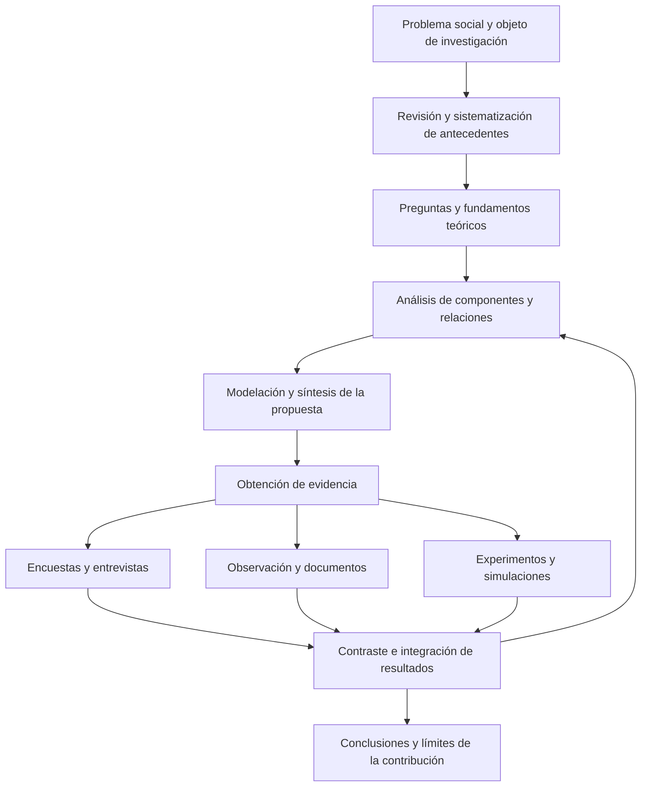

# Clase 2: Métodos de investigación en computación: modelación, análisis sistémico, encuesta y experimentación

> **Objetivo académico:** Comprender y articular los métodos de modelación, sistémico estructural y funcional, analítico-sintético, encuesta y experimentación para construir investigaciones en ciencias de la computación con pertinencia social, coherencia epistemológica y evidencia proporcional a sus conclusiones.

## 1. Contexto y marco conceptual

### Pertinencia social y contribución científica

La sesión relaciona los problemas sociales con la construcción de conocimiento en ciencias de la computación. La salud, la educación, la seguridad de la información, los servicios financieros y la automatización empresarial aparecen como ámbitos donde un problema práctico puede convertirse en objeto de investigación. Esa transformación exige precisar qué aspecto del fenómeno se estudia, desde qué fundamentos y qué conocimiento se espera producir.

Las fronteras entre computación, informática y ciencias de la información se presentan como zonas de interacción y debate. Para situar una investigación no basta con mencionar una tecnología: es necesario identificar el objeto y el campo específico de conocimiento al que pertenece la contribución. Un sistema educativo con inteligencia artificial, por ejemplo, combina un fenómeno educativo con decisiones computacionales; esa combinación requiere distinguir qué se afirma sobre el aprendizaje y qué se aporta sobre representación, algoritmos o arquitectura.

El docente enfatiza la diferencia entre resolver un problema mediante un producto y contribuir al conocimiento científico. Una aplicación, una plataforma o un algoritmo pueden poseer gran utilidad práctica; su existencia no demuestra por sí sola una contribución doctoral. Esta puede encontrarse en relaciones antes no caracterizadas, regularidades, principios o explicaciones que surgen al profundizar en el objeto.

**Enriquecimiento conceptual:** La distinción no constituye una jerarquía absoluta entre productos profesionales y resultados científicos. Un artefacto computacional puede incorporar una contribución original si permite formular y respaldar conocimiento nuevo. La cuestión decisiva es explicar qué se conoce gracias al artefacto, bajo qué condiciones y mediante qué evidencia.

### Del estado del arte a una contribución defendible

La revisión y sistematización de antecedentes permiten identificar coincidencias, divergencias y vacíos. La sesión propone un recorrido argumental: examinar definiciones y resultados existentes, reconocer regularidades y justificar una formulación propia cuando las anteriores no representen adecuadamente el objeto.

Proponer una definición no equivale automáticamente a realizar un aporte teórico. Su valor depende de qué distinciones introduce, cómo organiza el conocimiento y qué utilidad explicativa posee. El docente vincula la consolidación de los aportes conceptuales con su utilización por la comunidad científica.

**Enriquecimiento conceptual:** La adopción comunitaria es una señal de influencia posterior, pero no puede exigirse como evidencia inmediata de toda contribución original. En una investigación concreta deben justificarse la novedad, la consistencia y el alcance explicativo del concepto, sin confundir una preferencia terminológica con un descubrimiento.

Un ejemplo discutido en la sesión muestra cómo una propuesta didáctica puede revelar relaciones entre asignatura, disciplina y perfil de egreso. Su interés metodológico reside en que la contribución puede emerger durante el análisis de las relaciones entre niveles, en lugar de estar completamente formulada desde el inicio.

### Cultura metodológica y pluralidad de enfoques

La selección de métodos debe responder al problema, no a la familiaridad del investigador con una técnica. Conocer una prueba estadística, saber entrevistar o dominar una herramienta de modelación no determina que sean adecuados para cualquier pregunta.

Se destaca la necesidad de comprender métodos cuantitativos y cualitativos, incluso cuando una investigación utilice principalmente uno de ellos. La sesión menciona ciencia abierta y una orientación hacia el cambio, pero no desarrolla una definición que permita tratarlas como equivalentes o como sustitutos formalmente establecidos de otros paradigmas.

**Enriquecimiento conceptual:** Las ciencias de la computación incluyen investigación formal, experimental, interpretativa y orientada al diseño. El uso de algoritmos o magnitudes numéricas no impone por sí mismo una única postura epistemológica. Asimismo, integrar métodos exige explicar qué aporta cada fuente y cómo se relacionarán sus resultados.

## 2. Fundamentos teóricos y arquitectura

### Modelación: representar para comprender

La modelación construye representaciones selectivas de un objeto o proceso. Su propósito es conservar componentes y relaciones relevantes para una pregunta, reduciendo la complejidad que dificultaría el estudio directo.

En la sesión se mencionan modelos matemáticos, computacionales y conceptuales, simulaciones, análisis de sensibilidad, escenarios, modelos dinámicos y prototipos virtuales. Estas categorías cumplen funciones diferentes: un modelo representa, una simulación explora su comportamiento bajo ciertas condiciones y un análisis de sensibilidad examina cómo cambian los resultados al variar entradas o supuestos.

El significado del modelo depende tanto de sus elementos como de las relaciones entre ellos. La comparación entre expresiones aritméticas con símbolos semejantes muestra que reorganizar los componentes modifica lo que se afirma. En un sistema informático ocurre algo equivalente: disponer de módulos de acceso, navegación y salida no basta; importan sus conexiones y condiciones de activación.

Las principales limitaciones identificadas son:

- Datos incompletos, inexactos o desactualizados.
- Simplificaciones que eliminan mecanismos decisivos.
- Necesidad de revisar el modelo cuando cambia el contexto.
- Diferencias entre el comportamiento representado y el observado.

**Enriquecimiento conceptual:** La calidad de un modelo no depende exclusivamente de los datos. También depende de la estructura elegida, sus supuestos, la representación de los mecanismos y el uso previsto. Un modelo con datos abundantes puede ser inadecuado si omite una relación esencial.

### Carácter sistémico y propiedades del conjunto

La modelación se conecta con la teoría general de sistemas mediante la atención a componentes, relaciones y propiedades del conjunto. El docente menciona sinergia, entropía y anisotropía, aunque sus explicaciones requieren precisión.

**Enriquecimiento conceptual:** La sinergia alude a efectos producidos por la interacción de componentes; no equivale simplemente al movimiento individual de estos. La entropía posee significados técnicos diferentes según el dominio y no debe utilizarse como sinónimo general de equilibrio. La anisotropía designa dependencia respecto de la dirección; la diferenciación de propiedades entre componentes se describe mejor como heterogeneidad. Estas precisiones preservan la intención sistémica sin trasladar términos entre disciplinas como si fueran intercambiables.

### Método sistémico estructural y funcional

El método se presenta mediante tres dimensiones complementarias:

| Dimensión | Pregunta principal | Resultado esperado |
| --- | --- | --- |
| Sistémica | ¿Qué integra el objeto y cómo se delimita? | Identificación del sistema, sus componentes y su entorno. |
| Estructural | ¿Cómo se conectan y organizan sus componentes? | Representación de relaciones, dependencias y niveles. |
| Funcional | ¿Qué hace cada componente y cómo contribuye al conjunto? | Comprensión de funciones, procesos e interacciones. |

La exposición utiliza el cuerpo humano y las organizaciones como analogías. En el caso universitario, rectorado, vicerrectorado y facultades constituyen componentes; las relaciones institucionales forman parte de la estructura; y sus responsabilidades y procesos corresponden a la dimensión funcional.

El docente insiste en denominarlo «método sistémico estructural y funcional» y diferencia un método, entendido como vía de actuación, de un enfoque, entendido como orientación para estudiar un fenómeno.

**Enriquecimiento conceptual:** Esta preferencia terminológica se conserva como posición de la sesión. No establece un consenso universal que invalide la expresión «enfoque sistémico» en toda la literatura. Para justificar su uso como método deben explicitarse operaciones, criterios de análisis y procedimientos de contraste.

Las herramientas mencionadas incluyen diagramas de influencia, análisis de realimentación, redes, modelación matemática, análisis factorial, regresión, análisis de procesos y análisis documental. Su asociación con una dimensión es orientativa: cada técnica requiere condiciones de aplicación propias y no demuestra automáticamente la estructura o función de un sistema.

### Método analítico-sintético

El análisis distingue partes, propiedades y relaciones del objeto; la síntesis reconstruye una comprensión integrada a partir de lo examinado. Ambos funcionan como operaciones del pensamiento y pueden organizar una estrategia de investigación.

La síntesis no consiste en reunir piezas sin explicar sus vínculos. Debe recuperar las relaciones relevantes y mostrar cómo el estudio de las partes modifica la comprensión del conjunto. En ingeniería de software, la descomposición en módulos facilita el análisis, mientras que la integración exige comprender interfaces, dependencias y comportamiento global.

Durante el debate se corrige la afirmación de que este método permite conocer únicamente lo externo. El análisis puede examinar estructuras internas y la síntesis relacionarlas con propiedades observables. La restricción efectiva depende del acceso al objeto y de los instrumentos empleados.

También se distingue entre concepto y definición: el primero corresponde al contenido conceptual con el que se comprende un objeto; la segunda es su formulación explícita mediante lenguaje. Una definición debe expresar rasgos pertinentes, sin pretender agotar todos los casos posibles.

El diagrama integra los métodos discutidos como recursos articulables. No prescribe que toda investigación deba utilizar simultáneamente todas las técnicas.

## 3. Implementación técnica y lógica de negocio

La fuente presenta propuestas y procedimientos metodológicos, pero no contiene código ejecutable, conjuntos de datos auditables ni resultados experimentales suficientes para verificar implementaciones. Los casos siguientes se interpretan como diseños o aplicaciones descritas, sin atribuirles eficacia demostrada.

### Aplicaciones de la modelación en computación

| Caso presentado | Función de la modelación | Aspecto que requiere contraste |
| --- | --- | --- |
| Ingeniería de software y socioformación | Articular prácticas iterativas, roles y procesos con proyectos formativos. | Coherencia de la integración y efectos educativos. |
| Modelos lingüísticos e ingeniería de instrucciones | Representar la transformación de requisitos en especificaciones, diseños y código. | Fidelidad semántica, calidad del código y trazabilidad. |
| Comunicación en elicitación de requisitos | Representar interacciones, necesidades y patrones comunicativos. | Evidencia de las técnicas y calidad de los requisitos obtenidos. |
| Generación de contenido para capacitación | Apoyar la incorporación de personal y la formación de usuarios. | Exactitud, pertinencia y actualización del contenido. |
| Optimización de arquitecturas de software | Predecir rendimiento de configuraciones antes de evaluarlas directamente. | Correspondencia entre predicción y comportamiento medido. |
| Automatización empresarial | Simular la transformación de procesos manuales y sus posibles efectos. | Viabilidad y mejora efectiva de los procesos. |

En el caso de requisitos asistidos por modelos lingüísticos se propone utilizar prototipos para revisar y validar diseños y código antes de su implementación. La contribución metodológica consiste en representar un proceso de transformación y sus puntos de control; la generación automática no garantiza que los requisitos hayan sido comprendidos correctamente.

La exposición sobre comunicación recurre a la programación neurolingüística como posible fundamento de guiones, listas de verificación y mapeo de necesidades.

**Enriquecimiento conceptual:** La sesión no aporta evidencia para establecer la eficacia de ese fundamento. Conviene separar las prácticas de comunicación que puedan evaluarse de las afirmaciones generales sobre programación neurolingüística. Tampoco debe presentarse esta última como sustento establecido de la inteligencia artificial.

La capacitación mediante contenido generado se relaciona en la exposición con aprendizaje profundo y evolución del modelo.

**Enriquecimiento conceptual:** Generar contenido, aprender de datos y actualizar un sistema son procesos distintos. La interacción con usuarios no implica por sí sola que los parámetros del modelo se actualicen ni que se incorpore conocimiento fiable. Debe especificarse si se emplean documentos recuperados, ajustes del modelo o mantenimiento manual del contenido.

### Análisis sistémico de una institución universitaria

El caso de educación superior propone comprender primero la organización universitaria para identificar datos pertinentes y, posteriormente, aplicar algoritmos de aprendizaje profundo. El orden metodológico es importante: definir el sistema y sus relaciones antecede a decidir qué datos pueden representar el problema.

El procedimiento recuperable consiste en delimitar unidades, describir conexiones, reconocer funciones y localizar información útil. La representación no debería limitarse al organigrama si el problema depende de procesos de aprendizaje, coordinación o circulación de información.

**Enriquecimiento conceptual:** Un organigrama representa autoridad formal, pero puede omitir redes informales y prácticas reales. Además, la disponibilidad de datos institucionales no justifica por sí sola el aprendizaje profundo: la selección del modelo depende del problema, del volumen y tipo de datos y de las alternativas de comparación.

### Asistente virtual educativo y análisis-síntesis

El asistente virtual se descompone en procesamiento de lenguaje natural, aprendizaje automático, base de conocimiento, adaptación y retroalimentación. La fase analítica examina qué función cumpliría cada componente; la síntesis propone integrarlos mediante una arquitectura modular.

La exposición relaciona este método con varias etapas: revisión documental y entrevistas para comprender el problema, desarrollo de componentes durante la construcción y pruebas de usabilidad y análisis estadístico durante la evaluación.

La alternancia entre descomposición e integración permite revisar si el comportamiento del sistema responde a las necesidades identificadas. Sin embargo, las expresiones de éxito presentes en la exposición no están acompañadas por mediciones, protocolos ni resultados verificables.

**Enriquecimiento conceptual:** La personalización debe basarse en necesidades y respuestas observables. Mencionar «estilos de aprendizaje» no demuestra que clasificarlos y adaptar contenidos a ellos mejore el aprendizaje. La usabilidad, la calidad de las respuestas y los resultados educativos constituyen dimensiones diferentes de evaluación.

El mismo razonamiento analítico-sintético se menciona para planeación empresarial, reingeniería y optimización de portafolios financieros. Su utilidad general no reemplaza los métodos específicos que cada dominio necesita.

### Encuesta, técnica e instrumento

La sesión desarrolla una discusión sobre metodología, método, técnica e instrumento. Su clasificación varía según la tradición utilizada y la función que cumple cada procedimiento.

**Enriquecimiento conceptual:** Para evitar ambigüedades puede adoptarse la siguiente convención operativa, sin atribuirle universalidad:

| Nivel | Función | Ejemplo |
| --- | --- | --- |
| Metodología | Justificar la estrategia y la articulación de procedimientos. | Fundamentar un diseño que combine encuesta y entrevistas. |
| Método | Organizar una vía sistemática de investigación. | Desarrollar una investigación por encuesta. |
| Técnica | Concretar una operación de obtención o análisis de información. | Aplicar preguntas estandarizadas o realizar una entrevista semiestructurada. |
| Instrumento | Materializar el registro o la medición. | Cuestionario, guía de entrevista o guía de observación. |

La entrevista puede formar parte de una encuesta administrada por entrevistador o constituir una técnica cualitativa independiente. Un grupo focal corresponde a una discusión guiada y no debe equipararse sin más con una encuesta colectiva.

En el caso de seguridad de la información se propone esta secuencia: definir objetivos, identificar participantes, diseñar el cuestionario, seleccionar el medio de aplicación, distribuirlo y analizar los datos. Se contemplan preguntas abiertas, cerradas y dicotómicas, así como plataformas digitales.

La lógica de auditoría presentada combina un cuestionario inicial con entrevistas posteriores. El cuestionario permite reconocer asuntos generales y la entrevista profundiza en problemas detectados. La observación y el análisis documental pueden aportar evidencia adicional sobre las prácticas reales.

El momento de aplicación afecta la información obtenida. Una encuesta de satisfacción administrada cuando las personas necesitan retirarse puede generar omisiones o respuestas apresuradas. También importan la claridad del lenguaje, la familiaridad de los participantes con el tema y la confianza en el tratamiento de los datos.

### Método experimental y variables

El método experimental se presenta como una vía para contrastar hipótesis mediante intervención, medición y comparación. Su diseño requiere definir variables, unidades de estudio, condiciones, procedimientos de registro y análisis.

En el caso de orientación vocacional, la intervención propuesta es utilizar un sistema inteligente basado en aprendizaje automático. El resultado de interés se describe como efectividad en la identificación de afinidades, aunque posteriormente se propone medir satisfacción con la orientación recibida. Esa diferencia exige revisión: satisfacción y adecuación de la orientación no son equivalentes.

**Enriquecimiento conceptual:** La variable independiente es la intervención o condición manipulada; la dependiente es el resultado observado. En un pasaje de la transcripción estas denominaciones aparecen invertidas. Asimismo, nombrar una universidad identifica un contexto, pero no define por sí mismo una variable interviniente: deben explicitarse las características contextuales que podrían influir en el resultado.

El diseño descrito considera un grupo de orientación tradicional y otro con el sistema propuesto, cada uno con 150 participantes distribuidos en cohortes. Se trata de cantidades previstas, no de una muestra ejecutada ni de resultados obtenidos. La sesión cuestiona que la igualdad numérica sea suficiente para comparar los grupos.

Se distinguen dos niveles de evaluación: examinar el modelo mediante simulación y contrastar posteriormente las hipótesis con evidencia empírica. También se mencionan experimentos controlados y cuasiexperimentos. La aleatorización relevante corresponde a la asignación de unidades a condiciones; cuando no está disponible, el diseño necesita otras estrategias para abordar diferencias previas.

## 4. Análisis crítico de casos y auditoría práctica

### Correspondencia entre pregunta, variable e indicador

El caso vocacional muestra un riesgo frecuente: formular un objetivo amplio y medir un resultado más estrecho. Una persona puede estar satisfecha con una recomendación sin que esta represente adecuadamente sus intereses o posibilidades. El abandono y el cambio de carrera tampoco dependen exclusivamente de la orientación: pueden intervenir condiciones económicas, institucionales o familiares.

**Enriquecimiento conceptual:** Para auditar el diseño conviene distinguir tres cuestiones: qué constructo se quiere estudiar, con qué indicador se lo representará y qué interpretación admite ese indicador. Un cuestionario de satisfacción puede describir una experiencia, pero no demuestra por sí solo la exactitud de una recomendación vocacional.

### Comparabilidad y atribución causal

El docente utiliza el ejemplo de dos grupos con condiciones desiguales: uno recibe tecnología, alimentación y un ambiente favorable; el otro carece de esos apoyos. Una diferencia posterior no permitiría atribuir el resultado exclusivamente a la tecnología, porque se modificaron varias condiciones simultáneamente.

La llegada aparentemente azarosa de estudiantes a un gabinete tampoco demuestra que exista asignación aleatoria a tratamientos. La selección de participantes y la asignación a condiciones son operaciones diferentes.

**Enriquecimiento conceptual:** Una representación elemental de la comparación es:

$$
\widehat{\Delta}=\bar{Y}_{T}-\bar{Y}_{C}
$$

Aquí $Y$ es un resultado numérico definido previamente; $\bar{Y}_{T}$ es su media en el grupo que recibe la intervención y $\bar{Y}_{C}$ su media en el grupo de comparación. El estimador $\widehat{\Delta}$ tiene las mismas unidades que $Y$; si se usa una escala, debe informarse su rango y significado. La expresión describe una diferencia observada. Su interpretación causal requiere justificar que las condiciones de comparación permiten atribuirla a la intervención.

**Enriquecimiento conceptual:** En un ejemplo hipotético, si ambos grupos contienen el mismo número de personas pero uno posee mayor preparación inicial, la igualdad de tamaños no elimina esa diferencia. La comparación necesita considerar características previas, pérdidas de participantes y condiciones de aplicación. No se asignan cifras de efecto porque la fuente no proporciona mediciones.

El docente sugiere que un diseño más acotado, con mediciones antes y después, puede ser más manejable que varias cohortes heterogéneas.

**Enriquecimiento conceptual:** La mayor simplicidad no garantiza mayor validez causal. Un único grupo antes-después permanece expuesto a maduración, cambios externos y efectos de repetición de la medición. La elección debe equilibrar viabilidad y fortaleza de la inferencia.

### Hipótesis, incertidumbre y resultados negativos

La sesión rechaza una interpretación triunfalista de la investigación. Que la evidencia no respalde la hipótesis inicial puede aportar conocimiento y orientar nuevas decisiones. El valor científico no depende de confirmar que una tecnología es superior.

**Enriquecimiento conceptual:** No encontrar evidencia suficiente de un efecto no demuestra automáticamente su inexistencia. Deben considerarse precisión de las mediciones, tamaño de muestra, variabilidad e incertidumbre. Del mismo modo, un contraste estadístico no convierte una hipótesis en una verdad definitiva.

Se mencionan hipótesis causales, de comparación, de correlación y de tendencia. Estas no exigen exactamente el mismo diseño ni el mismo análisis: describir asociación, identificar cambio y atribuir causalidad son objetivos distintos.

### Alcance del experimento y del cuasiexperimento

Las limitaciones discutidas incluyen artificialidad de las condiciones, factores externos, recursos y tiempo. También se afirma que los fenómenos subjetivos no serían adecuados para la experimentación.

**Enriquecimiento conceptual:** Las percepciones y emociones pueden estudiarse experimentalmente mediante indicadores e instrumentos apropiados. La dificultad consiste en justificar la medición y la interpretación, no en una imposibilidad absoluta. Asimismo, existen experimentos de campo; el control experimental no implica necesariamente un laboratorio desconectado de situaciones cotidianas.

Los cuasiexperimentos resultan pertinentes cuando la asignación aleatoria no es viable. Las entrevistas pueden ayudar a comprender procesos y experiencias, pero no eliminan por sí solas los sesgos de selección de un diseño no aleatorizado.

### Validar modelos según el uso previsto

La pregunta final de la sesión se refiere a cómo evaluar si un modelo captura la complejidad relevante de un fenómeno. Se mencionan consulta a expertos, factibilidad, satisfacción y pruebas a menor escala.

**Enriquecimiento conceptual:** Estos procedimientos aportan evidencias distintas:

| Procedimiento | Qué permite examinar | Qué no establece por sí solo |
| --- | --- | --- |
| Consulta a expertos | Coherencia, pertinencia y plausibilidad de componentes. | Exactitud predictiva o impacto efectivo. |
| Análisis de factibilidad | Posibilidad de implementación en ciertas condiciones. | Superioridad frente a otras soluciones. |
| Evaluación de satisfacción | Experiencia y aceptación de participantes. | Corrección técnica o eficacia causal. |
| Prototipo o prueba piloto | Funcionamiento inicial y problemas de implementación. | Generalización a cualquier escala o contexto. |
| Contraste con observaciones | Correspondencia entre resultados del modelo y datos. | Validez fuera de las condiciones examinadas. |

**Enriquecimiento conceptual:** La verificación examina si la implementación representa correctamente el modelo especificado; la validación examina si ese modelo es adecuado para su finalidad. Una simulación puede ayudar a detectar inconsistencias, pero no demuestra automáticamente que el sistema represente el mundo real. El análisis de sensibilidad contribuye a identificar dependencia respecto de supuestos y parámetros.

### Auditoría de encuestas y observaciones

Los principales riesgos señalados para las encuestas son sesgo de selección, no respuesta y respuestas sesgadas. El lenguaje inadecuado y la solicitud de datos identificatorios innecesarios pueden afectar la confianza y la calidad de las respuestas.

**Enriquecimiento conceptual:** La ausencia de respuesta puede sesgar los resultados cuando quienes no participan difieren sistemáticamente de quienes sí lo hacen. El anonimato puede reducir ciertos riesgos, aunque no asegura veracidad. La triangulación permite contrastar fuentes; sus discrepancias deben investigarse, sin forzar coincidencias.

La sesión menciona observación participante, encubierta y cruzada, además de fotografías como evidencia. Estas denominaciones no corresponden a una sola dimensión de clasificación.

**Enriquecimiento conceptual:** Participar en una actividad y hacer explícita la observación son decisiones diferentes: «participante» no significa simplemente que las personas sepan que son observadas. La observación encubierta plantea requisitos éticos de justificación y protección de las personas. Las fotografías requieren contexto, criterios de selección e interpretación; no permiten inferir de manera concluyente ocupaciones o condiciones sociales a partir de la apariencia.

### Infraestructura, energía y arquitectura de software

Otro caso relaciona el crecimiento de infraestructura informática con demanda energética y emisiones, y propone explorar alternativas al modelo cliente-servidor. Se menciona REST como referencia de razonamiento arquitectónico.

**Enriquecimiento conceptual:** REST es un estilo arquitectónico, no un protocolo. Reducir la participación de servidores puede trasladar cómputo y tráfico a otros nodos; no demuestra una reducción energética total. Una evaluación debería delimitar la función ofrecida y considerar conjuntamente recursos de clientes, servidores y red, además de las condiciones de carga. La sesión no proporciona mediciones para concluir qué alternativa consume menos energía.

## 5. Principios de diseño, buenas prácticas y anti-patrones

### Principios para construir una investigación coherente

1. **Delimitar el objeto antes de seleccionar herramientas.** El problema y la pregunta deben justificar el método, el tipo de datos y la estrategia de análisis.
2. **Relacionar utilidad y contribución científica.** Explicar qué conocimiento nuevo se obtiene, además de describir el producto construido.
3. **Definir los términos centrales.** Las palabras empleadas en el problema y los objetivos implican compromisos conceptuales y empíricos.
4. **Articular análisis y síntesis.** Estudiar componentes y reconstruir sus relaciones, evitando que la descomposición elimine propiedades del conjunto.
5. **Hacer explícitos los supuestos del modelo.** Señalar qué se incluye, qué se omite y para qué usos se considera adecuado.
6. **Separar propuesta, implementación y evidencia.** Describir un sistema no equivale a haberlo construido; construirlo no equivale a demostrar su eficacia.
7. **Controlar la comparación.** Examinar diferencias previas y condiciones de aplicación, además del tamaño de los grupos.
8. **Preservar la incertidumbre.** Presentar límites y resultados contrarios a las expectativas sin convertirlos en fracasos metodológicos.

La selección de métodos estadísticos debe realizarse por su correspondencia con la pregunta y los datos. En la transcripción se agrupan de manera imprecisa pruebas de comparación y asociación.

**Enriquecimiento conceptual:** La prueba $t$ de Student se utiliza habitualmente para contrastes sobre medias bajo determinados supuestos; las pruebas de chi-cuadrado tienen varios usos, entre ellos asociación entre variables categóricas y bondad de ajuste. No deben clasificarse en conjunto como pruebas de correlación ni utilizarse indistintamente para estudiar tendencias.

### Calidad de interfaces e instrumentos

La discusión sobre productos educativos resalta contraste, legibilidad, tamaño, sobriedad y pertinencia de los elementos visuales. La saturación decorativa puede dificultar el acceso al contenido, especialmente en personas con limitaciones visuales. La calidad debe evaluarse respecto de usuarios y finalidades concretas.

El mismo principio se aplica a los instrumentos: un cuestionario debe ser comprensible, pertinente y aplicable en condiciones que favorezcan respuestas informadas. La elegancia visual o la facilidad de distribución no reemplazan la calidad de medición.

### Anti-patrones identificados

| Anti-patrón | Consecuencia metodológica | Criterio de corrección |
| --- | --- | --- |
| Adoptar una técnica porque ya se domina. | Desajuste entre pregunta y evidencia. | Justificar su función en el diseño. |
| Considerar todo producto como aporte teórico. | Confusión entre desarrollo y conocimiento original. | Explicar la contribución y cómo se respalda. |
| Añadir términos amplios para aparentar mayor alcance. | Compromisos que no pueden evaluarse. | Acotar afirmaciones e indicadores. |
| Equiparar satisfacción con efectividad. | Conclusiones que exceden la medición. | Separar constructos y resultados. |
| Comparar grupos solo por igualdad de tamaño. | Confusión entre intervención y diferencias previas. | Examinar asignación y comparabilidad. |
| Presentar el juicio experto como validación total. | Ausencia de evidencia sobre comportamiento real. | Combinar evidencias según el uso previsto. |
| Aplicar más métodos sin explicar su integración. | Acumulación de datos sin coherencia inferencial. | Precisar el aporte y la relación entre fuentes. |
| Suponer que un modelo más complejo es científicamente superior. | Mayor dificultad sin ganancia demostrada. | Evaluar necesidad, interpretabilidad y alcance. |

## 6. Síntesis conceptual y profundización académica

La sesión sitúa la investigación en computación en la relación entre necesidad social, representación del objeto y producción de evidencia. La modelación permite representar aspectos relevantes; el método sistémico estructural y funcional organiza componentes, relaciones y funciones; el analítico-sintético permite alternar el examen de partes y su integración; las encuestas recogen información declarada; y la experimentación busca examinar efectos de intervenciones bajo condiciones de comparación justificadas.

Ninguno de estos recursos garantiza por sí mismo una contribución científica. Su valor depende de la coherencia entre pregunta, supuestos, operaciones, datos e interpretación. La combinación de métodos puede fortalecer una investigación cuando atiende limitaciones concretas y explica cómo integra resultados convergentes o discrepantes.

El caso vocacional concentra varias lecciones: los términos del objetivo deben corresponder a lo medido; la igualdad numérica no asegura comparabilidad; las diferencias entre cohortes importan; y una tecnología no debe asumirse superior antes del contraste. El asistente educativo muestra que una arquitectura plausible requiere evaluación tanto técnica como pedagógica. Los casos de automatización y eficiencia energética recuerdan que predecir beneficios mediante modelos no equivale a haberlos observado.

**Enriquecimiento conceptual:** Las líneas de profundización que se desprenden de la sesión son la validez de los constructos, la atribución causal, la validación de modelos y la articulación interdisciplinaria. Estudiarlas permite distinguir entre representar un fenómeno, explicar su funcionamiento y transformar sus condiciones. Esa distinción ayuda a formular contribuciones acotadas, comprobables y útiles, sin hacer depender su valor de una complejidad innecesaria.
