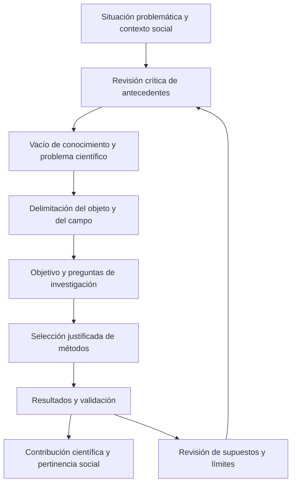
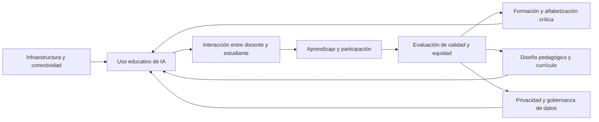

# Clase 3: Epistemología de la investigación computacional, inteligencia artificial e inclusión social

> **Objetivo académico:** Analizar la coherencia epistemológica de la investigación doctoral en ciencias de la computación y examinar las posibilidades, límites y condiciones sociales de la inteligencia artificial en educación y seguridad ciudadana.

## 1. Contexto y marco conceptual

La sesión articula dos planos: la construcción rigurosa de conocimiento doctoral y el análisis de las relaciones entre ciencia, tecnología y sociedad, identificadas como CTS. La inteligencia artificial constituye el eje del debate, especialmente por sus aplicaciones educativas, sus posibles efectos sobre el trabajo docente y las condiciones necesarias para que contribuya a la inclusión.

La pertinencia social de una investigación computacional requiere identificar el problema que enfrenta, el ámbito en que sus resultados pueden resultar relevantes y la contribución que realiza al conocimiento disciplinar. La utilidad de una aplicación y su contribución científica están relacionadas, pero requieren argumentos específicos. En la sesión se insiste en que la investigación doctoral debe superar la presentación de una solución práctica mediante una fundamentación que explique qué conocimiento produce y cómo lo sostiene.

**Enriquecimiento conceptual:** Una herramienta puede resolver una necesidad local sin producir por sí misma una contribución científica generalizable. Esta última puede residir, por ejemplo, en una explicación, un método, un modelo o evidencia sobre las condiciones de funcionamiento de una solución. Su alcance depende de la pregunta investigada y de la calidad de la validación; no exige universalidad irrestricta.

El rápido cambio tecnológico introduce una tensión adicional: los productos y plataformas pueden tener ciclos de vida breves, mientras que una investigación necesita formular resultados cuyo valor no dependa exclusivamente de una versión de software. De ahí la importancia de distinguir el artefacto utilizado del conocimiento que permite diseñarlo, evaluarlo o comprender sus efectos.

### Actores y mediación educativa

La discusión parte de la relación entre docente y estudiante e incorpora la IA como un nuevo componente de mediación. También amplía la responsabilidad educativa hacia quienes diseñan entornos virtuales, programan herramientas, organizan contenidos o acompañan el aprendizaje.

**Enriquecimiento conceptual:** Presentar la IA como un tercer «actor» resulta útil para describir interacciones, pero no supone atribuirle responsabilidad moral equivalente a la de las personas o instituciones. Las decisiones sobre su diseño, uso y supervisión siguen requiriendo responsables identificables.

La sesión caracteriza varios modelos educativos de manera introductoria:

| Modelo discutido | Papel atribuido al docente | Papel atribuido al estudiante |
| --- | --- | --- |
| Tradicional | Transmisión y autoridad sobre el contenido | Recepción y memorización |
| Conductista | Organización de condiciones y orientación hacia objetivos | Respuesta y consolidación de aprendizajes |
| Romántico | Acompañamiento con menor intervención directiva | Espontaneidad y desarrollo personal |
| Constructivista | Facilitación del aprendizaje | Construcción activa y toma de decisiones |
| Sociocrítico | Investigación de la propia práctica | Desarrollo de capacidades y participación crítica |

**Enriquecimiento conceptual:** Esta comparación representa tipos pedagógicos simplificados. No demuestra una sucesión histórica universal ni que un modelo elimine a los anteriores. El enfoque por competencias, también mencionado, puede combinarse con diferentes concepciones pedagógicas; no constituye necesariamente una etapa posterior única.

## 2. Fundamentos teóricos y arquitectura

### 2.1. Coherencia del diseño de investigación

El diseño teórico y metodológico debe mantener correspondencia entre sus categorías. La sesión propone comprender el problema como una expresión delimitada de la realidad que necesita explicación o transformación; el objeto como el proceso o fenómeno investigado; el campo, cuando se utilice, como una delimitación dentro del objeto; y el objetivo como el compromiso de conocimiento o transformación asumido.

| Categoría | Función en el razonamiento investigativo | Pregunta de coherencia |
| --- | --- | --- |
| Situación problemática | Identificar dificultades o contradicciones en un contexto | ¿Qué ocurre y con qué evidencia se reconoce? |
| Problema científico | Formular la necesidad de conocimiento | ¿Qué permanece insuficientemente explicado o resuelto? |
| Objeto | Delimitar el fenómeno o proceso estudiado | ¿Sobre qué realidad se investiga? |
| Campo | Precisar el aspecto del objeto, cuando corresponda | ¿Qué dimensión específica se examina? |
| Objetivo | Expresar el resultado de conocimiento perseguido | ¿Qué se pretende explicar, desarrollar o transformar? |
| Métodos | Justificar cómo se obtiene y analiza evidencia | ¿Por qué este procedimiento permite responder al problema? |
| Resultados y contribución | Exponer lo obtenido y su significado científico | ¿Qué conocimiento se aporta y hasta dónde se sostiene? |

Las hipótesis, preguntas y objetivos específicos deben responder al enfoque adoptado. La sesión reconoce que no todas las investigaciones siguen una estructura idéntica ni requieren las mismas categorías con igual función.

El diagrama representa una reconstrucción conceptual de las relaciones discutidas. La retroalimentación expresa que el diseño se revisa mediante aproximaciones sucesivas: cambiar una delimitación exige reconsiderar sus consecuencias sobre las demás categorías.

### 2.2. Antecedentes, sistematización y construcción de definiciones

La búsqueda de antecedentes debe permitir distinguir lo conocido de aquello que permanece abierto. La sesión recomienda contrastar literatura científica actual y relevante, ampliar la mirada más allá del contexto local y comprender las definiciones comprometidas en el título y en las categorías de investigación.

La sistematización teórica se presenta como un procedimiento de comparación de autores, definiciones, atributos y relaciones. Las matrices o mallas ayudan a identificar coincidencias, divergencias y omisiones. A partir de ese análisis puede asumirse una definición existente o construirse otra, siempre con justificación explícita.

Una definición no queda validada por el prestigio de quien la formula ni por haber sido producida mediante IA. Es necesario explicar sus antecedentes, sus componentes y su adecuación al objeto estudiado. El marco teórico puede integrar conceptos, relaciones, tendencias, principios y, cuando existan en el dominio, leyes; su función es sostener el razonamiento de la investigación.

**Enriquecimiento conceptual:** Una matriz de coincidencias organiza evidencia conceptual, pero la frecuencia de un atributo no demuestra su corrección. También deben examinarse diferencias de contexto, tradiciones teóricas, dependencia entre publicaciones y utilidad explicativa. Un atributo minoritario puede ser decisivo para un problema particular.

### 2.3. Enfoque sistémico, estructural y funcional

La sesión recupera el método sistémico estructural y funcional como una manera de examinar conjuntamente la totalidad, sus componentes, sus relaciones y las funciones que cumplen.

**Enriquecimiento conceptual:** En un sistema educativo con IA, el análisis sistémico delimita las relaciones entre estudiantes, docentes, institución y tecnología; el estructural identifica componentes y conexiones; el funcional estudia cómo esas conexiones participan en la orientación, ejecución y retroalimentación del aprendizaje. Enumerar componentes sin explicar sus relaciones deja incompleto el análisis.

### 2.4. Conocimiento, IA y justificación

Una intervención vincula la epistemología con la representación del conocimiento, su adquisición, su uso y la justificación de decisiones. También señala problemas de sesgo y transparencia. Estas relaciones se plantean como una línea de reflexión, sin desarrollar una teoría formal ni demostrar que los sistemas utilizados produzcan conocimiento válido de manera automática.

**Enriquecimiento conceptual:** Conviene distinguir la producción de una respuesta, su corrección y su justificación. La fluidez de un texto no garantiza ninguna de las otras dos. Del mismo modo, una explicación generada después de una respuesta no demuestra por sí sola que describa el mecanismo que la produjo.

## 3. Implementación técnica y lógica de negocio

La fuente no presenta código, conjuntos de datos, configuraciones de modelos ni experimentos reproducibles. La implementación se aborda mediante funciones posibles y decisiones metodológicas; no se atribuyen resultados de ejecución a estas propuestas.

### 3.1. Procedimiento de sistematización conceptual

El procedimiento expuesto puede reconstruirse así:

1. Identificar los conceptos centrales del problema y del título de investigación.
2. Localizar antecedentes pertinentes y registrar sus fuentes de manera consistente.
3. Extraer las definiciones junto con el contexto en que se utilizan.
4. Organizar atributos, semejanzas y diferencias en una matriz.
5. Justificar la adopción, adaptación o construcción de una definición.
6. Explicar cómo la definición orienta los métodos y la interpretación de resultados.

**Enriquecimiento conceptual:** Una matriz útil puede contener las columnas «concepto», «fuente», «contexto», «definición», «atributos», «límites» e «implicaciones para la investigación». Esta estructura facilita rastrear una decisión conceptual hasta la evidencia que la sustenta, sin convertir el número de fuentes en sustituto de la profundidad analítica.

### 3.2. Funciones educativas apoyadas por IA

Las aplicaciones discutidas incluyen generación y organización de materiales, apoyo a la búsqueda de información, tutoría, retroalimentación, personalización, análisis de datos educativos y automatización de operaciones repetitivas. Se menciona además la evaluación automatizada en programación y ciencias exactas, donde el volumen de estudiantes y la complejidad de las respuestas pueden incrementar el trabajo docente.

| Función | Beneficio potencial discutido | Condición o límite |
| --- | --- | --- |
| Generación de materiales | Acelerar la preparación de recursos | Revisión de exactitud, pertinencia y adecuación pedagógica |
| Tutoría y retroalimentación | Ofrecer orientación con mayor disponibilidad | Calidad de las respuestas y apoyo humano ante dificultades |
| Personalización | Ajustar recursos a necesidades individuales | Evidencia válida sobre el aprendizaje y protección de datos |
| Evaluación automatizada | Apoyar el análisis de numerosas respuestas | Criterios explícitos, tratamiento de errores y supervisión |
| Analítica educativa | Identificar patrones para orientar intervenciones | Calidad de datos, sesgos y utilidad de la intervención |
| Accesibilidad | Ampliar formas de acceso y participación | Adecuación a necesidades concretas y condiciones materiales |

**Enriquecimiento conceptual:** Un modelo generativo no equivale por sí mismo a un buscador ni a un mecanismo de validación documental. Para utilizarlo en investigación conviene distinguir respuestas generadas de documentos recuperados y comprobar las afirmaciones en sus fuentes. La síntesis automatizada puede apoyar la lectura, pero no sustituye el análisis del método, la evidencia y los límites del trabajo original.

La sesión destaca que una mayor disponibilidad puede favorecer a estudiantes con capacidad de autogestión. También advierte que el contenido necesita contexto y control: una explicación técnicamente correcta puede ser insuficiente para formar criterio profesional frente a problemas abiertos.

### 3.3. Arquitectura sociotécnica de adopción

La implementación educativa depende de condiciones que exceden al modelo: conectividad, dispositivos, mantenimiento, formación docente, alfabetización del estudiante, integración curricular, políticas institucionales y protección de la información.

La compra de equipos representa una condición material, pero no demuestra integración pedagógica. El debate recoge observaciones sobre equipamiento subutilizado y las utiliza para argumentar la necesidad de planificación y preparación de los usuarios; no presenta una evaluación sistemática de programas públicos específicos.

### 3.4. Visión artificial y reconocimiento de placas

Otro caso traslada la discusión a la seguridad ciudadana. Se propone utilizar visión artificial para reconocer placas vehiculares y apoyar la identificación de vehículos. Los beneficios planteados son la recuperación de vehículos robados, la posible disuasión y la optimización de recursos de investigación. Se presentan como posibilidades, sin mediciones de eficacia.

**Enriquecimiento conceptual:** Una arquitectura mínima distinguiría captura de imágenes, localización de la placa, reconocimiento de caracteres, contraste con registros autorizados y revisión de coincidencias. Separar estas etapas permite identificar dónde se originan los errores. Reconocer una placa no equivale a identificar con certeza al conductor ni demuestra que se haya cometido un delito.

## 4. Análisis crítico de casos y auditoría práctica

### 4.1. Automatización de funciones y sustitución del docente

La posición predominante sostiene que la IA puede asumir funciones específicas y liberar tiempo para una enseñanza más creativa y cercana. Se destacan la motivación, la empatía, la interpretación contextual, la formación en valores y la construcción de comunidad como dimensiones centrales del trabajo docente.

Otras intervenciones cuestionan que esas diferencias permitan afirmar una imposibilidad permanente de sustitución. Plantean que podrían aparecer sistemas con capacidades más amplias y que la discusión debe atender al contexto, al tipo de aprendizaje y a resultados observables.

| Posición | Argumento principal | Límite de la evidencia presentada |
| --- | --- | --- |
| Complementariedad | La docencia combina enseñanza, acompañamiento y formación social | No demuestra una imposibilidad tecnológica futura |
| Sustitución parcial | Algunas funciones pueden automatizarse | Automatizar funciones no equivale a reemplazar una profesión completa |
| Sustitución futura posible | Las capacidades tecnológicas pueden ampliar su alcance | Es una hipótesis prospectiva sin demostración en la sesión |
| Comparación empírica | Deben contrastarse competencias alcanzadas | No se presentan estudios comparativos que resuelvan el debate |

**Enriquecimiento conceptual:** La pregunta «¿puede reemplazar al maestro?» necesita precisar población, contenido, duración, condiciones y dimensiones del resultado. Una comparación informativa distinguiría aprendizaje conceptual, retención, transferencia a situaciones nuevas, autorregulación, participación y bienestar. La satisfacción o la rapidez de respuesta, consideradas aisladamente, son indicadores insuficientes de calidad educativa.

La consulta a modelos conversacionales sobre si pueden sustituir a docentes aparece como un recurso del debate. Sus respuestas no constituyen evidencia independiente sobre sus capacidades o límites.

### 4.2. El ajedrez: desempeñar una actividad y enseñarla

El caso de los programas de ajedrez introduce una distinción metodológica importante: alcanzar un rendimiento elevado en una actividad no demuestra igual capacidad para enseñarla. Se discute la existencia de aplicaciones de enseñanza y, por separado, la posibilidad de que superen pedagógicamente a un gran maestro.

La sesión no aporta indicadores comparables para resolver esta segunda cuestión. La existencia de niveles de dificultad o de recomendaciones automáticas no basta para establecer superioridad educativa.

**Enriquecimiento conceptual:** Un sistema puede recomendar una jugada óptima sin diagnosticar por qué un estudiante eligió otra ni seleccionar la explicación que mejor le permita aprender. La competencia en la tarea y la competencia para producir aprendizaje deben evaluarse separadamente.

Los relatos históricos sobre los encuentros de Deep Blue y las referencias a otros motores contienen imprecisiones cronológicas o técnicas. El argumento recuperable es la necesidad de evitar inferencias entre rendimiento competitivo y eficacia pedagógica.

### 4.3. Inclusión y brecha digital

El debate contrapone explicaciones centradas en políticas públicas, equipamiento, formación, planificación y disposición de los usuarios. La síntesis es que el acceso a tecnología no garantiza su aprovechamiento.

**Enriquecimiento conceptual:** Conviene distinguir tres dimensiones de la brecha digital: acceso a recursos, capacidades para utilizarlos y beneficios efectivamente obtenidos. Una interfaz sencilla puede reducir algunas barreras de uso y coexistir con desigualdades de conectividad, costo, idioma o calidad del servicio. Por ello, la afirmación de que la IA no aumenta ni reduce la brecha necesita matizarse: sus efectos dependen del diseño y de las condiciones de adopción.

La inclusión comprende necesidades educativas diversas, participación cultural, colaboración y acceso a recursos a distancia. Los laboratorios ciudadanos y espacios de creación se mencionan como posibles ámbitos de aprendizaje comunitario. No se aportan evaluaciones suficientes para atribuir efectos concretos a los proyectos nombrados.

Las referencias a herramientas de accesibilidad, incluidos recursos vinculados al braille, muestran que la inclusión exige adaptar los medios a las personas. **Enriquecimiento conceptual:** La accesibilidad digital no requiere necesariamente IA; conviene evaluar qué tecnología resuelve cada barrera en lugar de atribuir toda mejora a una misma familia de métodos.

### 4.4. Biometría, emociones y privacidad

Una intervención describe sistemas escolares de reconocimiento facial y supuesta estimación del estado de ánimo o la atención. El caso sirve para discutir vigilancia, acumulación de datos sensibles y riesgos de uso indebido. Su alcance geográfico y su desempeño no quedan documentados en la fuente.

**Enriquecimiento conceptual:** Detectar una expresión facial no equivale a establecer de manera fiable una emoción, y estimar una emoción no demuestra atención ni aprendizaje. Estas inferencias requieren validación contextual. La simulación de respuestas empáticas tampoco demuestra experiencia emocional ni eficacia pedagógica.

También se menciona Cambridge Analytica como advertencia sobre perfilado y personalización de mensajes. El relato incluye detalles históricos y causales no respaldados en la sesión; no permite concluir que una técnica haya determinado un resultado electoral. El problema conceptual relevante es la reutilización de datos personales para influir sobre individuos sin suficiente transparencia o control.

### 4.5. Reconocimiento de placas y límites de la vigilancia

El caso permite contrastar beneficios públicos con riesgos de seguimiento, abuso de poder, acceso indebido y errores. La recomendación discutida es establecer normas y participación social para equilibrar seguridad y derechos.

**Enriquecimiento conceptual:** Una auditoría debería examinar exactitud bajo diferentes condiciones de captura, falsos positivos, falsos negativos, duración de conservación y legitimidad de cada uso. Un sistema técnicamente preciso puede seguir siendo problemático si recoge información desproporcionada o permite finalidades incompatibles con las inicialmente justificadas.

### 4.6. Valor probatorio de ejemplos y analogías

La sesión utiliza un relato cinematográfico sobre una emergencia aérea para ilustrar el juicio humano frente a procedimientos y simulaciones. La narración mezcla elementos cuya exactitud no se establece. Su valor es ilustrativo; no demuestra superioridad general de la intuición humana ni fracaso general de la IA.

**Enriquecimiento conceptual:** El análisis histórico-lógico requiere reconstruir condiciones y relaciones relevantes mediante fuentes contrastadas. Una analogía puede originar una hipótesis, pero no sustituye su comprobación. Del mismo modo, las menciones a sistemas predictivos de abandono escolar señalan un campo de aplicación, sin demostrar precisión, equidad o reducción efectiva del abandono.

## 5. Principios de diseño, buenas prácticas y anti-patrones

### Principios metodológicos

- **Mantener coherencia interna:** relacionar título, problema, objeto, objetivo, métodos y contribución. Una modificación conceptual debe revisarse en todo el diseño.
- **Justificar las definiciones:** explicar por qué sus atributos son adecuados y qué fenómenos permiten comprender.
- **Documentar el camino del resultado:** comunicar fuentes, procedimiento, evidencia e interpretación. La creatividad necesita argumentos que permitan examinarla.
- **Combinar métodos con fundamento:** la innovación metodológica puede surgir de una articulación original de procedimientos, siempre que se explique su necesidad y alcance.
- **Conservar trazabilidad bibliográfica:** mantener un estilo consistente y distinguir ideas propias, paráfrasis y aportaciones de las fuentes.

### Principios de adopción tecnológica

- **Diseñar desde la necesidad educativa o social:** elegir herramientas por el problema y por su contexto de uso.
- **Preparar a docentes y estudiantes:** promover comprensión crítica de capacidades, límites y riesgos, además del manejo operativo.
- **Integrar la ética durante el ciclo de vida:** examinar datos, diseño, despliegue, funcionamiento y cambios de finalidad.
- **Asignar responsabilidades:** determinar quién revisa resultados, decide intervenciones y atiende errores o reclamaciones.
- **Vincular accesibilidad con participación:** comprobar que las personas puedan utilizar el servicio y obtener beneficios relevantes.

La sesión recupera una recomendación de la UNESCO sobre ética de la IA y la vincula con derechos humanos, dignidad, igualdad, diversidad cultural, medio ambiente y acceso equitativo a los beneficios. No se reproduce una interpretación jurídica exhaustiva del documento.

**Enriquecimiento conceptual:** Estos principios pueden concretarse mediante minimización de datos, control de acceso, conservación limitada, evaluación de sesgos y mecanismos de revisión humana. La supervisión necesita autoridad y medios para corregir resultados; su presencia nominal no garantiza protección.

| Anti-patrón | Problema que introduce | Criterio de corrección |
| --- | --- | --- |
| Adoptar definiciones por autoridad o por generación automática | Debilita la comprensión y la justificación conceptual | Contrastar antecedentes y adecuación al objeto |
| Equipar sin integración pedagógica | Puede producir recursos subutilizados | Planificar usos, formación, mantenimiento y evaluación |
| Confundir fluidez con veracidad | Favorece información incorrecta o referencias inexistentes | Verificar afirmaciones y documentos originales |
| Inferir aprendizaje desde rendimiento de una máquina | Mezcla capacidades diferentes | Evaluar resultados educativos directamente |
| Tratar predicciones como certezas | Oculta errores y puede perjudicar a personas | Explicitar incertidumbre y revisar decisiones |
| Generalizar desde anécdotas o ficción | Atribuye fuerza probatoria a ejemplos ilustrativos | Contrastar fuentes y delimitar el argumento |
| Culpar exclusivamente al usuario por la adopción limitada | Ignora condiciones materiales y organizativas | Analizar barreras, incentivos y apoyos |
| Considerar ilimitados los datos o la disponibilidad | Oculta restricciones de cobertura, servicio y recursos | Documentar condiciones reales de funcionamiento |

**Enriquecimiento conceptual:** Los límites temporales del conocimiento de un sistema dependen de la versión y de sus mecanismos de actualización o recuperación. Una fecha mencionada para una herramienta concreta no debe convertirse en propiedad permanente de todos los modelos. Asimismo, computación en la nube, aprendizaje automático, modelos generativos y realidad virtual designan tecnologías distintas, aunque puedan integrarse en una misma solución.

## 6. Síntesis conceptual y profundización académica

El hilo conductor de la clase es la necesidad de transformar intuiciones y posibilidades tecnológicas en conocimiento justificable. En investigación doctoral, ello exige delimitar problemas, sistematizar antecedentes, comprender las definiciones y sostener la correspondencia entre métodos y resultados. En las aplicaciones de IA, exige precisar funciones, condiciones de uso, evidencias de beneficio y riesgos.

El debate educativo distingue automatización de funciones y sustitución integral del docente. La mayoría de las intervenciones defiende una relación de complementariedad por la importancia del acompañamiento humano, mientras otras mantienen abierta la posibilidad de cambios futuros. La sesión no resuelve empíricamente esa controversia. Su aporte consiste en mostrar que el desempeño técnico, la experiencia educativa y la responsabilidad institucional son dimensiones diferentes.

La inclusión tampoco se deriva automáticamente de disponer de herramientas. Depende de infraestructura, accesibilidad, alfabetización crítica, diseño pedagógico y políticas capaces de convertir acceso en participación y beneficios. Los casos de biometría y reconocimiento de placas muestran, a su vez, que ampliar capacidades de observación puede incrementar riesgos de privacidad, discriminación y concentración de poder.

**Enriquecimiento conceptual:** La conexión entre epistemología y gobernanza puede expresarse mediante tres exigencias relacionadas: establecer qué evidencia respalda una capacidad, determinar bajo qué condiciones es legítimo utilizarla y definir quién responde por sus consecuencias. Cumplir solo una de ellas deja incompleta la evaluación de un sistema sociotécnico.

Las líneas de profundización que emergen son la evaluación comparativa del aprendizaje con apoyo de IA, la validez de las inferencias sobre estados emocionales, la trazabilidad de decisiones automatizadas, la equidad en los beneficios de la digitalización y la persistencia del conocimiento científico frente a la obsolescencia de las plataformas. En todas ellas, la investigación requiere distinguir posibilidades, evidencias y juicios normativos.
