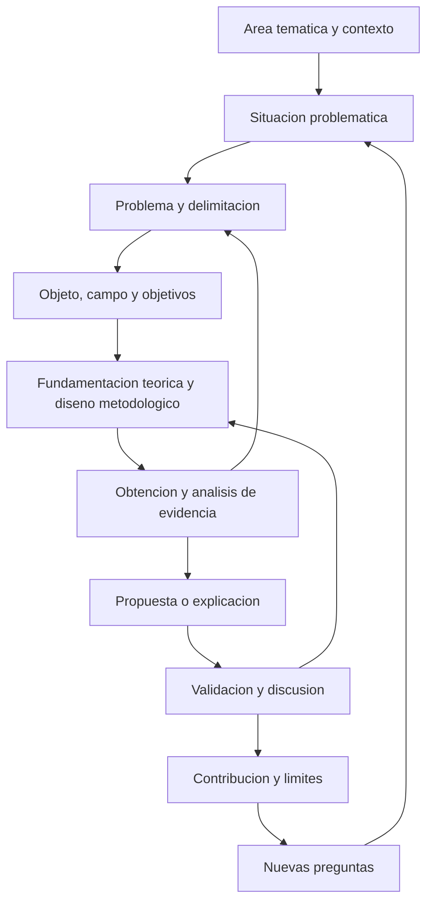

# Clase 1: Fundamentos de la investigación doctoral: del objeto de estudio a la contribución científica

> **Objetivo académico:** Comprender la investigación doctoral como un proceso sistemático, crítico e iterativo que articula delimitación del objeto, construcción del problema, fundamentación teórica, diseño metodológico y validación de una contribución original en ciencias de la computación.

## 1. Contexto y marco conceptual

### La tesis como investigación y comunicación del conocimiento

La sesión presenta la tesis como una proposición original y creativa que debe sostenerse mediante razonamiento y evidencia. Su elaboración exige investigar con profundidad, organizar los conocimientos disponibles y comunicar una contribución comprensible para otras personas. El resultado puede ampliar el conocimiento existente o introducir una nueva forma fundamentada de comprender el objeto de estudio.

La tesis y otras investigaciones científicas comparten componentes centrales: diseño teórico, diseño metodológico, análisis, resultados, conclusiones y comunicación de hallazgos. Algunas investigaciones incluyen una propuesta de intervención o un artefacto; otras producen explicaciones o caracterizaciones sin formular una solución instrumental. La defensa argumentada constituye una dimensión académica característica de la tesis, mientras que artículos, eventos y repositorios permiten difundir el conocimiento.

La claridad de la exposición forma parte del rigor. Un trabajo debe permitir comprender la relación entre el problema, las decisiones metodológicas y los resultados, incluso a lectores que no dominen todos los detalles de su especialidad. Esto requiere explicar conceptos y relaciones sin sustituir la precisión por simplificaciones engañosas.

### Conocimiento común y conocimiento científico

La clase diferencia el conocimiento cotidiano, adquirido mediante experiencia y transmisión social, del conocimiento científico, construido mediante procedimientos sistemáticos de indagación y contrastación. Una creencia cotidiana puede originar una pregunta científica, pero su familiaridad o aceptación social no constituye evidencia suficiente de su validez.

En el proceso de conocimiento se distinguen un **sujeto**, que investiga e interpreta, y un **objeto**, sobre el que recae la indagación. Experiencia y razonamiento participan en ese proceso: la experiencia permite reconocer situaciones y obtener información; el razonamiento organiza, relaciona y explica lo observado. Los ejemplos visuales discutidos en la sesión muestran que una misma representación puede interpretarse de formas distintas según los conocimientos previos.

**Enriquecimiento conceptual:** La observación científica también depende de categorías, instrumentos y supuestos. Reconocer esta mediación permite explicitar cómo se construye la evidencia y revisar interpretaciones alternativas. Experiencia y razón cumplen funciones complementarias y no constituyen vías completamente separadas.

### Investigación como proceso y formación de criterio

La investigación se caracteriza en la sesión como un proceso creativo, sistemático y controlado, orientado a producir conocimiento sobre una realidad. Su dimensión metodológica permite justificar cómo se pasa de una inquietud a una conclusión; su dimensión crítica exige interpretar y valorar lo encontrado.

La lectura reiterada cumple una función decisiva: conocer lo que ya se sabe, identificar lo que permanece incierto y ajustar el alcance de la investigación. A medida que aumenta el conocimiento de un área, también se hacen visibles nuevas preguntas. La delimitación evita que esa expansión convierta el estudio en una búsqueda indefinida.

## 2. Fundamentos teóricos y arquitectura

### De la temática al problema investigable

Un área temática constituye un espacio amplio de interés, como inteligencia artificial, gestión de riesgos o enseñanza y aprendizaje. La investigación concreta requiere identificar dentro de ella una situación problemática y formular un problema susceptible de tratamiento científico.

Una **situación problemática** es una configuración de hechos, relaciones o incertidumbres que genera preguntas y demanda explicación. No equivale necesariamente a una situación perjudicial: también puede consistir en una oportunidad insuficientemente comprendida o en una capacidad tecnológica cuyo funcionamiento merece estudiarse.

El **problema de investigación** delimita qué se desconoce, qué contradicción requiere análisis o qué relación necesita esclarecerse. El **objetivo** expresa el conocimiento o resultado que se busca alcanzar para responder a ese problema.

**Enriquecimiento conceptual:** El objetivo orienta la investigación; la respuesta efectiva se construye mediante resultados y conclusiones. Tampoco todo problema exige una solución tecnológica: caracterizar límites, explicar un fenómeno o demostrar una propiedad puede constituir una contribución científica.

### Objeto de estudio, campo de acción y delimitación

En el marco empleado por la docente, el **objeto de estudio** identifica el proceso, fenómeno o sistema que se estudia; el **campo de acción** precisa el aspecto particular sobre el que se concentra la transformación propuesta. La distinción permite pasar de un ámbito amplio a un recorte investigable.

| Categoría | Pregunta orientadora | Función metodológica |
| --- | --- | --- |
| Área temática | ¿En qué ámbito general se sitúa el interés? | Ubicar la investigación dentro de un dominio. |
| Situación problemática | ¿Qué hechos o incertidumbres requieren comprensión? | Reconstruir el contexto que origina las preguntas. |
| Problema | ¿Qué se necesita conocer o resolver específicamente? | Definir el núcleo de la indagación. |
| Objeto de estudio | ¿Qué proceso, fenómeno o sistema se estudia? | Precisar el referente de la investigación. |
| Campo de acción | ¿Qué aspecto del objeto concentra la intervención? | Acotar el foco transformador en el enfoque de la sesión. |
| Objetivo | ¿Qué conocimiento o resultado se pretende obtener? | Orientar el diseño y la valoración de los resultados. |
| Delimitación sustantiva | ¿Hasta dónde llega el estudio? | Establecer fronteras conceptuales y evitar expansiones injustificadas. |

La docente recomienda formular objeto y campo mediante expresiones conceptuales precisas, evitando párrafos extensos que oculten la categoría central. Esa concisión debe acompañarse de definiciones y delimitaciones que permitan interpretar el alcance de los términos.

**Enriquecimiento conceptual:** La categoría «campo de acción» pertenece a determinadas tradiciones metodológicas y no aparece con igual significado en toda la literatura científica. Es necesario mantener consistencia con el marco adoptado y explicar su relación con el objeto, sin presentarla como terminología universal.

### Diseño teórico y diseño metodológico

La sesión distingue dos componentes relacionados. El **diseño teórico** organiza el problema, el objeto, el campo, los objetivos y, cuando corresponde, las hipótesis. La fundamentación teórica aporta conceptos, antecedentes y relaciones para comprender el objeto y justificar la contribución. El **diseño metodológico** establece cómo se obtendrá, analizará y valorará la evidencia mediante métodos, técnicas e instrumentos.

La coherencia entre ambos componentes es esencial: el método debe producir evidencia pertinente para el problema y el objetivo. Una técnica sofisticada no compensa una pregunta mal delimitada, y una propuesta atractiva no sustituye la justificación de cómo se evaluará.

### Método científico e iteración

La clase presenta una secuencia introductoria: observación, pregunta, hipótesis, obtención de datos, análisis y contrastación. Cuando los resultados no respaldan lo esperado, se revisan los supuestos o se reformula el problema. Un resultado contrario a la expectativa puede ser científicamente valioso.

Las flechas de retorno representan revisiones justificadas. La investigación tiene dependencias lógicas, pero su desarrollo puede exigir volver al marco teórico, ajustar instrumentos o reconsiderar la delimitación.

**Enriquecimiento conceptual:** No toda investigación sigue una única secuencia experimental ni necesita una hipótesis estadística. En computación también existen investigaciones formales, exploratorias, descriptivas y de construcción de artefactos. Asimismo, el respaldo empírico a una hipótesis no produce automáticamente una nueva teoría: su alcance depende del diseño, la evidencia y la integración con otros conocimientos.

### La práctica como criterio en el enfoque epistemológico presentado

La docente sitúa parte de su explicación en una perspectiva marxista del conocimiento: **contemplación viva, pensamiento abstracto y práctica enriquecida**. La observación de la realidad permite identificar el problema; la abstracción permite construir conceptos y modelar una explicación o solución; el retorno a la práctica permite contrastar esa construcción.

La espiral del conocimiento expresa que los resultados se convierten en puntos de partida para nuevas investigaciones. En la organización del trabajo, esta idea se vincula con fundamentación teórica, diagnóstico, propuesta y validación, aunque no exige una correspondencia rígida entre fases y capítulos.

**Enriquecimiento conceptual:** Esta es la interpretación epistemológica adoptada en la sesión. El éxito práctico aporta evidencia dentro de unas condiciones, pero no garantiza por sí solo la verdad universal de una explicación ni elimina la posibilidad de teorías alternativas compatibles con los resultados.

## 3. Implementación técnica y lógica de negocio

La fuente no presenta código, un experimento ejecutado ni resultados técnicos reproducibles. Su desarrollo operativo consiste en organizar la lógica de una investigación y relacionar sus componentes.

### Selección de un tema viable

La selección del tema articula interés investigativo, experiencia, afinidad profesional y viabilidad. También requiere sustento teórico y correspondencia con las líneas de investigación del ámbito académico en que se desarrolla el estudio.

La viabilidad comprende acceso al contexto, datos, participantes, infraestructura y fuentes. La posibilidad de comprender la literatura técnica también importa: una traducción automática debe revisarse cuando pueda alterar conceptos especializados.

La preparación previa facilita reconocer problemas relevantes, pero la familiaridad con un contexto no sustituye la revisión crítica. Del mismo modo, elegir una tecnología por su popularidad puede conducir a formular una solución antes de comprender la necesidad científica.

### Organización de fuentes y construcción de antecedentes

La clase insiste en localizar documentos, ordenarlos y volver sobre el tema a la luz de nuevas lecturas. Conservar la procedencia de los fragmentos y los datos bibliográficos evita perder referencias o atribuir incorrectamente ideas ajenas.

Una búsqueda efectiva debe orientarse hacia literatura pertinente y fuentes especializadas. Los buscadores académicos y las herramientas de inteligencia artificial pueden apoyar el acceso y la organización, pero la valoración de cada documento sigue siendo parte del trabajo intelectual.

**Enriquecimiento conceptual:** Una matriz de literatura puede registrar problema abordado, contexto, método, datos, resultados, limitaciones y relación con el objeto propio. Su finalidad es hacer comparables los antecedentes y sostener una síntesis argumentada; reunir documentos o resumirlos sucesivamente no garantiza identificar una brecha.

La sesión distingue tres formas de comunicación académica:

| Tipo de artículo | Núcleo del trabajo intelectual | Sustento principal |
| --- | --- | --- |
| Revisión | Organizar y sintetizar conocimientos publicados sobre un objeto. | Literatura seleccionada y analizada con criterios explícitos. |
| Reflexión | Desarrollar una interpretación o posición argumentada. | Literatura pertinente y razonamiento crítico del autor. |
| Investigación original | Comunicar hallazgos producidos por un proceso de investigación. | Métodos y evidencia adecuados a la pregunta. |

Los requisitos editoriales varían entre revistas. Los números de documentos mencionados en la conversación son ejemplos de posibles políticas editoriales y no umbrales universales de calidad.

**Enriquecimiento conceptual:** Un artículo de reflexión requiere argumentos revisables; la opinión personal sin fundamentación es insuficiente. Una revisión rigurosa explica cómo se seleccionaron y analizaron las fuentes. La investigación original puede producir evidencia empírica, formal o computacional, según el problema.

### De los objetivos a los resultados

El enfoque piramidal expuesto enlaza un nivel de abstracción —problema, objeto y objetivo general— con un nivel de concreción —objetivos específicos, operaciones de investigación, métodos, técnicas y resultados—.

La visión horizontal permite revisar la trazabilidad de estas relaciones. Cada objetivo específico necesita un procedimiento pertinente y un resultado reconocible; la acumulación de técnicas sin función definida debilita el diseño.

**Enriquecimiento conceptual:** Una matriz de coherencia puede expresarse así:

| Elemento | Relación que debe justificarse |
| --- | --- |
| Objetivo específico | Qué parte del problema aborda. |
| Procedimiento | Qué operaciones permiten alcanzar el objetivo. |
| Método y técnica | Por qué resultan adecuados para esas operaciones. |
| Datos o materiales | Qué evidencia se necesita y cómo se obtiene. |
| Resultado esperado | Qué producto de conocimiento permitirá valorar el logro. |
| Limitaciones | Qué conclusiones quedarían fuera del alcance. |

### Operacionalización y diagnóstico

La clase vincula el diagnóstico con el estado actual del objeto. Para investigarlo se requieren variables o categorías y, cuando corresponda, dimensiones e indicadores que orienten la obtención de información. La operacionalización conecta conceptos con observaciones mediante instrumentos adecuados.

Interpretar los datos exige explicar su significado. Repetir porcentajes que ya aparecen en una tabla o figura no constituye por sí mismo análisis: debe aclararse qué expresan respecto del objeto, cómo se relacionan con los antecedentes y qué inferencias permiten.

### Validación de la contribución

La docente distingue validación metodológica, validación desde el área de conocimiento y valoración teórica mediante expertos. En su exposición, la primera se vincula especialmente con contrastación de hipótesis; la segunda puede apoyarse en casos, prototipos o simulaciones; la consulta a expertos permite revisar aspectos de la propuesta.

**Enriquecimiento conceptual:** Estas denominaciones deben definirse operativamente. La consulta a expertos puede aportar evidencia de pertinencia o coherencia, mientras que una simulación permite analizar comportamiento bajo supuestos explícitos. Ninguno de esos procedimientos demuestra por sí solo eficacia en todos los contextos. La evidencia necesaria depende de la afirmación que se pretende sostener.

## 4. Análisis crítico de casos y auditoría práctica

### Aplicar una herramienta y producir una contribución doctoral

La conversación plantea si desarrollar una herramienta, una guía, un método o una metodología basta para alcanzar una contribución doctoral. La respuesta central de la docente es que el tipo de propuesta debe definirse después de estudiar el objeto y reconocer qué conocimiento falta.

El caso de Power BI permite distinguir funcionalidad y contribución: utilizar una herramienta existente para analizar datos puede ser útil, pero su utilidad no demuestra automáticamente originalidad científica. Se requiere identificar qué relación, procedimiento, limitación o explicación nueva se investiga mediante ella.

**Enriquecimiento conceptual:** El nombre del producto no determina su nivel académico. Un modelo llamado «nuevo» puede reproducir ideas conocidas; una herramienta concreta puede materializar una contribución importante si incorpora un principio original y se evalúa rigurosamente. La relevancia doctoral depende del conocimiento generado y del alcance de su justificación.

La comparación entre niveles de formación se presenta en la clase de este modo:

| Nivel | Énfasis descrito en la sesión |
| --- | --- |
| Especialización | Integración de conocimientos mediante procedimientos válidos. |
| Maestría | Profundización o ampliación del conocimiento en un área. |
| Doctorado | Contribución original y significativa al conocimiento existente. |

**Enriquecimiento conceptual:** Esta comparación ofrece una orientación general. Las modalidades concretas varían entre programas y disciplinas. Una contribución significativa se valora por la incertidumbre que reduce, su relevancia y la solidez de su evidencia; su importancia no se deduce únicamente de su tamaño o complejidad.

### Inteligencia artificial y enseñanza y aprendizaje

La sesión menciona la convergencia entre experiencia docente e informática como origen de problemas de investigación. Sin embargo, «inteligencia artificial aplicada a la educación» es todavía un ámbito demasiado amplio. Es necesario precisar qué componente del proceso educativo se estudia y qué incertidumbre se busca esclarecer.

**Enriquecimiento conceptual:** Si el foco fuese la evaluación del aprendizaje, todavía habría que definir el tipo de evaluación, el contexto, la función concreta de la tecnología y los criterios de calidad. Este recorte ilustra la delimitación metodológica; no implica que una aplicación de inteligencia artificial mejore necesariamente el aprendizaje ni que esa mejora haya sido observada en la sesión.

### Tecnología y agricultura

Los ejemplos sobre alimentación y agricultura muestran que una situación amplia admite entradas disciplinares distintas. La robótica, el geoposicionamiento y el análisis de datos pueden vincularse con problemas de uso de agua o productos químicos, pero la presencia de una tecnología no delimita por sí misma la pregunta científica.

La utilidad del ejemplo consiste en distinguir el contexto social de la contribución específica que puede formular un investigador en computación. La transcripción no aporta datos suficientes para evaluar impactos concretos ni para verificar las cifras demográficas mencionadas.

### Matriz de Vester y selección justificada de técnicas

La docente presenta la matriz de Vester como un recurso empleado para analizar influencia y dependencia entre problemas. Advierte contra su adopción por imitación o su aplicación forzada cuando no corresponde a la estructura del problema.

**Enriquecimiento conceptual:** La clasificación obtenida depende de cómo se definan los elementos y se valoren sus relaciones. Es necesario documentar criterios y revisar la consistencia de los juicios. Una matriz de influencia no establece automáticamente causalidad empírica. La sesión no proporciona puntuaciones ni un procedimiento completo que permita reproducir su aplicación.

### Contrastar hipótesis sin sobreinterpretar resultados

La clase reconoce que un resultado que no respalda la hipótesis de investigación puede ser válido. También utiliza expresiones como «aprobar la hipótesis nula», que requieren precisión técnica.

**Enriquecimiento conceptual:** En la contrastación estadística habitual se decide rechazar o no rechazar una hipótesis nula bajo un modelo y una regla de decisión. No rechazarla no demuestra que sea verdadera: puede existir evidencia insuficiente o baja capacidad del diseño para detectar el efecto relevante. La hipótesis alternativa forma parte del planteamiento del contraste, aunque su formulación concreta depende del procedimiento. Además, no todo análisis estadístico es una prueba de hipótesis.

### Valoración crítica de observaciones metodológicas

Un caso de gestión de riesgos ilustra cómo revisar observaciones externas sin aceptarlas mecánicamente. Se pueden incorporar sugerencias que fortalezcan la propuesta, justificar por qué otras no corresponden al contexto o integrar elementos compatibles.

El principio es preservar la coherencia entre objeto, contexto, marco y método. Las denominaciones de normas y metodologías aparecen de manera ambigua en la transcripción, por lo que el caso permite rescatar el razonamiento metodológico sin establecer una comparación técnica verificable entre esos referentes.

## 5. Principios de diseño, buenas prácticas y anti-patrones

### Coherencia, delimitación y flexibilidad

Una investigación rigurosa mantiene alineados problema, objetivos, conceptos, procedimientos y conclusiones. La delimitación debe establecer qué queda dentro del estudio y qué afirmaciones requieren evidencia adicional. Las revisiones son parte del proceso cuando se documentan y se justifican.

La creatividad metodológica consiste en seleccionar o adaptar recursos pertinentes, respetando sus supuestos. Aplicar una técnica porque está de moda, acumular variables sin necesidad o forzar una matriz son anti-patrones: añaden complejidad sin asegurar mejor conocimiento.

### Ética, atribución y uso de inteligencia artificial

La clase subraya la responsabilidad de respetar autorías y producir una elaboración intelectual propia. Las herramientas de inteligencia artificial pueden apoyar búsqueda, organización o redacción, pero sus respuestas requieren revisión y no sustituyen la comprensión del investigador.

**Enriquecimiento conceptual:** Plagio, similitud textual y uso de inteligencia artificial son fenómenos distintos. Un indicador de similitud requiere interpretación; un detector de texto generado no constituye una prueba concluyente de autoría. La sospecha basada en el estilo de escritura tampoco basta para establecer una infracción.

**Enriquecimiento conceptual:** La extensión de una cita no determina por sí sola que exista plagio. No hay una regla general según la cual superar cierto número de citas o palabras convierta automáticamente un texto en plagio. Lo central es atribuir correctamente, distinguir las palabras ajenas y mantener una aportación propia suficiente. Las referencias concretas a APA hechas en la conversación no permiten establecer límites normativos universales.

**Enriquecimiento conceptual:** El uso responsable de inteligencia artificial exige verificar afirmaciones y referencias, proteger información sensible y declarar su intervención cuando lo requieran las políticas aplicables. Una referencia generada debe comprobarse contra una fuente real antes de incorporarla.

### Organización documental y trazabilidad

La fuente presenta la pérdida de contenido entre versiones como un problema que puede comprometer la coherencia del trabajo. Conservar archivos con identificadores claros, registrar cambios y mantener localizable la versión vigente facilita recuperar decisiones y comprobar qué observaciones se incorporaron.

**Enriquecimiento conceptual:** La trazabilidad vincula fuentes, decisiones y resultados. Un registro breve de cambios puede indicar qué se modificó, por qué y qué evidencia lo motivó. El uso de múltiples dispositivos o servicios requiere una estrategia explícita de sincronización para evitar versiones divergentes.

### Relación de supervisión y autonomía intelectual

La supervisión académica requiere competencia temática, disponibilidad, revisión efectiva y orientación metodológica. La revisión progresiva permite detectar inconsistencias antes de que afecten otras partes del estudio. El investigador conserva la responsabilidad de comprender, argumentar y responder por sus decisiones.

Una observación debe valorarse críticamente: puede aceptarse, reformularse o rechazarse mediante razones. La autonomía no consiste en ignorar la crítica, sino en sostener elecciones coherentes y revisables.

### Escritura e interpretación científica

La redacción académica requiere términos consistentes, párrafos con unidad de sentido y distinción entre antecedentes, resultados e interpretación. Las unidades deben presentarse con convenciones claras, y las tablas y figuras deben integrarse en el argumento.

Entre los anti-patrones discutidos destacan la descripción del objeto mediante prosa imprecisa, el marco teórico como acumulación de citas, la repetición de cifras sin interpretación y la definición prematura de una solución. En todos ellos se pierde la relación entre el texto y el problema que debe esclarecer.

## 6. Síntesis conceptual y profundización académica

La investigación doctoral articula comprensión del conocimiento existente, formulación de una incertidumbre delimitada y producción de evidencia capaz de sostener una contribución. La propuesta adquiere sentido cuando responde a un problema fundamentado y sus afirmaciones se mantienen dentro del alcance de la evaluación realizada.

La sesión permite distinguir cuatro funciones conectadas:

1. **Comprender:** reconstruir antecedentes, conceptos y contexto para identificar qué se conoce y qué permanece incierto.
2. **Delimitar:** precisar objeto, campo, problema y objetivos para construir una indagación viable.
3. **Producir y contrastar:** desarrollar explicaciones o propuestas y obtener evidencia mediante procedimientos pertinentes.
4. **Comunicar y revisar:** argumentar resultados, reconocer límites y permitir que otras personas evalúen la contribución.

El proceso es acumulativo e iterativo. Los resultados parciales pueden exigir revisar el marco teórico o el diseño; esa revisión conserva rigor cuando las decisiones se explicitan y las conclusiones se ajustan a la evidencia.

**Enriquecimiento conceptual:** La brecha científica no se reduce a encontrar un tema poco mencionado. También puede consistir en resultados contradictorios, limitaciones de métodos existentes, ausencia de explicaciones o insuficiente evidencia sobre condiciones relevantes. Identificarla exige evaluar la literatura, no solo contabilizar publicaciones.

**Enriquecimiento conceptual:** Tres distinciones permiten profundizar el criterio doctoral: novedad frente a relevancia, utilidad frente a conocimiento transferible y evidencia de funcionamiento frente a explicación de por qué funciona. Su articulación ayuda a comprender cómo una contribución acotada puede ser significativa sin afirmar más de lo que sus resultados permiten.
