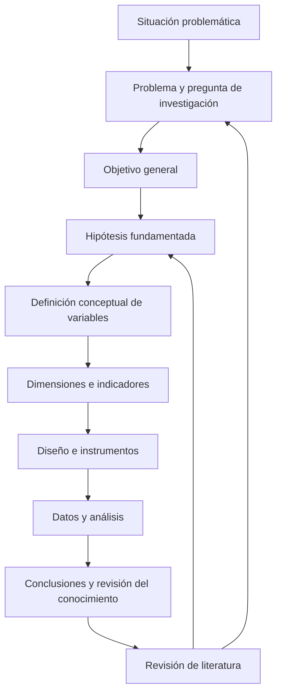

# Clase 4: Hipótesis, variables y coherencia del diseño de investigación

> **Objetivo académico:** Formular hipótesis contrastables y coherentes con el problema y los objetivos de investigación, distinguir relaciones asociativas y causales, y fundamentar la definición de variables y la selección del diseño de contrastación.

## 1. Contexto y marco conceptual

### La hipótesis dentro del proceso de conocimiento

La sesión sitúa la formulación de hipótesis en el diseño teórico y metodológico. El recorrido parte de la observación de una situación real, pasa por su elaboración conceptual y conduce a una propuesta cuya pertinencia se contrasta en la práctica. Los resultados amplían el conocimiento disponible y pueden convertirse en punto de partida de nuevas investigaciones.

La investigación se presenta como un proceso iterativo: precisar el problema puede exigir modificar el objetivo; profundizar en la literatura puede llevar a reformular la hipótesis; revisar la definición de una variable puede obligar a ajustar sus instrumentos. Esta revisión requiere conservar la coherencia del conjunto, en lugar de corregir fragmentos aislados.

La literatura técnica proporciona conceptos y antecedentes; la escritura académica permite expresar sus relaciones y justificar las decisiones. Se recomienda construir oraciones completas, evitar subordinaciones que oculten el sujeto y organizar cada párrafo alrededor de una unidad de sentido. La exposición de resultados exige interpretar lo observado, no limitarse a reproducir tablas o figuras.

### Definición y origen de las hipótesis

Una hipótesis es una proposición tentativa sobre un fenómeno, un valor esperado o una relación entre variables. Conecta el conocimiento teórico con la evidencia empírica y orienta qué datos reunir, cómo analizarlos y qué resultados serían relevantes para la pregunta de investigación.

Su formulación combina el problema identificado, la revisión de literatura y el conocimiento previo del investigador. La experiencia y la observación pueden sugerir relaciones, pero no sustituyen su fundamentación. Una búsqueda insuficiente puede conducir a proponer como novedoso un resultado ampliamente establecido o a desconocer evidencia contraria.

La hipótesis debe:

- Referirse a una población, situación y contexto delimitados.
- Utilizar conceptos precisos y una relación inteligible entre ellos.
- Vincularse con propiedades observables o susceptibles de medición.
- Poder contrastarse mediante procedimientos disponibles y adecuados.
- Admitir resultados que cuestionen la proposición inicial.

**Enriquecimiento conceptual:** La plausibilidad de una hipótesis no equivale a su verdad. Una relación aparentemente obvia también necesita evidencia; una relación contraintuitiva puede ser investigable si cuenta con justificación y condiciones claras de contrastación. La falta de respaldo a la hipótesis inicial no invalida por sí misma una investigación rigurosa.

## 2. Fundamentos teóricos y arquitectura

### Alcance del estudio y formulación de hipótesis

La sesión diferencia los alcances exploratorio, descriptivo, correlacional y explicativo. Su distinción permite reconocer qué clase de afirmación se pretende sostener.

| Alcance | Propósito | Relación con las hipótesis |
| --- | --- | --- |
| Exploratorio | Reconocer un fenómeno poco estudiado y precisar categorías o preguntas | Puede generar hipótesis sin partir de una hipótesis formal cerrada |
| Descriptivo | Caracterizar propiedades, distribuciones o comportamientos | Puede incluir un pronóstico de un valor o comportamiento |
| Correlacional | Establecer asociaciones entre variables | Formula relaciones, con dirección definida o sin ella |
| Explicativo | Investigar mecanismos y relaciones causales | Formula efectos atribuibles a una causa bajo un diseño adecuado |

**Enriquecimiento conceptual:** El alcance no determina automáticamente el enfoque cualitativo o cuantitativo. Una investigación descriptiva puede ser cuantitativa y estudiar múltiples variables; una investigación cualitativa puede desarrollar explicaciones. Tampoco el nivel doctoral impone universalmente hipótesis estadísticas: la investigación teórica, formal, interpretativa o de construcción de artefactos puede justificar sus contribuciones mediante otras estrategias. La sesión privilegia un itinerario aplicado de diagnóstico, intervención y evaluación, que debe entenderse como su marco metodológico de trabajo.

### Tipos de hipótesis

La exposición distingue hipótesis de investigación, nulas, alternativas y estadísticas. Estas denominaciones responden a planos distintos: la hipótesis de investigación expresa una expectativa sustantiva; la formulación estadística la traduce, cuando corresponde, a parámetros o distribuciones.

| Tipo | Función | Ejemplo conceptual |
| --- | --- | --- |
| De investigación | Proponer una relación o comportamiento esperado | El uso de un chatbot educativo se relaciona con la autorregulación académica |
| Nula | Expresar la condición de referencia de un contraste | No existe asociación en la población bajo el parámetro considerado |
| Alternativa | Expresar la condición enfrentada a la nula | Existe asociación, o esta tiene una dirección especificada |
| Estadística | Representar la proposición mediante parámetros | Diferencia entre medias o correlación poblacional distinta de cero |

La sesión también presenta las alternativas como explicaciones sustantivas diferentes. Por ejemplo, frente a una relación entre infraestructura y seguridad de la información, propone considerar el presupuesto como otro factor explicativo.

**Enriquecimiento conceptual:** Una explicación sustantiva alternativa no siempre es la hipótesis alternativa de un contraste estadístico. Cambiar infraestructura por presupuesto modifica la pregunta o amplía el modelo. Además, negar una relación positiva no equivale a afirmar una relación negativa: la negación incluye también la ausencia de relación positiva.

### Formas de relación entre variables

**Hipótesis descriptiva de un valor.** Anticipa una magnitud o intervalo definido. Su formulación exige identificar población, periodo, escala y unidad cuando corresponda. Mencionar únicamente una propiedad, como «calidad educativa de una población», delimita un tema, pero no constituye una proposición contrastable completa.

**Hipótesis correlacional.** Plantea una asociación entre dos o más variables. Puede ser positiva, negativa o carecer de dirección anticipada. Los ejemplos de la sesión incluyen actividad física y bienestar psicológico, profundidad de una red neuronal y precisión del reconocimiento de imágenes, e incorporación de sistemas de inteligencia artificial y tiempo de diagnóstico.

**Enriquecimiento conceptual:** Una asociación positiva significa que valores mayores de una variable tienden a acompañarse de valores mayores de la otra; una asociación negativa expresa una tendencia inversa. Las combinaciones de aumentos y disminuciones empleadas como analogía en clase no constituyen cuatro tipos independientes de correlación. La correlación tampoco demuestra causalidad.

**Hipótesis de diferencia entre grupos.** Compara un resultado entre poblaciones o condiciones: organizaciones con servidores locales frente a organizaciones con servicios en la nube, o establecimientos con y sin sistemas inteligentes de inventario. Puede anticipar una diferencia o especificar su dirección.

**Enriquecimiento conceptual:** Una diferencia entre grupos puede ser descriptiva, asociativa o causal según cómo se constituyan los grupos y se controlen explicaciones alternativas. La redacción comparativa no convierte automáticamente el estudio en experimental.

**Hipótesis causal.** Atribuye una modificación de la variable dependiente a una intervención o factor explicativo. La sesión utiliza ejemplos como pruebas de usabilidad tempranas y facilidad de uso percibida, métodos ágiles y satisfacción del cliente, o aprendizaje profundo y precisión de detección en imágenes médicas. Todos son ejemplos de formulación, no resultados demostrados.

### Analogía funcional y sus límites

La clase ilustra la dependencia mediante:

$$
y=f(x)
$$

En esta analogía, $x\in\mathcal{X}$ representa la variable independiente, $y\in\mathcal{Y}$ la dependiente y $f:\mathcal{X}\rightarrow\mathcal{Y}$ la relación propuesta. Los conjuntos $\mathcal{X}$ y $\mathcal{Y}$ contienen los valores admisibles de cada variable; sus unidades dependen de la operacionalización. La expresión indica dependencia funcional, pero no especifica una relación lineal ni acredita causalidad.

**Enriquecimiento conceptual:** En datos empíricos suele ser necesario reconocer variación no explicada:

$$
Y=f(X,Z)+\varepsilon
$$

Aquí $X$ representa el factor de interés; $Z$, otras características relevantes; $Y$, el resultado; y $\varepsilon$, la variación no recogida por la función. Los dominios y unidades de $X$, $Z$ y $Y$ dependen del caso, mientras que $\varepsilon$ tiene las unidades de $Y$ en esta formulación aditiva. Es una representación conceptual, no un modelo estimado durante la sesión ni una garantía de identificación causal.

## 3. Implementación técnica y lógica de negocio

### Coherencia entre problema, objetivo e hipótesis

La sesión propone auditar tres componentes conjuntamente:

1. **Problema:** identifica los conceptos centrales y la relación que requiere investigación.
2. **Objetivo general:** expresa qué se pretende producir o conocer, mediante qué enfoque, con qué finalidad y en qué contexto.
3. **Hipótesis:** formula la relación esperada entre las variables relevantes.

Dentro de la nomenclatura utilizada, el **objeto de estudio** designa aquello que se estudia y el **campo de acción** el aspecto delimitado que se pretende transformar. El objeto puede aparecer en el producto o en el fundamento de la propuesta; el campo debe guardar correspondencia con la finalidad declarada.

La recomendación central es mantener estables los nombres de los constructos. Sustituir «aprendizaje automático» por «aprendizaje profundo», «proceso de aprendizaje» por «rendimiento académico» o «seguridad de la información» por «seguridad informática» puede alterar el alcance conceptual.

**Enriquecimiento conceptual:** Esta correspondencia es una herramienta de trazabilidad, no una equivalencia universal entre objeto, variable independiente y campo, variable dependiente. Un objeto puede contener múltiples variables; una intervención puede actuar sobre varias dimensiones del campo. La consistencia exige equivalencia conceptual, no identidad literal de todas las oraciones.

### Formulación del objetivo y naturaleza de la contribución

La clase utiliza como guía las preguntas «qué», «cómo», «para qué» y «dónde». En una investigación propositiva, el producto debe reconocerse: modelo, sistema, metodología, marco de trabajo o guía. En una investigación orientada a evaluar efectos, la finalidad principal puede ser estimar o analizar la influencia de una intervención.

La diferencia importa porque cada contribución exige evidencia congruente. Un sistema necesita especificaciones y comprobación de su funcionamiento; un modelo requiere explicar componentes y relaciones; una metodología necesita justificar procedimientos y condiciones de aplicación.

**Enriquecimiento conceptual:** No existe una lista universal de verbos que por sí sola determine la validez o el diseño de una investigación. «Evaluar», «demostrar», «diseñar» u «optimizar» deben interpretarse junto con la pregunta, la contribución, los datos y el procedimiento. Es preferible formular objetivos abiertos al resultado antes que comprometerse a demostrar anticipadamente un efecto positivo.

### De los conceptos a los datos

Una variable es una propiedad que puede adoptar valores o categorías y cuya variación puede observarse o medirse. La definición conceptual establece su significado; la definición operacional determina cómo obtener evidencia sobre ella.

El recorrido metodológico es:

**Concepto → dimensiones → indicadores → instrumentos o registros → datos.**

La sesión recomienda revisar definiciones de autores, instituciones o normas y decidir cuál resulta pertinente. También permite construir una definición de trabajo mediante una sistematización explícita. Las dimensiones deben guardar relación con esta definición, en lugar de agregarse por conveniencia.

**Enriquecimiento conceptual:** Elaborar una definición propia exige justificar qué incorpora, qué excluye y cómo se relaciona con las definiciones previas. Ajustarla exclusivamente a los datos disponibles o al resultado deseado compromete la validez del constructo. Los indicadores también requieren sustento, reglas de cálculo y evidencia de pertinencia.

| Nivel | Pregunta metodológica | Ejemplo vinculado a la sesión |
| --- | --- | --- |
| Definición conceptual | ¿Qué significa el constructo? | Qué se entiende por satisfacción del cliente |
| Dimensión | ¿Qué componentes comprende? | Aspectos pertinentes identificados en su fundamentación |
| Indicador | ¿Qué observación representa cada componente? | Medida definida de la experiencia del cliente |
| Instrumento o registro | ¿Cómo se obtiene la observación? | Cuestionario, observación o registro del sistema |
| Regla de interpretación | ¿Qué significa el valor obtenido? | Criterio explícito de comparación |

Los ejemplos de la tabla ilustran la estructura; la fuente no proporciona una operacionalización completa de satisfacción del cliente.

### Clasificación de variables

| Criterio | Categoría | Característica |
| --- | --- | --- |
| Naturaleza | Cuantitativa discreta | Valores contables y separados, como una cantidad de dispositivos |
| Naturaleza | Cuantitativa continua | Valores en un continuo, como duración o altura, sujetos a precisión instrumental |
| Escala categórica | Nominal | Categorías sin orden inherente |
| Escala categórica | Ordinal | Categorías con orden, sin asumir distancias iguales |
| Número de categorías | Dicotómica o politómica | Dos categorías o más de dos |
| Función | Independiente | Factor explicativo o intervención de interés |
| Función | Dependiente | Resultado cuya variación se estudia |
| Función | Otras variables relevantes | Factores que pueden modificar o explicar el resultado |

La sesión distingue además variables independientes activas, susceptibles de manipulación, y atributivas, observadas como características preexistentes.

**Enriquecimiento conceptual:** Discreto no significa necesariamente entero: lo definitorio es que el conjunto de valores sea separado y contable. Dicotomía y orden son criterios diferentes; una variable con dos categorías puede ser nominal u ordinal. Codificar categorías con números no transforma la escala: asignar códigos a profesiones no permite interpretar su promedio como una cantidad sustantiva. Asimismo, una variable puede describirse y medirse sin formar parte de una hipótesis relacional.

No se desarrollan código, cálculos ejecutados ni configuraciones de software. Se mencionan Excel y SPSS como herramientas posibles; su elección debe seguir a la definición del problema estadístico.

## 4. Análisis crítico de casos y auditoría práctica

### Casos de coherencia y delimitación

Los casos discutidos muestran cómo una pequeña modificación terminológica puede alterar lo que se pretende estudiar o validar.

| Caso técnico | Problema metodológico identificado | Criterio de revisión |
| --- | --- | --- |
| Reconocimiento facial e identificación universitaria | Alternancia entre metodología y sistema; incorporación de precisión, robustez y seguridad sin articulación suficiente | Definir el producto y distinguir sus métricas técnicas del proceso institucional que se pretende mejorar |
| Aprendizaje profundo para apoyar álgebra | Cambio entre proceso de aprendizaje y rendimiento académico | Elegir el constructo central y explicitar su relación con los demás resultados |
| Ciberseguridad agroindustrial | Confusión entre riesgo, ciberseguridad y procesos críticos; contexto inicialmente extenso | Precisar el resultado que se busca transformar y el acceso real a la evidencia |
| Chatbots y autorregulación académica | Diferencia entre asociación positiva y mejora atribuida al uso del chatbot | Ajustar la fuerza de la conclusión al diseño utilizado |
| Fenotipado de quinua | Inconsistencia entre aprendizaje automático y profundo; influencia de condiciones de captura | Estabilizar el alcance técnico y controlar luz, calidad de imagen y variación de las plantas |
| Inteligencia artificial generativa y arquitectura de software | Inversión entre fundamento técnico y aspecto que se pretende transformar | Relacionar el modelo propuesto con criterios definidos de calidad arquitectónica |
| Aula virtual y abandono estudiantil | Compromiso amplio de personalización individual y ambigüedad sobre quién abandona | Delimitar el artefacto, los sujetos y el resultado; separar predicción de abandono y reducción efectiva |
| Monitoreo energético doméstico | Confusión entre informar sobre consumo y conseguir ahorro | Definir el mecanismo de cambio y considerar el costo de la solución |
| Transformers y transcriptómica espacial | Pregunta cerrada y objetivo que anticipa un resultado favorable; acumulación de finalidades | Precisar qué análisis se mejora y con qué evidencia se comparará |
| Evaluación de riesgos de información | Seguridad de activos definida con excesiva amplitud; dos formulaciones causales presentadas como distintas | Acotar dominios y reconocer la relación expresada, más allá de sustituir verbos |
| Comunicación cliente-servidor y energía | Dos transformaciones mezcladas: optimización de comunicaciones y disminución energética | Distinguir el mecanismo técnico del resultado energético |
| Formación interdisciplinaria en software | Confusión entre modelo nuevo y fundamentos existentes | Separar la contribución propuesta de los conceptos que permiten construirla |
| Transformación digital en telecomunicaciones | Acumulación de metodologías ágiles, procesos de negocio y desarrollo seguro | Definir constructos, relaciones y límites antes de decidir el producto final |

**Enriquecimiento conceptual:** Los casos son propuestas analizadas, no evidencia de que las tecnologías mencionadas produzcan las mejoras anticipadas. En particular, un predictor preciso de abandono no reduce por sí mismo el abandono; necesita vincularse con una intervención eficaz. De igual modo, aumentar la precisión de identificación o reducir errores técnicos no demuestra automáticamente una mejora del proceso institucional completo.

### Delimitación, población y acceso

La sesión distingue entre estudiar una población de organizaciones y aplicar una propuesta en un contexto concreto. Se consideran registros empresariales como posible fuente para identificar poblaciones y se subraya que la disponibilidad de información puede restringir el alcance.

**Enriquecimiento conceptual:** Una calculadora de tamaño muestral no garantiza representatividad. La selección depende del marco muestral, el procedimiento de muestreo, la no respuesta, la heterogeneidad y el tipo de estimación. Si el diagnóstico abarca varias organizaciones y la intervención se aplica en una sola, deben explicitarse las diferencias entre ambas poblaciones y limitar la generalización del resultado.

### Contraste de hipótesis

La secuencia presentada comprende formular hipótesis, seleccionar una prueba, establecer significancia, calcular el estadístico e interpretar los resultados. La selección exige atender al diseño y a la naturaleza de los datos.

**Enriquecimiento conceptual:** En un contraste estadístico, $H_0$ representa la hipótesis nula y $H_1$ la alternativa. Para una asociación lineal poblacional sin dirección anticipada puede plantearse:

$$
H_0:\rho=0,\qquad H_1:\rho\neq 0
$$

Aquí $\rho\in[-1,1]$ es la correlación poblacional de Pearson, adimensional, entre dos variables cuantitativas con varianzas finitas y no nulas. La elección de una prueba para este parámetro exige supuestos adicionales según el procedimiento. Una correlación nula no descarta relaciones no lineales.

Para una expectativa de asociación positiva, una formulación unilateral es:

$$
H_0:\rho\leq 0,\qquad H_1:\rho>0
$$

La alternativa negativa no sustituye a la nula de este contraste. La dirección debe justificarse antes de observar los resultados.

**Enriquecimiento conceptual:** El nivel de significancia $\alpha\in(0,1)$ es el umbral elegido para controlar el error de tipo I del procedimiento bajo la hipótesis nula y sus supuestos. El valor $p\in[0,1]$ es la probabilidad, calculada bajo la nula, de obtener un estadístico tan extremo o más extremo que el observado, según la definición de extremidad del contraste. La regla usual es:

$$
p\leq\alpha\Rightarrow\text{rechazar }H_0
$$

Cuando $p>\alpha$, se informa que no se rechaza $H_0$; esto no demuestra su verdad. El valor $p$ tampoco es la probabilidad de que la hipótesis sea verdadera. La conclusión debe considerar magnitud del efecto, incertidumbre, calidad de medición y relevancia práctica.

**Enriquecimiento conceptual:** Student y Welch admiten contrastes de una o dos colas; la dirección depende de la hipótesis. Welch contempla varianzas potencialmente distintas en la comparación de medias independientes. Ni una frontera de tamaño muestral ni una prueba de normalidad bastan para seleccionar el análisis: también importan independencia, emparejamiento, distribución, valores extremos y diseño.

### Diseños para evaluar intervenciones

La clase compara experimentos, cuasiexperimentos y preexperimentos, y destaca la facilidad operativa de medir un mismo grupo antes y después de una intervención.

**Enriquecimiento conceptual:** La distinción requiere precisar el control del diseño:

| Diseño | Rasgo central | Límite principal |
| --- | --- | --- |
| Experimento aleatorizado | Asignación aleatoria a condiciones comparables | Su validez depende también de ejecución, medición, pérdidas y contaminación |
| Cuasiexperimento | Evaluación sin asignación aleatoria, mediante una estrategia explícita de comparación | Requiere justificar supuestos frente a diferencias preexistentes y cambios externos |
| Preexperimento de un grupo antes-después | Observación del mismo grupo antes y después de intervenir | El cambio puede deberse a historia, maduración, regresión a la media u otros factores |

No existe una duración mínima universal para un experimento. Un cuasiexperimento no se define por cambiar variables o instrumentos, ni necesariamente por ser longitudinal. Mantener mediciones comparables suele ser necesario para interpretar el cambio.

**Enriquecimiento conceptual: ejemplo trabajado de cambio antes-después.** Para $n$ unidades observadas en ambos momentos, se define:

$$
d_i=Y_{i,\mathrm{post}}-Y_{i,\mathrm{pre}},\qquad
\overline{d}=\frac{1}{n}\sum_{i=1}^{n}d_i
$$

El índice $i\in\{1,\ldots,n\}$ identifica cada unidad; $n$ es el número entero positivo de pares completos; $Y_{i,\mathrm{pre}}$ y $Y_{i,\mathrm{post}}$ son mediciones cuantitativas comparables; $d_i$ y $\overline d$ conservan sus unidades. Primero se calcula el cambio de cada unidad y después su promedio. Si $Y$ mide tiempo, un promedio negativo representa una reducción; si mide una puntuación donde valores altos son favorables, su interpretación cambia. La expresión describe cambio observado y no identifica por sí sola un efecto causal. No se proporcionan datos para realizar un cálculo numérico.

### Evidencias complementarias de validación

La exposición distingue consulta a expertos, validación en el dominio —por ejemplo, mediante simulación o estudio de caso— y contrastación empírica. Se menciona Delphi como estrategia de consulta estructurada.

**Enriquecimiento conceptual:** Estas evidencias responden a preguntas diferentes. El juicio experto puede apoyar pertinencia o consistencia; una simulación muestra comportamiento bajo supuestos; un estudio de caso documenta desempeño contextual. Ninguna sustituye automáticamente a las demás ni existe una combinación universal obligatoria. La elección debe responder a las afirmaciones concretas de la investigación.

## 5. Principios de diseño, buenas prácticas y anti-patrones

### Principios de formulación

- **Trazabilidad conceptual:** conservar el significado de los constructos desde el problema hasta las conclusiones.
- **Fundamentación previa:** revisar evidencia pertinente antes de presentar una relación como novedosa o plausible.
- **Delimitación explícita:** identificar sujetos, contexto, unidades de análisis y periodo cuando sean relevantes.
- **Contrastabilidad:** precisar qué observaciones serían compatibles o incompatibles con la hipótesis.
- **Correspondencia entre afirmación y diseño:** reservar las conclusiones causales para estrategias que permitan sostenerlas.
- **Operacionalización justificada:** derivar dimensiones e indicadores de una definición conceptual defendible.
- **Viabilidad de la evidencia:** prever acceso a datos, costos y condiciones de aplicación desde el diseño.

### Anti-patrones identificados

**Sustituir conceptos por términos cercanos.** Cambiar aprendizaje por rendimiento o digitalización por transformación digital exige justificar la equivalencia o reconocer el cambio de objeto.

**Usar «mejora» u «optimización» sin criterio.** Debe especificarse qué propiedad cambia, respecto de qué referencia y con qué restricciones. En energía, por ejemplo, disminuir consumo puede acompañarse de una degradación del servicio.

**Enriquecimiento conceptual:** La optimización formal requiere una función objetivo, variables de decisión y restricciones. Si la investigación solo documenta una mejora respecto de una referencia, no puede inferirse que haya alcanzado un óptimo global. Tampoco la profundidad de una red neuronal garantiza incrementos monotónicos de precisión.

**Acumular finalidades.** Encadenar cambios en arquitectura, rendimiento, consumo y costos dificulta identificar el resultado principal. Los mecanismos técnicos y los resultados secundarios pueden conservarse, pero deben ordenarse dentro de un modelo explícito.

**Convertir la hipótesis en inventario de métricas.** La relación central debe ser clara; sus indicadores pueden detallarse en la operacionalización. Sin embargo, una predicción cuantitativa bien justificada también puede formar parte de la hipótesis.

**Presuponer el éxito.** Investigar no consiste en conseguir obligatoriamente la confirmación de una expectativa. Un resultado contrario exige revisar datos, supuestos y teoría, sin descartarlo por ser inconveniente.

**Confundir producto y fundamento.** Un modelo nuevo puede utilizar teorías y técnicas existentes. Debe distinguirse qué se aporta y qué se adopta, para evitar atribuir novedad a todo el conjunto.

**Enriquecimiento conceptual:** La recomendación de no introducir una solución cerrada en el problema busca evitar sesgos prematuros. No prohíbe investigar una tecnología o artefacto específico cuando esa delimitación está justificada. De forma semejante, una pregunta de respuesta aparentemente binaria puede originar una investigación rigurosa si requiere evidencia compleja; las preguntas abiertas facilitan expresar mecanismos, condiciones y magnitudes, pero su forma gramatical no determina por sí sola el valor científico.

### Escritura y revisión de fuentes

La claridad de la redacción permite detectar errores de razonamiento: sujeto impreciso, producto indefinido, cambio de constructo o finalidad incompatible con la pregunta. Conviene revisar párrafos por unidad de sentido y desarrollar las siglas antes de utilizarlas de forma abreviada.

La sesión valora los artículos revisados por pares y advierte que la disponibilidad de una tesis, presentación o documento en internet no certifica su corrección.

**Enriquecimiento conceptual:** La revisión por pares es un indicador de control editorial, no una garantía de verdad. La calidad debe evaluarse atendiendo al método, la evidencia, las limitaciones y la pertinencia del documento. Las recomendaciones lingüísticas particulares de la exposición tampoco deben convertirse automáticamente en prohibiciones universales: expresiones como «basado en» y denominaciones como «pregrado» dependen de usos lingüísticos e institucionales legítimos.

## 6. Síntesis conceptual y profundización académica

La contribución central de la clase es vincular la formulación de hipótesis con la coherencia del diseño completo. Una hipótesis útil identifica una expectativa precisa, se apoya en conocimiento previo y puede relacionarse con observaciones obtenidas mediante procedimientos defendibles.

La diferencia entre asociación y causalidad organiza la elección del diseño. Escribir «se relaciona» propone una asociación; escribir «mejora» atribuye un efecto. Esa diferencia debe reflejarse en la comparación, el control de otras variables y la interpretación, no solo en el verbo utilizado.

La definición conceptual establece qué se estudia; la operacionalización hace explícito cómo se reconocerá empíricamente. La clasificación de variables orienta el análisis, pero el software y la técnica estadística se seleccionan después de precisar la pregunta, el diseño y la estructura de los datos.

**Enriquecimiento conceptual:** La discusión permite distinguir cuatro planos de rigor: validez de constructo, relativa a la correspondencia entre concepto y medición; validez interna, relativa a la atribución del cambio; validez externa, relativa a la transferencia de resultados; y validez de las conclusiones estadísticas, relativa a la adecuación del análisis y su incertidumbre. Una formulación verbal coherente ayuda a todos ellos, pero no sustituye su evaluación.

Las líneas de profundización que se desprenden de la sesión son la medición de constructos abstractos, la identificación causal, el diseño de comparaciones reproducibles y la relación entre desempeño técnico y utilidad en el contexto real. En ciencias de la computación, esta última conexión resulta decisiva: construir un artefacto funcional, demostrar una mejora técnica y acreditar una transformación del proceso de aplicación son contribuciones relacionadas que necesitan evidencias específicas.
