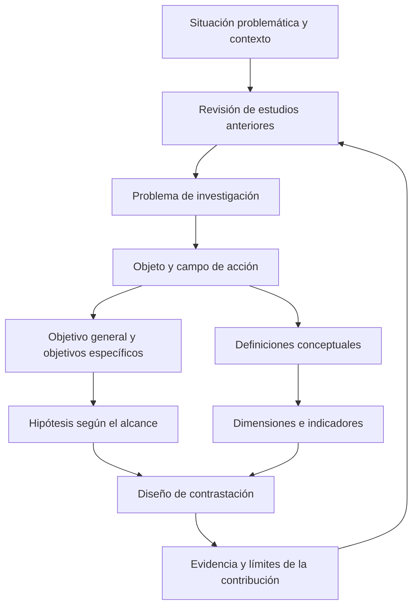

# Clase 5: Coherencia del diseño investigativo, conceptualización de variables y novedad científica

> **Objetivo académico:** Articular el problema, el objeto, el campo de acción, los objetivos, las hipótesis y las definiciones conceptuales de una investigación en ciencias de la computación, evaluando su coherencia, su posibilidad de contrastación y la naturaleza de su contribución científica.

## 1. Contexto y marco conceptual

### De una idea técnica a un problema investigable

La sesión aborda la dificultad de transformar una intención profesional —desarrollar un sistema, aplicar inteligencia artificial o automatizar un proceso— en un diseño de investigación coherente. Conocer una tecnología o reconocer una necesidad práctica no equivale a delimitar un problema científico ni a justificar una contribución doctoral.

El punto de partida debe ser una situación problemática identificable en la realidad o una limitación sustentada en el conocimiento disponible. Se cuestiona la construcción de problemas ficticios destinados únicamente a justificar una solución previamente elegida. La investigación exige revisar tanto lo que ocurre en el contexto como lo que ya se conoce sobre ello.

La secuencia de argumentación recuperada en la clase comprende:

1. Presentar la situación problemática general.
2. Analizar estudios anteriores, sus métodos, resultados y limitaciones.
3. Delimitar el contexto específico.
4. Mostrar cómo se manifiesta allí la situación problemática.
5. Formular el problema que orientará la investigación.

Esta secuencia constituye una estructura de justificación: cada componente debe aportar evidencia para comprender por qué la pregunta es pertinente. Una colección de antecedentes desconectados no cumple esa función.

### Necesidad de estudio y vacío de conocimiento

Una revisión inicial puede revelar una **necesidad de estudio** sin demostrar todavía un **vacío de conocimiento**. No haber encontrado una solución en unas pocas publicaciones no permite afirmar que la comunidad científica no la haya desarrollado.

La formulación del problema madura mediante lectura, comparación y delimitación. Durante ese proceso pueden cambiar el objeto, el campo, el enfoque técnico y los objetivos. El cambio es metodológicamente admisible cuando responde a nueva evidencia; requiere actualizar los componentes relacionados para conservar la coherencia.

**Enriquecimiento conceptual:** Una necesidad práctica indica que un contexto requiere intervención. Un vacío de conocimiento señala una insuficiencia delimitada en las explicaciones, métodos o evidencias disponibles. Ambos pueden coexistir, pero resolver una necesidad local no demuestra por sí mismo que se haya producido conocimiento nuevo para la disciplina.

### Transferencia metodológica

La formación investigativa busca desarrollar una capacidad transferible entre problemas y áreas. Identificar evidencia, delimitar conceptos, formular preguntas contrastables y justificar decisiones son operaciones que permanecen útiles aunque cambie el tema. La competencia técnica y la competencia metodológica se complementan: una implementación competente puede carecer de justificación científica, y una formulación metodológica ordenada puede resultar inviable si desconoce los datos o recursos necesarios.

## 2. Fundamentos teóricos y arquitectura

### Coherencia entre los componentes del diseño

El objeto de estudio expresa el proceso, fenómeno o entidad sobre el que se construye conocimiento. El campo de acción delimita el aspecto específico del objeto que será abordado. En la orientación metodológica de la sesión, ambos deben poder reconocerse de manera consistente en el problema, los objetivos, las hipótesis y la conceptualización de variables.

La coherencia no se reduce a repetir palabras: exige conservar el significado y el alcance. Cambiar entre términos relacionados sin explicar sus diferencias puede introducir objetos distintos dentro de un mismo diseño. Por ejemplo, reconocimiento facial, sistema de reconocimiento facial y seguridad de la identificación no designan exactamente la misma entidad.

El diagrama representa un proceso con realimentación. La evidencia posterior puede obligar a revisar decisiones iniciales; no describe una sucesión irreversible.

### Estructura del objetivo general

La sesión propone organizar el objetivo general mediante cuatro componentes:

| Componente | Pregunta orientadora | Función |
| --- | --- | --- |
| Acción y resultado central | ¿Qué se pretende hacer? | Identifica el resultado investigativo principal. |
| Enfoque o medio | ¿Cómo se pretende hacerlo? | Delimita la vía metodológica o tecnológica. |
| Finalidad | ¿Para qué se pretende hacerlo? | Expresa el cambio o conocimiento buscado. |
| Contexto | ¿Dónde o en qué ámbito? | Acota las condiciones de aplicación y análisis. |

Se recomienda una acción principal expresada mediante un verbo rector. Los objetivos específicos deben producir resultados parciales alineados con el objetivo general; las actividades necesarias para obtenerlos pertenecen a otro nivel de planificación.

La distinción central es entre **resultado** y **actividad**. Consultar documentos o ejecutar procedimientos puede contribuir a un objetivo, pero su realización no constituye automáticamente un resultado científico.

**Enriquecimiento conceptual:** La regla de un verbo rector y la estructura de cuatro componentes son convenciones útiles de la orientación presentada. No son leyes universales de la investigación. El criterio sustantivo es que cada objetivo tenga un propósito identificable, un alcance viable y un resultado evaluable. Tampoco la presencia de una segunda preposición de finalidad invalida por sí sola un objetivo: debe analizarse si introduce una finalidad diferente o una ambigüedad.

### Hipótesis relacionales y explicativas

La sesión distingue dos formas de planteamiento:

- **Relacional o correlacional:** propone una asociación entre variables.
- **Explicativo:** propone un efecto o mecanismo por el cual una intervención o condición modifica un resultado.

| Alcance | Formulación orientadora | Compromiso empírico |
| --- | --- | --- |
| Relacional | Una característica del sistema se relaciona con un resultado observado. | Estimar dirección, magnitud e incertidumbre de la asociación. |
| Explicativo | La aplicación de una intervención modifica un resultado. | Justificar una inferencia causal y analizar explicaciones alternativas. |

Durante la revisión se utiliza la oposición entre el producto y su aplicación para advertir cuándo una formulación pasa de asociación a intervención. También se recomienda redactar la hipótesis como una proposición declarativa en presente, en lugar de presentarla como una promesa futura.

**Enriquecimiento conceptual:** Las palabras «aplicación» o «implementación» no determinan por sí mismas el alcance. Puede estudiarse de manera observacional la adopción de una tecnología y su asociación con un resultado. A la inversa, eliminar esas palabras no vuelve correlacional una afirmación que emplea verbos causales como «influye». El alcance depende de la pregunta, las variables y el diseño que permite sostener la conclusión.

**Enriquecimiento conceptual:** La investigación explicativa puede utilizar grupos de comparación y diseños experimentales o cuasiexperimentales. La afirmación oral que excluye los grupos del alcance explicativo no debe generalizarse. Una comparación apropiada puede ser precisamente el soporte de la inferencia causal. Del mismo modo, la investigación descriptiva es un alcance válido, aunque los casos de la sesión se concentren en hipótesis relacionales y explicativas.

### Definición conceptual y operacionalización

Una definición conceptual aclara qué significa el constructo, cuáles son sus propiedades esenciales y qué límites tiene. Debe distinguirse de un resumen de antecedentes, una declaración de importancia o una recomendación normativa.

| Tipo de contenido | Pregunta que responde | Uso metodológico |
| --- | --- | --- |
| Definición conceptual | ¿Qué es el fenómeno o constructo? | Delimita significado y propiedades. |
| Justificación | ¿Por qué importa estudiarlo? | Sustenta relevancia. |
| Antecedente | ¿Qué hicieron otros y qué encontraron? | Sitúa el estudio frente al conocimiento disponible. |
| Prescripción | ¿Qué debería hacerse? | Orienta prácticas o requisitos. |
| Definición operacional | ¿Cómo se observará o medirá? | Conecta el constructo con evidencia. |

La definición propia se presenta como una síntesis fundamentada de la lectura, ajustada al propósito del estudio. No equivale a reunir frases de distintos autores ni a agregar calificativos como «avanzado», «relevante» o «eficiente» sin especificarlos.

Las dimensiones organizan aspectos del constructo; los indicadores expresan observaciones o medidas asociadas a esas dimensiones. Una definición demasiado general dificulta ese tránsito.

**Enriquecimiento conceptual:** Elaborar una definición de trabajo puede aportar claridad y mostrar síntesis intelectual, pero no constituye automáticamente una novedad científica. Su valor depende de la necesidad que resuelve, su fundamentación, su consistencia y, cuando corresponda, su validación.

## 3. Implementación técnica y lógica de negocio

### Procedimiento de construcción y revisión

La fuente no presenta código ejecutable, una implementación reproducible ni resultados experimentales verificables. Su dimensión técnica consiste en analizar diseños de investigación y los requisitos que deberán satisfacer sus futuras implementaciones.

El procedimiento metodológico que se desprende de las revisiones es:

1. Identificar el resultado central del objetivo.
2. Precisar el medio técnico, evitando expresiones tan amplias como «mediante inteligencia artificial» cuando no permiten comprender la propuesta.
3. Delimitar contexto, población o unidad de análisis.
4. Distinguir la finalidad general de sus posibles indicadores.
5. Formular la hipótesis según la relación que se pretende contrastar.
6. Definir los constructos involucrados.
7. Derivar dimensiones, indicadores y requisitos de datos.
8. Comprobar que la evidencia prevista permite responder al problema.

En la sesión también se admite una vía inversa: partir de indicadores que el investigador comprende y utilizarlos para buscar o construir una conceptualización más precisa.

**Enriquecimiento conceptual:** Esta vía inversa es una estrategia exploratoria válida si se revisa después su validez conceptual. Elegir únicamente lo que resulta fácil medir puede reducir indebidamente el constructo. La disponibilidad de una métrica no demuestra que represente el fenómeno completo.

### Organización de los fundamentos teóricos

Se presentan dos herramientas para estructurar la revisión:

- **Mapeo conceptual:** identifica conceptos, relaciones y dependencias entre objeto, campo y enfoque técnico.
- **Método de índices:** organiza epígrafes y subepígrafes para construir una exposición argumentada.

El marco debe cubrir tanto el fenómeno estudiado como las técnicas necesarias para abordarlo. Si el objeto no coincide con el medio tecnológico, este último también necesita fundamento. Un sistema basado en redes neuronales, por ejemplo, requiere explicar los elementos de esas redes pertinentes para la propuesta.

Se cuestiona la organización enciclopédica que encadena definiciones, características, ventajas y desventajas sin argumentación. La revisión debe mostrar conexiones, decisiones y limitaciones de las que pueda emerger la contribución.

**Enriquecimiento conceptual:** La sesión emplea «estado del arte» en un sentido amplio que integra componentes teóricos, conceptuales, referenciales y tendencias. Conviene distinguir sus funciones: el marco teórico sustenta la explicación; el marco conceptual fija significados; el estado del arte compara críticamente el conocimiento disponible. Las denominaciones pueden variar entre instituciones. La profundidad de numeración de apartados también es una convención editorial, no un criterio de validez científica.

### Gestión bibliográfica y trazabilidad

Se diferencia la cita abreviada dentro del texto de la referencia completa. La primera vincula una afirmación con su fuente; la segunda permite identificar y recuperar el documento. Los gestores bibliográficos ayudan a mantener esa relación, pero dependen de metadatos correctos.

La revisión de metadatos debe considerar autoría personal o corporativa, año, título, tipo documental, datos editoriales y DOI o URL cuando corresponda. El tipo de documento importa: una tesis inédita y una tesis disponible en un repositorio no se describen necesariamente de la misma manera.

La sesión muestra que la automatización no elimina la auditoría: un gestor puede importar autores incompletos, clasificar incorrectamente un documento o generar una referencia defectuosa si sus datos de entrada son insuficientes.

**Enriquecimiento conceptual:** Una cita textual debe conservar el contenido de la fuente y aportar un localizador cuando esté disponible. Una paráfrasis es válida si reformula fielmente la idea y reconoce su procedencia; no toda incorporación de literatura requiere reproducción literal. En APA 7, las citas de obras con tres o más autores emplean normalmente el primer apellido y «et al.», salvo casos que requieran desambiguación; las obras de dos autores conservan ambos apellidos. La ausencia de DOI no invalida automáticamente una referencia, y no todas las fuentes requieren URL.

## 4. Análisis crítico de casos y auditoría práctica

### Identificación facial y seguridad de la identidad

El primer caso propone un sistema de reconocimiento facial basado en redes convolucionales para verificar la identidad de estudiantes en un contexto universitario. La revisión detecta dos problemas: la amplitud del término «seguridad» y la confusión entre definir una tecnología y describir su importancia social.

La seguridad debe delimitarse: autenticación, prevención de suplantación, protección de información u otro aspecto específico. Un texto que explica el tránsito a la educación a distancia puede servir como antecedente, pero no define necesariamente ese constructo.

Cuando no existe una definición que combine exactamente los términos del estudio, se propone articular definiciones de sus componentes y elaborar una definición de trabajo fundamentada.

**Enriquecimiento conceptual:** El sistema es el artefacto; la calidad del reconocimiento y los resultados de autenticación son propiedades evaluables. Una operacionalización rigurosa debe distinguir el desempeño técnico del reconocimiento de la seguridad del proceso completo. Una buena clasificación facial no garantiza por sí sola resistencia a suplantación ni protección de datos biométricos.

### Fenotipado de quinua mediante visión por computadora

El caso de fenotipado articula procesamiento de imágenes y aprendizaje profundo para analizar manifestaciones de enfermedad en hojas de quinua. Se destacan la severidad y la esporulación, asociadas al análisis de las superficies adaxial y abaxial de la hoja.

El interés metodológico reside en conectar características fitopatológicas con propiedades observables en las imágenes. El término general «fenotipado» comprende más aspectos de los que el estudio pretende abordar; por ello se requiere una delimitación explícita.

La dificultad central identificada es la obtención de datos y de anotaciones especializadas. El preprocesamiento de imágenes, la selección de filtros, la arquitectura de red y la comparación con valoraciones expertas aparecen como decisiones por desarrollar. Las menciones a pruebas preliminares no aportan evidencia suficiente para establecer resultados de desempeño ni prioridad científica.

**Enriquecimiento conceptual:** La repetibilidad de un algoritmo no garantiza objetividad ni exactitud. Puede reproducir errores de anotación, sesgos de muestreo o limitaciones de adquisición. Si la referencia procede de especialistas, es necesario analizar su acuerdo y la incertidumbre del etiquetado antes de afirmar superioridad del sistema.

**Enriquecimiento conceptual:** En metrología, la precisión describe la concordancia entre mediciones repetidas bajo condiciones especificadas; la exactitud se refiere a la cercanía al valor de referencia. En clasificación, la precisión tiene otro significado: la proporción de predicciones positivas que son correctas. Estos usos deben distinguirse. La analogía del blanco presentada oralmente no basta para establecer esa diferencia.

### Evaluación de riesgos de seguridad de la información

El caso propone un modelo de evaluación de riesgos para empresas comerciales. La revisión identifica indefiniciones en el medio tecnológico y en el rubro empresarial. Los activos y amenazas relevantes pueden variar entre sectores; «empresas comerciales» puede resultar una delimitación insuficiente.

Se analizan definiciones de evaluación de riesgos y de gestión de activos. Aparecen como elementos relevantes la identificación, el análisis y la evaluación, junto con la confidencialidad, integridad y disponibilidad de la información. También se distinguen el inventario, la clasificación, la protección y el mantenimiento de activos.

El debate principal concierne a la correspondencia entre el alcance declarado y el lugar de la innovación: si la inteligencia artificial interviene únicamente en la identificación, debe explicarse cómo esa contribución se integra en el modelo completo.

**Enriquecimiento conceptual:** Una innovación localizada puede formar parte de un modelo más amplio sin que todas sus etapas sean novedosas. El requisito es declarar qué se conserva, qué se modifica y qué evidencia demuestra el valor de la modificación. Combinar varias normas tampoco garantiza, por sí solo, una contribución doctoral.

### Chatbots y autorregulación académica

Se revisa un chatbot educativo como sistema conversacional basado en inteligencia artificial, con interacción en lenguaje natural y funciones de información, orientación o apoyo personalizado.

La autorregulación se conceptualiza mediante la planificación, supervisión, control y evaluación del aprendizaje, con componentes cognitivos, metacognitivos, motivacionales y conductuales. Estas propiedades ofrecen una base para construir dimensiones e indicadores.

El caso muestra una síntesis conceptual relativamente articulada, pero todavía requiere seleccionar qué funciones del chatbot y qué aspectos de la autorregulación serán efectivamente estudiados.

**Enriquecimiento conceptual:** La disponibilidad de un chatbot es una característica del entorno; su utilización es una conducta; el aprendizaje de estrategias de autorregulación es un resultado. Confundir estos niveles puede llevar a atribuir al sistema cambios que dependen de la intensidad de uso, las características del estudiante u otras intervenciones educativas.

### Sistemas híbridos para realimentación sobre código

Otro caso plantea un sistema inteligente para analizar fallos en código de videojuegos desarrollado en programación introductoria. Se propone combinar capacidades de interpretación del código fuente y de análisis visual de los resultados de ejecución.

La revisión obliga a distinguir dos objetos de evaluación:

- La utilidad de la realimentación para que el estudiante comprenda y corrija errores.
- El rendimiento del sistema al producir esa realimentación, por ejemplo, en tiempo o exactitud diagnóstica.

El diálogo inicialmente sugiere retirar el término «rendimiento», pero después reconoce su pertinencia cuando se aclara que el interés incluye tiempos y calidad de detección. La decisión final depende del propósito investigativo, no de una preferencia terminológica aislada.

**Enriquecimiento conceptual:** Un modelo híbrido combina enfoques o componentes de aprendizaje; un sistema multiagente organiza entidades que interactúan. Ambos rasgos pueden coexistir, pero no son equivalentes. La propuesta debe explicar qué se combina, cómo se intercambia información y por qué esa integración debería superar alternativas pertinentes.

### Aula virtual y abandono universitario

El caso de aula virtual propone utilizar aprendizaje automático para contribuir a reducir el abandono en una carrera virtual. La revisión destaca la amplitud del medio técnico y la heterogeneidad de causas del abandono: factores académicos, personales, institucionales y de conectividad, entre otros.

La factibilidad depende de contar con datos adecuados. También debe precisarse si se estudia abandono definitivo, interrupción temporal u otra condición. La definición conceptual determina qué eventos deben identificarse en los registros.

**Enriquecimiento conceptual:** Predecir riesgo de abandono no equivale a reducirlo. Entre la predicción y el resultado debe existir una intervención plausible: orientación, adaptación didáctica, apoyo oporturno u otro mecanismo. Para sostener una reducción atribuible al modelo deben analizarse ese mecanismo, su aplicación y explicaciones alternativas.

### Aprendizaje por refuerzo y consumo energético

El último caso propone optimizar la comunicación cliente-servidor de aplicaciones web mediante aprendizaje por refuerzo para disminuir el consumo energético en centros de datos.

Se requiere precisar qué se optimiza: procesamiento, tiempo, almacenamiento, comunicaciones, energía o costo monetario. Estos conceptos pueden relacionarse, pero no son intercambiables. También se discute la necesidad de un referente empírico o de condiciones de simulación bien definidas.

La definición de comunicación cliente-servidor identifica procesos que solicitan y proporcionan servicios o recursos. La definición de consumo energético debe especificar una cantidad de energía durante un periodo, evitando confundirla con potencia.

**Enriquecimiento conceptual:** Una menor complejidad computacional no garantiza un menor consumo energético total. El hardware, la carga, la duración de ejecución y la infraestructura modifican esa relación. Además, TCP/IP y HTTP son pertinentes para numerosas aplicaciones web, pero no definen de forma universal toda comunicación cliente-servidor.

## 5. Principios de diseño, buenas prácticas y anti-patrones

### Alinear significado, evidencia y alcance

La auditoría del diseño debe comprobar tres correspondencias: que los términos mantengan su significado; que los indicadores representen el constructo; y que el diseño permita sostener la conclusión prevista.

| Buena práctica | Anti-patrón correspondiente |
| --- | --- |
| Justificar el problema con evidencia contextual y documental. | Inventar una dificultad para acomodar una solución elegida. |
| Mantener una terminología definida y consistente. | Cambiar de objeto entre problema, objetivo e hipótesis. |
| Delimitar el enfoque tecnológico cuando existe fundamento. | Usar «inteligencia artificial» como explicación completa del método. |
| Declarar lo que aún es provisional. | Presentar indefiniciones como decisiones consolidadas. |
| Separar constructos, dimensiones e indicadores. | Convertir una métrica disponible en definición total del fenómeno. |
| Revisar los metadatos bibliográficos. | Confiar sin auditoría en la salida del gestor. |
| Explicar dónde reside la contribución. | Equiparar integración de tecnologías con novedad científica. |

### No introducir conceptos sin articulación previa

Términos como precisión, eficiencia o rendimiento pueden incorporarse como dimensiones o indicadores, pero requieren definición y una relación explícita con la finalidad del estudio. No toda métrica necesita figurar literalmente en el objetivo general; sí debe quedar claro por qué permite evaluar el resultado buscado.

Los calificativos tampoco son siempre improcedentes. «Eficiente» o «mejor» se vuelven problemáticos cuando no especifican recurso, criterio, comparación o magnitud. La solución es operacionalizarlos, no sustituir el análisis por una prohibición léxica.

### Significación estadística y relevancia práctica

La sesión aconseja cautela al utilizar «significativamente» y presenta un ejemplo de comparación entre un estadístico chi-cuadrado y un valor crítico. Su intención es evitar compromisos vagos, pero la interpretación oral confunde la cercanía al umbral con la ausencia de significación.

**Enriquecimiento conceptual:** En una prueba de cola derecha, como una prueba chi-cuadrado de independencia bajo sus supuestos, la regla de decisión puede expresarse así:

$$
T > c_{\alpha} \;\Rightarrow\; \text{rechazar } H_0.
$$

Aquí $T$ es el estadístico calculado, adimensional; $H_0$ es la hipótesis nula; $\alpha\in(0,1)$ es el nivel de significación fijado previamente; y $c_{\alpha}$ es el valor crítico correspondiente a la distribución nula y sus parámetros. La regla presupone que el contraste y sus condiciones de aplicación son apropiados para los datos.

**Enriquecimiento conceptual:** Si el valor calculado supera el crítico por una diferencia pequeña, puede existir significación estadística según esa regla. La distancia entre ambos no mide directamente la importancia práctica del resultado. Deben distinguirse la decisión estadística, el tamaño del efecto, la incertidumbre y la relevancia sustantiva. Los números mencionados en la sesión son ilustrativos y no corresponden a un análisis reproducible.

### Unidades y consumo energético

**Enriquecimiento conceptual:** Para el caso energético, si la potencia es aproximadamente constante durante el intervalo observado:

$$
E=P\,\Delta t.
$$

$E\geq 0$ representa la energía consumida en kilovatios-hora; $P\geq 0$, la potencia media en kilovatios; y $\Delta t>0$, la duración en horas. La expresión supone una frontera de medición definida: servidores, equipos de red o infraestructura completa, por ejemplo.

**Enriquecimiento conceptual:** Como ejemplo puramente ilustrativo, una potencia media de $2\,\mathrm{kW}$ durante $3\,\mathrm{h}$ corresponde a $6\,\mathrm{kWh}$. Esto no es un resultado del caso discutido. Una comparación entre soluciones exige mantener una carga de trabajo equivalente y considerar el costo energético del propio mecanismo de optimización.

### Redacción y evaluación de fuentes

La redacción científica debe favorecer términos específicos, relaciones explícitas y paralelismo gramatical. En una enumeración conviene mantener estructuras equivalentes, como identificación, análisis y tratamiento, o identificar, analizar y tratar.

La fuente también subraya la consistencia en unidades, símbolos y referencias. Estas convenciones contribuyen a la legibilidad, pero deben aplicarse según la norma correspondiente y sus excepciones.

**Enriquecimiento conceptual:** El rigor de una fuente debe evaluarse por su calidad, pertinencia, método y trazabilidad. Su nivel académico no basta para aceptarla o descartarla: una tesis de maestría puede aportar evidencia útil a una investigación doctoral. Del mismo modo, una norma ofrece definiciones y requisitos, pero no sustituye la revisión de literatura científica sobre el problema.

## 6. Síntesis conceptual y profundización académica

La clase presenta el diseño de investigación como una construcción iterativa. La situación problemática orienta la revisión; la revisión delimita el problema; los objetivos establecen resultados; las hipótesis articulan relaciones; y las definiciones permiten decidir qué evidencia será pertinente.

Los casos muestran que la coherencia requiere decisiones concretas: distinguir sistema y desempeño, predicción e intervención, medición y constructo, costo computacional y energía, utilidad educativa y velocidad operativa. Una formulación aparentemente correcta puede ocultar indefiniciones que solo se hacen visibles al anticipar su operacionalización.

La contribución doctoral se vincula en la sesión con la profundidad del conocimiento y la novedad científica en ciencias de la computación. La relevancia del contexto de aplicación puede justificar el estudio, pero no reemplaza la explicación de su aporte disciplinar. El uso de una técnica conocida tampoco excluye automáticamente una contribución: debe analizarse qué conocimiento produce su adaptación, integración, evaluación o explicación.

**Enriquecimiento conceptual:** La distinción entre maestría como aporte práctico y doctorado como aporte teórico-práctico expresa la orientación de la sesión, pero no describe de manera exhaustiva todos los programas. Una contribución computacional puede adoptar la forma de un método, una arquitectura, una explicación, un resultado formal o evidencia empírica sistemática. Su calidad depende de la originalidad, el rigor y el alcance de las afirmaciones sustentadas; no del número de tecnologías combinadas ni del prestigio atribuido al contexto.

Las líneas de profundización que se desprenden del contenido son la validez de constructo, la inferencia causal, el diseño de comparaciones, la incertidumbre de las anotaciones expertas y la generalización fuera del contexto inicial. Todas convergen en una exigencia: formular conclusiones proporcionales a la evidencia disponible y declarar con precisión qué permanece abierto.
