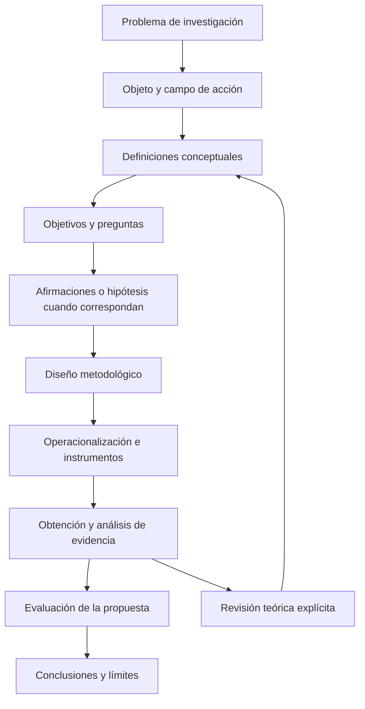
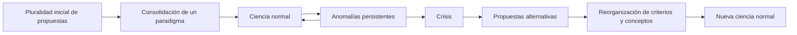

# Clase 6: Diseño metodológico y fundamentos epistemológicos de la investigación en computación

> **Objetivo académico:** Fundamentar un diseño metodológico coherente con el problema, los conceptos, los objetivos y las afirmaciones de una investigación en ciencias de la computación, distinguiendo paradigmas epistemológicos, enfoques metodológicos y formas de validación formal, empírica e interpretativa.

## 1. Contexto y marco conceptual

### 1.1. La coherencia como principio de construcción de la investigación

La sesión enlaza la delimitación conceptual de una investigación con su diseño metodológico. Su tesis central es que las decisiones sobre variables, hipótesis, métodos e instrumentos no deben formularse aisladamente: necesitan responder al mismo problema y conservar una terminología consistente.

En el vocabulario metodológico empleado durante la clase, el **objeto de estudio** identifica el proceso o dominio conceptual sobre el que se investiga, mientras que el **campo de acción** delimita el aspecto específico sobre el que se pretende actuar. La docente destaca que sus conceptos deben poder discutirse teóricamente sin reducirse a una institución, una población o una implementación particular. El contexto se incorpora después para precisar dónde y con quién se estudian esos conceptos.

**Enriquecimiento conceptual:** Esta distinción entre objeto y campo pertenece a una tradición metodológica concreta y no constituye una nomenclatura universal. Además, un objeto de estudio no se convierte automáticamente en una variable: puede requerir varios constructos, dimensiones e indicadores. Lo indispensable es explicar cómo se pasa de la definición conceptual a la evidencia observable.

La cadena de coherencia propuesta es la siguiente:

La revisión de conceptos durante el proceso es compatible con la investigación rigurosa siempre que se documente. No debe confundirse con modificar retrospectivamente una hipótesis para presentarla como si hubiera precedido a los resultados.

### 1.2. Función del diseño metodológico

El diseño metodológico explica **cómo se producirá y evaluará el conocimiento**. La sesión identifica los siguientes componentes:

- Perspectiva epistemológica y relación entre investigador y objeto.
- Tipo de investigación, enfoque, alcance y temporalidad.
- Delimitación del estudio.
- Variables o categorías y sus definiciones conceptuales y operacionales.
- Métodos, técnicas e instrumentos de recolección de datos.
- Población, muestra y criterios de inclusión y exclusión.
- Técnicas de análisis de información.
- Procedimientos de diagnóstico y evaluación de la propuesta.

Su descripción debe permitir comprender las decisiones adoptadas y valorar qué partes podrían reproducirse o transferirse a otro estudio. La revisión de antecedentes cumple aquí una función metodológica: permite identificar procedimientos útiles, sus supuestos y sus límites, sin asumir que un diseño previo puede trasladarse íntegramente a otro contexto.

### 1.3. Marco teórico, estado del arte y aporte

La clase concibe el marco teórico de manera amplia: incluye conceptos, antecedentes, regularidades, enfoques y, cuando corresponde, aspectos normativos. El aporte surge al identificar aspectos insuficientemente explicados o abordados desde una perspectiva diferente.

**Enriquecimiento conceptual:** Conviene distinguir funciones complementarias. El marco teórico organiza conceptos y relaciones explicativas; el estado del arte analiza críticamente la investigación disponible y sus vacíos; el marco normativo precisa restricciones jurídicas pertinentes. Su integración no elimina la necesidad de señalar qué función cumple cada evidencia.

## 2. Fundamentos teóricos y arquitectura

### 2.1. Paradigma, enfoque y diseño

Un paradigma proporciona compromisos sobre la realidad investigada, la producción de conocimiento y los criterios para considerar válida una afirmación. La clase utiliza como ejes de comparación el propósito de la investigación, la relación sujeto–objeto, el análisis de datos y la forma de evaluar hipótesis o propuestas.

**Enriquecimiento conceptual:** Para evitar confusiones, deben separarse tres niveles:

| Nivel | Pregunta que organiza | Ejemplos pertinentes |
|---|---|---|
| Paradigma o perspectiva epistemológica | ¿Qué se considera conocimiento y cómo se justifica? | Positivismo, interpretativismo, perspectiva sociocrítica |
| Enfoque metodológico | ¿Qué evidencia se construye y cómo se integra? | Cuantitativo, cualitativo, mixto |
| Diseño y procedimientos | ¿Cómo se organiza concretamente el estudio? | Experimento, estudio de caso, investigación participativa, entrevistas, mediciones |

Estos niveles se relacionan, pero no son equivalentes. Utilizar números no demuestra por sí solo una adscripción positivista; incorporar entrevistas no basta para sostener una perspectiva interpretativa; combinar técnicas tampoco convierte automáticamente una investigación en sociocrítica.

### 2.2. Positivismo y orientación empírico-analítica

La exposición sobre positivismo enfatiza la observación, la medición, la búsqueda de regularidades, la predicción y la contrastación de hipótesis. Presenta al investigador como una instancia que procura mantener sus preferencias separadas de la producción de resultados.

En este marco adquieren relevancia los instrumentos estandarizados, los cuestionarios, las listas de verificación y los procedimientos estadísticos. Se mencionan la correlación de Pearson, la prueba t de Student y el análisis de varianza como ejemplos de técnicas, sin desarrollar sus cálculos.

Sus aplicaciones computacionales discutidas incluyen comparación de algoritmos, simulaciones, ciencia de datos y evaluación de indicadores de seguridad. En todos estos casos importa definir qué se mide, en qué condiciones y con qué incertidumbre.

La clase cuestiona una aplicación que reduzca el análisis a repetir porcentajes. Un valor solo adquiere significado al relacionarse con la definición del indicador, su referencia de comparación y el contexto del problema.

**Enriquecimiento conceptual:** El positivismo no se identifica sin matices con todo método hipotético-deductivo. Tampoco la separación sujeto–objeto garantiza ausencia de sesgos. La objetividad se fortalece mediante protocolos explícitos, instrumentos adecuados, trazabilidad y revisión crítica. Comte y Durkheim se mencionan como referentes históricos; Popper requiere una ubicación diferenciada por su crítica al verificacionismo y su propuesta de falsabilidad.

### 2.3. Interpretativismo y fenomenología

La exposición interpretativa se centra en comprender cómo las personas experimentan y significan una situación. El contexto histórico, cultural e institucional forma parte del fenómeno; el investigador participa en la interpretación y debe reconocer sus presupuestos.

Se presentan entrevistas en profundidad, grupos focales, observación participante y análisis documental como recursos posibles. Para el tratamiento fenomenológico se describe una secuencia de cuatro momentos:

1. Clarificación de presupuestos y preconcepciones del investigador.
2. Recuperación de experiencias vividas mediante relatos, entrevistas y observación.
3. Reflexión estructural y análisis temático de esas experiencias.
4. Escritura e integración de las estructuras de significado identificadas.

**Enriquecimiento conceptual:** La fenomenología es una tradición específica y no un sinónimo de toda investigación interpretativa. La observación prolongada de una cultura se aproxima también a la etnografía; su clasificación depende de la pregunta, el marco y el procedimiento de análisis. Reconocer la posición del investigador no equivale a aceptar interpretaciones arbitrarias.

La sesión sostiene que en la investigación fenomenológica no corresponde una prueba estadística de hipótesis. Esta orientación privilegia preguntas abiertas y comprensión de significados.

**Enriquecimiento conceptual:** De ello no se deriva que todo estudio cualitativo deba carecer de proposiciones orientadoras ni que sus resultados sean imposibles de evaluar. La calidad puede sustentarse mediante coherencia interpretativa, reflexividad, contraste de fuentes, evidencia contextual y trazabilidad del análisis. La prueba estadística no es el único criterio de rigor.

### 2.4. Perspectiva sociocrítica

El paradigma sociocrítico se presenta como una orientación que busca comprender y transformar condiciones sociales mediante participación, reflexión y acción. Su objeto puede incluir relaciones de poder, desigualdades y estructuras que condicionan la vida de los participantes.

La relación entre investigación y valores es explícita: se discuten emancipación, equidad, justicia y empoderamiento. La investigación acción, la investigación colaborativa y la participativa aparecen como modalidades afines. Se mencionan Marx, Horkheimer, Habermas y Adorno como referentes, sin desarrollar una genealogía bibliográfica completa.

La secuencia observar–pensar–actuar expresa una relación recursiva entre conocimiento y transformación. Según las necesidades del problema, pueden utilizarse datos cualitativos y cuantitativos.

**Enriquecimiento conceptual:** La perspectiva sociocrítica no se define por equilibrar cantidades iguales de datos numéricos y narrativos. Su rasgo distintivo es la orientación crítica y transformadora. La utilidad social de una intervención tampoco prueba por sí sola la verdad de todas las explicaciones formuladas: deben evaluarse por separado la calidad de la evidencia, los efectos de la acción y su legitimidad ética.

### 2.5. Racionalismo y fundamentación formal en computación

La exposición racionalista sitúa la razón y la deducción en el centro de la justificación del conocimiento. En computación, esta orientación se relaciona con programas entendidos como objetos matemáticos, modelos de computabilidad, funciones recursivas, cálculo lambda y máquinas de Turing.

Se mencionan Turing y Church, así como la semántica denotacional y los razonamientos lógico-matemáticos. La idea relevante es que ciertas propiedades pueden justificarse mediante demostraciones sobre modelos explícitos, sin depender exclusivamente de observar ejecuciones.

**Enriquecimiento conceptual:** El racionalismo moderno asociado a Descartes no corresponde a la Edad Media. Asimismo, la equivalencia entre determinados modelos formales de computación no debe confundirse con una prueba de toda interpretación informal de lo computable. Deben distinguirse los teoremas sobre modelos y las tesis que vinculan esos modelos con nociones intuitivas.

Una limitación importante es la distancia entre el modelo demostrado y el sistema implementado. Una deducción correcta puede partir de supuestos inadecuados o de una especificación incompleta; por ello, la justificación formal y la evaluación empírica pueden complementarse.

### 2.6. Orientación tecnocrática e ingeniería

La exposición tecnocrática reúne dos sentidos relacionados, pero diferentes: la autoridad concedida a quienes poseen conocimiento técnico y la búsqueda ingenieril de soluciones eficaces y eficientes.

En el segundo sentido, el investigador mide, analiza y modifica sistemas para mejorar su funcionamiento. Se destacan el análisis de datos, los indicadores y la evaluación sistemática de alternativas. En el primero, surge la discusión sobre quién decide, con qué legitimidad y bajo qué criterios de bienestar.

Se mencionan Howard Scott y William Smith en relación con la tecnocracia, y la crítica del papa Francisco en *Laudato si’*. La discusión organiza esta crítica alrededor de la responsabilidad ética, el lugar del ser humano y las consecuencias político-económicas de la expansión tecnológica.

**Enriquecimiento conceptual:** La optimización técnica no determina por sí misma qué fines son deseables. Un sistema puede ser eficiente respecto de una métrica y perjudicial para determinados grupos. Tampoco debe suponerse que una decisión basada en datos tiene margen de error nulo: persisten incertidumbre, errores de medición y límites del modelo.

### 2.7. Kuhn y la transformación del conocimiento científico

La sesión recupera de Thomas Kuhn la crítica a una historia de la ciencia exclusivamente lineal y acumulativa. Distingue ciencia normal, anomalías, crisis y revoluciones científicas, y destaca el papel de las comunidades en la aceptación de teorías, métodos y estándares.

El retorno de las anomalías a la ciencia normal representa la posibilidad de resolver dificultades dentro del marco vigente. No toda anomalía conduce a una revolución.

También aparecen Popper, Feyerabend y Lakatos como interlocutores: falsabilidad, pluralidad metodológica y programas de investigación, respectivamente. La referencia al conocimiento como espiral refuerza en la discusión la idea de revisión y desarrollo continuo.

**Enriquecimiento conceptual:** El esquema histórico de Kuhn y la orientación computacional que combina modelos y experimentación no constituyen el mismo nivel de análisis. El primero examina transformaciones de comunidades y marcos científicos; la segunda organiza procedimientos de investigación. La inconmensurabilidad tampoco implica imposibilidad absoluta de comparación, sino dificultades para comparar conceptos y criterios mediante una medida completamente neutral.

## 3. Implementación técnica y lógica de negocio

### 3.1. De los conceptos a indicadores observables

La fuente no desarrolla código, conjuntos de datos ni ejecuciones experimentales. Su implementación es metodológica: convertir conceptos en decisiones observables y justificadas.

El caso inicial articula prácticas ágiles, proyectos socioformativos y competencias de desarrollo de software. La corrección central consiste en mantener el mismo nombre del constructo en todas las secciones y distinguirlo del contexto poblacional.

| Componente | Delimitación conceptual recuperada |
|---|---|
| Base de la propuesta | Articulación de prácticas ágiles y proyectos socioformativos |
| Resultado de interés | Competencias de desarrollo de software |
| Contexto | Formación de estudiantes de ingeniería de sistemas |
| Propuesta | Modelo educativo interdisciplinario |
| Problema de definición | Integrar el concepto general de competencia con capacidades específicas del desarrollo de software |

La sesión señala conocimientos, habilidades, actitudes y valores como componentes frecuentes del concepto de competencia. Una definición propia debe sintetizar críticamente fuentes sobre competencias y sobre desarrollo de software, en lugar de limitarse a una opinión o a enumerar instrumentos de medición.

**Enriquecimiento conceptual:** Una operacionalización posible seguiría la cadena constructo–dimensión–indicador–evidencia–regla de interpretación. Si una dimensión fuera la capacidad de verificar software, podría observarse cómo se justifican y aplican pruebas; esta posibilidad ilustra el procedimiento, pero no constituye un indicador validado ni un resultado del caso.

La comparación entre rúbricas educativas y criterios de aceptación de historias de usuario puede ayudar a formular evidencias explícitas. Sin embargo, evalúan objetos diferentes: una rúbrica valora desempeños de aprendizaje; los criterios de aceptación expresan condiciones de satisfacción de un requerimiento.

### 3.2. Alcance correlacional y alcance explicativo

La clase insiste en que una hipótesis correlacional establece una asociación entre variables y no debe redactarse automáticamente como efecto de una intervención. En el ejemplo, relacionar prácticas formativas con competencias es distinto de sostener que un modelo educativo mejora esas competencias.

**Enriquecimiento conceptual:** Para dos variables numéricas puede ilustrarse la asociación lineal mediante la correlación de Pearson:

$$
r = \frac{\sum_{i=1}^{n}(x_i-\bar{x})(y_i-\bar{y})}{\sqrt{\sum_{i=1}^{n}(x_i-\bar{x})^2}\sqrt{\sum_{i=1}^{n}(y_i-\bar{y})^2}}
$$

Aquí $n$ es el número entero de observaciones emparejadas, con $n\geq 2$; $x_i$ e $y_i$ son los valores numéricos de cada observación; y $\bar{x}$ y $\bar{y}$ son las medias de las respectivas variables. Ambas variables deben tener varianza distinta de cero para que el cociente esté definido. El coeficiente $r$ es adimensional y pertenece a $[-1,1]$.

Un valor positivo expresa asociación lineal en el mismo sentido; uno negativo, asociación en sentidos opuestos. Un valor próximo a cero no descarta relaciones no lineales. La pertinencia del cálculo requiere revisar la escala, la forma de la relación y las observaciones influyentes; las inferencias estadísticas añaden supuestos sobre el muestreo y la distribución.

La descripción oral de combinaciones de ascenso y descenso es una intuición didáctica, no una clasificación completa de las relaciones posibles.

Para una afirmación causal hacen falta condiciones adicionales: precedencia temporal, comparación adecuada y tratamiento de explicaciones alternativas. Llamar independiente a una variable y dependiente a otra no proporciona esas condiciones. Un estudio observacional también puede utilizar predictores y respuestas sin que ello demuestre causalidad.

### 3.3. Temporalidad, alcance y clasificación global

La temporalidad organiza la relación entre observaciones y tiempo; la delimitación temporal fija el periodo al que se refiere el estudio. La clase menciona retrospectividad, prospectividad y transversalidad.

**Enriquecimiento conceptual:** Estas categorías responden a preguntas distintas. Retrospectivo y prospectivo describen la orientación de la obtención o seguimiento de información; transversal y longitudinal describen su estructura temporal. No deben tratarse como opciones mutuamente excluyentes de una única lista.

De modo similar, una revisión exploratoria inicial no vuelve exploratoria a toda la investigación. El diseño global se caracteriza por las preguntas y afirmaciones centrales, sus procedimientos y la evidencia que permitirá sostenerlas.

**Enriquecimiento conceptual:** El producto final es relevante, pero no basta para clasificar un diseño. Aplicar instrumentos o comparar mediciones tampoco convierte automáticamente un estudio en experimental. El carácter experimental depende de cómo se manipulan condiciones y se controlan explicaciones alternativas.

### 3.4. Integración de evidencia y evaluación

La docente defiende combinar medición e interpretación para comprender los problemas de ingeniería. La consecuencia metodológica es integrar las evidencias, no acumular técnicas sin explicar su relación.

**Enriquecimiento conceptual:** Interpretar correctamente un porcentaje no constituye por sí mismo un componente cualitativo. Un diseño mixto requiere producir y analizar evidencia cualitativa y cuantitativa, además de explicar cómo se conectan. Puede usarse una secuencia en la que relatos orienten indicadores o en la que entrevistas ayuden a comprender patrones numéricos.

La sesión menciona evaluación por especialistas, estudios de caso, simulaciones y prototipos como posibilidades para analizar una propuesta. Cada alternativa responde a preguntas diferentes: la opinión especializada puede examinar pertinencia y consistencia; una simulación explora comportamiento bajo supuestos; un prototipo permite observar determinadas funciones en condiciones concretas.

**Enriquecimiento conceptual:** Ninguna de estas vías exige universalmente una prueba estadística de hipótesis. La forma de evaluación debe corresponder al tipo y alcance de la afirmación, y deben explicitarse tanto las coincidencias como las discrepancias entre fuentes de evidencia.

## 4. Análisis crítico de casos y auditoría práctica

### 4.1. Modelo educativo y uso de Scrum

El caso sobre formación en desarrollo de software muestra dos problemas de delimitación: el uso de un constructo demasiado genérico y la desviación hacia detalles de un marco técnico que no constituyen el centro de la investigación educativa.

La sesión aclara que Scrum es un marco de trabajo y recomienda seleccionar de él aquello que contribuya al aprendizaje. El valor de un conocimiento técnico para la investigación depende de su función en el problema y no de la extensión con que pueda describirse.

**Enriquecimiento conceptual:** Scrum, programación extrema, Kanban y desarrollo guiado por pruebas no son categorías intercambiables. El desarrollo guiado por pruebas es una práctica; no describe por sí solo la gestión completa de un proyecto. Tampoco el uso de Scrum garantiza que se hayan especificado todas las prácticas de ingeniería necesarias.

La evaluación del modelo educativo debe distinguir resultados de aprendizaje, funcionamiento del proceso formativo y calidad del software producido. Una mejora en uno de estos planos no demuestra automáticamente una mejora en los restantes.

### 4.2. Neutralidad y evaluación de una intervención propia

Un participante describe la tensión de evaluar una propuesta que él mismo desarrolló y aplicó. La posibilidad de orientar involuntariamente a los participantes ilustra el riesgo de que las expectativas del investigador influyan en el resultado.

La clase propone guías de observación con criterios derivados de la operacionalización y participación de otros observadores.

**Enriquecimiento conceptual:** Estos mecanismos mejoran el control, pero no eliminan todo sesgo. Conviene explicitar qué ayudas se permiten, cómo se registran las observaciones y cómo se resuelven discrepancias entre observadores. La presencia de terceros solo fortalece la evaluación si sus funciones y criterios están definidos.

### 4.3. Ciberseguridad institucional y comprensión interpretativa

Se presenta un caso ilustrativo sobre estrategias de ciberseguridad en instituciones bolivianas. La aproximación consiste en recuperar experiencias, revisar planes y comprender obstáculos percibidos mediante entrevistas y análisis temático.

El caso permite distinguir entre dos resultados: comprender por qué los actores consideran que una estrategia no avanzó y demostrar que una propuesta alternativa resuelve el problema. El primero puede orientar al segundo, pero no lo sustituye.

**Enriquecimiento conceptual:** Las afirmaciones institucionales del relato se conservan como contexto del ejemplo, no como hechos verificados. Un análisis interpretativo puede producir conocimiento válido sobre experiencias y decisiones; para sostener eficacia de una nueva estrategia se necesitan evidencias adicionales ajustadas a esa afirmación.

### 4.4. Algoritmos, pruebas y demostraciones

La comparación de algoritmos exige separar propiedades formales de comportamiento observado. Una demostración de corrección responde a una pregunta diferente de un experimento sobre latencia, consumo de memoria o estabilidad.

**Enriquecimiento conceptual:** Las pruebas unitarias ejecutan casos seleccionados; por sí solas no son una demostración universal. Por ejemplo, probar que una función de ordenación devuelve resultados correctos para varias listas no demuestra su corrección para todas las entradas admisibles. Una demostración requeriría justificar propiedades como conservación de elementos, orden de salida y terminación bajo supuestos definidos.

En sentido inverso, una demostración sobre un algoritmo idealizado no establece automáticamente el rendimiento de su implementación. El entorno de ejecución, la representación de datos y las dependencias pueden modificar los resultados empíricos.

### 4.5. Inteligencia artificial, automatización y evidencia

El debate sobre programación y servicios preconstruidos contrapone la facilidad de ensamblar soluciones con la persistencia del conocimiento necesario para diseñarlas y evaluarlas. El aumento de abstracción desplaza parte del trabajo hacia configuración, integración y supervisión, sin demostrar la desaparición de la programación.

La discusión también utiliza una pregunta verbal para cuestionar capacidades de sistemas de inteligencia artificial.

**Enriquecimiento conceptual:** Una respuesta aislada, especialmente ante un enunciado ambiguo, no permite concluir de manera universal que un sistema razona o carece de razonamiento. Una evaluación defendible debe delimitar la capacidad, el sistema, las condiciones y el conjunto de casos, y analizar los errores sin convertir una anécdota en resultado general.

### 4.6. Analogías de cambio de paradigma

La fuente utiliza la programación orientada a objetos, la programación funcional y variantes de aprendizaje automático como ejemplos de anomalías y sustituciones.

**Enriquecimiento conceptual:** Estas analogías ilustran la revisión de enfoques, pero no demuestran revoluciones kuhnianas. Los estilos de programación pueden coexistir; el aprendizaje por refuerzo profundo y el aprendizaje con pocos ejemplos no implican abandonar el aprendizaje profundo. Tampoco una nueva versión de un producto o una iteración de desarrollo equivale por sí misma a un cambio de paradigma científico.

## 5. Principios de diseño, buenas prácticas y anti-patrones

### 5.1. Correspondencia entre afirmaciones y evidencia

| Principio | Buena práctica | Anti-patrón que debe evitarse |
|---|---|---|
| Consistencia conceptual | Mantener definiciones y nombres de constructos a lo largo del estudio | Cambiar el significado de una variable entre objetivo, hipótesis e instrumento |
| Delimitación | Separar el constructo de su población y contexto | Reducir el concepto a una aplicación local |
| Coherencia inferencial | Ajustar las conclusiones al diseño y a la evidencia | Presentar asociación como causalidad |
| Transparencia analítica | Documentar decisiones y revisiones | Reformular una hipótesis después de observar los datos y presentarla como previa |
| Integración metodológica | Explicar cómo se relacionan distintas evidencias | Llamar mixto a un estudio solo porque contiene números y comentarios |
| Evaluación formal y empírica | Precisar qué demuestra cada procedimiento | Tratar pruebas unitarias como demostración general |
| Incertidumbre | Reconocer error de medición y límites del modelo | Atribuir certeza absoluta a una decisión basada en datos |
| Responsabilidad social | Examinar efectos, valores y distribución de beneficios | Identificar eficiencia técnica con bienestar general |

### 5.2. Formación ingenieril integral

El debate sobre tecnocracia cuestiona currículos centrados exclusivamente en herramientas actuales. Se destaca la necesidad de conservar fundamentos matemáticos y computacionales que permitan comprender modelos, comparar alternativas y producir contribuciones originales.

En aprendizaje automático se subraya la relación entre optimización y cálculo diferencial. En procesamiento de señales se recuerda la necesidad de comprender representaciones y modelos matemáticos. El argumento general es que utilizar una tecnología no equivale a comprender las condiciones bajo las que funciona.

La formación integral articula saber, hacer y ser: conocimientos, capacidades prácticas y responsabilidad ética. Incluye comunicación, colaboración, prudencia, atención al entorno y evaluación de impactos socioeconómicos y ambientales.

**Enriquecimiento conceptual:** La pertinencia de un contenido curricular debe justificarse por las capacidades y problemas a los que contribuye. Conservar fundamentos y actualizar tecnologías son decisiones compatibles cuando se explicitan sus relaciones formativas.

### 5.3. Comunicación académica y trazabilidad

La sesión insiste en la precisión terminológica, la corrección de la escritura y la integridad de las referencias. Una fuente incompleta dificulta verificar la definición utilizada; una diapositiva sobrecargada puede desviar la atención de la relación conceptual que pretende mostrar.

**Enriquecimiento conceptual:** Las decisiones visuales deben evaluarse por claridad, accesibilidad y función explicativa. La observación oral sobre imágenes en movimiento no constituye una prohibición universal de la animación: lo relevante es evitar elementos que compitan con el argumento sin aportar comprensión.

## 6. Síntesis conceptual y profundización académica

La clase sitúa la fundamentación epistemológica dentro de la arquitectura completa de la investigación. Su utilidad consiste en explicar qué se quiere conocer, qué evidencia puede sostenerlo y cuáles son los límites de la conclusión.

Las orientaciones discutidas aportan preguntas complementarias. La perspectiva empírico-analítica enfatiza medición y contrastación; la interpretativa, significados y contexto; la sociocrítica, participación y transformación; la formal, propiedades demostrables; y la orientación ingenieril, construcción y evaluación de soluciones. La perspectiva histórica de Kuhn permite analizar cómo cambian los marcos de investigación, sin sustituir el diseño concreto de cada estudio.

**Enriquecimiento conceptual:** La articulación de estas contribuciones requiere justificar su compatibilidad y su función. No basta con sumar etiquetas ni con presentar todos los paradigmas como etapas sucesivas que se reemplazan por completo. Una investigación computacional puede combinar argumentación formal, evaluación empírica y comprensión de usuarios, siempre que identifique qué pregunta responde cada componente.

Los procesos lógicos mencionados al cierre —análisis y síntesis, inducción y deducción, abstracción y concreción— atraviesan el trabajo científico. El análisis diferencia componentes y relaciones; la síntesis los reorganiza; la inducción propone regularidades a partir de casos; la deducción obtiene consecuencias de premisas; la abstracción selecciona propiedades pertinentes; y la concreción vuelve al sistema situado para valorar el alcance del modelo.

La profundización académica queda abierta en cuatro relaciones centrales: asociación y causalidad; demostración y experimentación; interpretación y rigor; eficiencia y legitimidad social. Comprender estas relaciones permite formular propuestas cuya evaluación sea proporcional a las afirmaciones que se pretende sostener.
