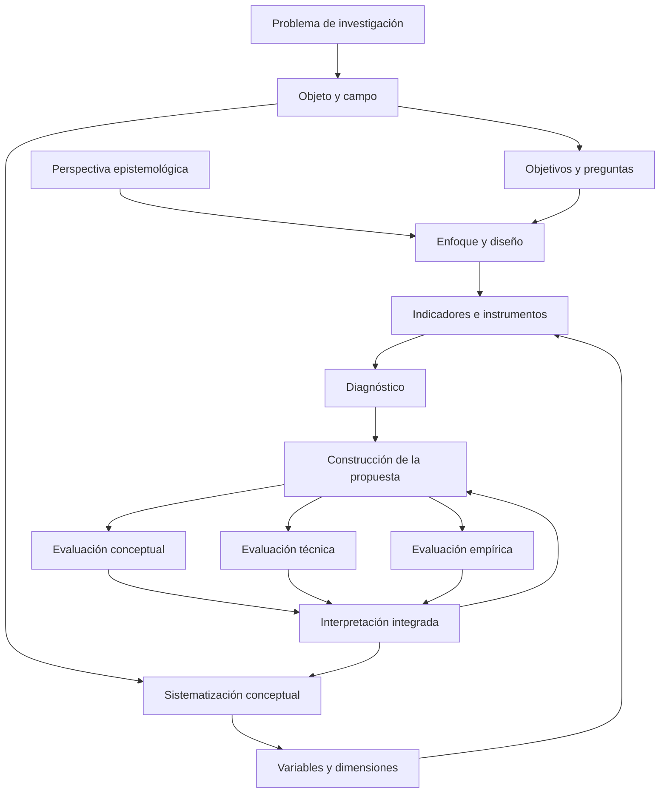

# Clase 7: Coherencia metodológica, enfoques de investigación y validación en ciencias de la computación

> **Objetivo académico:** Articular la perspectiva epistemológica, los enfoques de investigación, la definición de variables y la selección de métodos, técnicas e instrumentos en un diseño coherente, distinguiendo la evaluación conceptual, técnica y empírica de una propuesta en ciencias de la computación.

## 1. Contexto y marco conceptual

La sesión aborda la investigación como un sistema de decisiones interdependientes. El problema, el objeto, el campo, los objetivos, las variables, los métodos y la validación deben guardar correspondencia. La coherencia metodológica no consiste en reunir definiciones correctas de manera aislada: exige explicar cómo cada decisión contribuye a producir evidencia pertinente para el problema estudiado.

El **objeto de investigación** identifica el proceso o fenómeno sobre el que se construye conocimiento; el **campo** delimita el aspecto específico del objeto en el que se concentra la investigación. En el planteamiento desarrollado durante la clase, la propuesta transforma alguna condición del objeto o del campo. Su construcción requiere comprender previamente sus propiedades, relaciones y regularidades, sin confundir ese conocimiento con la solución que se pretende diseñar.

La formulación inicial es revisable. La lectura, la sistematización conceptual y el diagnóstico pueden modificar el alcance del problema, las dimensiones de una variable y la forma de la propuesta. El aporte teórico y la novedad científica requieren maduración intelectual: no se obtienen únicamente declarando que una tecnología es novedosa ni redactando anticipadamente un beneficio general.

### Perspectiva epistemológica y enfoque metodológico

La **perspectiva epistemológica** expresa supuestos sobre qué se considera conocimiento, cómo puede justificarse y qué relación mantiene quien investiga con lo investigado. El **enfoque metodológico** orienta la producción, el tratamiento y la integración de evidencia cuantitativa, cualitativa o mixta. La selección de una encuesta o de una prueba estadística, por sí sola, no determina la perspectiva epistemológica.

Durante el debate se analizan investigaciones educativas mediadas por tecnología. Una intervención puede adoptar una perspectiva sociocrítica y utilizar un diseño mixto: ambas decisiones responden a niveles diferentes del diseño. La primera introduce una orientación crítica y transformadora; la segunda describe cómo se articulan distintas formas de evidencia.

**Enriquecimiento conceptual:** Conviene distinguir también el diseño de investigación, que organiza comparaciones, temporalidad y procedimientos concretos. Paradigma, enfoque, diseño, técnica e instrumento no son sinónimos. Su articulación necesita argumentos explícitos, especialmente cuando se combinan tradiciones con supuestos distintos.

El diagrama representa un proceso con retroalimentación. Las relaciones entre componentes se revisan a partir de la evidencia; no constituyen una secuencia irreversible.

## 2. Fundamentos teóricos y arquitectura

### 2.1. Construcción de los fundamentos teóricos

El marco teórico debe sistematizar conocimiento sobre el objeto, el campo y sus relaciones. Puede integrar definiciones, antecedentes, tendencias, experiencias previas y restricciones normativas cuando estas sean pertinentes. Su calidad depende de la articulación argumental, no de la acumulación de apartados separados por etiquetas genéricas.

La clase propone utilizar mapas conceptuales para identificar qué aspectos del objeto y del campo necesitan desarrollo y cómo se conectan. De ellos puede derivarse un índice provisional, susceptible de incorporar, reorganizar o eliminar elementos a medida que avanza la investigación. Agrupar contenidos bajo categorías conceptuales evita dispersar un mismo tema en diferentes secciones sin una función clara.

Es importante distinguir entre **fundamentar un objeto** y **describir una solución**. Si se diseña un modelo de gestión de seguridad, la revisión debe esclarecer los procesos de gestión, las condiciones de seguridad y las restricciones relevantes. La arquitectura particular del modelo pertenece al desarrollo de la propuesta.

**Enriquecimiento conceptual:** Esta distinción no impide revisar modelos existentes como antecedentes o alternativas. Lo que debe evitarse es presentar como conocimiento establecido la solución propia antes de justificar sus decisiones. Asimismo, un estado del arte enfatiza avances, debates y vacíos de investigación; el marco teórico establece las categorías y relaciones que sostienen el estudio. Pueden integrarse, pero sus funciones no son idénticas.

### 2.2. Definición conceptual y operacionalización

La **definición conceptual** precisa el significado del constructo o variable asumido en la investigación. La **definición operacional** establece cómo se reconocerá, observará o medirá ese significado mediante dimensiones, indicadores y reglas de valoración.

La relación entre ambas es sustantiva: las dimensiones deben estar justificadas por la definición conceptual. No resulta coherente definir un fenómeno mediante ciertos atributos y medir otros sin explicar la conexión. La comparación de definiciones de distintos autores permite establecer convergencias, diferencias y límites antes de adoptar una posición propia o una formulación existente.

Una misma denominación puede dar lugar a operacionalizaciones distintas según la definición asumida, el contexto y los objetivos. La diferencia no constituye automáticamente un error; requiere una justificación explícita. En cambio, seleccionar dimensiones porque una herramienta automática las sugiere, sin revisar su fundamento, debilita la validez de las inferencias posteriores.

**Enriquecimiento conceptual:** La operacionalización puede revelar insuficiencias en una definición y motivar su revisión. Esta retroalimentación es legítima si queda documentada y no se utiliza para redefinir retrospectivamente el fenómeno con el único propósito de obtener resultados favorables.

### 2.3. Enfoques cuantitativo, cualitativo y mixto

La exposición presenta una trayectoria entre racionalismo, positivismo, postpositivismo y constructivismo para contextualizar los enfoques de investigación. Ese esquema ayuda a reconocer diferencias entre supuestos, aunque debe tratarse como una simplificación introductoria.

**Enriquecimiento conceptual:** Estas corrientes no forman una genealogía única y lineal. El racionalismo no equivale al positivismo, ni el enfoque cuantitativo pertenece exclusivamente al postpositivismo. El constructivismo reconoce la construcción situada de significados, pero ello no elimina la exigencia de evidencia, argumentación y control crítico.

| Dimensión | Enfoque cuantitativo | Enfoque cualitativo | Enfoque mixto |
| --- | --- | --- | --- |
| Propósito destacado en la sesión | Medir variables, estimar relaciones y contrastar hipótesis | Comprender experiencias, procesos, significados y contextos | Integrar medición y comprensión para responder una pregunta articulada |
| Planteamiento | Habitualmente delimitado y explícito respecto de las variables | Puede precisar sus preguntas durante el contacto con el campo | Coordina preguntas cuantitativas, cualitativas y de integración |
| Producción de evidencia | Instrumentos estructurados y mediciones comparables | Entrevistas, observaciones y materiales abiertos o flexibles | Combina procedimientos con una función definida para cada componente |
| Análisis | Procedimientos estadísticos e interpretación de magnitudes y relaciones | Interpretación sistemática de patrones, categorías y significados | Relaciona resultados y analiza convergencias, complementariedades y discrepancias |
| Presentación | Resultados estructurados, estimaciones y límites inferenciales | Descripciones contextualizadas y argumentos interpretativos | Inferencias conjuntas sustentadas en ambas formas de evidencia |

**Enriquecimiento conceptual:** La tabla sintetiza tendencias, no fronteras rígidas. La revisión de literatura no es necesariamente secundaria en investigación cualitativa; puede orientar el problema y dialogar con los hallazgos. Tampoco toda encuesta es cuantitativa ni toda entrevista exclusivamente cualitativa: importan el tipo de información, el procedimiento analítico y la inferencia buscada.

La sesión menciona etnografía, estudio de caso, teoría fundamentada, fenomenología y narrativa. Sus intereses incluyen comprender culturas y prácticas, analizar casos situados, construir teoría desde datos, interpretar experiencias vividas y estudiar relatos. **Enriquecimiento conceptual:** El estudio de caso puede adoptar un enfoque cualitativo, cuantitativo o mixto; no queda definido únicamente por trabajar con un caso.

### 2.4. Calidad de la investigación cualitativa

La exposición identifica credibilidad, verificabilidad, confiabilidad del proceso y transferibilidad como criterios de calidad. Su sentido es exigir una representación fundamentada de las experiencias y una documentación suficiente para revisar cómo se construyeron los resultados.

**Enriquecimiento conceptual:** La credibilidad se refiere a la plausibilidad y al sustento de las interpretaciones; la confirmabilidad permite rastrear su relación con los datos; la dependencia atiende a la consistencia y documentación del proceso; la transferibilidad depende de que exista información contextual suficiente para juzgar la pertinencia en otros entornos. Esta última no equivale a generalización estadística ni significa que los resultados sean automáticamente aplicables a cualquier población.

## 3. Implementación técnica y lógica de negocio

La fuente desarrolla una arquitectura metodológica y ejemplos de aplicación. No contiene código, ejecuciones de software ni resultados experimentales reproducibles. La implementación tratada consiste en traducir decisiones conceptuales a procedimientos e instrumentos concretos.

### 3.1. Organización por etapas de investigación

La clase distingue una preparación del diseño teórico y metodológico y, posteriormente, cuatro etapas: sistematización teórica, diagnóstico, construcción de la propuesta y validación. Esta organización permite identificar qué evidencia necesita cada etapa y qué procedimiento puede producirla.

| Etapa | Función | Procedimientos mencionados | Producto de conocimiento |
| --- | --- | --- | --- |
| Sistematización teórica | Comprender el objeto, el campo y sus relaciones | Histórico-lógico, organización por índices, mapeo y análisis documental | Categorías, relaciones y fundamentos conceptuales |
| Diagnóstico | Caracterizar el contexto y sus condiciones | Análisis documental, encuesta, entrevista y grupo focal | Evidencia sobre problemas, condiciones y potencialidades |
| Propuesta | Estructurar una alternativa de transformación | Enfoque sistémico y modelación | Componentes, relaciones y reglas de funcionamiento de la solución |
| Validación | Valorar fundamento, funcionamiento y resultados | Consulta a expertos, procedimientos técnicos del área y contrastación empírica | Evidencia sobre pertinencia, desempeño y efectos de la propuesta |

**Enriquecimiento conceptual:** Esta secuencia corresponde al esquema trabajado en la sesión; no constituye un protocolo universal. Un diagnóstico con aplicación de instrumentos no es, por ese hecho, experimental. La investigación experimental requiere intervención y condiciones de diseño que permitan analizar sus efectos.

### 3.2. Métodos, técnicas e instrumentos

En la distinción empleada durante la clase, un método organiza una vía de conocimiento; una técnica establece un procedimiento específico para obtener información; un instrumento materializa criterios, preguntas o registros. Las clasificaciones pueden variar entre autores, por lo que debe declararse una convención y aplicarla consistentemente.

| Método o técnica | Instrumento asociado | Función principal |
| --- | --- | --- |
| Análisis documental | Guía de análisis documental | Extraer y comparar información mediante criterios explícitos |
| Encuesta | Cuestionario de encuesta | Recoger respuestas mediante preguntas organizadas |
| Entrevista estructurada | Cuestionario de entrevista | Mantener preguntas y condiciones comparables |
| Entrevista flexible | Guía de entrevista | Orientar temas y permitir profundización pertinente |
| Grupo focal | Guía de grupo focal | Conducir una discusión colectiva sobre dimensiones relevantes |
| Observación | Guía de observación | Registrar indicadores con criterios y reglas de valoración |

La denominación del instrumento debe conservar la población destinataria y el propósito establecidos para la técnica. Una entrevista dirigida al responsable de tecnología de una organización debe corresponder con una guía que atienda ese mismo rol y el mismo objetivo de información. La correspondencia nominal ayuda a detectar inconsistencias, aunque no sustituye la revisión del contenido.

La flexibilidad de una entrevista permite modificar el orden y profundizar respuestas, pero exige preparación del entrevistador y trazabilidad de las decisiones. En grupos focales, la moderación debe contener la dominancia de algunos participantes y evitar que la conversación abandone el propósito del estudio.

### 3.3. Análisis documental y triangulación

El análisis documental puede intervenir tanto en la fundamentación teórica como en el diagnóstico. La sesión presenta dos usos: comparar normas mediante indicadores y caracterizar una infraestructura de red a partir de documentación pertinente. La guía debe establecer objetivos, criterios y fuentes para que la extracción y la interpretación no dependan de una lectura improvisada.

La triangulación busca contrastar perspectivas y fuentes. Por ejemplo, los documentos institucionales pueden describir procedimientos formales, mientras entrevistas y observaciones permiten analizar su ejecución real. La discrepancia entre fuentes puede revelar diferencias entre reglas declaradas y prácticas efectivas.

**Enriquecimiento conceptual:** La cantidad de instrumentos no garantiza triangulación. Dos cuestionarios que reproducen el mismo sesgo pueden aportar poca evidencia adicional. Es necesario justificar qué dimensión ilumina cada fuente y cómo se analizarán sus coincidencias o contradicciones. La pertinencia metodológica, antes que un número universal de instrumentos, debe orientar la decisión.

### 3.4. Enfoque sistémico y modelación

El **enfoque sistémico** permite estructurar una propuesta en componentes, identificar entradas y salidas y explicar las relaciones entre bloques. Su interés reside en comprender cómo una modificación afecta al conjunto y qué mecanismos de retroalimentación permiten revisar el funcionamiento.

La **modelación** construye una representación del objeto o del proceso relevante para comprenderlo, diseñarlo o analizarlo. En la clase se presenta como una vía especialmente pertinente cuando el resultado consiste en un modelo. Se alude a principios de modelación, pero no se desarrollan sus contenidos.

**Enriquecimiento conceptual:** Ambos procedimientos pueden complementarse. Un modelo puede representar relaciones sistémicas y una propuesta sistémica puede apoyarse en modelos. No existe una incompatibilidad necesaria entre ellos; su selección depende del problema y de la función explicativa o de diseño que cumplan.

### 3.5. Tres planos de validación

La sesión propone distinguir tres planos para valorar una propuesta:

1. **Validación teórica o conceptual:** consulta a expertos para valorar dimensiones e indicadores de la propuesta. Se menciona Delphi y la necesidad de justificar la experticia de quienes participan.
2. **Validación desde el área de conocimiento:** prototipos, simulaciones, estudios de caso u otros procedimientos capaces de aportar evidencia técnica pertinente.
3. **Validación metodológica mediante contrastación empírica:** observación de indicadores y análisis de hipótesis sobre los resultados o la transformación de variables.

**Enriquecimiento conceptual:** Esta separación es una organización didáctica de la sesión. Una simulación o un estudio de caso también poseen decisiones metodológicas que deben justificarse. Una consulta a expertos no equivale automáticamente a Delphi: este requiere un proceso estructurado de consulta iterativa, retroalimentación y tratamiento de las respuestas. La aceptación experta tampoco sustituye la demostración del desempeño técnico o del efecto de una intervención.

La observación se presenta como una actividad con componentes teóricos y empíricos: definir qué observar exige conceptualización previa; registrar su comportamiento produce evidencia. Por ello, la discusión sobre si debe denominarse método o técnica no elimina la obligación de justificar su función y su instrumento.

## 4. Análisis crítico de casos y auditoría práctica

### 4.1. Intervenciones educativas mediadas por tecnología

Los casos educativos discutidos combinan diagnóstico, diseño de una intervención y análisis de resultados. Encuestas a estudiantes, entrevistas a docentes y perspectivas de responsables institucionales pueden ofrecer información complementaria sobre un mismo proceso. La participación del investigador en ese entorno plantea decisiones sobre su relación con los participantes y su influencia en las prácticas estudiadas.

La investigación-acción se presenta como una posibilidad para intervenir y comprender una transformación desde el contexto. La perspectiva sociocrítica permite discutir condiciones institucionales y cambios en las prácticas, además de medir resultados.

**Enriquecimiento conceptual:** La presencia de personas o de una intervención no basta para clasificar un estudio como sociocrítico o investigación-acción. Deben justificarse su orientación transformadora, la participación de los actores y los ciclos de reflexión y acción. Un diseño mixto tampoco adopta necesariamente esa perspectiva: puede organizarse desde otros supuestos coherentes con su pregunta.

### 4.2. Población, muestra y datos en aprendizaje automático

Un caso de clasificación de plantas de quinua mediante imágenes permite discutir la diferencia entre participantes humanos y datos utilizados por una solución computacional. La respuesta docente reserva el apartado de población y muestra para los sujetos a quienes se aplican instrumentos, mientras ubica procedencia, cantidad y calidad de imágenes en el tratamiento de información y en los requisitos de la propuesta.

Esa convención permite separar dos componentes que pueden coexistir: el diagnóstico con participantes y el desarrollo de un modelo con datos. Sin embargo, no debe convertirse en una definición estadística general.

**Enriquecimiento conceptual:** Una población estadística puede estar formada por imágenes, plantas, eventos, dispositivos o registros. En aprendizaje automático resulta necesario definir la unidad de análisis, el universo al que se pretende generalizar y el procedimiento de selección del conjunto de datos. La delimitación del apartado documental no elimina estos requisitos científicos.

**Enriquecimiento conceptual:** Para el caso de imágenes de plantas, una revisión metodológica debe distinguir datos de entrenamiento, validación y prueba, así como documentar su procedencia. Si imágenes de una misma planta o capturas casi duplicadas aparecen en entrenamiento y prueba, puede existir fuga de información y una estimación demasiado optimista del desempeño. La fuente no proporciona tamaños de conjuntos, métricas ni resultados que permitan evaluar un modelo concreto.

### 4.3. Integración en métodos mixtos

La pregunta central del debate es cómo evitar que una investigación mixta sea únicamente la suma de un componente cuantitativo y otro cualitativo. Se propone utilizar hallazgos cualitativos para construir mejores encuestas y relacionar la valoración experta con evidencia estadística de resultados.

**Enriquecimiento conceptual:** Un ejemplo de integración secuencial sería identificar barreras de adopción tecnológica mediante entrevistas, traducir las categorías pertinentes a indicadores de un cuestionario y analizar posteriormente su distribución. La integración debe explicar qué categorías se incorporaron, por qué y cómo sus resultados responden a una pregunta compartida. Este ejemplo es metodológico; no corresponde a una ejecución reportada en la sesión.

La analogía del diagnóstico médico ilustra la complementariedad entre indicadores medidos y conocimiento contextual obtenido en la conversación. No obstante, combinar procedimientos distintos solo constituye un diseño mixto cuando se planifica cómo sus resultados se relacionan para producir una inferencia conjunta.

**Enriquecimiento conceptual:** La integración no exige igualdad de peso. Un componente puede ser dominante y otro complementario, siempre que esa decisión responda al problema. Buscar un equilibrio simétrico sin necesidad puede aumentar costos y complejidad sin mejorar el conocimiento producido.

### 4.4. Validez de los instrumentos

La clase insiste en la correspondencia entre definición conceptual, operacionalización e instrumentos. Un cuestionario puede estar bien redactado y, sin embargo, omitir dimensiones esenciales del fenómeno. Asimismo, asignar números a respuestas o utilizar una escala tipo Likert no demuestra por sí mismo que el instrumento represente el constructo.

**Enriquecimiento conceptual:** Conviene distinguir evidencia de contenido, evidencia sobre la estructura interna y evidencia de relaciones con otras variables, según las inferencias que se pretenden sostener. La confiabilidad se refiere a consistencia o precisión y no equivale a validez. La revisión experta aporta evidencia pertinente, pero no certifica por sí sola toda la validez de constructo ni garantiza la ausencia de sesgos.

**Enriquecimiento conceptual:** Una escala tipo Likert organiza respuestas ordinales de acuerdo o frecuencia; la codificación numérica permite procesarlas, pero no las convierte automáticamente en mediciones de intervalo. La selección de procedimientos estadísticos debe considerar el nivel de medición y los supuestos del análisis. Tampoco una comprobación estadística aislada demuestra que una pregunta carezca de direccionamiento.

### 4.5. Comparaciones e interpretación estadística

La sesión menciona diseños preexperimentales, cuasiexperimentales y experimentales, así como la comparación de observaciones en diferentes momentos. También advierte que un resultado estadístico debe interpretarse: comparar un valor con un umbral no explica por sí mismo la relevancia de una transformación.

**Enriquecimiento conceptual:** Dos momentos de medición no requieren necesariamente dos instrumentos distintos. Puede utilizarse un mismo instrumento con condiciones comparables. Además, una medición previa y otra posterior no bastan para clasificar un diseño como cuasiexperimental ni para establecer causalidad; importan los grupos de comparación, la asignación y el control de explicaciones alternativas.

**Enriquecimiento conceptual:** Una regla convencional de decisión en contrastación es:

$$
p \leq \alpha
$$

Aquí $p \in [0,1]$ es el valor p calculado bajo una hipótesis nula y los supuestos de una prueba; $\alpha \in (0,1)$ es el umbral de significación fijado previamente. Si se cumple la desigualdad, la regla permite rechazar la hipótesis nula al nivel seleccionado. El valor p no es la probabilidad de que esa hipótesis sea verdadera ni mide la importancia práctica del efecto. La interpretación requiere considerar la magnitud estimada, la incertidumbre y las condiciones del diseño. La fuente no aporta datos suficientes para seleccionar o ejecutar una prueba concreta.

## 5. Principios de diseño, buenas prácticas y anti-patrones

### Coherencia y trazabilidad

Cada método debe justificarse por su aplicación: qué información produce, sobre qué objeto actúa y para qué etapa se necesita. Copiar una definición genérica no demuestra que el procedimiento sea pertinente. De modo equivalente, nombrar un instrumento exige revisar que sus preguntas o criterios respondan a los indicadores declarados.

**Enriquecimiento conceptual:** Una matriz de trazabilidad puede relacionar objetivos, dimensiones, indicadores, fuentes, instrumentos y análisis. Su utilidad consiste en identificar indicadores sin evidencia, preguntas sin propósito e inferencias que exceden lo observado.

### Escritura académica y justificación

La justificación debe explicar el valor específico del estudio: qué problema aborda, qué beneficio se espera y qué contribución pretende producir. Repetir el título o describir únicamente la importancia general de la inteligencia artificial, la seguridad o la educación no demuestra la pertinencia de una investigación particular. Los beneficios esperados deben distinguirse de los resultados efectivamente obtenidos.

La perspectiva epistemológica necesita una posición aplicada al estudio, no una recopilación de fragmentos teóricos. Las referencias pueden sostener una decisión, pero el argumento que conecta esa decisión con el problema corresponde a quien investiga.

**Enriquecimiento conceptual:** La ausencia de referencias en la justificación, el número mínimo de oraciones por párrafo y el uso de una persona gramatical son convenciones de escritura señaladas en la sesión, no reglas universales. La unidad del párrafo depende de su función argumentativa. Toda afirmación empírica o idea tomada de otra fuente necesita atribución cuando corresponda, independientemente de la sección en que aparezca.

### Organización documental como apoyo al razonamiento

La demostración con estilos de documento muestra que los encabezados semánticos, el panel de navegación y el índice automático facilitan revisar relaciones entre problema, objetivos, variables y métodos. El uso consistente de estilos también permite conservar jerarquías y evitar alteraciones al incorporar texto de diferentes procedencias.

**Enriquecimiento conceptual:** La numeración y la tipografía ayudan a navegar, pero no crean coherencia por sí mismas. La profundidad de la jerarquía debe responder a la estructura del argumento; un límite de niveles pertenece a una convención editorial específica. En citación, las citas textuales requieren un localizador pertinente y la distinción entre cita breve y cita en bloque no elimina esa exigencia. Los detalles de formato deben verificarse con el estándar adoptado.

### Uso crítico de inteligencia artificial

La inteligencia artificial puede apoyar la generación de alternativas, la identificación de relaciones y la revisión de formulaciones. La clase rechaza su incorporación automática mediante copia y pegado: quien investiga debe analizar las propuestas, contrastarlas con la literatura y conservar la responsabilidad intelectual sobre el texto y las decisiones.

| Anti-patrón | Problema que introduce | Criterio de corrección |
| --- | --- | --- |
| Inferir el paradigma a partir de una encuesta | Confunde una técnica con supuestos epistemológicos | Justificar por separado perspectiva, enfoque y diseño |
| Denominar instrumento a la encuesta o entrevista sin precisión | Dificulta identificar el soporte concreto de obtención de datos | Declarar el cuestionario o la guía correspondiente |
| Equiparar métodos mixtos con acumular técnicas | No explica la integración de evidencias | Definir relaciones y puntos de integración |
| Elegir dimensiones sin fundamento conceptual | Debilita la representación del constructo | Vincular definición, dimensiones e indicadores |
| Equiparar codificación numérica con validez | Confunde procesamiento con calidad de medición | Analizar evidencia de validez y precisión |
| Presentar consenso experto como eficacia demostrada | Extiende la conclusión más allá de la evidencia | Distinguir pertinencia conceptual y desempeño observado |
| Interpretar significación como utilidad práctica | Ignora magnitud, incertidumbre y contexto | Relacionar análisis estadístico y relevancia sustantiva |
| Describir la solución propia como fundamento ya establecido | Produce razonamiento circular | Separar antecedentes, decisiones de diseño y resultados |

## 6. Síntesis conceptual y profundización académica

La contribución central de la sesión es entender el diseño metodológico como una estructura de correspondencias. El objeto y el campo orientan la revisión conceptual; las definiciones sustentan dimensiones e indicadores; estos se materializan en instrumentos; la evidencia obtenida permite construir, revisar y valorar una propuesta. La coherencia se mantiene mediante argumentación y retroalimentación entre etapas.

Los enfoques cuantitativo y cualitativo ofrecen capacidades diferentes y pueden integrarse cuando el problema lo requiere. Ninguno es intrínsecamente superior. La integración rigurosa no elimina las diferencias entre sus lógicas ni obliga a repartir la investigación en proporciones iguales: explica qué contribuye cada componente y cómo se construye una interpretación conjunta.

La validación debe diferenciar los alcances de la evidencia. El juicio experto puede sostener pertinencia y coherencia; un prototipo o simulación puede aportar información técnica; un diseño empírico permite analizar resultados bajo condiciones concretas. Estas evidencias se complementan, pero no se sustituyen automáticamente.

**Enriquecimiento conceptual:** La complejidad de un estudio doctoral no se reduce a una etiqueta como aplicado o propositivo. Una investigación puede incluir momentos exploratorios o descriptivos y producir una contribución original si desarrolla preguntas, métodos e inferencias suficientemente justificadas. La originalidad y el rigor deben analizarse en el aporte efectivamente construido.

Como líneas de profundización conceptual quedan la evidencia de validez de los instrumentos, los puntos de integración en diseños mixtos, las amenazas a la inferencia causal y la delimitación de poblaciones y unidades de análisis en aprendizaje automático. Estas cuestiones permiten pasar de una selección nominal de métodos a una evaluación crítica de lo que cada procedimiento autoriza a concluir.
