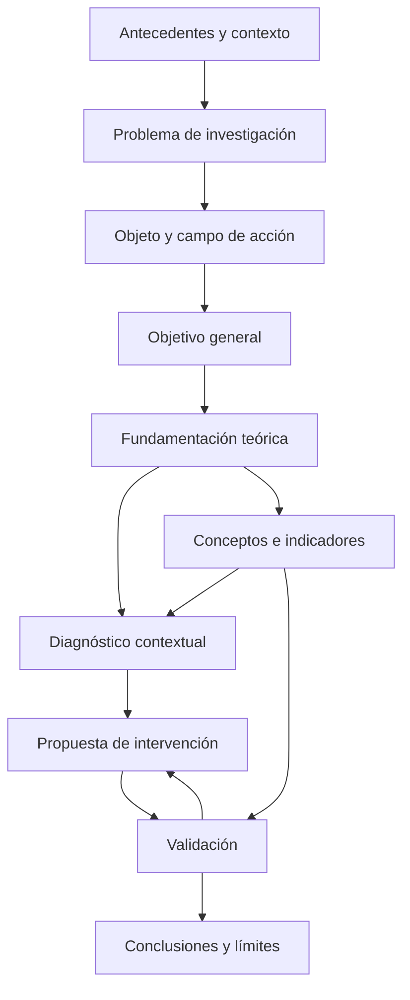

# Clase 8: Coherencia del diseño de investigación: objetivos, diagnóstico, propuesta y validación

> **Objetivo académico:** Analizar la coherencia entre problema, objeto de estudio, campo de acción, objetivos, fundamentos teóricos, diagnóstico, propuesta y validación en investigaciones de ciencias de la computación, diferenciando resultados científicos de actividades operativas y evaluando críticamente las decisiones metodológicas.

## 1. Contexto y marco conceptual

La sesión desarrolla una revisión transversal de diseños de investigación mediante casos de inteligencia artificial aplicada a agricultura, educación, ingeniería de requisitos y seguridad de la información. Su eje es la correspondencia entre aquello que se investiga, el conocimiento que se necesita producir y la evidencia que permitiría sostener una contribución. Las observaciones sobre escritura adquieren sentido dentro de esa correspondencia: un documento bien organizado debe hacer visible la lógica de la investigación.

### Del contexto general al problema específico

Los antecedentes se conciben como un discurso argumentativo que avanza de lo general a lo particular. Primero establece la importancia del tema; después revisa investigaciones previas; finalmente describe la situación del contexto y conduce a la formulación del problema. La continuidad entre párrafos permite comprender por qué el problema surge de la evidencia presentada.

La revisión de investigaciones anteriores debe recuperar sus autores, métodos, resultados y conclusiones relevantes. Enumerar trabajos sin analizar qué hicieron y qué aportaron no basta para fundamentar una nueva investigación. Cuando el estudio continúa otro trabajo, ese antecedente debe ocupar un lugar explícito porque determina qué conocimiento se retoma y qué aspecto permanece abierto.

Conviene distinguir dos componentes:

- **Planteamiento del problema:** construcción argumentada de la situación problemática, los antecedentes y el contexto.
- **Formulación del problema:** expresión precisa del interrogante que organiza la investigación.

**Enriquecimiento conceptual:** La transición entre ambos componentes puede analizarse como una cadena de justificación: existe una situación relevante, la evidencia disponible no resuelve un aspecto delimitado y esa insuficiencia permite formular una pregunta investigable. Una descripción extensa del sector o de la tecnología no constituye por sí sola un problema científico.

### Objeto de estudio, campo de acción y contexto

En el esquema metodológico de la sesión, el objeto de estudio corresponde a un proceso, fenómeno o sistema de relaciones perteneciente a un área del conocimiento. El campo de acción delimita el aspecto sobre el que se concentra la transformación. El contexto establece dónde y con quién se estudia esa relación.

La fundamentación teórica abstrae el objeto de sus condiciones locales para analizar características, regularidades y relaciones conceptuales. El diagnóstico lo sitúa en un contexto concreto. Esta distinción explica por qué el primer objetivo específico no debe reducirse a describir una institución y por qué el segundo requiere precisar los sujetos y condiciones de observación.

El caso de una solución de conectividad instalada en un autobús ilustra la diferencia entre soporte material y problema disciplinar. Nombrar únicamente el vehículo no explicita qué se investiga en redes o telecomunicaciones. La pregunta debe permitir reconocer el fenómeno tecnológico relevante, como el comportamiento de la red o la ingeniería de tráfico.

**Enriquecimiento conceptual:** La nomenclatura objeto–campo pertenece al marco adoptado en la sesión y no es uniforme en todas las tradiciones científicas. Un artefacto físico sí puede ser objeto de investigación; la insuficiencia aparece cuando su nombre sustituye la definición del fenómeno, las propiedades y las relaciones que se analizarán.

## 2. Fundamentos teóricos y arquitectura

### La arquitectura de cuatro resultados

La docente propone una organización en cuatro momentos articulados: fundamentación teórica, diagnóstico, elaboración de la propuesta y validación. Cada momento produce un resultado identificable y puede corresponder a un objetivo específico. El número responde a esta organización; la propia sesión aclara que cuatro objetivos no constituyen una obligación universal.

| Momento | Pregunta central | Resultado esperado | Relación principal |
| --- | --- | --- | --- |
| Fundamentación teórica | ¿Qué se conoce del objeto y cuáles son sus relaciones relevantes? | Sistema de fundamentos y posicionamiento conceptual | Objeto y campo en el plano teórico |
| Diagnóstico | ¿Cómo se manifiesta el problema en el contexto delimitado? | Caracterización sustentada del estado actual | Campo de acción contextualizado |
| Propuesta | ¿Qué intervención se construye y por qué tendría capacidad de transformación? | Modelo, sistema o marco de trabajo estructurado | Objetivo general y necesidades diagnosticadas |
| Validación | ¿Qué evidencia respalda la propuesta y sus efectos? | Juicio argumentado sobre pertinencia, funcionamiento y transformación | Indicadores, criterios y alcance de las conclusiones |

La retroalimentación desde la validación hacia la propuesta representa la posibilidad de introducir ajustes. La secuencia organiza el razonamiento, aunque no implica que cada componente se complete de una vez y permanezca inalterable.

### Objetivos y actividades operativas

Un objetivo específico expresa un resultado de conocimiento o transformación. Las actividades operativas son los pasos necesarios para alcanzarlo. Confundir ambos niveles produce listas extensas en las que acciones como aplicar instrumentos, ejecutar un piloto o redactar una guía aparecen como resultados independientes sin justificación.

El diagnóstico permite observar esta diferencia. Para obtenerlo se necesita caracterizar el contexto, construir o seleccionar instrumentos, justificar su uso, recoger información, analizarla, contrastar fuentes y jerarquizar las contradicciones encontradas. Todas estas actividades pueden contribuir a un único resultado diagnóstico.

La sesión recomienda verbos como analizar, sistematizar, fundamentar, identificar o determinar para la etapa exploratoria; diagnosticar o evaluar para el estado actual; estructurar para concretar la propuesta; y validar para reunir evidencia sobre ella. La elección debe reflejar el resultado esperado, no funcionar como sustituto de su definición.

La pauta de un verbo rector por objetivo busca evitar la acumulación de resultados heterogéneos. El propósito puede formularse mediante un sustantivo: por ejemplo, «estructurar un modelo para la mejora de la gestión». También se recomienda que los objetivos específicos no repitan el verbo del general, para hacer visible la diferencia de alcance.

**Enriquecimiento conceptual:** Estas pautas son recursos de claridad dentro del esquema trabajado, no condiciones lógicas universales. Repetir un verbo no invalida automáticamente un diseño, ni convertir un segundo verbo en sustantivo garantiza coherencia. Lo decisivo es que cada objetivo tenga un resultado delimitado, contribuya al general y pueda evaluarse mediante evidencia pertinente.

### Perspectiva epistemológica y congruencia metodológica

La perspectiva epistemológica debe justificarse desde la investigación concreta. Declarar positivismo, constructivismo o paradigma sociocrítico exige explicar cómo esa posición orienta la relación con el fenómeno, la producción de evidencia y la interpretación de resultados. Una definición genérica del paradigma no demuestra su pertinencia.

La sesión insiste en distinguir el propósito aplicado o propositivo, el enfoque de tratamiento de datos, el alcance y la temporalidad. Estas categorías responden a preguntas distintas y requieren argumentos compatibles. Una propuesta educativa participativa, por ejemplo, no queda caracterizada metodológicamente solo por llamarse «cualitativa».

**Enriquecimiento conceptual:** La sesión asocia de manera categórica el paradigma sociocrítico con un enfoque cualitativo y cuantitativo, y cuestiona la investigación cualitativa en ingeniería. Estas afirmaciones no deben generalizarse. La investigación sociocrítica puede adoptar estrategias cualitativas, cuantitativas o mixtas; la ingeniería y las ciencias de la computación también investigan prácticas, experiencias y procesos organizacionales mediante métodos cualitativos. La congruencia depende de la pregunta, el diseño y la evidencia requerida.

### Alcance correlacional y explicativo

El alcance correlacional analiza asociaciones entre variables definidas. En el caso de seguridad de la información, la discusión distingue la evaluación de riesgos y la gestión de activos de información de la propuesta particular que se pretende construir. Nombrar un modelo no equivale todavía a definir una variable medible.

El alcance explicativo requiere argumentos sobre cómo y por qué se producen los efectos. Durante la revisión, la elección del alcance se presenta como una decisión que debe consolidarse al profundizar en el objeto, la teoría y el tratamiento de variables.

**Enriquecimiento conceptual:** Una investigación puede incluir análisis correlacionales dentro de un propósito explicativo más amplio. La asociación positiva entre variables no demuestra causalidad. Para atribuir una transformación a una intervención se necesita un diseño capaz de evaluar explicaciones alternativas.

## 3. Implementación técnica y lógica de negocio

La fuente no presenta código, ejecuciones de software ni resultados experimentales. La implementación tratada es metodológica: convertir el problema en decisiones sobre métodos, instrumentos, poblaciones, indicadores y componentes de una propuesta. No se dispone de especificaciones suficientes para reconstruir los sistemas informáticos mencionados.

### Selección de métodos según su función

En la etapa teórica se discuten el método histórico-lógico y el mapeo. El primero resulta pertinente cuando interesa reconstruir la evolución de conceptos y enfoques, como los proyectos socioformativos y las prácticas ágiles. El mapeo se vincula a la organización de fundamentos y relaciones conceptuales; en la sesión se corrige su uso como si fuera, por sí mismo, el procedimiento de construcción de un modelo educativo.

Para la propuesta se destacan la modelación y el enfoque de sistemas. Su función es explicitar componentes, relaciones, entradas, resultados y condiciones de funcionamiento. Dibujar bloques sin explicar sus interdependencias no desarrolla una propuesta metodológicamente suficiente.

**Enriquecimiento conceptual:** La recomendación de elegir un único método en una etapa responde al diseño discutido. Es posible combinar métodos si cada uno cumple una función diferenciada y se explica su articulación. El problema es acumular nombres sin mostrar qué pregunta resuelve cada procedimiento.

### Métodos, técnicas e instrumentos

La sesión diferencia el procedimiento de investigación de la herramienta concreta que permite registrar información. También exige correspondencia entre lo declarado y lo efectivamente utilizado.

| Procedimiento declarado | Instrumento relacionado | Información que debe quedar justificada |
| --- | --- | --- |
| Análisis documental | Guía de análisis documental | Documentos, criterios y categorías de revisión |
| Observación sistemática | Guía de observación | Conductas, interacciones o eventos y condiciones de registro |
| Encuesta | Cuestionario adaptado a la población | Dimensiones, destinatarios y finalidad de la información |
| Entrevista | Guía de entrevista | Perfil de participantes y asuntos que se profundizan |
| Grupo focal | Guía de discusión | Tema, composición del grupo y forma de analizar las intervenciones |

Para cada técnica se propone responder tres preguntas: qué se aplica, a quién y para qué. Esta especificación permite detectar destinatarios demasiado generales y anticipar qué información puede aportar cada grupo.

En el caso del modelo educativo, graduados, empleadores y representantes profesionales poseen experiencias distintas. Los graduados pueden informar sobre su formación y trayectoria; los empleadores, sobre necesidades del desempeño laboral. Esa diferencia exige instrumentos pertinentes, aunque puedan compartir dimensiones que permitan comparar perspectivas.

La triangulación se plantea como contraste entre fuentes o instrumentos. Su utilidad consiste en reconocer coincidencias y contradicciones, no en sumar respuestas de procedencia heterogénea sin interpretación.

**Enriquecimiento conceptual:** Usar dos instrumentos no garantiza triangulación. Hace falta precisar qué dimensión se contrasta, cómo se relacionan los resultados y qué tratamiento reciben las discrepancias. La diversidad de fuentes puede ampliar la comprensión incluso cuando no produce convergencia.

### Definición conceptual y operacionalización

La definición conceptual establece qué significa una variable dentro de la investigación. Puede asumirse desde un autor, una norma o una elaboración propia argumentada. La sesión subraya que debe corresponder a la posición efectivamente adoptada y no ser una colección de definiciones incompatibles.

La operacionalización conecta ese significado con dimensiones, indicadores y formas de registro. De ella deben derivarse las preguntas de cuestionarios y entrevistas; la intuición del investigador no basta para justificar su contenido. Aunque en la sesión no se desarrolla una matriz operacional completa, se insiste en que los instrumentos no surgen de preguntas improvisadas.

**Enriquecimiento conceptual:** En una investigación sobre autorregulación académica, una dimensión como gestión del tiempo podría relacionarse con indicadores sobre planificación y cumplimiento de actividades. Este ejemplo ilustra el enlace conceptual; no constituye una escala validada ni reproduce un instrumento de la fuente.

### Población, muestra y criterios de inclusión

La población y la muestra deben identificarse para cada instrumento y grupo de informantes. No existe necesariamente una única muestra para toda la investigación: los estudiantes, graduados, empleadores y expertos pueden corresponder a poblaciones diferentes.

En el caso del chatbot se considera incluir a toda la población accesible y distribuirla en un grupo de intervención y otro de comparación. La coincidencia entre población accesible y participantes debe declararse, junto con criterios como matrícula y modalidad de estudio. Las cantidades mencionadas durante la conversación son ilustrativas y no constituyen datos confirmados.

También se menciona el cálculo de muestras para poblaciones finitas, sin desarrollar una fórmula ni especificar sus parámetros. Por ello, no puede reconstruirse un tamaño muestral a partir de la transcripción.

**Enriquecimiento conceptual:** Que una población sea finita no basta para elegir una fórmula. El cálculo depende del parámetro que se desea estimar, la precisión, la variabilidad esperada, el diseño de selección y la posible falta de respuesta. Incluir a toda una población accesible tampoco garantiza que los resultados se generalicen a otras instituciones.

### Estructura operativa y mantenimiento de la propuesta

Las guías de implementación, la capacitación de usuarios, la socialización y los mecanismos de actualización forman parte de la propuesta cuando son necesarios para su funcionamiento. No requieren convertirse automáticamente en objetivos específicos adicionales. La ejecución de un piloto, en cambio, puede integrarse en la validación cuando su finalidad es producir evidencia sobre el modelo.

La propuesta debe distinguir su arquitectura de las condiciones para llevarla a la práctica. También necesita considerar vigencia tecnológica y revisión posterior. El periodo de desarrollo de la investigación, el periodo de observación y el horizonte de validez de la solución son dimensiones temporales diferentes.

## 4. Análisis crítico de casos y auditoría práctica

### Fenotipado de hojas de quinua mediante inteligencia artificial

El caso plantea continuar una investigación previa utilizando aproximadamente 4000 fotografías de hojas enfermas. Se pretende contrastar valoraciones humanas de severidad con estimaciones obtenidas mediante inteligencia artificial. La discusión permite precisar que se reutilizaría el conjunto existente y que no se confirma la incorporación de imágenes nuevas.

La delimitación del conjunto es sustantiva: si solo contiene hojas enfermas, no permite evaluar directamente la capacidad de distinguir entre hojas sanas y enfermas. La investigación debe expresar si estudia presencia de enfermedad, cuantificación de severidad u otra propiedad observable.

**Enriquecimiento conceptual:** La estimación automatizada no es objetiva por el mero hecho de emplear inteligencia artificial. Depende de las etiquetas, el muestreo, la calidad de imagen y las decisiones del modelo. La discrepancia entre especialistas debe analizarse como un problema de referencia y medición; el modelo puede reproducir esa discrepancia si aprende de las mismas valoraciones. La reutilización de imágenes requiere además evitar contaminación entre los datos utilizados para desarrollar el modelo y los destinados a evaluarlo.

### Modelo educativo interdisciplinario y prácticas ágiles

La discusión exige que el título identifique qué competencias se desarrollan: «competencias» sin especificación deja abierto un universo excesivo. En el caso tratado, la referencia principal son las competencias de desarrollo de software.

El objeto debe abarcar los componentes teóricos que realmente se utilizarán. Si el estudio incorpora una filosofía de conocimiento ágil más amplia que un marco de trabajo particular, limitar el objeto a ese marco puede crear una discordancia entre delimitación y contenido.

La propuesta requiere articular fundamentos educativos, prácticas ágiles y necesidades diagnosticadas. Las opiniones de graduados y empleadores pueden aportar información complementaria, pero no deben tratarse como equivalentes. El diseño de instrumentos diferenciados permite conservar la especificidad de cada perspectiva y construir comparaciones pertinentes.

Se menciona un instrumento denominado en la transcripción «Complex 21», orientado a aspectos del pensamiento complejo y habilidades relacionadas. No se aportan sus ítems, propiedades de medición ni referencia completa.

**Enriquecimiento conceptual:** La existencia de un instrumento previamente validado no asegura su pertinencia para cualquier propósito. Una medida de pensamiento complejo no sustituye automáticamente una evaluación de competencias de desarrollo de software. Se necesita justificar la relación entre el constructo medido, la población y los resultados que la propuesta declara transformar.

### Chatbot educativo y autorregulación académica

El caso relaciona un chatbot con estrategias de autorregulación en estudiantes de modalidad virtual. Se discuten dos grupos, intervención y comparación, y un seguimiento a lo largo de un periodo académico. La delimitación sustantiva debe precisar el modelo educativo de referencia, las funciones del chatbot y las técnicas de inteligencia artificial pertinentes; la expresión «basado en inteligencia artificial» es demasiado amplia para describir por sí sola el diseño.

El diagnóstico puede considerar el conocimiento previo sobre chatbots, las estrategias de autorregulación, la administración del tiempo y el manejo de la plataforma. La sesión distingue esta caracterización inicial de la valoración de satisfacción y de la evidencia sobre transformación.

**Enriquecimiento conceptual:** Es excesiva la afirmación de que las encuestas solo sirven para diagnosticar o que un mismo instrumento nunca puede aplicarse antes y después. Un cuestionario adecuado puede medir cambios si sus propiedades permiten interpretar las puntuaciones de forma comparable. Lo que debe diferenciarse es la medición de resultados, el diagnóstico inicial y la satisfacción: cada uno responde a una pregunta distinta. La satisfacción, por sí sola, no demuestra mejora del aprendizaje ni de la autorregulación.

**Enriquecimiento conceptual:** Tener dos grupos y mediciones en el tiempo no basta para afirmar que existe un experimento. Es necesario documentar la intervención, el procedimiento de asignación y el control de factores alternativos. Según esas condiciones, el diseño podría ser experimental o cuasiexperimental. La transcripción no permite resolver esta clasificación.

### Transformers y gestión de requisitos de software

La revisión aborda un modelo Transformer aplicado a la gestión de requisitos y considera la posibilidad de acotar el trabajo a un proceso específico, como la elicitación. La contribución debe quedar delimitada por el problema que se pretende resolver; el nombre de la arquitectura tecnológica no basta para describirla.

El marco teórico incluye niveles de análisis del lenguaje: léxico, sintáctico, semántico y pragmático, además de procesos como tokenización y segmentación. La recomendación es agruparlos en categorías explicativas coherentes y evitar que cada término menor genere un apartado independiente sin desarrollo sustantivo.

La fuente no especifica el modelo, el corpus, el procedimiento de entrenamiento ni las métricas. No permite atribuir resultados de mejora al uso de Transformers.

### Evaluación de riesgos y gestión de activos de información

Este caso muestra una corrección conceptual importante: durante la revisión se ajusta el diagnóstico para que recaiga sobre la gestión actual de activos de información, identificada como campo de acción. Diagnosticar otro fenómeno habría roto la correspondencia entre objetivo, campo y transformación esperada.

También se precisa el contexto empresarial: la expresión «empresas» debe acotarse al segmento y actividad económica pertinentes. La amplitud del diagnóstico afecta tanto la selección de participantes como el alcance de las conclusiones.

La discusión distingue las normas y procedimientos que aportan información de entrada de aquellos que constituyen el mecanismo central del modelo. Se menciona ISO 27005 y una metodología de análisis de riesgos cuyo nombre presenta ambigüedad en la transcripción. Su función debe justificarse dentro de la propuesta, evitando presentar cualquier referencia normativa como si fuera la arquitectura completa del modelo.

### Tres planos de validación

La sesión diferencia la consulta a expertos, la comprobación desde el área del conocimiento y el análisis metodológico de resultados. En la primera se mencionan la consulta experta y Delphi; en la segunda, estudios de caso, simulaciones o pilotos; en la tercera, el contraste de hipótesis y el seguimiento de indicadores.

**Enriquecimiento conceptual:** Delphi es un procedimiento estructurado de consulta iterativa, no una prueba estadística en sí misma. Los juicios expertos pueden respaldar pertinencia, consistencia o viabilidad, pero no sustituyen la evidencia de funcionamiento. Asimismo, una prueba de hipótesis no demuestra por sí sola que una propuesta sea correcta: sus conclusiones dependen del diseño, la calidad de medición y los supuestos del análisis. Un diagnóstico basado en encuestas o entrevistas tampoco se convierte en experimento simplemente por recoger datos.

## 5. Principios de diseño, buenas prácticas y anti-patrones

### Trazabilidad entre problema, objetivos y evidencia

Cada objetivo debe corresponder a un resultado que contribuya al problema central. La propuesta debe responder a necesidades identificadas y la validación debe volver a las dimensiones que se declararon transformables. Cambiar de variable, población o resultado entre secciones rompe esa trazabilidad.

| Buena práctica | Anti-patrón | Consecuencia del anti-patrón |
| --- | --- | --- |
| Definir el resultado de cada objetivo | Convertir cada actividad en un objetivo | Fragmentación y pérdida de jerarquía |
| Delimitar el campo antes del diagnóstico | Diagnosticar un fenómeno distinto del declarado | Evidencia insuficiente para sostener la propuesta |
| Justificar métodos e instrumentos | Enumerar procedimientos sin función explícita | Diseño difícil de evaluar o reproducir |
| Adaptar instrumentos a destinatarios | Aplicar preguntas indiferenciadas a grupos distintos | Información poco pertinente |
| Derivar indicadores de conceptos | Redactar preguntas por intuición | Debilidad de la medición |
| Separar satisfacción y resultados | Equiparar aceptación con efectividad | Conclusiones que exceden la evidencia |
| Explicar componentes e interrelaciones | Presentar solo un diagrama de bloques | Propuesta sin lógica de funcionamiento |
| Establecer límites y vigencia | Prometer aplicabilidad indefinida | Generalizaciones injustificadas |

### Coherencia del diagrama causal

En los diagramas de Ishikawa revisados, la docente recomienda nombrar en la cabecera el fenómeno cuyo comportamiento se analiza, en lugar de anticipar una valoración genérica como «dificultad» o «ineficiencia». Esta pauta procura mantener la correspondencia con el campo de acción.

**Enriquecimiento conceptual:** Un Ishikawa también puede organizarse alrededor de un efecto problemático definido con precisión. La cuestión central es que la cabecera, las categorías y las causas tengan un significado consistente. Las ramas representan hipótesis causales que deben contrastarse; el diagrama no demuestra causalidad.

### Escritura académica y jerarquía documental

El marco teórico debe sistematizar la información necesaria para la investigación. Una estructura excesivamente fragmentada favorece apartados con un solo párrafo, repeticiones y acumulación de definiciones desconectadas. La síntesis exige agrupar contenidos por relaciones conceptuales y explicar su relevancia para la propuesta.

Los párrafos deben desarrollar una idea, aportar sustento y enlazar con la siguiente. La sesión propone evitar párrafos de una única oración y procurar equilibrio visual y argumentativo. Esa recomendación busca continuidad, aunque la calidad del párrafo no depende de alcanzar un número fijo de oraciones.

La numeración debe reflejar la jerarquía real del documento. Dentro de un mismo capítulo, cambiar de objeto a campo no inicia automáticamente otro capítulo ni otra serie principal. Los niveles tipográficos menores permiten distinguir asuntos secundarios sin multiplicar innecesariamente la estructura numerada.

Se recomiendan estilos de Word, numeración automática y referencias cruzadas para mantener consistencia cuando se agregan o eliminan elementos. La bibliografía gestionada mediante herramientas reduce ajustes manuales, y los anexos deben estar vinculados con una referencia explícita en el cuerpo del documento. También se insiste en conservar versiones identificables para evitar la pérdida de correcciones.

Las convenciones sobre ubicación de títulos, denominación de fotografías, sangrías y extensión del desarrollo corresponden al marco editorial usado en la sesión. Deben reconocerse como convenciones institucionales, no como propiedades universales de la escritura científica. Los términos técnicos aceptados en inglés pueden conservarse, acompañados de definiciones claras en español.

### Precisión de la redacción y prudencia inferencial

La sesión aconseja sustituir expresiones vagas de intención por formulaciones directas y precisas. Esa claridad debe conservar la diferencia entre lo planificado y lo demostrado. Un diseño puede afirmar qué procedimiento aplicará sin anticipar como cierto un resultado todavía no observado.

**Enriquecimiento conceptual:** La firmeza de la escritura procede de la precisión y la evidencia, no de eliminar toda incertidumbre. Tampoco iniciar una oración con infinitivo o emplear un gerundio constituye automáticamente un error; corresponde evaluar su función, claridad y corrección en cada enunciado.

## 6. Síntesis conceptual y profundización académica

La investigación se organiza alrededor de resultados articulados: comprender teóricamente el fenómeno, diagnosticar su manifestación contextual, construir una intervención y reunir evidencia sobre su validez. Esta organización permite distinguir el propósito científico de las actividades necesarias para realizarlo. La arquitectura de cuatro momentos es útil cuando responde al problema y se aplica con justificación, sin convertirla en una plantilla universal.

La fundamentación teórica aporta categorías, relaciones y criterios que orientan la observación. El diagnóstico produce una caracterización que debe explicar qué necesita transformación. La propuesta concreta una respuesta con componentes e interdependencias, y la validación evalúa afirmaciones delimitadas mediante evidencia adecuada. Ninguna de estas etapas puede compensar por sí sola la falta de coherencia de las otras.

La sesión extiende esta lógica a distintos niveles de formación. La diferencia principal se sitúa en la profundidad del conocimiento y la exigencia de la contribución. La identificación de problemas disciplinares, la distinción entre soporte material y fenómeno investigado y la relación entre conceptos e instrumentos constituyen capacidades transversales de la formación científica.

**Enriquecimiento conceptual:** La continuidad entre niveles no obliga a utilizar diseños idénticos. La investigación teórica, la construcción de artefactos, los estudios empíricos y la investigación cualitativa pueden requerir arquitecturas diferentes. El criterio compartido es la correspondencia entre pregunta, método, evidencia y conclusión.

Como profundización conceptual, resultan centrales cuatro distinciones: asociación frente a explicación causal; aceptación frente a efectividad; consistencia de un modelo frente a evidencia de funcionamiento; y cobertura de una población accesible frente a generalización. Estas distinciones permiten evaluar qué sostiene realmente un estudio y dónde comienzan sus límites.

La aportación doctoral requiere ir más allá de reunir lo que otros autores han dicho. La sistematización teórica, el diagnóstico y la propuesta deben conducir a una contribución original argumentada. Su fuerza depende de hacer explícito qué conocimiento se agrega, con qué evidencia se respalda y bajo qué condiciones puede sostenerse.
