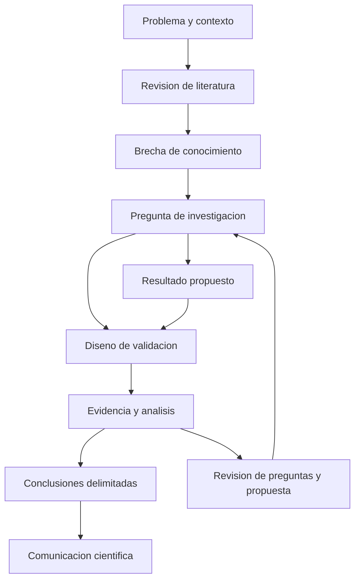

# Clase 1: Calidad y metodología de la investigación en ingeniería de software

> **Objetivo académico:** Analizar la calidad de una contribución científica en ingeniería de software mediante la coherencia entre preguntas, resultados y evidencia; comprender la revisión por pares y formular criterios para comunicar contribuciones originales, rigurosas y contextualizadas.

## 1. Contexto y marco conceptual

### De desarrollar software a producir conocimiento

La sesión aborda la ingeniería de software como campo de investigación. Su centro no es repetir las etapas habituales del desarrollo —requisitos, diseño, implementación y pruebas—, sino comprender cómo se identifica un problema abierto, se formula una contribución y se construye evidencia que permita sostenerla ante una comunidad científica.

La experiencia profesional proporciona acceso a problemas, organizaciones y prácticas reales, pero no se convierte automáticamente en investigación. Construir una aplicación demuestra que se ha desarrollado un producto; sostener una contribución científica exige explicar qué conocimiento aporta, cómo se diferencia del trabajo existente y bajo qué condiciones sus resultados son válidos.

Una contribución puede adoptar la forma de una herramienta, un procedimiento, un modelo, un formalismo o una caracterización empírica. No necesita resolver toda un área: puede ampliar de manera acotada el conocimiento sobre un problema específico. La delimitación es esencial para relacionar la magnitud de las afirmaciones con la evidencia disponible.

### Contexto regional y transferibilidad metodológica

Los problemas de logística, educación, distribución de recursos o gestión de requisitos pueden originar investigación relevante cuando se especifican sus condiciones y se identifica una brecha de conocimiento. El contexto regional aporta valor si modifica el problema, las restricciones o la aplicabilidad de soluciones existentes. Cambiar únicamente el lugar de aplicación no establece por sí mismo una novedad científica.

La formulación de preguntas, la revisión crítica de literatura y la justificación de la evidencia son prácticas transferibles a otras áreas de computación. Las técnicas concretas de evaluación, sin embargo, deben ajustarse a los objetos y afirmaciones de cada disciplina.

### Seleccionar literatura de referencia

Se presentan tres conferencias como referentes destacados del campo:

| Conferencia | Orientación destacada en la sesión |
|---|---|
| ICSE | Investigación amplia en ingeniería de software. |
| FSE | Fundamentos de la ingeniería de software, incluidos requisitos, diseño y arquitectura. |
| ASE | Automatización de actividades de ingeniería de software, con presencia importante de pruebas. |

Estas orientaciones no constituyen fronteras temáticas rígidas. El prestigio del lugar de publicación sirve como indicio inicial de selección y revisión, pero no reemplaza el análisis del artículo individual ni excluye contribuciones valiosas publicadas en otros espacios.

Se distinguen los reconocimientos retrospectivos, como los premios de impacto o de permanencia en el tiempo, de los premios otorgados a trabajos recientes. Los primeros permiten observar influencia sostenida; los segundos identifican contribuciones prometedoras cuya repercusión futura todavía se desconoce. También debe distinguirse la calidad de la contribución de la calidad de su exposición: un resultado influyente puede estar presentado en un texto mejorable.

## 2. Fundamentos teóricos y arquitectura

### La tríada pregunta, resultado y validación

La sesión utiliza el trabajo *What Makes Good Research in Software Engineering?*, atribuido a Mary Shaw, como marco para analizar tres facetas de una investigación:

1. **Pregunta:** qué problema o incertidumbre se pretende resolver.
2. **Resultado:** qué producto intelectual o técnico se obtiene para responderla.
3. **Validación:** qué evidencia permite sostener que el resultado responde efectivamente a la pregunta.

No son únicamente etapas cronológicas: son dimensiones que deben conservar coherencia en el trabajo completo. Una pregunta clara puede quedar sin respuesta si el resultado no es pertinente; una herramienta novedosa puede quedar insuficientemente sustentada si su evaluación no mide las propiedades que se afirman.

### Tipos de preguntas

La clasificación expuesta permite reconocer distintas maneras de formular una investigación:

| Tipo | Pregunta orientadora | Ejemplo conceptual de la sesión |
|---|---|---|
| Método de desarrollo | ¿Cómo realizar una actividad de una manera nueva o mejor? | Generar automáticamente casos de prueba. |
| Método de análisis o evaluación | ¿Cómo evaluar una propiedad de un método o artefacto? | Determinar si la cobertura informa sobre la efectividad de las pruebas. |
| Diseño y evaluación de un sistema | ¿Cómo construir y analizar una solución integrada? | Diseñar una herramienta que mejore un proceso. |
| Generalización o caracterización | ¿Qué regularidades permiten describir una familia de fenómenos? | Caracterizar prácticas o errores recurrentes. |
| Factibilidad | ¿Es posible utilizar un enfoque para resolver un problema? | Explorar si una técnica puede aplicarse en un contexto distinto. |

La clasificación orienta la formulación; no implica que todas las investigaciones deban responder todas las clases de preguntas.

### Tipos de resultados

Los resultados pueden ser procedimientos o técnicas, modelos empíricos o analíticos, herramientas o notaciones, soluciones situadas y reportes que sinteticen observaciones o recomendaciones.

Un modelo empírico se apoya en observaciones o datos para describir o predecir un fenómeno. Un modelo analítico representa relaciones mediante una estructura conceptual o formal. Una herramienta materializa capacidades operativas, mientras que un procedimiento prescribe una manera de actuar. Un reporte puede aportar conocimiento mediante una síntesis argumentada, aunque no produzca software nuevo.

El resultado es aquello que la investigación aporta. Debe distinguirse tanto de la pregunta que lo motiva como del método utilizado para producirlo y evaluarlo.

### Formas de validación y alcance de sus conclusiones

La sesión distingue análisis formal, evidencia empírica, ejemplos y argumentación persuasiva. También menciona afirmaciones apoyadas en la autoridad de una figura reconocida, cuya existencia sociológica no las convierte en evidencia suficiente.

| Forma de validación | Qué puede sustentar | Límite que debe explicitarse |
|---|---|---|
| Análisis formal | Propiedades derivadas de definiciones y supuestos explícitos. | La conclusión se restringe al modelo y a los supuestos de la demostración. |
| Evaluación empírica | Comportamiento observado mediante mediciones o estudios. | Depende de la selección de casos, instrumentos y condiciones. |
| Ejemplo de aplicación | Viabilidad o funcionamiento en un caso delimitado. | No demuestra por sí solo generalidad. |
| Argumentación persuasiva | Plausibilidad y coherencia de una propuesta. | Puede dejar sin comprobar afirmaciones sobre su funcionamiento real. |

**Enriquecimiento conceptual:** Estas formas no constituyen una jerarquía universal independiente de la pregunta. Una demostración puede establecer corrección en un modelo sin acreditar utilidad organizacional; un estudio empírico puede documentar utilidad sin demostrar corrección para todos los casos posibles. La exigencia central es la correspondencia entre afirmación y evidencia.

Una aportación teórica también requiere resultados identificables y justificación. Hacer concreto un resultado no equivale necesariamente a programarlo: puede significar definir con precisión un modelo, un procedimiento o una propiedad demostrable.

## 3. Implementación técnica y lógica de negocio

### Diseñar la investigación antes de cerrar su relato

La sesión no desarrolla código ni ejecuta experimentos. Su implementación técnica consiste en organizar el proceso de investigación y especificar cómo se evaluaría una propuesta.

La secuencia recomendada parte de identificar una idea, revisar su novedad, justificar su relevancia, formular preguntas, concretar un resultado y definir su evaluación. Los resultados preliminares permiten conocer el comportamiento real de la propuesta y ajustar el alcance de la contribución.

Se cuestiona redactar un artículo completo como si bastara con sustituir cifras al final: los resultados pueden obligar a cambiar las conclusiones y la línea argumental. Esto no impide documentar tempranamente decisiones y métodos; impide presentar resultados todavía desconocidos como si fueran una confirmación asegurada.

### Caso conductor: generación automática de pruebas

El ejemplo recurrente consiste en recibir código Java y producir pruebas JUnit. La pregunta se refiere al método de generación; el resultado puede ser una herramienta; la evaluación debe comprobar propiedades relevantes de las pruebas producidas.

| Propiedad | Indicador mencionado | Qué permite observar |
|---|---|---|
| Validez técnica inicial | Proporción de pruebas que compilan. | Si la salida puede superar una comprobación básica de integración. |
| Ejercicio del programa | Cobertura o recubrimiento. | Qué elementos definidos por el criterio de cobertura se ejecutan. |
| Detección de defectos | Errores detectados. | Evidencia de efectividad sobre los defectos considerados. |
| Sensibilidad ante cambios defectuosos | Pruebas de mutación. | Capacidad de distinguir determinadas alteraciones del programa. |

**Enriquecimiento conceptual:** Para precisar el significado de cobertura, puede expresarse una proporción genérica:

$$
C = \frac{|E_{\mathrm{ejecutados}}|}{|E_{\mathrm{objetivo}}|}
$$

Aquí $E_{\mathrm{objetivo}}$ es un conjunto finito y no vacío de elementos del programa definidos por el criterio elegido, como sentencias o ramas; $E_{\mathrm{ejecutados}}$ es el subconjunto ejercitado por las pruebas. El símbolo $|\cdot|$ representa cardinalidad. La cobertura $C$ es adimensional y pertenece al intervalo $[0,1]$; al multiplicarla por cien se obtiene un porcentaje.

Esta proporción cuantifica ejecución, no corrección de los resultados. Una prueba puede recorrer una sentencia defectuosa sin verificar la salida correspondiente. Por eso, una cobertura alta no basta para concluir que la batería detecta bien los errores. La fórmula es una aclaración conceptual, no un resultado calculado durante la sesión.

### Especificación de la evaluación

Una metodología verificable debe describir los programas o sujetos incluidos, los criterios de selección, las herramientas utilizadas, las métricas y las condiciones de ejecución pertinentes. Cuando se compara con una solución existente, esta funciona como **línea base** o *baseline*.

La elección de la población debe responder a la pregunta. Consultar a desarrolladores no sustituye automáticamente la perspectiva de gestores de proyectos si las afirmaciones se refieren a decisiones de gestión. Del mismo modo, aplicar una herramienta a un único proyecto no permite atribuirle comportamiento universal.

### Arquitectura de un artículo técnico

El esquema presentado comprende introducción, fundamentos, propuesta, metodología, resultados, trabajos relacionados y conclusiones. La metodología incluye la discusión de amenazas a la validez.

| Componente | Función argumental |
|---|---|
| Resumen | Condensar problema, solución y resultados. |
| Introducción | Motivar el problema, situar la brecha y declarar las contribuciones. |
| Fundamentos | Aportar los conceptos necesarios para comprender la propuesta. |
| Propuesta | Explicar el resultado y su funcionamiento. |
| Metodología | Justificar cómo se obtendrá evidencia para responder las preguntas. |
| Resultados y análisis | Presentar observaciones e interpretar su relación con las preguntas. |
| Amenazas a la validez | Delimitar restricciones y posibles explicaciones alternativas. |
| Trabajos relacionados | Comparar la contribución con el conocimiento existente. |
| Conclusiones | Sintetizar lo demostrado, sus límites y las líneas abiertas. |

El orden de lectura no tiene que coincidir con el orden de redacción. Se recomienda comenzar por la propuesta, la metodología y los resultados; después articular fundamentos, trabajos relacionados y conclusiones; finalmente redactar resumen e introducción con conocimiento del conjunto. La introducción debe declarar explícitamente qué aporta el trabajo, mediante contribuciones concretas y respaldadas por el contenido.

## 4. Análisis crítico de casos y auditoría práctica

### Cobertura y calidad de las pruebas

Se comenta un trabajo influyente que cuestiona utilizar la cobertura como indicador único de la capacidad de detectar defectos. El argumento central es metodológico: una métrica accesible no debe sustituir sin justificación la propiedad que interesa estudiar.

La sesión describe evidencia contraria a asumir una correlación fuerte y general entre cobertura y efectividad. No proporciona el diseño ni los datos completos del artículo, por lo que no corresponde reconstruir sus resultados estadísticos ni afirmar que la cobertura carece siempre de utilidad. La conclusión recuperable es la necesidad de complementar su interpretación con indicadores de efectividad.

### Soluciones contextualizadas y novedad

Una propuesta de gestión de requisitos aplicada en una empresa concreta puede producir evidencia pertinente si caracteriza las condiciones organizacionales y documenta sus resultados. La contribución depende de lo que esas condiciones permitan aprender, no únicamente de que la aplicación ocurra en una empresa distinta.

Para analizar novedad contextual deben identificarse las características que diferencian el caso respecto de la literatura y explicar por qué podrían alterar el comportamiento del método. Si el problema y sus condiciones son equivalentes a los ya estudiados, la localización geográfica no basta como argumento de originalidad.

La revisión bibliográfica aumenta la confianza en una declaración de novedad, pero no garantiza exhaustividad absoluta. Es necesario mantener atención al trabajo reciente: una contribución publicada durante el desarrollo de una investigación puede obligar a reformular su alcance.

### Revisión por pares

El proceso descrito incluye una comprobación editorial inicial, la asignación a revisores expertos, revisiones independientes y una decisión editorial o del comité. En el ejemplo de la sesión se habla habitualmente de tres revisores, pero este número y la forma de resolver desacuerdos dependen del medio.

El **rechazo editorial inicial**, o *desk rejection*, puede producirse antes de la revisión externa por incumplimiento de las condiciones de envío. La especialización de los revisores no exime al artículo de explicar sus supuestos, métodos y contribuciones de manera comprensible y suficientemente autocontenida.

La sesión destaca cinco criterios de valoración: novedad, rigor, relevancia, verificabilidad y transparencia, y calidad de presentación.

| Motivo de rechazo | Problema de fondo | Respuesta metodológica o editorial |
|---|---|---|
| Motivación insuficiente | No se comprende quién necesita la solución ni qué mejora. | Precisar el problema, sus consecuencias y los beneficiarios. |
| Novedad poco clara | La diferencia frente al trabajo previo no está establecida. | Comparar contribuciones específicas y actualizar la literatura. |
| Metodología débil | Las decisiones de evaluación no están justificadas. | Explicitar selección, instrumentos, procedimientos y límites. |
| Resultados insuficientes para las afirmaciones | La evidencia no respalda la mejora anunciada. | Revisar el alcance de la conclusión y la pertinencia de la comparación. |
| Acumulación de defectos menores | Figuras, redacción y omisiones dificultan valorar el trabajo. | Revisar iterativamente claridad, consistencia y legibilidad. |

**Enriquecimiento conceptual:** Un resultado que no supera una línea base no carece necesariamente de valor científico. Puede documentar límites de una técnica o cuestionar una expectativa, siempre que responda una pregunta pertinente mediante un diseño riguroso. El problema es sostener superioridad cuando la evidencia no la respalda.

### Conferencias, revistas y extensiones

Las conferencias publican artículos aceptados en actas o *proceedings*. Una revista constituye otro medio de publicación; no es necesario publicar previamente en una conferencia para enviarle un trabajo.

La sesión destaca la centralidad de las conferencias en ingeniería de software por su circulación comunitaria y sus procesos con hitos de decisión conocidos. Las revistas pueden incorporar rondas de revisión y presentar tiempos más variables. Estas observaciones expresan tendencias y experiencias, no reglas universales de visibilidad o rapidez.

El modelo **journal-first** permite presentar en una conferencia un trabajo publicado previamente en una revista, conforme a las condiciones del evento. Otra vía es extender un artículo de conferencia para una revista: deben citarse los antecedentes y explicarse los aportes adicionales, como nuevas capacidades o una evaluación ampliada. La extensión está sujeta a revisión; una invitación no equivale a aceptación automática.

El umbral porcentual mencionado en la conversación no debe interpretarse como norma universal. Lo decisivo es la política editorial aplicable y la existencia de una ampliación científica sustantiva, no un aumento mecánico de páginas.

### Revisiones de literatura

Se distingue *survey* como artículo de revisión de *survey* como encuesta a participantes. Una revisión de literatura puede aportar una síntesis, una caracterización o un mapeo del conocimiento existente.

La sesión menciona la selección mediante criterios explícitos, palabras clave y búsqueda de trabajos relacionados. También alude a *backward snowballing*, que sigue referencias de documentos identificados, y *forward snowballing*, que localiza trabajos posteriores que los citan.

Una revisión permite conectar resultados e identificar brechas, pero requiere un procedimiento organizado. La estructura de un artículo técnico con herramienta y experimentos no debe trasladarse mecánicamente a este tipo de contribución. El enlace metodológico mencionado en la sesión no está incluido en la fuente y no se reconstruye.

## 5. Principios de diseño, buenas prácticas y anti-patrones

### Alinear afirmaciones y evidencia

La pregunta debe orientar la selección de métricas, casos y comparaciones. La herramienta o el modelo no se justifican únicamente por existir: necesitan una evaluación acorde con las propiedades que se les atribuyen.

**Anti-patrones:** equiparar implementación con contribución científica; presentar cobertura como prueba suficiente de efectividad; generalizar desde un ejemplo sin justificar la transferencia; recurrir al prestigio del autor como sustituto de evidencia.

### Hacer verificable el proceso

La transparencia implica describir suficientemente los métodos y, cuando corresponda, facilitar código, datos, configuraciones y materiales. La sesión propone repositorios como apoyo a esta trazabilidad. Un pseudocódigo debe aportar detalle suficiente para comprender y reconstruir el procedimiento relevante.

**Enriquecimiento conceptual:** Publicar materiales facilita la verificación, pero no garantiza obtener resultados numéricamente idénticos. Los métodos aleatorios, las dependencias y las condiciones de ejecución pueden requerir controles y descripciones adicionales. La disponibilidad de un repositorio tampoco sustituye una explicación metodológica completa.

### Explicitar amenazas a la validez

Las amenazas a la validez delimitan qué inferencias permite el estudio y qué factores podrían debilitarlas. Si una herramienta se estudia únicamente sobre Java, la evidencia no establece automáticamente su funcionamiento en otros lenguajes.

**Enriquecimiento conceptual:** Conviene distinguir una delimitación de alcance de una amenaza concreta. Trabajar solo con Java delimita la población estudiada; afirmar después que los resultados se transfieren a cualquier lenguaje introduce una generalización que requiere justificación adicional. Asimismo, reconocer una deficiencia no la corrige: deben explicarse sus consecuencias y, cuando sea posible, las medidas de mitigación.

### Cuidar la escritura y la colaboración

La revisión iterativa permite detectar ambigüedades, supuestos omitidos, figuras ilegibles y referencias insuficientes. La lectura de un colaborador ayuda a descubrir conocimientos que el autor da por compartidos, especialmente en la descripción metodológica.

La sesión recomienda control de versiones, gestión bibliográfica, revisión ortográfica y LaTeX como apoyos al trabajo conjunto. El inglés se presenta como medio de ampliar la audiencia internacional; publicar en español también es posible, con una circulación dependiente del medio y de su comunidad.

La concisión debe preservar la información necesaria. Revisar si una oración aporta contenido es útil para reducir redundancias, pero no debe eliminar definiciones, justificaciones o conexiones necesarias para comprender el razonamiento.

La colaboración científica requiere reconocer las contribuciones efectivas y distinguir liderazgo, implementación y otras aportaciones. **Enriquecimiento conceptual:** Explicitar esas responsabilidades favorece una atribución transparente y evita equiparar la posición institucional con la contribución intelectual.

### Interpretar los antecedentes sin sobreafirmar

Leer trabajos influyentes permite aprender niveles de contribución, estrategias de evaluación y formas de argumentación. Su utilidad no depende de reutilizar directamente una implementación antigua: el aprendizaje metodológico puede permanecer aunque el artefacto original no esté disponible o requiera adaptación.

También deben analizarse críticamente las generalizaciones basadas en experiencia personal. Las observaciones sobre sistemas académicos, prestigio editorial o debilidades de comunidades de investigación no constituyen por sí mismas estudios comparativos.

## 6. Síntesis conceptual y profundización académica

Una contribución científica defendible conecta un problema relevante con una pregunta delimitada, produce un resultado identificable y aporta evidencia adecuada para sostener conclusiones proporcionadas. La publicación comunica esa conexión; la aceptación editorial no sustituye la calidad del razonamiento ni elimina sus límites.

La sesión articula tres relaciones fundamentales:

- **Novedad y literatura:** la originalidad se establece frente al conocimiento existente, mediante una revisión informada y actualizada.
- **Resultado y validación:** el tipo de aporte determina qué evidencia resulta pertinente; una prueba formal, un estudio empírico y un caso situado responden a exigencias diferentes.
- **Evidencia y comunicación:** los resultados deben presentarse con métodos transparentes, contribuciones explícitas y restricciones reconocibles.

La contextualización regional puede aportar conocimiento si identifica condiciones que alteran un problema o la aplicabilidad de una solución. Una revisión de literatura puede ser una contribución por sí misma cuando su método y síntesis permiten comprender mejor un área. Un artículo técnico, por su parte, debe hacer visible cómo la propuesta y su evaluación responden a las preguntas formuladas.

**Enriquecimiento conceptual:** Una línea de profundización transversal es la validez de los indicadores: qué propiedad se desea conocer, qué se observa realmente y qué supuestos permiten relacionar ambas. El caso de cobertura y detección de defectos muestra que medir con precisión una variable no asegura que esa variable represente adecuadamente el fenómeno de interés.

Otra línea es la relación entre generalización y contexto. La precisión sobre las condiciones de un estudio no debilita su contribución: permite reconocer dónde la evidencia es sólida y qué conocimiento adicional sería necesario para extenderla.
