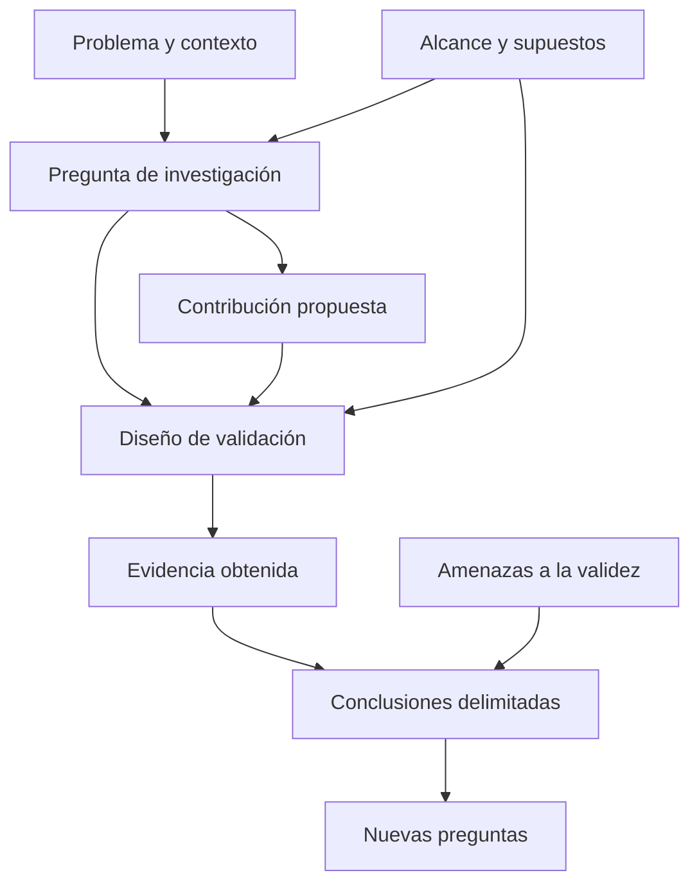
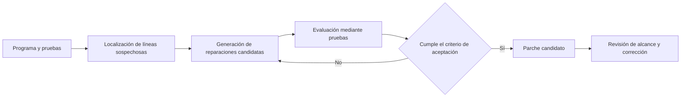

# Clase 2: Evaluación crítica de investigaciones en ingeniería de software: contribuciones, evidencia y alcance

> **Objetivo académico:** Evaluar investigaciones en ingeniería de software mediante la coherencia entre pregunta, contribución y validación, distinguiendo limitaciones legítimas, amenazas a la validez y debilidades sustentadas en evidencia.

## 1. Contexto y marco conceptual

La sesión desarrolla una lectura crítica de investigaciones que han influido en distintas áreas de la ingeniería de software. El interés principal es metodológico: comprender qué problema aborda cada trabajo, qué aporta y qué evidencia permite sostener sus conclusiones. Los detalles técnicos funcionan como casos para comparar estrategias de investigación.

Un artículo influyente no es necesariamente perfecto. Su impacto puede coexistir con restricciones de aplicación, dificultades de escalabilidad o aspectos de presentación mejorables. La revisión crítica requiere reconocer tanto el valor de la contribución como sus límites, sin convertir cualquier restricción en un defecto.

### 1.1. La unidad de análisis: pregunta, resultado y validación

El esquema central relaciona tres componentes:

- **Pregunta de investigación:** qué incertidumbre, problema o necesidad pretende resolver el trabajo.
- **Resultado o contribución:** qué conocimiento, técnica, proceso, modelo, herramienta o propuesta arquitectónica ofrece como respuesta.
- **Validación:** qué evidencia conecta la contribución con la pregunta y permite evaluar la fuerza de las afirmaciones.

En este esquema, el resultado no equivale exclusivamente a una cifra experimental. Una técnica o un modelo puede ser el resultado principal; los datos experimentales constituyen evidencia sobre sus propiedades.

El alcance atraviesa toda la relación: determina qué se pregunta, dónde puede funcionar la propuesta y hasta dónde es razonable generalizar sus conclusiones.

### 1.2. Criterios de calidad

| Criterio | Pregunta orientadora | Distinción necesaria |
|---|---|---|
| Originalidad | ¿Qué cambia respecto del conocimiento o las soluciones anteriores? | Una combinación nueva de técnicas existentes puede constituir una contribución. |
| Rigor | ¿La metodología permite sostener las afirmaciones? | La aceptación editorial no reemplaza el análisis del diseño y la evidencia. |
| Relevancia | ¿Por qué importa el problema y para quién? | Las citas indican circulación académica; no demuestran por sí solas utilidad industrial. |
| Verificabilidad | ¿Otros pueden inspeccionar y contrastar lo realizado? | La descripción metodológica y la disponibilidad de artefactos cumplen funciones complementarias. |
| Presentación | ¿El argumento resulta claro para su público especializado? | La densidad técnica no constituye automáticamente una debilidad. |

La originalidad debe juzgarse en el contexto de publicación. La aparición posterior de técnicas más potentes no elimina la novedad histórica de una propuesta.

## 2. Fundamentos teóricos y arquitectura

### 2.1. Tipos de contribución y estrategias de evidencia

La sesión muestra que las categorías de contribución pueden combinarse. Un trabajo puede introducir una técnica e implementarla en una herramienta; otro puede proponer un proceso que incorpora un algoritmo; otro puede organizar evidencia previa y derivar una guía metodológica.

| Tipo de contribución | Manifestación en los casos discutidos | Evidencia pertinente |
|---|---|---|
| Técnica o procedimiento | Reparación automática, generación de pruebas, recomendación de código | Evaluación de eficacia, coste y límites frente a referencias pertinentes. |
| Herramienta | Prototipos que materializan técnicas | Funcionamiento observable, artefactos y resultados sobre casos definidos. |
| Proceso | Asignación de informes de defectos a desarrolladores | Desempeño técnico y adecuación al trabajo de las personas involucradas. |
| Modelo o estilo arquitectónico | REST y organización de sistemas web | Argumentación sobre restricciones, propiedades y experiencia de aplicación. |
| Síntesis metodológica | Guía para evaluar algoritmos aleatorizados | Revisión de prácticas y justificación de recomendaciones. |
| Evidencia sobre un instrumento de investigación | Uso de mutantes para evaluar pruebas | Comparación entre indicadores experimentales y detección de defectos reales. |

Los ejemplos ilustrativos, los estudios empíricos y los informes de experiencia pueden coexistir. Sin embargo, no debe atribuirse experiencia de uso independiente cuando la fuente solo describe aplicaciones realizadas por los investigadores.

### 2.2. Alcance: de un concepto amplio a un problema tratable

Productividad, calidad o detección de defectos son conceptos demasiado amplios para abordarlos íntegramente en un único artículo. Una investigación los transforma en problemas tratables mediante tres operaciones:

1. Identifica una dimensión relevante del concepto.
2. Delimita el contexto y los supuestos de aplicación.
3. Define una contribución y evidencia compatibles con esa delimitación.

El caso de la gestión del contexto en el entorno de desarrollo ilustra esta lógica: la productividad se aborda a través del coste de recuperar información al cambiar de actividad. No cubrir todas las dimensiones de la productividad es compatible con una contribución sólida si las conclusiones conservan ese alcance.

**Enriquecimiento conceptual:** Esto plantea una cuestión de validez de constructo: un indicador observable debe representar adecuadamente el concepto que se desea estudiar. Reducir el tiempo de búsqueda puede aportar evidencia sobre una dimensión de productividad; no basta para afirmar una mejora global de calidad, valor entregado o sostenibilidad del trabajo.

### 2.3. Acumulación de conocimiento y referencias de comparación

La investigación no exige reconstruir todos los componentes desde cero. Reutilizar una técnica de localización de fallos permite concentrar una contribución posterior en la reparación. También facilita establecer referencias compartidas y explicar qué parte del sistema es nueva.

Una referencia de comparación, o *baseline*, adquiere valor cuando representa una alternativa pertinente al problema. Compartir métricas favorece la comparación entre trabajos, aunque no garantiza por sí solo su equivalencia.

**Enriquecimiento conceptual:** Dos resultados publicados con la misma métrica pueden ser incomparables si difieren en los conjuntos de datos, los recursos disponibles, los presupuestos de ejecución o la definición de éxito. La comparación requiere alinear estas condiciones o justificar sus diferencias.

### 2.4. Amenazas a la validez

La sesión destaca que reconocer limitaciones fortalece la transparencia. Las amenazas a la validez explican qué factores podrían alterar la interpretación de los resultados.

**Enriquecimiento conceptual:** Una clasificación útil para organizar este análisis es:

| Dimensión | Riesgo ilustrativo |
|---|---|
| Validez de constructo | Medir productividad solo mediante operaciones de edición y concluir sobre toda la productividad. |
| Validez interna | Atribuir una mejora a una herramienta cuando también cambió la experiencia de los participantes. |
| Validez externa | Generalizar desde un lenguaje, entorno o conjunto reducido de proyectos a toda la industria. |
| Validez de conclusión | Inferir superioridad con pocas ejecuciones de un algoritmo estocástico o sin considerar su variabilidad. |

Una limitación del alcance y una amenaza a la validez no son idénticas. Una restricción declarada puede ser aceptable; se vuelve problemática cuando las afirmaciones exceden lo que el diseño permite demostrar.

## 3. Implementación técnica y lógica de negocio

La fuente no contiene código ejecutable ni una implementación reproducible desarrollada durante la sesión. Presenta mecanismos de herramientas y estrategias de evaluación. Por ello, los siguientes apartados reconstruyen su lógica conceptual sin simular ejecuciones ni atribuir resultados adicionales.

### 3.1. Localización y reparación automática de defectos

Se discutieron tres componentes relacionados:

- **Tarantula:** utiliza información de ejecución de pruebas y una representación visual para orientar la búsqueda de instrucciones asociadas con fallos. La visualización ayuda a priorizar la inspección; no demuestra por sí misma que una línea sea la causa del defecto.
- **Reparación basada en programación genética:** representa variantes del programa mediante estructuras como árboles de sintaxis abstracta y explora modificaciones usando selección, mutación y cruzamiento. Las pruebas orientan la función de aptitud.
- **Reparación semántica:** combina localización de fallos, ejecución simbólica, restricciones y síntesis para construir cambios candidatos. La transcripción alterna varias denominaciones de esta herramienta; interesa aquí la arquitectura conceptual descrita.

En la reparación genética, una fase posterior reduce las modificaciones para producir un parche más pequeño. La discusión subraya que el espacio de reparación puede depender de fragmentos disponibles en el mismo programa y que ciertos enfoques suponen comportamiento determinista.

**Enriquecimiento conceptual:** Superar una batería de pruebas hace que un parche sea plausible respecto de esas pruebas, pero no demuestra su corrección para todas las entradas. Una reparación puede ajustarse a casos observados y fallar en comportamientos no cubiertos. Por tanto, tamaño del parche, éxito de pruebas y corrección semántica son propiedades distintas.

### 3.2. Ejecución concreta, simbólica y concolic

La ejecución simbólica representa entradas mediante símbolos y acumula restricciones sobre las rutas del programa. Su dificultad central es el crecimiento del número de caminos posibles.

CUTE combina ejecución concreta y simbólica. La ejecución con valores concretos proporciona una trayectoria; la información simbólica permite construir condiciones para explorar otras trayectorias. En la sesión también se menciona el tratamiento de entradas con estructuras de memoria y la simplificación de expresiones difíciles mediante valores concretos.

**Enriquecimiento conceptual:** Un ejemplo mínimo permite explicar el mecanismo. Sea $x \in \mathbb{Z}$ una entrada entera sin unidad física y supóngase que el programa contiene una bifurcación con condición $x > 0$. Una ejecución con $x=1$ recorre la rama verdadera. La condición de la rama alternativa es:

$$
x \leq 0
$$

Un solucionador puede elegir $x=0$ para recorrer esa alternativa. El ejemplo supone semántica matemática de enteros y omite desbordamientos y restricciones adicionales del lenguaje. Ilustra generación dirigida de entradas; no implica que todos los caminos de un programa real sean explorables.

**Enriquecimiento conceptual:** Con $b$ decisiones binarias independientes, donde $b$ es un entero no negativo, pueden existir hasta $2^b$ combinaciones de decisiones. Esta cota simplificada ilustra la explosión de caminos, aunque algunos sean inviables y los bucles introduzcan dificultades adicionales. La ejecución concolic orienta la exploración, pero no elimina sus límites generales.

### 3.3. Contexto de desarrollo y asignación de defectos

La herramienta de gestión del contexto presentada registra y relaciona elementos relevantes para una actividad de programación. Su integración con el entorno de desarrollo permite filtrar información y recuperar componentes al retomar una actividad.

La recomendación de responsables de defectos utiliza otro tipo de información: informes históricos y asignaciones previas. El proceso conceptual comprende preparar los datos, representar los informes, aprender asociaciones y producir recomendaciones de desarrolladores.

En ambos casos, el desempeño técnico debe conectarse con el proceso humano. Una recomendación acertada desde un registro histórico no demuestra automáticamente una reducción del tiempo de resolución ni una distribución adecuada de la carga de trabajo.

### 3.4. Autocompletado y naturalidad del software

La sesión presenta dos líneas relacionadas:

1. Autocompletado mediante frecuencia, reglas de asociación y vecinos más cercanos, con integración en un entorno de desarrollo.
2. Modelado estadístico del código a partir de su repetitividad y predictibilidad, discutido mediante *On the Naturalness of Software* y modelos de n-gramas.

La naturalidad del software se refiere a regularidades estadísticas en código escrito por personas. No equivale a afirmar que el software tenga una naturaleza humana ni que los lenguajes de programación compartan todas las propiedades del lenguaje natural.

**Enriquecimiento conceptual:** Un modelo de n-gramas aproxima la probabilidad del siguiente token mediante un contexto limitado:

$$
P(t_i \mid t_1,\ldots,t_{i-1}) \approx P(t_i \mid t_{i-n+1},\ldots,t_{i-1})
$$

Aquí, $t_i$ es el token en la posición $i$ de una secuencia de código, los tokens pertenecen a un vocabulario finito y $n$ es un entero positivo que determina la longitud del contexto más el token predicho. Las probabilidades toman valores en $[0,1]$; al inicio de la secuencia se requiere un contexto más corto o símbolos de inicio. La aproximación reduce la dependencia al historial reciente y no garantiza validez sintáctica o semántica de la sugerencia.

La evaluación debe distinguir la calidad de las recomendaciones, su orden, la aceptación por usuarios y el efecto sobre el trabajo de programación.

### 3.5. REST como propuesta arquitectónica

REST se presenta como un estilo arquitectónico, cuyo nombre corresponde a transferencia de estado representacional. El trabajo discutido organiza restricciones y principios para razonar sobre sistemas hipermedia distribuidos, considerando escalabilidad, interfaces, independencia de componentes e intermediarios.

Su contribución difiere de una herramienta evaluada sobre una batería de programas. El argumento relaciona decisiones arquitectónicas con propiedades deseadas de la web. No debe interpretarse como demostración de que cualquier aplicación web deba adoptar idéntica arquitectura, ni como garantía de rendimiento sin considerar condiciones de aplicación.

## 4. Análisis crítico de casos y auditoría práctica

### 4.1. Reparación semántica: innovación por integración

El primer caso combina técnicas previamente existentes para automatizar la reparación. La lección metodológica es que la novedad puede residir en una integración con una función y un alcance nuevos.

La discusión menciona comparaciones con reparación genética y aplicaciones a programas reales. La auditoría debe preguntar qué defectos se consideran reparables, qué pruebas actúan como criterio y si las métricas distinguen parches aceptados por las pruebas de parches correctos.

La apertura del código y de los materiales utilizados favorece la verificabilidad. No basta con declarar que una combinación mantiene coherencia semántica: esa propiedad requiere una definición y evidencia acordes con la afirmación.

### 4.2. Reparación genética: eficacia y restricciones del espacio de búsqueda

El enfoque evolutivo explora candidatos y luego minimiza el parche. Los criterios discutidos incluyen éxito de reparación, tiempo y tamaño de la modificación.

La fuente contiene una tasa de éxito ambigua, por lo que no se retiene como resultado establecido. Sí se conservan sus límites metodológicos: disponibilidad de material de reparación dentro del programa, dependencia de las pruebas y supuestos de determinismo.

La aleatoriedad no constituye por sí sola una debilidad. Exige un diseño de evaluación que contemple variabilidad y repeticiones.

### 4.3. Tarantula: localizar, visualizar y delimitar

Tarantula muestra cómo una representación visual puede asistir la localización de fallos. La discusión identifica dificultades de visualización en programas de gran tamaño y ausencia de determinadas comparaciones.

El docente corrige una inferencia importante: el rigor no proviene de que el trabajo haya sido aceptado, sino de la capacidad de su metodología para sostener la contribución. Cuando no existe una alternativa equivalente, la evaluación debe ofrecer evidencia convincente sin fabricar un competidor artificial.

También se distingue entre contribuir al conocimiento y lograr adopción industrial inmediata. Un prototipo acotado puede habilitar investigaciones posteriores aunque no resuelva todos los problemas de una organización.

### 4.4. Gestión del contexto: productividad operacionalizada

El caso presentado estudia recuperación de información y cambio de contexto dentro del entorno de desarrollo. Se describe un estudio de campo con un subconjunto de participantes elegibles y análisis cuantitativo y cualitativo.

La crítica inicial propone abarcar más dimensiones de productividad. La respuesta metodológica sostiene que una delimitación estrecha puede ser precisamente la fortaleza del artículo. El punto decisivo es si la selección de participantes, los indicadores y las conclusiones son adecuados para esa dimensión.

**Enriquecimiento conceptual:** Una comparación antes-después puede verse afectada por aprendizaje, cambios en las actividades o selección de participantes. Estas posibilidades deben analizarse antes de atribuir causalmente cualquier diferencia a la herramienta; la transcripción no proporciona detalles suficientes para establecer su control en este caso.

### 4.5. REST: diseño, generalización y persuasión

El caso de REST amplía la variedad de contribuciones. No se reduce a una opinión ni a una revisión de literatura: ofrece una propuesta arquitectónica concreta apoyada en principios, restricciones y antecedentes.

En la discusión se destaca la persuasión y se atribuye importancia a la autoridad académica de sus autores. Esa observación describe una dimensión de recepción del trabajo, pero no constituye un criterio suficiente de validez.

**Enriquecimiento conceptual:** La fuerza de una propuesta arquitectónica debe juzgarse por la explicitud de sus supuestos, la coherencia de su razonamiento y la relación entre restricciones y propiedades esperadas. La reputación puede influir en su recepción, pero no sustituye esta evaluación crítica.

### 4.6. Asignación de defectos: el resultado técnico dentro de un proceso social

El trabajo sobre quién debería solucionar un defecto introduce un procedimiento de recomendación basado en informes históricos. Se discuten proyectos como Eclipse, Firefox y GCC, con diferencias importantes de desempeño.

Un caso desfavorable se relaciona en la presentación con la concentración de asignaciones en un desarrollador. Los porcentajes y las métricas se expresan de forma inconsistente, por lo que no se fijan cifras. La lección conservada es investigar por qué un proyecto se aparta del patrón esperado.

**Enriquecimiento conceptual:** El desbalance de clases no demuestra por sí solo que un algoritmo necesariamente fracase. Puede producir métricas engañosas o dificultar recomendaciones para clases poco representadas. Conviene comparar con una referencia que recomiende la clase mayoritaria y analizar qué significa la etiqueta histórica: persona inicialmente asignada, responsable final o quien efectivamente resolvió el defecto.

### 4.7. CUTE: una modificación conceptual con impacto metodológico

CUTE ilustra cómo combinar ejecución concreta y simbólica puede modificar una práctica de investigación consolidada. La sesión subraya que una idea conceptualmente sencilla puede producir una contribución sustancial cuando aborda un obstáculo importante, como la exploración del espacio de estados.

Su evaluación incluye aplicaciones a bibliotecas y programas concretos, detección de defectos y cobertura. Estos elementos no permiten concluir exploración exhaustiva de todo programa ni equivalencia automática entre cobertura y calidad.

Las cifras de citas o la existencia de múltiples versiones localizables de un documento no prueban la robustez de la técnica. El juicio debe concentrarse en los mecanismos, las condiciones y la evidencia.

### 4.8. Autocompletado aprendido: precisión técnica y utilidad percibida

El caso compara métodos de frecuencia, reglas de asociación y vecinos más cercanos. También describe un estudio con desarrolladores que utilizan la propuesta y aportan información mediante entrevistas y cuestionarios.

La combinación de evidencia cuantitativa y cualitativa permite estudiar tanto recomendaciones como experiencia de uso. No obstante, las percepciones de mejora no equivalen por sí solas a una medición causal de productividad.

La sesión identifica como aspectos relevantes el tamaño del estudio de usuarios, la concentración en un entorno y la disponibilidad de código. También señala la importancia de explicitar amenazas a la validez. Las referencias temporales del caso no son consistentes y no se adoptan como datos bibliográficos.

### 4.9. Naturalidad del software: adecuación de la evidencia empírica

El trabajo sobre naturalidad investiga regularidades estadísticas del código y sus aplicaciones al autocompletado. El docente cuestiona que una validación sea considerada débil simplemente por ser empírica: su adecuación depende de la pregunta y del diseño.

También se discute el público de un artículo científico. Un texto especializado puede suponer conocimientos previos; la crítica de presentación debe distinguir esa expectativa de una explicación insuficiente de la contribución nueva.

**Enriquecimiento conceptual:** Usar un modelo establecido no garantiza rigor experimental. En modelos de código, separar apropiadamente datos de ajuste y evaluación es decisivo para evitar que información compartida o duplicada produzca estimaciones demasiado favorables.

### 4.10. Guía estadística: investigación sobre cómo evaluar algoritmos

La guía discutida aborda prácticas de evaluación de algoritmos aleatorizados mediante revisión de investigaciones previas. Su valor no reside solo en organizar publicaciones, sino en responder a un problema metodológico: diversidad y confusión en la selección de pruebas estadísticas.

La presentación menciona una recomendación de realizar al menos cien ejecuciones cuando sea viable y justificar cantidades menores. Esta cifra se conserva como recomendación relatada del trabajo, no como umbral universal de suficiencia.

**Enriquecimiento conceptual:** El número de ejecuciones debe relacionarse con variabilidad, precisión deseada y coste. También es necesario distinguir variación entre ejecuciones y variación entre problemas: repetir muchas veces sobre un único programa no demuestra generalización a otros programas. La selección de pruebas estadísticas depende del diseño, la independencia, el emparejamiento y las propiedades de los datos.

**Enriquecimiento conceptual:** Determinismo y eficiencia son propiedades diferentes. Un algoritmo determinista no tiene necesariamente coste polinomial ni resuelve correctamente cualquier problema. Del mismo modo, un algoritmo aleatorizado no tiene necesariamente resultados incorrectos ni mejora siempre de forma iterativa; esas afirmaciones requieren especificar su clase y funcionamiento.

### 4.11. Mutación: validez de un sustituto experimental

El último caso aborda una pregunta sobre la propia investigación: si detectar defectos sintéticos mediante pruebas permite evaluar su capacidad para detectar defectos reales.

El análisis de mutación introduce modificaciones controladas en programas y observa si las pruebas distinguen el comportamiento modificado. El estudio discutido compara efectividad frente a mutantes y frente a fallos reales. La sesión lo presenta como evidencia favorable para el uso metodológico de la mutación, sin proporcionar detalle suficiente para extender sus conclusiones a cualquier contexto.

**Enriquecimiento conceptual:** Una asociación entre detección de mutantes y detección de fallos reales respalda el uso del indicador dentro de las condiciones estudiadas; no demuestra identidad entre ambos tipos de defecto. Su utilidad depende, entre otros factores, de los operadores de mutación y la representatividad de los programas.

En la conversación aparecen analogías con seguridad, análisis estático, análisis dinámico e inyección de entradas. Estas prácticas no se consideran equivalentes por compartir la idea general de introducir variaciones.

**Enriquecimiento conceptual:** La mutación modifica programas; el fuzzing genera o modifica entradas para explorar comportamientos. SAST y DAST designan enfoques de análisis estático y dinámico de seguridad. Pueden relacionarse en una estrategia de pruebas, pero sus objetivos, artefactos y evidencias son distintos. Las afirmaciones sobre herramientas comerciales mencionadas no quedan verificadas en la fuente.

## 5. Principios de diseño, buenas prácticas y anti-patrones

### 5.1. Principios para construir una contribución defendible

1. **Declarar la novedad:** precisar si consiste en una técnica, una integración, una adaptación o evidencia nueva.
2. **Delimitar antes de generalizar:** establecer contexto, supuestos y exclusiones coherentes con las conclusiones.
3. **Reutilizar conocimiento pertinente:** aprovechar herramientas existentes y separar sus capacidades de la contribución propia.
4. **Alinear evidencia y afirmación:** una mejora de precisión exige evidencia diferente de una mejora de productividad o de escalabilidad arquitectónica.
5. **Incluir a las personas cuando forman parte del fenómeno:** combinar mediciones técnicas con observación o estudios de usuarios cuando corresponda.
6. **Investigar resultados discordantes:** distinguir errores de implementación, características de los datos y límites reales del enfoque.
7. **Facilitar la verificabilidad:** documentar métodos y proporcionar artefactos cuando sea posible.
8. **Reconocer amenazas y límites:** explicar su efecto sobre la interpretación y las medidas de mitigación disponibles.

### 5.2. Anti-patrones de revisión e inferencia

| Anti-patrón | Por qué debilita la evaluación | Alternativa |
|---|---|---|
| Considerar riguroso un trabajo porque fue publicado | Sustituye el análisis metodológico por una señal editorial. | Revisar diseño, evidencia y alcance de las conclusiones. |
| Usar citas o descargas como prueba de eficacia | Confunde impacto académico con desempeño técnico. | Separar influencia, adopción y resultados medidos. |
| Exigir que un artículo resuelva todo un concepto amplio | Ignora la función de la delimitación. | Evaluar si resuelve bien la dimensión declarada. |
| Tratar toda limitación como una debilidad | Desconoce restricciones legítimas del problema. | Identificar cuándo la limitación contradice una afirmación. |
| Considerar insuficiente la evidencia solo por ser empírica | Aplica una jerarquía de métodos sin atender a la pregunta. | Valorar pertinencia, diseño y trazabilidad. |
| Equiparar pruebas superadas con corrección general | Extiende evidencia finita a comportamientos no observados. | Explicitar el papel y los límites de las pruebas. |
| Descartar observaciones adversas | Oculta información sobre validez o funcionamiento. | Analizar causas y reportar su interpretación. |
| Exigir divulgación general a todo texto especializado | Confunde público objetivo con calidad expositiva. | Evaluar claridad para lectores con formación pertinente. |
| Juzgar originalidad con tecnologías posteriores | Introduce un anacronismo. | Comparar con el estado del conocimiento de su época. |

### 5.3. Transparencia y materiales de investigación

Publicar código representa una señal importante de apertura, especialmente cuando la contribución es una herramienta. Su valor aumenta si se acompaña de datos, configuración y materiales experimentales.

**Enriquecimiento conceptual:** La disponibilidad de un repositorio no garantiza que los resultados puedan repetirse. La trazabilidad puede requerir versiones, dependencias, semillas aleatorias, parámetros, criterios de selección y procedimientos de análisis. La verificabilidad es una propiedad del conjunto de materiales y explicaciones.

## 6. Síntesis conceptual y profundización académica

La calidad de una investigación depende de la correspondencia entre lo que pregunta, lo que aporta y lo que demuestra. Esta relación admite múltiples formas: técnicas implementadas, procesos que involucran personas, propuestas arquitectónicas, síntesis de literatura y estudios sobre la validez de los instrumentos utilizados para investigar.

Los casos permiten distinguir dos planos complementarios. Algunos trabajos intervienen directamente en el desarrollo de software: localizan defectos, reparan programas, generan pruebas o apoyan a programadores. Otros mejoran la investigación en ingeniería de software: orientan la evaluación estadística o estudian si los mutantes constituyen indicadores útiles de efectividad de pruebas.

Tres conclusiones articulan la sesión:

- **Una contribución acotada puede ser valiosa.** Su fortaleza depende de que el problema importe y de que la evidencia respalde la respuesta dentro del alcance declarado.
- **Una integración puede producir conocimiento nuevo.** La originalidad no exige inventar cada componente; exige precisar qué relación o capacidad nueva aporta el conjunto.
- **La crítica debe estar justificada.** Reconocer virtudes y aceptar límites legítimos es tan importante como identificar fallos metodológicos.

**Enriquecimiento conceptual:** La profundización puede organizarse mediante cuatro distinciones: eficacia técnica frente a utilidad en el trabajo real; indicador observable frente a concepto estudiado; evidencia local frente a generalización; y transparencia de materiales frente a validez de las conclusiones. Estas distinciones permiten formular críticas precisas sin desestimar contribuciones por expectativas ajenas a su propósito.

El criterio transversal consiste en ajustar la fuerza de cada afirmación a la fuerza y al dominio de su evidencia.
