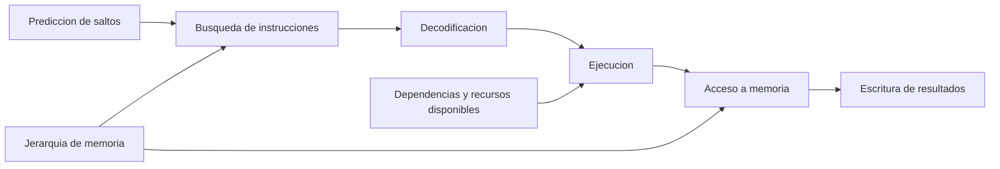
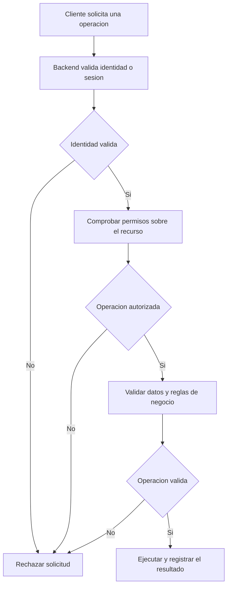

# Clase 1: Microarquitectura avanzada: paralelismo, jerarquía de memoria y seguridad

> **Objetivo académico:** Comprender cómo la organización interna del procesador, el paralelismo y la jerarquía de memoria condicionan el rendimiento computacional, y analizar críticamente sus relaciones con la confiabilidad, la seguridad y el desarrollo de software.

## 1. Contexto y marco conceptual

La sesión introduce la computación avanzada desde la **microarquitectura**, entendida como el diseño y la optimización de la estructura interna de un microprocesador. El hilo conductor consiste en relacionar decisiones de hardware con fenómenos observables en el software: ejecución de instrucciones, utilización de recursos, acceso a datos y capacidad para procesar varias actividades.

Se presentan como componentes del campo la segmentación de instrucciones o *pipelining*, la ejecución fuera de orden, la predicción de saltos, los sistemas multinúcleo, el paralelismo y la jerarquía de memoria. También se mencionan virtualización, seguridad, aceleradores y unidades especializadas, aunque sin desarrollar sus mecanismos internos.

**Enriquecimiento conceptual:** Conviene distinguir tres niveles de descripción:

| Nivel | Pregunta central | Ejemplos |
| --- | --- | --- |
| Arquitectura del conjunto de instrucciones, ISA | ¿Qué comportamiento ofrece el procesador al software? | Instrucciones, registros visibles y reglas de ejecución |
| Microarquitectura | ¿Cómo implementa el procesador ese comportamiento? | Etapas de ejecución, predictores, unidades funcionales y cachés |
| Sistema computacional | ¿Cómo se integran procesamiento, memoria, dispositivos y software? | CPU, GPU, memoria principal, sistema operativo y aplicaciones |

Esta distinción evita atribuir a una biblioteca de programación un control directo sobre mecanismos internos que administra el procesador. El software puede organizar el trabajo e influir en su aprovechamiento; ello no significa que pueda crear físicamente etapas de ejecución o núcleos.

### 1.1 Analogías y precisión terminológica

La metáfora de la tubería aparece como recurso para explicar el movimiento y la transformación de información. Es útil como primera aproximación, pero la sesión reúne bajo esa imagen mecanismos de distinta naturaleza.

**Enriquecimiento conceptual:** La semejanza verbal entre *pipe* y *pipeline* no establece equivalencia técnica:

| Concepto | Significado técnico | Límite de la analogía |
| --- | --- | --- |
| Pipeline de instrucciones | Organización del procesamiento en etapas que se solapan | No es un canal de red ni una petición a un servidor |
| Pipe de software | Canal de comunicación entre componentes o procesos | No implica segmentación física del procesador |
| Pipeline de integración y despliegue | Secuencia automatizada de operaciones de construcción, comprobación y publicación | Sus etapas pertenecen al flujo de desarrollo |
| Interacción cliente-servidor | Intercambio de solicitudes y respuestas | Puede utilizarse sin un pipeline de instrucciones específico |
| VPN | Conectividad lógica protegida sobre una infraestructura de red | Sus propiedades dependen de protocolos y configuraciones de seguridad |

Una definición personal favorece la comprensión cuando conserva las propiedades esenciales del concepto. Si elimina sus diferencias con otros mecanismos, deja de ser una simplificación útil.

### 1.2 Conocimiento científico y actualización

La sesión destaca la comunicación de resultados, la lectura de literatura técnica y la necesidad de actualizar conocimientos en un área de rápida evolución. También cuestiona que la antigüedad de una referencia sea motivo suficiente para descartarla.

**Enriquecimiento conceptual:** Una fuente fundacional puede seguir siendo pertinente para explicar un principio, mientras que las afirmaciones sobre productos, vulnerabilidades o rendimiento requieren contextualización temporal. La publicación facilita el escrutinio y la circulación de resultados; por sí sola no garantiza su validez. Del mismo modo, una traducción automática facilita el acceso lingüístico, pero exige revisar términos especializados, supuestos y significado de las conclusiones.

## 2. Fundamentos teóricos y arquitectura

### 2.1 Segmentación de instrucciones

El *pipelining* se presenta como uno de los mecanismos centrales de la microarquitectura avanzada.

**Enriquecimiento conceptual:** Su principio consiste en dividir el procesamiento de instrucciones en etapas y solapar instrucciones diferentes. Una representación didáctica puede distinguir búsqueda, decodificación, ejecución, acceso a memoria y escritura del resultado. Este esquema sirve para comprender la segmentación; no describe necesariamente un procesador comercial concreto.

La segmentación busca aumentar la cantidad de instrucciones que terminan por unidad de tiempo. No garantiza que una instrucción individual tarde menos en atravesar el procesador.

**Enriquecimiento conceptual:** En un modelo ideal de $k$ etapas, cada una con duración $\tau$, el procesamiento de $n$ instrucciones requiere:

$$
T_{\mathrm{sin\ solapamiento}} = nk\tau
$$

$$
T_{\mathrm{pipeline}} = (k+n-1)\tau
$$

Aquí $n$ y $k$ son enteros positivos, $\tau>0$ es el tiempo por etapa y ambos tiempos se expresan en la misma unidad que $\tau$. La primera expresión supone que cada instrucción completa sus $k$ etapas antes de iniciar la siguiente. La segunda suma $k$ intervalos para completar la primera instrucción y $n-1$ para las restantes, una vez ocupado el pipeline.

La aceleración ideal es:

$$
S = \frac{nk}{k+n-1}
$$

$S$ es una razón adimensional. Por ejemplo, con cinco etapas y diez instrucciones, el modelo requiere $50\tau$ sin solapamiento y $14\tau$ con segmentación, de donde $S\approx 3{,}57$. Son valores ilustrativos, no resultados de la sesión. El modelo supone etapas equilibradas y ausencia de dependencias, conflictos de recursos, fallos de caché y errores de predicción. Para un flujo largo de instrucciones, su límite ideal se aproxima a $k$.

### 2.2 Ejecución fuera de orden

La sesión relaciona el orden de procesamiento con FIFO, LIFO, prioridades, trabajo más corto y Round Robin. Estas referencias permiten discutir reglas de selección, pero pertenecen a problemas diferentes.

**Enriquecimiento conceptual:** FIFO y LIFO describen disciplinas de acceso a estructuras de datos; Round Robin y trabajo más corto son políticas de planificación; la **ejecución fuera de orden** es un mecanismo microarquitectónico que permite ejecutar instrucciones disponibles antes que otras anteriores que están esperando operandos o recursos.

Su criterio central es respetar las dependencias y preservar el comportamiento arquitectónico del programa. Si una instrucción necesita el resultado de otra, no puede ejecutarse correctamente antes de disponer de él. En cambio, una operación independiente puede avanzar mientras otra espera datos de memoria. En implementaciones habituales, la finalización interna y el retiro que confirma resultados al estado arquitectónico son etapas distintas.

La ejecución fuera de orden no equivale a escoger libremente instrucciones ni a activar procesos paralelos desde una aplicación. Su finalidad es aprovechar mejor las unidades funcionales disponibles dentro de las restricciones de corrección.

### 2.3 Predicción de saltos

La predicción de saltos se introduce como una técnica para anticipar el resultado de bifurcaciones condicionales y reducir retrasos.

**Enriquecimiento conceptual:** Un salto condiciona qué instrucciones deberían buscarse a continuación. El predictor anticipa esa decisión para mantener ocupado el flujo de procesamiento. Si acierta, se aprovecha el trabajo anticipado; si falla, debe descartarse el trabajo especulativo incorrecto y retomarse el camino adecuado.

Por tanto, la predicción no modifica la lógica del programa ni garantiza una reducción fija del tiempo total. Su beneficio depende de la precisión, del coste de recuperación y de la frecuencia de los saltos. Aunque comparte con otros problemas la idea de anticipar un resultado, no debe confundirse con la predicción climatológica o con un modelo genérico de inteligencia artificial.

### 2.4 Multinúcleo, concurrencia y paralelismo

La discusión colectiva identifica una distinción importante: la disponibilidad física de recursos y la organización del software son dimensiones relacionadas, pero diferentes.

**Enriquecimiento conceptual:** Las definiciones que permiten precisar esa discusión son:

- **Multinúcleo:** procesador que integra varios núcleos de ejecución.
- **Concurrencia:** organización de varias actividades cuyos periodos de progreso se superponen, aunque puedan alternarse sobre un solo recurso.
- **Paralelismo:** ejecución simultánea de operaciones en recursos diferentes.
- **Hilo de software:** secuencia de ejecución gestionada por el entorno de programación y el sistema operativo.
- **Procesador lógico:** contexto de ejecución que el hardware presenta al sistema; no equivale necesariamente a un núcleo físico adicional.
- **Sistema heterogéneo:** sistema que combina recursos de distinta naturaleza, como CPU y GPU.

La presencia de CPU y GPU no define por sí sola que una CPU sea multinúcleo. Un procesador multinúcleo puede ejecutar trabajo en paralelo, pero una aplicación no obtiene automáticamente una mejora proporcional al número de núcleos. Debe existir trabajo independiente suficiente y una coordinación cuyo coste no absorba el beneficio.

La alternancia rápida sobre un solo recurso explica ciertas formas de concurrencia. No permite concluir que todo paralelismo de hardware sea aparente: varios núcleos o unidades funcionales pueden realizar operaciones simultáneamente.

### 2.5 Jerarquía de memoria y localidad

La memoria caché se describe como un recurso de acceso rápido que reduce el coste de obtener información utilizada por el procesador. Se discuten RAM, almacenamiento, registros y niveles de caché.

**Enriquecimiento conceptual:** La jerarquía organiza recursos con compromisos entre latencia, capacidad y coste. Una representación habitual va de registros a cachés L1, L2 y L3, memoria principal y almacenamiento persistente. La configuración concreta depende del procesador y del sistema.

| Recurso | Función principal | Consideración |
| --- | --- | --- |
| Registros | Mantener operandos y estado inmediato de ejecución | Capacidad muy limitada y acceso estrechamente integrado con las instrucciones |
| Caché L1 | Servir accesos muy próximos al núcleo | Generalmente pequeña y de baja latencia |
| Caché L2 | Ampliar la cobertura de datos e instrucciones | Habitualmente mayor que L1 y con más latencia |
| Caché L3, cuando existe | Proporcionar otro nivel de almacenamiento rápido | Puede compartirse entre núcleos |
| RAM | Alojar datos y programas activos | Mayor capacidad y mayor latencia que las cachés del procesador |
| Almacenamiento persistente | Conservar información más allá de la ejecución | No ofrece la misma latencia ni la misma función que la RAM |

L2 es un nivel distinto de L1. Tampoco existe un tamaño universal por nivel ni un número fijo de niveles para todos los modelos. El término «memoria principal» aplicado a la RAM describe su papel en el sistema, no que sea la memoria más rápida.

Los principios de localidad explican por qué una caché puede ser efectiva:

- **Localidad temporal:** un dato o una instrucción utilizados recientemente pueden volver a utilizarse pronto.
- **Localidad espacial:** acceder a una dirección suele acompañarse de accesos a direcciones próximas.

**Enriquecimiento conceptual:** En un modelo simplificado de un nivel de caché, el tiempo medio de acceso puede escribirse como:

$$
T_{\mathrm{medio}} = t_c + mP
$$

$t_c>0$ es el tiempo de consulta de la caché, $m\in[0,1]$ es la fracción de accesos que fallan y $P\geq0$ es la penalización adicional media de un fallo. Los tiempos deben expresarse en la misma unidad. La expresión supone que todo acceso consulta la caché y que un fallo añade un coste medio representable por $P$. No representa por completo el solapamiento de accesos ni las interacciones entre varios niveles, pero muestra que la latencia de acierto y la frecuencia y coste de los fallos afectan conjuntamente al rendimiento.

### 2.6 Reemplazo y escritura en caché

La sesión introduce dos familias de políticas: reemplazo y escritura.

**Enriquecimiento conceptual:** Una política de reemplazo decide qué bloque desplazar cuando debe incorporarse otro y no existe una ubicación libre adecuada. FIFO prioriza la antigüedad de inserción; LRU, la antigüedad del último uso; LFU, la frecuencia de uso. Son criterios distintos, con costes de seguimiento diferentes. Mencionarlos no implica que todos se implementen literalmente en cualquier caché de CPU; pueden emplearse aproximaciones.

| Política de escritura | Comportamiento | Compromiso principal |
| --- | --- | --- |
| Write-through | Propaga la escritura hacia el nivel inferior | Facilita mantenerlo actualizado, pero puede generar más tráfico |
| Write-back | Modifica el bloque en caché y difiere su propagación | Puede reducir tráfico, pero exige registrar modificaciones y gestionar su escritura posterior |

La propagación en write-through no tiene que ser físicamente simultánea, pues pueden intervenir buffers. Write-back tampoco se define solo como una escritura «en bloque»: su propiedad esencial es diferir la actualización del nivel inferior de los datos modificados.

## 3. Implementación técnica y lógica de negocio

La fuente menciona herramientas y aplicaciones, pero no contiene una implementación completa, código relevante que conservar ni resultados reproducibles. Su aportación técnica se sitúa en la selección de mecanismos y en la relación entre problemas de software y recursos de hardware.

### 3.1 Del problema a la estrategia de procesamiento

Entre los ejemplos aparecen procesamiento de registros universitarios, análisis de información comercial y ejecución simultánea de pruebas automatizadas. La lógica común consiste en identificar unidades de trabajo que puedan distribuirse y combinar sus resultados.

**Enriquecimiento conceptual:** La posibilidad de dividir una carga no basta para justificar su paralelización. Es necesario identificar dependencias, datos compartidos, requisitos de sincronización y coste de combinar resultados. En pruebas automatizadas, por ejemplo, ejecutar casos simultáneamente exige controlar el estado compartido, los datos de prueba y la competencia por servicios externos.

| Recurso mencionado | Función técnica | Precisión necesaria |
| --- | --- | --- |
| MPI | Comunicación entre procesos mediante paso de mensajes | Se asocia especialmente con modelos de memoria distribuida |
| OpenMP | Directivas y mecanismos para expresar paralelismo, especialmente en memoria compartida | No es simplemente un programa que activa núcleos |
| CUDA | Plataforma de programación para GPU compatibles | Requiere una carga adecuada y considerar movimientos de datos |
| Bibliotecas de concurrencia de Python | Organización de tareas, hilos o procesos | Su comportamiento depende de la implementación y del tipo de trabajo |
| Simulación de arquitectura | Análisis de modelos de procesadores y sistemas | Sus conclusiones dependen del modelo y de sus parámetros |

Estas precisiones son **Enriquecimiento conceptual**. Los nombres o enlaces de algunas herramientas se oyen de forma ambigua en la transcripción; no se reconstruyen instalaciones ni funcionalidades a partir de ellos.

### 3.2 Memoria compartida y memoria distribuida

Ambos modelos aparecen como alternativas para organizar cómputo paralelo.

**Enriquecimiento conceptual:** En memoria compartida, las unidades de ejecución pueden acceder a un espacio de direcciones común; el diseño debe controlar accesos concurrentes y sincronización. En memoria distribuida, los procesos operan sobre memorias separadas e intercambian información mediante comunicación explícita. Esta diferencia influye en cómo se particionan los datos y se expresa la coordinación.

Ningún modelo garantiza superioridad universal. Una descomposición que minimiza comunicación puede favorecer un sistema distribuido; una carga con intercambio frecuente y estrecho puede beneficiarse de memoria compartida, siempre que no genere contención excesiva.

### 3.3 Inteligencia artificial y aceleración

La sesión vincula la inteligencia artificial con el procesamiento paralelo y las GPU. Se mencionan un proyecto de apoyo a dificultades de lectura mediante dispositivos visuales y otro de análisis de ventas agrícolas para apoyar decisiones productivas.

Estos casos permiten separar captura de datos, procesamiento y decisión. No se presentan detalles suficientes para establecer eficacia clínica, precisión predictiva ni mejoras económicas.

**Enriquecimiento conceptual:** Para relacionar una aplicación de inteligencia artificial con la arquitectura conviene distinguir entrenamiento e inferencia, capacidad de memoria, transferencia de datos y operaciones susceptibles de aceleración. Un gran número de parámetros no determina por sí solo el tiempo de ejecución. También importan su representación, el algoritmo, el tamaño de los lotes y el hardware utilizado.

### 3.4 Seguridad en aplicaciones cliente-servidor

La sesión describe una separación entre frontend y backend y plantea el uso de autenticación, roles y tokens. Su caso técnico más concreto es una interfaz cuyos controles deshabilitados pueden modificarse desde el navegador.

**Enriquecimiento conceptual:** Deben distinguirse tres funciones:

- **Autenticación:** establecer la identidad del solicitante.
- **Autorización:** determinar qué operaciones puede realizar sobre qué recursos.
- **Validación:** comprobar que los datos y la operación solicitada cumplen las reglas aplicables.

Los roles son una forma de organizar permisos; los tokens pueden transportar o referenciar información de una sesión. Su presencia no demuestra que los permisos se validen correctamente.

El frontend puede ocultar acciones para mejorar la experiencia de uso, pero la decisión de permitir una modificación debe verificarse en el servidor. Modificar HTML local no debería bastar para alterar información protegida.

## 4. Análisis crítico de casos y auditoría práctica

### 4.1 La petición a un servidor como analogía del pipeline

La sesión utiliza una secuencia de validaciones cliente-servidor para ilustrar una tubería. La analogía ayuda a visualizar entradas, procesamiento y respuestas, pero no explica por sí misma el solapamiento entre instrucciones.

**Enriquecimiento conceptual:** La auditoría de una analogía debe identificar qué conserva y qué pierde. Aquí conserva la idea de tránsito y transformación; pierde la distinción entre canal de comunicación, secuencia de trabajo y segmentación microarquitectónica. Por ello debe acompañarse de definiciones diferenciadas.

### 4.2 Apertura de aplicaciones y cachés

Se compara la apertura de programas frecuentes con la de otros menos utilizados para ilustrar el beneficio de almacenar información reutilizable.

**Enriquecimiento conceptual:** El fenómeno observado no permite atribuir la diferencia exclusivamente a las cachés del procesador. También intervienen la caché de archivos del sistema operativo, páginas que permanecen en RAM, almacenamiento, bibliotecas cargadas y tareas de inicialización. Una apertura rápida no demuestra qué nivel de caché fue responsable.

La memoria virtual tampoco equivale simplemente a ampliar RAM con disco: es una abstracción de direcciones y gestión de memoria que puede apoyarse en paginación hacia almacenamiento. El uso de dispositivos externos como caché y la paginación son mecanismos distintos. Las afirmaciones de la sesión sobre familias enteras de procesadores sin caché, equipos ensamblados sin ella o niveles excepcionales no permiten establecer características universales de productos.

### 4.3 Rendimiento cuántico y comparabilidad

La computación cuántica aparece como horizonte del módulo, acompañada de relatos de reducciones drásticas en tiempos de procesamiento. No se especifican el algoritmo, el dispositivo, la codificación de datos, el papel del procesamiento clásico ni las condiciones de comparación.

**Enriquecimiento conceptual:** Una ventaja cuántica no se deduce de una diferencia temporal aislada. Deben compararse soluciones del mismo problema, con criterios equivalentes de calidad y un alcance temporal claramente definido. Un sistema cuántico utiliza qubits y operaciones propias de ese modelo; no se caracteriza como un computador clásico que simplemente maneja más bits por operación.

Tampoco puede inferirse una aceleración general para cargar bases de datos o procesar archivos arbitrarios. En ausencia de información reproducible, los relatos de la sesión se mantienen como afirmaciones no verificadas y no como demostraciones de rendimiento.

### 4.4 Confiabilidad, redundancia y medición de redes

La sesión reconoce mecanismos transversales de confiabilidad: redundancia, tolerancia a fallos, monitoreo, diagnóstico, recuperación y reinicio. La relación entre ellos es pertinente, pero se confunden redundancia, tráfico de red y pruebas de carga.

**Enriquecimiento conceptual:** La redundancia consiste en incorporar recursos, información o caminos adicionales para sostener un servicio o recuperar información. El simple envío y recepción de paquetes no constituye redundancia. Una prueba de velocidad observa propiedades como tasa de transferencia y latencia bajo ciertas condiciones; una prueba de estrés analiza comportamiento bajo demandas exigentes.

| Concepto | Qué representa | Qué no demuestra por sí solo |
| --- | --- | --- |
| Replicación | Mantenimiento de copias de datos o servicios | Recuperación frente a cualquier fallo o corrupción |
| Redundancia de red | Disponibilidad de enlaces, rutas o equipos alternativos | Mayor velocidad en todas las comunicaciones |
| Tolerancia a fallos | Capacidad de continuar dentro de un modelo de fallos | Ausencia de errores |
| Recuperación | Restablecimiento de un estado operativo | Continuidad sin interrupciones |
| Prueba de estrés | Observación del comportamiento ante demandas extremas | Existencia de recursos redundantes |

La confiabilidad depende del tipo de fallo previsto. Varias copias expuestas al mismo fallo común pueden no ofrecer la protección esperada.

### 4.5 Seguridad, low-code y mantenimiento

La sesión defiende que un sistema debe ser funcional y seguro, y advierte sobre reutilizar código sin comprenderlo. La crítica se extiende al código generado y a plataformas low-code.

**Enriquecimiento conceptual:** La evaluación debe centrarse en controles concretos y no en asumir que una tecnología es insegura por su categoría. Son relevantes la autorización, el tratamiento de entradas, la gestión de secretos, las dependencias y la posibilidad de auditar y mantener el resultado.

Las anécdotas sobre incidentes, adquisiciones tecnológicas y estudios educativos carecen de referencias suficientes para tratarlas como evidencia. El argumento académico recuperable es metodológico: una afirmación llamativa requiere trazabilidad, condiciones explícitas y evaluación crítica.

## 5. Principios de diseño, buenas prácticas y anti-patrones

### 5.1 Rendimiento con límites explícitos

La sesión identifica escalabilidad, consumo energético y complejidad del diseño como desafíos. La imposibilidad de añadir capacidad arbitrariamente a un procesador ya fabricado es una restricción física, pero no agota el concepto de escalabilidad.

**Enriquecimiento conceptual:** La escalabilidad puede analizarse en el procesador, en un equipo o en un conjunto de nodos. Sus límites incluyen dependencias, comunicación, ancho de banda de memoria, energía, temperatura y coordinación. El overclocking modifica condiciones de funcionamiento; no crea núcleos ni garantiza una mejora proporcional.

Una expresión útil para delimitar la aceleración por paralelismo es la ley de Amdahl:

$$
S(p)=\frac{1}{(1-f)+f/p}
$$

Aquí $p\geq1$ es el número entero de unidades de procesamiento equivalentes, $f\in[0,1]$ es la fracción del tiempo secuencial susceptible de paralelización ideal y $S(p)$ es la aceleración adimensional respecto de una unidad. Se supone un problema de tamaño fijo, reparto perfecto y ausencia de costes adicionales.

El denominador suma la fracción que permanece secuencial y la fracción paralelizable dividida entre $p$. Si $f<1$, al aumentar indefinidamente los recursos:

$$
\lim_{p\to\infty}S(p)=\frac{1}{1-f}
$$

La expresión muestra por qué más núcleos no eliminan una sección secuencial. En sistemas reales, sincronización, comunicación y contención pueden reducir aún más la aceleración.

### 5.2 Reglas de diseño derivadas

| Buena práctica | Justificación | Anti-patrón asociado |
| --- | --- | --- |
| Identificar dependencias antes de paralelizar | Permite separar trabajo independiente del que requiere coordinación | Crear hilos sin una descomposición del problema |
| Medir con condiciones comparables | Permite interpretar diferencias de rendimiento | Comparar tiempos de operaciones o entornos distintos |
| Considerar movimientos de datos | La transferencia puede dominar el coste de cálculo | Suponer que todo uso de GPU acelera el programa |
| Diseñar con localidad | Favorece reutilización y accesos próximos | Ignorar el patrón de acceso a memoria |
| Validar permisos en el backend | El cliente está bajo control del usuario | Proteger datos solo con controles visuales |
| Revisar código reutilizado o generado | Reduce dependencias incomprendidas y facilita mantenimiento | Aceptar funcionalidad como prueba suficiente de calidad |
| Definir el modelo de fallos | Hace evaluable la protección ofrecida | Equiparar duplicación con continuidad garantizada |

Estas reglas son **Enriquecimiento conceptual** derivado de los problemas discutidos; no representan comprobaciones ejecutadas en la sesión.

### 5.3 Deuda técnica y comprensión del código

La sesión vincula la falta de comentarios y documentación con retrasos y pérdidas económicas.

**Enriquecimiento conceptual:** La deuda técnica es el coste futuro asociado a decisiones de diseño o implementación que simplifican una solución inmediata y dificultan su evolución. La documentación insuficiente puede contribuir, pero no es su única causa. También influyen acoplamiento, duplicación y dependencias difíciles de modificar. Una falta de correspondencia entre contenidos y necesidades de investigación no constituye, por sí misma, deuda técnica de software.

El uso de asistentes de inteligencia artificial o de componentes reutilizables requiere capacidad para explicar su comportamiento y sus límites. Obtener una respuesta rápidamente y comprenderla son resultados distintos; la sesión no aporta evidencia suficiente para cuantificar una relación causal general entre una herramienta y el aprendizaje.

## 6. Síntesis conceptual y profundización académica

La microarquitectura conecta el comportamiento visible del software con mecanismos internos de procesamiento y memoria. El pipeline solapa etapas; la ejecución fuera de orden aprovecha instrucciones disponibles; la predicción de saltos intenta mantener alimentado el flujo de trabajo; el multinúcleo ofrece varios recursos de ejecución; y la jerarquía de memoria reduce el coste esperado de obtener datos.

Estas técnicas actúan sobre limitaciones distintas y no son intercambiables. Una aplicación puede disponer de varios núcleos y seguir limitada por una sección secuencial. Puede ejecutar operaciones rápidamente y esperar datos. Puede ser funcional y permitir modificaciones no autorizadas. Por ello, rendimiento, confiabilidad y seguridad requieren argumentos y verificaciones específicos.

**Enriquecimiento conceptual:** Una estructura común para profundizar en estos temas consiste en formular primero la propiedad buscada, identificar el mecanismo que pretende producirla y establecer bajo qué supuestos se sostiene. Para el rendimiento, esto exige describir la carga y el recurso limitante; para la confiabilidad, el modelo de fallos; para la seguridad, las identidades, permisos y fronteras de confianza.

Las conexiones más relevantes que deja la sesión son la relación entre localidad y diseño de datos, entre paralelismo y dependencias, entre aceleración de inteligencia artificial y movimiento de información, y entre autorización del servidor e integridad de las operaciones. La computación cuántica queda planteada como un campo posterior cuya evaluación requiere modelos y evidencia propios.

La principal precaución epistemológica es conservar la utilidad de las analogías sin confundirlas con definiciones. El rigor exige que un concepto permita distinguir mecanismos, justificar decisiones y reconocer cuándo la evidencia disponible no sostiene una conclusión.
