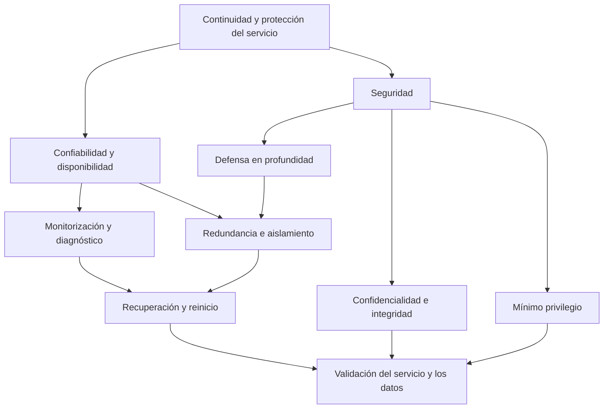

# Clase 2: Confiabilidad, recuperación y seguridad en arquitecturas de computación

> **Objetivo académico:** Analizar cómo la redundancia, la tolerancia a fallos, la monitorización y la recuperación se articulan con la seguridad de hardware, software y redes, distinguiendo mecanismos, supuestos y límites mediante la evaluación crítica de casos arquitectónicos.

## 1. Contexto y marco conceptual

La sesión desarrolla dos ejes relacionados: la continuidad de los sistemas ante fallos y la protección de los recursos frente a amenazas. El primero comprende redundancia, detección de errores, aislamiento, recuperación y reinicio. El segundo aborda confidencialidad, integridad, disponibilidad, mínimo privilegio y defensa en profundidad.

La conexión entre ambos ejes es la disponibilidad: una plataforma puede interrumpirse por una avería, una modificación incorrecta, agotamiento de recursos, un incidente de seguridad o pérdida de alimentación eléctrica. Sin embargo, mantener el servicio activo no basta si los datos están alterados o se divulgan sin autorización.

**Enriquecimiento conceptual:** Conviene distinguir cuatro términos que en el discurso aparecen próximos:

| Concepto | Significado técnico | Pregunta que orienta su análisis |
|---|---|---|
| Confiabilidad | Capacidad de operar sin fallos durante un intervalo y bajo condiciones definidas | ¿Durante cuánto tiempo funciona correctamente? |
| Disponibilidad | Capacidad de prestar el servicio cuando se requiere | ¿Puede utilizarse ahora? |
| Tolerancia a fallos | Capacidad de conservar un servicio aceptable pese a determinados fallos | ¿Qué ocurre cuando falla un componente? |
| Seguridad | Protección frente a acciones y accesos no autorizados, considerando también riesgos operativos | ¿Qué activos están protegidos, frente a quién y mediante qué controles? |

La redundancia es un medio para mejorar la continuidad; su mera existencia no demuestra tolerancia a fallos. Del mismo modo, disponer de cifrado, un firewall o infraestructura en la nube no demuestra por sí solo una arquitectura segura.

El diagrama integra los conceptos de la clase: la recuperación debe comprobar tanto la continuidad funcional como el estado de los datos y los permisos.

## 2. Fundamentos teóricos y arquitectura

### 2.1. Redundancia: duplicación con propósito

La redundancia consiste en disponer de componentes, funciones o información adicionales que permitan responder a fallos o sostener requisitos de servicio. La sesión distingue tres ámbitos:

- **Hardware:** discos, servidores en espera y componentes físicos duplicados.
- **Software:** múltiples instancias y entornos virtualizados.
- **Datos:** réplicas y copias de seguridad.

Sus beneficios potenciales son mayor disponibilidad, mantenimiento con menos interrupciones y mejores posibilidades de recuperación. Sus costos incluyen infraestructura, almacenamiento, comunicaciones, administración y coordinación.

**Enriquecimiento conceptual:** La repetición accidental de un bucle y la redundancia para tolerar fallos son fenómenos diferentes. Un bucle sin terminación puede agotar recursos; una arquitectura redundante incorpora recursos adicionales deliberadamente. Asimismo, varias GPU pueden emplearse para distribuir trabajo y aumentar rendimiento sin ofrecer sustitución ante fallos. La clasificación depende de la función arquitectónica.

También deben distinguirse mecanismos de almacenamiento:

| Mecanismo | Función principal | Límite relevante |
|---|---|---|
| RAID, según su configuración | Distribuir datos y, en ciertos niveles, tolerar fallos de discos | No sustituye una copia independiente ni protege por sí solo de borrado lógico |
| Réplica | Mantener otra instancia de los datos y facilitar continuidad o lectura distribuida | Puede propagar modificaciones erróneas y eliminaciones |
| Copia de seguridad | Conservar información recuperable de un estado anterior | Requiere retención, protección y restauración comprobadas |
| Servidor en espera | Ofrecer capacidad de sustitución | Necesita datos adecuados y un mecanismo de conmutación |

Estas distinciones son **enriquecimiento conceptual** que precisa las categorías presentadas en la sesión.

### 2.2. Tolerancia a fallos y contención

La tolerancia a fallos se organiza alrededor de detección, contención y recuperación. La sesión menciona aislamiento, particionamiento, reconfiguración dinámica, votación entre unidades, checkpoints y rollback.

**Enriquecimiento conceptual:** Un fallo interno puede producir un estado erróneo y este, a su vez, una desviación observable del servicio. Detectar una excepción es una parte del proceso, pero no garantiza que se mantenga el servicio ni que los datos queden consistentes.

- **Aislamiento:** limita la propagación de un problema entre componentes.
- **Reconfiguración dinámica:** modifica recursos o rutas de servicio durante la operación; exige controles para no introducir estados incompatibles.
- **Votación:** compara resultados de varias unidades. Su utilidad depende del número de participantes, la regla de decisión y los fallos que se pretende tolerar.
- **Checkpoint:** conserva un estado desde el cual puede reanudarse una ejecución.
- **Rollback:** revierte operaciones o estados dentro de las garantías del mecanismo utilizado.

La votación tiene límites cuando varias unidades comparten el mismo defecto o una dependencia común. Del mismo modo, varias instancias en una sola máquina siguen expuestas a la caída de ese equipo.

La sesión también introduce *fail-safe* y *failover*. **Enriquecimiento conceptual:** el primero busca un estado seguro ante un fallo, incluso si ello implica detener una función; el segundo transfiere el servicio a un recurso alternativo. Son objetivos diferentes y deben especificarse según el riesgo.

### 2.3. Arquitecturas monolíticas, microservicios y virtualización

El discurso contrasta aplicaciones monolíticas con microservicios y destaca el aislamiento de funciones como ventaja de estos últimos. También presenta virtualización y contenedores como medios de organizar y transportar entornos.

**Enriquecimiento conceptual:** La dependencia de una base de datos puede afectar tanto a un monolito como a varios microservicios. Separar procesos ayuda únicamente cuando las dependencias, los tiempos de espera y los mecanismos de recuperación permiten contener el fallo. Los microservicios añaden comunicaciones, coordinación, observabilidad y posibles problemas de consistencia.

Las máquinas virtuales y los contenedores tampoco crean recursos físicos adicionales. Varias instancias compiten por CPU, RAM y almacenamiento. Esta restricción es especialmente relevante para modelos de lenguaje de gran tamaño, cuyo despliegue puede requerir memoria y capacidad de cómputo considerables.

**Enriquecimiento conceptual:** Docker permite construir y ejecutar contenedores; Kubernetes coordina aplicaciones desplegadas en ellos. La portabilidad exige gestionar además imágenes, configuración, secretos, volúmenes y compatibilidad con el entorno de ejecución.

### 2.4. Principios de seguridad

La tríada de seguridad articula:

- **Confidencialidad:** acceso a información únicamente por sujetos autorizados.
- **Integridad:** protección frente a alteraciones o destrucción no autorizadas y preservación de la corrección de la información.
- **Disponibilidad:** acceso oportuno a datos y servicios por usuarios autorizados.

**Enriquecimiento conceptual:** La integridad no equivale a ocultar información. La privacidad y las condiciones legales del tratamiento de datos se relacionan con la seguridad, pero no se reducen a ella. Tampoco corresponde atribuir el origen de la tríada a una fecha o publicación que la fuente no identifica de manera verificable.

El **mínimo privilegio** limita cada identidad a los permisos necesarios para su función. La **defensa en profundidad** combina controles en distintos puntos para reducir la dependencia de una única barrera.

**Enriquecimiento conceptual:** Los roles de una aplicación o base de datos no pertenecen universalmente a la capa de sesión del modelo OSI. Una réplica de base de datos utiliza protocolos de aplicación, transporte y red; no queda circunscrita a la capa de red. El modelo OSI ayuda a localizar funciones de comunicación, pero no reemplaza el diseño de autenticación y autorización.

## 3. Implementación técnica y lógica de negocio

### 3.1. Respaldo, replicación y recuperación

La sesión describe un problema de acumulación de copias completas de una base de datos en el servidor de producción. La enseñanza técnica recuperable es la necesidad de automatizar respaldos, controlar su crecimiento y evitar interferencias con el servicio.

**Enriquecimiento conceptual:** Una política de respaldo debe definir qué se conserva, durante cuánto tiempo, dónde se almacena y cómo se restaura. Copiar únicamente registros nuevos no constituye una estrategia completa si también existen actualizaciones, eliminaciones o cambios de esquema. Una copia incremental debe preservar la información necesaria para reconstruir un estado consistente.

Mantener un disco permanentemente conectado puede simplificar la automatización, pero también expone el respaldo a errores, malware o fallos que afecten al sistema principal. La separación de credenciales y dominios de fallo complementa la separación física o lógica.

La sesión recomienda programar operaciones intensivas fuera de los periodos de mayor demanda. El criterio debe basarse en mediciones del servicio y en sus compromisos de disponibilidad; no existe una franja horaria universal de baja utilización.

**Enriquecimiento conceptual:** Dos objetivos ayudan a concretar la recuperación:

- **RPO:** pérdida temporal máxima de datos admisible, expresada como intervalo.
- **RTO:** tiempo objetivo máximo para restablecer el servicio.

Bajo el supuesto ideal de copias exitosas separadas por un intervalo fijo $\Delta t$, sin mecanismos adicionales de recuperación, la antigüedad de la última copia al producirse un incidente puede aproximarse a $\Delta t$. Aquí $\Delta t > 0$ se mide en unidades de tiempo. Esto describe una exposición potencial; no demuestra que el RPO se cumpla si las copias fallan o resultan inutilizables.

Se mencionan checkpoints, journaling, rollback y replicación como estrategias complementarias. **Enriquecimiento conceptual:** un journal registra operaciones o cambios para apoyar consistencia y recuperación. Su alcance depende de la tecnología. En una transacción, `COMMIT` confirma cambios y `ROLLBACK` los revierte cuando siguen dentro del alcance transaccional; rollback no es una instrucción para guardar información.

### 3.2. Replicación y permisos sobre los datos

La sesión presenta publicador, distribuidor y suscriptor como roles de una arquitectura de replicación, junto con la selección de conjuntos de datos o artículos que se propagan.

**Enriquecimiento conceptual:** Esta terminología corresponde a implementaciones concretas, especialmente a modalidades de replicación de SQL Server; no describe universalmente todos los gestores propietarios. Seleccionar tablas o artículos para una réplica y autorizar consultas sobre ella son decisiones relacionadas, pero distintas. Deben controlarse tanto la transferencia como el acceso posterior.

Para usuarios remotos, se propone trabajar con una instancia separada en lugar de acceder directamente a producción. Este aislamiento puede proteger el servicio principal, siempre que el entorno alternativo mantenga permisos limitados y no exponga innecesariamente información sensible.

### 3.3. Monitorización y diagnóstico

La monitorización busca detectar anomalías temprano, prevenir fallos en cascada, optimizar recursos y apoyar el mantenimiento. La sesión incluye recopilación de datos, análisis de registros, diagnóstico remoto, métricas de rendimiento y análisis predictivo.

Un proceso operativo coherente comprende:

1. Recoger señales del hardware, sistema operativo, red, base de datos y aplicación.
2. Definir un comportamiento de referencia y umbrales pertinentes.
3. Detectar desviaciones y valorar su impacto.
4. Investigar causas antes de aplicar correcciones.
5. Verificar la recuperación y conservar evidencia del incidente.

Se mencionan Nagios, ELK Stack, Grafana, MemTest86 y Prime95, entre otras herramientas cuyos nombres no siempre se reconocen con claridad en la transcripción. Sus funciones deben distinguirse: visualización, centralización de registros, monitorización de servicios y pruebas de componentes no son intercambiables.

**Enriquecimiento conceptual:** La ausencia de registros de error no demuestra ausencia de problemas. Puede indicar falta de instrumentación. Los registros operativos, las métricas y las trazas ofrecen perspectivas complementarias; registrar únicamente excepciones reduce la capacidad de explicar degradaciones silenciosas.

Los desafíos incluyen volumen de telemetría, falsos positivos, costo de procesamiento y protección de información contenida en los registros. Los umbrales visuales pueden facilitar la interpretación, pero deben asociarse con gravedad, responsables y acciones. El análisis predictivo puede anticipar determinados patrones, aunque necesita datos representativos y evaluación de errores; no garantiza predecir todos los incidentes.

### 3.4. Recuperación y modalidades de reinicio

La sesión diferencia reinicio suave, duro, gradual y selectivo, aplicables en hardware, sistema operativo o aplicación.

**Enriquecimiento conceptual:** Estas denominaciones requieren una definición operativa para cada plataforma. Un reinicio ordenado intenta cerrar procesos y persistir estado; uno abrupto puede perder trabajo en curso. Un reinicio selectivo actúa sobre un componente y uno gradual puede renovar instancias sucesivamente para conservar capacidad de servicio.

El arranque y el calentamiento de cachés pueden introducir latencia temporal. Este fenómeno no debe interpretarse literalmente como una necesidad térmica universal del servidor. La recuperación termina cuando se verifica la funcionalidad, la consistencia de datos y el nivel de servicio acordado mediante el SLA.

### 3.5. Seguridad de hardware, firmware y memoria

La sesión aborda amenazas físicas, alimentación eléctrica, firmware, arranque seguro, aislamiento, protección de memoria y entornos de ejecución protegidos.

**Enriquecimiento conceptual:** Los mecanismos deben separarse por su finalidad:

| Mecanismo | Función | Límite |
|---|---|---|
| TPM | Proteger material criptográfico y apoyar medición o atestación de la plataforma | No identifica por sí solo el chip descrito en el relato |
| Arranque seguro | Verificar componentes autorizados de la cadena de arranque mediante firmas | No garantiza la ausencia de vulnerabilidades en todo el software |
| DEP | Impedir ejecución desde regiones de memoria marcadas como no ejecutables | No bloquea todas las técnicas de explotación |
| ASLR | Aleatorizar ubicaciones de componentes en el espacio de direcciones virtuales | No consiste en elegir sectores físicos del disco |
| MMU | Traducir direcciones y aplicar permisos de acceso a memoria | Depende de su configuración y del sistema operativo |
| Intel SGX y Arm TrustZone | Ofrecer mecanismos diferentes de aislamiento de ejecución y datos | No son equivalentes ni constituyen garantías absolutas |

El dispositivo físico descrito mediante autenticación remota no queda identificado con precisión. No puede concluirse que fuera un TPM ni generalizarse que los chips de seguridad necesitan conexión a Internet.

**Enriquecimiento conceptual:** Meltdown y Spectre son familias de vulnerabilidades relacionadas con ejecución transitoria y canales laterales. No son parches ni mecanismos defensivos. Sus mitigaciones pueden implicar hardware, microcódigo, firmware, sistema operativo y software, con efectos variables sobre el rendimiento.

La alimentación y los desastres naturales también condicionan la disponibilidad. Dimensionar generadores y sistemas de respaldo requiere conocer cargas, autonomía y calidad del suministro. Las variaciones eléctricas no son una consecuencia inevitable de usar un generador correctamente dimensionado.

**Enriquecimiento conceptual:** Un canal lateral obtiene información a partir de efectos observables, como tiempo, consumo eléctrico o emanaciones electromagnéticas. Una VPN protege comunicaciones, pero no resuelve por sí sola esas fugas. La distancia a infraestructura eléctrica externa tampoco permite descartar riesgos electromagnéticos de un equipo.

### 3.6. Criptografía, autenticación y protección de redes

La sesión reúne cifrado de bases de datos, funciones hash, firmas digitales, contraseñas y gestores de credenciales.

**Enriquecimiento conceptual:** Cifrado y hash cumplen propósitos diferentes. El cifrado permite recuperar el texto mediante una clave autorizada; una función hash produce un resumen y no se diseña para descifrarse. Los servicios que aparentan revertir MD5 suelen buscar coincidencias de entradas conocidas. MD5 no es adecuado para proteger contraseñas ni para aplicaciones que requieren resistencia a colisiones.

Para contraseñas deben utilizarse funciones especializadas con sal y costo ajustable. Un gestor de contraseñas facilita credenciales diferentes y robustas, mientras que la autenticación multifactor reduce la dependencia de un único secreto. Las firmas digitales permiten comprobar origen e integridad bajo supuestos de confianza y protección de claves; no proporcionan confidencialidad por sí mismas.

La propuesta de controles de infraestructura puede ordenarse así:

| Zona o recurso | Controles tratados | Precisión de diseño |
|---|---|---|
| Equipo del usuario | Restricción de USB, actualizaciones y permisos | Aplicar políticas administradas según necesidad operativa |
| Acceso remoto | VPN y separación de entornos | Añadir autenticación sólida y limitar recursos accesibles |
| Red interna | Identidades centralizadas y segmentación | Hacer cumplir reglas entre segmentos |
| DMZ | Firewalls y detección o prevención de intrusiones | Separar servicios publicados de los sistemas internos |
| Documentos en nube | Cuentas, permisos y almacenamiento centralizado | Revisar compartición, auditoría y recuperación |
| Routers y cámaras | Firmware actualizado y credenciales seguras | Evitar administración expuesta innecesariamente |

**Enriquecimiento conceptual:** Un IDS detecta y alerta; un IPS puede intervenir sobre el tráfico según su configuración. Una DMZ es un segmento de exposición controlada para servicios publicados. Dos firewalls no sustituyen reglas correctas, mantenimiento y revisión de flujos. La segmentación es un principio arquitectónico incluso cuando existen recursos para adquirir más equipos.

## 4. Análisis crítico de casos y auditoría práctica

### 4.1. Muchas instancias en un mismo servidor

El caso de múltiples instancias de un gestor de base de datos muestra flexibilidad de configuración, pero no demuestra rendimiento ni alta disponibilidad. Deben evaluarse concurrencia, memoria disponible, presión de entrada y salida y dependencias comunes.

**Enriquecimiento conceptual:** La unidad de auditoría es el dominio de fallo. Una caída del host puede detener todas sus instancias, aunque cada una funcione correctamente de manera aislada.

### 4.2. Crecimiento de respaldos y particionamiento de datos

El caso de almacenamiento saturado revela una política de retención indefinida y ausencia de control de capacidad. La respuesta técnica debe preservar recuperación y trazabilidad; eliminar copias sin evaluar su necesidad puede destruir la única vía de restauración.

La sesión también propone separar registros nuevos en otra tabla para reducir el volumen consultado. **Enriquecimiento conceptual:** Crear tablas manualmente no equivale necesariamente a particionamiento nativo. Antes de modificar el esquema, deben analizarse consultas, índices y planes de ejecución. La separación puede ayudar a ciertos accesos, pero también complicar consultas históricas, restricciones y mantenimiento.

### 4.3. Ransomware y recuperación

Se relatan incidentes organizacionales y recuperaciones rápidas. Como no se aportan registros, informes o configuraciones, estos relatos sirven para ilustrar la importancia de recuperar servicios, sin demostrar tiempos ni capacidades comerciales específicas.

**Enriquecimiento conceptual:** El ransomware puede acceder mediante phishing, servicios vulnerables, credenciales comprometidas y otras vías. Su ejecución dentro de una red no demuestra que un empleado lo haya instalado deliberadamente. Además, una réplica puede propagar datos cifrados o alterados; debe complementarse con puntos de recuperación protegidos.

### 4.4. Protección de datos y exposición pública

La exploración de perfiles públicos ilustra que nombres, contactos y relaciones pueden combinarse para perfilar personas. El debate introduce una tensión adicional: algunos servicios solicitan permisos amplios y las personas no siempre disponen de alternativas prácticas.

**Enriquecimiento conceptual:** Consultar información públicamente accesible se aproxima a la investigación en fuentes abiertas. La ingeniería social implica manipular a personas para que revelen información o realicen acciones. Ambos fenómenos pueden relacionarse, pero no son equivalentes.

Las observaciones sobre legislación y madurez regional expresan percepciones de los participantes. No constituyen un análisis jurídico ni una comparación sistemática entre países. Que varias entidades estén asociadas no demuestra por sí solo que cualquier intercambio de datos resulte legítimo.

La preocupación por capturas de pantalla y fotografías muestra el límite del control del terminal. Bloquear una función de captura no impide todos los canales de extracción.

**Enriquecimiento conceptual:** Minimizar datos visibles, aplicar permisos, registrar accesos y utilizar marcas de agua puede reducir exposición o mejorar trazabilidad. No puede prometerse impedir universalmente que una cámara externa fotografíe una pantalla.

### 4.5. Interfaz manipulable y validación del servidor

La demostración de modificación local del HTML permite separar representación visual y estado persistente. Alterar el DOM cambia lo mostrado en un navegador; no demuestra una modificación en la base de datos.

**Enriquecimiento conceptual:** Atributos como `disabled` son controles de interfaz. El servidor debe volver a autenticar, autorizar y validar cada operación sensible. Una captura de pantalla tampoco prueba por sí sola el estado del sistema.

La discusión sobre inyección SQL identifica el riesgo de que una entrada se interprete como parte de una consulta. La transcripción no aporta una implementación íntegra y no permite reconstruir una prueba reproducible.

**Enriquecimiento conceptual:** Las consultas parametrizadas separan datos e instrucciones. Deben complementarse con permisos mínimos de la cuenta de base de datos, validación contextual y tratamiento seguro de errores.

Se presentan plataformas de laboratorio y simulación como espacios para comprender vulnerabilidades. Sus nombres aparecen parcialmente deformados; no se reconstruyen enlaces ni instrucciones ausentes. La comparación técnica relevante es entre laboratorios aislados, simulaciones de decisiones y pruebas sobre aplicaciones.

### 4.6. Acceso a redes, cámaras y dispositivos especializados

Conocer una dirección IP pública permite localizar un punto de comunicación, pero no implica obtener acceso al router o a una cámara. El riesgo depende de servicios expuestos, vulnerabilidades, configuración y credenciales.

**Enriquecimiento conceptual:** Una IP pública no debe utilizarse como secreto de seguridad. Tampoco puede afirmarse que un dispositivo portátil obtenga cualquier contraseña inalámbrica con solo apuntar a una red. Las capacidades dependen del protocolo, las protecciones y las condiciones concretas del entorno.

### 4.7. Paralelismo y evaluación de evidencia

Se describe un caso de procesamiento secuencial y con varios núcleos mediante C++ y OpenMP, relacionado conceptualmente con procesamiento de requerimientos y modelos Transformer. No se proporcionan código completo, tiempos exactos ni condiciones experimentales; por tanto, no pueden afirmarse mejoras cuantitativas ni equivalencia con ejecutar un Transformer real.

**Enriquecimiento conceptual:** Para comparar rendimiento puede definirse la aceleración:

$$
S(p)=\frac{T_1}{T_p}
$$

Aquí $p$ es un entero positivo que representa los trabajadores utilizados; $T_1>0$ y $T_p>0$ son tiempos de ejecución, en la misma unidad, para la misma carga y bajo condiciones comparables. La razón es adimensional. Interpretarla requiere controlar sobrecarga, sincronización, distribución de trabajo y variabilidad de medición. Aumentar el número de trabajadores no garantiza una reducción proporcional del tiempo.

## 5. Principios de diseño, buenas prácticas y anti-patrones

1. **Definir el fallo que se desea tolerar.** Duplicar recursos sin especificar averías y dependencias deja indeterminada la protección real.
2. **Separar réplica y respaldo.** La primera favorece continuidad; el segundo debe permitir recuperar estados anteriores. Ambos requieren validación.
3. **Automatizar con observabilidad.** Respaldos, reinicios y conmutaciones deben producir evidencia de éxito, errores y tiempos.
4. **Mantener consistencia durante la recuperación.** Un servicio disponible con datos incorrectos no satisface necesariamente su propósito.
5. **Aplicar mínimo privilegio.** Distinguir autenticación, autorización y selección de datos replicados; revisar cuentas administrativas y técnicas.
6. **Diseñar capas complementarias.** Proteger firmware, sistema operativo, aplicación, red y datos según el modelo de amenazas.
7. **Gestionar recursos compartidos.** Virtualización, monitorización y redundancia consumen capacidad y pueden competir con producción.
8. **Conservar documentación operativa.** Registrar dependencias, procedimientos de recuperación y criterios de comprobación ayuda a reducir errores.
9. **Revisar actualizaciones y configuración.** Un control instalado pero mal configurado puede aportar una protección muy limitada.
10. **Evaluar alternativas con evidencia.** Comparar arquitecturas por riesgo, complejidad, costo y requisitos, evitando preferencias universales.

**Enriquecimiento conceptual:** La nube implica responsabilidad compartida. El proveedor puede administrar parte de la infraestructura, pero la organización mantiene responsabilidades sobre identidades, permisos, datos y configuraciones según el servicio contratado. Su conveniencia económica requiere considerar consumo, transferencia, almacenamiento y operación.

Los anti-patrones identificados incluyen acumular respaldos sin retención, asumir que varias instancias garantizan disponibilidad, equiparar ausencia de logs con ausencia de fallos, confiar en controles del navegador, sustituir análisis por adquisición de dispositivos y tratar la migración a la nube como eliminación de responsabilidades.

La concientización aparece como un problema sociotécnico: las recomendaciones fracasan si las personas no comprenden su utilidad o si los procesos dificultan su adopción. **Enriquecimiento conceptual:** Las simulaciones autorizadas y controladas permiten observar conductas sin recurrir a comprometer información real. El objetivo es mejorar prácticas, herramientas y procesos, incluyendo a quienes toman decisiones.

## 6. Síntesis conceptual y profundización académica

La confiabilidad y la seguridad requieren una arquitectura que conecte prevención, detección, contención, recuperación y verificación. La redundancia aporta alternativas; la monitorización informa sobre el estado; el aislamiento reduce propagación; y la recuperación devuelve el sistema a un estado útil y consistente.

Las distinciones centrales de la sesión son:

- Tener copias no equivale a poder restaurar.
- Distribuir componentes no demuestra independencia de fallos.
- Cifrar información no sustituye gestionar permisos y claves.
- Observar una anomalía no equivale a identificar su causa.
- Manipular una interfaz no demuestra alterar el estado persistente.
- Contratar infraestructura no elimina la responsabilidad de configurarla y gobernarla.

La discusión metodológica final aporta un criterio de rigor: una implementación demuestra un comportamiento bajo ciertas condiciones; una explicación académica debe explicitar esas condiciones y contrastar interpretaciones. Citar una obra exige vincularla con las afirmaciones que sustenta, mientras que una bibliografía aislada no permite rastrear el argumento.

**Enriquecimiento conceptual:** La revisión crítica de evidencia debe distinguir observación, interpretación y generalización. Un resultado local de paralelismo no prueba escalabilidad universal; un incidente narrado no establece una estadística; una característica comercial mencionada sin documentación no constituye una garantía técnica.

Como líneas de profundización conceptual se desprenden el análisis de fallos correlacionados, los compromisos entre consistencia y continuidad, el costo operativo de la observabilidad, la seguridad de la ejecución transitoria y la evaluación de recuperación frente a incidentes que comprometen simultáneamente infraestructura y datos. Estas líneas prolongan el problema central de la clase: justificar qué garantías ofrece una arquitectura y bajo qué límites.
