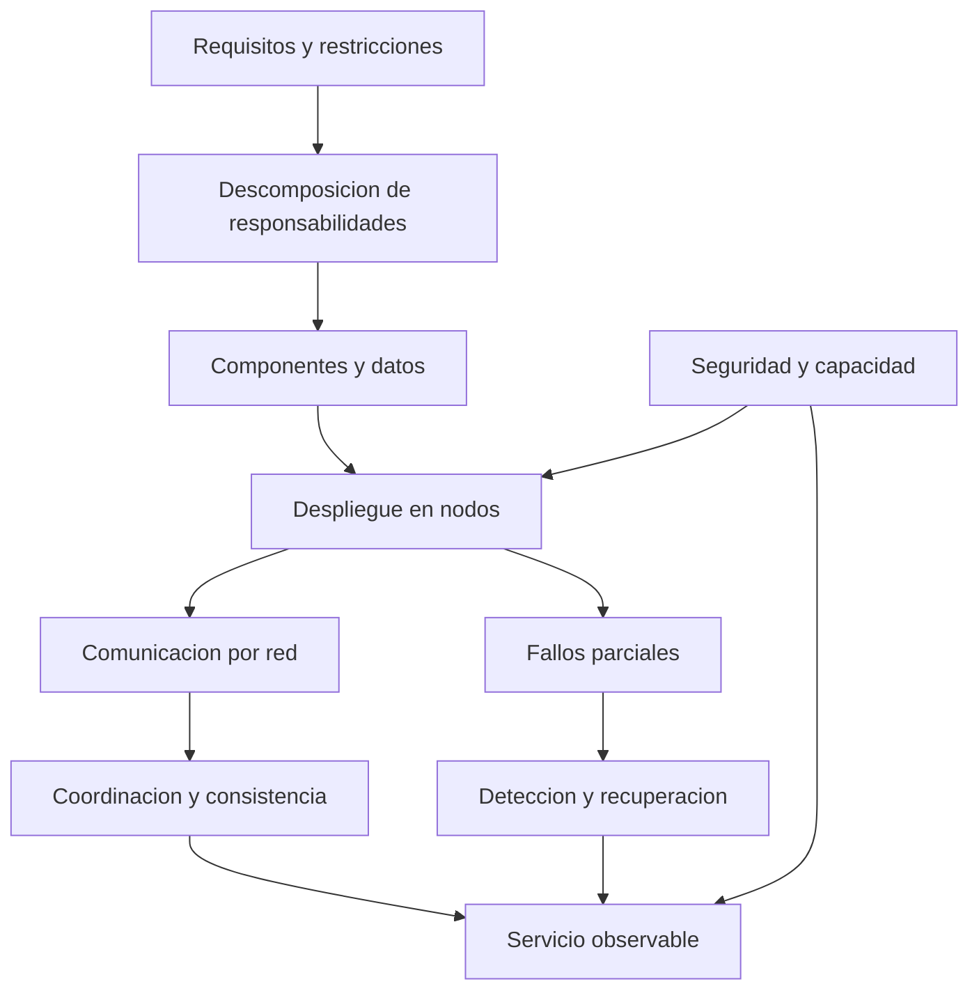
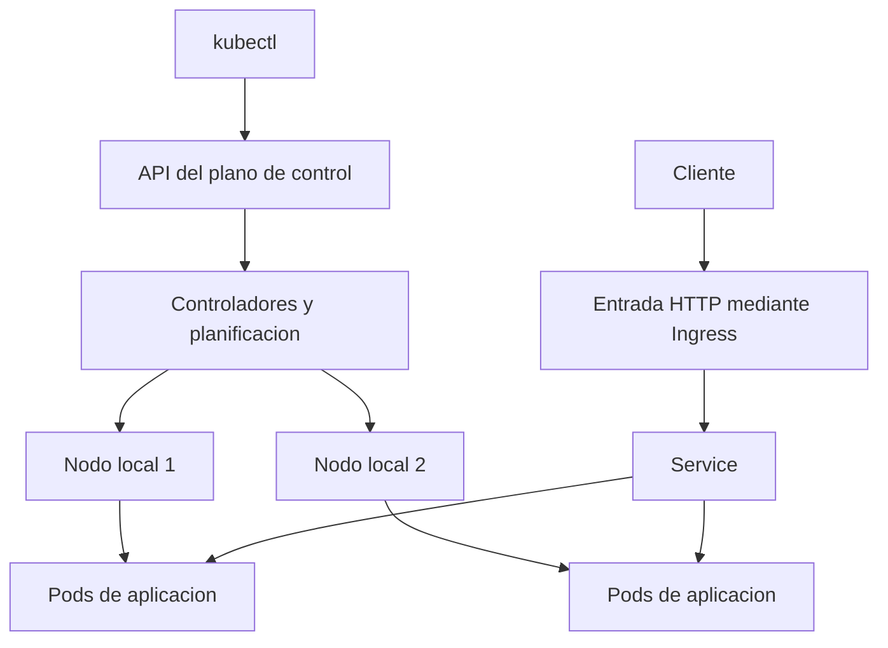

# Clase 4: Arquitecturas distribuidas y paralelas: fundamentos, contenedores y orquestación

> **Objetivo académico:** Analizar los principios, beneficios y límites de las arquitecturas distribuidas y paralelas, relacionarlos con la consistencia, la seguridad y la escalabilidad, e interpretar el ciclo de vida de contenedores Docker y la función de Kubernetes y Minikube.

## 1. Contexto y marco conceptual

La sesión conecta la arquitectura de sistemas con su operación efectiva. Dividir una aplicación o incorporar más servidores no garantiza, por sí solo, mejor rendimiento ni mayor disponibilidad: también introduce comunicación por red, coordinación, observabilidad y recuperación ante fallos. El principio de «dividir para resolver» requiere definir responsabilidades, dependencias y mecanismos de control.

Un sistema distribuido reúne componentes que ejecutan procesos en equipos conectados por una red y cooperan para prestar un servicio. Cada componente dispone de información local y se comunica con otros mediante mensajes. La sesión destaca la concurrencia, la ausencia de un reloj global perfectamente compartido, los fallos parciales y la comunicación asíncrona.

**Enriquecimiento conceptual:** La comunicación asíncrona es habitual y útil, pero no define por sí sola a todos los sistemas distribuidos: también existen interacciones síncronas de solicitud y respuesta. La propiedad central es que la comunicación y los fallos no pueden tratarse como si todos los componentes estuvieran dentro de un único proceso confiable.

Conviene separar tres dimensiones que aparecen relacionadas durante la clase:

| Dimensión | Pregunta central | Implicación |
| --- | --- | --- |
| Distribución | ¿Dónde ejecutan y se comunican los componentes? | Intervienen equipos, redes y fallos parciales. |
| Paralelismo | ¿Qué trabajo se ejecuta simultáneamente? | Se busca reducir el tiempo de cómputo o aumentar la capacidad de procesamiento. |
| Descomposición del software | ¿Cómo se organizan las responsabilidades? | Se delimitan módulos, servicios e interfaces. |

**Enriquecimiento conceptual:** Una aplicación distribuida puede ejecutar operaciones secuenciales; un programa paralelo puede funcionar dentro de una sola máquina. Asimismo, microservicios y arquitectura hexagonal responden a decisiones distintas: los primeros delimitan servicios desplegables y la segunda organiza dependencias mediante puertos y adaptadores. No son sinónimos ni alternativas necesariamente excluyentes.

La experiencia discutida sobre separar un subsistema de recursos humanos muestra que extraer código de una aplicación grande no basta para obtener autonomía operativa. También deben revisarse las dependencias de datos, las interfaces y la capacidad de operar cada parte de forma independiente.



## 2. Fundamentos teóricos y arquitectura

### 2.1. Beneficios y condiciones de funcionamiento

Los sistemas distribuidos permiten compartir procesadores, almacenamiento, archivos, datos y servicios. La sesión relaciona esta cooperación con una posible mejora de la relación costo-beneficio y con la posibilidad de repartir la carga.

Los beneficios requieren condiciones concretas:

- **Rendimiento:** el trabajo debe poder repartirse sin que la comunicación y la coordinación absorban la ganancia.
- **Disponibilidad:** los componentes redundantes deben poder asumir funciones y disponer de las dependencias necesarias.
- **Escalabilidad:** la incorporación de recursos debe aliviar el cuello de botella relevante.
- **Heterogeneidad:** las diferencias de hardware, sistemas operativos y lenguajes deben quedar mediadas por interfaces compatibles.

**Enriquecimiento conceptual:** La transparencia busca ocultar ciertos detalles de ubicación, acceso o replicación a quienes utilizan el sistema. Tiene límites: ocultar completamente la latencia o los fallos puede producir interfaces engañosas. Las aplicaciones deben contemplar que una operación remota puede tardar, fallar o dejar un resultado incierto.

### 2.2. Escalabilidad vertical, horizontal y geográfica

| Modalidad | Mecanismo | Beneficio potencial | Límite principal |
| --- | --- | --- | --- |
| Vertical | Aumentar memoria, almacenamiento o capacidad de cómputo de un equipo. | Mayor capacidad con una topología relativamente estable. | Restricciones físicas, compatibilidad y costo del equipo. |
| Horizontal | Incorporar nodos y repartir trabajo o datos. | Crecimiento mediante recursos adicionales. | Coordinación, particionamiento y dependencias compartidas. |
| Geográfica | Distribuir despliegues entre ubicaciones. | Cercanía a usuarios y separación de ciertos dominios de fallo. | Latencia entre regiones y coordinación de datos. |

**Enriquecimiento conceptual:** La distribución geográfica no exige utilizar una nube pública; también puede implementarse con infraestructura propia o híbrida. Además, varios servidores pequeños no siempre cuestan menos que uno grande: deben contabilizarse operación, redes, licencias, transferencia de datos y capacidad ociosa.

### 2.3. Centralización, distribución y modelos de comunicación

La comparación presentada en clase resulta útil como orientación, aunque no debe interpretarse como una clasificación absoluta.

| Aspecto | Sistema centralizado | Sistema distribuido |
| --- | --- | --- |
| Control | Predomina una autoridad o nodo central. | Las responsabilidades pueden repartirse entre componentes. |
| Estado | Su observación suele ser más directa. | Cada componente conoce principalmente su estado local y mensajes recibidos. |
| Coordinación | Menor dependencia de comunicación remota. | Requiere protocolos e interfaces entre componentes. |
| Fallos | Un componente central puede afectar al servicio completo. | Pueden existir fallos parciales y propagación de sus efectos. |
| Recursos | El crecimiento suele concentrarse inicialmente en un equipo. | Puede incorporar nodos, si el diseño permite aprovecharlos. |

**Enriquecimiento conceptual:** Centralización lógica y distribución física son dimensiones diferentes. Un servicio con autoridad central puede tener réplicas físicas; un monolito puede desplegarse en varias instancias. Del mismo modo, tener muchos puntos de acceso o muchos clientes no prueba que la arquitectura sea distribuida.

La sesión distingue tres configuraciones generales:

- **Cliente-servidor:** los clientes solicitan funciones a servidores con responsabilidades definidas.
- **Entre pares, o P2P:** los participantes pueden asumir funciones de proveedores y consumidores.
- **Híbrida:** combina coordinación central con intercambios entre pares u otros mecanismos distribuidos.

### 2.4. Capas lógicas y niveles físicos

Se utiliza la separación entre presentación, reglas de negocio y persistencia para explicar la arquitectura por capas. Esta organización ayuda a distinguir responsabilidades, pero no determina por sí misma dónde se despliega cada una.

**Enriquecimiento conceptual:** Las capas son separaciones lógicas; los niveles de despliegue son separaciones físicas. Una aplicación de escritorio puede contener múltiples capas dentro de un único equipo. Por ello, clasificar Word, Excel o una consola como aplicaciones de una o dos capas exige analizar su estructura y definir el criterio utilizado; la apariencia de su interfaz no permite concluirlo.

### 2.5. Arquitecturas paralelas y memoria

La clase introduce sistemas de memoria compartida, SMP, NUMA, clústeres y arquitecturas de procesamiento masivamente paralelo.

| Arquitectura o propiedad | Interpretación técnica |
| --- | --- |
| Memoria compartida | Varios procesadores o hilos acceden a un espacio de direcciones compartido. |
| SMP | Multiprocesamiento simétrico: los procesadores tienen funciones equivalentes dentro del sistema. |
| NUMA | La latencia de acceso a memoria depende de la ubicación de la memoria respecto del procesador. |
| Memoria distribuida | Los nodos disponen de memoria local y requieren comunicación para intercambiar información. |
| Clúster | Conjunto de equipos conectados que cooperan en servicios o procesamiento. |
| MPP | Organización orientada a un elevado paralelismo mediante múltiples unidades de procesamiento. |

**Enriquecimiento conceptual:** NUMA no significa asignar porcentajes diferentes de memoria a procesos. Describe una propiedad de localidad y costo de acceso. La ubicación de los datos y de los hilos puede afectar el rendimiento. Tampoco debe identificarse automáticamente NUMA con la arquitectura de cualquier GPU.

La coherencia de caché y la consistencia de memoria son conceptos relacionados, pero distintos. **Enriquecimiento conceptual:** La coherencia trata la visibilidad de escrituras sobre una misma ubicación; el modelo de consistencia establece qué ordenamientos de lecturas y escrituras pueden observarse. Ninguna de estas propiedades elimina la necesidad de sincronización cuando varios hilos modifican estado compartido.

## 3. Implementación técnica y lógica de negocio

### 3.1. Concurrencia, herramientas y patrones de procesamiento

La sesión plantea que no toda interacción simultánea exige crear hilos explícitamente. Solicitar datos para una interfaz puede resolverse mediante mecanismos asíncronos, mientras que un cálculo intensivo puede requerir paralelismo de CPU o GPU.

**Enriquecimiento conceptual:** La elección depende del modelo de ejecución del lenguaje y de si predomina la espera de entrada/salida o el cómputo. La asincronía permite avanzar mientras una operación espera; no garantiza ejecutar instrucciones simultáneamente en varios núcleos.

Se mencionan OpenMP y CUDA. La distinción requiere una precisión: **Enriquecimiento conceptual:** OpenMP permite paralelismo real, habitualmente mediante hilos en CPU, y también contempla descarga a dispositivos en implementaciones compatibles. CUDA es una plataforma de programación para GPU NVIDIA. La diferencia no consiste en «simulación» frente a «paralelismo real», sino en los dispositivos, modelos y herramientas utilizados.

Los patrones discutidos incluyen:

- **Coordinador-trabajadores:** un componente distribuye unidades de trabajo y reúne resultados. Debe controlar reparto de carga y fallos de trabajadores.
- **Pipeline:** las etapas procesan diferentes elementos de un flujo de forma solapada. Su capacidad queda limitada por la etapa más lenta.
- **MapReduce:** separa transformaciones sobre particiones de datos de una agregación posterior por claves. Es pertinente cuando el problema admite esa descomposición.

La fuente menciona procesamiento paralelo en motores de bases de datos, pero no identifica con precisión sus mecanismos. No permite reconstruir configuraciones específicas de Oracle o SQL Server.

### 3.2. Selección del entorno de desarrollo

Se comentan Go para servicios de comunicación y concurrencia; C# con .NET y Entity Framework para aplicaciones transaccionales; y Express o NestJS sobre Node.js. El criterio relevante es relacionar necesidades del servicio con experiencia del equipo, bibliotecas disponibles y facilidad de mantenimiento.

**Enriquecimiento conceptual:** La familiaridad con JavaScript puede facilitar el tránsito entre frontend y backend, pero la similitud de carpetas o nombres de componentes no convierte Angular, React, Vue y NestJS en arquitecturas equivalentes. Tampoco una implementación breve demuestra rendimiento, seguridad o aptitud para producción. Las atribuciones empresariales de tecnologías mencionadas oralmente no se toman como evidencia verificada.

### 3.3. Docker: imagen, contenedor y proceso

La demostración introduce Docker como herramienta para empaquetar aplicaciones y sus dependencias y reducir diferencias entre entornos.

**Enriquecimiento conceptual:** Docker es una plataforma; un contenedor es una instancia de ejecución creada a partir de una imagen. Una imagen contiene un sistema de archivos y metadatos; no es un proceso activo. Un volumen proporciona persistencia separada del ciclo de vida del contenedor y no debe confundirse con un identificador de imagen.

Los comandos centrales de la demostración pueden expresarse de forma normalizada:

```bash
docker --help
docker images
docker pull node
docker pull node:20
docker pull node:18
docker image rm node:18
docker ps
docker ps -a
```

`docker images` lista imágenes locales. `docker pull` descarga una imagen desde un registro. Cuando se omite una etiqueta, la referencia usa convencionalmente `latest`; esta etiqueta no garantiza una versión específica ni estable. `docker image rm` elimina una referencia local y puede encontrar restricciones si existen contenedores asociados. No selecciona arbitrariamente la primera fila de una lista.

**Enriquecimiento conceptual:** Las etiquetas numéricas anteriores se conservan para explicar la sintaxis observada; no constituyen una recomendación de versiones vigentes. Para reproducibilidad debe elegirse una referencia deliberada y, cuando corresponda, fijar el contenido por digest.

La reutilización de descargas se explica mediante capas de imagen ya disponibles localmente. **Enriquecimiento conceptual:** Que dos versiones descarguen menos datos no se debe a que descarguen un mismo kernel: los contenedores Linux comparten el kernel del entorno Linux que los ejecuta. En Docker Desktop ese entorno puede funcionar dentro de una máquina virtual.

### 3.4. Creación y arranque: reconstrucción del procedimiento

Durante la demostración aparecen errores al confundir el nombre deseado para un contenedor con la referencia de la imagen. La distinción operativa es:

- La imagen se selecciona por una referencia válida o por su identificador local.
- El nombre del contenedor se asigna mediante una opción específica.
- Crear un contenedor no implica iniciarlo.
- Iniciarlo no garantiza que su proceso permanezca activo.

**Enriquecimiento conceptual:** El siguiente ejemplo es una reconstrucción didáctica coherente del ciclo observado; no es una transcripción literal ni una ejecución verificada:

```bash
docker pull nginx:stable
docker create --name web-demo -p 8080:80 nginx:stable
docker start web-demo
docker ps
docker ps -a
docker logs web-demo
docker stop web-demo
```

`docker create` es una forma abreviada de `docker container create`. En el ejemplo, `web-demo` es el nombre del contenedor; `nginx:stable`, la imagen. La opción `-p 8080:80` publica el puerto 80 del contenedor mediante el puerto 8080 del anfitrión. Su disponibilidad externa también depende de la interfaz de escucha y de la red.

`docker start` inicia el proceso configurado; `docker ps` muestra contenedores activos y `docker ps -a` incluye los detenidos. `docker logs` permite consultar la salida disponible del proceso. Si este termina, el contenedor deja de aparecer entre los activos, aunque siga existiendo.

Un error al descargar no demuestra por sí mismo que falte iniciar sesión. **Enriquecimiento conceptual:** También deben considerarse referencias incorrectas, repositorios privados, etiquetas inexistentes o restricciones del registro. El diagnóstico debe partir del mensaje concreto.

### 3.5. Kubernetes y Minikube

La práctica continúa con Minikube como entorno local para ejecutar Kubernetes. Se describe una instalación en macOS mediante Homebrew y se informa del despliegue de Nginx y de la incorporación de un segundo nodo. La fuente no conserva todos los comandos ni evidencia suficiente para reproducir exactamente esa configuración.

**Enriquecimiento conceptual:** Kubernetes orquesta cargas contenerizadas mediante un estado deseado. Minikube crea clústeres locales apropiados para aprendizaje y pruebas; puede utilizar Docker como controlador, pero no es obligatorio que toda instalación de Kubernetes dependa de Docker Engine.

Los conceptos mencionados se relacionan de la siguiente manera:



**Enriquecimiento conceptual:** Un Pod es una unidad de despliegue de Kubernetes que contiene uno o más contenedores relacionados. Un Deployment administra réplicas de Pods para determinadas cargas. Un Service proporciona una forma estable de acceder a conjuntos de Pods. Ingress define reglas de entrada HTTP o HTTPS y requiere un controlador que las implemente. Un Service de tipo LoadBalancer depende de soporte específico del entorno.

Docker Desktop con Kubernetes habilitado aparece como alternativa para un entorno local. La disponibilidad de redes, balanceadores e ingreso debe verificarse para cada instalación. Tener dos nodos simulados en una misma computadora permite estudiar distribución, pero ambos siguen compartiendo el fallo del equipo anfitrión.

## 4. Análisis crítico de casos y auditoría práctica

### 4.1. Extracción de un subsistema desde una aplicación grande

El caso de recursos humanos ilustra una dificultad frecuente: la separación del código no elimina automáticamente el acoplamiento. Un subsistema puede seguir dependiendo de tablas, autorizaciones o procesos compartidos.

**Enriquecimiento conceptual:** Para evaluar la separación deben revisarse la propiedad de los datos, los contratos de comunicación y la capacidad de desplegar y recuperar cada servicio. Si todas las partes requieren actualizarse juntas o comparten modificaciones directas sobre los mismos datos, la autonomía es limitada.

### 4.2. Elección arquitectónica a partir de necesidades reales

El caso de un sistema de registro de la propiedad contrapone una aplicación de escritorio conectada a una base de datos con una solución web. La preferencia por una interfaz web no basta para justificar una infraestructura más compleja.

La decisión requiere analizar actores, ubicaciones de acceso, carga, conectividad y mantenimiento. El aprendizaje central es evitar tanto el sobredimensionamiento como una solución incapaz de crecer. Las arquitecturas deben revisarse cuando cambian los requisitos; eso no significa que toda arquitectura esté mal definida desde su origen.

### 4.3. Despliegue sin validación representativa

Se relata una interrupción tras trasladar servicios a producción antes de completar pruebas en condiciones representativas. Su funcionamiento en un entorno local no anticipó todos los problemas de puesta en servicio, y el retorno al sistema anterior también requirió tiempo.

**Enriquecimiento conceptual:** El caso sustenta la necesidad de validar configuración, conectividad, dependencias y recuperación antes del cambio. Programar una intervención en horas de menor demanda reduce exposición, pero no sustituye pruebas ni garantiza seguridad. La estrategia debe adaptarse al servicio e incluir criterios verificables para continuar o revertir.

### 4.4. Fallos parciales y consistencia de datos

La sesión emplea la interrupción de una función de mensajería mientras otras continúan para ilustrar degradación parcial. El ejemplo es conceptual: observar ese comportamiento no permite identificar con certeza la arquitectura interna de un producto concreto.

Un segundo caso trata operaciones que dejan datos actualizados en un servicio y pendientes en otro. La preocupación es válida: una aplicación puede seguir disponible y, sin embargo, mostrar estados incompatibles.

**Enriquecimiento conceptual:** Un rollback local no revierte automáticamente operaciones confirmadas en otros servicios. Según los requisitos pueden emplearse transacciones coordinadas o compensaciones, junto con operaciones idempotentes y reconciliación. Una compensación es una acción de negocio que contrarresta efectos previos; no equivale siempre a restaurar exactamente el estado anterior.

### 4.5. Costos de nube y evidencia sobre adopción

Se revisa oralmente una encuesta de tecnologías y se comparan proveedores como AWS, Azure y Google Cloud. La discusión sirve para reconocer alternativas y experiencias de uso, pero la fuente no aporta tablas completas ni referencias verificables que permitan conservar rankings o porcentajes.

**Enriquecimiento conceptual:** La popularidad declarada en una encuesta no demuestra menor costo ni mejor adecuación. Una comparación económica necesita especificar región, recursos, disponibilidad, almacenamiento, transferencia de datos y operación. Tampoco debe interpretarse la infraestructura compartida como acceso a información de otros clientes: compartir recursos físicos es compatible con aislamiento lógico.

### 4.6. Límites de las afirmaciones sobre tecnologías emergentes

Se mencionan computación cuántica, arquitecturas neuromórficas, sistemas heterogéneos y computación sostenible. Funcionan como horizonte temático, sin implementación ni mediciones en esta sesión.

**Enriquecimiento conceptual:** La afirmación de que la inteligencia artificial consume más de la mitad de la energía mundial no está sustentada por la fuente y no se adopta como resultado. Analizar energía exige definir sistema, período y magnitud medida. También debe distinguirse consumo energético de eficiencia o intensidad de carbono.

**Enriquecimiento conceptual:** La fisión nuclear controlada no debe describirse como una explosión operativa, y la fusión combina núcleos ligeros bajo condiciones específicas. Ambas son cuestiones de suministro energético; no reducen automáticamente la energía que demanda una carga computacional.

## 5. Principios de diseño, buenas prácticas y anti-patrones

### 5.1. Seguridad, identidad y operación

La sesión diferencia autenticación y autorización mediante el uso de un directorio institucional: comprobar quién accede es distinto de decidir qué puede hacer. También señala cifrado, integridad y protección de datos.

**Enriquecimiento conceptual:** Centralizar identidades puede simplificar administración, pero introduce una dependencia crítica que también necesita disponibilidad y protección. El cifrado contribuye a proteger confidencialidad; la integridad exige mecanismos apropiados para detectar alteraciones. En un entorno distribuido deben controlarse tanto usuarios como comunicaciones entre servicios.

La experiencia operativa presentada incluye Kubernetes, automatización, CI/CD, GitOps, métricas y migraciones entre plataformas de virtualización. No se documentan configuraciones suficientes para compararlas técnicamente.

**Enriquecimiento conceptual:** DevOps implica colaboración y responsabilidad compartida entre desarrollo y operación. Dividir equipos no prueba su adopción. CI/CD automatiza integración y procesos de entrega; GitOps utiliza un estado declarado y versionado para orientar la reconciliación del entorno. Ambos requieren controles y observabilidad.

### 5.2. Criterios transversales

| Buena práctica | Justificación | Anti-patrón asociado |
| --- | --- | --- |
| Diseñar desde requisitos y carga esperada. | Relaciona complejidad con una necesidad concreta. | Adoptar microservicios o más servidores por tendencia. |
| Distinguir capas lógicas de despliegue físico. | Evita inferencias incorrectas sobre distribución. | Contar interfaces o máquinas para deducir capas. |
| Delimitar propiedad de datos y contratos. | Reduce acoplamiento y estados incoherentes. | Separar procesos conservando dependencias implícitas. |
| Observar fallos y dependencias. | Facilita localizar causas y recuperar servicios. | Interpretar que un contenedor activo garantiza una aplicación sana. |
| Validar cambios y recuperación. | Reduce incertidumbre del despliegue. | Publicar sin pruebas representativas ni retorno comprobado. |
| Utilizar referencias de imágenes deliberadas. | Mejora trazabilidad y reproducibilidad. | Confiar en etiquetas mutables como garantía de versión. |
| Evaluar dominios de fallo. | Permite distinguir réplica de disponibilidad efectiva. | Considerar varios nodos locales como independencia física. |
| Evaluar costos completos. | Evita comparar únicamente capacidad nominal. | Suponer que nube o escalado horizontal siempre abaratan. |

**Enriquecimiento conceptual:** Los contenedores comparten recursos del anfitrión y su aislamiento no es absoluto. Empaquetar dependencias reduce diferencias entre entornos, pero no elimina diferencias de arquitectura de CPU, configuración, permisos, almacenamiento o red. La portabilidad debe verificarse sobre los entornos objetivo.

## 6. Síntesis conceptual y profundización académica

La arquitectura distribuida permite repartir responsabilidades y recursos, a cambio de afrontar incertidumbre sobre comunicación, estado y fallos. La arquitectura paralela aborda cómo ejecutar trabajo simultáneamente; sus ganancias dependen de la descomposición del problema y del costo de coordinación. Docker facilita construir entornos de ejecución consistentes, mientras Kubernetes administra cargas y réplicas sobre nodos. Ninguna de estas herramientas determina por sí sola la calidad del diseño.

Las aplicaciones señaladas durante la sesión incluyen simulación climática, dinámica molecular, análisis genómico, procesamiento masivo de datos, inteligencia artificial distribuida e IoT. Su pertinencia depende de la relación entre cómputo, comunicación y localidad de datos, no únicamente del volumen nominal de recursos.

**Enriquecimiento conceptual:** Una forma de precisar el límite del paralelismo es el modelo ideal de Amdahl:

$$
S(p)=\frac{1}{(1-f)+f/p}
$$

Aquí $S(p)$ es la aceleración adimensional respecto de una ejecución con una unidad de procesamiento; $p\in\mathbb{N}$, con $p\geq 1$, es el número de unidades equivalentes; y $f\in[0,1]$ es la fracción del tiempo original que puede paralelizarse. El modelo supone un problema de tamaño fijo y omite comunicación, sincronización y desequilibrio de carga.

Se obtiene al normalizar el tiempo original a una unidad: la parte secuencial conserva el tiempo $1-f$ y la parte paralelizable pasa idealmente a $f/p$. Para una fracción hipotética $f=0.8$ y cuatro unidades, el tiempo relativo es $0.2+0.8/4=0.4$, por lo que la aceleración ideal es $2.5$. Este ejemplo no es una medición de la sesión: muestra por qué cuadruplicar recursos no garantiza cuadruplicar rendimiento.

La introducción final a computación cuántica necesita una delimitación adicional. **Enriquecimiento conceptual:** Un qubit no es un conjunto de ocho dígitos. Su estado puro puede representarse como:

$$
|\psi\rangle=\alpha|0\rangle+\beta|1\rangle,\qquad |\alpha|^2+|\beta|^2=1
$$

Los símbolos $|0\rangle$ y $|1\rangle$ son estados de una base ortonormal; $\alpha,\beta\in\mathbb{C}$ son amplitudes adimensionales. Al medir en esa base, las probabilidades de obtener cero y uno son $|\alpha|^2$ y $|\beta|^2$. Esta descripción supone un estado puro ideal y no significa que una medición revele simultáneamente ambas amplitudes.

**Enriquecimiento conceptual:** Una ventaja cuántica depende del problema, del algoritmo y de los recursos disponibles. No se obtiene automáticamente al trasladar código clásico ni al ejecutar una implementación recursiva ineficiente de Fibonacci. La sesión no aporta una comparación experimental que sustente tiempos de aceleración específicos. Del mismo modo, la ley de Moore se refiere históricamente al crecimiento de la integración de transistores, no a una garantía universal de duplicación del rendimiento.

Las líneas de profundización que se desprenden del contenido son la relación entre consistencia y disponibilidad, la localidad de memoria en NUMA, la recuperación coordinada de operaciones de negocio y la evaluación conjunta de rendimiento, costo y energía. Todas convergen en un mismo criterio: justificar cada decisión arquitectónica con requisitos, supuestos y evidencia observable.
