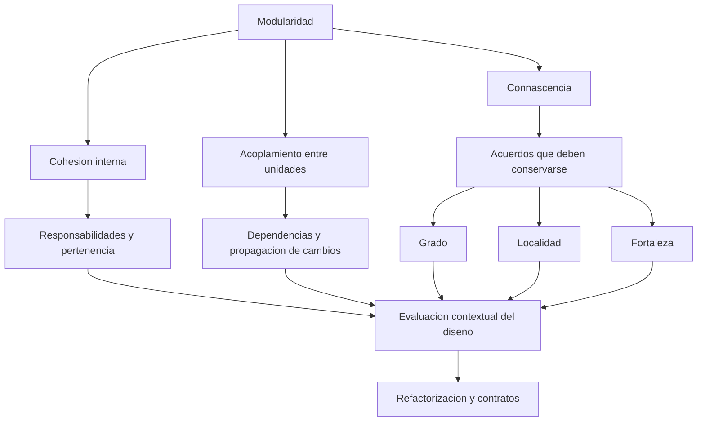
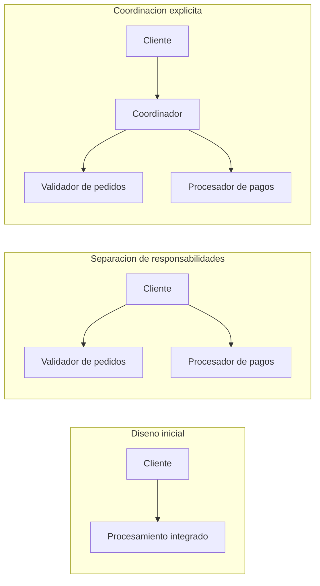
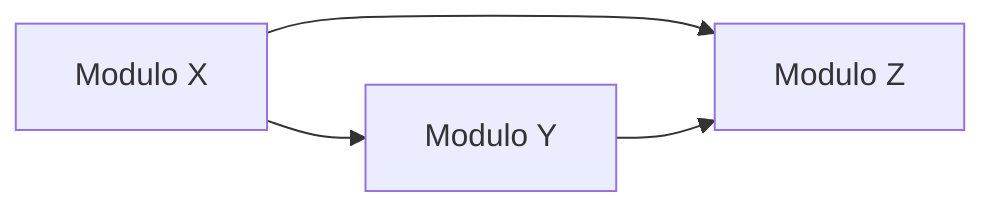

# Clase 1: Modularidad, cohesión, acoplamiento y connascencia en los paradigmas de programación

> **Objetivo académico:** Analizar la modularidad como problema transversal de los lenguajes y paradigmas de programación, interpretar métricas de cohesión y dependencia y evaluar decisiones de refactorización mediante su impacto en las responsabilidades, los contratos y la propagación de cambios.

## 1. Contexto y marco conceptual

### 1.1. La modularidad como problema de representación

La programación avanzada se presenta desde una perspectiva que conecta implementación, diseño, arquitectura e investigación en lenguajes. La cuestión central es cómo organizar una solución para comprenderla, modificarla y comunicar sus decisiones sin tener que razonar continuamente sobre cada línea de código.

La sesión utiliza la organización de programas mediante tarjetas perforadas como antecedente ilustrativo: incluso cuando programar se entendía principalmente como traducir instrucciones a una representación ejecutable, era necesario ordenar y agrupar sus partes. Con el crecimiento de los programas, la organización dejó de ser un asunto exclusivamente físico y se convirtió en un problema de abstracción y delimitación de responsabilidades.

La modularidad no pertenece exclusivamente a la orientación a objetos. Aparece en funciones, procedimientos, clases, paquetes, bibliotecas, componentes y servicios. También guarda una relación conceptual con la organización de representaciones matemáticas: en ambos casos, introducir unidades reconocibles permite razonar sobre un conjunto sin desplegar todos sus detalles simultáneamente.

La exposición sostiene que el código tiende a generar desorden conforme crece. **Enriquecimiento conceptual:** esta afirmación puede entenderse como una advertencia sobre la expansión de dependencias y decisiones implícitas, no como una ley según la cual cualquier crecimiento empeora inevitablemente el diseño. La complejidad depende también de las restricciones arquitectónicas y de la disciplina de mantenimiento.

### 1.2. Módulo lógico y organización física

Un **módulo** es una agrupación de elementos de software que puede tratarse como una unidad de responsabilidad, comprensión o interacción. Su escala depende del análisis: una función puede ser una unidad modular dentro de una clase, y varias clases pueden constituir un componente dentro de un sistema.

La agrupación lógica no coincide necesariamente con una carpeta. Una funcionalidad puede involucrar código de aplicación, una tabla y una migración almacenados en ubicaciones distintas. Inversamente, compartir un archivo no demuestra que varios elementos deban constituir una misma unidad conceptual.

| Perspectiva | Pregunta principal | Ejemplo |
| --- | --- | --- |
| Física | ¿Dónde se almacena o empaqueta el código? | Archivos, carpetas y artefactos compilados. |
| Lógica | ¿Qué responsabilidad y significado comparten sus elementos? | Operaciones y datos que sostienen la gestión de usuarios. |
| Arquitectónica | ¿Cómo se relaciona la unidad con el resto del sistema? | Un componente de facturación y sus contratos de interacción. |

El módulo también funciona como unidad de comunicación. Hablar del servicio de usuarios o del procesador de pagos permite discutir decisiones con mayor precisión que enumerar líneas de código.

### 1.3. Paradigmas como respuestas a problemas

La perspectiva propuesta consiste en estudiar cada paradigma a partir de sus motivaciones: qué problemas intenta resolver, qué mecanismos ofrece y qué limitaciones introduce. La sesión menciona programación estructurada, orientada a objetos, orientada a aspectos y funcional.

El interés científico no se agota en utilizar correctamente una tecnología; requiere explicar por qué existen sus mecanismos y bajo qué condiciones resultan adecuados. Esta perspectiva complementa la práctica de ingeniería, sin establecer una separación absoluta entre ambos tipos de conocimiento.

**Enriquecimiento conceptual:** los paradigmas no forman necesariamente una sucesión donde cada uno sustituye por completo al anterior. Muchos lenguajes combinan estructuras de control, objetos y funciones; por ello, conviene analizar mecanismos concretos y no clasificar cada lenguaje mediante una etiqueta exclusiva.

## 2. Fundamentos teóricos y arquitectura

### 2.1. Tres dimensiones complementarias de la modularidad

La sesión organiza el análisis alrededor de tres conceptos:

- **Cohesión:** grado en que los elementos internos de una unidad contribuyen a una responsabilidad común.
- **Acoplamiento:** dependencias entre unidades y exposición de unas a las decisiones o cambios de otras.
- **Connascencia:** relación por la cual varios elementos deben mantener un acuerdo para que el sistema continúe funcionando correctamente.

La transcripción presenta variantes fonéticas de connascencia; se utiliza aquí una denominación uniforme para el concepto conocido como *connascence*.

La recomendación general de alta cohesión y bajo acoplamiento resulta útil, pero insuficiente para decidir una transformación concreta. Dividir una clase puede aclarar responsabilidades y añadir dependencias explícitas; fusionar componentes puede reducir enlaces externos y mezclar conceptos que deberían permanecer separados.

**Enriquecimiento conceptual:** no existe una relación inversa universal ni una cantidad de acoplamiento que deba conservarse en toda transformación. Una refactorización puede eliminar dependencias innecesarias, cambiar su dirección o sustituirlas por contratos más estables. Lo relevante es evaluar conjuntamente su número, naturaleza y efecto sobre el cambio.

### 2.2. Tipos de cohesión

La exposición presenta una clasificación desde cohesión coincidental hasta funcional. Es una guía cualitativa para interpretar agrupaciones, no una escala numérica con intervalos equivalentes.

| Tipo | Criterio de agrupación | Ejemplo y límite |
| --- | --- | --- |
| Coincidental | Los elementos comparten ubicación sin una responsabilidad reconocible. | Un archivo de utilidades que reúne operaciones inconexas. |
| Lógica | Los elementos pertenecen a una categoría general de operaciones. | Utilidades para cadenas con funciones independientes. |
| Temporal | Los elementos se agrupan por ejecutarse durante una misma fase. | Inicialización de servicios al arrancar una aplicación. |
| Procedimental | Las operaciones forman parte de un procedimiento cuyo orden importa. | Verificar condiciones antes de abrir un archivo. |
| Comunicacional | Las operaciones trabajan sobre un mismo conjunto de información. | Operaciones relacionadas mediante datos compartidos. |
| Secuencial | La salida de una operación alimenta la siguiente. | Una transformación produce el dato consumido por otra. |
| Funcional | Los elementos contribuyen a una responsabilidad claramente delimitada. | Una unidad especializada en validar pedidos. |

La sesión ilustra la cohesión funcional mediante métodos que utilizan atributos del mismo módulo. Esa estructura puede aportar evidencia de relación interna, pero no basta para demostrar unidad funcional.

**Enriquecimiento conceptual:** cohesión funcional no exige que cada método utilice todos los atributos ni que una biblioteca carezca de dependencias externas. Una biblioteca puede depender legítimamente de otras y conservar una responsabilidad clara. La matriz de accesos a atributos es un indicador estructural; el significado de la responsabilidad requiere análisis semántico.

La explicación oral de cohesión comunicacional incluye un encadenamiento de transformaciones que también corresponde a cohesión secuencial. Para distinguirlas, el criterio comunicacional es compartir información; el secuencial exige específicamente que una salida constituya una entrada posterior. Un mismo diseño puede exhibir ambos rasgos según la unidad observada.

La transición entre tipos tampoco obliga a recorrer todos los niveles en orden. La clasificación ayuda a justificar una transformación, pero no prescribe una ruta universal de refactorización.

### 2.3. Encapsulación y mecanismos de los lenguajes

Paquetes, módulos, importaciones y modificadores de acceso permiten expresar límites y controlar qué elementos pueden utilizar otros componentes. La sesión destaca que los lenguajes modernos automatizan parte de esta organización, haciendo menos visibles los problemas que resuelven.

Se discuten paquetes de Java, módulos de Kotlin y configuración de construcción en Android como ejemplos de soporte técnico para agrupar código. También aparecen visibilidades como público, privado y protegido.

**Enriquecimiento conceptual:** disponer de estos mecanismos no garantiza cohesión. Una clase privada puede contener responsabilidades inconexas y un paquete correctamente configurado puede depender de demasiados componentes. Asimismo, la correspondencia entre paquetes Java y directorios es una convención y una exigencia habitual de las herramientas, no una explicación completa de su semántica.

Los modificadores de acceso favorecen ocultación de información y control de dependencias. No sustituyen controles de autorización ni constituyen por sí solos una frontera de seguridad frente a actores externos. Además, modificadores como `sealed`, cuando existen, restringen extensión o herencia y no equivalen simplemente a un nivel adicional de visibilidad.

## 3. Implementación técnica y lógica de negocio

### 3.1. Refactorización de un flujo de pedidos y pagos

La sesión analiza una unidad que reúne validación de pedidos y procesamiento de pagos. Una primera transformación separa esas responsabilidades. El cliente pasa a conocer dos colaboradores; una segunda introduce un coordinador que concentra la secuencia y conserva una interfaz más sencilla para el cliente.

El beneficio potencial consiste en especializar componentes y reducir el conocimiento que el cliente necesita sobre la coordinación interna. El costo incluye más unidades, contratos y decisiones sobre cómo transmitir datos y errores.

**Enriquecimiento conceptual:** un coordinador no es únicamente una forma de ocultar un conteo de dependencias. Puede encapsular una política de orquestación y proteger a los clientes frente a cambios internos. Su utilidad disminuye si solo añade una capa sin una responsabilidad propia.

La refactorización conserva el comportamiento observable mientras modifica la estructura interna. Las mejoras de legibilidad y mantenibilidad son objetivos habituales; si una transformación cambia el contrato o la funcionalidad, debe analizarse también como cambio de comportamiento.

### 3.2. Falta de cohesión mediante accesos a atributos

La sesión presenta una métrica de la familia LCOM, identificada oralmente como LCOM 96b. La expresión descrita y el resultado numérico corresponden al complemento de la densidad de accesos entre métodos y atributos:

$$
L = 1 - \frac{1}{am}\sum_{j=1}^{a}\mu_j.
$$

Aquí $a$ es el número de atributos y $m$ el número de métodos de la clase, ambos enteros positivos. Para cada atributo $j$, con $j\in\{1,\ldots,a\}$, $\mu_j$ es el número de métodos distintos que acceden a él, de modo que $0\leq\mu_j\leq m$. El resultado $L$ es adimensional y pertenece a $[0,1]$ bajo estas condiciones.

El término restado de uno es la proporción de relaciones método–atributo observadas respecto de las $am$ relaciones posibles. Un valor menor indica una matriz de accesos más densa; un valor mayor indica menor densidad.

**Enriquecimiento conceptual:** la denominación exacta de esta variante no puede verificarse con las diapositivas ausentes. Las variantes de LCOM no son intercambiables: al comparar herramientas deben registrarse la fórmula y las reglas de conteo, incluidos constructores, accesos indirectos y miembros estáticos. Si $a=0$ o $m=0$, esta expresión no está definida y requiere una convención explícita de la herramienta.

#### Ejemplo trabajado de la sesión

Se describen tres métodos y tres atributos. Los atributos son utilizados, respectivamente, por uno, dos y dos métodos. Por tanto, $a=3$, $m=3$ y la suma de accesos distintos es $1+2+2=5$:

$$
L = 1 - \frac{1+2+2}{3\cdot3}
  = 1 - \frac{5}{9}
  = \frac{4}{9}
  \approx 0.44.
$$

La cifra expresa una propiedad estructural de los accesos, no un porcentaje de calidad ni una certificación de cohesión funcional.

Otro ejemplo contiene tres parejas independientes de método y atributo. En ese caso, la suma es tres:

$$
L = 1 - \frac{3}{9}
  = \frac{2}{3}
  \approx 0.67.
$$

El incremento sugiere menor conexión estructural interna. Aun así, no establece por sí mismo si conviene dividir la clase.

La sesión propone $0.5$ como referencia personal para orientar la interpretación. No constituye un umbral universal. Tampoco $L=0$ demuestra responsabilidad única: solo indica que todos los métodos contados acceden a todos los atributos contados. De manera análoga, $L=1$ indica ausencia de esos accesos, pero no descarta otras relaciones semánticas entre métodos.

### 3.3. Acoplamiento aferente y eferente

Para una unidad de análisis determinada se distinguen:

- **Acoplamiento aferente, $C_a$:** número de unidades externas que dependen de ella.
- **Acoplamiento eferente, $C_e$:** número de unidades externas de las que depende.

Ambos son conteos enteros no negativos. Antes de medir debe fijarse qué constituye una unidad —clase, paquete o componente— y qué relación cuenta como dependencia.

Un $C_a$ elevado indica que muchos clientes pueden verse afectados por cambios incompatibles. Un $C_e$ elevado indica una mayor superficie de exposición a colaboradores externos, aunque el impacto efectivo depende de la estabilidad de sus contratos.

El ejemplo descrito en clase tiene tres módulos y las dependencias siguientes:

| Módulo | $C_a$ | $C_e$ | Interpretación estructural |
| --- | ---: | ---: | --- |
| X | 0 | 2 | Depende de Y y Z; no recibe dependencias en este modelo. |
| Y | 1 | 1 | Es utilizado por X y utiliza Z. |
| Z | 2 | 0 | Es utilizado por X e Y y no depende de otros módulos representados. |

### 3.4. Abstracción e inestabilidad

La proporción de abstracción se define mediante:

$$
A = \frac{N_a}{N_a+N_c}.
$$

$N_a$ es el número de tipos clasificados como abstractos y $N_c$ el de tipos concretos dentro de la unidad. Ambos son enteros no negativos y su suma debe ser positiva. $A$ es adimensional y pertenece a $[0,1]$. La clasificación concreta de interfaces y clases abstractas debe mantenerse consistente.

El ejemplo de tres tipos abstractos y siete concretos produce:

$$
A=\frac{3}{3+7}=0.3.
$$

**Enriquecimiento conceptual:** una clase abstracta puede contener implementación parcial. Además, no existe una regla general que exija al menos tantas clases concretas como interfaces: una implementación puede satisfacer varias interfaces, y los contratos de un paquete pueden implementarse en otro. Por ello, $A=0.5$ no representa por definición un diseño óptimo, ni $A=0$ demuestra un defecto.

La inestabilidad estructural se calcula como:

$$
I = \frac{C_e}{C_a+C_e}.
$$

La expresión es válida cuando $C_a+C_e>0$. $I$ es adimensional y pertenece a $[0,1]$. Un valor cercano a uno indica predominio de dependencias salientes; uno cercano a cero indica predominio de entrantes.

Aplicada al ejemplo anterior:

$$
I_X=\frac{2}{0+2}=1,\qquad
I_Y=\frac{1}{1+1}=0.5,\qquad
I_Z=\frac{0}{2+0}=0.
$$

**Enriquecimiento conceptual:** estabilidad estructural no equivale a ausencia de fallos ni a calidad global. Un componente con muchas dependencias entrantes puede ser difícil de modificar precisamente por su número de clientes. Un componente con dependencias salientes puede cambiar poco si utiliza contratos estables. Si ambos conteos son cero, la fórmula no está definida sin una convención adicional.

La sesión vincula programación contra abstracciones con el principio de sustitución de Liskov. **Enriquecimiento conceptual:** la sustitución de Liskov exige preservar las expectativas de comportamiento al sustituir tipos. La orientación de dependencias hacia abstracciones corresponde más directamente al principio de inversión de dependencias; son principios relacionados, pero distintos.

### 3.5. Distancia a la secuencia principal

La secuencia principal relaciona abstracción e inestabilidad mediante la recta:

$$
A+I=1.
$$

Con $I$ en el eje horizontal y $A$ en el vertical, une los puntos $(0,1)$ y $(1,0)$. La distancia normalizada presentada es:

$$
D=|A+I-1|.
$$

$A$ e $I$ son las proporciones previamente definidas; $D$ es adimensional y pertenece a $[0,1]$. Un resultado cero indica que el punto está sobre la recta. Un valor mayor expresa mayor separación respecto de esa referencia, no necesariamente peor calidad en cualquier contexto.

**Enriquecimiento conceptual:** la distancia perpendicular geométrica a la recta es:

$$
d_{\perp}=\frac{|A+I-1|}{\sqrt{2}}.
$$

El denominador proviene de la norma del vector normal $(1,1)$. Así, $D$ es una distancia normalizada y $d_{\perp}$ la separación euclídea en el plano de métricas; no deben confundirse.

Los pares de la sesión ilustran que perfiles diferentes pueden dar el mismo resultado:

| $A$ | $I$ | $D$ |
| ---: | ---: | ---: |
| 0.3 | 0.7 | 0 |
| 0.6 | 0.4 | 0 |
| 0.1 | 0.9 | 0 |

La pérdida de información es explícita: $D$ resume la separación de la recta, pero no identifica la posición sobre ella.

#### Precisión sobre las zonas del plano

La explicación oral atribuye inutilidad a alta abstracción con baja inestabilidad, y dolor a baja abstracción con alta inestabilidad. Esas combinaciones se aproximan, respectivamente, a los extremos $(0,1)$ y $(1,0)$ de la propia secuencia principal, por lo que esa identificación resulta inconsistente con la fórmula.

**Enriquecimiento conceptual:** en la interpretación habitual del plano:

- La **zona de dolor** se aproxima a $A=0$ e $I=0$: componentes concretos estructuralmente estables, con clientes que dificultan modificarlos.
- La **zona de inutilidad** se aproxima a $A=1$ e $I=1$: abstracciones con escasa utilización entrante y predominio de dependencias salientes.

Estos nombres son heurísticos. No implican que toda abstracción deba implementarse dentro del mismo paquete ni que estar sobre la secuencia principal certifique un diseño correcto. La interpretación requiere examinar responsabilidades, contratos y clientes reales.

### 3.6. Connascencia: acuerdos y propagación de cambios

La connascencia permite describir dependencias que un conteo de enlaces no distingue. Su evaluación utiliza tres dimensiones:

| Dimensión | Qué representa | Consecuencia práctica |
| --- | --- | --- |
| Grado | Número de entidades involucradas en el acuerdo. | Más entidades pueden ampliar el esfuerzo de cambio coordinado. |
| Localidad | Cercanía de los elementos, desde un ámbito local hasta sistemas separados. | La distancia aumenta dificultades de coordinación y despliegue. |
| Fortaleza | Naturaleza y dificultad del acuerdo que debe preservarse. | Los acuerdos implícitos o dependientes de ejecución suelen ser más difíciles de verificar. |

Un acuerdo nominal dentro de un archivo puede modificarse con una herramienta de renombrado. El mismo acuerdo en un campo JSON utilizado por aplicaciones externas requiere compatibilidad y coordinación. La localidad y el grado pueden hacer prioritario un vínculo considerado débil.

La sesión distingue connascencia estática y dinámica:

| Tipo | Acuerdo requerido | Ejemplo y tratamiento posible |
| --- | --- | --- |
| Nombre | Coincidencia de identificadores. | Variables, métodos, campos JSON o columnas SQL; controlar alcance y contratos. |
| Tipo | Compatibilidad de tipos. | Cambiar un precio de entero o punto flotante a una representación decimal. |
| Significado o convención | Interpretación compartida de valores. | Códigos `A` e `I` para estados; hacer explícito el dominio. |
| Algoritmo | Uso de reglas de transformación compatibles. | Cálculos o protocolos compartidos entre cliente y servidor. |
| Posición | Correspondencia entre significado y orden. | Parámetros nombre y apellido; introducir nombres explícitos o constructores guiados. |
| Ejecución | Orden válido de operaciones. | Iniciar, operar y finalizar una transacción. |
| Temporización | Coordinación temporal que afecta el resultado. | Operaciones concurrentes sobre una cuenta. |
| Valor | Conservación conjunta de una relación entre valores. | Coordenadas que deben seguir representando un cuadrado. |
| Identidad | Referencia a una misma entidad o instancia. | Componentes que deben compartir un contexto transaccional. |

Los cinco primeros se presentan como estáticos; los restantes dependen del comportamiento en ejecución. La sesión los ordena pedagógicamente de menor a mayor dificultad, pero esa fortaleza debe evaluarse junto con localidad y grado.

## 4. Análisis crítico de casos y auditoría práctica

### 4.1. Mismo LCOM, distinta estructura

El caso más significativo de cohesión compara dos módulos con $L\approx0.44$. En uno, las relaciones descritas conectan métodos y atributos; en otro, una pareja método–atributo queda separada del resto.

La igualdad numérica surge porque la fórmula agrega relaciones sin conservar toda su distribución. Dos matrices pueden contener cinco accesos sobre nueve posibles y tener estructuras diferentes.

**Enriquecimiento conceptual:** puede representarse la clase como un grafo bipartito cuyos conjuntos de nodos son métodos y atributos. Una arista expresa que un método utiliza un atributo. La densidad resume cuántas aristas existen; la conectividad permite detectar grupos separados. Esta segunda perspectiva explica por qué el mismo valor agregado puede ocultar responsabilidades distintas.

Separar la pareja aislada puede ser razonable si también posee una responsabilidad independiente. La decisión necesita evidencia semántica: una partición estructural no demuestra por sí sola que existan dos conceptos del dominio.

Los conflictos frecuentes al modificar un archivo desde funcionalidades distintas pueden revelar esa mezcla de responsabilidades. También pueden deberse a otros factores de colaboración; son una señal para investigar, no una prueba concluyente.

### 4.2. Usuarios y facturación: dependencia no implica pertenencia

Un componente de facturación puede necesitar el nombre de un usuario. Esa dependencia no obliga a fusionar facturación con usuarios. La fusión reduce una frontera, pero puede producir una unidad con responsabilidades heterogéneas.

El criterio pertinente es si los elementos cambian por razones relacionadas y si su agrupación mejora la comprensión del dominio. Compartir un dato o una llamada no basta para justificar la misma frontera modular.

### 4.3. Inicialización, eventos y orden de negocio

La inicialización de servicios ejemplifica cohesión temporal: componentes diferentes participan en una misma fase del ciclo de vida. La inyección de dependencias puede automatizar resolución y construcción, pero no elimina la necesidad de declarar correctamente sus requisitos.

La secuencia pago, facturación y notificación ilustra restricciones de orden. En sistemas distribuidos, eventos y colas hacen explícitos desafíos de coordinación, retrasos y consistencia. La sesión menciona orquestadores y sagas como mecanismos relacionados con estos problemas.

**Enriquecimiento conceptual:** introducir eventos no mejora automáticamente la cohesión, ni sustituirlos por llamadas directas constituye siempre una mejora. La elección modifica sincronía, disponibilidad y tratamiento de errores. Una saga coordina operaciones locales y posibles compensaciones; no equivale por sí sola a una transacción atómica global. Tampoco toda arquitectura de eventos requiere un orquestador central: puede emplear coreografía.

La referencia oral a ausencia de frameworks en Rust no debe tomarse como característica del lenguaje. La conclusión generalizable es que, sin un mecanismo que gestione el ciclo de vida, la implementación debe organizar explícitamente la construcción y coordinación de servicios.

### 4.4. Abstracción, pruebas y dependencias del framework

La discusión relaciona interfaces y dobles de prueba con la posibilidad de aislar unidades sin arrancar toda la aplicación. Una abstracción puede ser valiosa aunque su proporción eleve $A$.

**Enriquecimiento conceptual:** un *mock* o un *fake* aporta comportamiento de prueba; una declaración abstracta por sí sola no lo proporciona. Las pruebas unitarias pueden beneficiarse de sustituciones controladas. Las pruebas de integración deben comprobar además las interacciones relevantes con implementaciones reales. Ninguna de estas estrategias exige maximizar la cantidad de interfaces.

El valor de una abstracción depende de si delimita una variación o un contrato útil. Crear interfaces únicamente para mejorar una métrica puede aumentar complejidad sin mejorar verificabilidad.

### 4.5. Contratos remotos y evolución de tipos

Cambiar el tipo de un campo utilizado por clientes externos combina connascencia de tipo, localidad distante y un grado potencialmente alto. El esfuerzo no consiste solo en editar el servidor: incluye compatibilidad de serialización y capacidad de actualización de cada consumidor.

La sesión contrapone una actualización coordinada con la coexistencia de versiones. Cuando algunos clientes no pueden adoptar el contrato nuevo, mantener temporalmente dos implementaciones o versiones puede reducir interrupciones.

**Enriquecimiento conceptual:** modificar el tipo o significado de una interfaz pública puede exceder una refactorización que preserve comportamiento. Para importes monetarios, una representación decimal y reglas explícitas de escala y redondeo suelen ser más pertinentes que cambiar automáticamente a `float` o `double`.

La afirmación de que JavaScript resulta intrínsecamente inadecuado para transacciones financieras es demasiado general. La evaluación requiere considerar representación numérica, validaciones, base de datos, seguridad y diseño transaccional, además del lenguaje elegido.

### 4.6. Algoritmos compartidos y autenticación

La sesión utiliza JSON Web Token como ejemplo de acuerdo algorítmico entre componentes. También menciona bibliotecas y generadores de clientes como formas de reducir discrepancias.

**Enriquecimiento conceptual:** un JWT firmado normalmente se verifica, no se descifra. Codificar su contenido no equivale a cifrarlo, y el cliente no necesita poseer una clave secreta de firma. Si se emplea cifrado, constituye un mecanismo adicional. El ejemplo conserva su valor para analizar compatibilidad de protocolos, pero debe distinguir codificación, firma y cifrado.

Del mismo modo, generar clientes desde una descripción de servicio ayuda a mantener consistencia de contratos y serialización; no significa copiar el algoritmo de negocio del servidor ni elimina toda posibilidad de incompatibilidad.

### 4.7. Valores coordinados e identidad compartida

El cuadrado ilustra una invariante entre valores: cambiar una coordenada arbitrariamente puede destruir la figura. El problema no es que todas las coordenadas deban cambiar siempre, sino que las modificaciones deben conservar las restricciones geométricas pertinentes.

**Enriquecimiento conceptual:** una representación basada en parámetros independientes y operaciones que preserven la figura puede reducir el número de valores que deben coordinarse manualmente. El principio se extiende a saldos, estados y relaciones entre datos del negocio.

En connascencia de identidad, compartir una misma instancia puede ser un requisito legítimo. El ejemplo de acceso a bases de datos obliga a distinguir entre compartir un gestor de recursos y compartir indiscriminadamente una conexión mutable.

**Enriquecimiento conceptual:** Singleton puede garantizar una instancia bajo ciertas condiciones, pero no elimina el acoplamiento por identidad y puede introducir estado global. Inyección de dependencias y ámbitos de vida explícitos permiten controlar qué se comparte. Inmutabilidad reduce riesgos de estado mutable, pero no elimina todas las dependencias de identidad. La seguridad entre hilos tampoco significa necesariamente permitir acceso a un único hilo: significa preservar la corrección bajo concurrencia mediante una estrategia adecuada.

### 4.8. Analogía con el diseño curricular

La discusión extiende cohesión y dependencia a una estructura curricular. Una materia contiene conocimientos o competencias que deben guardar una relación justificable; sus prerrequisitos establecen vínculos con otras materias. El lugar de una asignatura depende del propósito del programa: una lengua puede ser periférica en un contexto y central en otro.

La analogía permite destacar que pertenencia e independencia se definen respecto de un contexto. No autoriza trasladar directamente métricas de clases a materias sin definir nuevas unidades y validar su interpretación.

## 5. Principios de diseño, buenas prácticas y anti-patrones

### 5.1. Buenas prácticas derivadas del análisis

1. **Definir la unidad y el alcance de medición.** Comparar clases con clases y paquetes con paquetes, usando reglas estables de dependencia y abstracción.
2. **Distinguir estructura de significado.** Los accesos a atributos y los conteos de enlaces apoyan el análisis, pero no reemplazan la interpretación de responsabilidades.
3. **Evaluar transformaciones completas.** Una separación puede mejorar especialización y trasladar coordinación a otro componente; deben analizarse ambos efectos.
4. **Localizar los acuerdos difíciles.** Una dependencia fuerte puede ser manejable dentro de una unidad pequeña; un acuerdo nominal remoto puede exigir una estrategia de evolución cuidadosa.
5. **Usar contratos para limitar propagación.** Encapsulación, interfaces y adaptadores resultan útiles cuando protegen variaciones reales y mantienen expectativas claras.
6. **Interpretar métricas conjuntamente.** LCOM, $C_a$, $C_e$, $A$, $I$ y $D$ responden preguntas distintas. Ninguna sintetiza toda la modularidad.
7. **Examinar tendencias comparables.** La evolución entre versiones puede revelar deterioro o mejoras si el alcance y la configuración permanecen consistentes.
8. **Automatizar sin delegar el juicio.** El análisis estático reduce el trabajo de conteo; la evaluación semántica sigue siendo necesaria.

La sesión menciona SonarQube y herramientas específicas de cada lenguaje como apoyo al análisis estático. **Enriquecimiento conceptual:** no debe asumirse que cualquier instalación ofrece todas estas métricas o variantes. La disponibilidad depende del analizador, los complementos y su configuración. En lenguajes dinámicos, resolución en ejecución y metaprogramación pueden limitar el grafo de dependencias obtenido estáticamente.

### 5.2. Anti-patrones

| Anti-patrón | Problema | Criterio de mejora |
| --- | --- | --- |
| Confundir carpeta con módulo coherente | La ubicación física oculta responsabilidades mezcladas. | Justificar pertenencia mediante propósito y cambios relacionados. |
| Fusionar todo para eliminar enlaces externos | Se pierde separación conceptual y capacidad de evolución. | Conservar fronteras útiles y revisar dependencias innecesarias. |
| Crear interfaces para alcanzar una proporción objetivo | Aumenta la estructura sin una variación que proteger. | Vincular abstracciones con contratos y necesidades reales. |
| Tratar $0.5$ como umbral universal | Se convierte una referencia contextual en regla injustificada. | Examinar distribución, dominio e historial. |
| Interpretar $D=0$ como diseño perfecto | Se ignora la posición en el plano y el significado de los componentes. | Analizar $A$, $I$ y responsabilidades por separado. |
| Confiar en un renombrado local para cambiar contratos remotos | Pueden quedar consumidores, SQL y datos persistidos incompatibles. | Identificar límites y mecanismos de transición. |
| Mantener convenciones implícitas | El acuerdo existe fuera del sistema de tipos y validaciones. | Representar dominios y restricciones explícitamente. |
| Usar Singleton como solución general de concurrencia | La instancia única puede seguir conteniendo estado inseguro. | Definir identidad, ciclo de vida y estrategia de sincronización. |
| Equiparar modificadores de acceso con autorización | Se confunden restricciones de programación y seguridad operativa. | Diseñar ambos controles según sus objetivos. |

**Enriquecimiento conceptual:** la deuda técnica describe consecuencias futuras de decisiones o deficiencias que encarecen el cambio. No es idéntica al volumen de código ni aumenta necesariamente de forma proporcional con él. La refactorización debe justificarse por riesgos y costos observables, además de por métricas.

## 6. Síntesis conceptual y profundización académica

### 6.1. Integración de los conceptos

La modularidad organiza el razonamiento sobre un sistema. La cohesión examina la pertenencia interna; el acoplamiento describe dependencias externas; la connascencia precisa qué acuerdos deben mantenerse y cuánto puede costar modificarlos.

Las métricas convierten algunas de estas propiedades en observaciones comparables. Su utilidad depende de conservar el vínculo entre número y fenómeno: una densidad de accesos no representa toda la responsabilidad funcional, la inestabilidad estructural no mide fallos y la distancia a una recta no certifica calidad arquitectónica.

La refactorización es una decisión contextual. Especializar componentes, introducir coordinación, preservar compatibilidad o aceptar una dependencia local son alternativas que deben justificarse mediante responsabilidades, riesgos y efectos sobre clientes.

### 6.2. Marco metodológico para estudiar paradigmas

El contenido metodológico de la sesión puede organizarse como un proceso general de investigación:

1. **Historia y fundamentos:** identificar los problemas que motivaron un paradigma y los supuestos de sus propuestas.
2. **Preguntas de investigación:** precisar limitaciones, críticas y ámbitos de aplicación.
3. **Revisión de literatura:** contrastar explicaciones y evidencia, distinguiendo propuestas teóricas de resultados empíricos.
4. **Herramientas y mecanismos:** estudiar cómo lenguajes y entornos concretan las ideas del paradigma.
5. **Prototipos y comparaciones:** cuando corresponda, observar efectos bajo condiciones explícitas.
6. **Análisis crítico:** relacionar hallazgos con mantenibilidad, legibilidad, dependencia y capacidad de cambio.
7. **Síntesis:** establecer alcance de las conclusiones y cuestiones que permanecen abiertas.

En programación estructurada, la sesión relaciona este enfoque con el uso excesivo de saltos y con las estructuras de control. **Enriquecimiento conceptual:** el resultado conocido como teorema de Böhm–Jacopini fundamenta la suficiencia de secuencia, selección e iteración para expresar computaciones bajo las condiciones de su formulación. La posibilidad de una transformación estructurada no demuestra por sí sola que cualquier transformación mejore legibilidad.

Para orientación a objetos se destacan clases, encapsulación, abstracción y patrones de diseño. La programación orientada a aspectos y la funcional se mencionan como perspectivas adicionales, sin desarrollar en esta clase un tratamiento técnico comparable.

**Enriquecimiento conceptual:** aspectos permite analizar la modularización de preocupaciones transversales; el enfoque funcional ofrece mecanismos como composición de funciones e inmutabilidad para controlar ciertas dependencias y efectos. Son conexiones de profundización, no resultados demostrados durante la sesión. La cohesión funcional de la clasificación expuesta tampoco equivale a programación funcional.

### 6.3. Alcance de la evidencia

La clase desarrolla conceptos, cálculos manuales y análisis de diseños descritos verbalmente. No aporta una ejecución reproducible de código, resultados de rendimiento ni una comparación experimental de herramientas. Los ejemplos numéricos permiten comprender fórmulas; no establecen umbrales universales.

La profundización académica se sitúa en tres cuestiones: cómo construir métricas con mayor sensibilidad a la estructura, cómo validar su relación con el costo real del cambio y cómo controlar acuerdos distribuidos sin eliminar la autonomía de los componentes. Estas cuestiones conectan lenguajes de programación, arquitectura, análisis estático y evolución de software.
