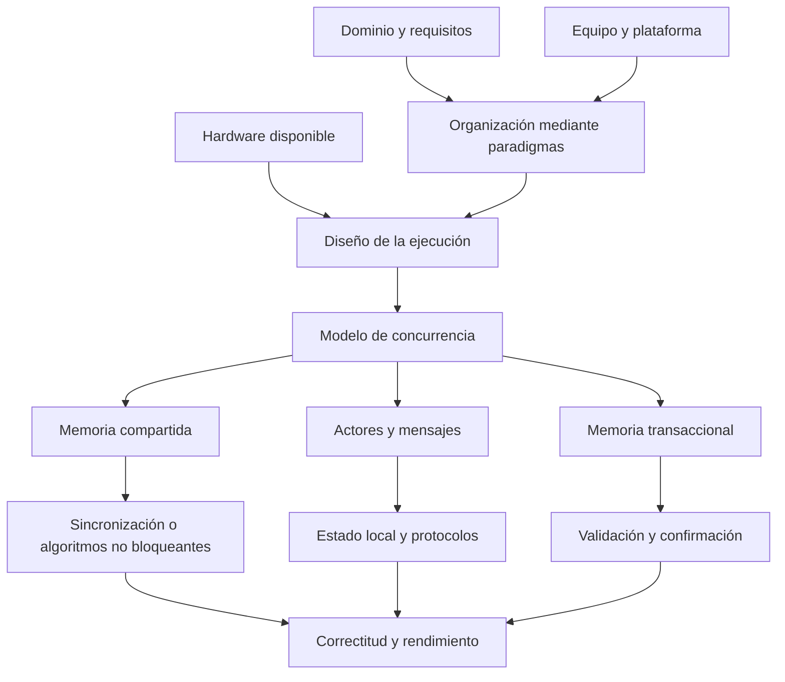

# Clase 2: Paradigmas de programación y fundamentos de concurrencia y paralelismo

> **Objetivo académico:** Analizar la selección e integración de paradigmas de programación y comprender los modelos y patrones de concurrencia, distinguiendo sus garantías de correctitud, sus costos y su relación con el hardware y el dominio del problema.

## 1. Contexto y marco conceptual

La sesión desarrolla dos ejes conectados: una revisión crítica de los paradigmas estructurado, orientado a objetos, funcional y orientado a aspectos; y una introducción a la concurrencia y el paralelismo. El vínculo entre ambos es arquitectónico: organizar responsabilidades y controlar interacciones resulta decisivo cuando varias actividades progresan de manera independiente y pueden acceder a recursos comunes.

### Paradigma, lenguaje y plataforma

Un **paradigma** proporciona conceptos para expresar y organizar una solución. Un **lenguaje** implementa mecanismos concretos con restricciones sintácticas, semánticas y operativas. La **plataforma de ejecución** determina, entre otros aspectos, cómo se administran memoria, hilos, procesos y recursos físicos.

La distinción evita atribuir al paradigma una limitación particular de una biblioteca o un entorno. Las dificultades de un ORM, por ejemplo, corresponden a la interacción entre un modelo de objetos, una representación persistente y una tecnología específica; no demuestran que toda programación orientada a objetos requiera ese mecanismo.

Los lenguajes pueden combinar varios paradigmas. La sesión menciona operaciones funcionales en JavaScript y Python, características funcionales en lenguajes de la JVM y aspectos integrados en aplicaciones Java. La coexistencia de mecanismos permite adoptar una estrategia local sin reconstruir todo un sistema.

La selección depende de:

- El dominio, las invariantes y la naturaleza del estado.
- La estructura de las interacciones y las necesidades de distribución.
- Las restricciones de hardware y plataforma.
- La experiencia del equipo y el costo de aprendizaje.
- Las necesidades de mantenimiento, verificación y rendimiento.

El tamaño del proyecto, por sí solo, no determina el paradigma. Un componente pequeño puede beneficiarse de objetos; un sistema extenso puede organizar parte de su procesamiento mediante transformaciones funcionales. Del mismo modo, software cercano al hardware puede ser muy grande y requerir una modularización rigurosa.

### Concurrencia y paralelismo

La motivación material es el desplazamiento desde mejoras sostenidas de frecuencia hacia arquitecturas con varios núcleos y aceleradores especializados. La sesión conecta esta evolución con servidores de muchas conexiones, procesamiento masivo de datos, microservicios y entrenamiento de modelos.

**Enriquecimiento conceptual:** La **concurrencia** consiste en organizar actividades cuyos intervalos de ejecución se superponen; pueden progresar mediante intercalación en un único núcleo. El **paralelismo** implica ejecución simultánea de operaciones en distintos recursos de procesamiento. Una estructura concurrente puede facilitar el paralelismo, pero no garantiza que este ocurra. Tampoco requiere necesariamente memoria compartida.

**Enriquecimiento conceptual:** La frecuencia de reloj expresa ciclos por segundo; el cuanto de planificación es el intervalo de ejecución que un planificador puede asignar a una actividad. Son magnitudes diferentes. La ley de Moore describe una tendencia histórica de integración de transistores, no una garantía de duplicación del rendimiento. Los límites de potencia, disipación e interconexión ayudan a explicar el interés por múltiples núcleos; no es correcto fundamentarlos en un supuesto diámetro fijo del electrón.

## 2. Fundamentos teóricos y arquitectura

### Programación estructurada

La discusión recupera la secuencia, la selección y la iteración como estructuras que hacen explícito el flujo de control y reducen la dificultad de seguir saltos arbitrarios. La modularización mediante procedimientos y funciones permite razonar sobre partes del programa y sus interfaces.

Su vigencia se observa dentro de métodos orientados a objetos y de otras implementaciones multiparadigma. Sin embargo, esa presencia no convierte todos los paradigmas en una misma teoría: organizar el flujo de control y organizar el estado o las interacciones son decisiones relacionadas, pero distintas.

La sesión vincula esta tradición con la validación matemática de programas y contrasta ese propósito con el predominio práctico de las pruebas por ejemplos.

**Enriquecimiento conceptual:** Una prueba automatizada comprueba comportamientos en las ejecuciones seleccionadas. Una verificación formal busca justificar propiedades bajo un modelo y supuestos explícitos. Son complementarias: las pruebas pueden descubrir fallos que una especificación no contempló, mientras que una demostración puede cubrir una clase de comportamientos que una colección finita de casos no agota. La complejidad ciclomática describe características del flujo de control; no demuestra por sí misma la correctitud del programa.

### Orientación a objetos: responsabilidades, comunicación y estado

Los conceptos centrales discutidos son encapsulación, herencia y polimorfismo. El docente enfatiza la comunicación entre componentes como criterio de diseño y cuestiona una enseñanza reducida a trasladar taxonomías del mundo real al código.

Encapsular significa proteger una representación mediante operaciones que preservan sus reglas. Una jerarquía de clases no se justifica únicamente porque dos conceptos compartan una categoría nominal. Debe facilitar las responsabilidades y las relaciones de uso del sistema.

La **cohesión** describe la relación interna entre las responsabilidades de un módulo; el **acoplamiento**, sus dependencias respecto de otros. Las jerarquías profundas pueden volver difícil determinar de dónde procede un comportamiento, aumentar dependencias y propagar cambios.

**Enriquecimiento conceptual:** Orientación a objetos no exige que todas sus realizaciones sean exclusivamente basadas en clases. Para el diseño analizado, resulta más útil preguntar qué comportamiento ofrece cada componente, qué estado protege y qué contrato presenta a sus colaboradores que exigir una correspondencia literal con entidades físicas.

### Programación funcional: pureza, inmutabilidad y composición

La sesión identifica las funciones puras y la inmutabilidad como recursos para controlar la complejidad, especialmente en procesamiento de datos y ejecución concurrente.

Una función pura produce un resultado determinado por sus argumentos y no modifica estado externo observable. La inmutabilidad evita modificar un valor existente; una transformación produce otro valor. Esto reduce las interferencias asociadas a escrituras compartidas, aunque no elimina todas las dificultades de una aplicación concurrente.

Se mencionan `map`, `filter` y `reduce` como operaciones que expresan transformaciones, selección y agregación. Las expresiones lambda permiten definir funciones anónimas; su presencia en una consulta no garantiza una mejora de rendimiento.

**Enriquecimiento conceptual:** La programación funcional admite variables como nombres o enlaces; no debe definirse como ausencia absoluta de variables. También puede representar efectos de entrada/salida mediante mecanismos explícitos. La evaluación perezosa retrasa cálculos hasta que se necesitan, pero no caracteriza a todos los lenguajes funcionales ni selecciona automáticamente una solución óptima. Puede evitar trabajo innecesario o introducir retención de memoria y costos de evaluación.

La referencia a Spark y Scala ilustra la relación entre transformaciones y datos distribuidos. **Enriquecimiento conceptual:** Scala es multiparadigma, y la inmutabilidad de una abstracción de datos no demuestra que recrear información sea siempre más rápido que actualizarla. El costo depende de la representación, el almacenamiento, la distribución y el volumen realmente procesado.

### Programación orientada a aspectos

La orientación a aspectos permite modularizar **preocupaciones transversales**: comportamientos que afectan a múltiples componentes y no encajan limpiamente en una sola responsabilidad funcional. Los ejemplos centrales son instrumentación temporal, registro de eventos, auditoría y seguridad.

La sesión utiliza los siguientes elementos:

| Elemento | Función conceptual |
| --- | --- |
| Aspecto | Agrupa una preocupación transversal. |
| Punto de unión o `join point` | Punto de ejecución en el que puede intervenir un aspecto. |
| Punto de corte o `pointcut` | Selecciona los puntos de unión relevantes. |
| Consejo o `advice` | Define el comportamiento adicional que se ejecuta. |
| Tejido o `weaving` | Integra el comportamiento transversal con el programa base. |

**Enriquecimiento conceptual:** Los mecanismos de integración varían. Algunos sistemas transforman código o bytecode; otros utilizan proxies e interceptores. Por ello, la descripción de generación de bytecode expuesta en la sesión no debe generalizarse a todas las configuraciones de Spring AOP. Tampoco todo registro de eventos constituye programación orientada a aspectos: una biblioteca de logging puede utilizarse mediante llamadas ordinarias.

### Modelos de concurrencia

| Modelo | Organización del estado | Coordinación principal | Riesgo o costo característico |
| --- | --- | --- | --- |
| Hilos con memoria compartida | Varias actividades acceden a estructuras comunes | Exclusión mutua, semáforos y otras primitivas | Carreras de datos, bloqueos y contención |
| Actores | Cada actor administra su estado y recibe mensajes | Buzones y protocolos de mensajes | Acumulación de mensajes, orden y fallos distribuidos |
| STM | Acceso transaccional a memoria compartida gestionada | Validación y confirmación de transacciones | Conflictos, abortos y reintentos |
| Algoritmos no bloqueantes | Estructuras compartidas con operaciones atómicas | Protocolos como compare-and-swap | Reintentos, complejidad y garantías de progreso |

Estas categorías no son completamente excluyentes. Un runtime de actores puede usar hilos y colas no bloqueantes; una aplicación puede combinar varios modelos en subsistemas distintos.

## 3. Implementación técnica y lógica de negocio

### Memoria compartida y sincronización

El modelo clásico crea actividades que acceden a datos comunes. Cuando una operación depende de leer y después modificar un valor, la intercalación puede romper una invariante aunque cada paso aislado parezca sencillo.

**Enriquecimiento conceptual:** Considérese un contador entero compartido que inicialmente vale cero. Dos hilos leen cero, calculan uno y escriben uno. El resultado final es uno, aunque se pretendían dos incrementos. La operación lógica completa debe protegerse mediante una primitiva adecuada o expresarse como una operación atómica.

Un mutex protege una región de exclusión mutua. Un semáforo administra permisos y puede permitir varios accesos según su configuración. La selección debe corresponder a la propiedad que se busca preservar.

**Enriquecimiento conceptual:** Una **condición de carrera** ocurre cuando la corrección depende de un orden temporal no controlado. Una **carrera de datos** se refiere, de manera más específica y según el modelo de memoria, a accesos concurrentes conflictivos sin sincronización apropiada, con al menos una escritura. No son términos intercambiables en todos los contextos.

**Enriquecimiento conceptual:** Un **interbloqueo** o `deadlock` implica que actividades no pueden progresar por dependencias de espera que no se resuelven, como un ciclo de adquisición de recursos. Un archivo de bloqueo residual puede impedir el progreso, pero no constituye por sí solo la definición general de interbloqueo. Un archivo `.lock` es un mecanismo particular de coordinación, no una representación universal de los bloqueos de memoria.

### Actores y protocolos

Cada actor mantiene estado local, recibe mensajes y procesa su comportamiento según las reglas del runtime. La sesión menciona Erlang, Elixir, Akka y Orleans como tecnologías asociadas a este enfoque.

La ventaja de diseño es evitar el acceso directo de otros actores al estado interno. La coordinación se desplaza hacia los mensajes: qué significan, quién los recibe y qué respuestas o cambios producen.

**Enriquecimiento conceptual:** El aislamiento reduce ciertas carreras sobre memoria compartida, pero no garantiza la corrección del protocolo. Dos mensajes pueden expresar decisiones incompatibles; un mensaje puede retrasarse y una operación distribuida puede repetirse. El orden, la entrega y la recuperación deben analizarse según la plataforma. Un buzón tampoco garantiza por sí solo capacidad ilimitada ni ausencia de sobrecarga.

### Memoria transaccional de software

STM agrupa operaciones sobre memoria gestionada en una transacción. En el esquema optimista descrito, dos transacciones pueden leer un estado inicial; si una confirma una modificación que invalida la lectura de la otra, esta última debe abortar y reintentarse.

El flujo conceptual es:

1. Leer los valores relevantes dentro de una transacción.
2. Calcular modificaciones tentativas.
3. Validar los accesos según las reglas del sistema.
4. Confirmar los cambios de forma atómica o descartar y reintentar.

**Enriquecimiento conceptual:** STM no exige predecir matemáticamente el resultado futuro del negocio. La detección de conflictos puede apoyarse en versiones y conjuntos de lectura y escritura. Sus garantías dependen de la implementación y de que los accesos relevantes participen en el protocolo transaccional.

**Enriquecimiento conceptual:** La atomicidad de memoria no se extiende automáticamente a una factura emitida por un servicio externo o a un correo enviado. Si una transacción se reintenta, los efectos externos no reversibles podrían repetirse. Las sagas coordinan operaciones distribuidas con compensaciones y garantías distintas; no son una aplicación equivalente de STM.

### Garantías de progreso no bloqueante

La transcripción presenta `obstruction-free`, `lock-free` y `wait-free`, pero sus explicaciones requieren una precisión central.

**Enriquecimiento conceptual:**

| Garantía | Significado | Límite |
| --- | --- | --- |
| `Obstruction-free` | Una operación termina si obtiene suficiente ejecución aislada, sin interferencia de otras operaciones. | La interferencia sostenida puede impedir el progreso. |
| `Lock-free` | Existe progreso global: alguna operación completa bajo las condiciones del modelo. | Una operación particular puede sufrir inanición. |
| `Wait-free` | Cada operación completa en un número acotado de sus propios pasos. | La cota y los supuestos deben establecerse para el algoritmo concreto. |

`Wait-free` no significa reintentar indefinidamente hasta encontrar acceso. La jerarquía de garantías es que una solución `wait-free` satisface una condición más fuerte que una `lock-free`, y esta una más fuerte que una `obstruction-free`, bajo supuestos comparables.

Compare-and-swap, o CAS, compara atómicamente un valor con el esperado y lo sustituye si coincide. Si la comparación falla, un algoritmo puede volver a leer y reintentar. La presencia de CAS no demuestra por sí sola ninguna garantía de progreso del algoritmo completo.

**Enriquecimiento conceptual:** Una operación atómica evita ciertas interferencias sobre esa operación, pero no vuelve atómica cualquier secuencia que la contenga. Tampoco corresponde clasificar todos los contadores atómicos de Java como `wait-free` sin analizar la operación y su implementación.

### Patrones de organización del trabajo

| Patrón | Estructura | Condición de diseño relevante |
| --- | --- | --- |
| Productor-consumidor | Productores generan elementos y consumidores los procesan mediante una cola | Controlar capacidad, finalización y diferencia entre ritmos de producción y consumo |
| Pipeline | Etapas sucesivas transforman o procesan un flujo | Equilibrar etapas y evitar que una monopolice el tiempo total |
| Fan-out/fan-in | Se distribuyen trabajos entre trabajadores y se reúnen resultados | Controlar granularidad, errores y agregación |
| MapReduce | Se mapean entradas, se agrupan resultados intermedios y se reducen | Definir claves, agrupamiento y propiedades de la agregación |

**Enriquecimiento conceptual:** Un pipeline puede ejecutar etapas simultáneamente sobre elementos diferentes; no equivale simplemente a concatenar llamadas. Fan-out/fan-in describe una topología general de distribución y reunión. MapReduce añade una semántica de transformación y agregación, normalmente por claves. Las funciones `map` y `reduce` de una biblioteca local no implican ejecución distribuida.

### Reducción paralela y ejemplos descritos

La sesión describe variantes de una suma de arreglo: memoria compartida con sincronización en Java, una variante no bloqueante en C++, STM en Haskell y actores en Elixir. No se dispone del código completo para auditar las implementaciones.

**Enriquecimiento conceptual:** La descomposición puede expresarse como:

$$
S = \sum_{i=1}^{n} x_i = \sum_{j=1}^{p} s_j,
\qquad s_j = \sum_{i \in I_j} x_i.
$$

Aquí, $n$ es el número de elementos; $p$ es el número de particiones no vacías, con $1 \leq p \leq n$; $x_i$ es el elemento de índice $i$; e $I_j$ contiene los índices de la partición $j$. Las particiones deben ser disjuntas y cubrir todos los índices. $s_j$ es una suma parcial y $S$ la suma total. Si los elementos tienen unidad, las sumas conservan esa unidad.

Por ejemplo, el arreglo de enteros $[2,4,6,8]$ puede dividirse en $[2,4]$ y $[6,8]$. Las sumas parciales son $6$ y $14$; la combinación produce $20$. El ejemplo supone suma entera sin desbordamiento. Con punto flotante, cambiar el orden de agregación puede cambiar el resultado por redondeo.

También se describe procesamiento independiente de imágenes en Go mediante goroutines, canales y espera de finalización. La observación técnica rescatable es que el orden de terminación puede diferir del orden de lanzamiento.

**Enriquecimiento conceptual:** Una goroutine es una actividad administrada por el runtime, no necesariamente un hilo nuevo del sistema operativo. Un canal permite comunicación y sincronización, pero no transforma automáticamente el programa en un sistema de actores. Si cada actividad modifica datos independientes, puede no requerirse un mutex; aun así, deben coordinarse finalización, errores y resultados compartidos.

## 4. Análisis crítico de casos y auditoría práctica

### Caso de orientación a objetos: persistencia y sobreingeniería

El debate identifica jerarquías innecesarias, patrones aplicados por hábito y dificultad para seguir comportamientos heredados. También plantea el desajuste entre objetos y persistencia relacional.

La decisión relevante es determinar qué responsabilidad tiene cada capa y qué costo introduce la abstracción. Un ORM puede reducir trabajo repetitivo, pero su conveniencia depende de consultas, volumen, transacciones y necesidades de control sobre la persistencia.

**Enriquecimiento conceptual:** Un singleton no garantiza menos consultas, mejor uso de conexiones ni mayor rendimiento. Puede introducir estado global compartido y dificultades de prueba o concurrencia. La gestión de conexiones, la repetición de consultas y el almacenamiento temporal de resultados son problemas distintos y requieren mecanismos específicos.

### Caso funcional: datos masivos y adopción gradual

Se describen experiencias con análisis de datos, registros, sistemas de recomendación y transformaciones sobre Spark. El argumento favorable es que separar transformaciones de efectos facilita comprender y distribuir ciertas operaciones.

La adopción requiere evaluar al equipo y la base existente. Una migración extensa puede resultar costosa incluso cuando algunos componentes se beneficien del estilo funcional. Una alternativa coherente con la sesión es incorporar transformaciones puras en partes delimitadas y mantener los efectos en fronteras explícitas.

**Enriquecimiento conceptual:** Inteligencia artificial, blockchain o complejidad matemática no hacen obligatorio el paradigma funcional. Los sistemas con muchos efectos tampoco lo excluyen automáticamente. La decisión depende de cómo se representan y coordinan esos efectos, no de una clasificación absoluta por sector.

### Caso de aspectos: observabilidad y optimización

Un caso relatado corresponde a una aplicación Java con Spring Boot en la que se busca localizar demoras en llamadas a controladores. Introducir mediciones en cada método mezcla la funcionalidad principal con instrumentación y repite código. Un aspecto permite seleccionar puntos de interés y centralizar el comportamiento de medición.

La distinción decisiva es entre **observar** y **optimizar**. Medir tiempos ayuda a localizar un cuello de botella; reducirlo puede requerir modificar consultas, algoritmos, recursos o políticas de ejecución. El aspecto de medición añade trabajo y no demuestra una aceleración.

**Enriquecimiento conceptual:** Una duración puede calcularse mediante:

$$
\Delta t = t_{\mathrm{fin}} - t_{\mathrm{inicio}}.
$$

$t_{\mathrm{inicio}}$ y $t_{\mathrm{fin}}$ son lecturas de un mismo reloj monotónico; $\Delta t$ es el tiempo transcurrido en la unidad elegida, por ejemplo segundos. El intervalo debe delimitarse expresamente: puede incluir esperas o solo un tramo del procesamiento. Una medición aislada no representa la distribución de latencias de un servicio.

La caché aparece como un posible comportamiento transversal capaz de evitar trabajo repetido. **Enriquecimiento conceptual:** Ese beneficio depende de claves correctas, vigencia, invalidación y contexto de autorización. Memorizar una operación con efectos o devolver datos desactualizados puede alterar la semántica. Mejor modularidad y mejor rendimiento son propiedades que deben evaluarse por separado.

### Caso de seguridad y auditoría

La sesión describe modificaciones de información clínica que requieren confirmación de identidad y trazabilidad. La orientación a aspectos puede centralizar la aplicación de controles en operaciones seleccionadas.

**Enriquecimiento conceptual:** Autenticación, autorización y auditoría cumplen funciones diferentes: establecer identidad, comprobar permisos y registrar acciones. Un punto de corte incompleto puede dejar rutas sin protección; uno excesivamente amplio puede intervenir operaciones no previstas. La centralización requiere comprobar cobertura, comportamiento ante errores y tratamiento de información sensible en los registros.

### Caso distribuido: identificadores y recursos compartidos

Se plantea que dos instancias de un servicio pueden generar identificadores diferentes al intentar acceder a un mismo recurso. El problema revela una decisión pendiente sobre identidad y coordinación.

**Enriquecimiento conceptual:** No siempre es necesario sincronizar los generadores. Si se busca una identidad común, puede requerirse una clave de negocio estable; si se busca unicidad, otra estrategia; si se busca impedir procesamiento repetido, idempotencia. Un mutex local no coordina instancias en procesos o máquinas diferentes. Tampoco una saga resuelve de manera general la asignación de identidad.

### Auditoría del rendimiento

La comparación de modelos exige distinguir el costo del trabajo útil del costo de crear actividades, comunicar datos, sincronizar y agregar resultados. Una operación pequeña puede terminar antes en secuencia si la coordinación domina.

**Enriquecimiento conceptual:** Para una carga y condiciones comparables, la aceleración se expresa como:

$$
S(p) = \frac{T_1}{T_p}.
$$

$p$ es el número de recursos de procesamiento considerados; $T_1$ es el tiempo de una referencia secuencial y $T_p$ el tiempo de la versión que utiliza esos recursos. Ambos tiempos deben medirse en la misma unidad; $S(p)$ es adimensional. Un valor mayor que uno indica menor tiempo respecto de esa referencia, pero no permite atribuir la diferencia exclusivamente al paradigma si cambian lenguaje, algoritmo, entrada/salida o configuración.

Para interpretar mediciones importan el mismo resultado funcional, la carga, el hardware, los límites de recursos, el calentamiento del runtime y la interferencia de la instrumentación. La transcripción no proporciona resultados suficientes para establecer una clasificación de rendimiento entre modelos.

## 5. Principios de diseño, buenas prácticas y anti-patrones

### Principios de diseño

1. **Seleccionar por propiedades del problema.** El dominio, el estado y las interacciones deben orientar la elección antes que la popularidad de una tecnología.
2. **Separar paradigma de implementación.** Una carencia de una biblioteca o runtime no caracteriza necesariamente al paradigma completo.
3. **Asignar responsabilidades coherentes.** La modularidad debe proteger invariantes y hacer comprensibles las dependencias.
4. **Reducir el estado mutable compartido cuando sea viable.** La propiedad local y las transformaciones inmutables simplifican parte del razonamiento concurrente.
5. **Declarar las garantías necesarias.** Atomicidad, orden, progreso, entrega y recuperación son propiedades diferentes.
6. **Elegir una granularidad útil.** Crear más actividades no asegura mayor rendimiento; cada actividad introduce costos de gestión.
7. **Controlar los límites del sistema.** Una garantía local no se extiende automáticamente a servicios externos o nodos distribuidos.
8. **Verificar correctitud y rendimiento por separado.** Una implementación rápida puede producir resultados incorrectos; una correcta puede no aprovechar adecuadamente los recursos.

### Rust y seguridad de concurrencia

La sesión presenta Rust como respuesta a problemas de seguridad de memoria y uso eficiente del hardware.

**Enriquecimiento conceptual:** En Rust seguro, los mecanismos de propiedad, préstamos y tipos restringen patrones que producirían usos inválidos de memoria y carreras de datos. Esto no significa que el lenguaje paralelice automáticamente el programa, impida toda condición de carrera lógica o elimine interbloqueos. Tampoco constituye una demostración completa de la lógica de negocio. Las garantías deben interpretarse considerando los límites del código seguro y las obligaciones de las partes que utilizan mecanismos inseguros.

### Anti-patrones discutidos o derivados del análisis

| Anti-patrón | Consecuencia |
| --- | --- |
| Jerarquías profundas sin necesidad contractual | Dificultan trazabilidad y propagan cambios |
| Introducir patrones por prestigio o costumbre | Aumenta complejidad sin beneficio demostrado |
| Confundir código breve con código eficiente | Oculta asignaciones, recorridos y costos de ejecución |
| Equiparar asincronía con paralelismo | Genera expectativas incorrectas sobre uso de núcleos |
| Añadir bloqueos sin datos compartidos que proteger | Introduce contención y complejidad innecesarias |
| Considerar que actores eliminan todo problema de coordinación | Traslada fallos al protocolo de mensajes |
| Repetir efectos externos dentro de transacciones reintentables | Puede duplicar acciones irreversibles |
| Identificar una biblioteca atómica con una garantía `wait-free` universal | Atribuye propiedades no demostradas al algoritmo |
| Escalar infraestructura sin localizar el cuello de botella | Puede aumentar costos sin resolver la causa |

La familiaridad del equipo tiene valor operativo, pero también puede sesgar la arquitectura. Adoptar otro paradigma requiere una justificación concreta y puede hacerse de forma gradual.

## 6. Síntesis conceptual y profundización académica

La clase sostiene una idea transversal: el diseño debe conectar la organización lógica del software con las restricciones de su ejecución. Los paradigmas aportan formas de distribuir responsabilidades; los modelos de concurrencia determinan cómo progresan las actividades y cómo coordinan el estado.

La programación estructurada facilita seguir el flujo de control. La orientación a objetos organiza comportamiento y estado detrás de contratos. La programación funcional favorece transformaciones explícitas y reduce determinadas interferencias. La orientación a aspectos modulariza preocupaciones que atraviesan componentes. Estas contribuciones pueden coexistir y no forman una clasificación de superioridad universal.

En concurrencia, la memoria compartida exige controlar accesos; los actores desplazan la coordinación a mensajes; STM administra modificaciones transaccionales; y los algoritmos no bloqueantes requieren analizar garantías de progreso. Los patrones productor-consumidor, pipeline, fan-out/fan-in y MapReduce organizan trabajo sobre esas bases, con costos y supuestos propios.

La discusión sobre investigación destaca correctitud, métodos formales, model checking, bibliotecas y optimización vinculada al hardware. **Enriquecimiento conceptual:** La verificación debe distinguir propiedades de seguridad, como que nunca se produzca un estado prohibido, de propiedades de vivacidad, como que una solicitud eventualmente progrese bajo ciertos supuestos. El model checking puede explorar estados e intercalaciones de un modelo finito, aunque su utilidad está condicionada por la fidelidad de la abstracción y el crecimiento del espacio de estados.

**Enriquecimiento conceptual:** Las referencias a records de Java ilustran la incorporación de mecanismos para representar datos, pero no demuestran inmutabilidad profunda de todo objeto alcanzable. Del mismo modo, Erlang, Elixir, Haskell y Rust no deben tratarse como un conjunto homogéneo de lenguajes puros o exclusivamente académicos. Para el argumento de la sesión basta reconocer que distintas tecnologías incorporan y combinan ideas de varios paradigmas.

Las líneas conceptuales de profundización que se desprenden del contenido son el análisis de invariantes entre componentes, las garantías de progreso de estructuras concurrentes, la interacción entre transacciones y efectos externos, y la relación entre observabilidad, evidencia empírica y verificación formal. El criterio integrador es justificar qué propiedad aporta cada mecanismo y bajo qué condiciones deja de ofrecerla.
