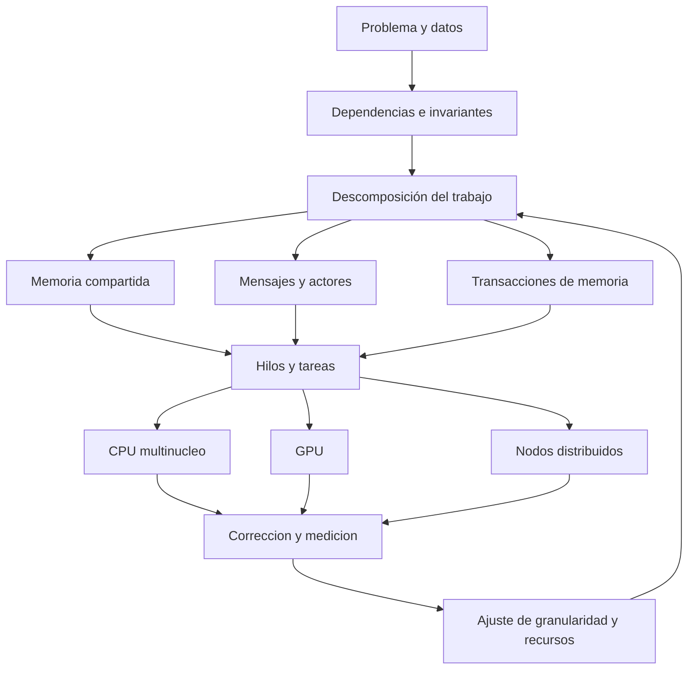
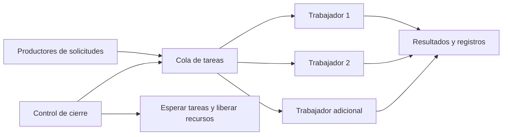

# Clase 3: Concurrencia, paralelismo y automatización del software: rendimiento, arquitecturas y metaprogramación

> **Objetivo académico:** Analizar cómo la descomposición del trabajo, la sincronización, las abstracciones de programación y la arquitectura de hardware condicionan la corrección y el rendimiento; relacionar estos principios con OpenMP, GPU, computación de alto rendimiento, metaprogramación y reflexión.

## 1. Contexto y marco conceptual

La sesión articula dos problemas de programación avanzada: coordinar actividades que progresan concurrentemente y automatizar decisiones o estructuras de código. El primero aparece en compresión de imágenes, multiplicación de matrices, cálculo de factoriales y números primos, algoritmos genéticos, procesamiento de solicitudes y búsqueda en archivos. El segundo se desarrolla mediante directivas de paralelización, generación de código, anotaciones y reflexión.

La idea transversal es que el rendimiento constituye una propiedad del sistema completo. Intervienen el algoritmo, el tamaño y la distribución de los datos, la granularidad de las tareas, el modelo de comunicación, el runtime, las bibliotecas, el compilador y el hardware. Por ello, comparar dos programas escritos en lenguajes diferentes no equivale a aislar el efecto del lenguaje.

### Concurrencia, paralelismo y asincronía

| Concepto | Pregunta central | Consecuencia práctica |
|---|---|---|
| Concurrencia | ¿Cómo se estructuran y coordinan varias actividades en progreso? | Requiere controlar dependencias, estado y comunicación. |
| Paralelismo | ¿Qué actividades se ejecutan simultáneamente? | Depende de recursos de cómputo y trabajo susceptible de distribución. |
| Asincronía | ¿Debe el solicitante esperar inmediatamente la finalización? | Permite desacoplar solicitud y respuesta, sin garantizar mayor velocidad de cálculo. |

**Enriquecimiento conceptual:** Una implementación concurrente puede ejecutarse por intercalado en un solo núcleo. El paralelismo permite ejecución simultánea, pero su presencia no asegura aceleración. Asimismo, una operación asíncrona puede limitarse a delegar trabajo o esperar entrada/salida; no necesariamente crea un hilo ni utiliza varios núcleos.

En los casos revisados se distinguen tres familias de organización: memoria compartida con sincronización explícita, comunicación mediante mensajes y ejecución mediante tareas gestionadas por un runtime. Estas familias pueden combinarse; no son propiedades exclusivas de un lenguaje.



## 2. Fundamentos teóricos y arquitectura

### 2.1. Aceleración y límites de escalabilidad

Los casos muestran un patrón recurrente: aumentar trabajadores mejora inicialmente el tiempo, pero después produce estabilización o degradación. El número de trabajadores lógicos no equivale al número de recursos físicos disponibles.

La sesión introduce la ley de Amdahl para explicar el límite impuesto por la fracción secuencial.

**Enriquecimiento conceptual:** Su expresión idealizada para un problema de tamaño fijo es:

$$
S(p)=\frac{1}{(1-f)+\frac{f}{p}}
$$

Aquí, $S(p)$ es la aceleración adimensional respecto de la ejecución secuencial; $f\in[0,1]$ es la fracción del tiempo original susceptible de paralelización, y $p\in\mathbb{N}^{+}$ representa unidades de ejecución efectivamente disponibles. Se supone reparto perfecto y ausencia de sobrecostes adicionales.

La expresión se obtiene al dividir el tiempo paralelo ideal, $(1-f)T_1+fT_1/p$, por el tiempo secuencial $T_1>0$. Si $f=0.9$, valor ilustrativo discutido en la sesión, entonces:

$$
S(8)=\frac{1}{0.1+0.9/8}\approx4.71,
\qquad
\lim_{p\to\infty}S(p)=10
$$

El límite significa que ninguna cantidad de recursos elimina el costo de la parte secuencial bajo estos supuestos. No constituye una estimación del rendimiento real de los programas presentados.

**Enriquecimiento conceptual:** Un modelo más útil para interpretar degradaciones incorpora sobrecostes:

$$
T_p=T_1\left((1-f)+\frac{f}{p}\right)+H(p)
$$

$T_p$ y $T_1$ son tiempos medidos en la misma unidad; $H(p)\geq0$ es el tiempo adicional por planificación, comunicación, sincronización y administración. Si $H(p)$ crece suficientemente, agregar trabajadores empeora el resultado. Además, esta aproximación no describe por completo cambios de caché, ancho de banda o desequilibrios de carga.

### 2.2. CPU multinúcleo, vectorización y memoria

El procesamiento multinúcleo distribuye trabajo entre núcleos de propósito general. La vectorización opera sobre varios elementos mediante instrucciones SIMD; AVX se menciona como ejemplo de extensiones vectoriales. Son niveles diferentes de paralelismo y pueden coexistir.

La sesión subraya dos dificultades: las condiciones de carrera y los efectos de la jerarquía de memoria.

**Enriquecimiento conceptual:** Una carrera de datos implica accesos concurrentes conflictivos a una ubicación de memoria, al menos uno de escritura, sin la sincronización exigida por el modelo de memoria. Una condición de carrera es una noción más amplia: el resultado depende de un orden de acontecimientos que el programa no controla adecuadamente.

**Enriquecimiento conceptual:** La falsa compartición ocurre cuando hilos modifican datos lógicamente independientes situados en una misma línea de caché. El protocolo de coherencia puede generar tráfico e invalidaciones entre núcleos aunque los hilos no compartan la variable que actualizan. Su efecto típico es de rendimiento; no debe definirse simplemente como tener copias desactualizadas de información compartida. La coherencia de caché y la sincronización del programa son problemas relacionados, pero distintos.

Por tanto, un tiempo paralelo elevado no demuestra falsa compartición. También puede deberse a tareas demasiado pequeñas, creación de trabajadores, bloqueo, saturación de memoria o medición del arranque.

### 2.3. GPU y programación heterogénea

Las GPU ofrecen alta capacidad de procesamiento para operaciones con abundante paralelismo de datos. La CPU suele organizar la ejecución y preparar datos; la GPU ejecuta kernels sobre conjuntos de elementos. Se revisan CUDA, OpenCL y el acceso desde Python mediante PyCUDA, junto con frameworks de aprendizaje profundo.

**Enriquecimiento conceptual:** Una CPU no es intrínsecamente secuencial ni una GPU se define por superar un umbral de núcleos. Difieren en su organización y sus compromisos de latencia, throughput, control y memoria. Tampoco existe equivalencia directa entre un hilo CUDA y un núcleo físico: los hilos se agrupan en bloques y se planifican sobre multiprocesadores. Las cantidades mencionadas en la demostración no bastan para reconstruir una configuración exacta.

La eficiencia depende de distribuir suficiente trabajo, reducir transferencias y organizar accesos a memoria. La similitud de las operaciones facilita el procesamiento masivo, pero no exige que todos los elementos tengan tiempos idénticos.

**Enriquecimiento conceptual:** Las bifurcaciones que hacen seguir caminos distintos a hilos de un mismo grupo pueden reducir la eficiencia. Esto no vuelve inválido el algoritmo; introduce un costo que debe evaluarse.

### 2.4. HPC y distribución

La computación de alto rendimiento integra recursos multinúcleo, aceleradores y, con frecuencia, múltiples nodos. MPI se presenta como interfaz estandarizada para comunicación por mensajes en entornos distribuidos. Un diseño híbrido puede emplear MPI entre nodos y OpenMP o CUDA dentro de cada nodo.

Las variantes discutidas incluyen recursos HPC en la nube y sistemas a escala exa. Sus dificultades centrales son escalabilidad, balance de carga, comunicación y tolerancia a fallos. Los checkpoints conservan estados desde los cuales se puede recuperar una ejecución.

**Enriquecimiento conceptual:** Un checkpoint distribuido debe representar un estado consistente, incluyendo cuando corresponda comunicaciones en curso. Un rollback no puede deshacer automáticamente efectos externos ya confirmados. La frecuencia de los checkpoints intercambia costo de almacenamiento y sincronización por cantidad potencial de trabajo perdido.

Las FPGA aparecen como opción de hardware especializado. Su utilidad depende de que la carga justifique adaptar el procesamiento a una arquitectura específica.

## 3. Implementación técnica y lógica de negocio

### 3.1. Go, Java, .NET y Python

| Entorno o mecanismo | Organización descrita | Aspecto que requiere control |
|---|---|---|
| Go: goroutines, canales y `sync.WaitGroup` | Trabajo concurrente, intercambio de resultados y espera de finalización | Cierre de canales, finalización, tamaño de buffers y cantidad de trabajo pendiente. |
| Java: hilos y locks | Coordinación explícita de memoria compartida | Alcance de bloqueos, publicación de resultados y ciclo de vida. |
| Java: `ExecutorService` | Envío de tareas a un ejecutor que administra trabajadores | Tamaño del pool, finalización, errores y espera efectiva. |
| .NET: `Task` | Abstracción de operaciones y composición de resultados | Planificación, excepciones y estado compartido. |
| Python: `threading` | Hilos dentro de un proceso | Sincronización y características de la implementación del intérprete. |
| Python: `multiprocessing` | Procesos separados con comunicación explícita | Arranque, serialización, transferencia y consumo de memoria. |

**Enriquecimiento conceptual:** Una goroutine no corresponde necesariamente a un hilo del sistema operativo. Un canal no elimina todas las carreras si se comparten objetos mutables por otros caminos. `WaitGroup` permite esperar finalización, pero no sustituye un protocolo correcto de propiedad de los datos.

**Enriquecimiento conceptual:** En Java no es obligatorio heredar de `Thread`: pueden utilizarse `Runnable`, `Callable`, lambdas y ejecutores. Tampoco `ExecutorService` elimina por sí mismo las carreras. La corrección depende de qué datos accede cada tarea y de cómo se coordinan.

**Enriquecimiento conceptual:** Una `Task` de .NET representa una operación, no necesariamente un hilo dedicado. El uso de tareas no proporciona rollback transaccional automático. En Python, para CPython convencional con GIL, los bucles CPU-bound escritos en Python no suelen obtener paralelismo multinúcleo mediante hilos; extensiones nativas y otras configuraciones pueden comportarse de forma diferente. Los procesos tampoco quedan vinculados automáticamente a un núcleo exclusivo.

### 3.2. Multiplicación de matrices: partición y propiedad de resultados

Se comparan estrategias por celdas, filas y rangos de filas. Una partición por bloques de filas reduce la cantidad de tareas respecto de crear una por cada elemento y permite asignar regiones de salida disjuntas.

**Enriquecimiento conceptual:** Para matrices $A\in\mathbb{R}^{m\times n}$ y $B\in\mathbb{R}^{n\times q}$, con $m,n,q\in\mathbb{N}^{+}$, el producto $C\in\mathbb{R}^{m\times q}$ satisface:

$$
C_{ij}=\sum_{k=1}^{n}A_{ik}B_{kj},
\qquad 1\leq i\leq m,\quad1\leq j\leq q
$$

Si $A$ y $B$ permanecen inmutables y cada tarea escribe exclusivamente sus filas de $C$, no es necesario bloquear cada acumulación local. Debe existir una espera antes de que otro componente consuma el resultado completo. El algoritmo clásico requiere un número de operaciones de orden $mnq$; para matrices cuadradas de lado $n$, el orden es $n^3$. Este conteo no predice por sí solo el tiempo, porque la localidad de memoria y las bibliotecas utilizadas tienen gran impacto.

### 3.3. OpenMP y reducción

La demostración central utiliza una directiva para distribuir iteraciones de un bucle y combinar una suma. Se reporta una ejecución paralela cercana a 0.14 segundos; no se proporciona en el discurso un tiempo secuencial exacto que permita calcular la aceleración.

**Enriquecimiento conceptual:** El siguiente fragmento reconstruye el patrón explicado; no es una transcripción literal del código mostrado ni una ejecución verificada:

```cpp
#include <cstddef>
#include <vector>

double sumar(const std::vector<double>& datos) {
    double suma = 0.0;
    const auto n = static_cast<std::ptrdiff_t>(datos.size());

    #pragma omp parallel for reduction(+:suma)
    for (std::ptrdiff_t i = 0; i < n; ++i) {
        suma += datos[static_cast<std::size_t>(i)];
    }
    return suma;
}
```

`datos` contiene valores de tipo `double`, `n` es su cantidad de elementos e `i` recorre los índices. Se supone que la colección no cambia durante la ejecución y que su tamaño es representable por el tipo de índice. La compilación debe habilitar OpenMP en una herramienta compatible.

La cláusula `reduction(+:suma)` combina acumuladores privados mediante suma; evita que todas las iteraciones actualicen sin protección un único acumulador compartido. `parallel for` expresa tanto la región paralela como el reparto del bucle: una región `parallel` aislada no distribuye automáticamente sus iteraciones.

**Enriquecimiento conceptual:** OpenMP es una especificación estandarizada y dispone de implementaciones en distintos sistemas operativos; no es exclusivo de Unix. La independencia de iteraciones, o el tratamiento explícito de sus dependencias, es más importante que su mera semejanza. Además, la suma en punto flotante no es asociativa de forma exacta: cambiar el orden de reducción puede modificar los últimos dígitos.

### 3.4. Productor–consumidor y ciclo de vida

Los sistemas de restaurante y pasarela de pagos usan una cola para desacoplar la llegada de solicitudes de su procesamiento. Los trabajadores extraen tareas mientras un mecanismo de sincronización protege la cola. El pool de C++ descrito combina trabajadores, tareas pendientes, mutex y notificación; también se incorpora un logger concurrente.



**Enriquecimiento conceptual:** El bloqueo de la cola debe cubrir sus operaciones críticas, no necesariamente todo el procesamiento de una solicitud. Una cola acotada permite aplicar contrapresión cuando la producción supera la capacidad de consumo. El cierre debe especificar si drena tareas pendientes o las cancela, impedir nuevas inserciones y garantizar la finalización de trabajadores y registros.

La simulación mediante `sleep` representa espera artificial. No implementa validación financiera, persistencia ni confirmación de pagos.

**Enriquecimiento conceptual:** `CountDownLatch` coordina la espera de varios acontecimientos; no es un reloj. Puede delimitar el momento en que termina un conjunto de tareas, pero la duración debe obtenerse mediante un instrumento de tiempo separado. En Java, el ciclo de vida de un ejecutor requiere cierre explícito o una construcción que lo garantice en la versión utilizada.

### 3.5. Memoria transaccional y operaciones atómicas

El caso de inventario contrasta bloqueos en Python con STM de Haskell. Se identifican variables transaccionales `TVar`, ejecución atómica y reintento.

**Enriquecimiento conceptual:** Un bloque STM agrupa lecturas y escrituras transaccionales para que se confirmen de manera atómica. En Haskell, `retry` puede suspender una transacción hasta que cambien variables leídas relevantes. Un lock no equivale por sí mismo a una implementación STM, y los efectos externos arbitrarios no adquieren rollback por estar relacionados con una transacción.

En la búsqueda de palabras en archivos se contrasta un método Java sincronizado con contadores atómicos en C++ mediante `compare_exchange_weak`.

**Enriquecimiento conceptual:** Esta operación compara un valor esperado con el contenido del atómico y, si coincide, intenta reemplazarlo. Puede fallar espuriamente, por lo que suele utilizarse en un bucle; ante fallo actualiza el valor esperado con el observado. Para un incremento sencillo, `fetch_add` expresa directamente la operación. El uso de atómicos no demuestra que toda la aplicación sea lock-free: esa propiedad exige analizar garantías de progreso y soporte de las operaciones utilizadas.

## 4. Análisis crítico de casos y auditoría práctica

### 4.1. Compresión BMP mediante LZ77: Go frente a Java

El caso emplea imágenes de 512 × 512, 1024 × 1024 y 2048 × 2048 píxeles, generadas con ruido, y configuraciones de cuatro y ocho trabajadores. Se reportan tiempos menores, mayor throughput y menor consumo de recursos en la implementación Go.

LZ77 se presenta como compresión sin pérdida. La implementación Go utiliza goroutines, canales y espera de finalización; la Java utiliza hilos y locks. También se describe que aumentar hilos por encima de la capacidad útil del equipo elevó el tiempo.

**Enriquecimiento conceptual:** LZ77 explota repeticiones mediante referencias a datos anteriores. La distribución de los datos y el tamaño de la ventana afectan el trabajo y la compresibilidad. Una entrada con ruido no representa todos los patrones de imagen. Además, debe distinguirse comprimir varios archivos independientes de dividir una secuencia entre trabajadores: la segunda opción requiere definir fronteras, diccionarios e integración de resultados.

Las atribuciones de mayor CPU a sincronización o de mayor memoria a hilos son hipótesis plausibles, pero no quedan demostradas sin perfiles y configuración equivalente. Una cola concurrente o un ejecutor tampoco corrigen cualquier carrera de forma automática.

### 4.2. Matrices, factoriales y números primos

Las comparaciones de matrices entre Go y Java muestran ventajas de la implementación Java con ejecutores en algunos tamaños. Para matrices de 10 × 10, la administración concurrente no aportó beneficio. Se reportan mesetas y retrocesos al aumentar trabajadores.

La comparación Python–Java utiliza bucles Python convencionales frente a Java, y después procesos Python frente a hilos Java. Para matrices de 500 × 500 se mencionan aproximadamente 78 segundos secuenciales en Python y 0.4 segundos en Java; para 1000 × 1000, 681 y 36 segundos. En Python, el caso menor baja a aproximadamente 39, 21, 15 y 15 segundos con dos, cuatro, ocho y dieciséis procesos.

Estos valores ilustran la mejora interna del programa Python y su posterior saturación. No aíslan el efecto del modelo concurrente entre lenguajes, porque las bases secuenciales ya difieren ampliamente.

**Enriquecimiento conceptual:** Una biblioteca numérica con kernels nativos puede cambiar radicalmente la comparación. Deben distinguirse tres efectos: implementación del cálculo, optimización del código y distribución paralela. Comparar un bucle interpretado con una rutina nativa optimizada y paralela mezcla esos factores.

El caso factorial compara `Task` de .NET con hilos Java y reporta resultados diferentes según la magnitud del cálculo. La facilidad de escritura no determina la velocidad. Tampoco basta el número de líneas añadidas para evaluar la complejidad de hacer concurrente un algoritmo.

**Enriquecimiento conceptual:** En factoriales deben controlarse el dominio entero no negativo, el desbordamiento y la representación numérica. Para comparar tiempos, ambas versiones deben calcular resultados equivalentes; utilizar enteros de precisión arbitraria en una y enteros acotados en otra cambia el problema.

Los casos de primalidad y matrices en Java/C# muestran que una tarea breve puede resultar más lenta al pasar por un pool, mientras una partición por rangos de filas amortiza mejor sus costos. El framework de benchmarking de .NET no se identifica de manera inequívoca; en Java se menciona medición manual con `nanoTime`.

### 4.3. Inventario transaccional

Se reporta el mismo stock final y menor duración con STM de Haskell respecto de la versión Python con bloqueo. Sin embargo, la secuencia de cantidades está incompleta y no permite reconciliar aritméticamente el resultado anunciado. Por ello, no se reconstruye un balance numérico.

**Enriquecimiento conceptual:** Que dos ejecuciones terminen con el mismo stock es una comprobación parcial. También deben preservarse invariantes intermedios, como ausencia de stock negativo cuando el dominio lo exige, y evitar actualizaciones perdidas. La igualdad final no demuestra equivalencia semántica ni corrección bajo todas las intercalaciones.

### 4.4. Algoritmo genético para ocho reinas

El problema consiste en ubicar ocho reinas sin ataques por fila, columna o diagonal. Cada individuo se representa mediante un arreglo de ocho posiciones, donde el índice identifica una columna y el valor indica la fila. El proceso incluye población inicial, aptitud, selección, cruzamiento y mutación. Se mencionan poblaciones de 10 000 y 1 000 000 de individuos y una configuración de 1000 generaciones.

Se comparan Python secuencial, Pythran con OpenMP y actores mediante Pykka; los nombres de estas herramientas presentan variaciones fonéticas en la transcripción, pero esas identificaciones son consistentes con la descripción técnica.

| Población reportada | Python secuencial | Pythran y OpenMP | Pykka |
|---|---:|---:|---:|
| 10 000 individuos | 0.15 s | 0.005 s | 1 s |
| 1 000 000 de individuos | 14 s | 0.26 s | 136 s |

La demostración adicional produjo tiempos distintos de los promedios, lo que refuerza la necesidad de describir variabilidad. Tampoco queda inequívocamente delimitado si cada tiempo tabulado incluye todas las generaciones y etapas.

**Enriquecimiento conceptual:** La reducción relativa de tiempo se calcula como:

$$
R=100\left(1-\frac{T_{\mathrm{opt}}}{T_{\mathrm{base}}}\right)
$$

$R$ se expresa en porcentaje; $T_{\mathrm{base}}>0$ y $T_{\mathrm{opt}}\geq0$ son duraciones equivalentes en la misma unidad. Con 14 s y 0.26 s, $R\approx98.14\%$, y la aceleración es aproximadamente $53.85$. Los valores suministrados no respaldan una reducción superior al 99 %.

La mejora combina compilación nativa y paralelización. Para atribuirla específicamente a OpenMP haría falta una versión Pythran secuencial equivalente. Asimismo, representar cada etapa mediante un actor puede introducir dependencias y mensajes sin crear paralelismo útil entre individuos. La lentitud observada no invalida el modelo de actores para otros problemas.

### 4.5. GPU, solicitudes y búsqueda documental

La demostración PyCUDA contrasta una operación vectorial en CPU con un kernel GPU. No se proporciona un tiempo GPU completo ni información suficiente sobre transferencias y sincronización para calcular una aceleración reproducible.

En las simulaciones de restaurante y pagos, las esperas artificiales favorecen solapar actividades. No deben interpretarse como cargas intensivas de CPU. Los tiempos de pagos contienen unidades y cifras ambiguas, por lo que se preserva la arquitectura descrita sin reconstruir una tabla cuantitativa.

La búsqueda documental reporta 0.10 s frente a 0.039 s para cinco rutas y 0.17 s frente a 0.099 s para diez rutas, comparando Java sincronizado y C++ con atómicos. Los valores redondeados implican reducciones aproximadas de 61 % y 41.8 %, respectivamente; no permiten recuperar exactamente los porcentajes anunciados.

**Enriquecimiento conceptual:** La comparación mezcla lenguaje, biblioteca de archivos y estrategia de sincronización. Un método `synchronized` de instancia excluye otros accesos que adquieren el mismo monitor, no todos los hilos de Java. Si el bloqueo abarca la lectura completa del archivo, puede serializar una región innecesariamente grande. Tanto la versión con bloqueo como la versión con atómicos utilizan hilos: la comparación pertinente es entre mecanismos de coordinación.

### 4.6. Alcance de algunas afirmaciones arquitectónicas

**Enriquecimiento conceptual:** La FFT calcula eficientemente una transformada discreta de Fourier; no es un mecanismo general de transferencia CPU–GPU ni un requisito para repartir datos entre aceleradores. BLAS agrupa operaciones básicas de álgebra lineal; OpenBLAS, Intel MKL y cuBLAS son implementaciones o bibliotecas relacionadas. Las bibliotecas DNN optimizan operaciones como convoluciones, pooling y activaciones, que no son sinónimos de map, filter y reduce.

**Enriquecimiento conceptual:** Los sistemas expertos clásicos y las redes neuronales actuales pertenecen a tradiciones diferentes; no debe identificarse el modelo de los primeros con el de los modelos generativos actuales. Tampoco un qubit equivale a mantener un dato simultáneamente en CPU y GPU. La computación cuántica introduce otro modelo de cálculo y no elimina de manera general los cuellos de botella de sistemas clásicos.

Las referencias a optimizaciones de empresas y servidores se interpretan como motivación del vínculo software–hardware. La fuente no aporta evidencia verificable para atribuir resultados comerciales concretos a una única técnica.

## 5. Principios de diseño, buenas prácticas y anti-patrones

### 5.1. Medir una pregunta definida

Una evaluación debe distinguir si analiza el algoritmo completo, el kernel de cálculo, el arranque, el envío de tareas o el tiempo percibido por el solicitante. La frontera de medición determina qué resultado se puede defender.

**Enriquecimiento conceptual:** Un protocolo sólido incluye entradas equivalentes, verificación de resultados, versiones de herramientas, hardware, número de trabajadores y repeticiones. Debe considerar calentamiento de runtimes con JIT, cachés, optimizaciones del compilador y carga ajena. En GPU es necesario sincronizar antes de registrar la finalización; medir solo el lanzamiento del kernel subestima el tiempo.

Para un lote, conviene separar latencia de throughput. El tiempo total dividido entre solicitudes no representa necesariamente la latencia media de cada solicitud cuando existe concurrencia.

El profiling complementa estas mediciones. La sesión lo vincula con inspección de memoria, pero su alcance es mayor.

**Enriquecimiento conceptual:** Los perfiles pueden identificar consumo de CPU, asignaciones, esperas, contención y eventos de hardware. Un snapshot de memoria no basta para diagnosticar falsa compartición. Las intervenciones deben responder a evidencia: reducir bloqueos, agrupar tareas, mejorar localidad o separar contadores solo cuando el diagnóstico lo justifique.

### 5.2. Elegir granularidad y sincronización

Las buenas decisiones observadas son repartir trabajo suficiente por tarea, reutilizar trabajadores, delimitar regiones críticas y esperar resultados antes de consumirlos. Se deben controlar finalización, cancelación, excepciones y liberación de recursos.

Son anti-patrones crear un trabajador por operación elemental, aumentar hilos sin límite, usar un bloqueo global sobre cálculos independientes y atribuir cualquier mejora o deterioro al lenguaje. También es incorrecto asumir que un pool, un canal o un atómico proporciona corrección completa.

La energía exige una evaluación separada del tiempo.

**Enriquecimiento conceptual:** Menor duración no garantiza menor consumo energético si aumenta la potencia. Una comparación debe considerar energía total y trabajo completado, manteniendo resultados equivalentes.

### 5.3. Mensajes y sistemas distribuidos

La sesión conecta el patrón productor–consumidor con microservicios y comunicación por mensajes. El desacoplamiento facilita evolución, despliegue y escalado independiente, pero introduce latencia, fallos parciales y administración del estado.

**Enriquecimiento conceptual:** La mensajería no elimina carreras lógicas ni garantiza aislamiento de fallos. Deben definirse duplicación, orden, reintentos, idempotencia y consistencia. Un servicio puede seguir activo y, aun así, quedar afectado por la indisponibilidad de sus dependencias. Desacoplar componentes desplaza parte de la complejidad hacia los protocolos de interacción.

## 6. Síntesis conceptual y profundización académica

### 6.1. Metaprogramación y reflexión como segundo eje de automatización

El segmento final desarrolla la metaprogramación como programación que produce o transforma código. Puede operar durante compilación o ejecución. La reflexión permite inspeccionar información de un programa durante su ejecución y, según el lenguaje y sus mecanismos, utilizar esa información para actuar sobre objetos o invocar operaciones.

Se identifican aplicaciones en generación de getters y setters, builders, factories, serialización, ORM, orientación a aspectos, plugins y frameworks de pruebas. Entre las técnicas aparecen templates y macros de C++, macros de Rust, anotaciones y reflexión de Java, decoradores de Python y macros de Lisp.

| Mecanismo | Momento habitual | Beneficio | Riesgo principal |
|---|---|---|---|
| Generación durante compilación | Construcción del programa | Reducir repetición y anticipar verificaciones | Mayor complejidad de construcción y diagnósticos. |
| Reflexión | Ejecución | Inspeccionar tipos y adaptar acceso | Costos dinámicos y restricciones de acceso. |
| Decoradores y wrappers | Definición o ejecución, según lenguaje | Componer comportamiento transversal | Flujo de ejecución menos visible. |
| Carga de plugins | Ejecución | Extender capacidades | Compatibilidad, confianza y ciclo de vida. |

**Enriquecimiento conceptual:** Builders y factories no requieren metaprogramación: pueden escribirse manualmente. Las anotaciones tampoco generan código por sí mismas; necesitan un procesador, compilador o framework que interprete su significado. La técnica pertenece al lenguaje y a su cadena de herramientas; el IDE puede facilitarla, pero no la define.

### 6.2. Factorial en compilación e inspección en ejecución

El ejemplo C++ utiliza una plantilla recursiva para calcular un factorial y una especialización como caso base.

**Enriquecimiento conceptual:** Para $n\in\mathbb{N}_0$, el factorial satisface:

$$
0!=1,\qquad n!=n(n-1)!\quad\text{para }n\geq1
$$

Esta recurrencia permite instanciar un valor constante cuando $n$ se conoce al compilar. No supone que toda ejecución del programa desaparezca; traslada ese cálculo concreto a la compilación y sigue sujeto a límites de representación y de las herramientas.

El ejemplo Java obtiene una clase mediante `Class.forName` y consulta sus métodos. Es una inspección de metadatos durante ejecución.

**Enriquecimiento conceptual:** La reflexión estándar de Java permite inspeccionar e invocar miembros bajo las reglas de acceso aplicables, pero no agregar arbitrariamente métodos a una clase ya cargada. Proxies, instrumentación y generación de bytecode son mecanismos adicionales. También debe distinguirse un procesador de anotaciones de mecanismos como los usados por Lombok, que intervienen en la compilación.

Las anotaciones de frameworks, como `@Service`, `@Component` o `@Controller`, pueden guiar detección de componentes y configuración; no implican necesariamente generación de código fuente. De manera semejante, un ORM puede usar reflexión para mapear tipos sin que ello garantice un cambio transparente de motor de base de datos: SQL, transacciones y capacidades del proveedor también importan.

### 6.3. Beneficios y límites de la automatización

La metaprogramación reduce boilerplate y centraliza convenciones, pero puede ocultar dependencias. El ahorro de escritura debe contrastarse con la capacidad de localizar el comportamiento real, depurar errores y revisar cambios.

Las prácticas propuestas son documentar generadores y macros, moderar el uso de reflexión costosa, conservar resultados de inspección cuando sea apropiado y verificar el comportamiento generado. La seguridad requiere controlar qué tipos o miembros pueden descubrirse e invocarse.

**Enriquecimiento conceptual:** La reflexión no constituye por sí misma una vulnerabilidad. El riesgo depende del origen de los nombres o parámetros, de los permisos y de las operaciones expuestas. Una lista explícita de capacidades permitidas puede ser más adecuada que resolver dinámicamente cualquier miembro solicitado.

### 6.4. Convergencia: corrección, especialización y autotuning

OpenMP y los generadores de código comparten una aspiración: expresar una intención en un nivel alto y delegar mecanismos repetitivos. Esa delegación no elimina la obligación de conocer dependencias, costos y límites. Una directiva no convierte cualquier bucle en paralelizable, del mismo modo que una anotación no garantiza un diseño mantenible.

Las líneas conceptuales de profundización incluyen abstracciones para hardware heterogéneo, análisis de dependencias, generación de código verificable, selección automática de granularidad, reflexión segura y recuperación distribuida. El autotuning puede ajustar parámetros según mediciones y recursos disponibles, pero necesita objetivos y restricciones explícitos.

**Enriquecimiento conceptual:** Verificación formal y benchmarking responden a preguntas distintas. La primera puede demostrar propiedades bajo un modelo y ciertos supuestos; el segundo observa comportamiento en configuraciones concretas. Utilizar Haskell no demuestra automáticamente la corrección de un programa, y obtener un tiempo menor no prueba que se preserve su semántica.

La conclusión académica de la clase es que una optimización defendible debe conservar resultados e invariantes, identificar el costo dominante y justificar por qué una abstracción y una arquitectura son adecuadas para ese problema. La misma exigencia se aplica al paralelismo explícito, a la aceleración mediante bibliotecas y al código generado.
