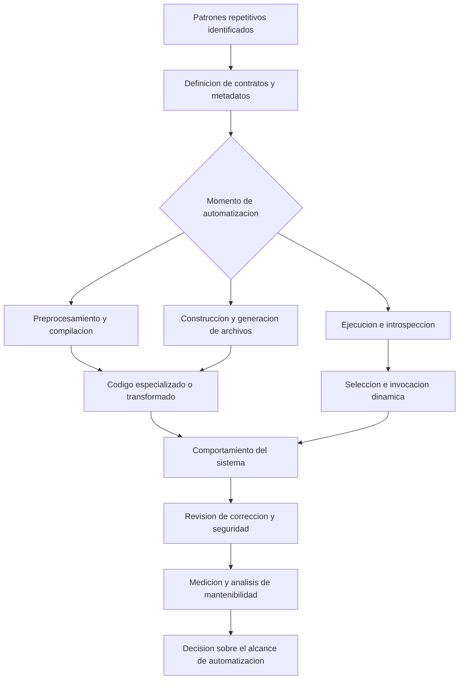

# Clase 4: Metaprogramación, reflexión y generación de código: arquitectura, evaluación crítica e inteligencia artificial

> **Objetivo académico:** Analizar mecanismos de metaprogramación, reflexión y generación de código en C++, Java, Dart, Python y .NET; distinguir sus fases de operación y evaluar sus efectos sobre extensibilidad, rendimiento, mantenibilidad y seguridad, conectándolos con la generación de software asistida por inteligencia artificial.

## 1. Contexto y marco conceptual

La sesión articula dos formas de automatizar la producción de software. La primera utiliza mecanismos explícitos del lenguaje o del ecosistema: macros, plantillas, anotaciones, decoradores, metaclases, reflexión y generadores. La segunda emplea inteligencia artificial generativa para proponer implementaciones a partir de descripciones y contexto técnico. Ambas reducen trabajo repetitivo, pero requieren revisar qué se automatiza, qué garantías se conservan y dónde se desplaza la complejidad.

El problema transversal es el *boilerplate*: código recurrente cuya estructura cambia poco entre entidades o funcionalidades, como accesores, constructores, conversiones entre objetos, clientes HTTP, operaciones de persistencia o formularios. La sesión sostiene que, conforme madura un producto, se reconocen patrones propios que pueden convertirse en plantillas o generadores internos. Automatizar demasiado pronto puede consolidar una estructura que todavía no es estable.

La **metaprogramación** comprende técnicas mediante las cuales un programa opera sobre representaciones de programas o sobre su estructura: puede inspeccionarla, generarla o transformar su comportamiento. La **introspección** permite consultar información estructural; la **reflexión**, en un sentido más amplio, también posibilita determinadas operaciones dinámicas, como invocar métodos o acceder a miembros. La **generación de código** produce artefactos que después se compilan o ejecutan.

**Enriquecimiento conceptual:** Estos conceptos se solapan, pero no son equivalentes. La inyección de dependencias es una técnica de composición de objetos y puede implementarse con reflexión, con código generado o mediante configuración explícita. La programación orientada a aspectos organiza responsabilidades transversales y puede materializarse mediante proxies o transformación de código. Un decorador puede envolver una función sin generar código fuente nuevo.

| Mecanismo | Operación principal | Momento característico | Ejemplos tratados |
|---|---|---|---|
| Macro de preprocesador | Sustitución de tokens y selección condicional | Antes de la compilación | Constantes, bloques multilínea, variantes con rol |
| Plantilla de C++ | Parametrización y generación de especializaciones | Compilación | Vector genérico y detección de miembros |
| Procesamiento de anotaciones | Interpretación de metadatos para producir artefactos | Compilación o construcción | Mapeadores y builders en Java |
| Reflexión | Consulta e invocación mediante metadatos | Ejecución | Serialización, inyección y acceso a miembros |
| Decorador de Python | Asociación de metadatos o envoltura de llamadas | Definición y ejecución, según la operación | Registro y medición de tiempos |
| Metaclase de Python | Intervención en la creación de clases | Creación de la clase | Contratos de modelos y registro de operaciones |
| Plantilla T4 | Transformación de texto en archivos | Transformación integrada al desarrollo o construcción | Versiones de ensamblados y clases C# |
| IA generativa | Propuesta de código condicionada por instrucciones y contexto | Flujo de desarrollo | Entidades, repositorios y servicios |

La pregunta arquitectónica central no es cuántas líneas desaparecen, sino si la automatización reduce el costo total de comprender, modificar y verificar el sistema.

## 2. Fundamentos teóricos y arquitectura

### 2.1. Fases de transformación y ubicación del costo

Una misma apariencia declarativa puede ocultar mecanismos distintos. Una anotación puede conservar información para que otro componente la lea en ejecución; también puede activar un procesador durante la compilación. Una plantilla puede generar un archivo antes de compilarlo. Un proxy puede interceptar llamadas durante la ejecución sin modificar el código fuente del servicio.

**Enriquecimiento conceptual:** Trasladar trabajo a la construcción puede evitar ciertas búsquedas dinámicas en ejecución, pero no garantiza rendimiento superior en todos los casos. El tamaño del código generado, las asignaciones de memoria y la lógica producida siguen influyendo. Del mismo modo, reflexión no implica necesariamente generación de nuevas clases o modificación arbitraria de su código.

### 2.2. Macros, templates y SFINAE en C++

Las macros de objeto permiten sustituir identificadores por secuencias de tokens, como en una constante simbólica. Las macros de función admiten parámetros. Para extender una definición a varias líneas físicas se utiliza una barra inversa al final de cada línea continuada.

La demostración de pirámides evidencia un problema de expansión: los nombres internos pueden colisionar cuando el texto expandido comparte ámbito con otras declaraciones. La reutilización de una variable temporal no prueba que las macros tengan variables globales propias; el ámbito efectivo resulta del código después de expandirlas.

**Enriquecimiento conceptual:** Los argumentos de una macro no son parámetros tipados ni son inmutables por definición. Su posibilidad de modificación depende de la expresión sustituida. Además, una macro puede evaluar varias veces un argumento con efectos laterales. Por ello, funciones, funciones `inline`, `constexpr` o plantillas suelen ofrecer mejores garantías cuando satisfacen la misma necesidad.

Las plantillas permiten expresar estructuras y algoritmos parametrizados por tipos. En el vector presentado, el parámetro `T` representa el tipo de elemento. La reutilización depende de que ese tipo soporte las operaciones utilizadas: comparación para ordenar, asignación para mover elementos y algún mecanismo de representación para mostrarlos.

La sesión introduce **SFINAE**, *Substitution Failure Is Not An Error*, mediante detección de miembros y sobrecarga. Su alcance exige precisión.

**Enriquecimiento conceptual:** Cuando una sustitución falla en el contexto inmediato pertinente de una plantilla candidata, esa candidata puede descartarse durante la resolución de sobrecargas. No se suprimen todos los errores de una plantilla ni se garantiza que una llamada tenga una alternativa válida. Los errores en otros contextos pueden seguir siendo errores de compilación.

### 2.3. Reflexión, anotaciones y proxies en Java

Los elementos centrales descritos son `Class<T>`, `Field`, `Method` y `Constructor`, junto con proxies dinámicos. Permiten obtener metadatos, seleccionar constructores, instanciar objetos e invocar métodos identificados durante la ejecución.

Las anotaciones aportan metadatos, por ejemplo una prioridad o una marca de inyección. Su significado operativo depende de un componente que las interprete.

**Enriquecimiento conceptual:** `RetentionPolicy.RUNTIME` conserva una anotación para su lectura reflexiva; no genera código, no elimina por sí mismo la necesidad de compilación y no implementa inyección. El procesamiento de anotaciones durante compilación es otro mecanismo. El acceso a miembros privados mediante reflexión también está sujeto a restricciones de acceso y del entorno de ejecución.

Un proxy introduce una frontera de intercepción entre cliente e implementación. Puede validar parámetros, comprobar autenticación, registrar actividad o medir duración. El servicio mantiene su responsabilidad funcional mientras el intermediario concentra las responsabilidades transversales.

Una limitación concreta surgió al intentar aplicar el proxy dinámico estándar de Java a una clase abstracta: el mecanismo utilizado requiere interfaces.

**Enriquecimiento conceptual:** Esta restricción corresponde a `java.lang.reflect.Proxy`, no a todas las técnicas posibles de intercepción. Una implementación puede conservar una clase base para compartir estado y comportamiento y, simultáneamente, implementar una interfaz para exponerla mediante ese proxy.

### 2.4. Decoradores, metaclases y creación dinámica en Python

Los decoradores se emplearon para registrar operaciones, envolver funciones e instrumentar tiempos. La introspección utilizó atributos, diccionarios y el módulo `inspect` para recuperar miembros y metadatos.

Las metaclases permiten controlar la creación de clases. Los ejemplos utilizan una subclase de `type` para comprobar la presencia de operaciones de entrenamiento y predicción, o para construir un registro de métodos de una calculadora.

**Enriquecimiento conceptual:** En el ciclo de creación, `__prepare__` proporciona el espacio de nombres del cuerpo de la clase; `__new__` construye el objeto clase y `__init__` lo inicializa. Estos pasos deben distinguirse de la construcción posterior de sus instancias. Crear una clase dinámicamente tampoco requiere siempre una metaclase personalizada: `type` admite una forma de construcción con nombre, bases y espacio de nombres.

### 2.5. Reflexión y emisión de código en .NET

La sesión presenta tanto lectura de metadatos como creación dinámica de un tipo calculadora. En este último caso se describen un ensamblado, un módulo, un tipo y un método que suma enteros, cuyo cuerpo se construye mediante un generador de instrucciones.

**Enriquecimiento conceptual:** La inspección de tipos se asocia con `System.Reflection`; la emisión de tipos y cuerpos de métodos dinámicos corresponde específicamente a `System.Reflection.Emit`, que incluye `ILGenerator`. Inspeccionar un método existente e implementar uno nuevo son operaciones diferentes.

Las plantillas T4 trabajan sobre texto para producir archivos, por ejemplo código C# o información de ensamblados. Su ejecución puede integrarse en la construcción, pero esa integración debe configurarse: el uso de un archivo `.tt` no implica por sí solo generación durante la ejecución de la aplicación.

## 3. Implementación técnica y lógica de negocio

La fuente contiene descripciones de código y demostraciones, pero no listados completos. Por ello, se reconstruyen responsabilidades y flujos sin atribuirles implementaciones exactas ni resultados reproducidos.

### 3.1. C++: vector genérico, registro de tipos y variantes de autenticación

El vector genérico parametriza el tipo de sus elementos y aplica un ordenamiento por mezcla. La demostración utiliza diez enteros aleatorios y muestra el vector antes y después de ordenar. La dificultad de presentación aparece al intentar usar formatos de salida diferentes para enteros y reales.

**Enriquecimiento conceptual:** Un algoritmo genérico debe expresar las operaciones requeridas por el tipo y evitar asumir un formato específico. Si cada tipo ofrece una operación de salida compatible, puede delegarse la representación en ella; si no, debe hacerse explícita una estrategia de formato. Para un ordenamiento por mezcla convencional, el tiempo es $O(n\log n)$ y el almacenamiento auxiliar habitual es $O(n)$, donde $n\in\mathbb{N}$ es la cantidad de elementos; estas propiedades no se verificaron sobre el código mostrado.

Otra demostración combina macros, plantillas y mapas de funciones para registrar clases y métodos. Las clases de usuario y administrador dependen de un objeto base común. El registro permite crear objetos o invocar operaciones mediante identificadores. Se describen comprobaciones con una biblioteca de pruebas de Google sobre creación, registro y comportamiento.

**Enriquecimiento conceptual:** Este registro construye explícitamente metadatos para los tipos incorporados al mecanismo. Debe distinguirse de una capacidad de inspección general de cualquier clase del programa: las operaciones disponibles dependen de lo registrado.

En autenticación, una macro controla si el tipo usuario contiene un rol y si sus constructores y métodos reciben ese argumento. El preprocesador selecciona una variante antes de compilar. La detección mediante SFINAE permite adaptar una operación a la presencia del miembro rol.

**Enriquecimiento conceptual:** La variante elegida por una macro es una decisión de construcción. No constituye un cambio de rol durante la ejecución. Cuando la selección debe variar por usuario o petición, la política necesita representarse en datos y reglas de ejecución.

### 3.2. Java y Dart: API de precios, mapeo y clientes generados

El caso de precios de bitcoin reúne varios mecanismos:

1. Un servicio Java consulta un proveedor externo y obtiene datos periódicamente; se menciona un intervalo de treinta segundos.
2. Un aspecto registra el nombre del método y un mensaje asociado a una anotación.
3. Un cliente declarado mediante interfaces describe las operaciones HTTP.
4. Lombok reduce código repetitivo de las clases de datos.
5. MapStruct genera la implementación del mapeo entre el formato recibido y el formato expuesto por la API.
6. Una aplicación Dart consume la API mediante clases y clientes generados.

La arquitectura separa el contrato externo, los objetos del servicio y el modelo expuesto al consumidor. El mapeador concentra la traducción entre representaciones y evita repetir asignaciones en distintos puntos.

**Enriquecimiento conceptual:** Las operaciones de Lombok y MapStruct no deben describirse como búsquedas reflexivas ejecutadas en cada petición. Sus mecanismos de construcción producen o incorporan código que después forma parte del programa compilado. Por ello, no procede atribuir a Lombok una penalización general de ejecución equivalente a la reflexión.

En Dart se declaran modelos y una clase abstracta para el cliente; el generador produce archivos que implementan serialización y llamadas HTTP. La sesión vincula esta estrategia con las restricciones de reflexión de Flutter.

**Enriquecimiento conceptual:** En Flutter no se dispone de reflexión general mediante `dart:mirrors`. La generación favorece que las dependencias sean conocidas durante la construcción y facilita la eliminación de código no utilizado. El alcance concreto de JSON, XML u otros formatos depende de las bibliotecas configuradas; la fuente no permite confirmar soporte de todos ellos.

El refresco periódico tampoco equivale estrictamente a actualización continua: la frescura de un precio depende de la frecuencia de consulta, la latencia y la disponibilidad del proveedor.

### 3.3. .NET: OData y exposición declarativa de consultas

El ejemplo con .NET 6 describe entidades, anotaciones, construcción del modelo OData y un controlador con `EnableQuery`. A partir de esa configuración, el consumidor puede expresar opciones de consulta en la URL. Se ilustra una limitación de resultados equivalente a solicitar el primer elemento.

**Enriquecimiento conceptual:** OData define convenciones para consultar y manipular datos mediante servicios HTTP; no es por sí mismo un ORM. Un ORM puede intervenir en la persistencia, mientras OData interpreta el contrato de consulta. Opciones como `$top` y `$filter` deben habilitarse y limitarse según las reglas del servicio.

La relevancia metaprogramática reside en que metadatos y convenciones permiten a una biblioteca construir comportamiento reutilizable, sin implementar manualmente cada combinación de consulta.

### 3.4. Inyección de dependencias y selección de servicios de pago

El procesador de pagos depende de una interfaz con implementaciones de tarjeta, PayPal y criptomonedas. Un inyector personalizado inspecciona anotaciones y selecciona una implementación según una prioridad. En la demostración, modificar las prioridades cambia el servicio que procesa la llamada.

El flujo descrito comprende descubrimiento o recopilación de candidatas, lectura de metadatos, selección, construcción e inyección. Después se incorporan proxies para validar un monto positivo y simular una comprobación de autenticación.

**Enriquecimiento conceptual:** Deben definirse explícitamente el sentido del orden, los empates y la ausencia de candidatas. La descripción verbal del orden es ambigua, aunque sí muestra que la prioridad modifica la selección. `ServiceLoader` se plantea como mejora para descubrir proveedores registrados; no se acredita su implementación completa en el ejemplo.

El monto negativo produce una excepción que interrumpe el flujo. Esto demuestra una barrera de validación, pero no un tratamiento completo de errores de negocio. Asimismo, un token simulado o un booleano de autenticación no equivalen a un mecanismo de seguridad listo para producción.

### 3.5. Python: contratos de modelos y medición transversal

El caso de aprendizaje automático separa el entrenamiento y la predicción de la instrumentación temporal. Un decorador registra la duración de cada operación, mientras una metaclase comprueba la presencia de métodos `train` y `predict`. Se describen modelos de regresión lineal y árbol de decisión, con datos sintéticos.

El beneficio organizativo es que nuevos modelos reutilizan el mismo contrato y la misma instrumentación. La comparación sin decorador repite la captura del instante inicial, la ejecución y la captura del instante final en cada lugar instrumentado.

**Enriquecimiento conceptual:** La existencia de dos nombres de método no garantiza que sus firmas, resultados o semántica sean correctos. La comprobación debe distinguir miembros declarados de miembros heredados y, cuando corresponda, verificar que sean invocables. Un contrato estructural es una garantía parcial.

La diferencia temporal se interpreta mediante:

$$
\Delta t = t_{\mathrm{fin}} - t_{\mathrm{inicio}}
$$

**Enriquecimiento conceptual:** $t_{\mathrm{inicio}}$ y $t_{\mathrm{fin}}$ son lecturas, expresadas en segundos, de un mismo reloj monotónico; $\Delta t\geq 0$ representa el tiempo transcurrido entre ellas. La interpretación depende de dónde se sitúen las lecturas: pueden incluir o excluir el registro de mensajes y parte de la envoltura. Una medición aislada no permite estimar de manera fiable el costo del decorador.

### 3.6. Calculadora extensible y registro automático

Una calculadora Python utiliza un decorador `register_op` para asociar a cada método un atributo como `op_symbol`. Una metaclase inspecciona el espacio de nombres y construye un mapeo entre símbolos y operaciones. También se describe una variante de inspección con `inspect` y una interfaz interactiva mediante widgets.

El despacho deja de depender de una lista manual dispersa: el símbolo identifica una operación registrada y el sistema invoca su método. La lógica aritmética permanece separada del descubrimiento y de la interfaz.

**Enriquecimiento conceptual:** El registro en la metaclase y el descubrimiento en una instancia son alternativas con momentos y alcances distintos. Si se combinan, deben evitar duplicados y precisar cómo se tratan herencia, sobrescritura, símbolos repetidos y operaciones desconocidas. No debe inferirse de esta descripción la necesidad de evaluar expresiones arbitrarias.

### 3.7. Persistencia, serialización y generación a partir de catálogos

En Java se presenta una inserción genérica basada en anotaciones propias para tabla y columna. La entidad proporciona los metadatos; una clase genérica obtiene sus miembros y construye la operación de inserción. Se compara con una sentencia SQL escrita manualmente.

En Java y C# se muestran conversiones de objeto a mapa o diccionario y en sentido inverso. La reflexión centraliza la enumeración de miembros, evitando repetir asignaciones por cada atributo de cada clase.

**Enriquecimiento conceptual:** La longitud del serializador puede mantenerse estable al crecer una clase, pero el trabajo ejecutado aumenta con sus miembros. Si se procesan $m\in\mathbb{N}$ miembros con costo constante por miembro, una conversión superficial requiere $O(m)$ tiempo; objetos anidados, conversiones de tipos y ciclos requieren tratamiento adicional. La inversión mapa-objeto tampoco es automática si faltan constructores, nombres o tipos compatibles.

El caso empresarial .NET consulta catálogos de SQL Server para recuperar tablas, columnas y tipos. Plantillas propias usan esa información para producir procedimientos almacenados, disparadores de auditoría, clases y formularios, incluidos patrones simples y maestro-detalle. El CLR facilita la interoperabilidad entre componentes escritos en lenguajes del ecosistema .NET.

**Enriquecimiento conceptual:** Consultar el catálogo de una base de datos es introspección de su esquema; no es idéntico a reflejar objetos del CLR. Ambos mecanismos pueden alimentar el mismo generador, pero representan fuentes de metadatos diferentes. El esquema de almacenamiento tampoco expresa necesariamente todas las reglas del dominio.

### 3.8. T4: versiones, clases y responsabilidades transversales

Las plantillas T4 se utilizan para generar información de versión de varias bibliotecas y clases auxiliares de autenticación. El caso de versionamiento incorpora una convención basada en fecha y número de construcción, con una transformación conectada al proceso de construcción.

También se describen aspectos asociados a métodos mediante atributos para ejecutar acciones alrededor de una llamada. La fuente no identifica con precisión el mecanismo de tejido, por lo que no puede fijarse si la transformación ocurre antes de ejecutar o durante la ejecución.

**Enriquecimiento conceptual:** Generar una clase antes de compilar permite que el programa la use como código ordinario. Un error del editor mientras falta el archivo generado no demuestra que la clase se cree en ejecución. Para versiones automáticas, la trazabilidad y la reproducibilidad requieren definir cómo se relacionan versión, revisión de código y artefacto construido.

## 4. Análisis crítico de casos y auditoría práctica

### 4.1. Qué permiten concluir las demostraciones

| Caso | Evidencia descrita | Conclusión admisible | Límite |
|---|---|---|---|
| Vector C++ | Valores antes y después del ordenamiento | Se ilustró reutilización por tipo y ordenamiento | No hay listado completo ni comprobación exhaustiva |
| Servicios de pago | Cambio de implementación tras modificar prioridades | El metadato influye en la selección | No se acredita resolución de empates ni descubrimiento completo |
| Proxy de validación | Interrupción ante monto negativo | La llamada atraviesa una validación | No demuestra recuperación ni seguridad integral |
| Modelos Python | Tiempos y resultados reportados | Se ilustró instrumentación reutilizable | No hay protocolo que aísle su costo |
| Inserción reflexiva Java | Métricas y registro insertado | Se describió persistencia dirigida por metadatos | No puede atribuirse toda diferencia temporal a reflexión |
| Conversión a mapas | Recorrido genérico de miembros | Se centraliza lógica repetitiva | No se demuestra soporte universal de tipos y estructuras |
| T4 | Reaparición de un archivo generado al construir | La transformación produce un artefacto utilizable | No implica generación durante la ejecución |

Los resultados observados deben distinguirse de afirmaciones generales. Un tiempo mayor con reflexión o con decoradores no establece una penalización universal. La latencia de base de datos, inicialización, compilación dinámica, cachés y carga del sistema puede alterar una comparación.

**Enriquecimiento conceptual:** Una evaluación útil repite operaciones equivalentes, controla entradas y condiciones, separa inicialización de uso estable y documenta qué incluye la medición. También debe comprobar equivalencia funcional: reducir tiempo o líneas de código carece de valor si cambian validaciones, errores o resultados.

### 4.2. Seguridad y límites de acceso

Los ejemplos de acceso a miembros privados, autenticación y serialización muestran por qué la flexibilidad necesita fronteras. Un serializador que recorre todos los campos podría exponer contraseñas o detalles internos; un inyector que acepta cualquier clase podría construir dependencias no previstas.

**Enriquecimiento conceptual:** Para persistencia, los valores deben enviarse mediante parámetros de consulta. Los identificadores de tablas y columnas requieren validación contra metadatos autorizados, porque no se parametrizan de la misma manera que los valores. En generación de disparadores y procedimientos, deben revisarse permisos, alcance transaccional y operaciones que afectan múltiples filas.

En Python se mencionan validaciones de argumentos, anotaciones de tipos y herramientas de análisis. Es necesario separar comprobación de tipos de autorización.

**Enriquecimiento conceptual:** Las anotaciones de tipos no imponen automáticamente validación en ejecución. Un analizador estático como mypy detecta ciertas incompatibilidades antes de ejecutar, pero no sustituye controles de identidad, permisos o validación de datos externos. Una metaclase tampoco constituye por sí sola una frontera de seguridad.

### 4.3. Evaluación crítica de la inteligencia artificial generativa

La segunda parte de la sesión propone aprovechar asistentes para producir código habitual y dedicar más atención a su revisión. Se mencionan herramientas generales y asistentes integrados en editores; los nombres citados describen el panorama considerado en la sesión, sin constituir una comparación actual de disponibilidad o calidad.

**Enriquecimiento conceptual:** Los modelos generativos modernos no se describen adecuadamente como sistemas expertos clásicos ni como una búsqueda que devuelve siempre el proyecto más parecido. Generan secuencias condicionadas por su entrenamiento y contexto; pueden combinarse con recuperación de información, pero esa capacidad no es equivalente al mecanismo generativo. Que una propuesta sea plausible no garantiza que sea correcta.

La afirmación de que todos los repositorios privados de una plataforma se utilizan para entrenar modelos no está acreditada en la fuente. Tampoco puede deducirse una garantía de calidad únicamente por el nombre de una comunidad que forme parte del entrenamiento.

La sesión destaca tres riesgos técnicos pertinentes: dependencias desactualizadas, soluciones que no respetan el contexto del producto y aceptación acrítica de resultados. El ejemplo concreto es la generación de importaciones `javax.persistence` cuando el proyecto esperaba `jakarta.persistence`.

**Enriquecimiento conceptual:** La compatibilidad depende de la versión del ecosistema utilizado. `javax.persistence` sigue apareciendo en sistemas anteriores; no es correcto afirmar que dejó de existir universalmente. La revisión debe contrastar importaciones, dependencias y plataforma objetivo.

### 4.4. Propiedad intelectual, empleo y detalle del dominio

Se discuten autoría, licencias, derechos y posibles restricciones sobre el código generado. La sesión plantea preguntas y escenarios, pero no proporciona una respuesta jurídica verificable.

**Enriquecimiento conceptual:** Derechos de autor, condiciones de licencia y patentes son categorías diferentes. La procedencia de un fragmento y las condiciones del proveedor pueden ser relevantes, pero las obligaciones concretas dependen de los hechos y del marco aplicable.

Respecto del empleo, se plantea que las tareas repetitivas pueden automatizarse más fácilmente que las decisiones que requieren conocimiento profundo del negocio. Es una hipótesis de transformación del trabajo, no una predicción demostrada de sustitución por nivel profesional.

El debate final contrapone el avance de las capacidades de los modelos con la importancia del detalle del dominio. La síntesis defendida es que una implementación general necesita información contextual, revisión y corrección para satisfacer excepciones y restricciones reales. No hay evidencia en la sesión que permita fijar un límite permanente a las capacidades futuras de la IA.

## 5. Principios de diseño, buenas prácticas y anti-patrones

### 5.1. Automatizar regularidades suficientemente estables

Conviene identificar repeticiones verificables antes de construir una infraestructura propia. Una anotación o plantilla debería representar una convención clara, con entradas, salidas y errores definidos. La lógica particular del negocio merece especial cuidado: generar su estructura es posible, pero sus excepciones no deben desaparecer bajo una abstracción que nadie puede explicar.

**Enriquecimiento conceptual:** El criterio no es una prohibición absoluta de generar lógica de dominio. Es exigir que dicha lógica tenga una especificación suficientemente explícita y verificable. Reducir texto repetido y reducir complejidad conceptual son objetivos distintos.

### 5.2. Mantener trazabilidad entre declaración y comportamiento

El sistema debería permitir responder qué anotación, plantilla o regla produjo un comportamiento, en qué fase y sobre qué versión de las herramientas. Son buenas prácticas mantener accesible el código generado cuando exista, separar archivos generados de extensiones manuales y proporcionar diagnósticos relacionados con la declaración original.

La sesión asocia generación con dificultades de depuración. Esto debe interpretarse como mayor necesidad de herramientas y trazabilidad, no como imposibilidad absoluta de depurar o inspeccionar artefactos generados.

### 5.3. Especificar contratos y errores de la infraestructura

En un inyector deben estar definidas la ausencia de implementación, la multiplicidad de candidatas y las prioridades. En un registro de operaciones deben definirse colisiones y símbolos desconocidos. En un serializador deben precisarse miembros incluidos, nulos, conversiones, herencia y constructores admisibles.

**Enriquecimiento conceptual:** Los valores predeterminados son apropiados solo cuando representan una decisión válida del dominio. En autenticación, permisos o selección de servicios financieros, continuar silenciosamente ante una configuración inválida puede ser peor que detener la operación con un diagnóstico claro.

### 5.4. Evitar abstracciones encadenadas sin beneficio demostrable

La sesión advierte sobre la tendencia a crear anotaciones sobre anotaciones o automatizaciones sobre automatizaciones. El problema no es la composición en sí, sino perder una ruta comprensible entre una declaración y sus efectos.

**Enriquecimiento conceptual:** La metaprogramación no produce necesariamente efectos incorrectos o inesperados. Sí amplía el conjunto de mecanismos que deben comprenderse y verificarse. Un nivel adicional de abstracción se justifica si elimina una dificultad recurrente y conserva contratos, observabilidad y diagnósticos suficientes.

### 5.5. Integrar IA mediante revisión y contexto explícitos

El caso técnico de un servicio de personas ilustra una secuencia de generación: entidad con identificador, nombre y edad; repositorio; servicio con operaciones CRUD; y revisión de compatibilidad. La utilidad del prompt depende de que describa con precisión el entorno y el comportamiento esperado.

**Enriquecimiento conceptual:** Un contexto técnico útil incluye versiones, dependencias, convenciones del proyecto, restricciones de datos, manejo de errores y criterios de aceptación. La propuesta generada debe revisarse como cualquier contribución de código. Compilar es una comprobación necesaria en muchos entornos, pero no demuestra corrección de negocio ni seguridad.

La sesión relaciona este cambio con TDD: escribir una prueba, producir una implementación que la satisfaga y refactorizar. La asistencia generativa puede acelerar alguno de esos pasos; no elimina la necesidad de diseñar las pruebas ni de revisar sus supuestos. Pruebas y código generados a partir de una misma interpretación equivocada pueden confirmar el mismo error.

En formación inicial, aceptar soluciones sin reconstruir su razonamiento puede debilitar el aprendizaje. En profesionales experimentados, la experiencia ayuda a detectar errores, aunque tampoco garantiza que se identifiquen todos.

## 6. Síntesis conceptual y profundización académica

La metaprogramación desplaza trabajo desde implementaciones repetidas hacia contratos, metadatos y mecanismos de transformación. Sus beneficios potenciales son consistencia, reutilización y extensibilidad. Sus costos pueden aparecer en construcción, ejecución, diagnóstico, aprendizaje y dependencia de herramientas. No existe una relación universal según la cual menos líneas impliquen automáticamente mayor mantenibilidad o la reflexión implique siempre rendimiento inaceptable.

La generación convencional y la generación asistida por IA comparten la necesidad de especificación y revisión, aunque ofrecen garantías diferentes.

**Enriquecimiento conceptual:** Un generador basado en reglas explícitas puede ofrecer transformaciones reproducibles bajo entradas y herramientas fijadas. Un modelo generativo propone código a partir de un contexto y requiere controles adicionales sobre corrección y adecuación. Esa diferencia importa al decidir qué artefactos pueden construirse automáticamente y cuáles necesitan una revisión particular.

La sesión identifica varias líneas de profundización:

- **Paralelismo declarativo:** las directivas y anotaciones pueden ocultar mecanismos de distribución del trabajo. Debe analizarse qué recursos utilizan, qué sincronización introducen y qué comportamiento conserva el programa.
- **Generación de pruebas:** la IA puede ampliar escenarios considerados, pero no garantiza cobertura exhaustiva ni distingue siempre la criticidad. El espacio de combinaciones y la calidad de las expectativas siguen siendo problemas centrales.
- **Reparación automática:** se plantea generar cambios ante fallos detectados. La sesión no demuestra un sistema de autorreparación ni permite afirmar que la frontera dependa exclusivamente de si el lenguaje es compilado o interpretado.
- **Autotuning e infraestructura como código:** la configuración puede ajustarse mediante observaciones de rendimiento y costo. Los valores adecuados dependen de la carga y del entorno de despliegue.
- **Lenguajes de dominio específico:** un DSL puede expresar conceptos como cuentas y operaciones bancarias, mientras un generador implementa detalles técnicos. Su valor depende de la precisión de su semántica y de los límites del dominio.
- **Sistemas críticos:** la generación requiere evidencia proporcional a las consecuencias del fallo, incluyendo análisis de seguridad, disponibilidad y propiedades funcionales.

**Enriquecimiento conceptual:** En verificación formal, las propiedades se razonan sobre modelos y supuestos explícitos; no basta con añadir una notación matemática al código. En reparación automática, una propuesta necesita validación, control de despliegue y posibilidad de reversión. En autotuning, optimizar una sola métrica puede deteriorar otras, por lo que deben especificarse restricciones además del objetivo.

La conclusión arquitectónica es seleccionar el mecanismo por su problema y su fase de operación: preprocesamiento para variantes de construcción, plantillas para parametrización estática, generación para estructuras regulares y reflexión para necesidades dinámicas justificadas. La IA amplía la capacidad de proponer implementaciones, mientras el conocimiento del dominio y la evaluación crítica siguen determinando si esas propuestas satisfacen el propósito del sistema.
