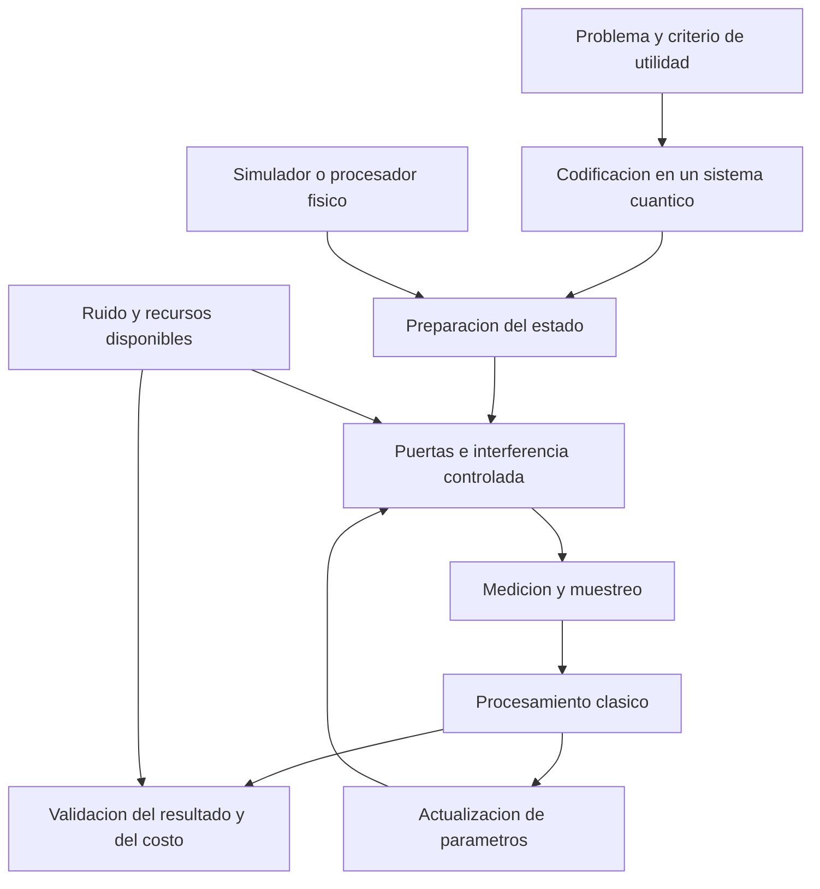

# Clase 5: Programación cuántica: fundamentos, algoritmos, ruido y optimización híbrida

> **Objetivo académico:** Comprender la representación y transformación de información cuántica, analizar los algoritmos de Grover y Shor, y evaluar las posibilidades y limitaciones de los entornos de programación, la corrección de errores y los modelos híbridos de optimización y aprendizaje automático.

## 1. Contexto y marco conceptual

La sesión aborda la programación cuántica como un campo de investigación que conecta álgebra lineal, física, algoritmia, criptografía y optimización. Su recorrido integra fundamentos del qubit, puertas cuánticas, simulación, búsqueda, factorización, control del ruido, aprendizaje automático cuántico y algoritmos híbridos. El hilo conductor es la distancia entre disponer de una formulación matemática y lograr una implementación útil, reproducible y escalable.

Los simuladores y los servicios remotos permiten estudiar circuitos sin disponer de infraestructura cuántica propia. Esta accesibilidad facilita la investigación y la comprensión de nuevas formas de procesamiento, pero no elimina los límites computacionales de la simulación ni garantiza que un circuito ideal funcione con igual calidad en un procesador físico.

### Información clásica e información cuántica

Un bit clásico toma un valor de un conjunto de dos elementos: cero o uno. Un qubit admite estados descritos mediante amplitudes complejas respecto de una base. La superposición, el entrelazamiento y la interferencia constituyen recursos distintos:

- **Superposición:** combinación lineal de estados de una base, con amplitudes que determinan probabilidades de medición.
- **Entrelazamiento:** estructura de un estado compuesto que impide describirlo como producto de estados individuales.
- **Interferencia:** combinación de amplitudes que puede aumentar o reducir probabilidades de resultados, dependiendo de sus fases relativas.

**Enriquecimiento conceptual:** la metáfora de una moneda girando ayuda a introducir incertidumbre, pero no representa completamente un qubit. Una superposición no equivale a un valor clásico desconocido ni a una alternancia rápida entre cero y uno. La fase relativa y su efecto sobre mediciones posteriores distinguen la coherencia cuántica de una mezcla clásica.

**Enriquecimiento conceptual:** el entrelazamiento produce correlaciones cuánticas, pero no permite transmitir mensajes instantáneos. La medición local no proporciona un mecanismo controlable de comunicación más rápida que la luz.

### Alcance de la ventaja cuántica

La clase presenta la computación cuántica como complemento de la clásica. Su interés está en problemas y estructuras específicas; no se deduce una mejora universal por sustituir bits por qubits.

**Enriquecimiento conceptual:** una superposición de muchas configuraciones no permite leer todas sus respuestas en una sola medición. Un algoritmo debe transformar amplitudes para que la información relevante resulte accesible con suficiente probabilidad. Las ventajas exponenciales, cuadráticas o inexistentes dependen del problema, del modelo de acceso a los datos y del costo total de ejecución.

## 2. Fundamentos teóricos y arquitectura

### 2.1. Estados, notación de Dirac y medición

La notación de Dirac representa los estados base de un qubit como $|0\rangle$ y $|1\rangle$. En representación vectorial:

$$
|0\rangle=\begin{pmatrix}1\\0\end{pmatrix},\qquad
|1\rangle=\begin{pmatrix}0\\1\end{pmatrix}.
$$

Un estado puro general se expresa como:

$$
|\psi\rangle=\alpha|0\rangle+\beta|1\rangle,\qquad
\alpha,\beta\in\mathbb{C},\qquad |\alpha|^2+|\beta|^2=1.
$$

Los coeficientes $\alpha$ y $\beta$ son amplitudes complejas adimensionales. La normalización garantiza que las probabilidades sumen uno. En una medición ideal en la base computacional, la regla de Born establece:

$$
P(0)=|\alpha|^2,\qquad P(1)=|\beta|^2.
$$

**Enriquecimiento conceptual:** el cuadrado del módulo es la formulación precisa para amplitudes complejas. Cada medición entrega un resultado clásico definido, pero ese resultado puede ser aleatorio; obtener un valor definido no significa que fuera determinista antes de medir. Un qubit tampoco tiene que estar necesariamente en una superposición no trivial antes de una medición.

Para un registro de $n$ qubits, con $n$ entero positivo, la base computacional contiene $2^n$ cadenas binarias. El estado inicial convencional $|0\rangle^{\otimes n}$ significa que todos los qubits se preparan en cero; no significa que ya estén en una superposición uniforme.

### 2.2. Puertas fundamentales

Las puertas presentadas incluyen Pauli X, Pauli Z, Hadamard y operaciones controladas.

| Puerta | Acción ideal | Papel conceptual |
|---|---|---|
| X | Intercambia $|0\rangle$ y $|1\rangle$ | Inversión de bit |
| Z | Conserva $|0\rangle$ y cambia el signo de $|1\rangle$ | Modificación de fase |
| Hadamard, H | Transforma los estados base en superposiciones equilibradas | Preparación y transformación de interferencia |
| CNOT | Invierte el objetivo cuando el control vale uno en la base computacional | Operación condicional capaz de generar entrelazamiento |
| CZ | Cambia el signo del componente $|11\rangle$ | Marcado de fase y operaciones de dos qubits |

La matriz de Hadamard es:

$$
H=\frac{1}{\sqrt{2}}\begin{pmatrix}1&1\\1&-1\end{pmatrix}.
$$

Su aplicación a los estados base produce:

$$
H|0\rangle=\frac{|0\rangle+|1\rangle}{\sqrt{2}},\qquad
H|1\rangle=\frac{|0\rangle-|1\rangle}{\sqrt{2}}.
$$

En ambos casos, medir directamente en la base computacional da probabilidades de un medio para cero y uno. El signo diferente corresponde a una fase relativa, aunque esa medición particular no permita distinguir ambos estados.

**Enriquecimiento conceptual:** Hadamard es una transformación unitaria determinista del estado, no una moneda aleatoria aplicada internamente. La aleatoriedad aparece al medir. Como $H^2=I$, aplicar Hadamard dos veces recupera el estado inicial ideal; $I$ representa la identidad. Esta reversibilidad evidencia información de fase que una descripción puramente probabilística omitiría.

### 2.3. Preparación uniforme y entrelazamiento

Aplicar Hadamard a cada uno de dos qubits preparados en cero genera:

$$
(H\otimes H)|00\rangle=\frac{|00\rangle+|01\rangle+|10\rangle+|11\rangle}{2}.
$$

El símbolo $\otimes$ denota producto tensorial. Cada cadena tiene probabilidad $1/4$ en una medición ideal. Para $n$ qubits preparados del mismo modo, cada una de las $2^n$ cadenas tiene probabilidad $2^{-n}$.

**Enriquecimiento conceptual:** aplicar puertas H independientes no genera entrelazamiento por sí solo. Por ejemplo, aplicar H al primer qubit de $|00\rangle$ y después CNOT con ese qubit como control produce $(|00\rangle+|11\rangle)/\sqrt{2}$, un estado entrelazado. Tampoco toda aplicación de CNOT entrelaza: el resultado depende de su entrada.

### 2.4. Arquitectura del ecosistema de programación

La sesión compara Qiskit, Cirq y pyQuil como herramientas basadas en Python para construir circuitos, simularlos y acceder a determinados ecosistemas de hardware.

| Entorno | Vinculación destacada en la sesión | Representación e integración | Criterios de evaluación |
|---|---|---|---|
| Qiskit | IBM Quantum | Circuitos desde Python y relación con OpenQASM | Documentación, comunidad, modularidad y compatibilidad de versiones |
| Cirq | Ecosistema de Google Quantum | Construcción de circuitos mediante objetos de Python | Control de circuitos e integración con herramientas como TensorFlow Quantum |
| pyQuil | Rigetti y ecosistema Forest | Programación desde Python vinculada al lenguaje Quil | Integración híbrida y acceso a operaciones del ecosistema correspondiente |

**Enriquecimiento conceptual:** un SDK, un lenguaje de representación de circuitos y un servicio de ejecución cumplen funciones diferentes. Qiskit no se reduce a OpenQASM ni pyQuil es idéntico a Quil. Las asociaciones con proveedores tampoco implican que todas sus posibilidades se limiten exclusivamente a un único dispositivo.

## 3. Implementación técnica y lógica de negocio

### 3.1. Flujo de construcción y ejecución

Los ejemplos comparten una secuencia metodológica: crear registros, preparar el estado, aplicar puertas, definir mediciones, seleccionar un backend, ejecutar repeticiones y analizar resultados. Un backend puede ser un simulador o un servicio conectado a hardware físico.

En el ejemplo de un qubit se crea un circuito con un qubit y un bit clásico. El índice cero identifica la primera posición. Se aplica X al qubit inicialmente preparado en cero y se mide su resultado en el bit clásico. En simulación ideal, todas las repeticiones deben devolver uno; se mencionan ejecuciones con 100, 500 y 1024 repeticiones.

El registro clásico almacena resultados de medición, no una copia del estado cuántico completo. La correspondencia de un bit clásico por qubit medido es una elección del ejemplo, no una obligación general de todo circuito.

La fuente menciona interfaces como `QuantumCircuit`, `Aer`, `execute` y componentes históricos de Aqua. No se dispone del código completo mostrado.

**Enriquecimiento conceptual:** esas referencias deben interpretarse dentro de su contexto de versiones. Transpilar significa transformar un circuito para un conjunto de operaciones y restricciones; ejecutar significa enviarlo a un backend. Un transpiler y una función de ejecución no son componentes intercambiables.

### 3.2. Shots y estimación de probabilidades

Un *shot* representa una repetición del procedimiento de preparación, transformación y medición. Las numerosas repeticiones no deben interpretarse como mediciones independientes de una única superposición que permanece intacta.

En la comparación de frameworks se describe un experimento con un qubit preparado en cero, una puerta H y 10000 shots. Los participantes reportan proporciones cercanas al 50 % para ambos resultados. La fuente no proporciona los conteos completos ni el protocolo de medición de tiempos.

**Enriquecimiento conceptual:** si se realizan $S$ shots independientes de un circuito ideal y $K_1$ es el número de resultados uno, entonces:

$$
K_1\sim\operatorname{Binomial}(S,p),\qquad
\widehat p=\frac{K_1}{S},\qquad
\operatorname{SE}(\widehat p)=\sqrt{\frac{p(1-p)}{S}}.
$$

Aquí $S$ es un entero positivo, $K_1$ pertenece a $\{0,\ldots,S\}$, $p$ es la probabilidad teórica y $\widehat p$ su estimación empírica. La desviación estándar corresponde al supuesto de ensayos independientes con probabilidad constante.

Para el circuito H sobre cero, $p=1/2$. Con $S=10000$, el error estándar teórico es $0.005$, equivalente a medio punto porcentual. Esta cuenta ilustra que pequeñas desviaciones del 50 % son esperables sin atribuirlas al framework. No constituye un resultado observado adicional.

### 3.3. Grover: oráculo y amplificación de amplitudes

Grover se presenta como un algoritmo de búsqueda no estructurada. Sus etapas son preparación uniforme, marcado de fase por un oráculo, aplicación del difusor y medición. En el ejemplo de dos qubits hay cuatro candidatos; se muestra el marcado de $|11\rangle$ mediante CZ y también una explicación alternativa centrada en $|00\rangle$.

**Enriquecimiento conceptual:** un oráculo de fase codifica un predicado que reconoce soluciones:

$$
O_f|x\rangle=(-1)^{f(x)}|x\rangle.
$$

El índice $x$ recorre los candidatos y $f(x)\in\{0,1\}$ indica si un candidato cumple la condición buscada. El oráculo es una operación controlada y coherente; no es una apuesta ni ruido ambiental. Para problemas reales, su construcción tiene un costo que debe incorporarse a la evaluación.

Si hay $N=2^n$ candidatos y $M$ soluciones, con $1\leq M\leq N$, la búsqueda cuántica requiere del orden de $\sqrt{N/M}$ consultas al oráculo, frente al orden de $N/M$ comprobaciones en una búsqueda clásica no estructurada. Para una única solución, la comparación habitual es $O(\sqrt N)$ frente a $O(N)$. Estas expresiones describen escalamiento asintótico, no tiempos exactos ni una cantidad fija de operaciones para cualquier implementación.

**Enriquecimiento conceptual — ejemplo trabajado:** con cuatro candidatos y una única solución, las amplitudes iniciales son $1/2$. Tras el oráculo, la amplitud marcada es $-1/2$ y las otras tres son $1/2$. Su media es:

$$
\overline a=\frac{-1/2+1/2+1/2+1/2}{4}=\frac14.
$$

El difusor transforma cada amplitud $a_x$ mediante $a'_x=2\overline a-a_x$. La amplitud marcada pasa a uno y las restantes a cero. Por eso una iteración basta en este caso ideal particular.

El difusor canónico es $D=2|s\rangle\langle s|-I$, donde $|s\rangle$ es la superposición uniforme e $I$ la identidad del registro. La secuencia con H, X y CZ descrita en la sesión implementa, para dos qubits, una versión que puede diferir por una fase global de signo; esa diferencia no modifica las probabilidades.

### 3.4. Shor: factorización y búsqueda de período

El algoritmo de Shor combina una etapa cuántica de estimación del período con procesamiento clásico para recuperar factores. La transformada cuántica de Fourier participa en la extracción de información periódica. La demostración relatada utiliza una implementación histórica integrada en Qiskit; el código completo y el número factorizado no quedan disponibles en el texto.

**Enriquecimiento conceptual:** para un entero compuesto $N>1$ se puede elegir un entero $a$ coprimo con $N$ y buscar el orden $r$, es decir, el menor entero positivo que satisface:

$$
a^r\equiv1\pmod N.
$$

Si $r$ es par y $a^{r/2}\not\equiv-1\pmod N$, se calculan candidatos a factores mediante:

$$
\gcd(a^{r/2}-1,N),\qquad \gcd(a^{r/2}+1,N).
$$

El símbolo $\gcd$ representa el máximo común divisor. La elección de $a$ y la recuperación del período pueden requerir repetición; una medición no garantiza por sí sola una factorización válida.

La importancia criptográfica reside en que factorizar el módulo de RSA permite comprometer su clave privada. La sesión relaciona esta amenaza con la necesidad de criptografía poscuántica y con esquemas basados en retículos.

**Enriquecimiento conceptual:** Shor tiene complejidad polinómica respecto de la longitud binaria de la entrada en el modelo cuántico apropiado. Los mejores métodos clásicos generales conocidos de factorización tienen comportamiento subexponencial; describirlos simplemente como exponenciales pierde precisión. La amenaza tampoco equivale a romper automáticamente cualquier contraseña, conexión SSH o sistema de cadena de bloques: depende de sus primitivas y de los recursos del atacante.

### 3.5. Circuitos variacionales y aprendizaje automático cuántico

Un circuito cuántico paramétrico utiliza puertas dependientes de parámetros ajustables. La arquitectura expuesta separa codificación de datos, ansatz variacional, medición y optimización clásica.

| Componente | Función | Condición relevante |
|---|---|---|
| Codificación angular | Representa características mediante rotaciones | Requiere definir escalas y correspondencia entre variables y ángulos |
| Codificación en amplitudes | Utiliza componentes de un vector normalizado como amplitudes | La preparación del estado puede ser costosa |
| Codificación en la base | Representa datos discretos mediante cadenas binarias | Debe explicitarse la cantidad de qubits necesaria |
| Ansatz | Define las operaciones parametrizadas y los acoplamientos | Su expresividad debe equilibrarse con profundidad y entrenabilidad |
| Medición | Produce estimaciones utilizables por el modelo clásico | Introduce costo de muestreo cuando se usan shots |
| Optimizador | Actualiza parámetros para reducir una función de pérdida | Su calidad condiciona la convergencia |

Se mencionan ansätze adaptados al hardware, estructuras específicas del problema y capas repetidas. Los optimizadores incluyen descenso de gradiente, Adam y SPSA. Las demostraciones recurren a PennyLane, CUDA-Q y simulación con GPU, con un circuito descrito de cuatro qubits y dos capas variacionales. Se reporta visualización del costo de entrenamiento, pero no hay valores suficientes para evaluar precisión o rendimiento.

**Enriquecimiento conceptual:** una representación matemática general del ciclo es:

$$
|\psi(x,\theta)\rangle=U(\theta)U_{\mathrm{enc}}(x)|0\rangle^{\otimes n},\qquad
\widehat y(x,\theta)=\langle\psi(x,\theta)|A|\psi(x,\theta)\rangle.
$$

Aquí $x\in\mathbb R^d$ representa un vector de $d$ características clásicas; $\theta\in\mathbb R^p$ contiene $p$ parámetros, habitualmente ángulos adimensionales en radianes; $n$ es el número de qubits; $U_{\mathrm{enc}}$ codifica datos; $U$ es el circuito variacional y $A$ es un observable hermítico. La salida $\widehat y$ es un valor esperado, no necesariamente una etiqueta de clasificación directa. Su interpretación y unidades dependen del observable y del problema.

La función de pérdida debe corresponder al objetivo: error cuadrático para determinadas regresiones, entropía cruzada para ciertas clasificaciones o energía esperada para problemas variacionales físicos.

### 3.6. VQE y QAOA como algoritmos híbridos

En VQE, el circuito prepara estados de prueba y el procesador clásico ajusta parámetros para minimizar la energía esperada de un Hamiltoniano. La sesión utiliza dos qubits y un Hamiltoniano ZZ, con un resultado reportado cercano a menos uno.

**Enriquecimiento conceptual:** si el Hamiltoniano adimensional es $H=Z\otimes Z$, entonces:

$$
H=\operatorname{diag}(1,-1,-1,1),\qquad
\min_{\|\psi\|=1}\langle\psi|H|\psi\rangle=-1.
$$

El mínimo corresponde al subespacio generado por $|01\rangle$ y $|10\rangle$. Esta derivación explica el valor relatado sin certificar su ejecución. La energía esperada es una propiedad del problema modelado, no el consumo eléctrico del procesador. El símbolo $H$ representa aquí el Hamiltoniano, mientras que anteriormente designaba la puerta Hadamard; el contexto distingue ambos usos.

QAOA se ilustra mediante una formulación del problema del viajante. El flujo incluye construir un grafo ponderado, transformar el objetivo y sus restricciones a una formulación binaria, preparar el algoritmo, muestrear cadenas, verificar factibilidad y seleccionar una ruta por su costo. Se relata una instancia de cuatro vértices con una ruta de costo 80.

La penalización mencionada, de valor 1000 en la implementación, incrementa el objetivo cuando una configuración incumple restricciones, como repetir una ciudad. Ese valor pertenece a la instancia y no constituye una regla general de diseño.

**Enriquecimiento conceptual:** el viajante busca un ciclo que visite todas las ciudades exactamente una vez y regrese al origen. Se distingue del problema de camino mínimo entre dos vértices. En una matriz de adyacencia ponderada, las entradas representan pesos o costos, no necesariamente solo cero y uno. Las rutas que aparecen en órdenes distintos pueden representar el mismo ciclo por rotación o inversión cuando las condiciones del grafo lo permiten.

## 4. Análisis crítico de casos y auditoría práctica

### 4.1. Qué demuestra la comparación de frameworks

El circuito de Hadamard permite comprobar construcción básica, ejecución y conteos. Que las frecuencias estén próximas al 50 % es consistente con el modelo ideal, pero no certifica por sí solo una ventaja de un framework.

La sesión reporta una desviación algo mayor en Cirq y una ejecución más lenta en pyQuil. Sin conteos completos, repeticiones independientes, intervalos de incertidumbre ni definición del tiempo medido, esas observaciones deben limitarse al caso relatado. Los costos de importación, inicialización, compilación, creación del backend y muestreo pueden dominar un circuito de un solo qubit.

**Enriquecimiento conceptual:** una comparación útil debe fijar el circuito lógico, la cantidad de shots, la política de semillas, el tipo de simulador y el alcance del cronometraje. También debe distinguir equivalencia estadística de igualdad exacta de histogramas.

### 4.2. Interpretación de histogramas y cadenas binarias

En el ejemplo de dos qubits, la exposición interpreta conteos como si cada barra correspondiera a un qubit individual. La información transcrita no permite reconstruir exactamente las etiquetas mostradas.

**Enriquecimiento conceptual:** un histograma de medición de un registro cuenta cadenas conjuntas, como `10` y `11`. Si un qubit está en una superposición y el otro permanece en uno, dos barras pueden expresar las dos configuraciones posibles del registro. Las frecuencias 43 y 57 sumarían 100 shots de cadenas completas; no serían necesariamente 43 apariciones de un qubit y 57 del otro. El orden de presentación de bits debe comprobarse según el framework y la asignación de registros.

### 4.3. Simulación, memoria y hardware físico

La simulación ideal ayuda a validar transformaciones y probabilidades. La simulación con ruido permite estudiar modelos de error, pero su representatividad depende de la calidad del modelo y de los datos del dispositivo.

**Enriquecimiento conceptual:** un simulador genérico de vector de estado almacena $2^n$ amplitudes complejas. Con 16 bytes por amplitud, una estimación de memoria es:

$$
M(n)=16\cdot2^n\ \text{bytes}.
$$

Aquí $n$ es el número de qubits y $M(n)$ excluye estructuras auxiliares. Para 30 qubits, solo el vector ocupa aproximadamente 16 GiB. Otros métodos, como ciertas representaciones tensoriales o simuladores de circuitos restringidos, tienen costos diferentes. Por ello no es válido afirmar que un framework simula cientos de qubits arbitrarios mientras otros poseen un máximo universal cercano a treinta.

Usar GPU acelera determinadas simulaciones clásicas; no convierte una simulación en ejecución sobre hardware cuántico ni demuestra ventaja cuántica.

### 4.4. Ruido, errores y corrección cuántica

El ruido incluye perturbaciones no deseadas durante preparación, almacenamiento, puertas y lectura. La sesión destaca decoherencia, errores de puerta, ruido térmico e interacciones electromagnéticas. Sus consecuencias incluyen pérdida de coherencia y degradación de los resultados.

La corrección cuántica distribuye un estado lógico en varios qubits físicos y extrae información de error mediante ancillas. Se distinguen inversión de bit, asociada a X, e inversión de fase, asociada a Z.

**Enriquecimiento conceptual:** codificar redundancia no consiste en clonar un estado desconocido. En el código de repetición de tres qubits, una codificación ideal es:

$$
\alpha|0\rangle+\beta|1\rangle\longmapsto
\alpha|000\rangle+\beta|111\rangle.
$$

Las amplitudes satisfacen la normalización ya definida. El estado resultante contiene una única información lógica distribuida, no tres copias independientes.

Con la paridad definida como suma módulo dos y las comprobaciones $q_0\oplus q_1$ y $q_1\oplus q_2$, el síndrome ideal identifica una inversión de bit única:

| Síndrome | Interpretación bajo el modelo de un solo error X |
|---|---|
| 00 | Sin inversión detectada |
| 10 | Error en $q_0$ |
| 11 | Error en $q_1$ |
| 01 | Error en $q_2$ |

Los índices $q_0,q_1,q_2$ designan los tres qubits de datos. La tabla supone preparación y extracción de síndrome ideales y un máximo de una inversión. Las ancillas permiten medir paridades sin revelar directamente las amplitudes lógicas. El código no protege un estado arbitrario frente a todo tipo de error.

| Familia mencionada | Recursos básicos de datos por qubit lógico | Alcance y límites |
|---|---|---|
| Repetición de tres qubits | 3 | Corrige una inversión de bit bajo el modelo indicado |
| Shor | 9 | Protege frente a un error arbitrario en un qubit físico |
| Steane | 7 | Protege frente a un error arbitrario en un qubit físico |
| Superficie | Variable | Su sobrecosto depende de distancia, arquitectura y error lógico objetivo |

**Enriquecimiento conceptual:** esos conteos básicos no incluyen necesariamente todas las ancillas y recursos de operación tolerante a fallos. No hay un número universal de qubits físicos por qubit lógico. Los códigos de superficie son una alternativa destacada, pero no la única técnicamente posible. El código de Shor para corrección de errores y el algoritmo de Shor para factorización son construcciones diferentes.

Medir una ancilla no consume físicamente el qubit: puede reinicializarse y reutilizarse. Además, el aislamiento debe combinarse con control preciso; ninguna plataforma elimina todo el ruido solo por usar superconductores.

### 4.5. Límites de QML y de la optimización híbrida

La sesión introduce los *barren plateaus*, el costo de cargar datos y la ausencia de una ventaja práctica general demostrada. Estos límites obligan a comparar con modelos clásicos fuertes y a evitar problemas artificiales diseñados únicamente para justificar la tecnología.

**Enriquecimiento conceptual:** un barren plateau describe regiones donde los gradientes de una función de costo se vuelven extremadamente pequeños, a menudo con una varianza que decrece exponencialmente bajo determinadas condiciones. No significa que los parámetros mismos se hagan pequeños ni que todo circuito variacional presente ese comportamiento. Profundidad, inicialización, costo elegido, estructura del ansatz y ruido influyen en la entrenabilidad.

La simulación de un circuito pequeño y una curva de pérdida descendente muestran funcionamiento de una implementación, pero no bastan para probar generalización, aceleración o superioridad frente a aprendizaje clásico.

En QAOA, aumentar capas puede ampliar la familia de estados accesibles y también incrementar profundidad, ruido y dificultad de optimización. La mejor solución obtenida en una ejecución práctica no mejora necesariamente al aumentar el parámetro de profundidad.

**Enriquecimiento conceptual:** la complejidad $O(n^2 2^n)$ mencionada para el viajante corresponde a programación dinámica exacta del tipo Held–Karp. No establece un umbral universal de inviabilidad en veinte ciudades. Tampoco demuestra que QAOA resuelva eficientemente cualquier instancia del viajante.

### 4.6. Afirmaciones prospectivas que requieren cautela

Los ejemplos de clima, mercados y elecciones aparecen como posibilidades motivadoras, sin modelos ni evidencia de desempeño. La computación cuántica no implica capacidad general de predecir el futuro. Es necesario definir el problema, los datos, la incertidumbre y la comparación clásica antes de atribuir una mejora.

**Enriquecimiento conceptual:** no existe un mayor número primo absoluto. La búsqueda de récords de primos, las pruebas de primalidad y la factorización son problemas distintos. Las afirmaciones sobre una cantidad fija de qubits necesaria para alcanzar un supuesto primo máximo no quedan sustentadas.

Las proyecciones sobre ruptura de RSA tampoco pueden deducirse solo del número de qubits físicos. Requieren qubits lógicos fiables, profundidad suficiente, corrección de errores y tiempos de operación compatibles. La criptografía basada en retículos se apoya en problemas y supuestos específicos; no todos los retículos ni cualquier uso de sus problemas garantizan seguridad.

## 5. Principios de diseño, buenas prácticas y anti-patrones

### Diseño algorítmico y modelado

- Definir primero el problema, la salida verificable y el criterio de utilidad; después seleccionar representación, circuito y algoritmo.
- Distinguir amplitud, probabilidad y frecuencia empírica. Una modificación de fase puede ser esencial aunque no cambie inmediatamente un histograma.
- Diseñar interferencia y mediciones de acuerdo con la información que se necesita recuperar; evitar interpretar la superposición como acceso simultáneo a todas las respuestas.
- Separar oráculo, difusor, ruido físico y corrección de errores. El primero reconoce soluciones, el segundo amplifica amplitudes y el ruido degrada la ejecución.
- En problemas con restricciones, verificar factibilidad además del valor del objetivo penalizado. Una energía baja no garantiza una ruta válida si la formulación o las penalizaciones son inadecuadas.

### Reproducibilidad y evolución de dependencias

La experiencia relatada muestra incompatibilidades entre versiones de Python, SDK, simuladores y funciones históricas. Se emplean entornos locales, notebooks y contenedores Docker como alternativas de ejecución.

**Enriquecimiento conceptual:** fijar versiones, aislar entornos y registrar dependencias permite distinguir un error algorítmico de una incompatibilidad de interfaz. Cambiar de plataforma puede resolver una incompatibilidad accidental, pero conviene identificar qué dependencia hizo funcionar el ejemplo. La condición de software libre o científico no implica por sí misma ausencia de mantenimiento ni explica toda ruptura de compatibilidad.

Los generadores de código deben recibir contexto preciso sobre versiones y backend. Sus propuestas requieren revisión porque pueden combinar interfaces antiguas y nuevas. Que un código se ejecute tampoco certifica que implemente el algoritmo previsto.

### Evaluación y selección de herramientas

Elegir un framework requiere ponderar documentación, comunidad, integración, dispositivos disponibles, mantenimiento y necesidades del equipo. Las condiciones de acceso remoto, las cuotas y las versiones citadas en una sesión no deben tratarse como propiedades permanentes.

**Enriquecimiento conceptual:** para un algoritmo híbrido, un presupuesto temporal orientativo es:

$$
T_{\mathrm{total}}\approx T_{\mathrm{prep}}+I\bigl(BS\,T_{\mathrm{shot}}+T_{\mathrm{opt}}+T_{\mathrm{com}}\bigr).
$$

Aquí $T_{\mathrm{prep}}$ es el tiempo de preparación y compilación; $I$ es el número de iteraciones clásicas; $B$ es el número de circuitos o configuraciones de medición evaluados por iteración; $S$ es la cantidad de shots por configuración; $T_{\mathrm{shot}}$ es su duración media; $T_{\mathrm{opt}}$ es el costo temporal del optimizador por iteración y $T_{\mathrm{com}}$ recoge comunicación y coordinación. Los tiempos se expresan en una misma unidad. Es un modelo simplificado sin paralelismo ni detalle de colas y permite advertir que el costo total excede al de las puertas cuánticas.

### Anti-patrones identificados

Son prácticas problemáticas declarar un ganador por un circuito mínimo, confundir barras con qubits, atribuir diferencias de muestreo a errores del framework, usar APIs incompatibles sin registrar el entorno, equiparar GPU con procesador cuántico y presentar una demostración pequeña como evidencia de escalabilidad. También lo son asumir que más qubits o más capas garantizan mejores resultados y reducir la ventaja cuántica a velocidad bruta sin contabilizar carga de datos, mediciones y optimización clásica.

## 6. Síntesis conceptual y profundización académica

La programación cuántica exige relacionar tres niveles: la descripción matemática del estado, el circuito que implementa transformaciones y la evidencia estadística obtenida por medición. La puerta Hadamard introduce superposición y permite estudiar frecuencias; Grover muestra cómo la fase se convierte en amplificación de una solución; Shor articula estructura periódica y procesamiento clásico; los códigos de corrección permiten proteger información lógica frente a modelos de error.

Los circuitos variacionales, VQE y QAOA integran recursos clásicos y cuánticos mediante un ciclo de preparación, estimación y ajuste. Su carácter híbrido ofrece flexibilidad, pero la utilidad depende de la formulación, la calidad de la optimización, el ruido y el costo completo del proceso. Los ejemplos de la sesión ilustran mecanismos y dificultades de implementación; no demuestran una ventaja general sobre alternativas clásicas.

**Enriquecimiento conceptual:** conviene distinguir cuatro niveles de evidencia: corrección matemática, funcionamiento en simulación, ejecución fiable en hardware y ventaja práctica frente a un método clásico competitivo. Cada nivel requiere argumentos y controles adicionales; ninguno se deduce automáticamente del anterior.

Las líneas de profundización coherentes con la sesión incluyen el diseño reversible de oráculos, la estimación estadística con shots finitos, la extracción tolerante a fallos de síndromes, la entrenabilidad de ansätze y la evaluación integral de algoritmos híbridos. En todos estos casos, el criterio central es conectar una propiedad cuántica concreta con una mejora verificable bajo supuestos y límites explícitos.
