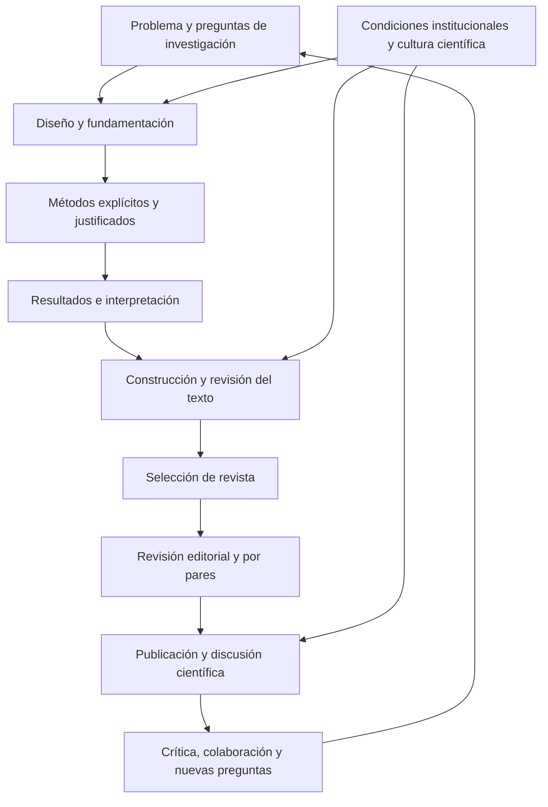

# Clase 5: Producción científica doctoral: escritura, reproducibilidad y publicación académica

> **Objetivo académico:** Comprender la producción científica como componente de la formación doctoral y articular la construcción textual, la documentación reproducible de métodos y algoritmos, la presentación de resultados y la selección crítica de canales de publicación.

## 1. Contexto y marco conceptual

### La producción científica como práctica doctoral

La sesión integra cuatro perspectivas: el papel de la producción científica en la identidad doctoral, los problemas de construcción textual, la comunicación de métodos y resultados técnicos y el funcionamiento de las revistas científicas. Su hilo conductor es que investigar, escribir y comunicar constituyen prácticas relacionadas: un resultado necesita una argumentación comprensible y procedimientos explícitos para poder incorporarse al debate de una comunidad especializada.

La formación doctoral se presenta como un proceso de adquisición de autonomía investigadora. Comprende identificar problemas, analizar críticamente información, justificar decisiones metodológicas, producir resultados y orientar a otros investigadores. La expresión «formarse para formar otros doctores» sintetiza la responsabilidad de reproducir y ampliar las capacidades científicas de una comunidad; no reduce el doctorado a la acumulación de conocimientos ni a la obtención de una credencial.

La producción científica tiene un alcance mayor que el artículo: incluye participación en eventos, proyectos de investigación, ensayos, patentes y otros productos de conocimiento. Estos productos no son equivalentes entre sí, pero muestran que la actividad investigadora abarca generación, comunicación y aprovechamiento del conocimiento.

### Intencionalidad y cultura científica

La intencionalidad vincula la motivación personal con una trayectoria de investigación sostenida. La pregunta por el sentido de formarse como doctor permite conectar el desarrollo profesional con la capacidad de contribuir a problemas científicos y sociales.

La cultura científica incluye hábitos de búsqueda, actualización, discusión argumentada, colaboración y apertura a la crítica. Su desarrollo depende tanto del investigador como de las instituciones. Una organización puede estimular la investigación mediante apoyo, reconocimiento y condiciones de trabajo, o dificultarla mediante restricciones y estructuras que no valoran sus resultados.

En la sesión se cuestiona la evaluación institucional basada exclusivamente en permanencia o carga horaria, porque no permite reconocer adecuadamente la contribución científica. También se destaca que los programas doctorales pueden fortalecer comunidades de investigación y capacidades locales.

**Enriquecimiento conceptual:** Las observaciones sobre universidades y contextos nacionales son valoraciones de la sesión, no resultados de un análisis comparativo documentado. Del mismo modo, la posición en un ranking constituye una representación parcial del desempeño institucional; no sustituye la evaluación de pertinencia, integridad, formación y contribución social.

### Publicación y diálogo científico

La publicación permite que un trabajo salga de su entorno inmediato y sea leído, discutido, contrastado o utilizado por otros. La circulación digital amplía esa posibilidad, aunque la disponibilidad de un documento no garantiza que encuentre lectores ni que produzca impacto.

Se distinguen tres funciones complementarias de la comunicación científica:

- **Socialización:** hacer accesibles procedimientos, argumentos y resultados.
- **Retroalimentación:** recibir objeciones que permitan revisar y fortalecer el trabajo.
- **Colaboración:** establecer relaciones con investigadores que estudian problemas próximos o complementarios.

El acceso a ese diálogo exige escribir para un lector. Una figura, una tabla o una formulación técnica deben contar con explicación suficiente para que su sentido no dependa de la presencia del autor.

## 2. Fundamentos teóricos y arquitectura

### Problemas, conocimiento y continuidad de la investigación

La sesión insiste en que la ciencia avanza mediante la formulación de problemas: una solución puede revelar nuevas preguntas, límites o condiciones de aplicación. Por ello, la capacidad doctoral no se agota en resolver una cuestión; también comprende reconocer qué permanece abierto y organizar investigaciones posteriores.

**Enriquecimiento conceptual:** Conviene distinguir un problema práctico de una laguna de conocimiento. Una dificultad local puede tener soluciones conocidas que aún no se han aplicado. Para sostener un problema científico es necesario identificar qué explicación, evidencia, método o capacidad de generalización resulta insuficiente respecto del conocimiento disponible. Una aplicación contextual también puede aportar conocimiento si permite estudiar condiciones o efectos que no estaban establecidos.

El esquema de investigación presentado articula cuatro componentes: diseño, fundamentación, método y resultados. La escritura selecciona y organiza esos componentes para construir un mensaje científico. La publicación incorpora ese mensaje a un circuito de revisión, circulación y discusión.

El diagrama sintetiza relaciones conceptuales; no representa una secuencia rígida. La revisión de literatura, la escritura y la discusión pueden modificar el diseño antes de obtener un producto publicable.

### Construcción textual y macrohabilidades comunicativas

La escritura se aborda como una actividad de construcción de significado que integra conocimientos, capacidades, intención comunicativa y contexto. No consiste únicamente en colocar información dentro de una estructura formal.

Las cuatro macrohabilidades lingüístico-comunicativas consideradas son escuchar, hablar, leer y escribir. La comprensión atraviesa estas prácticas: escuchar implica elaborar lo recibido y leer exige interpretar, relacionar y valorar la información. La escritura científica se alimenta de esas operaciones y, a su vez, obliga a hacer explícitas relaciones que podían permanecer imprecisas en el pensamiento.

El proceso de construcción textual se organiza en tres momentos:

| Momento | Operación principal | Preguntas orientadoras |
| --- | --- | --- |
| Planeación o preescritura | Delimitar propósito, lector, contenido y organización | ¿Qué se quiere comunicar y con qué evidencia? |
| Textualización o escritura | Construir la secuencia argumentativa y su expresión lingüística | ¿Las ideas expresadas responden al propósito y pueden comprenderse? |
| Autorrevisión o reescritura | Evaluar y modificar contenido, estructura y forma | ¿El texto sostiene sus afirmaciones y elimina ambigüedades? |

La productividad de la escritura puede variar. La necesidad de revisar o reescribir no indica por sí misma un fracaso: forma parte de la elaboración de un argumento preciso.

### Propiedades de la textualidad científica

La sesión destaca progresión temática, pertinencia, coherencia y cierre semántico. También subraya claridad, precisión, concreción, vocabulario especializado y uso adecuado de conectores.

- **Progresión temática:** incorporar información nueva manteniendo una relación reconocible con lo ya desarrollado.
- **Pertinencia:** seleccionar contenido que contribuya al propósito del texto.
- **Coherencia:** sostener relaciones conceptuales compatibles entre afirmaciones, evidencia e interpretación.
- **Cierre semántico:** completar una unidad de sentido y preparar su culminación, sin dejar ideas inconclusas. No equivale exclusivamente a la sección de conclusiones.

**Enriquecimiento conceptual:** La cohesión corresponde a los recursos lingüísticos que conectan segmentos, como referencias y conectores; la coherencia se refiere a las relaciones de significado. Añadir «por tanto» no vuelve válida una inferencia si la conclusión no se desprende de sus premisas.

### Reproducibilidad, transparencia y validez

La documentación metodológica permite que otro investigador comprenda cómo se obtuvieron los resultados y pueda contrastarlos. La sesión utiliza reproducibilidad y réplica en un sentido amplio: seguir los procedimientos descritos y obtener resultados comparables bajo condiciones pertinentes.

**Enriquecimiento conceptual:** La terminología cambia entre disciplinas. Puede distinguirse la reproducción de un análisis con los mismos datos y procedimientos de su réplica con nuevas observaciones. Es conveniente declarar qué sentido se adopta. En ambos casos, la transparencia es necesaria, pero no demuestra por sí sola validez: un procedimiento puede repetirse consistentemente y medir una propiedad distinta de la que pretende estudiar.

La semejanza de resultados tampoco exige identidad numérica. En procesos estocásticos, sistemas variables o muestras diferentes, lo pertinente es justificar la variación esperable y las condiciones de comparación.

## 3. Implementación técnica y lógica de negocio

### Documentar el procedimiento realmente aplicado

La sesión diferencia la metodología general de investigación de la descripción operativa de un estudio concreto. Declarar un enfoque general no sustituye explicar qué se hizo, con qué instrumentos y por qué.

Una descripción metodológica útil identifica fases, decisiones, herramientas, instrumentos, términos técnicos y criterios de análisis. La síntesis debe conservar los elementos esenciales: aquellos cuya omisión impediría comprender o reconstruir el procedimiento.

El procedimiento inicialmente previsto puede cambiar durante la investigación. La versión final debe describir fielmente lo realizado.

**Enriquecimiento conceptual:** Documentar al finalizar no debe convertirse en reconstrucción retrospectiva sin registros. Una bitácora permite conservar las decisiones y distinguir el plan inicial de sus modificaciones, con sus motivos y posibles efectos sobre las conclusiones.

### Ejemplo metodológico: revisión sobre aprendizaje automático y fraude financiero

El ejemplo de la sesión muestra cómo convertir prácticas de búsqueda aparentemente obvias en un procedimiento comunicable. Su pregunta orientadora se refiere a las técnicas de aprendizaje automático utilizadas para detectar fraude financiero y a las métricas con que se evalúan.

| Fase | Información necesaria | Función metodológica |
| --- | --- | --- |
| Delimitación | Preguntas, alcance y conceptos relevantes | Establecer qué conocimiento se busca sintetizar |
| Búsqueda | Bases consultadas y términos empleados | Explicitar cómo se identificó la literatura |
| Selección | Criterios de inclusión y exclusión | Justificar qué estudios integran el análisis |
| Extracción y análisis | Técnicas, datos, métricas y procedimiento comparativo | Permitir comprender cómo se elaboró la síntesis |
| Síntesis | Relaciones, tendencias, discrepancias y límites | Producir una interpretación que responda a las preguntas |

Se mencionan IEEE Xplore y ACM Digital Library, junto con términos como *machine learning*, *fraud detection* y *financial fraud*. El ejemplo también contempla seleccionar estudios experimentales con aplicación práctica y excluir trabajos que no satisfagan ese alcance. Son decisiones de ese caso, no requisitos universales de una revisión.

La expresión «se buscaron los artículos más relevantes» resulta insuficiente porque no explica cómo se determinó la relevancia ni cómo se delimitaron los resultados.

**Enriquecimiento conceptual:** Para una búsqueda auditable conviene registrar la consulta exacta, los campos consultados, la fecha, los filtros y las decisiones de selección. Una misma consulta puede devolver resultados diferentes cuando cambia una base de datos. Además, denominar una búsqueda «sistemática» exige una planificación y trazabilidad mayores que la simple enumeración de términos.

La sesión también distingue entre la metodología utilizada para producir un artículo y una metodología que constituye su objeto de estudio. Una investigación sobre un método necesita, a su vez, un procedimiento explícito para analizarlo.

### Presentación de algoritmos

El nivel de detalle debe responder a la función del algoritmo en el trabajo. Si solo se utiliza una herramienta cuyo funcionamiento depende de un algoritmo conocido, puede ser más relevante justificar la herramienta y su configuración. Si el algoritmo constituye una contribución, adaptación o decisión central, su exposición necesita mayor profundidad.

La presentación propuesta articula:

1. Contexto y problema computacional.
2. Entradas, salidas y componentes del procedimiento.
3. Pseudocódigo estructurado.
4. Ejemplo de ejecución relacionado con el problema.
5. Justificación técnica de la selección.

El pseudocódigo favorece la comprensión de la lógica sin exigir familiaridad con un lenguaje específico. Debe mantener nombres claros, estructura legible y consistencia con la explicación. La homogeneidad lingüística puede facilitar la lectura, respetando las convenciones del medio de publicación.

Cuando las dependencias de una tecnología sean centrales para comprender el procedimiento, el código específico puede resultar necesario. Los detalles extensos pueden ubicarse en material complementario, conservando en el cuerpo los elementos indispensables del argumento.

El ejemplo oral menciona Quicksort y estructuras de árbol, pero no proporciona una especificación completa ni el pseudocódigo mostrado. Por ello, no se reconstruye una variante ni se atribuyen propiedades de rendimiento a esa combinación.

**Enriquecimiento conceptual:** Refactorizar un fragmento para mejorar su presentación requiere comprobar que mantiene el comportamiento relevante. Si procede de otra fuente, debe conservarse la atribución y aclararse la adaptación. La legibilidad no sustituye el análisis de corrección ni justifica eliminar condiciones necesarias del algoritmo.

### Presentación de resultados técnicos

Las tablas deben permitir identificar patrones y comparaciones, además de conservar datos. La sesión describe un caso de comparación de algoritmos cuya presentación mezcla números, valoraciones cualitativas y observaciones sin suficiente organización.

La mejora consiste en definir columnas y criterios comparables, separar dimensiones cuando ello facilite la lectura y utilizar medidas homogéneas. La reorganización se compara con la refactorización del código: mejorar la estructura sin alterar indebidamente el contenido.

**Enriquecimiento conceptual:** Una tabla puede combinar variables cuantitativas y cualitativas si esa combinación responde a una pregunta analítica clara. El problema es la falta de estructura o comparabilidad. En datos cuantitativos deben declararse unidades, condiciones y forma de agregación; las categorías cualitativas necesitan criterios de interpretación.

Las figuras y los diagramas complementan la explicación. Su inclusión no elimina la necesidad de describir qué representan, cómo se obtuvieron y qué conclusión permiten sostener.

### Citación y referencias: APA, IEEE y ACM

Los tres estilos tratados permiten identificar las fuentes y conectar las afirmaciones con documentos recuperables. La elección depende del medio de publicación y de las reglas aplicables al documento.

| Estilo | Rasgo destacado en la sesión | Precaución principal |
| --- | --- | --- |
| APA | Sistema autor-fecha, con citas narrativas o parentéticas | Mantener correspondencia entre citas y referencias |
| IEEE | Referencias identificadas por números entre corchetes | Conservar la asociación correcta entre número y fuente |
| ACM | En el ejemplo se presenta un formato autor-año | Consultar la variante y plantilla exigidas por el medio |

**Enriquecimiento conceptual:** ACM admite configuraciones numéricas y de autor-año según la publicación. No debe reducirse a «APA con corchetes». Los campos, el orden y la puntuación de una referencia dependen del tipo de documento y de la versión aplicable del estilo. Los ejemplos orales no constituyen una guía normativa completa.

No mezclar estilos significa aplicar de forma consistente el sistema elegido. El rigor de un trabajo no depende de que use un estilo específico, sino también de la pertinencia, exactitud y trazabilidad de sus fuentes.

## 4. Análisis crítico de casos y auditoría práctica

### Caso de medición: respuesta de una base de datos

El ejemplo de la sesión cuestiona una medición de velocidad de respuesta basada en una herramienta que observa tráfico de red. La herramienta puede ser útil, pero su pertinencia depende de la propiedad que se busca estudiar.

Si interesa el rendimiento interno de un motor de base de datos, el tiempo observado desde un cliente puede incorporar factores adicionales: red, procesamiento de la aplicación y transferencia de resultados. Por tanto, no basta con nombrar la herramienta: se necesita definir la variable, el límite del sistema y las condiciones de medición.

**Enriquecimiento conceptual:** Como descomposición ilustrativa, bajo el supuesto simplificador de etapas secuenciales sin solapamiento, puede expresarse:

$$
T_{\mathrm{observado}} = T_{\mathrm{red}} + T_{\mathrm{aplicación}} + T_{\mathrm{BD}}
$$

Cada término es una duración no negativa, medida en la misma unidad, por ejemplo milisegundos. $T_{\mathrm{observado}}$ es la latencia total de la operación; $T_{\mathrm{red}}$, el tiempo de comunicación; $T_{\mathrm{aplicación}}$, el procesamiento fuera del motor; y $T_{\mathrm{BD}}$, el procesamiento atribuido a la base de datos. Es un modelo conceptual: si existen concurrencia, cachés o etapas superpuestas, la suma simple puede resultar inadecuada. Su utilidad es mostrar por qué una latencia total no identifica por sí sola el rendimiento del motor.

### Auditoría de construcción textual

Los errores señalados afectan distintos niveles y requieren intervenciones específicas:

| Problema | Efecto sobre la comunicación | Criterio de revisión |
| --- | --- | --- |
| Solecismos y discordancias | Relaciones gramaticales incorrectas o inestables | Revisar concordancia, régimen y estructura sintáctica |
| Anfibología | Más de una interpretación no controlada | Aclarar referentes, alcance y relaciones entre segmentos |
| Redundancia y monotonía | Repetición sin avance conceptual | Distinguir precisión terminológica de reiteración innecesaria |
| Puntuación insuficiente o excesiva | Dificulta reconocer jerarquías y límites de las ideas | Organizar las oraciones según su estructura y sentido |
| Mayúsculas injustificadas | Introduce inconsistencias formales | Aplicar las convenciones ortográficas pertinentes |
| Verbos demasiado generales | Ocultan la operación realizada | Precisar si se diseñó, aplicó, midió, comparó o analizó |
| Gerundios inadecuados | Vuelven confusa la relación temporal o causal | Comprobar qué acción modifica el gerundio |
| Ideas inconclusas | Interrumpen la progresión y el cierre semántico | Completar la relación argumentativa o eliminar el fragmento |
| Ausencia de autorrevisión | Acumula problemas conceptuales y formales | Revisar contenido, estructura y expresión antes de circular el texto |

La lectura en voz alta se propone como apoyo para detectar repeticiones y dificultades de expresión. Los correctores pueden señalar problemas, pero sus sugerencias requieren juicio del autor, especialmente ante terminología técnica.

**Enriquecimiento conceptual:** No toda repetición indica pobreza léxica: conservar un mismo término puede evitar ambigüedades en un texto técnico. Tampoco «hacer una encuesta» es siempre incorrecto; conviene precisar si se diseña el instrumento, se aplica o se analizan las respuestas. En el uso existencial impersonal de «haber» corresponde el singular, como en «hubo diferencias». Estas precisiones evitan convertir recomendaciones de estilo en prohibiciones absolutas.

### Aporte original y revisión de literatura

El diálogo final aborda cómo hacer visible la contribución. Se propone conservar y organizar las fuentes, registrar las ideas relevantes y desarrollar una posición propia. El estado del arte no debe convertirse en una concatenación de citas: necesita comparar autores, identificar relaciones y justificar acuerdos o discrepancias.

En el artículo original, la contribución se vincula con resultados nuevos sobre el objeto de estudio. En el artículo de revisión, debe existir elaboración intelectual: una síntesis crítica, relaciones explicativas o un enriquecimiento de la comprensión disponible. En ambos casos, los resultados proporcionan la evidencia; la discusión y las conclusiones explicitan su significado y alcance.

**Enriquecimiento conceptual:** La originalidad no exige estudiar una realidad enteramente desconocida. Puede residir en datos, métodos, explicaciones, contrastes o condiciones de aplicación. Una revisión también puede producir aportes sustantivos. La novedad se argumenta respecto de un estado del conocimiento delimitado, no mediante una declaración genérica de que «nadie lo ha hecho».

### Valorar la contribución sin confundir indicadores

La sesión propone observar la circulación del trabajo, el debate que genera, sus citas, la incorporación a la práctica y el reconocimiento de la comunidad. También plantea que la solución de un problema permite valorar la utilidad de una propuesta.

**Enriquecimiento conceptual:** Es necesario distinguir cuatro dimensiones:

- **Novedad:** qué cambia respecto del conocimiento previo.
- **Solidez:** qué evidencia y razonamiento sostienen las afirmaciones.
- **Utilidad:** qué capacidad de comprensión o intervención aporta el resultado.
- **Recepción:** cómo circula, se discute y se utiliza el trabajo.

Resolver un problema práctico aporta evidencia sobre una intervención, pero no demuestra automáticamente la verdad de toda la explicación teórica. Pueden existir explicaciones alternativas o condiciones particulares. A su vez, un resultado riguroso puede recibir pocas citas, y un artículo muy citado puede ser objeto de crítica.

### Rechazo editorial y revisión del manuscrito

El rechazo no tiene una interpretación única: puede relacionarse con alcance temático, requisitos formales, contribución, problemas metodológicos o prioridades editoriales. El caso discutido recuerda que la decisión final puede diferir de recomendaciones favorables de algunos revisores.

La respuesta académica consiste en separar objeciones verificables de valoraciones discutibles, revisar las razones y decidir si corresponde corregir, argumentar una discrepancia o buscar otro medio adecuado. La crítica se integra al trabajo sin equiparar el juicio sobre un manuscrito con el valor personal de su autor.

**Enriquecimiento conceptual:** La existencia de posibles sesgos no permite atribuir un rechazo concreto a falta de ética sin evidencia. También es importante distinguir el desacuerdo razonado de la negativa a revisar una debilidad metodológica demostrada.

## 5. Principios de diseño, buenas prácticas y anti-patrones

### Revista científica, indexación y selección del destino

La revista se presenta como un medio formal de comunicación científica que define un ámbito temático, normas de publicación, procedimientos editoriales y mecanismos de evaluación. La indexación supone su inclusión en un índice o sistema de información, conforme a los criterios de ese servicio.

Se mencionan Web of Science, Emerging Sources Citation Index, Scopus, IEEE Xplore, ACM Digital Library, Latindex, Redalyc, Dialnet y SciELO. Son recursos útiles para localizar literatura o publicaciones, aunque cumplen funciones y aplican criterios diferentes.

**Enriquecimiento conceptual:** Un índice de citas, un catálogo y una biblioteca digital no son servicios equivalentes. La indexación puede aportar visibilidad y evidencias sobre determinados criterios editoriales, pero no garantiza la corrección de cada artículo. Del mismo modo, prestigio y alto impacto no vuelven infalible una publicación.

La selección de revista debe integrar:

| Criterio | Pregunta de decisión |
| --- | --- |
| Alcance temático | ¿El problema y el tipo de contribución corresponden al medio? |
| Lectores y comunidad | ¿La audiencia puede utilizar y discutir los resultados? |
| Tipos y estructura de artículos | ¿Se admite la modalidad y el espacio necesarios para comunicar el trabajo? |
| Arbitraje | ¿El procedimiento está explicado y es coherente con una evaluación rigurosa? |
| Indexación | ¿La inclusión declarada puede verificarse en el servicio correspondiente? |
| Idioma | ¿Puede redactarse con suficiente precisión para esa audiencia? |
| Periodicidad y tiempos editoriales | ¿Las condiciones de circulación resultan compatibles con el propósito de comunicación? |
| Costos | ¿Las condiciones económicas están claramente declaradas y son viables? |
| Indicadores bibliométricos | ¿Qué dimensión miden y qué límites tienen? |

La sesión menciona herramientas de sugerencia como Journal Finder, servicios de Springer y JournalGuide, además de MIAR como recurso de información sobre revistas. Las búsquedas por título, resumen o palabras clave generan candidatos; no sustituyen la lectura de las políticas y del contenido publicado.

**Enriquecimiento conceptual:** La frecuencia de los números no determina por sí sola el tiempo de revisión, aceptación o publicación. Algunos medios publican de forma continua. Los recomendadores vinculados con una editorial también pueden limitar las sugerencias a su propio catálogo.

El acceso abierto no implica necesariamente cobros al autor. Deben diferenciarse el acceso de los lectores, las licencias y el modelo de financiación. Una invitación a publicar tampoco constituye evidencia suficiente de calidad editorial.

### Revisión editorial y por pares

El circuito descrito comienza con la recepción y revisión editorial del alcance y la estructura. Si el manuscrito continúa, se solicita la evaluación de especialistas. Sus informes identifican fortalezas, problemas y cambios propuestos. Después se produce una decisión editorial y, cuando corresponde, una nueva ronda de revisión. La aceptación conduce a corrección editorial y maquetación.

Las decisiones se sintetizan en aceptación, solicitud de correcciones y rechazo, aunque las denominaciones y las rondas varían entre revistas. Los revisores asesoran; la responsabilidad editorial no desaparece porque existan informes favorables.

| Modalidad | Relación de identidad descrita | Finalidad y límite |
| --- | --- | --- |
| Ciego simple | El revisor conoce al autor; el autor no conoce al revisor | Protege la identidad del revisor, sin eliminar sesgos asociados al autor |
| Doble ciego | Las identidades se ocultan entre ambas partes | Busca reducir ciertos sesgos; el anonimato puede ser imperfecto |
| Abierta | Se revelan identidades o componentes del proceso | Puede favorecer transparencia; sus características dependen de la política adoptada |

**Enriquecimiento conceptual:** La revisión abierta no es un único modelo: puede incluir identidades, informes o comentarios públicos. Ninguna modalidad garantiza objetividad por sí sola. La sesión cuestiona el fundamento de las modalidades ciegas, pero no aporta evidencia suficiente para concluir que carezcan universalmente de validación científica.

La ética exige valorar argumentos y evidencia, declarar conflictos y evitar que preferencias personales sustituyan criterios científicos. Los esquemas de evaluación pueden favorecer consistencia, siempre que no reduzcan la revisión a verificar casillas.

**Enriquecimiento conceptual:** Los sistemas de gestión editorial, como Open Journal Systems, pueden organizar comunicaciones, asignaciones y anonimización. Esa automatización administrativa no equivale a arbitraje científico automatizado ni sustituye el juicio experto.

### Anti-patrones transversales

| Anti-patrón | Riesgo | Principio de mejora |
| --- | --- | --- |
| Completar una plantilla sin razonamiento propio | Ocultar decisiones y relaciones causales | Usar la estructura como soporte de una investigación explícita |
| Dar por obvio el procedimiento | Impedir su reconstrucción y evaluación | Declarar operaciones, condiciones y justificaciones esenciales |
| Presentar datos sin una pregunta analítica | Acumular información sin interpretación | Organizar resultados según comparaciones pertinentes |
| Utilizar figuras como sustituto del argumento | Exigir al lector inferencias no justificadas | Explicar su origen, contenido y función |
| Encadenar citas sin síntesis | Diluir la contribución del investigador | Comparar, argumentar y delimitar una posición propia |
| Elegir solo por impacto o facilidad de aceptación | Desatender pertinencia y credibilidad | Evaluar conjuntamente audiencia, políticas, rigor y viabilidad |
| Considerar definitiva la aceptación editorial | Confundir publicación con certeza | Mantener apertura a crítica y corrección posterior |

**Enriquecimiento conceptual:** Publicar un artículo permite documentar y atribuir una contribución, pero no equivale a obtener una patente. La divulgación pública tampoco elimina automáticamente los derechos de autor ni incorpora jurídicamente la obra al dominio público. Deben distinguirse circulación pública, prioridad académica y protección de propiedad intelectual.

## 6. Síntesis conceptual y profundización académica

### Bibliometría: alcance y límites

La bibliometría se presenta como el uso de métodos cuantitativos para estudiar la comunicación científica. La sesión destaca el factor de impacto y el índice de inmediatez, señalando que los recuentos no capturan por completo la calidad de una contribución.

**Enriquecimiento conceptual:** Para expresar con precisión una ventana temporal, una forma general del factor de impacto de una revista es:

$$
FI_k(y) = \frac{C_y(y-k,\ldots,y-1)}{N(y-k,\ldots,y-1)}
$$

Aquí $y$ es el año de referencia, un entero; $k$ es un número entero positivo de años de la ventana; $C_y$ cuenta las citas recibidas durante $y$ por publicaciones de los años $y-k$ a $y-1$; y $N$ es el número de elementos considerados citables publicados en esa ventana. Se requiere $N>0$. El cociente es una razón de recuentos que se interpreta como citas por elemento del denominador en las condiciones definidas por el indicador. Los tipos documentales elegibles y las reglas exactas dependen de su metodología.

Para $k=2$, se consideran los dos años anteriores; para $k=5$, los cinco anteriores. La ventana de cinco años no sustituye universalmente a la de dos. Por ejemplo, para un año de referencia 2025 y una ventana de cinco años, el intervalo sería 2020–2024. Esta precisión corrige el intervalo oral inconsistente sin atribuir un cálculo real a la clase.

**Enriquecimiento conceptual:** El índice de inmediatez puede representarse como:

$$
II(y) = \frac{C_y(y)}{N(y)}
$$

$C_y(y)$ es el número de citas recibidas durante el año $y$ por publicaciones de ese mismo año; $N(y)$ es el número de elementos elegibles publicados en $y$, con $N(y)>0$. Ambos son recuentos no negativos. La razón representa la citación temprana agregada de la revista. No mide directamente el tiempo hasta la primera cita de un artículo y puede verse afectada por el momento del año en que se publica.

Los indicadores pertenecen al nivel y a la ventana para los que se construyen. Un promedio de revista no permite inferir automáticamente la calidad de un artículo o investigador. Además, las citas pueden expresar apoyo, utilización, discrepancia o crítica.

### Articular contribución, comunicación y formación

La integración de la sesión puede expresarse mediante cinco relaciones:

1. **La autonomía investigadora requiere método y juicio crítico.** El dominio técnico necesita acompañarse de la capacidad de formular problemas y justificar inferencias.
2. **La escritura contribuye a elaborar el conocimiento.** Planear, textualizar y revisar permite reconocer lagunas, contradicciones y afirmaciones insuficientemente sustentadas.
3. **La transparencia habilita la crítica.** Métodos, algoritmos y datos deben comunicarse con el detalle necesario para comprender y contrastar el trabajo.
4. **La publicación amplía la interlocución.** Su valor incluye discusión y colaboración, además de visibilidad.
5. **La contribución exige evaluación multidimensional.** Novedad, solidez, utilidad y recepción deben analizarse de manera relacionada, sin sustituirse entre sí.

La profundización académica se sitúa en las relaciones entre validez y reproducibilidad, entre eficacia práctica y explicación teórica, entre revisión por pares y sesgo, y entre indicadores bibliométricos y valoración cualitativa. La duda razonada y la comparación de perspectivas permiten someter tanto las afirmaciones propias como las de otros a una evaluación crítica sostenida.

La sesión aporta ejemplos metodológicos y criterios de comunicación, pero no documenta ejecuciones, mediciones ni resultados experimentales propios. Su contribución principal es un marco integrado para transformar una investigación en una comunicación científica comprensible, discutible y abierta a revisión.
