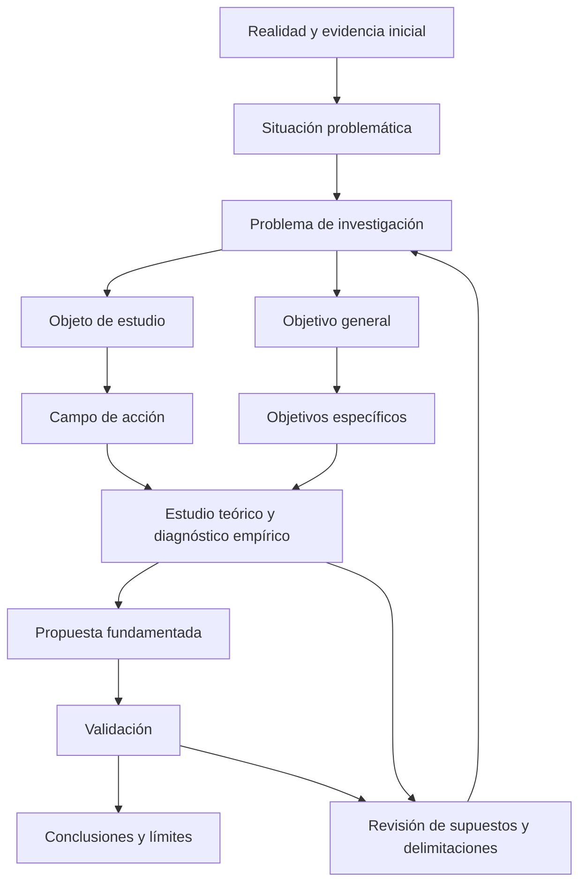

# Clase 6: Ciencia, objetividad y coherencia del diseño de investigación aplicada

> **Objetivo académico:** Analizar los fundamentos epistemológicos y éticos de la ciencia y articular situación problemática, problema, objeto, campo de acción, objetivos, hipótesis y validación en un diseño coherente de investigación aplicada.

## 1. Contexto y marco conceptual

### La ciencia como conocimiento y como actividad

La sesión vincula la producción científica con una pregunta fundamental: cómo comprender una realidad y fundamentar una intervención sobre ella. La metáfora de encender la luz en una habitación resume la orientación hacia la indagación y la evidencia. Su función es pedagógica; no constituye por sí misma una caracterización rigurosa de las diferencias entre ciencia, filosofía, metafísica y teología.

La ciencia se aborda desde dos dimensiones inseparables:

- **Producto:** cuerpo de conocimientos, conceptos, teorías y explicaciones construido históricamente.
- **Proceso:** actividad intencional que emplea razonamientos, métodos y procedimientos para producir y contrastar conocimiento.

La definición comentada en clase, atribuida a Mario Bunge, caracteriza el conocimiento científico como racional, sistemático, exacto, verificable y falible. El énfasis recae en la **falibilidad**: una afirmación científica puede revisarse ante mejores argumentos o evidencia. Invocar la ciencia no convierte una conclusión en incuestionable.

**Enriquecimiento conceptual:** La exactitud debe entenderse según la disciplina, la calidad de la medición y el alcance de los modelos. No equivale a una precisión ilimitada ni elimina la incertidumbre. Asimismo, la contrastación puede respaldar una afirmación sin demostrar definitivamente su verdad.

### Sujeto, objeto y reconstrucción conceptual

El **sujeto** es quien investiga; el **objeto** es la realidad delimitada que se estudia. Las teorías constituyen reconstrucciones conceptuales de esa realidad. La sesión describe la relación entre teoría y práctica como una unidad: la teoría busca explicar la realidad y la práctica permite confrontar sus alcances.

**Enriquecimiento conceptual:** Una teoría no es la realidad trasladada literalmente a un libro. Selecciona propiedades, establece relaciones y opera bajo supuestos. La correspondencia entre teoría y realidad debe evaluarse mediante evidencia y dentro de condiciones explícitas.

### Objetividad y vigilancia epistemológica

La objetividad se presenta como una orientación hacia comprender el mundo tal como se manifiesta, evitando acomodarlo a preferencias personales. La epistemología analiza cómo se obtiene, justifica y contrasta ese conocimiento.

La intervención del investigador no desaparece: selecciona preguntas, categorías e instrumentos. Por ello, la sesión destaca la necesidad de contrastar resultados y hacer explícitos los procedimientos.

**Enriquecimiento conceptual:** La objetividad puede fortalecerse mediante transparencia, crítica intersubjetiva, controles del sesgo y procedimientos reproducibles. El juicio experto aporta una evaluación argumentada, pero no reemplaza automáticamente la evidencia empírica sobre el funcionamiento de una intervención.

## 2. Fundamentos teóricos y arquitectura

### Investigación aplicada y propósito transformador

El modelo metodológico central de la sesión parte de una dificultad identificada en la realidad, desarrolla un estudio teórico y empírico y formula una propuesta de solución. Su carácter **transformador** se refiere a la intención de modificar una condición problemática del objeto.

La secuencia no describe toda investigación posible. También existen investigaciones orientadas a explorar fenómenos, describirlos, analizar relaciones o explicar mecanismos sin construir una intervención.

**Enriquecimiento conceptual:** La finalidad aplicada y el alcance descriptivo, correlacional o explicativo son dimensiones diferentes. Una investigación aplicada puede incluir diagnóstico descriptivo, análisis correlacional y evaluación experimental. No forman una clasificación de categorías necesariamente excluyentes. Proponer una transformación tampoco demuestra que esta haya ocurrido: esa afirmación requiere evidencia de aplicación y resultados.

### Situación problemática, problema, objeto y campo

| Componente | Función conceptual | Pregunta orientadora |
|---|---|---|
| Situación problemática | Expone manifestaciones, consecuencias y discrepancias respaldadas por evidencia | ¿Qué ocurre y por qué resulta relevante investigarlo? |
| Problema científico | Delimita una incertidumbre o dificultad de conocimiento | ¿Qué falta comprender o resolver? |
| Objeto de estudio | Define el proceso o fenómeno que debe estudiarse | ¿Qué realidad es necesario investigar? |
| Campo de acción | Precisa las relaciones o aspectos del objeto sobre los que se concentrará el análisis o la intervención | ¿En qué aspecto del objeto se actuará directamente? |
| Objetivo general | Expresa la aspiración principal y el alcance de la investigación | ¿Qué se pretende lograr? |
| Hipótesis | Formula una respuesta provisional susceptible de contrastación | ¿Qué relación o resultado se anticipa y bajo qué condiciones? |

La **situación problemática** permite argumentar la discrepancia entre un estado observado y un estado esperado. El **problema formulado** condensa la incertidumbre que orientará el estudio. Aunque ambos están relacionados, la descripción de dificultades no sustituye una pregunta investigable.

En el lenguaje del docente, el problema es una manifestación contradictoria del objeto. El objeto no se identifica exclusivamente con esa dificultad: comprende el proceso o fenómeno cuyo comportamiento permite entenderla.

### El campo de acción como precisión conceptual

La sesión adopta una concepción del campo de acción centrada en la parte o las relaciones del objeto que recibirán directamente el impacto de la propuesta. Su función principal es orientar y evitar la dispersión.

El ejemplo más claro distingue **comunicación**, como objeto amplio, y **comunicación pedagógica**, como precisión del estudio. Transformar aspectos de la segunda modifica propiedades de la primera, sin que ello implique transformar toda la comunicación en cualquier contexto.

El docente insiste en que el campo no debe entenderse como una realidad independiente ni reducirse al lugar físico del estudio. La delimitación puede incluir relaciones teóricas, variables, procesos y decisiones metodológicas; la ubicación geográfica cumple otra función.

Se mencionan dos concepciones del campo, una vinculada al contenido y otra a la realidad que se transformará, pero no se desarrollan suficientemente sus diferencias ni sus fundamentos.

**Enriquecimiento conceptual:** El uso de «campo de acción» depende de la tradición metodológica. Su ausencia como apartado no implica ausencia de delimitación. Tampoco debe confundirse este término con el concepto de campo físico utilizado en gravitación u otras teorías de la física.

El diagrama integra la lógica discutida en clase y explicita su carácter revisable: los hallazgos pueden modificar la pregunta, el alcance o la propuesta inicialmente prevista.

## 3. Implementación técnica y lógica de negocio

### Formular el problema sin convertir una preferencia en conclusión

La discusión central cuestiona preguntas que incorporan desde el inicio una tecnología como solución. El docente propone distinguir entre preguntar **cómo mejorar una realidad** y preguntar **cómo elaborar o aplicar una propuesta ya seleccionada**.

Su argumento es que la solución necesita fundamentación y que una elección prematura puede orientar todo el estudio a confirmar una intuición. Los participantes objetan que una tecnología propuesta puede constituir una solución hipotética cuya eficacia todavía se desconoce.

**Enriquecimiento conceptual:** Mencionar una técnica en una pregunta no presupone necesariamente que funcione. Una pregunta como «¿En qué condiciones una técnica mejora determinado resultado frente a una alternativa?» mantiene una incertidumbre contrastable. El criterio decisivo es identificar qué se desconoce y evitar que la eficacia se dé por demostrada. La prohibición absoluta de incluir una solución candidata corresponde a la postura metodológica defendida por el docente, no a una regla universal.

Una formulación útil debe aclarar el proceso estudiado, la dificultad específica, el contexto relevante y el tipo de conocimiento buscado. Expresiones generales como «mejorar» u «optimizar» necesitan criterios que permitan reconocer una mejora.

### Objetivos y derivación gradual

El objetivo general expresa la aspiración principal; los específicos descomponen esa aspiración en logros parciales. La sesión los relaciona con los momentos investigativos y, en la estructura comentada, con los capítulos.

| Momento | Logro orientador discutido | Relación con el conjunto |
|---|---|---|
| Fundamentación teórica | Sistematizar fundamentos sobre el objeto y el campo | Construye categorías y criterios para interpretar el fenómeno |
| Diseño metodológico | Precisar procedimientos, métodos, técnicas e instrumentos | Establece cómo obtener y analizar evidencia |
| Diagnóstico | Caracterizar el estado actual del objeto o del problema | Determina manifestaciones, magnitud y condiciones relevantes |
| Propuesta | Elaborar una solución fundamentada | Integra los resultados previos en una intervención o artefacto |
| Validación | Evaluar la propuesta mediante procedimientos pertinentes | Establece qué afirmaciones pueden sostenerse y con qué límites |

El diagnóstico no es necesariamente experimental. Puede apoyarse en observación, entrevistas, encuestas, estudios de caso u otros procedimientos adecuados a la pregunta.

La sesión discute verbos como «proponer», «elaborar», «diseñar», «sistematizar», «caracterizar» y «precisar». El docente prefiere «proponer» para la aspiración general y «elaborar» para el momento de construcción, aunque admite alternativas.

**Enriquecimiento conceptual:** La jerarquía entre objetivos depende de sus resultados y alcances, no únicamente del verbo. Repetir un verbo no constituye por sí mismo una incoherencia. Del mismo modo, completar objetivos específicos solo permite sostener el cumplimiento del general si cubren sus dimensiones y producen evidencia suficiente; no es una consecuencia automática de terminar capítulos.

### Hipótesis, variables y propuesta

La hipótesis se define como conjetura o respuesta provisional. En el modelo discutido, articula una propuesta con el resultado que se espera modificar:

- **Variable independiente:** intervención o condición cuya influencia se estudia.
- **Variable dependiente:** resultado observado o medido.

El objetivo declara lo que se busca lograr; la hipótesis anticipa una relación que puede resultar respaldada o cuestionada. Aunque el docente destaca el carácter provisional de la propuesta incluida en el objetivo, esto no convierte objetivo e hipótesis en componentes equivalentes.

**Enriquecimiento conceptual:** La exigencia de trabajar exactamente con dos variables pertenece al esquema discutido. Una investigación puede incluir múltiples resultados, factores de confusión, mediadores o moderadores. La variable independiente se manipula en determinados diseños experimentales; en estudios observacionales puede registrarse sin manipulación.

### Justificación del proceder metodológico

La metodología debe precisar la finalidad y el alcance del estudio, los métodos teóricos y empíricos, las técnicas, los instrumentos y, cuando corresponda, la población y la muestra. El punto central es explicar **para qué se utiliza cada procedimiento**.

La sesión ofrece ejemplos de funciones metodológicas: organizar antecedentes cronológicamente, derivar criterios observables desde una proposición general y obtener información mediante encuestas u observación. Definir un método de forma abstracta no demuestra su pertinencia para el estudio.

En ciencias de la computación se mencionan simulación, algoritmos, pruebas empíricas y procedimientos de ingeniería de software. No se presenta código, configuración experimental ni resultados ejecutados; el desarrollo técnico de la clase consiste en analizar diseños de investigación.

## 4. Análisis crítico de casos y auditoría práctica

### Fenotipado de quinua

Se analiza una pregunta que reúne visión por computadora, aprendizaje profundo y metaprogramación para mejorar el fenotipado. El docente observa que la formulación privilegia las tecnologías previstas y propone centrar inicialmente la pregunta en la mejora del fenotipado.

La discusión permite separar tres niveles: la dificultad del proceso, las tecnologías candidatas y la evidencia necesaria para valorar su utilidad. La sesión no aporta datos que permitan establecer la eficacia de ninguna combinación técnica.

**Enriquecimiento conceptual:** Una evaluación rigurosa requeriría definir qué propiedad del fenotipado se pretende mejorar y frente a qué referencia. Podrían considerarse tiempo, calidad de medición o robustez, según el problema real; estos criterios son posibilidades analíticas, no resultados descritos en la fuente.

### Optimización de arquitectura de software

Otro caso propone un modelo unificado apoyado en inteligencia artificial generativa para optimizar arquitectura de software en un contexto judicial. La reformulación del docente desplaza el énfasis hacia la pregunta «¿cómo optimizar la arquitectura de software?».

El objeto se vincula provisionalmente con la arquitectura de software y el campo con su proceso de optimización. El propio docente reconoce que la delimitación precisa exige conocimiento especializado del área y análisis adicional.

El aprendizaje metodológico es que el artefacto elegido debe responder a dificultades demostrables. El estudio puede revelar que se necesita una estrategia, otro modelo o una intervención distinta de la imaginada al comienzo.

**Enriquecimiento conceptual:** «Optimización» requiere criterios explícitos y puede involucrar compromisos entre atributos. Mejorar una propiedad no garantiza mejorar todas las demás. La clase no define métricas arquitectónicas ni acredita un diagnóstico del sistema mencionado.

### Lingüística computacional y gestión de requerimientos

Se revisa una pregunta orientada a aplicar técnicas lingüísticas computacionales para optimizar la gestión de requerimientos. El docente sostiene que el proceso problemático es la gestión de requerimientos y que las técnicas ocupan el lugar de medios candidatos.

La distinción depende de la pregunta efectiva. Si se estudian limitaciones de las propias técnicas, estas pueden convertirse en objeto de investigación. Si se estudia una dificultad en la gestión, no basta con nombrar la herramienta para delimitar el fenómeno.

Un participante propone analizar en qué medida una técnica influye en determinados resultados. La discusión muestra que el propósito de construir una propuesta y el de evaluar relaciones son distintos, aunque pueden integrarse en un diseño más amplio.

**Enriquecimiento conceptual:** La expresión «en qué medida» no determina por sí sola un alcance correlacional ni permite sostener causalidad. Esto depende del diseño, las comparaciones, los controles y la calidad de la evidencia.

### Experiencias de aprendizaje en línea

El caso educativo diferencia las experiencias de aprendizaje de las plataformas donde ocurren. La plataforma puede constituir el entorno o medio del proceso, mientras que la experiencia es el fenómeno de interés. Se advierte que una delimitación demasiado estrecha puede impedir comprender los fundamentos generales necesarios.

La pregunta original alude a diferentes estilos de aprendizaje, pero no los define ni aporta evidencia sobre sus efectos.

**Enriquecimiento conceptual:** Esa mención no basta para justificar que adaptar contenidos a categorías de estilos produzca mejores resultados. Sería necesario distinguir preferencias declaradas, necesidades de accesibilidad y desempeño observado.

### Herramientas de diagnóstico y pertinencia documental

El árbol de problemas se presenta como herramienta para organizar relaciones y apoyar la delimitación. También se menciona la representación mediante grafos, sin desarrollar una fórmula concreta.

La discusión sobre imágenes y diagramas conduce a un principio editorial: incluir materiales por su contribución al argumento. El docente cuestiona una imagen introductoria sin aporte identificable y considera que un árbol de problemas puede documentarse fuera del cuerpo principal.

**Enriquecimiento conceptual:** La ubicación no debe fijarse mediante una prohibición universal. Una figura o herramienta diagnóstica puede ser pertinente en el texto principal si resulta necesaria para comprender o auditar el razonamiento. Un grafo de relaciones tampoco demuestra causalidad por sí solo.

## 5. Principios de diseño, buenas prácticas y anti-patrones

### Coherencia antes que cumplimiento formal

El perfil de investigación cumple una función orientadora: explicita los componentes esenciales del proceso y establece fronteras conceptuales. Se critica su reducción a una plantilla en la que se fuerzan coincidencias verbales entre apartados.

| Buena práctica | Anti-patrón | Consecuencia metodológica |
|---|---|---|
| Fundamentar la situación problemática con evidencia | Construir una dificultad para justificar una tecnología preferida | Debilita la relevancia del estudio |
| Mantener revisable la propuesta inicial | Acomodar pregunta y diagnóstico a una respuesta decidida | Favorece el sesgo de confirmación |
| Delimitar procesos y relaciones | Reducir el campo al lugar físico | Deja impreciso qué se estudia |
| Justificar el uso de cada método | Enumerar definiciones sin conexión con el problema | Impide auditar decisiones |
| Vincular objetivos, evidencia y conclusiones | Asociar capítulos y objetivos solo por semejanza verbal | Produce coherencia aparente |
| Distinguir construcción y evaluación | Dar por eficaz un artefacto por haberlo elaborado | Confunde existencia con utilidad demostrada |

### Validación proporcional a las afirmaciones

La sesión menciona evaluación por expertos y validación mediante aplicación. También subraya la importancia de contrastar resultados y revisar procedimientos.

**Enriquecimiento conceptual:** La evaluación debe corresponder al tipo de afirmación. El juicio experto puede valorar coherencia, pertinencia o plausibilidad; una comparación empírica puede aportar evidencia sobre desempeño en condiciones definidas. La fiabilidad y validez de los instrumentos condicionan, a su vez, la confianza en el diagnóstico. Ningún procedimiento aislado garantiza todas estas propiedades.

### Ética, uso dual y responsabilidad

Los ejemplos de armamento, investigación nuclear y agente naranja ilustran que el conocimiento puede emplearse con fines diferentes de los previstos. Las historias y expresiones citadas en la sesión funcionan como referencias de discusión ética, no como documentación histórica verificada.

La intención de beneficiar a la humanidad no basta para controlar consecuencias. La pregunta ética incluye quién utiliza el resultado, bajo qué presiones y con qué efectos posibles.

**Enriquecimiento conceptual:** En computación, el uso dual invita a evaluar privacidad, discriminación, vigilancia, seguridad y concentración de poder. Son dimensiones para analizar según el caso, sin suponer que todas estén presentes en cada investigación.

### Pertinencia disciplinar y contribución doctoral

La pertinencia de un problema aplicado se relaciona con los objetivos y líneas de investigación del área. Usar una herramienta computacional en otro dominio no determina automáticamente la naturaleza de la contribución.

La sesión vincula el nivel doctoral con profundidad, novedad y aporte teórico, pero reconoce matices: el nombre del producto —guía, modelo, algoritmo o software— no basta para juzgar el alcance intelectual.

**Enriquecimiento conceptual:** Una contribución doctoral original no requiere siempre construir una teoría completa. Puede consistir en resultados formales, métodos, evidencia, explicaciones o artefactos cuya novedad y alcance estén rigurosamente justificados. Conviene distinguir utilidad contextual, originalidad científica y pertinencia disciplinar.

## 6. Síntesis conceptual y profundización académica

La investigación rigurosa articula una dificultad relevante, una incertidumbre explícita y procedimientos capaces de producir evidencia. El diseño orienta ese proceso sin sustituirlo: conocer mejor la realidad puede exigir revisar el problema, la delimitación y la propuesta.

La clase permite establecer seis relaciones esenciales:

1. **Ciencia y falibilidad:** el conocimiento se sostiene mediante razones y contrastación, conservando la posibilidad de revisión.
2. **Situación problemática y problema:** las manifestaciones observadas fundamentan una pregunta, pero no equivalen automáticamente a ella.
3. **Objeto y campo:** ambos orientan el estudio de una misma realidad desde distintos grados de precisión.
4. **Objetivos e hipótesis:** los primeros expresan logros; la segunda anticipa una relación provisional que requiere contrastación.
5. **Propuesta y validación:** construir una solución candidata y demostrar sus propiedades son operaciones diferentes.
6. **Resultados y conclusiones:** las conclusiones sintetizan lo respaldado por la investigación y deben respetar sus límites.

La sesión relaciona las conclusiones con los momentos teórico, diagnóstico y propositivo. El diseño metodológico organiza el trabajo, mientras que esos momentos deben producir resultados argumentables. La cantidad de conclusiones depende de los hallazgos, no de una regla numérica universal.

### Azar, leyes y límites de predicción

El debate inicial sobre «suerte» conduce a distinguir su sentido de condición o destino de la humanidad de su uso como azar. También se sostiene que conocer las leyes eliminaría el azar.

**Enriquecimiento conceptual:** Conviene separar incertidumbre por desconocimiento, comportamiento probabilístico y límites de predicción. Conocer leyes no garantiza prever cada resultado: un sistema determinista puede ser sensible a las condiciones iniciales y un modelo probabilístico puede describir regularidades sin fijar cada evento. Las analogías lingüísticas y las reinterpretaciones de palabras no constituyen demostraciones científicas.

### Líneas de profundización

La discusión abre conexiones entre epistemología, diseño y evaluación: cómo una hipótesis se convierte en indicadores observables; cómo distinguir una mejora contextual de una contribución generalizable; cómo justificar una tecnología frente a alternativas; y cómo controlar el sesgo de confirmación sin eliminar la creatividad de la investigación.

El principio articulador es mantener la coherencia entre lo que se pregunta, lo que se hace y lo que la evidencia permite concluir. La apertura a revisar una solución candidata es parte del rigor, junto con la responsabilidad sobre sus usos y consecuencias.
