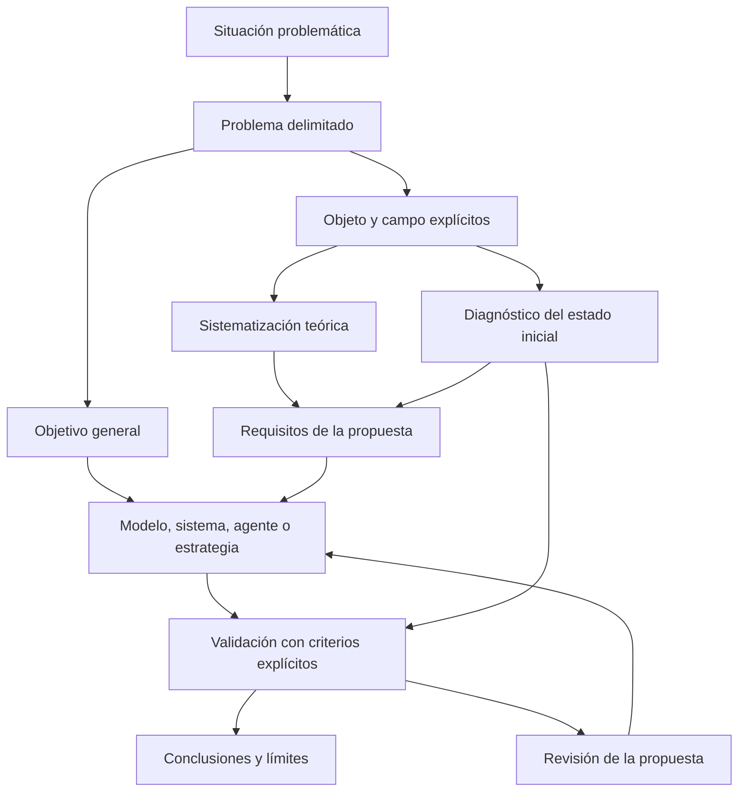

# Clase 8: Coherencia del diseño de investigación aplicada: problema, objeto, propuesta y validación

> **Objetivo académico:** Analizar la coherencia entre problema científico, objeto de estudio, campo de acción, objetivos, hipótesis y validación en investigaciones aplicadas de ciencias de la computación, mediante la revisión crítica de casos interdisciplinarios.

## 1. Contexto y marco conceptual

La sesión desarrolla una revisión metodológica de investigaciones que buscan transformar procesos mediante modelos, sistemas, agentes o estrategias. Su núcleo es la **consistencia interna del diseño**: la pregunta de investigación, el conocimiento que se necesita producir, la solución propuesta y la evidencia prevista deben referirse al mismo problema y mantener un alcance compatible.

La distinción que organiza el debate es la diferencia entre **estudiar una realidad problemática** y **fundamentar el recurso con el que se pretende transformarla**. Saber cómo funciona una tecnología no equivale a conocer el proceso donde se encuentra el problema. Para intervenir sobre el fenotipado vegetal, la inducción de personal, la gestión empresarial o la predicción financiera es necesario comprender primero esas realidades, sus mecanismos y sus limitaciones.

### 1.1. Situación problemática y problema científico

La **situación problemática** describe condiciones, antecedentes y manifestaciones que motivan la investigación. El **problema científico** delimita la incógnita que orienta la producción de conocimiento. Una descripción extensa de amenazas o dificultades no sustituye una pregunta precisa.

En el enfoque aplicado de la sesión, el problema debe expresar la transformación buscada sin incorporar prematuramente una solución particular. Por ejemplo, preguntar cómo aumentar la precisión de una estimación mantiene abierta la selección del medio técnico; preguntar cómo una arquitectura ya elegida aumenta esa precisión sitúa desde el comienzo la solución dentro de la pregunta.

El docente reconoce que un problema puede formularse como interrogación o como afirmación. La forma gramatical por sí sola no garantiza claridad: debe quedar definido qué ocurre, en qué proceso y qué se necesita conocer o transformar.

### 1.2. Alcances y finalidad aplicada

La sesión presenta una secuencia de investigaciones exploratorias, descriptivas, correlacionales, explicativas y aplicadas. En esa exposición, las primeras permiten aproximarse, caracterizar, relacionar o explicar; la aplicada incorpora una propuesta transformadora.

**Enriquecimiento conceptual:** Esta secuencia debe interpretarse como un esquema pedagógico local. La finalidad aplicada y el alcance explicativo o correlacional describen dimensiones diferentes y pueden coexistir. Una investigación aplicada puede construir un artefacto y evaluar causalmente sus efectos. Asimismo, expresiones como «cómo incide» o «en qué medida» no determinan por sí mismas un diseño correlacional: la clasificación depende de la intervención, la asignación de condiciones, los datos y la estrategia de inferencia.

La crítica central de la clase conserva valor más allá de esa clasificación: **si la contribución principal es diseñar una solución, la pregunta y los objetivos deben dar cabida explícita a esa contribución**. Si la pregunta solo busca identificar tecnologías existentes, un inventario podría responderla sin desarrollar ninguna propuesta.

## 2. Fundamentos teóricos y arquitectura

### 2.1. Relación entre problema, objeto y campo

El **objeto de estudio** es la realidad o el proceso donde se manifiesta el problema y sobre el que se necesita producir conocimiento. El problema representa una manifestación problemática de ese objeto. Por ello, la selección del objeto depende de haber precisado previamente la pregunta.

El docente vincula estrechamente el objeto, el problema y la variable dependiente: aquello que se pretende transformar debe comprenderse teóricamente y caracterizarse empíricamente. Esta relación explica por qué varios casos requieren desplazar el foco desde la inteligencia artificial hacia el proceso de aplicación.

| Componente | Función en el diseño | Pregunta orientadora |
| --- | --- | --- |
| Problema | Delimitar la incógnita y la transformación buscada | ¿Qué dificultad concreta requiere conocimiento y solución? |
| Objeto | Identificar la realidad donde ocurre el problema | ¿Qué proceso debe comprenderse para intervenir? |
| Campo de acción | Precisar el aspecto o contenido desde el cual se interviene, según el enfoque adoptado | ¿Sobre qué dimensión específica se concentra la transformación? |
| Objetivo general | Expresar la contribución principal y su finalidad | ¿Qué se propone producir y para qué? |
| Hipótesis | Plantear una respuesta contrastable sobre la intervención y el resultado | ¿Por qué y bajo qué condiciones se espera que funcione? |
| Validación | Contrastar la propuesta con criterios y evidencia | ¿Qué permite sostener o limitar su adecuación? |

Durante la sesión se reconocen dos formas de delimitar el campo. En buena parte de la retroalimentación se utiliza una interpretación vinculada con el objetivo y con el contenido transformador de la propuesta, atribuida por el docente a Carlos Álvarez de Zayas. Desde esa perspectiva, los algoritmos cuánticos o la hiperautomatización pueden ubicarse en el campo, mientras que los portafolios o la gestión empresarial constituyen el objeto.

**Enriquecimiento conceptual:** Otra convención entiende el campo como una delimitación del objeto. Estas interpretaciones no deben intercambiarse sin explicación. La coherencia exige declarar la convención adoptada y mantenerla en todo el diseño. Tampoco debe confundirse el campo con la localización institucional o geográfica: indicar una universidad o una empresa establece un contexto, pero no necesariamente una delimitación conceptual suficiente.

### 2.2. Tres momentos de conocimiento y transformación

La sesión organiza la investigación aplicada alrededor de tres momentos principales:

1. **Sistematización teórica:** identificar, analizar, comparar, valorar e integrar los fundamentos relevantes del objeto.
2. **Diagnóstico empírico:** caracterizar su estado inicial mediante datos y procedimientos explícitos.
3. **Propuesta:** estructurar una intervención que responda a las limitaciones identificadas.

La validación constituye una acción diferenciada, aunque pueda presentarse dentro del desarrollo de la propuesta. La separación conceptual importa más que su ubicación documental.

### 2.3. Funciones del marco teórico

El marco teórico es presentado como una caracterización teórica del objeto. Debe permitir comprender conceptos, antecedentes, relaciones, mecanismos y alternativas existentes. Su resultado no se reduce a reunir definiciones: requiere una síntesis crítica que justifique la posición del investigador.

El verbo **sistematizar** se recomienda porque integra operaciones que, aisladas, pueden quedar por debajo del propósito global: identificar fuentes, analizar autores o comparar enfoques son acciones parciales de esa integración.

La revisión teórica también ayuda a precisar terminología e identificar un espacio de contribución. En los casos discutidos, esto implica revisar cómo se estima la extensión de incendios, cómo se realiza la inducción de personal o cómo se organiza la enseñanza del álgebra, además de comprender los recursos computacionales pertinentes.

**Enriquecimiento conceptual:** No encontrar una combinación tecnológica en una revisión inicial no demuestra su inexistencia ni garantiza novedad científica. Una brecha necesita delimitarse frente a antecedentes identificables y puede consistir en una limitación de explicación, método, desempeño, integración o validez contextual.

### 2.4. Funciones y límites del diagnóstico

El diagnóstico aporta evidencia sobre la existencia y magnitud del problema. Permite contrastar impresiones iniciales, describir el funcionamiento actual e identificar factores que orienten la propuesta. Afirmaciones como «la valoración manual es imprecisa» necesitan datos que permitan reconocer el tipo y la magnitud de esa imprecisión.

El docente distingue este conocimiento práctico o fenoménico de la caracterización teórica. Ambos deben referirse al mismo objeto y complementarse.

**Enriquecimiento conceptual:** Un diagnóstico puede identificar asociaciones y posibles causas, pero una descripción del estado inicial no demuestra causalidad por sí sola. Las explicaciones causales requieren evidencia y un diseño compatible con esa inferencia.

## 3. Implementación técnica y lógica de negocio

La fuente no presenta código, ejecuciones ni una implementación terminada. El contenido técnico consiste en la estructuración de diseños de investigación y en la revisión de arquitecturas propuestas. Los resultados esperados se mantienen como hipótesis; no se reportan como hallazgos obtenidos.

### 3.1. Procedimiento de trazabilidad del diseño

La lógica metodológica desarrollada puede reconstruirse mediante las siguientes operaciones:

1. Delimitar el proceso problemático y describir sus manifestaciones observables.
2. Formular una pregunta que corresponda a la contribución principal.
3. Identificar el objeto y explicitar el criterio usado para establecer el campo.
4. Precisar el producto de conocimiento o intervención mediante el objetivo general.
5. Vincular objetivos específicos con teoría, diagnóstico, estructuración de la propuesta y validación.
6. Definir variables o dimensiones observables coherentes con el problema.
7. Establecer cómo se contrastarán los resultados y cómo se reconocerán sus límites.

En la sesión se recomienda un verbo principal por objetivo para hacer explícita la máxima aspiración de cada acción. Por ejemplo, desarrollar una propuesta y validarla persiguen resultados diferenciados y conviene distinguirlos.

**Enriquecimiento conceptual:** La cantidad de verbos no es un criterio universal de calidad. Lo decisivo es que cada objetivo tenga un resultado identificable, un alcance viable y evidencia verificable de cumplimiento. Separar diseño y validación favorece esa claridad.

### 3.2. Metodología de investigación y metodología de desarrollo

Una metodología para construir software no cubre automáticamente la metodología de investigación. La primera organiza decisiones de diseño, implementación, integración y prueba del artefacto. La segunda explica cómo se producirá y contrastará conocimiento sobre el problema y la solución.

| Dimensión | Metodología de investigación | Metodología de desarrollo |
| --- | --- | --- |
| Finalidad | Responder preguntas y fundamentar inferencias | Construir un artefacto funcional |
| Decisiones centrales | Fuentes, participantes, instrumentos, diseño y análisis | Componentes, interfaces, algoritmos y despliegue |
| Evidencia | Datos pertinentes y procedimientos trazables | Pruebas técnicas y comportamiento del sistema |
| Relación | Determina qué necesita conocerse y contrastarse | Materializa la intervención que puede someterse a contraste |

En los casos de simulación robótica, por ejemplo, describir cómo se programará un entorno no sustituye explicar cómo se seleccionarán escenarios, se establecerán referencias o se analizará el desempeño.

### 3.3. Hipótesis, mecanismo y operacionalización

Una hipótesis aplicada no debería limitarse a afirmar que «un modelo mejora un proceso». La sesión propone identificar características esenciales que expliquen por qué la propuesta podría producir el resultado esperado: su integración de componentes, su fundamento, sus relaciones o su forma de operación.

La variable independiente debe corresponder a la intervención efectivamente considerada. Si se propone un modelo didáctico que integra aprendizaje automático, la intervención no queda suficientemente descrita mediante la expresión genérica «aprendizaje automático».

La variable dependiente debe representar el resultado observado. «Proceso de inducción» o «ciclo de vida del software» pueden resultar demasiado amplios si lo que se pretende medir es transferencia de conocimiento, adaptación temprana, productividad o defectos de codificación.

**Enriquecimiento conceptual:** Operacionalizar significa conectar conceptos con dimensiones, indicadores, unidades y procedimientos. Un constructo amplio puede requerir varios indicadores; no conviene agruparlos en una puntuación única sin justificar su relación conceptual.

### 3.4. Comparación de estados y ejemplo trabajado

La sesión describe la intervención como un tránsito desde un estado inicial problemático hacia un estado final esperado.

**Enriquecimiento conceptual:** Para ilustrar esa comparación sin atribuir resultados a los casos, puede considerarse una intervención de asistencia a la codificación. Sea $p_0>0$ la productividad inicial y $p_1\geq 0$ la productividad posterior, ambas medidas en unidades funcionales aceptadas por hora bajo una definición común. El cambio relativo sería:

$$
\Delta_p=\frac{p_1-p_0}{p_0}\times 100\%.
$$

La resta expresa el cambio absoluto; dividir entre el valor inicial lo normaliza y multiplicar por cien lo presenta como porcentaje. Un valor positivo indicaría mayor productividad observada. La expresión no atribuye causalidad y deja de estar definida cuando $p_0=0$.

La productividad debe acompañarse de una medida de calidad. Si $e\geq 0$ es el número de defectos detectados mediante un procedimiento común y $u>0$ el número de unidades funcionales aceptadas, puede definirse:

$$
 d=\frac{e}{u}.
$$

Aquí $d$ expresa defectos por unidad funcional. Ambas medidas requieren tareas comparables y criterios estables de aceptación y detección. Un aumento de producción acompañado de mayor densidad de defectos no permite afirmar una mejora integral sin analizar el compromiso entre rapidez y calidad. Este ejemplo es metodológico; la sesión no aporta valores para calcularlo.

### 3.5. Validación y evidencia

El docente diferencia evaluación y validación: valorar características de una propuesta no basta para sostener que responde al propósito previsto. La simulación aparece como una vía para analizar efectividad y viabilidad, especialmente cuando la intervención física presenta riesgos o restricciones.

**Enriquecimiento conceptual:** La validación puede apoyarse en evaluaciones, experimentos, simulaciones, estudios de caso o juicio experto, según lo que se pretenda sostener. Ninguna técnica valida automáticamente todas las dimensiones de una propuesta. Una simulación puede aportar evidencia en determinados escenarios sin demostrar transferencia directa al entorno real; el juicio experto puede apoyar coherencia o pertinencia sin demostrar eficacia operativa.

## 4. Análisis crítico de casos y auditoría práctica

### 4.1. Visión por computadora y fenotipado de quinua

El caso propone integrar visión por computadora, aprendizaje profundo y metaprogramación para cuantificar severidad y esporulación en hojas de quinua. La motivación es reducir la subjetividad y variabilidad entre evaluadores y estudiar precisión, reproducibilidad y escalabilidad en laboratorio y campo.

La metaprogramación se presenta como un mecanismo para generar dinámicamente scripts y flujos de entrenamiento o validación desde configuraciones declarativas. La observación metodológica principal es que el objeto no debe quedar reducido a esas tecnologías: debe comprenderse el proceso de cuantificación fitopatológica que se pretende transformar.

**Enriquecimiento conceptual:** Automatizar la generación de flujos puede mejorar configurabilidad o consistencia operativa, pero no garantiza mayor precisión predictiva. Para sostener esa contribución sería necesario distinguir los efectos de la arquitectura de automatización de los efectos del modelo, los datos y el procedimiento de evaluación. La diferencia entre laboratorio y campo también introduce un problema de generalización que la descripción de la solución no resuelve por sí sola.

### 4.2. Arquitectura de software y recuperación aumentada

Se plantea un modelo unificado apoyado en RAG para optimizar arquitectura de software en una unidad institucional. La revisión destaca que «arquitectura deficiente» necesita convertirse en un problema delimitado mediante evidencia de funcionamiento y criterios de optimización.

El diagnóstico debe conectar los problemas identificados con los componentes de la propuesta. La hipótesis necesita explicar qué rasgos del modelo permitirían actuar sobre esas limitaciones.

**Enriquecimiento conceptual:** RAG se refiere a **generación aumentada por recuperación**. Recupera información de una fuente para incorporarla al contexto de generación; no optimiza por sí misma una arquitectura de software. La propuesta necesita precisar qué decisiones arquitectónicas asiste y qué criterios permiten valorar su aporte. La afirmación de inexistencia de investigaciones previas aparece como planteamiento del caso y no queda demostrada en la sesión.

### 4.3. Integración del diseño y la entrega de servicios digitales

El caso de telecomunicaciones identifica una separación entre equipos de diseño y equipos de construcción de servicios. Se propone un modelo de referencia que relacione estándares de arquitectura, plataformas semiautomáticas y entrega ágil.

La discusión conecta las fases de empatizar, definir, idear, prototipar y probar con actividades de codificación, construcción, prueba, liberación, despliegue, operación y seguimiento. La cuestión central es cómo reducir discontinuidades entre concepción y materialización, sin asumir que ambos conjuntos de actividades son equivalentes.

La validación por simulación se plantea como medio para analizar efectividad y viabilidad. La hipótesis necesita una redacción que conecte directamente la integración propuesta con el proceso que se busca optimizar.

### 4.4. Inducción de personal mediante inteligencia artificial generativa

Se presenta un modelo híbrido de entrenamiento, con referencia a redes adversariales, para apoyar la inducción en empresas de desarrollo de software. Los resultados de interés incluyen transferencia de conocimiento, adaptación funcional temprana, productividad y satisfacción.

La corrección central sitúa el objeto en el proceso de inducción y desplaza los mecanismos de entrenamiento al plano de la solución. También se cuestiona la amplitud de «mejorar»: conviene precisar qué dimensión del proceso se espera transformar.

**Enriquecimiento conceptual:** La mención de redes adversariales no basta para justificar su pertinencia en transferencia de conocimiento organizacional. La fuente no desarrolla una arquitectura ni una comparación de alternativas que permita establecer esa adecuación.

### 4.5. Estimación de incendios mediante enjambres de drones

El caso propone un sistema inteligente para estimar la extensión de incendios forestales en el parque Tunari, mediante datos disponibles y simulación robótica. La discusión exige distinguir **estimar una extensión**, **prevenir un incendio** y **extinguirlo**, pues son finalidades diferentes.

La pregunta «qué tecnologías son viables» podría responderse mediante identificación y comparación de alternativas. Si la contribución principal es construir un sistema, la pregunta debe expresar el problema de estimación que ese sistema abordará. El objeto se orienta al proceso de estimación; el diagnóstico debe considerar métodos, estrategias, modelos y recursos existentes, sin limitarse a una sola categoría.

La terminología «enjambre» frente a «equipo» se debate como un problema de equivalencia técnica, no solo de traducción literal.

**Enriquecimiento conceptual:** Un conjunto de drones no constituye necesariamente un enjambre. La coordinación distribuida y las reglas de interacción pueden ser relevantes para esa distinción. También debe precisarse si se estima un área actualmente afectada o una propagación futura: ambas posibilidades aparecen próximas en el discurso y requieren modelos y referencias distintos.

### 4.6. Costos computacionales de aprendizaje automático

Se propone estimar costos de entrenamiento e inferencia considerando recursos, consumo energético y escalabilidad. La revisión identifica un desplazamiento entre dos finalidades: estimar costos y mejorar decisiones de infraestructura.

Ambas pueden relacionarse, pero la hipótesis y el problema deben especificar si la contribución se valida por exactitud de estimación, por calidad de decisión o por ambas mediante evidencia diferenciada. La sistematización teórica y el diagnóstico no deben desaparecer detrás de actividades de diseño del modelo.

**Enriquecimiento conceptual:** Costo computacional, energía y costo monetario son magnitudes relacionadas, pero diferentes. Integrarlas exige definir unidades y supuestos. Una estimación más exacta tampoco garantiza por sí sola mejores decisiones si no se especifican las restricciones y objetivos del decisor.

### 4.7. Agente para elicitación de requisitos

La fuente describe un agente de procesamiento del lenguaje natural para reducir ambigüedades, omisiones e inconsistencias en requisitos de software. El término transcrito como «licitación» se interpreta aquí como **elicitación**, por el contexto explícito de captura y gestión de requisitos.

La revisión identifica que preguntar cómo inciden unas técnicas y proponerse diseñar un agente no expresa exactamente la misma contribución. El objeto debe centrarse en el proceso de elicitación y sus problemas, mientras que las técnicas lingüísticas forman parte del medio de intervención.

**Enriquecimiento conceptual:** «Precisión» necesita una definición propia del proceso. Claridad, completitud y consistencia pueden relacionarse, pero requieren criterios diferenciados; no deben tratarse automáticamente como una única propiedad.

### 4.8. Auditoría y evaluación de controles de TI

Este caso hace visible la importancia de distinguir entre controles de TI, proceso de evaluación de controles y proceso completo de auditoría. La discusión comienza con formulaciones amplias y converge hacia la necesidad de precisar qué se busca transformar: la efectividad de la evaluación no equivale a la calidad del control evaluado.

El alcance de la propuesta puede incluir varias fases de auditoría, pero eso no autoriza a intercambiar sus resultados con los de una fase específica. La distinción afecta el objeto, la variable dependiente y sus indicadores.

**Enriquecimiento conceptual:** Un procedimiento de evaluación podría mejorar su capacidad para detectar debilidades sin que los controles mejoren todavía. Para sostener una mejora de los controles se necesitaría evidencia adicional de implementación o corrección.

### 4.9. Agente generativo para implementación de software

La propuesta busca aumentar productividad y reducir errores. La revisión exige mantener una delimitación consistente entre «fase de implementación», «codificación» y «ciclo de vida del desarrollo»: son categorías de distinto alcance.

También se pide precisar dónde ocurren los errores y qué se medirá. La propuesta tecnológica no debe ocupar el lugar del proceso problemático como objeto. La contextualización en pequeñas y medianas empresas puede aportar relevancia práctica, pero la novedad necesita sustentarse más allá de la localización.

**Enriquecimiento conceptual:** Expresiones como «causa un aumento significativo» requieren un diseño que permita atribución causal y un criterio explícito de significación. La sesión no aporta resultados que permitan afirmar ese efecto.

### 4.10. Modelo didáctico para álgebra

El caso utiliza dificultades de rendimiento como motivación para un modelo didáctico apoyado en aprendizaje automático. La revisión sitúa el objeto en el proceso de enseñanza y aprendizaje del álgebra; la tecnología constituye un recurso de intervención.

El marco teórico debe incluir ese proceso educativo y sus métodos, además de las herramientas computacionales pertinentes. La variable independiente corresponde al modelo didáctico propuesto, no al aprendizaje automático considerado de forma aislada.

**Enriquecimiento conceptual:** Un indicador de rendimiento puede señalar dificultades, pero no identifica por sí solo sus causas ni demuestra que una tecnología sea la respuesta adecuada. Se requieren datos sobre los procesos de enseñanza, las condiciones de aprendizaje y las características del contexto.

### 4.11. Optimización cuántica de portafolios

La propuesta se orienta a selección y asignación de activos mediante optimización cuántica, con referencia a QAOA. La revisión desplaza el objeto desde los algoritmos hacia el proceso de optimización y rendimiento de portafolios. Los algoritmos constituyen el medio técnico, bajo el enfoque de campo utilizado en la sesión.

**Enriquecimiento conceptual:** Si existen $n$ activos candidatos, con $n$ entero positivo, y cada uno puede incluirse o excluirse independientemente, hay $2^n$ subconjuntos posibles. Si se exige seleccionar exactamente $k$ activos, donde $k$ es un entero entre $0$ y $n$, la cantidad es:

$$
\binom{n}{k}=\frac{n!}{k!(n-k)!}.
$$

Esta expresión cuenta selecciones sin importar el orden. No resuelve la asignación de pesos ni demuestra por sí sola que toda formulación de portafolios sea NP-dura. La complejidad depende de las restricciones y de la función objetivo. Además, rendimiento esperado, rendimiento realizado y riesgo deben distinguirse; maximizar una expectativa no garantiza ganancias futuras ni ventaja cuántica.

### 4.12. Computación cuántica y criptografía

El caso plantea analizar el impacto de algoritmos cuánticos sobre criptografía clásica y revisar alternativas poscuánticas mediante simulación. La observación metodológica identifica una situación problemática extensa sin una pregunta suficientemente delimitada ni una contribución transformadora central claramente establecida.

**Enriquecimiento conceptual:** Factorizar enteros grandes no se considera imposible para la computación clásica; su dificultad práctica depende del tamaño y los recursos. El algoritmo de Shor se relaciona con factorización y logaritmos discretos, mientras que Grover proporciona una aceleración cuadrática de búsqueda no estructurada. RSA y los sistemas de curva elíptica son de clave pública; AES es simétrico. Las menciones orales a estas familias contienen imprecisiones que no deben conservarse como definiciones. Simulaciones pequeñas tampoco demuestran capacidad práctica para comprometer sistemas de tamaño operativo.

### 4.13. Ciberseguridad agroindustrial

La propuesta busca reducir riesgos en procesos críticos mediante un modelo que articule marcos de referencia. La fuente menciona NIST y un segundo nombre transcrito como «COVID 2019», aparentemente referido a COBIT 2019, aunque el audio textual no permite confirmarlo de forma independiente.

La revisión destaca la necesidad de caracterizar el estado de seguridad y no limitarse a una valoración aislada. También propone incluir en la hipótesis los fundamentos distintivos del modelo cuando expliquen su mecanismo de actuación.

**Enriquecimiento conceptual:** Los riesgos y el nivel de ciberseguridad se relacionan, pero no son equivalentes. La variable dependiente debe corresponder al resultado principal elegido. Si se pretende reducir riesgo, es necesario definir cómo se estimará y qué condiciones permiten comparar el estado inicial con el posterior. La mención de marcos reconocidos no sustituye esa evidencia.

### 4.14. Procesos administrativos y consultas con modelos de lenguaje

El caso integra ajuste fino y RAG para apoyar procesos administrativos y respuestas a consultas en una unidad de posgrado. Se consideran tiempos, carga de trabajo y calidad de respuesta, esta última descrita mediante precisión, relevancia y exhaustividad.

La revisión pide definir la contribución central: proponer una solución y evaluar su efecto son acciones relacionadas, pero diferentes. También plantea si la calidad de respuesta debe tratarse como dimensión del proceso administrativo o como resultado separado, decisión que requiere justificación conceptual.

**Enriquecimiento conceptual:** El ajuste fino modifica parámetros del modelo mediante entrenamiento; RAG incorpora información recuperada al contexto de generación. No son mecanismos intercambiables ni aseguran actualización en tiempo real. La fuente presenta denominaciones inconsistentes de la familia y tamaño del modelo, por lo que no puede fijarse una configuración técnica exacta.

### 4.15. Hiperautomatización y gestión empresarial

Se propone una estrategia que integre automatización robótica de procesos, inteligencia artificial y aprendizaje automático en empresas energéticas. La revisión sitúa la gestión empresarial como objeto, mientras que la hiperautomatización constituye el contenido tecnológico de la intervención.

La hipótesis centrada en la estrategia concreta resulta más alineada con la propuesta que una afirmación genérica de relación entre adopción tecnológica y optimización. El diagnóstico debe identificar qué procesos presentan limitaciones y qué integración tecnológica responde a ellas.

### 4.16. Predicción de Bitcoin con Transformers

La propuesta busca combinar información técnica, fundamental y de sentimiento. La corrección metodológica orienta el objeto hacia el proceso de predicción y solicita que la pregunta no presuponga la arquitectura Transformer como respuesta necesaria.

Elaborar o estructurar un modelo debe distinguirse de implementarlo. También es necesario justificar la afirmación de que los modelos existentes no integran determinadas fuentes de información.

**Enriquecimiento conceptual:** Esa ausencia no queda demostrada en la sesión. La validación predictiva debería respetar el orden temporal y evitar información futura en entrenamiento o selección. Las fuentes adicionales no garantizan mejora y deben compararse con referencias apropiadas.

### 4.17. Seguridad en entornos virtuales de aprendizaje

El caso propone un modelo de seguridad para procesos evaluativos en plataformas virtuales, con atención a confidencialidad, integridad y disponibilidad. La discusión identifica dos focos posibles: seguridad de la información y gestión del proceso educativo. Elegir uno como resultado principal exige alinear el resto del diseño.

La delimitación nacional o institucional modifica la población, el muestreo, la heterogeneidad y los límites de generalización. Un estudio de una institución no sustenta automáticamente conclusiones sobre todas las universidades.

**Enriquecimiento conceptual:** Una intervención puede fortalecer seguridad sin optimizar toda la gestión educativa. La validación debe definir amenazas, activos, propiedades de seguridad y escenarios concretos, evitando presentar garantías absolutas.

## 5. Principios de diseño, buenas prácticas y anti-patrones

### 5.1. Coherencia y delimitación

- Mantener estables las categorías centrales en problema, objetivo e hipótesis. Cambiar entre proceso completo y fase específica altera el objeto y la evidencia necesaria.
- Sustituir términos amplios como «mejorar» por resultados precisos cuando exista una definición sustentable: reducir variabilidad, aumentar exactitud o disminuir tiempos, por ejemplo.
- Formular el diagnóstico sobre el objeto problemático, no sobre una propuesta que todavía no ha sido construida.
- Vincular componentes de la solución con limitaciones identificadas; una lista de tecnologías no constituye una justificación de diseño.
- Mantener correspondencia entre objetivos específicos, evidencia producida y conclusiones. Las conclusiones deben expresar qué se conoce y con qué límites.

### 5.2. Fundamentación de la propuesta

La sesión reconoce dos ubicaciones posibles para la teoría de la solución: dentro del marco teórico general o en el desarrollo de la propuesta. El docente prefiere la segunda, sin negar la primera.

La fundamentación debe explicar qué tipo de artefacto se propone, sus funciones, componentes, relaciones y antecedentes estructurales. Una estructura previamente sustentada puede adaptarse, siempre que se justifiquen incorporaciones y exclusiones.

**Enriquecimiento conceptual:** El respaldo de un antecedente no vuelve incuestionable una estructura. Su adecuación depende del problema, los requisitos y la evidencia; la autoridad de un autor no sustituye esa argumentación.

### 5.3. Modelo, estrategia y sistema

| Tipo de propuesta | Énfasis conceptual de la sesión | Aspectos que deben explicitarse |
| --- | --- | --- |
| Modelo | Componentes y relaciones que representan u organizan una realidad | Supuestos, estructura, relaciones y alcance |
| Estrategia | Sistema de acciones orientado a una finalidad | Diagnóstico, objetivos, planificación, ejecución y evaluación |
| Sistema | Componentes interrelacionados con funciones particulares y una función conjunta | Interacciones, organización y contribución de cada componente |
| Modelo didáctico | Organización del proceso de enseñanza y aprendizaje | Objetivos, contenidos, métodos, medios, organización, evaluación y actores según el enfoque |

Un modelo puede incorporar una estrategia, pero ambos términos no son sinónimos. La didáctica se define en la sesión como la disciplina que estudia el proceso de enseñanza y aprendizaje, sus elementos y relaciones.

El nivel académico de una contribución no queda determinado por llamar «modelo» o «estrategia» a la propuesta. La sesión enfatiza la complejidad del problema y la profundidad de la respuesta.

**Enriquecimiento conceptual:** También son relevantes la originalidad, la solidez metodológica, el aporte de conocimiento y su alcance. El nombre del artefacto no certifica esas propiedades.

### 5.4. Comunicación científica

La comunicación de resultados debe articular diseño de investigación, fundamentos y contribuciones. La sesión recomienda priorizar hallazgos o decisiones novedosas, sin sustituir la explicación por lectura literal.

En el soporte visual, la sobriedad se relaciona con legibilidad y pertinencia: contraste suficiente, recursos que aporten conocimiento y ausencia de elementos distractores. Las imágenes y esquemas son útiles cuando explican relaciones, evidencia o funcionamiento.

La terminología debe corresponder al uso especializado. Si existe un equivalente español consolidado, puede emplearse; si no, el préstamo lingüístico debe definirse. La equivalencia técnica importa más que una traducción palabra por palabra.

Para formular títulos, se presentan dos criterios: expresar la propuesta y su finalidad, o destacar la transformación buscada. En ambos casos debe conservarse la correspondencia con el problema y el objetivo general.

### 5.5. Anti-patrones transversales

| Anti-patrón | Consecuencia |
| --- | --- |
| Elegir primero una tecnología y buscar después un problema | Debilita la justificación de pertinencia |
| Presentar una situación problemática sin delimitar la incógnita | Impide precisar objeto, alcance y contribución |
| Confundir el artefacto con el proceso problemático | Desplaza teoría y diagnóstico hacia contenidos insuficientes |
| Intercambiar resultados próximos, como seguridad y gestión o costo y decisión | Produce indicadores que no responden a la pregunta central |
| Declarar novedad por ausencia aparente de antecedentes | Convierte una impresión de búsqueda en una conclusión injustificada |
| Usar «significativo», «causa» o «garantiza» sin respaldo | Sobreextiende la evidencia disponible |
| Confundir desarrollo funcional con validación científica | Permite afirmar funcionamiento sin demostrar adecuación al problema |
| Ampliar el contexto sin ajustar muestreo y recursos | Debilita la viabilidad y la generalización |

## 6. Síntesis conceptual y profundización académica

La contribución central de la clase es una lógica de investigación aplicada: **comprender y caracterizar el proceso problemático, justificar una intervención y contrastar lo que efectivamente transforma**. La propuesta adquiere sentido por su relación con el problema; la tecnología necesita una función explicativa y operativa dentro de esa relación.

La sistematización teórica y el diagnóstico se complementan. La primera organiza conceptos, antecedentes y mecanismos; el segundo establece cómo se manifiesta el problema en condiciones concretas. La propuesta debe mostrar qué elementos de ambos incorpora, mientras que la validación determina hasta dónde puede sostenerse su adecuación.

La revisión también revela límites del propio asesoramiento metodológico. Precisar objeto, campo e indicadores exige conocimiento del dominio: seguridad informática, robótica, educación o finanzas tienen categorías que no pueden intercambiarse libremente. Las observaciones de la sesión son orientaciones argumentadas, no definiciones definitivas de todos los casos.

**Enriquecimiento conceptual:** La tesis defendida oralmente de que todo problema tiene solución debe entenderse como una motivación para buscar conocimiento, no como una garantía lógica o empírica. Una investigación puede establecer imposibilidades, identificar restricciones o mostrar que una intervención no funciona en las condiciones estudiadas; esos resultados también pueden aportar conocimiento.

Como líneas de profundización conceptual destacan la compatibilidad entre diseño de artefactos e inferencia causal, la validez de simulaciones, la medición de constructos amplios, la distinción entre relevancia contextual y novedad, y la trazabilidad entre diagnóstico y decisiones de arquitectura. En todos estos ámbitos, la duda razonada exige contrastar afirmaciones con fuentes y evidencia, explicitar supuestos y construir una posición propia sin depender de la autoridad de quien la formula.
