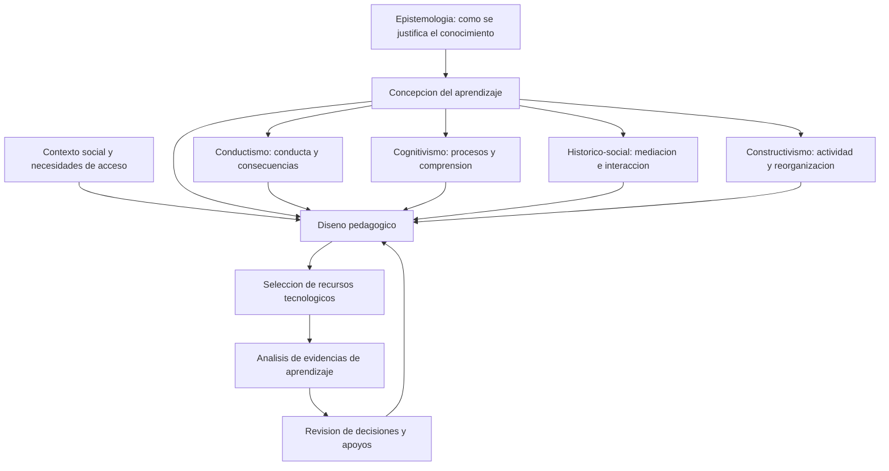

# Clase 1: Bases epistémicas de la tecnología educativa y paradigmas psicopedagógicos

> **Objetivo académico:** Analizar las relaciones entre epistemología, aprendizaje y tecnología educativa mediante la comparación crítica de los paradigmas conductista, cognitivo, histórico-social y constructivista, para fundamentar decisiones tecnopedagógicas contextualizadas, inclusivas y éticas.

## 1. Contexto y marco conceptual

### De la curiosidad al pensamiento científico

La sesión sitúa la pregunta «¿por qué?» como punto de partida de la indagación. La curiosidad impulsa a observar, formular preguntas y buscar explicaciones; la educación puede fortalecer esa disposición o debilitarla cuando reduce el aprendizaje a la reproducción de información.

El pensamiento crítico consiste en analizar y evaluar información para distinguir lo pertinente y confiable de lo engañoso o irrelevante. No equivale a desconfiar indiscriminadamente: exige solicitar razones, contrastar afirmaciones y revisar las propias conclusiones. Esta capacidad resulta especialmente relevante ante contenidos de internet y respuestas de inteligencia artificial generativa cuya apariencia convincente no garantiza validez.

El pensamiento científico añade procedimientos sistemáticos de observación, medición, formulación de preguntas, experimentación y revisión colectiva. La sesión relaciona la investigación con dos puntos de partida complementarios: la curiosidad por comprender y, desde la ingeniería, la identificación de un estado de insatisfacción que motive una intervención.

**Enriquecimiento conceptual:** La observación de un resultado favorable no demuestra por sí sola que una intervención sea su causa. La justificación científica requiere considerar explicaciones alternativas, condiciones de aplicación y límites de generalización. Del mismo modo, no toda investigación necesita una hipótesis formal: según su propósito y enfoque, puede organizarse mediante preguntas exploratorias, interpretativas o de diseño.

### Epistemología, educación y tecnología

La epistemología interroga cómo se produce y justifica el conocimiento. Su relación con la educación aparece cuando se decide qué significa aprender, qué papel tiene la experiencia y qué evidencias permiten sostener que hubo comprensión.

La tecnología educativa se presenta como un campo con fundamento pedagógico y filosófico, además de instrumental. Plataformas, simulaciones, inteligencia artificial y recursos digitales adquieren sentido cuando contribuyen a objetivos educativos definidos. Su disponibilidad no sustituye la necesidad de explicar cómo favorecen la exploración, el razonamiento y la construcción de conocimiento.

Aprender comprende más que acumular datos: implica discernir, relacionar, analizar, cuestionar y reconstruir significados. La sesión vincula esta idea con el aprendizaje significativo y plantea que la selección de modelos debe responder al contexto y al propósito, sin declarar un paradigma universalmente superior.

La psicopedagogía articula aportaciones de la psicología y la pedagogía para comprender y mejorar los procesos de aprendizaje. Incluye dificultades de aprendizaje, intervenciones, desarrollo e inclusión. Considerar necesidades relacionadas con la visión, la audición o la comunicación implica revisar las condiciones de acceso y participación, además del contenido que se enseña.

## 2. Fundamentos teóricos y arquitectura

### Paradigma conductista: conducta, práctica y consecuencias

El enfoque conductista privilegia el estudio de las relaciones entre condiciones ambientales y conductas observables. En la exposición se destacan la medición, la repetición, el refuerzo y las consecuencias de la actuación. El aprendizaje se reconoce mediante cambios en el comportamiento.

En la representación pedagógica discutida, el docente estructura estímulos, práctica y retroalimentación; el estudiante responde bajo condiciones organizadas externamente. La repetición puede favorecer la automatización y recuperación de conocimientos básicos. Su límite aparece cuando la ejecución correcta se interpreta automáticamente como comprensión profunda.

El debate cuestionó una descripción exclusivamente negativa del conductismo. La dirección docente, la práctica sistemática y el refuerzo pueden cumplir funciones legítimas. La pertinencia depende del objetivo: automatizar una respuesta y explicar conceptualmente su fundamento son logros relacionados, pero diferentes.

**Enriquecimiento conceptual:** Conviene distinguir el condicionamiento clásico, asociado a Pavlov y a las relaciones entre estímulos, del condicionamiento operante, centrado en las consecuencias de la conducta. La exposición reúne ambos bajo una descripción introductoria y presenta una filiación cronológica imprecisa entre Pavlov y Watson; no debe entenderse que el trabajo de Pavlov derivó del de Watson. Asimismo, un refuerzo se define por aumentar la probabilidad de una conducta, mientras que un castigo busca reducirla; no son términos intercambiables.

### Paradigma cognitivo: procesamiento y comprensión

El cognitivismo desplaza la atención hacia procesos internos como percepción, atención, memoria, lenguaje, pensamiento y organización del conocimiento. La pregunta central es cómo se procesa la información y cómo se alcanza la comprensión.

El estudiante participa activamente al identificar dudas, descomponer conceptos, relacionar ideas y reconstruir explicaciones. Entre las estrategias mencionadas aparecen leer y escribir, aclarar componentes desconocidos, elaborar mapas conceptuales y explicar un tema de forma sencilla.

El docente organiza contenidos y experiencias para que esas operaciones sean posibles. Su función no se agota en presentar información: requiere secuenciar, seleccionar apoyos y orientar el razonamiento. La sesión sintetiza este desafío como «enseñar a pensar».

El refuerzo puede formar parte de estas experiencias; utilizarlo no convierte automáticamente toda la propuesta en conductista. Las fronteras entre paradigmas no son rígidas y sus recursos pueden coexistir.

**Enriquecimiento conceptual:** La expresión «genética» en la epistemología genética de Piaget alude a la génesis y al desarrollo del conocimiento, no a una clasificación del aprendizaje según la herencia biológica. Tampoco es sinónimo de aprendizaje significativo. Este último, asociado a Ausubel, destaca la relación sustantiva entre conocimientos nuevos y conocimientos previos pertinentes. Piaget, Bruner, Ausubel y Vygotsky aportan perspectivas diferentes y no deben tratarse como integrantes de una teoría única.

### Paradigma histórico-social: mediación y contexto

En este enfoque, asociado en la sesión a Vygotsky, el aprendizaje se comprende mediante las relaciones entre sujeto, objeto de conocimiento y contexto social e histórico. El lenguaje y los artefactos culturales median esas relaciones.

Libros, computadoras y teléfonos pueden ampliar oportunidades, pero su efecto depende del uso social y educativo. La disponibilidad de herramientas, las prácticas comunicativas y las condiciones materiales forman parte de la situación de aprendizaje.

La verbalización ocupa un lugar destacado: explicar exige organizar lo que se sabe y hacerlo comunicable. El diálogo permite contrastar interpretaciones y construir conocimiento con otras personas. El estudiante es un participante social activo; el docente guía, facilita y organiza interacciones que conecten los saberes disponibles con nuevas posibilidades de actuación.

La zona de desarrollo próximo introduce la diferencia entre lo que una persona puede realizar por sí misma y lo que puede alcanzar mediante ayuda pertinente.

**Enriquecimiento conceptual:** La zona de desarrollo próximo se refiere a la distancia entre el nivel de desarrollo actual, expresado en la resolución independiente de problemas, y el nivel potencial, manifestado con orientación adulta o colaboración de pares más capaces en la actividad pertinente. La motivación puede influir en la participación, pero no define por sí sola esta zona. Tampoco se trata de una distancia numérica universal.

### Paradigma constructivista: actividad y reorganización del conocimiento

El constructivismo presenta al estudiante como participante activo que interpreta información desde sus experiencias y estructuras previas. El conocimiento se construye mediante la interacción con situaciones, objetos y problemas, y no se recibe como una copia intacta de lo explicado por otra persona.

La sesión plantea una tensión central: atribuir responsabilidad al estudiante no resuelve cómo se desarrollan la motivación, la madurez o la capacidad de autorregulación. La autonomía requiere condiciones de posibilidad y apoyo docente.

La discusión sobre aprendizaje basado en problemas muestra una vía para vincular actividad y propósito. Una situación relevante puede impulsar al estudiante a reconocer qué necesita saber y a buscar recursos para resolverla. El docente conserva la responsabilidad de seleccionar problemas, justificar su relevancia y proporcionar orientación.

**Enriquecimiento conceptual:** El constructivismo reúne perspectivas diversas y no constituye una técnica didáctica única. Reconocer la actividad del estudiante no exige retirar la explicación directa ni abandonar la planificación. La ayuda puede ajustarse progresivamente conforme se desarrolla la capacidad de actuar con independencia.

El diagrama expresa una relación de fundamentación y revisión: la herramienta se selecciona dentro de un diseño pedagógico condicionado por los objetivos y el contexto. Los paradigmas aportan perspectivas analíticas; no representan etapas obligatorias que todo aprendizaje deba recorrer.

## 3. Implementación técnica y lógica de negocio

### De una necesidad educativa a una decisión tecnológica

La fuente no incluye programación, implementación de software ni resultados experimentales. El contenido técnico se concentra en la coherencia entre una situación educativa, su fundamento pedagógico y la representación inicial de una aplicación.

El razonamiento desarrollado puede organizarse en cinco decisiones:

1. **Caracterizar la situación:** identificar conocimientos previos, dificultades, condiciones materiales y necesidades de participación.
2. **Precisar el aprendizaje buscado:** distinguir entre recordar, comprender, explicar, aplicar y colaborar.
3. **Justificar el enfoque:** establecer qué concepción del aprendizaje orienta la intervención y por qué resulta pertinente.
4. **Definir roles e interacciones:** determinar qué hará el estudiante, qué apoyo brindará el docente y cómo participarán otras personas.
5. **Seleccionar recursos y evidencias:** elegir herramientas que permitan esas interacciones y reconocer cambios relevantes en el aprendizaje.

La sesión menciona un modelo de diseño instruccional transcrito como «ADI» o «AD», sin desarrollar sus componentes de forma inequívoca. Su función en el discurso es conectar el fundamento abstracto con un diseño educativo explícito. La transcripción no permite reconstruir sus fases ni atribuirle una formulación precisa.

### Representación inicial y arquitectura de software

Se distingue entre visualizar una idea educativa y especificar una arquitectura técnica. Bocetos, esquemas e interfaces iniciales permiten mostrar qué recursos se ofrecen, qué acciones se esperan y cómo se manifiesta la orientación pedagógica. Esa representación no equivale a definir componentes de software, persistencia de datos, integraciones o requisitos de despliegue.

**Enriquecimiento conceptual:** Una interfaz puede hacer visible una intención pedagógica, pero no demuestra que esa intención se cumpla. Un botón de diálogo no garantiza colaboración; una secuencia de preguntas no garantiza comprensión. La revisión del diseño debe atender a las acciones y relaciones que el sistema posibilita, además de su apariencia.

| Propósito educativo | Decisión pedagógica | Posible recurso tecnológico | Evidencia pertinente |
| --- | --- | --- | --- |
| Automatizar conocimientos básicos | Práctica reiterada con retroalimentación | Sistema de práctica de respuestas breves | Precisión y estabilidad de la recuperación |
| Comprender relaciones | Comparación, organización y explicación | Editor de mapas conceptuales o simulación | Relaciones justificadas y explicación coherente |
| Construir significado mediante interacción | Diálogo y mediación con otras personas | Espacio de discusión o edición compartida | Revisión de interpretaciones a partir del intercambio |
| Aplicar conocimientos a un problema | Exploración con apoyos pertinentes | Entorno de modelado o representación de soluciones | Decisiones fundamentadas y uso del conocimiento en contexto |

**Enriquecimiento conceptual:** La tabla concreta posibilidades de diseño a partir de los principios discutidos; no describe aplicaciones implementadas ni resultados observados en la sesión. Ningún recurso pertenece de manera exclusiva a un paradigma.

## 4. Análisis crítico de casos y auditoría práctica

### La multiplicación como contenido común a distintos enfoques

La sesión utiliza las tablas de multiplicar para mostrar que un mismo contenido admite tratamientos diferentes.

| Perspectiva | Tratamiento del contenido | Aporte principal | Límite de interpretación |
| --- | --- | --- | --- |
| Conductista | Repetir productos con retroalimentación | Recuperación rápida de respuestas | La rapidez no demuestra comprensión de la operación |
| Cognitiva | Identificar patrones y relaciones entre productos | Organización y explicación conceptual | Un patrón observado necesita condiciones de validez |
| Histórico-social | Utilizar la multiplicación en una situación compartida, como distribuir plantas | Sentido contextual, lenguaje y mediación | Situar un problema en un entorno cotidiano no basta para demostrar mediación social |
| Constructivista | Construir arreglos rectangulares con objetos y relacionarlos con la operación | Elaboración del significado desde la actividad | Manipular objetos requiere orientación para explicitar las relaciones matemáticas |

En el ejemplo de la tabla del nueve se observa que algunos productos tienen cifras cuya suma es nueve. Es necesario limitar esa afirmación: no es una propiedad literal de todos los múltiplos de nueve con una única suma de sus cifras.

**Enriquecimiento conceptual:** Para un producto de dos cifras, puede justificarse el patrón mediante la representación decimal. Sean $a\in\{1,\ldots,9\}$ la cifra de las decenas, $b\in\{0,\ldots,9\}$ la cifra de las unidades y $n=10a+b$ el número representado. Entonces:

$$
n=10a+b=9a+(a+b).
$$

Por ello, $n$ es divisible por nueve si y solo si $a+b$ lo es. En los productos $18,27,36,45,54,63,72,81$ y $90$, la suma de cifras es nueve. Sin embargo, $99$ también es múltiplo de nueve y sus cifras suman dieciocho. La propiedad general es la conservación de la divisibilidad por nueve al sumar cifras, no que esa suma sea siempre nueve. Este razonamiento ilustra el paso de reconocer una regularidad a explicar sus condiciones y límites.

### Medición y comprensión no pertenecen a compartimentos aislados

Una intervención del debate señala que todos los paradigmas necesitan evidencias para valorar el aprendizaje y mejorar la enseñanza. La objeción es relevante: la observabilidad y la medición no son patrimonio exclusivo del conductismo.

La exposición responde contrastando el énfasis cuantitativo conductista con la incorporación de información cualitativa en otros enfoques. Esa distinción sirve como aproximación introductoria, pero requiere cautela.

**Enriquecimiento conceptual:** El tipo de dato no determina por sí solo el paradigma. Una escala de satisfacción puede producir datos cuantitativos, y una descripción de conducta puede ser cualitativa. La diferencia teórica más importante reside en qué se considera aprendizaje, qué mecanismos se proponen y cómo se interpretan las evidencias. Además, satisfacción y aprendizaje son dimensiones distintas: una experiencia agradable no demuestra necesariamente comprensión.

### Explicar, comprender y comunicar

Explicar un concepto con palabras sencillas puede evidenciar organización y comprensión. A la vez, cuando se dirige a otras personas, la explicación participa en una práctica comunicativa y social. El caso muestra complementariedad entre procesos cognitivos y mediación social.

**Enriquecimiento conceptual:** No poder verbalizar una idea no demuestra automáticamente ausencia de comprensión. Pueden intervenir barreras lingüísticas, ansiedad o necesidades de comunicación. La inferencia debe apoyarse en distintas formas de expresión y actuación, según el conocimiento que se busca valorar.

### Contexto, acceso y personalización

La referencia a comunidades sin electricidad muestra que una solución técnicamente disponible puede ser educativamente inadecuada. Antes de seleccionar equipos o plataformas, corresponde conocer las condiciones de uso y adaptar el diseño. El diagnóstico del contexto debe realizarse con respeto y sin invadir innecesariamente la vida de las personas.

La conversación también menciona preferencias visuales, auditivas o de movimiento como posibilidad de personalización.

**Enriquecimiento conceptual:** Reconocer preferencias no justifica clasificar a cada estudiante mediante un estilo fijo ni asumir que aprende mejor exclusivamente cuando la enseñanza coincide con esa etiqueta. Una personalización fundamentada considera conocimientos previos, barreras de acceso, progreso y características del contenido. Ofrecer representaciones diversas puede ampliar la participación sin convertir preferencias en diagnósticos.

Los relatos sobre aislamiento infantil y cambios de motivación se presentan como ilustraciones. La fuente no proporciona referencias ni condiciones suficientes para tratarlos como evidencia causal o generalizable.

## 5. Principios de diseño, buenas prácticas y anti-patrones

### Principios derivados de la discusión

- **Comenzar por el propósito educativo:** seleccionar tecnología después de precisar qué aprendizaje se busca y en qué contexto.
- **Justificar la combinación de enfoques:** integrar práctica, comprensión, interacción y construcción cuando sus funciones estén claras.
- **Mantener la responsabilidad docente:** orientar la relevancia de los contenidos y organizar apoyos, incluso cuando el estudiante tenga un papel protagónico.
- **Favorecer autonomía con acompañamiento:** reconocer que la motivación y la autorregulación se desarrollan y no pueden darse por supuestas.
- **Alinear evidencias y propósitos:** distinguir la ejecución correcta, la comprensión, la transferencia y la participación social.
- **Integrar inclusión y ética:** considerar accesibilidad, condiciones materiales y respeto al contexto como criterios del diseño.
- **Promover diálogo fundamentado:** solicitar razones y ofrecer observaciones que ayuden a revisar interpretaciones, manteniendo un trato respetuoso.

### Anti-patrones identificados

| Anti-patrón | Problema que introduce | Criterio de mejora |
| --- | --- | --- |
| Declarar un paradigma intrínsecamente bueno o malo | Oculta sus aportes y condiciones de uso | Analizar propósito, contexto y límites |
| Equiparar repetición con comprensión | Confunde fluidez de respuesta con significado | Complementar la práctica con explicación y aplicación |
| Delegar toda la responsabilidad al estudiante | Ignora las necesidades de orientación y desarrollo | Diseñar apoyos y ajustar su intensidad |
| Elegir una aplicación por su novedad | Sustituye la justificación pedagógica por disponibilidad | Vincular funciones con objetivos e interacciones |
| Reducir colaboración a reunir personas en una plataforma | Supone construcción conjunta sin revisar las interacciones | Analizar cómo se contrastan y transforman las ideas |
| Trasladar tecnología sin estudiar el contexto | Produce barreras materiales o culturales | Revisar acceso, pertinencia y posibilidades de adaptación |
| Aceptar respuestas digitales sin contrastarlas | Confunde plausibilidad con conocimiento justificado | Solicitar evidencias y verificar afirmaciones |

**Enriquecimiento conceptual:** La coherencia de un diseño no exige una adhesión exclusiva a un paradigma. Exige explicar qué función cumple cada decisión y evitar contradicciones entre el aprendizaje declarado, las interacciones propuestas y las evidencias utilizadas para valorarlo.

## 6. Síntesis conceptual y profundización académica

La clase articula una tesis central: la tecnología educativa necesita una concepción explícita del conocimiento y del aprendizaje. La pregunta «¿por qué?» conecta la curiosidad con el pensamiento crítico y científico, y permite revisar tanto las afirmaciones informativas como las decisiones de diseño pedagógico.

Los cuatro paradigmas destacan dimensiones complementarias. El conductismo enfatiza conducta, práctica y consecuencias; el cognitivismo, procesamiento y comprensión; el histórico-social, mediación, lenguaje y contexto; el constructivismo, actividad y reorganización del conocimiento desde la experiencia. Estas diferencias orientan el análisis sin convertir las perspectivas en categorías impermeables.

El debate sobre responsabilidad muestra que protagonismo estudiantil y orientación docente son compatibles. La autonomía no elimina la necesidad de explicar la relevancia del contenido, organizar experiencias y ofrecer apoyos. De manera semejante, medir resultados no excluye comprender procesos, y utilizar recursos digitales no garantiza innovación pedagógica.

**Enriquecimiento conceptual:** La profundización puede organizarse alrededor de tres distinciones: entre desempeño observable y comprensión inferida; entre acceso a herramientas y mediación efectiva; y entre responsabilidad personal y condiciones institucionales del aprendizaje. Estas distinciones permiten analizar propuestas educativas sin reducirlas al recurso que utilizan o al nombre del paradigma que invocan.

La pregunta integradora es qué relación justificable existe entre el conocimiento que se desea desarrollar, las condiciones de quienes aprenden, las interacciones diseñadas y las evidencias disponibles. Esa relación constituye el fundamento de una tecnología educativa contextualizada y susceptible de revisión crítica.
