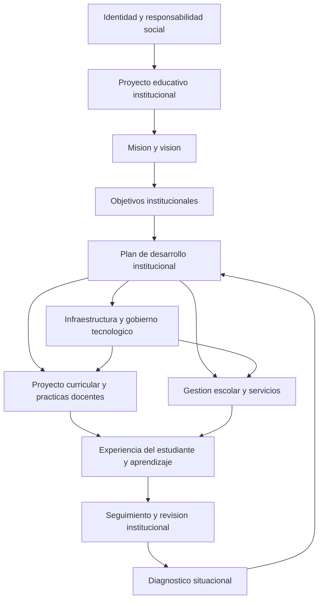

# Clase 3: Gestión educativa institucional, ecosistemas digitales e interoperabilidad del aprendizaje

> **Objetivo académico:** Analizar la articulación entre el proyecto educativo institucional, la gestión académica y los componentes tecnológicos de los entornos de aprendizaje, atendiendo al equilibrio entre eficiencia administrativa, experiencia del estudiante, interoperabilidad y desarrollo de competencias.

## 1. Contexto y marco conceptual

### De la operación tecnológica a la decisión institucional

La sesión aborda los sistemas de gestión administrativa desde una perspectiva estratégica. El problema central consiste en comprender cómo una institución educativa organiza sus propósitos, actores, información y recursos tecnológicos para sostener procesos formativos coherentes. La selección de una plataforma constituye una decisión dentro de ese sistema; por sí sola no define el modelo educativo.

La perspectiva propuesta exige pensamiento sistémico: relacionar las decisiones sobre infraestructura y servicios con las necesidades del estudiante, las prácticas docentes, las capacidades institucionales y la responsabilidad social de la educación. Este enfoque resulta aplicable a distintos niveles educativos y a organizaciones vinculadas con la educación, además de las universidades.

La tecnología educativa se presenta como parte de un **ecosistema pedagógico digital**. En él interactúan procesos administrativos, mediaciones didácticas, servicios de apoyo y mecanismos de producción y circulación de información. Su calidad depende tanto del funcionamiento técnico como de la coherencia entre sus componentes.

### Proyecto educativo institucional y proyecto curricular

El **proyecto educativo institucional, PEI**, expresa la identidad, los principios y las orientaciones generales de una comunidad educativa. Responde a preguntas como quiénes somos, qué pretendemos y cómo nos organizamos. La sesión lo diferencia del proyecto curricular, aunque desarrolla principalmente el primero.

**Enriquecimiento conceptual:** El proyecto curricular concreta decisiones sobre propósitos formativos, contenidos, secuencias y estrategias de enseñanza. Esta distinción permite comprender una relación de alineación: el PEI establece un horizonte institucional y el currículo lo traduce a la organización de la formación. No se trata de documentos intercambiables.

La institución es también una comunidad que construye su identidad mediante la participación, el consenso y la confluencia de intereses. Por ello, el PEI no se agota en una declaración fundacional: requiere prácticas coherentes y contribuciones de estudiantes, docentes, personal administrativo y autoridades.

### Misión, visión y orientación social

La misión expresa la razón de ser institucional, sus destinatarios, servicios y contexto de actuación. La visión describe un futuro deseado que orienta esfuerzos, creatividad e innovación. Los objetivos precisan los logros buscados; las metas contribuyen a concretarlos temporalmente.

En la misión de la Universidad Autónoma Gabriel René Moreno leída durante la sesión se destacan la formación de profesionales como agentes de cambio, los principios éticos, el pensamiento crítico, la responsabilidad y pertinencia social, la investigación, la innovación, el emprendimiento y la interacción social. Estos elementos vinculan la formación con la generación de conocimiento y la respuesta a necesidades colectivas.

La relación entre persona e institución es recíproca: la comunidad aporta conocimientos, prácticas y participación; la institución ofrece condiciones de formación, desarrollo y pertenencia. Esta reciprocidad amplía el análisis más allá del consumo individual de servicios educativos.

## 2. Fundamentos teóricos y arquitectura

### Planeación institucional y niveles de gestión

La misión, la visión y los objetivos deben reflejarse en un plan de desarrollo institucional o plan estratégico. La sesión destaca el diagnóstico situacional como condición para reconocer el estado actual y establecer un rumbo. También recoge la articulación entre una orientación universitaria general y planes específicos de facultades, apoyados en procesos de autoevaluación académica.

| Componente | Función en la gestión | Relación con la tecnología |
|---|---|---|
| Misión | Expresar identidad, propósito y compromiso social | Orientar los servicios que deben sostenerse |
| Visión | Formular un futuro institucional deseado | Dar sentido a las prioridades de transformación |
| Diagnóstico situacional | Reconocer capacidades, problemas y necesidades | Identificar restricciones y oportunidades tecnológicas |
| Objetivos y metas | Precisar logros y avances esperados | Establecer criterios para valorar decisiones |
| Plan de desarrollo | Articular estrategias y líneas de actuación | Coordinar recursos, procesos e iniciativas |
| Gestión escolar | Sostener el funcionamiento cotidiano | Ejecutar servicios y mantener registros confiables |

La dirección educativa y la gestión institucional operan en un plano predominantemente estratégico; la gestión escolar concreta decisiones en procesos tácticos y operativos. La distinción sirve para distribuir responsabilidades y comprender dependencias, aunque los niveles permanecen conectados.

El diagrama sintetiza relaciones tratadas en la sesión. **Enriquecimiento conceptual:** El retorno desde el seguimiento hacia el diagnóstico explicita un ciclo de mejora; no representa una arquitectura técnica presentada o implementada durante la clase.

### La organización como flujo de información

Un organigrama identifica funciones y responsabilidades, pero no explica por completo cómo funciona una organización. Para que sus áreas se coordinen debe circular información pertinente. La tecnología proporciona canales, plataformas y mecanismos de procesamiento que pueden facilitar esa circulación.

Los problemas de comunicación deben analizarse considerando tanto los medios disponibles como las formas de trabajo. Conocimientos, habilidades, responsabilidades y necesidades del entorno condicionan el uso efectivo de la infraestructura.

### Componentes del ecosistema de gestión

La sesión identifica equipos de administración del sistema, desarrollo, mantenimiento y facilitación, junto con docentes y estudiantes. La facilitación cumple una función de apoyo al uso de plataformas y servicios; el mantenimiento sostiene su continuidad técnica; la gestión establece orientaciones y responsabilidades.

Entre los subsistemas mencionados aparecen repositorios y bases de datos, gestión del currículo, registros de trayectoria académica, seguimiento de la actividad de aprendizaje y colaboración. También se consideran los materiales docentes y el historial de cualificaciones del profesorado.

### LMS, sistemas administrativos y analítica

Un **LMS**, o sistema de gestión del aprendizaje, proporciona soporte a contenidos, actividades pedagógicas, interacción y seguimiento. Moodle, Canvas y Classroom aparecen como ejemplos de plataformas utilizadas en contextos educativos, sin que se realice una comparación funcional exhaustiva.

Una intervención distingue el LMS de un sistema administrativo integrado que concentra información institucional, avance curricular y otros procesos, incluidos los financieros. La transcripción emplea siglas variables para este segundo sistema; su función resulta más clara que su denominación exacta.

**Enriquecimiento conceptual:** Un ERP integra procesos y recursos organizacionales, mientras que un sistema de información estudiantil se especializa en registros y servicios del alumnado. Ambas funciones pueden estar relacionadas o integradas en productos concretos. Esta precisión evita atribuir a cualquier ERP una cobertura académica idéntica.

El **entorno virtual de aprendizaje, EVA**, tampoco debe confundirse con una modalidad exclusivamente remota. Puede apoyar educación presencial, híbrida o a distancia. Un MOOC constituye una modalidad específica de oferta en línea y no representa la totalidad del e-learning.

## 3. Implementación técnica y lógica de negocio

### Servicios y reglas institucionales

La gestión administrativa y escolar comprende servicios como inscripción, organización de horarios y grupos, administración docente, certificación y elaboración de reportes institucionales. Estos procesos hacen posible mantener trayectorias documentadas y ofrecer información consistente a la comunidad.

Las políticas institucionales necesitan traducirse a reglas explícitas dentro de los sistemas. Su aplicación exige bases de datos confiables, estructuración adecuada, seguridad informática, transparencia y validez de los registros.

**Enriquecimiento conceptual:** Una regla de negocio vincula una condición institucional con una acción permitida o requerida. Por ejemplo, la emisión de una constancia puede depender de que la identidad y la información registrada estén verificadas. La automatización solo resulta confiable si las condiciones están definidas y los datos que las sustentan son correctos.

La sesión no desarrolla código, un esquema de base de datos ni una implementación ejecutable. Su aporte técnico consiste en identificar componentes, responsabilidades y criterios de integración.

### Diseño de servicios centrados en sus usuarios

La configuración global de un LMS debe considerar las interfaces del estudiante y del docente. La facilidad de uso necesita acompañarse de guías, pautas, manuales y apoyo para resolver dificultades de acceso o navegación.

La experiencia formativa involucra una cadena de soporte que puede incluir docentes, desarrolladores y personal de orientación tecnológica. Representarla mediante una sola figura oculta la diversidad de capacidades necesarias para sostener el servicio.

El seguimiento puede registrar accesos, tiempo de permanencia y otras interacciones. Estos datos permiten describir actividad, pero requieren interpretación pedagógica.

**Enriquecimiento conceptual:** La cantidad de accesos o el tiempo conectado no constituyen medidas directas de comprensión. Un acceso prolongado puede corresponder a una lectura cuidadosa, a una dificultad de navegación o a una sesión inactiva. La analítica necesita relacionar esas trazas con evidencias pertinentes de aprendizaje.

### Objetos de aprendizaje

La sesión caracteriza un **objeto de aprendizaje, LO**, como un recurso autocontenido, reutilizable y orientado al aprendizaje, que puede integrar contenido, actividad, mecanismos de valoración y metadatos. La sigla **RLO** destaca su condición reutilizable.

El énfasis está en la articulación pedagógica: disponer de un archivo o una simulación no garantiza que exista una unidad formativa coherente. El objeto debe relacionarse con un propósito y con formas de interacción y retroalimentación que favorezcan la comprensión.

**Enriquecimiento conceptual:** La definición de objeto de aprendizaje varía entre enfoques. La combinación de contenido, actividad, valoración y metadatos debe entenderse aquí como el modelo de diseño defendido en la sesión, sin convertirlo en un requisito universal. Tampoco es indispensable que toda retroalimentación dependa de inteligencia artificial.

Los metadatos describen los recursos y facilitan su identificación y organización. **Enriquecimiento conceptual:** Pueden incluir título, tema, propósito, nivel, idioma o condiciones de uso. No equivalen simplemente a agrupar nombres bajo una etiqueta general: su utilidad depende de descripciones consistentes y pertinentes para localizar y reutilizar recursos.

### Interoperabilidad y SCORM

La reutilización entre cursos y plataformas requiere compatibilidad técnica. La sesión introduce SCORM como referencia para estructurar y empaquetar contenidos de aprendizaje y facilitar su utilización en distintos LMS.

**Enriquecimiento conceptual:** SCORM corresponde a *Sharable Content Object Reference Model*. Además del empaquetado, contempla mecanismos de comunicación entre contenido y LMS; determinadas capacidades dependen de la versión y de la implementación. La interoperabilidad requiere soporte compatible en origen y destino.

Por ello, un recurso desarrollado dentro de Moodle no debe suponerse automáticamente transferible con todas sus funciones a otra plataforma. Es necesario distinguir un paquete compatible con SCORM de actividades, extensiones o configuraciones propias del LMS. La compatibilidad tampoco equivale a conservar íntegramente cursos, usuarios o registros históricos.

## 4. Análisis crítico de casos y auditoría práctica

### Responsabilidad compartida en el aprendizaje en línea

El debate contrapone una interpretación que concentra la responsabilidad en el estudiante remoto con otra que destaca el trabajo de diseño y acompañamiento docente. La síntesis de la discusión reconoce una responsabilidad compartida.

La autonomía estudiantil requiere iniciativa y autorregulación. A su vez, el diseño educativo demanda planificación, recursos comprensibles, actividades pertinentes y seguimiento. Subir documentos a una plataforma no resuelve por sí mismo esa mediación.

La pérdida de algunas señales presenciales, como expresiones de duda, dificulta detectar problemas de comprensión. Los recursos interactivos y la retroalimentación pueden aportar información adicional, siempre que respondan a un diseño pedagógico deliberado.

**Enriquecimiento conceptual:** La interacción síncrona permite coincidencia temporal, como una conversación en directo; la asíncrona permite participar en momentos distintos. Ambas pueden combinarse según necesidades de acompañamiento, flexibilidad y conectividad. La sesión menciona esta distinción sin desarrollarla sistemáticamente.

### Producción multidisciplinaria y verificación de identidad

Se describe una experiencia institucional de construcción de aulas digitales mediante un equipo multidisciplinario. La secuencia formativa presentada combina lectura de conceptos, análisis y aplicación para demostrar comprensión, con posibilidades de avance autogestionado.

El caso también distingue la disponibilidad de materiales digitales de la capacidad de verificar quién participa en un proceso de acreditación. La infraestructura y los mecanismos de identificación condicionan las modalidades que una institución puede sostener de manera confiable.

**Enriquecimiento conceptual:** Verificar identidad y acreditar aprendizaje son problemas relacionados, pero distintos. La autenticación busca establecer quién accede; la valoración pedagógica busca determinar qué comprende y puede hacer esa persona. Resolver el primero no garantiza resolver el segundo.

### Automatización y supuesta objetividad

Una intervención presenta la formación con sistemas automatizados como una vía para reducir subjetividad y errores. La discusión permite reconocer el potencial de simulaciones y tutores digitales, aunque no aporta evidencia para concluir que toda automatización sea objetiva o elimine la intervención humana.

**Enriquecimiento conceptual:** Un sistema automatizado incorpora decisiones sobre objetivos, datos, criterios y reglas. Puede aumentar la consistencia de aplicación y conservar sesgos o limitaciones del diseño. La auditoría debe valorar la pertinencia de sus criterios, la calidad de la retroalimentación y los casos en que requiere supervisión humana.

### Participación, permanencia y aprendizaje en los MOOC

La docente plantea una tensión entre inversión en recursos digitales, gran alcance de inscripción y baja finalización. Otras intervenciones señalan dificultades de claridad pedagógica y exigencia en experiencias personales con cursos masivos.

Estos testimonios plantean problemas relevantes, pero no permiten establecer una causa única del abandono ni generalizar sus resultados a toda la educación en línea. Las cifras mencionadas durante la sesión carecen de una referencia verificable y presentan ambigüedad en la transcripción; por ello no se utilizan como resultados consolidados.

**Enriquecimiento conceptual:** Una proporción de finalización puede expresarse como:

$$
T_f = \frac{N_f}{N_i}\times 100\%
$$

Aquí, $N_i$ es el número de personas inscritas en una cohorte definida, con $N_i>0$; $N_f$ es el número que cumple un criterio explícito de finalización, con $0\leq N_f\leq N_i$; ambos son conteos de personas. $T_f$ es un porcentaje. La expresión supone criterios y una ventana de observación comunes. Describe culminación formal, pero no mide directamente aprendizaje ni explica sus causas. La inscripción exploratoria, la disponibilidad de tiempo, el diseño y las expectativas pueden afectar su interpretación.

### Reutilización, contextualización y sostenibilidad

La producción de recursos altamente personalizados demanda esfuerzo especializado. La sesión presenta la reutilización de objetos transversales como una estrategia para distribuir ese esfuerzo entre diferentes cursos.

El ejemplo de dificultades de álgebra en asignaturas matemáticas avanzadas muestra una posible aplicación: reutilizar recursos para reforzar conocimientos previos y atender errores recurrentes. Su pertinencia depende del diagnóstico de necesidades y de la articulación con el contenido actual.

También se plantea una tensión entre recursos institucionales propios y materiales externos. Los primeros pueden favorecer control y contextualización; los segundos amplían la oferta disponible. La observación sobre un mayor reconocimiento institucional de la producción de objetos de aprendizaje se presenta como experiencia de la docente, sin documentación suficiente para tratarla como política general.

### Acceso global y dependencia de ecosistemas

Una intervención describe restricciones de acceso a servicios digitales occidentales desde China. El caso muestra que la disponibilidad de un recurso depende de conectividad, ubicación y ecosistema tecnológico, además de su formato.

La preocupación por la privacidad y la dependencia de proveedores también aparece como criterio de gestión. La sesión no aporta una comparación contractual o técnica que permita establecer conclusiones generales sobre proveedores específicos.

**Enriquecimiento conceptual:** Conviene distinguir interoperabilidad de contenidos, disponibilidad efectiva del servicio y gobierno de datos. Un recurso técnicamente compatible puede seguir siendo inaccesible por restricciones de red o de cuentas. La selección institucional debe considerar estos planos conjuntamente.

## 5. Principios de diseño, buenas prácticas y anti-patrones

| Principio | Buena práctica | Anti-patrón y consecuencia |
|---|---|---|
| Alineación institucional | Justificar decisiones mediante propósitos y diagnóstico | Incorporar plataformas por novedad, sin utilidad definida |
| Integración de funciones | Diferenciar soporte pedagógico, registro administrativo y analítica | Esperar que un LMS resuelva toda la gestión institucional |
| Calidad de información | Mantener datos estructurados y responsabilidades claras | Automatizar procesos sobre registros inconsistentes |
| Seguridad y transparencia | Proteger información y sostener procedimientos comprensibles | Ampliar la digitalización sin revisar controles |
| Mediación pedagógica | Articular contenidos, interacción y retroalimentación | Reducir la formación a un repositorio de documentos |
| Responsabilidad compartida | Combinar autonomía con acompañamiento | Atribuir toda dificultad a la disposición del estudiante |
| Reutilización pertinente | Adaptar recursos a objetivos y conocimientos previos | Aplicar un mismo recurso a cualquier contexto |
| Interoperabilidad comprobada | Verificar formato, versión y funciones compatibles | Suponer portabilidad total por compartir una etiqueta técnica |
| Evidencia de aprendizaje | Distinguir actividad, satisfacción y comprensión | Confundir uso frecuente o aceptación con aprendizaje |
| Innovación justificada | Conservar lo que funciona y mejorar problemas identificados | Cambiar procesos sin diagnóstico ni beneficio reconocible |

**Enriquecimiento conceptual:** Una auditoría de adopción tecnológica puede organizarse alrededor de cuatro preguntas: qué necesidad resuelve, cómo se integra en el trabajo institucional, qué evidencia permite valorar su contribución y qué condiciones requiere para sostenerse. Estas preguntas conectan propósito, arquitectura, resultados y viabilidad sin imponer una solución única.

La centralidad del estudiante requiere observar su trayectoria completa: acceso a recursos, comprensión de instrucciones, posibilidades de interacción, apoyo disponible y continuidad del proceso. La satisfacción aporta información sobre esa experiencia, pero debe complementarse con evidencias sobre el desarrollo de competencias.

## 6. Síntesis conceptual y profundización académica

La gestión educativa articula identidad institucional, organización del trabajo, información y mediación pedagógica. Su dimensión tecnológica adquiere sentido cuando contribuye a propósitos formativos y sociales explícitos.

El PEI proporciona un horizonte de coherencia; el diagnóstico y la planeación orientan decisiones; los sistemas administrativos sostienen registros y servicios; el LMS facilita procesos pedagógicos; los objetos de aprendizaje organizan recursos con intención formativa; y la interoperabilidad permite reutilizarlos bajo condiciones técnicas específicas.

La sesión deja tres tensiones centrales. La primera relaciona eficiencia administrativa y calidad de la experiencia formativa: ambas requieren coordinación, porque un servicio confiable facilita la trayectoria sin demostrar por sí solo aprendizaje. La segunda vincula personalización y sostenibilidad: adaptar recursos puede mejorar su pertinencia, pero exige capacidades y mantenimiento. La tercera conecta alcance y resultados: aumentar inscripciones o disponer de automatización no basta para establecer desarrollo de competencias.

El razonamiento académico sobre estas decisiones necesita diferenciar experiencias personales, observaciones institucionales, hipótesis y resultados verificados. La novedad técnica debe acompañarse de justificación conceptual y evidencia pertinente. Las conclusiones rigurosas explicitan qué sostienen los datos disponibles y cuáles son sus límites.

**Enriquecimiento conceptual:** Las líneas de profundización que se desprenden de la sesión incluyen el gobierno de datos educativos, la relación entre analítica y evidencias de aprendizaje, la sostenibilidad de la producción de recursos y la adaptación contextual de objetos reutilizables. Un problema transversal consiste en determinar bajo qué condiciones una mejora técnica se traduce en una mejora pedagógica, para qué población y con qué efectos sobre participación, autonomía y continuidad.
