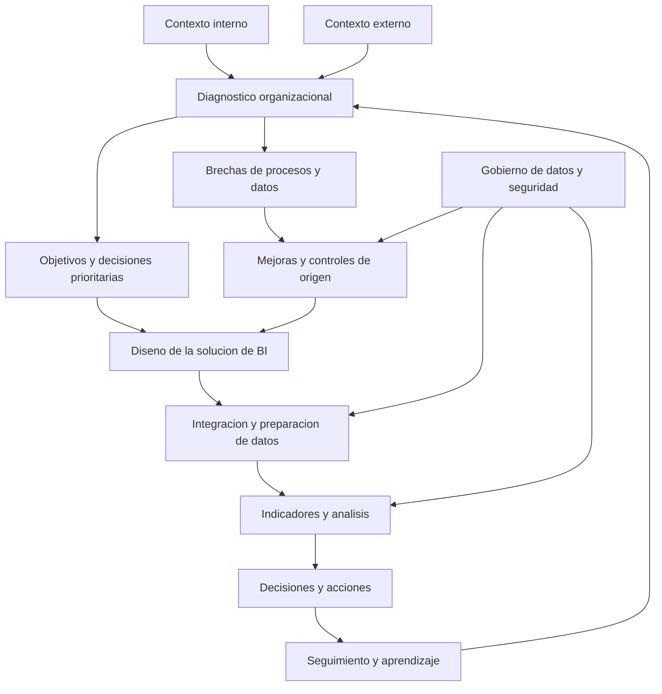

# Clase 1: Contexto organizacional y alineación estratégica de la inteligencia de negocios

> **Objetivo académico:** Analizar las condiciones organizacionales, estratégicas, tecnológicas y de gobierno de datos que determinan la pertinencia de una solución de inteligencia de negocios, distinguiendo sus capacidades técnicas de los procesos necesarios para convertir información en decisiones.

## 1. Contexto y marco conceptual

### 1.1. La inteligencia de negocios como capacidad organizacional

La sesión establece que la inteligencia de negocios, o Business Intelligence (BI), comprende prácticas de medición, interpretación y decisión articuladas con procesos, personas y tecnología. Power BI, Tableau o Qlik pueden instrumentar esa capacidad, pero su adquisición no constituye por sí misma una estrategia de inteligencia de negocios.

Una organización puede iniciar prácticas de BI mediante registros manuales, hojas de cálculo, indicadores y reuniones de seguimiento. La automatización amplía la oportunidad, escala y consistencia del análisis cuando existe una base organizacional suficiente. La elección de herramientas debe responder al problema y al contexto: necesidades de información, recursos, procesos, calidad de datos, riesgos y usuarios de las decisiones.

El argumento central es la **alineación entre estrategia y tecnología**. Incorporar una plataforma avanzada sin identificar qué decisiones debe apoyar puede producir una solución técnicamente operativa y organizacionalmente irrelevante. Por ello, el diagnóstico precede a la selección de la arquitectura y debe reconocer tanto condiciones internas como presiones externas.

### 1.2. Datos, información y conocimiento

La clase distingue tres niveles relacionados:

| Nivel | Significado | Ejemplo vinculado a la sesión |
| --- | --- | --- |
| Datos | Registros de hechos o transacciones todavía insuficientemente interpretados | Ventas, fechas de vencimiento y pagos registrados |
| Información | Datos organizados y contextualizados para responder preguntas | Saldos vencidos por cliente y período |
| Conocimiento | Comprensión que permite interpretar patrones y fundamentar actuaciones | Reconocer que el crecimiento de ventas a crédito está deteriorando la liquidez |

Disponer de muchos registros no garantiza contar con información útil. Tampoco un tablero genera conocimiento automáticamente: las personas deben interpretar sus resultados, contrastarlos con el contexto y vincularlos con decisiones.

**Enriquecimiento conceptual:** Esta relación no es una conversión mecánica e irreversible. Una cifra agregada puede perder significado si carece de definiciones, período, unidad o procedencia. El conocimiento depende también de experiencia del dominio, discusión y revisión de supuestos; no requiere necesariamente inteligencia artificial.

### 1.3. Medición y cultura de datos

La expresión «lo que no se mide no se puede mejorar» se utiliza para destacar la necesidad de seguimiento, indicadores y cierres periódicos. En la discusión se reconoce que las decisiones organizacionales también involucran dimensiones cualitativas: cultura, regulación, relaciones de poder y comportamiento del mercado.

Una cultura de datos implica valorar evidencia pertinente, examinar su calidad y utilizarla en decisiones y revisiones posteriores. Requiere liderazgo y participación de las áreas del negocio. El área de TI no puede compensar por sí sola una dirección que desatiende los procesos, posterga inversiones o desconoce los riesgos comunicados.

**Enriquecimiento conceptual:** La medición es un apoyo para mejorar, pero no una garantía suficiente ni una condición universal de toda forma de comprensión. También pueden identificarse mejoras mediante observación cualitativa y deliberación. El problema relevante es seleccionar evidencia adecuada a la decisión y evitar que un indicador sustituya al fenómeno que pretende representar.

## 2. Fundamentos teóricos y arquitectura

### 2.1. Dimensiones del contexto organizacional

El diagnóstico combina características generales de la organización con evidencia de su funcionamiento efectivo.

| Dimensión | Aspectos que deben comprenderse | Implicación para BI |
| --- | --- | --- |
| Tamaño y modelo de negocio | Escala de operaciones, ingresos, transacciones y dependencia de datos | Determina necesidades de capacidad y alcance |
| Sector y forma jurídica | Actividad económica, estructura de propiedad y obligaciones aplicables | Condiciona riesgos, prioridades y controles |
| Estrategia | Misión, visión, objetivos y ventajas buscadas | Orienta preguntas analíticas e indicadores |
| Organización y cultura | Responsabilidades reales, comunicación y disposición al cambio | Afecta adopción y uso de resultados |
| Procesos y datos | Registro, estandarización, oportunidad y calidad | Determina confiabilidad del análisis |
| Ambiente de TI | Personas, infraestructura y procedimientos tecnológicos | Condiciona operación y sostenibilidad |
| Gobierno y riesgo | Políticas, autorizaciones, supervisión y tratamiento de riesgos | Delimita usos legítimos y seguros |

La misión expresa el propósito organizacional y la visión el destino deseado. Su presencia formal no demuestra que exista una ruta estratégica. Deben relacionarse con planificación tecnológica, financiera, comercial y operativa, además de mecanismos de ejecución y seguimiento.

Un organigrama también puede ser meramente formal. La clase señala situaciones en las que la propiedad interviene directamente en distintas áreas y elude los canales establecidos. Por ello, comprender la estructura requiere observar quién decide, cómo se comunican las instrucciones y quién responde por los resultados.

### 2.2. Madurez organizacional y capacidad de procesos

La sesión introduce una escala de cinco niveles asociada con CMMI: inicial, gestionado, definido, gestionado cuantitativamente y en optimización. Su función en la clase es mostrar que las capacidades deben construirse progresivamente, desde prácticas dependientes de personas hasta procesos controlados y mejorados de manera sistemática.

También se menciona la familia ISO/IEC 33000 como referencia relacionada con la evaluación de procesos y capacidades. Se distingue el análisis de una organización del análisis de procesos o áreas específicas.

**Enriquecimiento conceptual:** La exposición es introductoria y no constituye una evaluación formal de CMMI ni de ISO/IEC 33000. Los modelos no son intercambiables y su aplicación exige precisar alcance, versión, criterios y evidencia. Una organización puede tener capacidades diferentes entre procesos; no corresponde asignarle un nivel solo por su sector o tamaño.

La clase propone observar inicialmente tres componentes del ambiente de TI:

- **Personas:** suficiencia del equipo, competencias, responsabilidades y dependencia de individuos.
- **Infraestructura:** aplicaciones, bases de datos, servidores, conectividad y protección de activos críticos.
- **Procesos de TI:** políticas, procedimientos, mantenimiento, operación y gestión de riesgos.

Estas observaciones permiten formular hipótesis diagnósticas. La falta de personal, infraestructura obsoleta o ausencia de procedimientos puede revelar desajustes entre la escala del negocio y sus capacidades de soporte.

**Enriquecimiento conceptual:** Tales señales deben contrastarse con evidencia. Un equipo pequeño puede apoyarse en servicios externos o automatización; una infraestructura costosa puede coexistir con procesos deficientes. Asimismo, adoptar IA o Internet de las cosas no demuestra por sí mismo un nivel de optimización.

### 2.3. Arquitectura conceptual del diagnóstico y la decisión

El diagrama sintetiza la lógica de la sesión: el diagnóstico identifica necesidades y brechas; las mejoras de origen hacen posible un análisis confiable; el seguimiento retroalimenta las decisiones. El gobierno de datos atraviesa el proceso y no debe añadirse únicamente después de desplegar los tableros.

### 2.4. Entorno VUCA y límites de la anticipación

La transcripción utiliza variantes fonéticas de VUCA, concepto compuesto por volatilidad, incertidumbre, complejidad y ambigüedad.

| Dimensión | Lectura organizacional | Implicación analítica |
| --- | --- | --- |
| Volatilidad | Cambios rápidos o de magnitud variable | Revisar frecuencia y oportunidad de la información |
| Incertidumbre | Conocimiento insuficiente sobre acontecimientos futuros | Explicitar supuestos y trabajar con escenarios |
| Complejidad | Interacción de múltiples factores | Integrar fuentes y perspectivas del dominio |
| Ambigüedad | Interpretaciones o relaciones causales poco claras | Contrastar explicaciones y reconocer límites |

Las restricciones sanitarias se presentan como ejemplo de cambios capaces de alterar operaciones, presencialidad y demanda. El propósito es ilustrar cómo una organización puede necesitar información externa además de sus transacciones históricas.

**Enriquecimiento conceptual:** Un modelo predictivo puede reducir ciertas incertidumbres bajo condiciones específicas, pero no eliminar la incertidumbre estratégica. La disponibilidad de datos externos no garantiza precisión: importan su calidad, pertinencia, oportunidad y la estabilidad de las relaciones aprendidas. La información externa puede ser cuantitativa o cualitativa; su procedencia no determina el enfoque metodológico.

## 3. Implementación técnica y lógica de negocio

### 3.1. Del problema a una solución viable

La fuente no presenta código, configuración de plataformas ni una implementación reproducible. Su contribución técnica se concentra en criterios de diseño y preparación organizacional:

1. Identificar la decisión que necesita apoyo y quién la toma.
2. Comprender el proceso que genera los hechos relevantes.
3. Revisar fuentes, definiciones, calidad y disponibilidad de datos.
4. Reconocer brechas de capacidades y controles.
5. Establecer mejoras de registro y responsabilidades.
6. Seleccionar una solución proporcional al contexto.
7. Definir indicadores, visualizaciones y accesos según sus usuarios.
8. Revisar resultados y ajustar procesos y decisiones.

La sesión enfatiza la preparación previa, especialmente cuando faltan procedimientos, políticas o datos esenciales. Una compra tecnológica no sustituye estas condiciones.

**Enriquecimiento conceptual:** Preparar capacidades y desarrollar analítica puede organizarse de forma incremental. No es necesario esperar una perfección organizacional total: un alcance acotado puede avanzar cuando dispone de responsables, datos suficientemente confiables y controles adecuados. La condición es reconocer dependencias y limitar las decisiones que la evidencia todavía no permite sostener.

### 3.2. Calidad desde el origen y límites de ETL

Se identifican problemas recurrentes: clientes o proveedores duplicados, productos repetidos, clasificaciones inconsistentes, nombres sin nomenclatura común y campos esenciales omitidos. Un formulario de texto libre utilizado para categorías puede producir variantes que fragmentan artificialmente la información.

La calidad debe abordarse en el sistema de origen mediante reglas de captura, catálogos, validaciones y responsabilidades. La sesión advierte sobre identificadores introducidos manualmente que generan errores y dificultan relaciones entre tablas.

**Enriquecimiento conceptual:** Una clave ingresada por una persona no es inválida por definición. El riesgo aparece si no existen garantías de unicidad, estabilidad y validación. Los identificadores técnicos pueden reducir ciertos errores, pero deben acompañarse de reglas para evitar duplicados del mismo objeto de negocio.

ETL significa extracción, transformación y carga. Puede integrar fuentes, normalizar representaciones y aplicar reglas de calidad. Sin embargo, si un atributo nunca se registró y no existe otra fuente confiable, la transformación no recupera automáticamente el hecho original.

**Enriquecimiento conceptual:** La recuperación mediante fuentes alternativas o la imputación pueden ser posibles en algunos contextos. Deben distinguirse los datos observados de los inferidos y documentarse los supuestos. Completar una celda no equivale a demostrar que su contenido es verdadero.

### 3.3. Componentes analíticos mencionados

La clase alude al almacén de datos o data warehouse como soporte de información integrada; al data mart como ámbito analítico específico, ejemplificado en cobranzas; y al dashboard como presentación de indicadores para apoyar decisiones. También menciona esquemas estrella y copo de nieve, así como repositorios de datos de alcance más amplio, sin desarrollar sus implementaciones.

**Enriquecimiento conceptual:** Los esquemas dimensionales organizan el análisis mediante hechos y dimensiones. La información externa o no estructurada puede requerir preparación y extracción de atributos antes de incorporarse a ese tipo de modelo; no queda excluida de él por su origen. La decisión arquitectónica debe partir del uso analítico y de la semántica de los datos.

### 3.4. Indicadores alineados con objetivos

La estrategia determina qué debe medirse. Una organización orientada al liderazgo en costos necesita observar costos de producción, gastos y eficiencia; una orientada a segmentos específicos requiere información sobre esos clientes y mercados. El indicador debe relacionarse con una decisión y evitar agregaciones que oculten el problema.

**Enriquecimiento conceptual: ejemplo trabajado sobre cobranzas.** Para ilustrar el caso de la sesión, puede definirse una proporción del saldo vencido:

$$
M_t = \frac{V_t}{C_t}\times 100
$$

Aquí $t$ es una fecha de corte; $V_t$ es el saldo pendiente vencido en esa fecha; $C_t$ es el saldo total pendiente de la cartera considerada, con $C_t>0$; y $M_t$ es el porcentaje de cartera vencida. Ambos saldos deben expresarse en la misma moneda, con idéntico alcance y criterios consistentes de vencimiento.

Si, en un ejemplo hipotético, el saldo total pendiente es de 200 000 unidades monetarias y el saldo vencido es de 30 000:

$$
M_t = \frac{30\,000}{200\,000}\times 100 = 15\%
$$

El resultado expresa la participación del saldo vencido en la cartera pendiente. No mide por sí mismo la pérdida esperada ni demuestra la causa de la falta de liquidez. Debe complementarse con antigüedad de saldos, concentración por cliente y cobros efectivos. Esta definición ilustra una posibilidad analítica; no fue una fórmula presentada en la clase.

### 3.5. Niveles de decisión y acceso

| Nivel | Necesidad principal | Información pertinente |
| --- | --- | --- |
| Estratégico | Orientación del negocio y decisiones de alcance amplio | Tendencias, resultados agregados y escenarios |
| Táctico | Coordinación de áreas y asignación de recursos | Desempeño por unidad, segmento o proceso |
| Operativo | Ejecución y atención de incidencias | Transacciones, estados y excepciones concretas |

El nivel decisional orienta la granularidad y la presentación, pero no sustituye una política de acceso. La información sensible debe protegerse según funciones, finalidad y autorización.

La sesión advierte que distribuir una hoja de cálculo conectada mediante ODBC puede exponer más información de la que muestra el tablero. Si las credenciales y permisos subyacentes son excesivos, un usuario podría consultar datos adicionales o incluso modificarlos.

**Enriquecimiento conceptual:** La conexión ODBC no concede por sí misma permisos de lectura o escritura. El alcance depende de la identidad utilizada y de los privilegios efectivos en la fuente. Ocultar columnas o limitar una visualización no equivale a controlar el acceso a los datos.

## 4. Análisis crítico de casos y auditoría práctica

### 4.1. Comercializadora sin objetivos ni seguimiento

Se relata una empresa importadora y comercializadora que adquirió una solución de BI sin contar con indicadores, seguimiento periódico o una orientación estratégica clara. La explicación propuesta es que la tecnología llegó antes de definir las preguntas y procesos que debía apoyar.

El caso permite distinguir tres cuestiones: funcionamiento del software, confiabilidad de los datos y utilidad organizacional. Una solución puede cumplir la primera y fallar en las otras dos. La revisión debe identificar qué decisiones cambiaron, quién utilizó la información y qué dependencias no fueron resueltas.

### 4.2. Almacén con histórico extenso y clasificación deficiente

Una intervención describe una base de almacenes con muchos años de registros, materiales mal clasificados y denominaciones inconsistentes. Los intentos de generar reportes o apoyar la clasificación con IA produjeron resultados poco útiles.

La antigüedad del registro no compensa su falta de coherencia semántica. Antes de interpretar consumos o agrupar materiales, es necesario comprender qué representa cada ítem y cómo se relacionan sus variantes.

**Enriquecimiento conceptual:** El relato no demuestra que toda clasificación asistida por IA sea inviable con datos imperfectos. Una aplicación acotada podría proponer equivalencias sometidas a revisión experta. El riesgo es aceptar sus resultados como verdad de referencia sin validación ni trazabilidad.

### 4.3. Importadora con sucursales y registros heterogéneos

En otro caso, las regionales registraban recepciones y altas de productos con criterios diferentes. Algunas ventas se efectuaban antes de completar oportunamente los registros de ingreso. Esto dificultaba el seguimiento logístico y la coherencia contable.

La intervención descrita comenzó con políticas y procedimientos comunes, seguida por formularios estandarizados y automatizados. Al mejorar la consistencia de los registros, fue posible construir tableros para observar demoras, disponibilidad y necesidades de reposición o liberación de inventario.

La relación relevante es **estandarización del proceso → mejor registro → información comparable → decisiones de inventario**. La fuente refiere mejoras de eficiencia, pero no proporciona mediciones que permitan cuantificar su magnitud ni separar el efecto de cada componente de la intervención.

### 4.4. Ventas a crédito y deterioro de liquidez

Una empresa cumplía metas comerciales mediante ventas a crédito mientras enfrentaba dificultades para cobrar. El aumento de ventas no se traducía en disponibilidad de efectivo. La respuesta incluyó un comité de cobranzas, control crediticio, políticas y posteriormente un soporte analítico más especializado.

El caso muestra un posible desalineamiento de indicadores: evaluar únicamente ventas puede ocultar la evolución de los cobros y de la cartera vencida. La interpretación requiere conectar áreas comerciales y financieras, no solo mejorar la presentación visual de sus cifras.

**Enriquecimiento conceptual:** Las ventas, el resultado contable y el flujo de efectivo representan dimensiones diferentes. Su comparación exige respetar períodos y criterios de reconocimiento; un aumento de ingresos no demuestra por sí solo una mejora de liquidez.

### 4.5. Startups y negocios intensivos en datos

El debate cuestiona la asociación automática entre tamaño pequeño e inviabilidad de BI. Una startup, un comercio electrónico o un negocio apoyado en plataformas puede generar datos relevantes desde sus primeras operaciones y necesitar analítica para sostener su crecimiento.

La respuesta de la sesión reconoce que importan el modelo de negocio, el volumen de transacciones y el orden de los procesos. La necesidad analítica puede existir antes de una estructura organizativa consolidada, pero debe acompañarse de preparación y responsabilidades.

**Enriquecimiento conceptual:** Conviene distinguir el tamaño de la empresa de su madurez analítica. También una organización con pocos datos puede obtener valor de un análisis sencillo. La viabilidad depende de la utilidad de la decisión frente al costo y riesgo de producir la información, no únicamente del volumen disponible.

### 4.6. Inteligencia externa y decisiones estratégicas

El ejemplo de una plataforma de servicios financieros digitales se utiliza para mostrar que una organización nueva puede recurrir a información externa antes de disponer de un histórico propio. El docente lo vincula con inteligencia competitiva y vigilancia tecnológica. El valor conceptual del caso es la exploración de oportunidades, necesidades y alternativas; las cifras y posiciones comerciales relatadas no cuentan con verificación en la fuente.

La comparación entre Netflix y Blockbuster ilustra la necesidad de revisar fricciones del modelo de negocio y cambios en las preferencias del cliente. La explicación de la sesión es una simplificación pedagógica, insuficiente para establecer una causa histórica única de la evolución de esas empresas.

Finalmente, el caso de importar frente a fabricar muestra que disponer de BI no garantiza una decisión acertada. Según el relato, una empresa mantuvo la importación mientras otra apostó por producción y obtuvo ventajas de costos. La sesión no proporciona evidencia económica suficiente para generalizar que fabricar siempre resulte más conveniente.

## 5. Principios de diseño, buenas prácticas y anti-patrones

### 5.1. Herramientas estratégicas complementarias

| Herramienta o marco | Función en el diagnóstico | Conexión con BI |
| --- | --- | --- |
| FODA | Relacionar fortalezas y debilidades internas con oportunidades y amenazas externas | Priorizar problemas y capacidades necesarias |
| PESTEL | Analizar factores políticos, económicos, sociales, tecnológicos, ecológicos y legales | Identificar variables externas, escenarios y restricciones |
| Cinco fuerzas de Porter | Analizar rivalidad, nuevos entrantes, sustitutos y poder de clientes y proveedores | Contextualizar presiones competitivas |
| Estrategias genéricas de Porter | Distinguir liderazgo en costos, diferenciación y enfoque | Seleccionar indicadores coherentes con la ventaja buscada |
| Cadena de valor | Comprender actividades y su contribución al valor y al margen | Vincular desempeño de procesos con resultados |
| Tres horizontes | Examinar continuidad del negocio, expansión y exploración de nuevas oportunidades | Ordenar prioridades de mejora e innovación |

PESTEL complementa la información interna: tipos de cambio, regulaciones, transformaciones sociales o tecnológicas pueden alterar el desempeño aunque los procesos internos no hayan cambiado. Las cinco fuerzas permiten interpretar la estructura competitiva; el poder de un proveedor o cliente puede intensificarse cuando existe concentración o pocas alternativas.

**Enriquecimiento conceptual:** PESTEL admite evidencia cualitativa y cuantitativa. Asimismo, producir internamente no garantiza liderazgo en costos: deben considerarse escala, inversión, utilización de capacidad y condiciones de suministro. El enfoque de Porter alude a un ámbito competitivo delimitado, no necesariamente a ingresar en un mercado nuevo.

La sesión presenta los tres horizontes mediante la continuidad del negocio actual, la incorporación de elementos diferenciadores y la exploración de negocios novedosos. La denominación del marco no se identifica con claridad en la transcripción.

**Enriquecimiento conceptual:** Los horizontes pueden coexistir en una cartera de iniciativas. No equivalen a niveles de madurez ni se determinan únicamente por ser el primero en adoptar una tecnología en un mercado local. Mantener el negocio principal también puede requerir innovación sostenida.

### 5.2. Inteligencia competitiva y vigilancia tecnológica

La inteligencia competitiva se presenta como el análisis del entorno, mercado, competencia y regulación para fundamentar decisiones estratégicas. La vigilancia tecnológica concentra la atención en tecnologías disponibles o emergentes, capacidades, limitaciones y posibles aplicaciones.

La vigilancia no debe limitarse a reproducir lo que implementa un competidor. También permite detectar necesidades desatendidas y alternativas presentes en otros contextos. En la sesión se mencionan aplicaciones potenciales de analítica e IA para fraude, seguridad y operación de redes; se trata de oportunidades discutidas, no de soluciones desarrolladas o validadas durante la clase.

**Enriquecimiento conceptual:** Un proceso útil de vigilancia requiere explicitar la pregunta, evaluar fuentes, contrastar señales y traducir hallazgos en decisiones. La recopilación debe respetar las condiciones legítimas de acceso y utilización de la información.

### 5.3. Gobierno, seguridad y democratización

Democratizar los datos supone facilitar su uso a quienes los necesitan dentro de un marco de responsabilidad. El autoservicio analítico puede reducir dependencias de TI para consultas recurrentes, pero necesita definiciones compartidas, permisos y formación.

La sesión subraya los riesgos de confidencialidad y de accesos excesivos. También plantea la importancia de la segregación de funciones: quien opera un sistema no debe asumir automáticamente toda la supervisión de su actividad sin controles adecuados.

**Enriquecimiento conceptual:** Una modificación no autorizada afecta directamente la integridad; una divulgación indebida afecta la confidencialidad; una interrupción o destrucción puede afectar la disponibilidad. Estos riesgos requieren controles diferentes. Entre las medidas pertinentes se encuentran privilegios mínimos, identidades trazables, separación de funciones y registro de accesos, seleccionados según el riesgo.

### 5.4. Buenas prácticas y anti-patrones

| Buena práctica | Anti-patrón asociado |
| --- | --- |
| Definir decisiones y objetivos antes de adquirir herramientas | Elegir primero el software y buscar después un uso |
| Revisar evidencia de madurez por proceso | Inferir capacidad solo por tamaño, sector o forma jurídica |
| Normalizar definiciones y mejorar captura en origen | Esperar que ETL o IA corrijan cualquier problema |
| Seleccionar tecnología mediante requisitos y capacidades | Juzgar calidad exclusivamente por marca o precio |
| Asignar responsables del dato y del proceso | Atribuir todos los problemas al área de TI |
| Documentar riesgos, decisiones y dependencias | Ignorar advertencias hasta que se materialice un incidente |
| Diseñar accesos desde el inicio | Confundir un tablero limitado con una fuente protegida |
| Evaluar adopción y uso posterior | Considerar que desplegar equivale a transformar |

La clase contrasta sistemas empresariales reconocidos con soluciones de baja calidad. El criterio académico rescatable es evaluar integridad de datos, controles, seguridad y adecuación funcional.

**Enriquecimiento conceptual:** La marca no certifica una implementación correcta y una solución pequeña no es necesariamente deficiente. En sistemas transaccionales, la normalización puede contribuir a la consistencia; en modelos analíticos, determinadas formas de desnormalización pueden ser deliberadas. La evaluación debe considerar el propósito de cada componente.

La responsabilidad profesional incluye comunicar cuándo una propuesta carece de condiciones suficientes y justificar las mejoras necesarias. La documentación de riesgos y decisiones debe servir a la rendición de cuentas y al aprendizaje organizacional.

## 6. Síntesis conceptual y profundización académica

La inteligencia de negocios aporta valor cuando conecta objetivos, procesos, datos, interpretación y acción. El contexto organizacional determina qué solución tiene sentido, qué información puede considerarse confiable y qué capacidades deben fortalecerse antes o durante su desarrollo.

La sesión permite establecer seis conclusiones:

1. **BI es una capacidad organizacional:** su alcance supera la plataforma de visualización.
2. **La calidad se construye desde el origen:** la preparación analítica tiene límites cuando faltan hechos o definiciones.
3. **La madurez debe demostrarse:** tamaño, ingresos y prestigio sectorial no sustituyen evidencia de procesos y controles.
4. **El entorno externo también informa:** vigilancia e inteligencia competitiva complementan el análisis interno.
5. **El acceso forma parte del diseño:** autoservicio y seguridad requieren responsabilidades y autorizaciones explícitas.
6. **El apoyo analítico no garantiza el éxito:** las decisiones y sus consecuencias siguen dependiendo de supuestos, interpretación, ejecución y condiciones externas.

La transformación digital se introduce como un cambio que puede afectar cultura, procesos, procedimientos y control interno. Implementar BI puede formar parte de ese cambio cuando modifica cómo se coordina, aprende y decide la organización; la instalación de software no permite afirmar por sí sola que exista transformación.

**Enriquecimiento conceptual:** La relación entre analítica y desempeño debe evaluarse distinguiendo la disponibilidad de información, su uso efectivo y el resultado obtenido. Una mejora observada después de implementar un tablero puede depender también de nuevas políticas, incentivos o condiciones del mercado. Esta distinción conecta la arquitectura de información con el análisis causal y evita atribuir a la herramienta todos los efectos de una intervención.

Las líneas de profundización que se desprenden de la clase son la medición de capacidades analíticas, la relación entre calidad y valor decisional, la incorporación responsable de información externa y la coordinación entre gobierno, seguridad y adopción. En todas ellas, el criterio rector es la correspondencia entre el problema organizacional y la evidencia necesaria para actuar.
