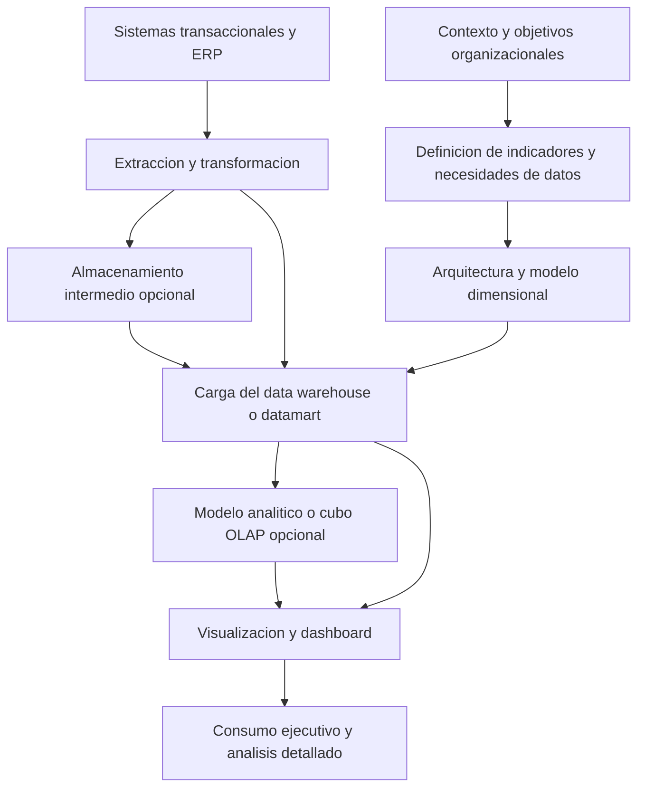

# Clase 3: Visualización estratégica y diseño de dashboards sobre una arquitectura de BI

> **Objetivo académico:** Comprender cómo el contexto organizacional, la arquitectura de business intelligence, el modelado dimensional y la integración de datos condicionan la definición de indicadores y la construcción de dashboards útiles para la toma de decisiones.

## 1. Contexto y marco conceptual

La visualización constituye la capa de consumo de una solución de **business intelligence (BI)**. Su utilidad depende de decisiones previas: qué necesita conocer la organización, para qué decisiones, con qué datos y mediante qué arquitectura. Un tablero visualmente elaborado no compensa un modelo de datos incapaz de representar el fenómeno que se pretende analizar.

El punto de partida es el contexto organizacional: tamaño, actividad, regulación, madurez de procesos y necesidades estratégicas, tácticas y operativas. La madurez influye tanto en la disponibilidad de información como en el esfuerzo necesario para depurarla e integrarla. Una organización con procesos definidos y registros consistentes suele requerir menos correcciones que otra con fuentes heterogéneas o procesos deficientemente modelados; esto no elimina la necesidad de controles de calidad.

La sesión distingue tres ámbitos de consumo:

| Ámbito | Pregunta orientativa | Contenido pertinente |
| --- | --- | --- |
| Estratégico | ¿Se están alcanzando los resultados del negocio? | Rentabilidad, márgenes y comparación con metas organizacionales. |
| Táctico | ¿Qué segmentos explican el desempeño? | Resultados por categoría, vendedor, cliente o país. |
| Operativo | ¿Qué sucede en la ejecución concreta de los procesos? | Información de mayor detalle y seguimiento de operaciones. |

**Enriquecimiento conceptual:** El nivel de un tablero depende de la decisión que respalda, de su granularidad y de su horizonte temporal. Una desagregación por vendedor puede servir a una revisión táctica o a un seguimiento operativo; la forma del gráfico no determina por sí sola su nivel de gestión.

La arquitectura puede seguir un enfoque **top-down**, que parte de una integración corporativa hacia necesidades particulares, o **bottom-up**, que comienza con soluciones departamentales. En la sesión también se mencionan los esquemas estrella, copo de nieve y constelación, además de Data Vault como posible componente previo. Estas alternativas se presentan como decisiones de contexto, sin desarrollar su implementación comparada.

**Enriquecimiento conceptual:** Conviene separar tres planos: top-down y bottom-up describen enfoques de construcción; estrella, copo de nieve y constelación describen estructuras dimensionales; Data Vault responde a otra estrategia de integración e historización. Pueden combinarse en una arquitectura, pero no son categorías equivalentes.

## 2. Fundamentos teóricos y arquitectura

### 2.1. Métricas, indicadores y KPIs

La sesión adopta una distinción práctica y reconoce variaciones terminológicas entre autores:

- **Métrica:** medida cuantitativa del negocio, como ingresos, ventas o ganancia neta.
- **Indicador:** cálculo que relaciona medidas para interpretar una condición o desempeño.
- **KPI:** indicador considerado clave y vinculado con una meta que permite evaluar el logro esperado.

**Enriquecimiento conceptual:** Una métrica puede ser agregada o calculada; no tiene que ser necesariamente un registro bruto. Asimismo, comparar un indicador con una meta no basta para justificar que sea clave: su selección debe responder a un objetivo relevante para la organización.

Como ejemplo de indicador, la rentabilidad sobre ventas puede expresarse de la siguiente manera:

$$
R = \frac{G}{I}\times 100
$$

Aquí, $G$ es la ganancia del período e $I$ sus ingresos por ventas, ambos en la misma unidad monetaria y con $I>0$. El resultado $R$ se expresa en porcentaje. Para que la relación sea interpretable, numerador y denominador deben corresponder al mismo período y ámbito del negocio. Además, es necesario precisar qué ganancia se utiliza: bruta, operativa o neta. La sesión emplea una formulación introductoria y no desarrolla una política contable completa.

Otro indicador presentado es el cumplimiento de ventas:

$$
C_v = \frac{V_r}{V_p}\times 100
$$

$V_r$ representa las ventas reales y $V_p$ las ventas proyectadas, expresadas en la misma moneda y para un alcance comparable, con $V_p>0$. El resultado $C_v$ es el cumplimiento porcentual. Si la proyección es cero, esta razón no está definida y requiere una regla de tratamiento específica.

El carácter de KPI surge al relacionar el indicador con una meta y una interpretación de negocio. Los semáforos permiten comunicar estados, pero sus umbrales deben definirse expresamente. En la sesión se ofrecen ejemplos ilustrativos de estados rojos y verdes; no se establece una política universal ni una clasificación exhaustiva de intervalos.

### 2.2. Arquitectura de referencia

El recorrido expuesto conecta un sistema transaccional o ERP con un almacén analítico, un proceso de integración y una herramienta de visualización. Puede existir una capa OLAP intermedia, aunque no es obligatoria en el ejemplo.

El diagrama reúne dos dependencias: los objetivos orientan el diseño, mientras que los datos recorren una cadena de procesamiento hasta llegar al consumo. Las rutas directa e intermedia representan alternativas de integración, no pasos que deban ejecutarse simultáneamente.

La sesión describe un caso sencillo asociado a un data warehouse y un datamart. No proporciona elementos suficientes para reconstruir una arquitectura corporativa completa. Su propósito técnico es mostrar las dependencias entre fuente, integración, almacenamiento y visualización.

### 2.3. Esquema estrella y capacidad analítica

En el esquema estrella, la tabla de hechos concentra medidas del negocio y se relaciona con dimensiones que permiten segmentarlas. El ejemplo incluye precio unitario, costo unitario, cantidades, ingreso bruto, importe neto, costos y gastos. Entre los ejes de análisis aparecen tiempo, producto o categoría, vendedor, cliente y país.

La dimensión tiempo permite organizar consultas por año, trimestre o mes, según los atributos disponibles. Su relevancia deriva de la necesidad de comparar resultados temporalmente; no debe interpretarse como una regla absoluta para cualquier modelo imaginable.

**Enriquecimiento conceptual:** Antes de seleccionar campos, debe fijarse el **grano**: qué representa exactamente una fila de hechos. Una línea de venta, una venta completa y un resumen mensual son unidades diferentes. Mezclarlas sin control puede duplicar importes y producir indicadores inconsistentes.

## 3. Implementación técnica y lógica de negocio

### 3.1. Del origen al modelo físico

El flujo técnico presentado comprende el análisis de las tablas del ERP, la selección de datos relevantes, el modelado del esquema y su materialización en un motor de base de datos. SQL Server aparece como ejemplo de plataforma física; también se menciona un modelador de datos para representar y trasladar estructuras.

La selección de datos debe responder a su valor analítico. Replicar todas las tablas del sistema operacional sin relacionarlas con preguntas de negocio aumenta el volumen y la complejidad sin garantizar utilidad.

El paso del modelo al motor puede apoyarse en generación de scripts desde herramientas de modelado o en asistencia de inteligencia artificial. La transcripción no incluye instrucciones SQL completas ni permite verificar una ejecución específica.

**Enriquecimiento conceptual:** El código generado requiere revisión de tipos, claves, relaciones, nulabilidad y coherencia con el grano. La automatización acelera la escritura de estructuras, pero su corrección depende de que el diseño represente adecuadamente el negocio.

### 3.2. Integración y calidad mediante ETL

El proceso **ETL** comprende extracción, transformación y carga. En la demostración se utiliza SQL Server Integration Services dentro del entorno de Visual Studio para trasladar datos desde el origen hacia el esquema analítico.

La transformación incluye limpieza y adecuación de información. Su alcance depende del estado de las fuentes: no todos los conjuntos de datos requieren idénticas operaciones. El flujo mostrado organiza tareas por dimensiones y establece un orden de ejecución.

Se describen dos variantes arquitectónicas:

| Variante | Recorrido | Implicación |
| --- | --- | --- |
| Integración directa | Origen, transformación y destino analítico. | Simplifica el recorrido en el ejemplo introductorio. |
| Integración con almacenamiento intermedio | Origen, tablas transitorias, depuración y destino analítico. | Separa la recepción de datos de su preparación posterior. |

**Enriquecimiento conceptual:** Una capa intermedia puede facilitar trazabilidad y reprocesamiento, a costa de almacenamiento y operación adicionales. Además, cuando los hechos referencian claves dimensionales, la carga debe resolver esas referencias: normalmente se preparan primero las dimensiones y después los hechos dependientes.

La sesión relaciona el entorno de Visual Studio con la posibilidad de trabajar con cubos. **Enriquecimiento conceptual:** Debe distinguirse el entorno de desarrollo del componente que presta el servicio: Integration Services se orienta a integración, mientras que Analysis Services se utiliza para modelos analíticos y cubos en el ecosistema de SQL Server. Compartir herramientas de desarrollo no vuelve equivalentes sus funciones.

### 3.3. Cálculos financieros del ejemplo

La utilidad bruta se presenta como la diferencia entre importe neto y costos:

$$
U_b = N-C
$$

La utilidad neta se representa de forma simplificada como:

$$
U_n^{\mathrm{simplificada}} = N-C-E
$$

$N$ es el importe neto de ventas, $C$ los costos asociados y $E$ los gastos considerados. Todas las cantidades se expresan en la misma moneda y corresponden al mismo período y ámbito de análisis. $U_b$ y $U_n^{\mathrm{simplificada}}$ son resultados monetarios y pueden ser positivos, cero o negativos.

**Enriquecimiento conceptual:** La segunda expresión conserva la simplificación utilizada en la sesión. En un estado de resultados completo, la utilidad neta puede exigir otras partidas, como resultados financieros e impuestos, según el marco contable aplicable. No debe trasladarse esta fórmula a producción sin definir su alcance.

La demostración muestra medidas calculadas para utilidades y rentabilidades, pero no proporciona sus expresiones DAX. Por tanto, puede describirse la lógica matemática sin reconstruir código ausente.

**Enriquecimiento conceptual:** Si se define el margen bruto sobre ventas netas, entonces:

$$
M_b = \frac{U_b}{N}\times 100
$$

$M_b$ es un porcentaje y requiere $N>0$. Para obtener el margen de un conjunto de operaciones, deben agregarse primero las utilidades y las ventas correspondientes y luego calcular la razón. Promediar márgenes individuales sin ponderación puede alterar el resultado.

### 3.4. Visualización, publicación y consumo

En Power BI se muestran tarjetas para importes y utilidades, indicadores de rentabilidad, segmentación temporal, tablas y un mapa de ventas por país. También se mencionan gráficos de barras, dispersión y medidores.

Cada representación responde a una necesidad: las tarjetas facilitan la lectura puntual; las tablas permiten consultar detalle; los filtros cambian el ámbito analizado; los mapas muestran distribución geográfica. La comparación con metas requiere que estas estén disponibles y correctamente vinculadas con los resultados reales.

La sesión recorre consumo en escritorio, publicación web y diseño para dispositivos móviles. El layout móvil reorganiza los elementos para una pantalla reducida y una consulta ejecutiva breve. También se presenta una herramienta alternativa cuya denominación aparece transcrita de manera irregular y que, por el contexto, parece corresponder a Tableau.

La elección de plataforma se vincula con costos, beneficios, experiencia del equipo, estrategia tecnológica y necesidades de nube. La demostración no constituye una comparación exhaustiva de productos ni permite establecer condiciones vigentes de licenciamiento.

## 4. Análisis crítico de casos y auditoría práctica

### 4.1. Resultados reales frente a metas

El modelo mostrado contiene principalmente datos reales. Permite calcular ingresos, costos, gastos y rentabilidades, pero no incorpora una estructura completa de proyecciones. De ello se desprende una limitación: una visualización no puede producir comparaciones presupuestarias fiables si los datos necesarios no existen en el modelo.

La sesión contrasta una rentabilidad real de aproximadamente 11,89 % con una meta de 15 %. Esta comparación permite reconocer una brecha, pero no explica por sí sola sus causas.

**Enriquecimiento conceptual:** Con esos valores ilustrativos, la diferencia es:

$$
\Delta R = R_r-R_m = 11{,}89\%-15\% = -3{,}11\ \text{puntos porcentuales}
$$

$R_r$ es la rentabilidad real y $R_m$ la rentabilidad meta, medidas con la misma definición y alcance. La brecha indica cuánto separa al resultado del objetivo; no equivale a una caída relativa de 3,11 %.

Si se define el cumplimiento de esa meta como una razón, se obtiene:

$$
C_R = \frac{11{,}89}{15}\times 100 \approx 79{,}27\%
$$

$C_R$ expresa el cumplimiento relativo bajo una regla en la que valores mayores de rentabilidad son preferibles y la meta es positiva. Este cálculo es una derivación conceptual de los valores mencionados, no una medida verificada del tablero.

### 4.2. Comparabilidad de resultados y proyecciones

La sesión considera incorporar otras tablas o ampliar la tabla de hechos para disponer de comparativos. La decisión depende de cómo se registren los objetivos.

**Enriquecimiento conceptual:** Si las ventas reales se almacenan por transacción y las metas por mes y categoría, unirlas directamente puede repetir una misma meta por cada transacción. Una alternativa es mantener hechos separados para resultados y presupuesto, conectados mediante dimensiones comunes, y comparar ambos al nivel compatible. El criterio central es preservar el grano y evitar duplicaciones.

### 4.3. Rentabilidad y contexto de interpretación

Un porcentaje de rentabilidad no puede evaluarse de manera aislada. Su interpretación depende del sector, el período, el riesgo, la estructura de costos y la definición del indicador. Una apreciación favorable durante una demostración introductoria no establece un umbral general de buen desempeño.

También debe distinguirse el resultado absoluto de la rentabilidad: una utilidad monetaria mayor puede coexistir con un margen menor si el volumen de ventas crece más rápidamente que la ganancia.

### 4.4. Publicación, confidencialidad y adaptación visual

La demostración muestra diferencias de presentación entre escritorio y web. Estas diferencias pueden afectar la lectura cuando alteran tamaños, posiciones o visibilidad de información relevante; por ello, cada canal requiere revisión.

**Enriquecimiento conceptual:** Ocultar una publicación de una galería o de un listado no equivale a restringir su acceso. La confidencialidad exige comprobar permisos y modalidad de publicación. La transcripción no permite verificar los controles concretos aplicados a los ejemplos.

La evidencia disponible es una explicación acompañada de demostraciones visuales descritas oralmente. No se dispone del modelo completo, de los scripts ni de los datos subyacentes para auditar resultados o rendimiento.

## 5. Principios de diseño, buenas prácticas y anti-patrones

| Principio | Justificación | Anti-patrón asociado |
| --- | --- | --- |
| Vincular indicadores con objetivos y usuarios. | Determina qué información tiene valor decisional. | Seleccionar métricas solo porque están disponibles. |
| Definir arquitectura, grano y dimensiones. | Asegura que las medidas representen hechos comparables. | Diseñar gráficos antes de resolver la estructura del dato. |
| Especificar fórmulas y alcance. | Evita discrepancias entre áreas y períodos. | Usar nombres como rentabilidad sin precisar numerador y denominador. |
| Separar resultados reales, proyecciones y metas. | Preserva sus significados y niveles de detalle. | Introducir comparativos sin controlar duplicaciones. |
| Ajustar ETL a la calidad de origen. | Concentra controles donde son necesarios. | Aplicar transformaciones por rutina o asumir que la fuente siempre es correcta. |
| Establecer umbrales interpretables. | Permite relacionar el estado visual con una regla de negocio. | Colorear indicadores sin explicar qué significan los intervalos. |
| Elegir visualizaciones según la pregunta. | Facilita una lectura adecuada del resultado. | Usar recursos visuales por disponibilidad o atractivo. |
| Revisar escritorio, web y móvil. | Mantiene legibilidad y acceso a información esencial. | Suponer que una misma distribución funciona en cualquier pantalla. |
| Proteger la información publicada. | Conserva el control sobre datos organizacionales. | Confundir baja visibilidad con autorización de acceso. |

**Enriquecimiento conceptual:** La tabla sistematiza los argumentos de la sesión e incorpora controles derivados. Un semáforo también debe acompañarse de valores o etiquetas que permitan interpretar el estado sin depender exclusivamente del color. Las medidas seleccionadas deberían documentar unidad, período, filtros aplicables y comportamiento ante datos faltantes o denominadores nulos.

La prioridad conceptual recae en la coherencia entre negocio, datos e indicadores. El diseño visual sigue siendo relevante porque organiza la lectura, establece jerarquías y puede facilitar o dificultar la comprensión. Su desarrollo debe apoyarse en una base analítica ya definida.

## 6. Síntesis conceptual y profundización académica

La sesión articula una cadena de dependencias: el contexto organizacional orienta las preguntas; las preguntas determinan indicadores y necesidades de información; el modelo dimensional estructura los datos; ETL los integra y prepara; la visualización permite consumirlos en distintos canales.

La distinción entre métrica, indicador y KPI es útil cuando obliga a precisar tres asuntos: qué se mide, cómo se interpreta y con qué objetivo se compara. Dado que la terminología puede variar, la definición operacional importa más que la etiqueta aislada.

El ejemplo financiero evidencia que las capacidades del tablero están delimitadas por el modelo. Con datos reales pueden calcularse utilidades y márgenes; para comparar con metas o presupuestos se necesitan referencias compatibles. Agregar un medidor o un semáforo no resuelve esa dependencia informativa.

**Enriquecimiento conceptual:** La calidad de un dashboard puede analizarse en tres dimensiones relacionadas: validez de los datos y cálculos, pertinencia de los indicadores para la decisión y claridad de la representación. Una falla en cualquiera de ellas reduce la confiabilidad del conjunto.

Como líneas de profundización conceptual quedan la gobernanza de definiciones de indicadores, la integración de presupuestos con granularidades diferentes, la trazabilidad del ETL y la adaptación del consumo analítico a perfiles de usuario. Estas líneas amplían los límites identificados en el ejemplo sin atribuir a la sesión implementaciones que no fueron mostradas.
