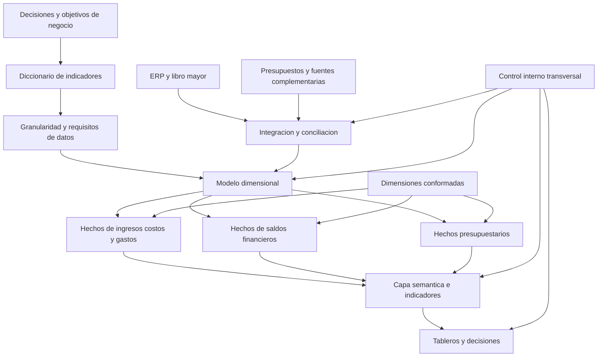

# Clase 6: BI financiero y control interno: indicadores, modelado dimensional y marco COSO

> **Objetivo académico:** Integrar los fundamentos financieros del Business Intelligence con el diseño dimensional y el control interno, para producir indicadores interpretables, información trazable y decisiones sustentadas en evidencia dentro de proyectos de transformación digital.

## 1. Contexto y marco conceptual

### 1.1. La transformación digital como cambio organizacional

La implementación de Business Intelligence (BI) no se reduce a incorporar herramientas de visualización. Requiere articular estrategia, personas, procesos, datos y controles. La sesión sitúa la cultura organizacional y la madurez institucional como condiciones que influyen en la adopción y sostenibilidad de una solución analítica.

La resistencia al cambio, la falta de patrocinio directivo, los procesos desordenados y la incorporación de tecnología desproporcionada respecto de las capacidades organizacionales pueden debilitar un proyecto. La fuente sostiene la importancia de estos factores, pero no aporta evidencia empírica que permita cuantificar su incidencia relativa en el fracaso de proyectos.

El análisis interno y externo de la organización permite contextualizar las necesidades de información. Se mencionan PESTEL, las cinco fuerzas de Porter y el entorno VUCA como referencias para comprender condiciones externas e incertidumbre. No se desarrollan sus procedimientos en esta sesión.

### 1.2. Niveles de decisión y orientación del BI

| Nivel | Necesidad predominante | Ejemplos tratados |
| --- | --- | --- |
| Estratégico | Evaluar la dirección y sostenibilidad del negocio | Rentabilidad, inversión, financiamiento, expansión y adquisiciones |
| Táctico | Traducir objetivos en seguimiento de gestión | Presupuesto, desempeño de unidades de negocio y control de gestión |
| Operativo | Supervisar transacciones y ejecución cotidiana | Ventas, cobros, pagos y utilización de recursos |

La clase privilegia un enfoque descendente o *top-down* para el BI estratégico: partir de las decisiones de la alta dirección, definir la información necesaria y derivar después los requerimientos del modelo de datos. También admite iniciativas ascendentes o *bottom-up* con alcance especializado, como la detección de posibles fraudes mediante análisis de datos.

**Enriquecimiento conceptual:** Estos enfoques pueden combinarse. El patrocinio estratégico proporciona dirección y legitimidad, mientras que una implementación incremental permite validar datos y capacidades con casos acotados. Una iniciativa especializada también necesita responsables y criterios de uso, aunque no cubra toda la organización.

### 1.3. Del reporte artesanal a la información gobernada

La consolidación manual de reportes y hojas de cálculo puede exigir cruces, ajustes y agregaciones repetitivas. El aporte esperado del BI consiste en reducir ese esfuerzo y ofrecer información consistente desde diferentes perspectivas: tiempo, producto, categoría y unidad de negocio.

El conocimiento financiero resulta especialmente importante en el caso desarrollado: un tablero puede ser técnicamente correcto y, aun así, inducir decisiones equivocadas si sus indicadores carecen de una definición económica precisa. La clase enfatiza esta competencia; su importancia no implica que todo proyecto de BI deba tener un alcance predominantemente financiero.

**Enriquecimiento conceptual:** Una hoja de cálculo puede ser una herramienta válida. El riesgo aparece cuando actúa como mecanismo de integración sin trazabilidad, reglas compartidas, control de versiones o conciliación con las fuentes. Del mismo modo, automatizar un cálculo no garantiza su validez.

## 2. Fundamentos teóricos y arquitectura

### 2.1. Estado de resultados: flujos de desempeño

El estado de resultados organiza ingresos, costos y gastos correspondientes a un período. La exposición distingue utilidad bruta, utilidad operativa y utilidad neta, y vincula estas magnitudes con los datos necesarios para construir indicadores estratégicos.

**Enriquecimiento conceptual:** Para precisar la presentación simplificada de la sesión, puede utilizarse la siguiente estructura ilustrativa:

$$
U_B = V - C_V
$$

$$
U_O = U_B - G_O
$$

$$
U_N = U_O + R_{NO} - T
$$

Aquí, $V$ representa ingresos netos por ventas; $C_V$, costo de ventas; $G_O$, gastos operativos; $R_{NO}$, resultado neto de partidas no operativas, incluido el resultado financiero según la presentación adoptada; $T$, gasto por impuesto sobre las ganancias; y $U_B$, $U_O$ y $U_N$, resultados bruto, operativo y neto. Todas las variables se expresan en la misma moneda y corresponden al mismo período. $R_{NO}$ y los resultados pueden ser negativos. La estructura exacta depende de las políticas contables y del sector.

Esta precisión evita clasificar automáticamente todos los gastos financieros como operativos. La fuente los agrupa con otros gastos para simplificar la explicación, pero esa agrupación no debe trasladarse sin revisión a la definición del margen operativo.

**Enriquecimiento conceptual:** La utilidad neta no equivale al efectivo disponible. El reconocimiento contable de una venta, un gasto o una depreciación puede ocurrir en un momento distinto del cobro o pago correspondiente. Por tanto, rentabilidad y liquidez requieren análisis separados.

### 2.2. Balance general: posición financiera a una fecha

La identidad contable presentada es:

$$
A = L + E
$$

$A$ representa activos, $L$ pasivos y $E$ patrimonio, medidos en unidades monetarias a una misma fecha. La igualdad expresa que los recursos reconocidos por la entidad tienen como contrapartida obligaciones frente a terceros y patrimonio.

El ejemplo de la sesión considera un activo de 100 000 unidades monetarias financiado con 60 000 de deuda y 40 000 de recursos propios. Así, $100\,000 = 60\,000 + 40\,000$.

| Categoría | Ejemplos de la sesión | Relevancia analítica |
| --- | --- | --- |
| Activos corrientes | Caja, bancos, cuentas por cobrar e inventarios | Recursos vinculados con el ciclo operativo y la liquidez de corto plazo |
| Activos no corrientes | Edificios y maquinaria | Recursos utilizados durante períodos prolongados |
| Pasivos corrientes | Proveedores y obligaciones de corto plazo | Necesidades próximas de pago |
| Pasivos no corrientes | Financiamiento de largo plazo | Estructura de deuda y compromisos futuros |
| Patrimonio | Aportes, resultados acumulados y resultado del período | Participación residual de los propietarios |

**Enriquecimiento conceptual:** El efectivo también es un activo. Asimismo, los activos no corrientes no se limitan a bienes físicos: pueden incluir otros recursos de largo plazo. La clasificación corriente/no corriente considera el ciclo normal de operación y criterios temporales; no depende únicamente de la facilidad de venta. En una deuda de largo plazo, la parte que vence próximamente puede requerir clasificación corriente. El patrimonio tampoco se limita al capital inicialmente aportado.

### 2.3. Integración financiera y modelado dimensional

El estado de resultados describe flujos durante un intervalo; el balance representa saldos a una fecha. El BI debe preservar esa diferencia cuando integra ambas fuentes. El plan de cuentas y el libro mayor o *general ledger* son referencias para localizar y clasificar los datos contables.

La clase propone incorporar primero ingresos, costos y gastos, y ampliar posteriormente el modelo con información de activos, pasivos y patrimonio. Cuando varias tablas de hechos comparten dimensiones, el conjunto puede describirse como una constelación de hechos.

| Estructura | Rasgo distintivo | Aplicación conceptual |
| --- | --- | --- |
| Estrella | Una tabla de hechos central relacionada con dimensiones | Análisis de un proceso con granularidad definida |
| Copo de nieve | Dimensiones descompuestas mediante normalización | Representación de jerarquías y dependencias dimensionales |
| Constelación | Varias tablas de hechos con dimensiones compartidas | Integración de procesos o mediciones diferentes |

**Enriquecimiento conceptual:** El siguiente diagrama traduce la propuesta de la clase en una arquitectura ilustrativa; no representa un sistema implementado ni prescribe tablas físicas concretas.

**Enriquecimiento conceptual:** Las dimensiones conformadas ofrecen significados compartidos entre hechos; su uso no elimina la necesidad de controlar la granularidad. Relacionar directamente dos tablas de hechos puede multiplicar filas y duplicar importes. Las comparaciones deben realizarse mediante dimensiones y agregaciones compatibles.

## 3. Implementación técnica y lógica de negocio

La fuente no presenta código SQL, DAX, M o Python, ni demuestra una implementación ejecutada. Su contribución técnica consiste en traducir necesidades financieras en requisitos de modelado, cálculo, actualización y control.

### 3.1. Definir indicadores antes de construir el tablero

La matriz recomendada en la sesión documenta el nombre del indicador, su significado, fórmula, ejemplo e interpretación. Su propósito es identificar datos faltantes antes de cargar información y construir visualizaciones.

**Enriquecimiento conceptual:** Para hacer operativa esa matriz conviene registrar también fuente, responsable, granularidad, moneda, periodicidad, filtros, reglas de asignación y tratamiento de valores nulos o denominadores cero. Estas definiciones constituyen un contrato semántico entre negocio y tecnología.

### 3.2. Márgenes sobre ventas

Los márgenes bruto, operativo y neto se obtienen relacionando cada resultado con las ventas:

$$
M_B = \frac{U_B}{V}\times 100\%,\qquad
M_O = \frac{U_O}{V}\times 100\%,\qquad
M_N = \frac{U_N}{V}\times 100\%
$$

$M_B$, $M_O$ y $M_N$ son porcentajes; las utilidades y $V$ están expresadas en la misma moneda y corresponden al mismo período y perímetro organizacional. Para la interpretación habitual se supone $V>0$. Con ventas iguales a cero, los cocientes no están definidos; con ventas negativas o ajustes relevantes, requieren una lectura específica.

El ejemplo de la sesión establece que ventas de 100 y utilidad neta de 10 producen un margen neto de 10 %. Esto significa que quedan 10 unidades de resultado contable por cada 100 unidades vendidas, después de las partidas consideradas en el resultado neto. Si el resultado es negativo y las ventas son positivas, el margen también será negativo.

**Enriquecimiento conceptual:** Un margen de 10 % no constituye un umbral universal de buen desempeño. Su evaluación depende del sector, la estructura de costos, el riesgo, el capital necesario y la evolución histórica. Un resultado neto nulo tampoco describe por sí solo todas las condiciones del punto de equilibrio operativo.

### 3.3. ROA y ROE: rendimiento de activos y patrimonio

La sesión presenta el ROA como utilidad neta dividida entre activos totales. Combina así un resultado del período con una magnitud del balance.

**Enriquecimiento conceptual:** Para reducir la dependencia respecto de una fecha puntual, una convención habitual utiliza activos promedio:

$$
ROA = \frac{U_N}{\overline{A}}\times 100\%
$$

$\overline{A}$ es el activo total promedio del período, en la misma moneda que $U_N$, y se supone positivo. Un promedio simple puede calcularse como $\overline{A}=(A_{inicio}+A_{fin})/2$, aunque cambios importantes durante el intervalo pueden requerir promedios más representativos. La convención utilizada debe quedar documentada.

El ROE evalúa el rendimiento contable del patrimonio. La fuente menciona una utilidad ajustada sin definir su ajuste de forma reproducible.

**Enriquecimiento conceptual:** Como referencia convencional, puede expresarse:

$$
ROE = \frac{U_N}{\overline{E}}\times 100\%
$$

$\overline{E}$ representa el patrimonio promedio del período y se supone positivo para la lectura ordinaria. Si el análisis distingue grupos de propietarios, numerador y denominador deben corresponder al mismo grupo. Con patrimonio nulo o negativo, el indicador pierde su interpretación habitual. Cualquier ajuste a la utilidad debe explicitarse y conciliarse con el resultado contable.

El ROA informa sobre el resultado obtenido respecto de los recursos reconocidos; el ROE lo relaciona con el patrimonio. Ninguno equivale automáticamente a dividendos distribuidos, retorno efectivo del inversionista o plazo de recuperación de su aporte.

### 3.4. Razón corriente y liquidez

La razón corriente se calcula como:

$$
RC = \frac{A_C}{L_C}
$$

$A_C$ es el activo corriente y $L_C$ el pasivo corriente, medidos en la misma moneda y fecha; se requiere $L_C>0$. $RC$ es un cociente adimensional expresado en veces, no un porcentaje.

Los ejemplos de la fuente son:

- $100/80=1{,}25$: existen 1,25 unidades de activo corriente por cada unidad de pasivo corriente.
- $80/100=0{,}80$: el activo corriente es inferior al pasivo corriente.

**Enriquecimiento conceptual:** Un valor superior a uno no garantiza capacidad inmediata de pago: los inventarios pueden tardar en venderse y las cuentas por cobrar pueden presentar mora. Un valor inferior a uno tampoco demuestra por sí solo insolvencia o quiebra. Deben analizarse vencimientos, calidad de los activos, ciclo de caja y acceso al financiamiento. La razón corriente aproxima cobertura contable de corto plazo; no mide exclusivamente efectivo disponible.

### 3.5. Flujo de caja y proyecciones

La sesión vincula el seguimiento de liquidez con la proyección de cobros, pagos y saldo de caja.

**Enriquecimiento conceptual:** La identidad básica es:

$$
S_f = S_i + C - P
$$

$S_i$ y $S_f$ son saldos inicial y final de efectivo; $C$ representa cobros o entradas de efectivo y $P$ pagos o salidas durante el intervalo. Todas las magnitudes se expresan en la misma moneda; $C$ y $P$ se registran como valores no negativos bajo esta convención. Para una proyección, los flujos futuros dependen de supuestos explícitos de fechas y montos. Un saldo proyectado negativo representa una necesidad de financiamiento o ajuste, no necesariamente un saldo bancario efectivamente autorizado.

Los préstamos recibidos aportan efectivo, pero no constituyen ingresos por ventas. Esta distinción permite evitar que un aumento de caja financiado con deuda se interprete como mejora de la rentabilidad.

La fuente plantea utilizar información histórica y modelos predictivos para anticipar comportamientos, sin desarrollar algoritmos ni resultados. Una proyección debe distinguirse de un dato observado y de una estimación provisional del cierre.

### 3.6. Presupuesto, capacidad instalada y análisis externo

El BI puede comparar ejecución real y presupuesto, siempre que ambos utilicen conceptos, períodos y unidades compatibles.

**Enriquecimiento conceptual:** Una convención de desviación absoluta es $D=X_R-X_P$, donde $X_R$ es el valor real y $X_P$ el presupuestado. Ambos tienen la misma unidad. Si $X_P>0$, la desviación relativa puede expresarse como $D_r=(X_R-X_P)/X_P\times100\%$. Una desviación positiva no es universalmente favorable: depende de si se evalúan ingresos, costos u otras magnitudes.

En organizaciones industriales, la utilización de capacidad relaciona la producción o procesamiento efectivo con la capacidad disponible.

**Enriquecimiento conceptual:** Puede definirse $U_C=Q_R/Q_C\times100\%$, donde $Q_R$ es la cantidad efectivamente procesada y $Q_C>0$ la capacidad de referencia para el mismo período y condiciones operativas. Si la capacidad es de 100 toneladas por período y se procesan 10, la utilización es 10 %. La interpretación exige distinguir capacidad nominal y efectiva, mantenimiento, demanda y restricciones del proceso.

La maquinaria vincula el análisis operativo con el financiero porque constituye un activo y puede generar depreciación. Sin embargo, una baja utilización no demuestra por sí sola que la inversión haya sido injustificada. También deben considerarse reservas de capacidad, estacionalidad y planes de expansión.

Las fuentes externas complementan este análisis con información de mercado y entorno. Su incorporación exige identificar procedencia, periodicidad y compatibilidad con los datos internos.

## 4. Análisis crítico de casos y auditoría práctica

### 4.1. Cuenta privilegiada del DBA y revisión de registros

El caso central describe a un administrador de bases de datos con capacidad de modificar tanto el sistema transaccional como la base del BI. El único control mencionado es revisar periódicamente los registros de actividad.

La debilidad consiste en que la persona capaz de alterar datos podría también desactivar o modificar sus registros. El control detectivo depende entonces del mismo ámbito de privilegios que pretende supervisar. Además, modificar origen y destino puede ocultar inconsistencias entre ambos.

La sesión propone limitar privilegios, utilizar mecanismos de autorización compartida y preservar trazabilidad de cambios: identidad, fecha, origen, registro afectado y valores anteriores y posteriores cuando corresponda.

**Enriquecimiento conceptual:** La solución debe combinar mínimo privilegio, segregación de funciones, autorizaciones, acceso excepcional controlado y registros protegidos en un dominio separado. La necesidad técnica de administrar una base no desaparece, pero debe diferenciarse de la autorización para alterar datos de negocio. No deben almacenarse contraseñas en los registros, aunque la fuente las mencione al enumerar información de acceso.

### 4.2. Autorización de descuentos y fricción operativa

Se plantea un flujo de autorización para descuentos superiores al 10 %. Puede reducir decisiones comerciales no autorizadas, pero también crear un cuello de botella si toda operación queda pendiente de una aprobación lenta.

La lección es que la existencia de un control no prueba su adecuación. Debe evaluarse si reduce el riesgo sin generar costos o demoras desproporcionados.

**Enriquecimiento conceptual:** Entre las alternativas están delegaciones por monto y margen, escalamiento por excepción y tiempos de respuesta definidos. La elección depende del riesgo comercial; el umbral del caso no constituye una recomendación general.

### 4.3. Selección de proveedores y conflicto de interés

Favorecer a un proveedor por amistad compromete la objetividad de la contratación y revela debilidades del ambiente de control. La clase contrapone esa práctica a una evaluación técnica y económica documentada, con participación de instancias apropiadas.

**Enriquecimiento conceptual:** El número de propuestas y la intervención de comités dependen de las políticas y del contexto. El principio general es gestionar conflictos de interés, justificar la selección y conservar evidencia; reunir varias ofertas no garantiza por sí solo una decisión íntegra.

### 4.4. Independencia y competencia de auditoría

La auditoría evalúa controles y comunica hallazgos; la administración conserva la responsabilidad de implementarlos y operarlos. Si el auditor configura la solución que después debe evaluar, aparece una amenaza de autorrevisión.

La sesión distingue esta función de la de un *controller*, cuyo papel puede incluir participación más directa en mejoras y seguimiento de gestión. Las funciones concretas deben interpretarse dentro de la estructura de cada organización.

La independencia de auditoría interna requiere acceso al directorio u órgano de gobierno y capacidad de comunicar hallazgos sin filtrado indebido por la gerencia. La clase critica las estructuras que subordinan sus conclusiones a la dirección auditada.

**Enriquecimiento conceptual:** Debe distinguirse dependencia funcional de dependencia administrativa. El apoyo administrativo de la gerencia no implica automáticamente falta de independencia si existen salvaguardas y supervisión funcional del órgano de gobierno o comité de auditoría. Tampoco toda solicitud de revisión formulada por la gerencia es improcedente: el riesgo surge cuando impone el alcance, bloquea evidencia o condiciona conclusiones. La auditoría puede asesorar sin asumir decisiones ni responsabilidades operativas.

Una estructura independiente tampoco garantiza competencia. El caso de una institución con procesos complejos muestra que la calidad de los hallazgos depende del conocimiento del proceso, la planificación, el trabajo de campo y un equipo con capacidades pertinentes.

El recorrido o relevamiento permite comprender cómo funcionan realmente las operaciones antes de evaluar controles. Trasladar automáticamente los controles de una empresa anterior puede producir conclusiones inadecuadas, incluso entre organizaciones del mismo sector.

**Enriquecimiento conceptual:** El auditor puede diseñar procedimientos de prueba y recomendar mejoras. Esto debe diferenciarse de asumir la propiedad del control operativo que luego evaluará.

### 4.5. ERP con debilidades y BI estratégico

El caso plantea incorporar BI sobre un ERP cuyos procesos están mal modelados y cuyos controles son inefectivos. La conclusión de la sesión es realizar un diagnóstico y corregir condiciones previas: una visualización más sofisticada no resuelve datos incompletos o procesos inconsistentes.

**Enriquecimiento conceptual:** El resultado depende de la implementación y del modelo de datos, no únicamente de la marca del ERP. Algunos ERP incluyen capacidades analíticas avanzadas. También puede avanzarse con un alcance de BI limitado si las deficiencias están identificadas y controladas; la condición es evitar presentar información incierta como plenamente confiable.

### 4.6. ROE y alternativas de inversión

La discusión compara el rendimiento de un negocio con el interés de un depósito bancario. La clase destaca el costo de oportunidad y la diferencia entre un negocio con trayectoria y una proyección de emprendimiento.

**Enriquecimiento conceptual:** La comparación requiere horizontes, monedas, impuestos, liquidez y riesgos compatibles. Un depósito bancario no carece de riesgo, y un ROE contable no equivale a una tasa contractual de cobro. Un rendimiento histórico tampoco garantiza continuidad. Por ello, la decisión de inversión no puede derivarse de comparar dos porcentajes aislados.

## 5. Principios de diseño, buenas prácticas y anti-patrones

### 5.1. COSO como marco de control interno

El control interno es un proceso realizado por el órgano de gobierno, la administración y el resto del personal para proporcionar seguridad razonable sobre el logro de objetivos. No pertenece exclusivamente a auditoría o al área tecnológica.

Las categorías de objetivos desarrolladas son:

- **Operaciones:** eficacia, eficiencia, desempeño y protección de recursos.
- **Información:** confiabilidad y calidad de información financiera y no financiera, interna y externa.
- **Cumplimiento:** observancia de leyes y regulaciones aplicables, apoyada por políticas y procedimientos internos.

La clase considera la estrategia como una dimensión transversal. Reconoce que añadirla como una cuarta cara del esquema presentado es una adaptación ilustrativa y no una modificación de las tres categorías del marco de control interno descrito.

La seguridad es razonable porque siguen existiendo errores de juicio, fallas, decisiones perjudiciales y otros límites. Un sistema de controles efectivo apoya el logro de objetivos; no garantiza éxito económico ni elimina todo riesgo.

### 5.2. Cinco componentes y aplicación al BI

| Componente | Contenido desarrollado | Aplicación a un proyecto de BI |
| --- | --- | --- |
| Ambiente o entorno de control | Integridad, estructura, competencia, autoridad y responsabilidad | Responsables de datos, funciones delimitadas y patrocinio coherente |
| Evaluación de riesgos | Identificación y análisis de situaciones que afectan objetivos | Riesgos de calidad, acceso, disponibilidad y decisiones basadas en datos incorrectos |
| Actividades de control | Políticas, procedimientos y medidas de respuesta | Validaciones, autorizaciones, conciliaciones y controles tecnológicos |
| Información y comunicación | Información pertinente y comunicación interna y externa | Definiciones compartidas, comunicación de incidencias y límites de los indicadores |
| Monitoreo | Evaluaciones continuas o separadas y seguimiento | Revisión de controles, incidentes, hallazgos y acciones correctivas |

La exposición menciona 17 principios distribuidos entre estos componentes, pero no desarrolla individualmente todos ellos. En el entorno de control enfatiza el compromiso ético, la estructura organizacional, la competencia y la rendición de cuentas. Las contraseñas compartidas, las funciones incompatibles y los permisos indiscriminados diluyen la responsabilidad individual.

La continuidad del negocio se incorpora mediante preguntas sobre interrupciones de energía, servidores, bases de datos y comunicaciones. Tener controles exige prever cómo sostener o recuperar los procesos críticos.

**Enriquecimiento conceptual:** Los respaldos y planes de continuidad necesitan pruebas para aportar evidencia de recuperabilidad. La existencia de un documento o una copia no demuestra por sí sola que un servicio pueda restablecerse.

### 5.3. Evolución del marco y sostenibilidad

La sesión menciona el marco de control interno de 1992, la referencia a gestión de riesgos empresariales de 2004, la actualización de control interno de 2013 y una guía complementaria de 2023 relacionada con sostenibilidad y aspectos ambientales, sociales y de gobernanza. Esta última se presenta como una ampliación de la aplicación del control interno, manteniendo los cinco componentes y 17 principios.

**Enriquecimiento conceptual:** Conviene distinguir la familia de marcos de control interno de la de gestión de riesgos empresariales. Las denominaciones informales COSO I, II y III pueden sugerir una sucesión única que oculta esa diferencia. Asimismo, el caso Enron y la ley Sarbanes-Oxley son posteriores al marco de 1992; no deben presentarse como causas de su publicación inicial. La guía de sostenibilidad se orienta al control de la información de sostenibilidad y no sustituye una estrategia integral en esa materia.

La clase también menciona compatibilidades con ISO 31000. La relación es de complementariedad conceptual en la gestión de riesgos; no se aporta un mapeo detallado que permita afirmar equivalencias completas.

### 5.4. Gestión de riesgos y mejora continua

La secuencia descrita parte de comprender el contexto, identificar riesgos, analizarlos, evaluarlos y definir su tratamiento. El seguimiento verifica si las medidas modifican la exposición.

**Enriquecimiento conceptual:** Una matriz puede utilizar una puntuación de priorización:

$$
S_R = s_P\times s_I
$$

$s_P$ es una puntuación de probabilidad, $s_I$ una puntuación de impacto y $S_R$ el valor resultante. Sus dominios son escalas positivas definidas por la organización, y el resultado es un índice, no necesariamente una pérdida monetaria esperada. Si las escalas son ordinales, el producto es una convención de clasificación y no una medición cardinal exacta. Los colores de la matriz dependen de umbrales establecidos; no son universales.

Los controles pretenden reducir el riesgo hasta un nivel aceptable, pero su efecto debe evaluarse. La mejora continua requiere diagnóstico, definición de cambios, implementación, seguimiento y revisión. La fuente relaciona este ciclo con Deming y diferencia la mejora de procesos de intervenciones más profundas de reingeniería, sin desarrollar una metodología detallada de esta última.

### 5.5. Proporcionalidad, gobernanza y anti-patrones

COSO puede adaptarse a organizaciones de distinto tamaño. Una entidad pequeña puede carecer de un área completa de auditoría y recurrir a revisiones externas especializadas. La proporcionalidad modifica recursos y mecanismos; no elimina la necesidad de asignar responsabilidades y evaluar riesgos.

El gobierno de TI debe alinearse con el gobierno organizacional. Auditoría, control de gestión, calidad y otras funciones contribuyen desde papeles diferentes; ninguna reemplaza la responsabilidad de la dirección y de quienes ejecutan los procesos.

| Anti-patrón | Consecuencia | Principio de mejora |
| --- | --- | --- |
| Construir visualizaciones antes de definir indicadores | Descubrir datos faltantes y rehacer el modelo | Diseñar desde las decisiones y fórmulas |
| Mezclar saldos y movimientos sin reglas | Duplicación o interpretación temporal incorrecta | Declarar granularidad y agregación |
| Compartir cuentas o privilegios irrestrictos | Pérdida de atribución y mayor exposición | Identidad individual y mínimo privilegio |
| Operar un control y auditarlo sin salvaguardas | Amenaza de autorrevisión | Separar operación y aseguramiento |
| Reutilizar controles sin conocer el proceso | Evaluación desconectada del contexto | Relevamiento previo y evidencia |
| Suponer que más controles siempre mejoran el negocio | Burocracia y cuellos de botella | Evaluar eficacia y costo operativo |
| Considerar el cumplimiento garantía de éxito | Exceso de confianza | Mantener juicio estratégico y monitoreo |

**Enriquecimiento conceptual:** La fuente afirma que una tabla de hechos sin medidas numéricas no sería una tabla de hechos. Esa afirmación requiere una excepción: existen tablas de hechos sin medidas que registran eventos o relaciones y permiten contar ocurrencias. En el caso financiero tratado, sí se requieren importes o fuentes conciliables para calcular resultados y rentabilidades.

**Enriquecimiento conceptual:** Los saldos de balance suelen ser semiaditivos: pueden agregarse entre ciertas entidades compatibles, pero no sumarse indiscriminadamente entre fechas. Los porcentajes de rentabilidad tampoco deben sumarse ni promediarse sin ponderación. Para consolidarlos, corresponde recalcular el cociente a partir de sus numeradores y denominadores agregados bajo reglas coherentes.

## 6. Síntesis conceptual y profundización académica

El vínculo central de la sesión conecta estrategia, definición financiera, modelado dimensional y control interno. Las decisiones determinan qué debe medirse; las definiciones establecen qué datos se necesitan; el modelo conserva sus relaciones y granularidad; y los controles sostienen la confiabilidad de la información durante todo el ciclo.

La arquitectura debe distinguir resultados del período, saldos a una fecha, flujos de efectivo, presupuestos y proyecciones. Integrarlos amplía la capacidad explicativa del BI, siempre que se mantengan unidades, tiempos y convenciones comparables. Un margen, un ROA, un ROE y una razón corriente responden preguntas diferentes y no se sustituyen entre sí.

El control interno cumple una doble función: ayuda a que la organización produzca datos confiables y proporciona criterios para supervisar el propio sistema analítico. A su vez, el BI puede apoyar el monitoreo mediante indicadores, comparaciones presupuestarias y detección de comportamientos inusuales. Sin responsabilidades, seguimiento y acciones, un tablero constituye información disponible, pero no un control efectivo por sí mismo.

Las principales líneas de profundización conceptual son la asignación de costos y gastos por producto o unidad de negocio, la conciliación entre datos contables y analíticos, el tratamiento de saldos y medidas no aditivas, la independencia de auditoría y la evaluación de la eficacia operativa de los controles. En conjunto, permiten comprender por qué la calidad de una solución de BI depende tanto de su contexto organizacional como de su implementación tecnológica.
