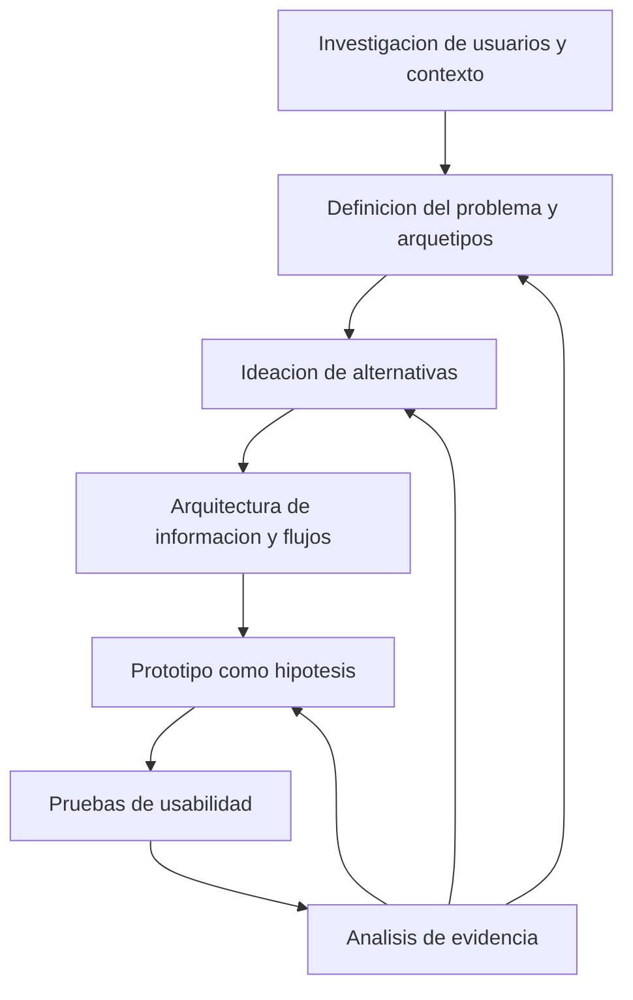

# Clase 2: Diseño centrado en el usuario: investigación, prototipado, usabilidad y percepción del color

> **Objetivo académico:** Comprender la relación entre interfaz y experiencia de usuario, articular un proceso de diseño sustentado en investigación y analizar cómo los prototipos, las pruebas de usabilidad y las decisiones cromáticas contribuyen a resolver necesidades humanas verificables.

## 1. Contexto y marco conceptual

### UI y UX: dimensiones relacionadas del producto digital

El diseño de productos digitales no se agota en construir software funcional. La sesión plantea una orientación centrada en el ser humano: comprender problemas reales y producir tecnología que aporte valor a quienes la utilizan.

La **interfaz de usuario —UI, User Interface—** comprende los elementos mediante los cuales se presenta y se opera un producto: botones, colores, tipografía, iconos y controles. La **experiencia de usuario —UX, User Experience—** comprende la facilidad de uso, la continuidad de la interacción, la satisfacción y la posibilidad de alcanzar objetivos dentro de un contexto determinado.

En una aplicación bancaria, la identidad cromática, el botón de transferencia y los iconos del historial pertenecen al diseño de la interfaz. La claridad de los pasos para transferir dinero, la prevención de confusiones y la confianza experimentada durante la operación pertenecen a la experiencia de uso. Una interfaz visualmente atractiva puede coexistir con recorridos confusos o con funcionalidades insuficientes.

**Enriquecimiento conceptual:** UI y UX no son componentes independientes que puedan optimizarse de manera aislada. La interfaz participa en la experiencia, pero esta también depende del rendimiento, la recuperación ante errores, el contenido, las condiciones de acceso y las expectativas previas. Asimismo, la sensación de seguridad debe distinguirse de la seguridad técnica: una apariencia confiable no demuestra que una operación esté protegida.

### De la preferencia estética a la evidencia

La discusión cuestiona la suficiencia de afirmaciones como «es bonito» o «funciona bien». Las apreciaciones personales pueden orientar hipótesis iniciales, pero una evaluación de ingeniería necesita explicitar usuarios, objetivos, condiciones de interacción e indicadores observables.

La sesión menciona a Norman y *El diseño de las cosas cotidianas* para sostener la prioridad de la usabilidad sobre la apariencia. También recoge la necesidad de patrones, buenas prácticas y estándares. Sin embargo, no desarrolla un estándar concreto ni sus criterios de conformidad.

**Enriquecimiento conceptual:** La experiencia contiene dimensiones subjetivas legítimas, como confianza y satisfacción. El rigor no consiste en eliminarlas, sino en estudiarlas sistemáticamente y contrastarlas con el comportamiento observado. Una preferencia declarada y una interacción exitosa responden a preguntas diferentes.

## 2. Fundamentos teóricos y arquitectura

### El proceso de diseño como ciclo de aprendizaje

La sesión relaciona las fases de investigación, definición, ideación, prototipado y pruebas con **Design Thinking**. Su hilo conductor es transformar conocimiento sobre las personas en propuestas que puedan contrastarse mediante interacción.

**Enriquecimiento conceptual:** El diagrama sintetiza los contenidos de la clase; las conexiones de retorno explicitan el carácter iterativo del diseño. Las fases no deben interpretarse como una secuencia irreversible. Una dificultad detectada durante una prueba puede exigir modificar la interfaz, revisar el flujo o replantear la necesidad inicialmente definida.

### Investigación cualitativa, cuantitativa y mixta

La investigación busca comprender necesidades, comportamientos y contextos de interacción. Sus resultados fundamentan decisiones posteriores.

| Enfoque | Pregunta predominante | Técnicas o fuentes tratadas | Alcance principal |
| --- | --- | --- | --- |
| Cualitativo | ¿Cómo se experimenta una situación y qué significado tiene? | Entrevistas en profundidad, observación contextual, grupos focales | Comprender motivaciones, dificultades, interpretaciones y prácticas |
| Cuantitativo | ¿Con qué frecuencia, magnitud o distribución ocurre algo? | Encuestas con respuestas cuantificables, analítica web y móvil, pruebas A/B | Medir comportamientos y comparar resultados según indicadores definidos |
| Mixto | ¿Cómo se relacionan los patrones medidos con las experiencias observadas? | Integración de evidencia cualitativa y cuantitativa | Interpretar patrones desde perspectivas complementarias |

La **entrevista en profundidad** explora experiencias y perspectivas mediante una conversación que permite repreguntar. La entrevista es una técnica; la guía que organiza temas y preguntas constituye un instrumento.

La **observación contextual** estudia a las personas mientras actúan en su entorno habitual. Permite identificar herramientas, interrupciones, interacciones sociales y dificultades que pueden no aparecer en un relato retrospectivo. La sesión la aproxima a la indagación contextual.

Los **grupos focales** reúnen participantes bajo la conducción de una persona moderadora. Además de opiniones individuales, permiten analizar cómo se construyen significados durante la interacción grupal.

**Enriquecimiento conceptual:** La indagación contextual suele combinar observación y preguntas situadas; no toda observación constituye por sí sola una indagación contextual completa. En los grupos focales, el consenso aparente puede responder a dominancia de algunas voces o conformidad social. Tampoco debe asumirse que toda encuesta es exclusivamente cuantitativa: puede incorporar respuestas abiertas.

La **analítica web y móvil** recopila y analiza datos de uso, como visitas, fuentes de tráfico, interacciones y tiempo de permanencia. La sesión la vincula con mejoras de contenido, experiencia y conversión.

**Enriquecimiento conceptual:** Estas métricas requieren interpretación contextual. Una permanencia prolongada puede reflejar interés o dificultad; una visita breve puede indicar abandono o resolución rápida. Además, combinar enfoques no demuestra automáticamente causalidad: comprender explicaciones plausibles no equivale a identificar efectos causales.

### Definición del problema mediante personas

Una **persona** es un arquetipo que sintetiza necesidades, motivaciones, frustraciones y comportamientos de un segmento de usuarios. Su utilidad reside en orientar decisiones hacia situaciones concretas.

La sesión utiliza el caso ilustrativo de un docente universitario que emplea Moodle para gestionar contenidos y actividades, pero encuentra dificultades de configuración y comunicación. El interés del arquetipo no está en su nombre o edad ficticios, sino en conectar comportamientos y obstáculos con posibles mejoras: asistentes de configuración, recordatorios y procedimientos más claros.

**Enriquecimiento conceptual:** Los perfiles presentados funcionan como ejemplos didácticos; no se aportan datos que permitan considerarlos personas validadas mediante investigación. Cuando un perfil se construye inicialmente por suposición, debe mantenerse como hipótesis y contrastarse con usuarios reales. Atribuir necesidades a una persona ficticia sin evidencia puede institucionalizar estereotipos.

### Arquitectura de información y flujo de usuario

La **arquitectura de información** organiza contenidos y funcionalidades para facilitar su comprensión y localización. La sesión alude a Peter Morville y a la arquitectura de información para la Web como referencia conceptual: una estructura clara permite reconocer dónde se está, qué se ha encontrado y qué opciones existen alrededor.

El **flujo de usuario —user flow—** representa la ruta seguida desde un punto de entrada hasta completar una actividad dentro del producto. Hace explícitos los pasos necesarios para alcanzar un objetivo.

**Enriquecimiento conceptual:** La arquitectura de información responde principalmente a cómo se organizan y relacionan contenidos y funciones; el flujo responde a cómo se recorre el sistema para lograr algo. Son complementarios: una estructura comprensible puede contener un procedimiento innecesariamente largo, y un procedimiento breve puede resultar difícil de localizar.

## 3. Implementación técnica y lógica de negocio

La sesión desarrolla procedimientos de diseño y una demostración de discriminación cromática. No presenta código, instrumentación de analítica ni una ejecución completa de una prueba A/B. Los ejemplos siguientes formalizan decisiones metodológicas sin atribuir resultados no observados.

### De la investigación a decisiones de producto

El ejemplo de WhatsApp permite diferenciar datos según su función:

- Las entrevistas pueden explorar cómo las personas organizan grupos y qué les resulta problemático.
- La observación puede mostrar cómo comparten archivos o gestionan notificaciones.
- Los registros cuantitativos pueden describir mensajes por grupo, archivos compartidos o tiempos de respuesta.

**Enriquecimiento conceptual:** Antes de calcular indicadores es necesario definir su unidad de análisis. Un promedio por grupo no equivale a un promedio por persona; ambos pueden ocultar distribuciones muy desiguales. El tiempo de respuesta exige precisar qué mensaje inicia el intervalo, qué respuesta lo cierra y cómo se tratan los mensajes sin respuesta.

### Técnicas de ideación

La generación de alternativas debe distinguirse de su selección posterior.

| Técnica | Procedimiento | Función en el diseño |
| --- | --- | --- |
| Brainstorming | Proponer ideas con juicio diferido y analizarlas después | Ampliar el espacio de soluciones individuales o grupales |
| Crazy 8s | Esbozar ocho alternativas en ocho minutos | Reducir la fijación en la primera propuesta y explorar variedad rápidamente |
| SCAMPER | Formular preguntas sobre sustituir, combinar, adaptar, modificar, dar otro uso, eliminar y reorganizar o revertir | Transformar una solución o proceso existente desde distintos ángulos |

El caso de las notificaciones en plataformas educativas ilustra que una misma necesidad puede abordarse mediante integración con calendarios, avisos progresivos, comunicación por otros canales o simplificación de acciones. Estas son alternativas de diseño, no soluciones cuya eficacia haya quedado demostrada.

**Enriquecimiento conceptual:** La cantidad de ideas es un recurso de exploración, no una medida suficiente de calidad. La selección posterior debe considerar pertinencia para el usuario, viabilidad técnica, accesibilidad, costes y efectos secundarios. Una mayor frecuencia de avisos, por ejemplo, puede aumentar la visibilidad y también producir fatiga.

### Prototipos como hipótesis verificables

Un prototipo materializa una posible solución para observar cómo interactúan las personas con ella.

| Dimensión | Baja fidelidad | Alta fidelidad |
| --- | --- | --- |
| Representación | Bocetos, esquemas y wireframes | Apariencia e interacción próximas a la propuesta final |
| Preguntas adecuadas | Estructura, organización y recorridos iniciales | Interacciones complejas, contenido y comportamiento detallado |
| Recursos habituales | Papel o herramientas de esquematización | Herramientas como Figma o Adobe XD, citadas en la sesión |
| Ventaja | Rapidez y facilidad para descartar o modificar alternativas | Mayor concreción de la experiencia representada |
| Límite | Puede omitir señales necesarias para interpretar la interacción | Puede consumir más recursos y dificultar cambios frecuentes |

La sesión recomienda reducir el acabado visual de los prototipos iniciales, mediante grises y contenido esencial, para evitar que se confundan con un producto terminado.

**Enriquecimiento conceptual:** La fidelidad tiene varias dimensiones: visual, de contenido, de interacción y funcional. Un prototipo visualmente pulido puede tener escasa funcionalidad. La escala de grises es una estrategia útil cuando el color no forma parte de la pregunta investigada; si se estudian estados cromáticos o contraste, eliminarlo impediría analizar justamente ese aspecto.

### Pruebas de usabilidad y pruebas A/B

Las **pruebas de usabilidad** observan a participantes que intentan alcanzar objetivos de interacción. Buscan identificar confusiones, obstáculos y oportunidades de mejora.

En las pruebas **moderadas**, una persona investigadora acompaña la sesión y puede profundizar en lo observado. En las **no moderadas**, el procedimiento se prepara de antemano y cada participante interactúa sin acompañamiento en tiempo real. Ambas pueden realizarse a distancia; la moderación y la ubicación son dimensiones diferentes.

**Enriquecimiento conceptual:** La persona moderadora debe evitar conducir al participante hacia la respuesta esperada. Ayudar demasiado modifica la evidencia sobre el uso autónomo. Cuando sea necesario intervenir, conviene registrar el momento y el tipo de ayuda.

Una **prueba A/B** compara una versión de control A con una variante B según una métrica previamente definida. La clase explica la distribución del tráfico entre versiones, pero no presenta resultados experimentales.

**Enriquecimiento conceptual:** Una formalización mínima para comparar la finalización de una operación es:

$$
\hat{p}_v = \frac{s_v}{n_v}, \qquad v \in \{A,B\}.
$$

Aquí, $n_v$ es el número de participantes elegibles asignados a la versión $v$, con $n_v>0$; $s_v$ es el número de esos participantes que completa la operación, con $0\leq s_v\leq n_v$; y $\hat{p}_v\in[0,1]$ es la proporción observada de finalización, sin unidad. La comparación exige definir la misma operación y ventana de observación en ambas versiones.

La diferencia observada es:

$$
\widehat{\Delta}=\hat{p}_B-\hat{p}_A.
$$

Un valor positivo favorece descriptivamente a B en esa métrica; al multiplicarlo por cien se expresa en puntos porcentuales. No basta para afirmar superioridad concluyente: deben considerarse incertidumbre, tamaño muestral y validez de la asignación. Para interpretar la comparación causalmente, se requiere una asignación aleatoria adecuada y condiciones comparables, además de controlar interferencias relevantes. Una prueba de usabilidad ayuda a comprender dificultades; una prueba A/B estima diferencias en resultados bajo un diseño comparativo.

### Color y discriminación perceptiva

La sesión presenta el color como un recurso de comunicación, jerarquía, atención y experiencia, además de su función estética.

El **matiz o tono —hue—** permite distinguir familias cromáticas como rojo, verde o azul. En modelos como HSL y HSB se representa mediante una posición angular en la rueda de color. La **saturación** describe la intensidad cromática relativa dentro del modelo empleado.

**Enriquecimiento conceptual:** En una representación angular habitual, el matiz $H$ pertenece a $[0,360)$ grados y tiene carácter circular: posiciones próximas a ambos extremos representan tonos cercanos. En colores acromáticos, el matiz puede resultar indefinido o perceptivamente irrelevante. Las escalas numéricas de saturación dependen de la implementación.

**Enriquecimiento conceptual:** Conviene distinguir luminosidad de HSL y brillo o valor de HSB/HSV. Son coordenadas de modelos diferentes y ninguna debe identificarse automáticamente con luminancia física o claridad percibida. Aclarar u oscurecer un color manteniendo su coordenada de matiz no garantiza que la percepción permanezca invariable en cualquier contexto.

La demostración emplea un entorno gamificado de correspondencia entre colores: aparece una referencia y se ajusta una selección sobre una rueda cromática. La progresión incorpora matiz, saturación y relaciones entre varios colores. Las dificultades comentadas se concentran en localizar referencias y coordinar selecciones simultáneas.

**Enriquecimiento conceptual:** En una rueda cromática convencional, una relación complementaria conecta posiciones opuestas y una tríada distribuye tres posiciones aproximadamente equidistantes. Estas relaciones describen una organización geométrica; no garantizan por sí mismas legibilidad, accesibilidad ni adecuación semántica.

## 4. Análisis crítico de casos y auditoría práctica

### Aplicaciones bancarias: percepción y desempeño

Las aplicaciones bancarias aparecen como ejemplos para distinguir identidad visual, facilidad operativa y confianza. Las preferencias expresadas durante la conversación son testimonios situados; no constituyen una comparación controlada entre productos.

**Enriquecimiento conceptual:** Una evaluación sistemática podría observar finalización de operaciones, errores, necesidad de ayuda y comprensión de confirmaciones, junto con confianza percibida. La interpretación debería considerar experiencia previa, dispositivo y necesidades de accesibilidad. Conocer una interfaz puede hacerla parecer intuitiva aunque resulte difícil para una persona nueva.

### Google Allo: alcance de una explicación retrospectiva

La sesión presenta Google Allo como ejemplo de una interfaz atractiva acompañada de limitaciones funcionales y de continuidad de uso frente a otras aplicaciones de mensajería. El caso sostiene que la apariencia no compensa por sí sola una propuesta insuficiente para las necesidades del usuario.

**Enriquecimiento conceptual:** La transcripción no aporta evidencia que permita atribuir el desenlace del producto exclusivamente a su UX. Las observaciones deben conservarse como una ilustración argumental. Una explicación causal requeriría analizar también adopción, estrategia, competencia y condiciones del ecosistema.

### Investigación contextual y análisis competitivo

La sesión menciona a Uber en Bolivia para ilustrar la combinación de entrevistas sobre inseguridad y análisis de tráfico. No proporciona documentación ni resultados que permitan verificar esa intervención específica.

El análisis competitivo se define como la revisión de productos, servicios y estrategias de competidores para reconocer fortalezas, debilidades y oportunidades. Su utilidad para UX consiste en contextualizar alternativas existentes, sin convertirlas automáticamente en requisitos propios.

**Enriquecimiento conceptual:** Copiar una solución competitiva sin estudiar su contexto puede trasladar problemas ajenos. La comparación debe relacionar cada funcionalidad con una necesidad y con evidencia sobre su desempeño.

### Percepción cromática y accesibilidad

La presencia de una persona que declara daltonismo introduce una limitación central de cualquier actividad basada en discriminación de color: las capacidades perceptivas no son uniformes.

**Enriquecimiento conceptual:** El desempeño en un juego cromático no equivale a competencia integral en diseño UI/UX ni constituye un diagnóstico visual. Puede depender de visión del color, pantalla, iluminación, familiaridad con el mecanismo y restricciones de tiempo. Tampoco demuestra por sí solo que una paleta será accesible.

**Enriquecimiento conceptual:** Los estados relevantes deben comunicarse mediante señales redundantes, como texto, iconos o diferencias de forma, además del color. En una interfaz bancaria, por ejemplo, una confirmación necesita un mensaje explícito, no únicamente un cambio de rojo a verde.

### Inteligencia artificial y fidelidad del prototipo

La sesión plantea que las herramientas de inteligencia artificial pueden acelerar la producción de prototipos. No se muestra una implementación que permita cuantificar el ahorro ni comparar su calidad con otro procedimiento.

**Enriquecimiento conceptual:** Acelerar la construcción de un artefacto no sustituye la investigación ni demuestra su adecuación. Los prototipos de baja fidelidad conservan utilidad cuando permiten cuestionar rápidamente una estructura. La aprobación de una propuesta visual y la validación de su uso son evidencias distintas.

## 5. Principios de diseño, buenas prácticas y anti-patrones

| Principio | Buena práctica | Anti-patrón |
| --- | --- | --- |
| Centrar el diseño en necesidades | Relacionar decisiones con usuarios, objetivos y contexto | Organizar el producto únicamente desde preferencias del equipo |
| Fundamentar la evaluación | Definir qué significa éxito antes de comparar propuestas | Tratar una opinión estética como prueba suficiente de calidad |
| Integrar enfoques | Contrastar comportamientos medidos con experiencias observadas | Suponer que los registros explican por sí solos las motivaciones |
| Mantener personas trazables | Separar evidencia, interpretación e hipótesis | Presentar un perfil inventado como resultado de investigación |
| Explorar antes de seleccionar | Generar alternativas y aplicar criterios de selección posteriores | Adoptar la primera idea o confundir volumen con pertinencia |
| Elegir la fidelidad adecuada | Construir lo necesario para responder una pregunta | Pulir detalles antes de validar estructura y recorrido |
| Preservar la observación | Evitar orientar indebidamente a participantes | Confundir éxito asistido con uso autónomo |
| Diseñar señales accesibles | Combinar color con información explícita | Depender exclusivamente de diferencias cromáticas |
| Evaluar la automatización | Revisar los artefactos producidos con IA | Confundir rapidez de generación con validación |

**Enriquecimiento conceptual:** La pregunta sobre quién lidera UI y UX queda sin una resolución organizativa concreta en la sesión. Los grupos focales son una técnica de investigación, no una respuesta sobre responsabilidad. Como principio general, conviene distinguir quién decide prioridades, quién investiga necesidades, quién diseña la interacción y quién verifica restricciones técnicas; la distribución específica depende de la organización.

## 6. Síntesis conceptual y profundización académica

El aporte central de la clase es conectar la apariencia del producto con un proceso de comprensión, representación y contraste. La UI ofrece controles y señales; la UX expresa cómo esas decisiones participan en la posibilidad de alcanzar objetivos dentro de un contexto.

La investigación aporta evidencia sobre las personas. La definición transforma esa evidencia en problemas delimitados. La ideación amplía alternativas. La arquitectura de información y los flujos organizan contenidos y acciones. El prototipado materializa hipótesis y las pruebas de usabilidad permiten detectar dificultades mediante interacción observada.

El color participa en esta cadena como un recurso funcional y perceptivo. Matiz, saturación y relaciones cromáticas ayudan a describir decisiones visuales, pero su calidad depende también de significado, contraste, contexto y diversidad de usuarios. Entrenar la discriminación cromática constituye una capacidad parcial dentro de una práctica de diseño más amplia.

**Enriquecimiento conceptual:** Una línea de profundización consiste en estudiar la trazabilidad entre necesidad, decisión e indicador: qué evidencia origina una propuesta, qué comportamiento se espera modificar y qué observación justificaría revisarla. Otra consiste en distinguir la aceptación visual, la facilidad de uso y el valor del producto, evitando que una sola medida represente dimensiones diferentes. En productos apoyados en inteligencia artificial o aprendizaje automático, esta distinción permite evaluar tanto el comportamiento del sistema como la comprensión y el control que conserva la persona usuaria.
