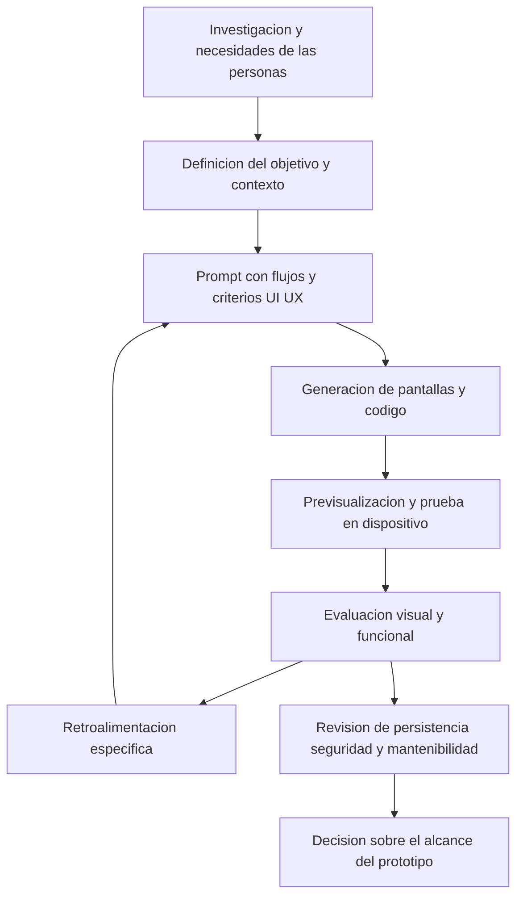

# Clase 3: Diseño UI/UX con inteligencia artificial generativa: prototipado, interacción y evaluación crítica

> **Objetivo académico:** Analizar cómo la generación de aplicaciones mediante lenguaje natural transforma el prototipado UI/UX, aplicando principios visuales, diseño centrado en las personas y criterios de accesibilidad, funcionalidad y mantenibilidad para distinguir una demostración interactiva de un producto preparado para operar.

## 1. Contexto y marco conceptual

La sesión articula los fundamentos del diseño de interacción humano-computadora con la creación de interfaces mediante inteligencia artificial generativa. Rork constituye el caso central: una plataforma presentada como capaz de transformar descripciones en lenguaje natural en aplicaciones móviles basadas en React Native y Expo. La experiencia se complementa con observaciones de otras herramientas generativas.

El cambio metodológico consiste en pasar de dibujar y programar directamente cada componente a describir objetivos, pantallas, interacciones y restricciones. Esta mediación no elimina las decisiones de diseño: las desplaza parcialmente hacia la formulación del prompt y la evaluación del resultado. La persona que diseña debe reconocer qué solicitar, qué información falta y qué aspectos del producto generado requieren corrección.

### Continuidad con el diseño centrado en las personas

La recapitulación organiza el proceso en cinco fases relacionadas:

1. **Investigación:** combinar aproximaciones cualitativas y cuantitativas para comprender comportamientos, motivaciones y contextos. Entrevistar, observar y medir aportan evidencias distintas y complementarias.
2. **Definición:** transformar los hallazgos en necesidades y representaciones de usuarios con motivaciones, frustraciones y condiciones de uso concretas.
3. **Ideación:** ampliar las alternativas mediante técnicas como brainstorming, Crazy 8s y SCAMPER antes de seleccionar soluciones viables y significativas.
4. **Prototipado:** materializar ideas con distintos niveles de fidelidad. Los prototipos de baja fidelidad permiten explorar y comunicar rápidamente; los de alta fidelidad aproximan la apariencia y las interacciones previstas.
5. **Pruebas de usabilidad:** observar el uso, identificar dificultades y retroalimentar las decisiones anteriores.

El proceso es iterativo. Un prototipo visualmente elaborado no suprime la necesidad de investigar ni demuestra, por sí mismo, que una solución responda a necesidades reales.

**Enriquecimiento conceptual:** Las personas de usuario deben apoyarse en evidencia y revisarse cuando cambie el conocimiento del contexto. Una descripción generada automáticamente puede servir como hipótesis, pero no sustituye el contacto con usuarios ni valida sus necesidades.

### UI, UX y sensibilidad visual

La interfaz de usuario —UI— comprende los elementos con los que se percibe y opera el sistema: botones, textos, imágenes, tarjetas y navegación. La experiencia de usuario —UX— incorpora cómo se comprende y vive la interacción en un contexto determinado. La sesión destaca que alineación, contraste, jerarquía, tipografía y color afectan la legibilidad, la orientación y la confianza; no son recursos meramente ornamentales.

Los pequeños desajustes visuales pueden perjudicar la percepción de calidad, aunque su importancia debe evaluarse según la tarea y el contexto. La rapidez de generación hace especialmente necesaria esta mirada crítica: producir una interfaz no equivale a verificar su calidad.

## 2. Fundamentos teóricos y arquitectura

### Generación mediante lenguaje natural

En la demostración, Rork recibe una descripción y genera pantallas, componentes, navegación y estilos. La interfaz de creación ofrece mensajes de progreso y una previsualización; también permite abrir el proyecto en un dispositivo mediante un código QR y Expo Go.

La plataforma se presenta como no-code desde la perspectiva de quien introduce instrucciones, aunque el resultado incluye código. React Native es la tecnología mencionada para construir interfaces móviles, mientras que Expo aporta herramientas para desarrollar y previsualizar proyectos dentro de ese ecosistema. La sesión no realiza una inspección técnica suficiente para caracterizar exhaustivamente la arquitectura interna del generador.

El diagrama representa el ciclo metodológico discutido, no una descripción de los componentes internos de Rork. La revisión de persistencia, seguridad y mantenibilidad recoge preocupaciones surgidas al analizar las aplicaciones.

### Retroalimentación e iteración

La visualización rápida aproxima la idea a un objeto interactivo que puede discutirse y corregirse. Además del resultado, importa la visibilidad del proceso: los mensajes sobre pasos, fallos y correcciones ayudan a comprender el estado de la generación.

La sesión muestra, sin embargo, esperas, errores y resultados que necesitan varias iteraciones. Por ello, la inmediatez del feedback debe entenderse como una aspiración de la experiencia y una ventaja relativa frente a procesos manuales extensos, no como una garantía de respuesta instantánea.

### Principios visuales que deben orientar la generación

| Principio | Función en la interfaz | Traducción a una especificación |
| --- | --- | --- |
| Alineación | Facilitar el recorrido visual y la asociación de elementos | Organizar textos, tarjetas y botones con una estructura común |
| Consistencia | Hacer previsibles las acciones y la navegación | Repetir estilos y posiciones para funciones equivalentes |
| Contraste y legibilidad | Permitir distinguir contenidos y controles | Diferenciar texto y fondo, considerando condiciones de uso |
| Espaciado | Separar grupos y evitar competencia visual | Definir separación entre secciones y elementos relacionados |
| Jerarquía visual | Mostrar prioridades y orientar la acción | Diferenciar títulos, descripciones, precios y acciones principales |
| Tipografía | Sostener lectura, identidad y organización | Especificar familias y niveles de texto legibles |
| Color | Comunicar identidad, estados y relaciones | Definir roles cromáticos coherentes y contrastes suficientes |

La teoría del color recuperada en la sesión distingue matiz o tono, saturación, luminosidad y armonías cromáticas. Estos atributos deben relacionarse con la intención comunicativa y la accesibilidad; una paleta atractiva no garantiza que todos sus usos sean legibles.

### Accesibilidad

La sesión introduce las WCAG como pautas para hacer el contenido web perceptible, operable, comprensible y compatible con tecnologías de asistencia. Se mencionan textos, imágenes, formularios, sonido y video como contenidos que requieren atención.

**Enriquecimiento conceptual:** El cuarto principio de las WCAG se denomina robustez e incluye la posibilidad de interpretación por diferentes agentes de usuario y tecnologías de asistencia. En aplicaciones móviles, estas pautas aportan criterios pertinentes, pero su aplicación debe complementarse con la revisión de componentes, semántica e interacción propios de cada plataforma. Solicitar accesibilidad en un prompt no acredita conformidad.

## 3. Implementación técnica y lógica de negocio

### Caso central: aplicación de pedidos de comida

La demostración construye una aplicación para un restaurante de pollo al espiedo y combos familiares. El prompt integra contexto comercial, intención de experiencia, criterios visuales y estructura funcional. La finalidad es que el usuario pueda encontrar productos y realizar un pedido mediante una interacción ágil y comprensible.

La descripción incluye un estilo moderno y limpio; colores asociados a la identidad del negocio; tipografía sans serif, con Poppins como referencia; títulos destacados; textos descriptivos legibles; alineación en cuadrícula; separación de secciones y contraste entre texto y fondo. Se solicita asimismo considerar la lectura en exteriores.

La formulación cromática del discurso mezcla la idea de una paleta cálida con referencias a verdes, amarillos y rojos. Esto ilustra que un prompt detallado todavía puede contener ambigüedades: es necesario aclarar qué colores cumplen cada función y revisar el resultado.

### Estructura funcional solicitada

| Pantalla | Contenido e interacción | Propósito |
| --- | --- | --- |
| Inicio | Identidad del restaurante, imagen principal, productos destacados y categorías | Facilitar el descubrimiento de la oferta |
| Detalle del producto | Imagen, descripción, precio en moneda boliviana, cantidad y botón para agregar al pedido | Apoyar la selección y comunicar su costo |
| Carrito y pago | Productos seleccionados, subtotal y acción para finalizar la compra | Permitir revisar la selección y continuar el flujo |
| Seguimiento | Estados de preparación, traslado y entrega | Comunicar el avance del pedido |

En la navegación relatada se seleccionó un producto, se modificó su cantidad, se agregó al carrito y se llegó a un estado de preparación. Esa observación respalda la existencia de un recorrido interactivo en el prototipo. No establece que se hayan procesado pagos, comunicado pedidos a un restaurante o conectado servicios de reparto reales.

### El prompt como especificación inicial

La demostración avanza desde una intención general hacia una descripción más estructurada:

- Contexto del negocio y tipo de producto.
- Experiencia que se desea facilitar.
- Estilo visual, tipografía y principios de organización.
- Pantallas, contenidos y acciones.
- Restricciones locales, como la moneda.
- Estados que deben comunicarse durante el recorrido.

**Enriquecimiento conceptual:** Para convertir esa descripción en una especificación evaluable conviene distinguir requisitos funcionales, criterios de presentación y condiciones de aceptación. Por ejemplo, «precio en moneda boliviana» define una restricción de presentación; «agregar al carrito» define una capacidad; «la cantidad elegida se conserva al cambiar de pantalla» establece un comportamiento verificable. Este último criterio se propone como ampliación metodológica y no como resultado comprobado en la sesión.

### Previsualización, corrección y alcance técnico

Expo Go permitió visualizar proyectos en teléfonos mediante QR. Se observaron dificultades de autorización y carga durante algunos intentos. También se sugirió cambiar de navegador ante problemas de previsualización, pero no se realizó una comparación controlada que demostrara una causa específica.

La interacción con el generador continuó mediante instrucciones correctivas y opciones de reparación. En algunos casos la corrección requirió reenviar una instrucción; en otros persistieron errores o aparecieron nuevos problemas. El ciclo de reparación es, por tanto, un mecanismo de iteración, no una garantía automática de resolución.

No se presentan fragmentos de código, esquemas de datos completos ni trazas técnicas que permitan reproducir una implementación. El conocimiento técnico disponible corresponde al flujo de generación, la descripción de las interacciones y las observaciones sobre los prototipos.

## 4. Análisis crítico de casos y auditoría práctica

### Defectos observados en el caso del restaurante

Se identificaron textos, botones o filas recortados en la zona de categorías y menú. La revisión colectiva permitió reconocer un defecto que la generación inicial no había evitado pese a las indicaciones de alineación y legibilidad. Se planteó solicitar su corrección sobre el proyecto existente, pero no quedó documentada una verificación posterior que confirmara su resolución.

**Enriquecimiento conceptual:** Un recorte visual admite varias causas posibles: dimensiones rígidas, desbordamiento, diferencias de escala tipográfica o tratamiento inadecuado del espacio disponible. Sin revisar el código y reproducir el comportamiento no es válido atribuirlo a una causa concreta. La evaluación debe describir primero el síntoma, la pantalla y las condiciones de aparición.

### Diversidad de prototipos y aprendizajes

| Caso | Funciones descritas | Aprendizaje y límite de la evidencia |
| --- | --- | --- |
| Gestión de horarios | Vista semanal, horarios, perfil y conflictos | La propia revisión señala que falta comprobar persistencia e integración entre interfaz y funcionalidad |
| Comercio de ropa | Catálogo, detalles y seguimiento de pedidos | Las iteraciones ayudan a particularizar un resultado inicialmente genérico para un segmento de mercado |
| Farmacia | Localización y pedido de medicamentos, identidad visual asociada a salud | La interpretación del generador requiere correcciones; el aspecto visual no demuestra operación comercial real |
| Aprendizaje de matemáticas | Áreas temáticas, cursos, iconos, desafíos y juegos | La generación amplía opciones, pero se reportan botones incompletos y necesidad de refinar la navegación |
| Campeonatos deportivos | Torneos, equipos, registro y posiciones | Se genera un flujo navegable, aunque se observa un recorte en la navegación inferior |
| Venta de formación continua | Tarjetas, búsqueda, carrito y mensajes de estado | Una descripción específica orienta recorridos simples y feedback sobre la selección |
| Seguros y atención médica | Credencial, búsqueda de médicos, citas, documentos y opciones de asistencia | El alcance descrito excede lo que puede acreditarse con una demostración de interfaz |
| Intermediación de compras | Roles de comprador y vendedor, seguimiento, billetera y retención de pagos | La confianza requiere reglas transaccionales y coordinación entre actores, además de pantallas |
| Finanzas personales | Ingresos, gastos, categorías y resúmenes | La comparación entre plataformas muestra diferencias de alcance incluso con un mismo prompt |
| Equipamiento tecnológico | Productos, categorías, precios y existencias de muestra | El generador completa información no indicada, que debe identificarse como contenido de demostración |

En los prototipos educativos, la herramienta propuso variaciones y juegos adicionales. Esto muestra su capacidad para ampliar el espacio de ideas, pero no constituye evidencia de eficacia pedagógica. De forma semejante, una modificación de color permitió aproximar una propuesta a una identidad institucional, sin demostrar que el resultado cumpliera criterios de contraste o coherencia en todas las pantallas.

### Sistemas de salud: interacción y promesas operativas

El prototipo de seguros reúne consultas de documentos, citas, informes, pagos y un botón de emergencia. También se describe orientación mediante IA a partir de síntomas y una posible activación de asistencia utilizando ubicación.

La evidencia disponible permite recoger estas funciones como propuestas del producto. No demuestra integración con servicios médicos, pagos, dispositivos NFC, despacho de ambulancias ni evaluación clínica validada. La propuesta de detección de accidentes tampoco quedó acreditada técnicamente.

**Enriquecimiento conceptual:** En este dominio, una interfaz debe comunicar con precisión qué servicio está disponible, qué confirmación existe y qué hacer si falla la conexión. Una confirmación visual de solicitud no equivale a la aceptación por un servicio de emergencia. Asimismo, el acceso a información clínica exige controles de autorización y protección de datos; un componente de orientación automatizada necesita una evaluación específica de sus límites y riesgos.

### Intermediación comercial y confianza

La aplicación de acompañamiento de compras propone centralizar vendedores, compradores, entregas y pagos, reteniendo fondos hasta la recepción del producto. La confianza aparece como objetivo de UX ligado a una regla de negocio concreta.

**Enriquecimiento conceptual:** Esa regla requiere definir estados y responsables: quién confirma la entrega, qué sucede ante una disputa y qué condiciones permiten liberar o devolver fondos. Una billetera o un botón de confirmación visibles no acreditan la existencia de un sistema transaccional seguro.

### Comparación de plataformas

La comparación más explícita utiliza un mismo prompt de finanzas personales en Rork, una herramienta mencionada fonéticamente como «Vzero/Bzero», Lovable y Stitch. En otra intervención se comenta una alternativa cuyo nombre se transcribe como «reply». La identificación de estas denominaciones no es igualmente segura.

| Herramienta mencionada | Observación comunicada en la sesión | Alcance de la conclusión |
| --- | --- | --- |
| Rork | Generación móvil y previsualización con Expo Go; necesidad de corregir fallos | Evidencia de prototipado interactivo en los casos mostrados |
| «Vzero/Bzero» | Se reportan backend, esquema de datos, autenticación, opciones de seguridad y enlace desplegado | Capacidades descritas por participantes, sin auditoría de infraestructura o controles |
| Lovable | Se reportan una aplicación similar y opciones de autenticación | No se verifica exhaustivamente su implementación |
| Stitch | Se presenta un resultado centrado en UI y organizado por pantallas o módulos | Describe el uso observado, no una caracterización exhaustiva del producto |
| Alternativa transcrita como «reply» | Se percibe una generación más rápida y un catálogo más completo | Comparación anecdótica, sin medición controlada ni identificación inequívoca |

**Enriquecimiento conceptual:** Usar el mismo prompt mejora la comparabilidad, pero no controla diferencias de plataforma objetivo, modelos, configuración, generación variable o criterios de completitud. Una comparación rigurosa debe separar apariencia, interacción, persistencia, seguridad, exportabilidad y costo de mantenimiento. Las observaciones de la sesión son exploratorias y no permiten establecer una superioridad general.

## 5. Principios de diseño, buenas prácticas y anti-patrones

### Especificar intención y comportamiento

La descripción debe conectar las necesidades con recorridos y contenidos concretos. Expresiones como «moderna» o «intuitiva» comunican intención, pero requieren criterios observables para orientar y evaluar la generación. La posibilidad de añadir funciones durante la conversación es útil, aunque puede aumentar la complejidad y dificultar la revisión del conjunto.

### Revisar coherencia, accesibilidad y estados

Los controles equivalentes deben conservar significado y estilo a lo largo de la aplicación. La revisión incluye textos recortados, jerarquía, contraste, espaciado y navegación, así como mensajes que informen qué ocurrió después de una acción.

**Enriquecimiento conceptual:** Los estados relevantes incluyen carga, ausencia de datos, error y confirmación. La accesibilidad también exige revisar etiquetas comprensibles, foco, escalado de texto y compatibilidad con tecnologías de asistencia. El color debe acompañarse de otros indicadores cuando comunica estados importantes.

### Distinguir niveles de evidencia

| Nivel | Evidencia necesaria | Confusión que debe evitarse |
| --- | --- | --- |
| Apariencia | Revisión de pantallas y componentes | Inferir usabilidad únicamente por atractivo visual |
| Interacción | Recorridos y respuestas de controles | Suponer que un botón visible implementa su función |
| Persistencia | Comprobación de conservación y recuperación de datos | Confundir estado temporal con almacenamiento estable |
| Integración | Confirmación del intercambio con servicios externos | Interpretar una simulación como conexión operativa |
| Operación | Revisión técnica del comportamiento y sus condiciones | Declarar preparación productiva a partir de una demostración breve |

**Enriquecimiento conceptual:** Esta clasificación organiza las preocupaciones surgidas en la sesión. No corresponde a una certificación aplicada a los prototipos mostrados.

### Mantener control sobre el producto generado

La discusión sobre GitHub y acceso al código plantea una cuestión arquitectónica: cómo revisar, mantener y evolucionar el producto sin depender exclusivamente de la plataforma. La sesión no confirma una exportación ni una revisión de repositorio, pero identifica la mantenibilidad como criterio de selección tecnológica.

La autenticación también aparece como una condición relevante. **Enriquecimiento conceptual:** Autenticar establece quién accede; autorizar determina qué puede consultar o modificar. La presencia de una pantalla de acceso no demuestra por sí misma una protección adecuada de los datos.

### Anti-patrones identificados

- Confundir rapidez de generación con calidad validada.
- Conservar un resultado genérico sin adaptarlo al contexto y a sus usuarios.
- Confiar en que solicitar «buenas prácticas» garantiza su cumplimiento.
- Dar por solucionado un defecto sin repetir la interacción afectada.
- Interpretar datos de muestra, mapas o estados simulados como integraciones reales.
- Ampliar funciones de manera continua sin revisar coherencia y alcance.
- Seleccionar una herramienta exclusivamente por su apariencia, sin considerar código, seguridad, dependencia y mantenimiento.

## 6. Síntesis conceptual y profundización académica

La inteligencia artificial generativa reduce la distancia entre una descripción y un prototipo interactivo. Su contribución más clara en la sesión es facilitar la exploración, hacer visibles ideas y permitir iteraciones que antes exigían mayor intervención manual. Los casos de comercio, educación, gestión, salud y finanzas muestran esa amplitud, junto con fallos visuales, controles incompletos y dudas sobre la infraestructura subyacente.

El conocimiento de UI/UX sigue siendo necesario para formular instrucciones y evaluar resultados. La persona que diseña conserva la responsabilidad de comprender a los usuarios, establecer prioridades, interpretar problemas y decidir qué evidencia falta. La herramienta puede proponer componentes y alternativas, pero la sesión no demuestra que comprenda de manera suficiente la dimensión cultural, emocional o cognitiva del contexto.

La tensión central es la diferencia entre plausibilidad y validación: una aplicación puede parecer coherente y ofrecer un recorrido convincente sin acreditar persistencia, seguridad o integración operativa. Por ello, la calidad debe analizarse por dimensiones y con evidencias acordes al alcance de cada afirmación.

**Enriquecimiento conceptual:** Las líneas de profundización más directamente vinculadas con la sesión son la trazabilidad entre necesidades y prompts, la evaluación de accesibilidad de interfaces generadas, la transferencia del prototipo al desarrollo mantenible y el estudio de cómo la automatización modifica el juicio del diseñador. Estas líneas permiten analizar tanto la productividad obtenida como las nuevas responsabilidades que introduce la mediación generativa.
