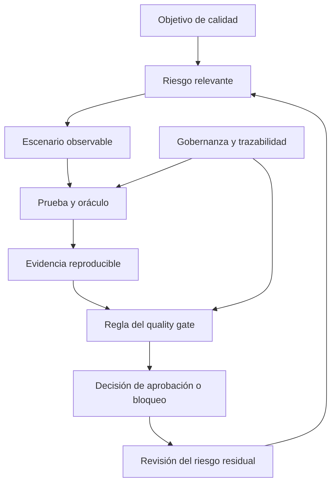

# Clase 2: Evaluación crítica de propuestas de calidad de software: evidencia, quality gates y gobernanza

> **Objetivo académico:** Analizar propuestas de control de calidad de software mediante criterios verificables, distinguir promesas de evidencia y fundamentar decisiones sobre quality gates, riesgos, automatización y gobernanza sin completar vacíos documentales con supuestos.

## 1. Contexto y marco conceptual

La sesión aborda la revisión de propuestas externas para implementar control de calidad de software. El problema central consiste en determinar si una propuesta ofrece mecanismos suficientes para reducir los riesgos relevantes de una organización, más allá de presentar una metodología atractiva o una lista de actividades.

Las propuestas examinadas comparten elementos como escenarios, priorización por riesgo, diseño sistemático de pruebas, integración continua y puertas de calidad. Sus diferencias aparecen principalmente en las reglas de aprobación, la gestión de fallos intermitentes, las excepciones y la formalización de responsabilidades. La revisión se orienta a comprender cómo funcionaría el control y qué carencias impedirían confiar en él.

### 1.1 Promesa, evidencia y decisión

Una promesa expresa una intención: mejorar la calidad, reducir fallos o automatizar verificaciones. La evidencia permite evaluar si esa intención se ha concretado mediante resultados observables, artefactos reproducibles y reglas de interpretación explícitas.

La sesión propone una cadena conceptual de operacionalización:

Operacionalizar significa transformar una preocupación abstracta por la calidad en criterios que puedan observarse y evaluarse. La automatización es una posibilidad posterior; primero debe estar claro qué se mide, por qué es relevante y cómo se interpretará el resultado.

### 1.2 Categorías de la revisión

| Categoría | Significado | Consecuencia para la decisión |
| --- | --- | --- |
| Fortaleza | Mecanismo explícito que contribuye a un objetivo relevante | Aporta razones favorables, con alcance delimitado |
| Debilidad | Característica descrita que puede comprometer el control | Requiere valorar impacto y posibilidad de corrección |
| Vacío | Información necesaria que no está especificada | Impide concluir sobre un aspecto concreto |
| Dependencia | Condición externa necesaria para ejecutar el programa | Exige responsabilidad y respuesta ante indisponibilidad |
| Riesgo residual | Riesgo que permanece después de aplicar controles | Debe reconocerse y relacionarse con la decisión de aceptación |
| Condición verificable | Cambio cuya satisfacción puede comprobarse | Permite distinguir aceptación condicionada de confianza informal |

No especificar un mecanismo no demuestra que el proveedor carezca de él; demuestra que la propuesta no permite comprobarlo. Esta distinción evita tanto el rechazo por conjeturas como la aceptación por confianza injustificada.

## 2. Fundamentos teóricos y arquitectura

### 2.1 Quality gate como regla de decisión

Un quality gate es un punto de decisión que utiliza resultados de verificaciones para permitir o impedir el avance de un cambio. Su rigor depende de la combinación entre criterios relevantes, umbrales definidos, evidencia disponible y reglas de aprobación.

La sesión distingue dos tipos de verificaciones:

- **Informativas:** producen información para seguimiento, pero su incumplimiento no bloquea el flujo.
- **Bloqueantes:** impiden continuar cuando no se cumplen las condiciones establecidas.

La transición progresiva entre ambos tipos puede reducir fricción inicial y permitir construir una línea base. Sin embargo, sin criterios objetivos de estabilización, un control relevante podría permanecer indefinidamente en modo informativo.

Un contrato del gate necesita especificar qué se verifica, cómo se calcula cada resultado, cuáles son los umbrales, qué evidencia se conserva y qué ocurre ante fallos, omisiones o excepciones.

### 2.2 Aprobación agregada y controles críticos

Una de las reglas discutidas permite aprobar cuando pasan tres de cuatro verificaciones. El problema aparece si una verificación crítica, como seguridad, puede ser precisamente la que falle sin impedir la aprobación. Añadir un control no garantiza que este tenga poder de bloqueo.

**Enriquecimiento conceptual:** sean $c_i \in \{0,1\}$ los resultados de cuatro verificaciones, con $i \in \{1,2,3,4\}$, donde $1$ significa cumplimiento y $0$ incumplimiento. La regla agregada sería:

$$
G_{3/4}=\mathbf{1}\left(\sum_{i=1}^{4}c_i\geq 3\right)
$$

Aquí $G_{3/4}\in\{0,1\}$ indica aprobación, y $\mathbf{1}(\cdot)$ vale uno cuando la condición es verdadera. Se supone que las cuatro verificaciones producen resultados binarios válidos; esta expresión no modela ejecuciones omitidas ni errores de infraestructura.

Si $c_4$ representa seguridad y los resultados son $(1,1,1,0)$, el gate aprueba a pesar del incumplimiento de seguridad. Para hacer obligatorio ese control, una regla ilustrativa sería:

$$
G=c_4\land\mathbf{1}\left(\sum_{i=1}^{3}c_i\geq 2\right)
$$

El operador $\land$ exige que ambas condiciones se cumplan. La expresión muestra la diferencia entre contar verificaciones satisfactorias y exigir controles críticos. El número de controles adicionales necesarios debe justificarse por riesgo; no se propone esta regla como umbral universal.

### 2.3 Ley de Goodhart y gaming

La sesión utiliza la ley de Goodhart para analizar situaciones en las que mejorar un indicador deja de representar una mejora del fenómeno que se pretendía controlar. El gaming consiste en adaptar el comportamiento para satisfacer el indicador, aunque el riesgo real permanezca.

Los mecanismos discutidos incluyen:

- Reejecutar una prueba fallida y conservar únicamente el resultado favorable.
- Reducir cobertura o relajar validaciones para aumentar la tasa de aprobación.
- Modificar umbrales para evitar bloqueos.
- Rebajar verificaciones bloqueantes a informativas sin criterios de restitución.
- Utilizar excepciones como vía habitual de aprobación.

Una métrica cuantitativa no genera por sí sola una ilusión de control. El problema surge cuando pierde su conexión con el riesgo o cuando se interpreta sin considerar cómo fue producida y qué aspectos deja fuera.

### 2.4 Priorización por riesgo y límites del consenso

Las propuestas incorporan matrices de probabilidad e impacto y selección de riesgos prioritarios. Estas herramientas ayudan a orientar el esfuerzo, pero su utilidad depende de la calidad de las estimaciones.

Cuando no existen datos históricos, el consenso puede aportar juicio experto, aunque también introducir sesgos. Una clasificación acordada no equivale automáticamente a una probabilidad empíricamente validada. Es necesario distinguir estimaciones apoyadas en datos, hipótesis de trabajo y decisiones adoptadas bajo incertidumbre.

La priorización tampoco elimina los riesgos que quedan fuera del conjunto seleccionado. La declaración del riesgo residual es una fortaleza porque hace visible ese límite.

### 2.5 Diseño sistemático y oráculos

Se mencionan particiones de equivalencia y valores límite como técnicas de diseño de pruebas. Su propósito es seleccionar casos de manera razonada y reducir redundancias, en lugar de aumentar indiscriminadamente la cantidad de pruebas.

**Enriquecimiento conceptual:** una partición de equivalencia agrupa entradas para las que se espera un comportamiento comparable respecto de una propiedad. Los valores límite concentran la atención en las fronteras entre comportamientos. La suficiencia de la selección depende de que las particiones representen adecuadamente las reglas del sistema.

Un oráculo determina cómo juzgar el resultado de una prueba. Ejecutar un caso sin un criterio de corrección explícito produce observaciones, pero no permite concluir de forma reproducible si el comportamiento es aceptable.

## 3. Implementación técnica y lógica de negocio

La fuente contiene una revisión de mecanismos y propuestas, pero no presenta código ejecutable, configuraciones completas ni resultados de ejecuciones. La implementación técnica se reconstruye al nivel de políticas y arquitectura del control, sin afirmar que los mecanismos hayan sido desplegados.

### 3.1 Contrato operativo del gate

A partir de las carencias discutidas, el gate debe poder responder preguntas concretas:

| Aspecto | Especificación necesaria | Riesgo de dejarlo ambiguo |
| --- | --- | --- |
| Verificaciones | Propiedad evaluada y relación con el riesgo | Aprobar controles poco pertinentes |
| Umbrales | Criterio de cumplimiento por verificación | Interpretación discrecional |
| Cobertura | Alcance y mínimo de casos pertinentes | Mejorar indicadores reduciendo lo observado |
| Omisiones | Tratamiento de pruebas no ejecutadas | Confundir ausencia de evidencia con cumplimiento |
| Reintentos | Motivo, cantidad permitida y regla de decisión | Ocultar fallos intermitentes |
| Evidencia | Resultados y artefactos que deben conservarse | Imposibilidad de reconstruir la aprobación |
| Cambios | Autoridad, revisión y registro de modificaciones | Relajar el control sin seguimiento |
| Excepciones | Justificación, aprobación y duración | Convertir el bypass en práctica ordinaria |

La selección del framework o del stack es importante para verificar compatibilidad, pero no sustituye la revisión de estos mecanismos. La recomendación metodológica de la sesión es aclarar primero qué control necesita la organización y después evaluar con mayor detalle cómo implementarlo.

### 3.2 Fallos intermitentes y política de reejecución

Una prueba inestable puede alternar entre éxito y fallo sin que exista un cambio deliberado que explique el resultado. La sesión cuestiona la política de tomar el segundo resultado como referencia cuando el primero falla: el resultado favorable puede borrar la señal de un defecto real.

La revisión plantea conservar ambos intentos, registrar la causa investigada y vincular el problema con un registro de seguimiento. También se propone aislar pruebas inestables en cuarentena.

**Enriquecimiento conceptual:** la cuarentena separa una señal poco confiable del mecanismo ordinario de bloqueo, pero no resuelve el defecto. Necesita responsable, seguimiento y criterio de reincorporación; de lo contrario, puede convertirse en una exclusión permanente de cobertura.

**Enriquecimiento conceptual:** supóngase que una prueba detecta un fallo con probabilidad $p\in[0,1]$ en cada intento y que los intentos son independientes bajo condiciones equivalentes. Si se declara fallo únicamente cuando fallan los dos intentos, entonces:

$$
P(\text{fallo registrado})=p\cdot p=p^2
$$

Por ejemplo, si $p=0{,}2$, un intento registra fallos con probabilidad del 20 %, mientras que la regla de aceptar un segundo intento satisfactorio reduce la probabilidad de registrar fallo al 4 %. Es un ejemplo hipotético, no un resultado de la sesión. Ilustra que una política de registro puede mejorar el indicador sin modificar el sistema. La independencia puede no cumplirse cuando intervienen estado compartido, cachés o dependencias externas.

### 3.3 Gobernanza de cambios y excepciones

Permitir que el equipo técnico cambie artefactos o umbrales sin un procedimiento formal dificulta saber qué regla estaba vigente cuando se aprobó un cambio. La gobernanza requiere poder reconstruir tanto la ejecución como la versión del control aplicado.

Las excepciones pueden ser necesarias, pero la expresión «justificación operativa» resulta insuficiente si no se precisa qué motivos son admisibles, quién tiene autoridad para aprobarlos y cuánto dura la autorización. La sesión también identifica como carencia la ausencia de un contenido mínimo para la bitácora.

**Enriquecimiento conceptual:** un registro de cambio útil puede incluir la regla anterior y la nueva, el motivo, el responsable, la aprobación y su vigencia. Estos campos son una propuesta de operacionalización; no se presentan como un formato existente en los documentos originales.

### 3.4 Entornos, seguridad y dependencias

Se discuten propuestas que no explicitan adecuadamente la separación entre desarrollo, pruebas y producción, la aprobación de cambios y las responsabilidades de seguridad. Ejecutar pruebas de carga en producción puede afectar la disponibilidad; la revisión debe aclarar dónde se realizan, bajo qué autorización y con qué límites.

Entre las dependencias operativas aparecen la disponibilidad del entorno, del responsable de producto y del liderazgo técnico. También importa quién prepara, limpia y mantiene los datos de prueba. Una dependencia declarada, pero sin respuesta ante su incumplimiento, puede impedir ejecuciones frecuentes o interrumpir la adopción del control.

**Enriquecimiento conceptual:** la segregación de entornos reduce exposición, pero no implica que toda prueba en producción sea inadmisible. Si se justifica su necesidad, requiere controles específicos de impacto y recuperación. La fuente no describe un procedimiento de este tipo.

## 4. Análisis crítico de casos y auditoría práctica

### 4.1 Regla de tres de cuatro y seguridad

El primer caso conservado en la segunda parte de la transcripción relaciona una regla agregada de aprobación con carencias en seguridad, control de cambios y segregación de entornos. Su discusión más importante es lógica: incorporar una verificación de seguridad no corrige la debilidad si la regla todavía permite aprobar cuando esa verificación falla.

La condición de aceptación debe modificar explícitamente el comportamiento del gate. Confiar en que un análisis posterior «debería incluirlo» mantiene abierta la misma incertidumbre que motivó la observación.

### 4.2 Atlas QA Partners: maduración progresiva y falsos verdes

Según lo expuesto en la sesión, esta propuesta combina escenarios, priorización por riesgo, diseño sistemático, oráculos y transición de verificaciones informativas a bloqueantes. Se valoran la adopción progresiva y la declaración del riesgo residual.

Las principales objeciones se concentran en la política de reejecución, la falta de reglas contra la manipulación, la estimación consensuada de riesgos y los criterios insuficientes para endurecer verificaciones no funcionales. También se mencionan dependencias del entorno y ambigüedades sobre alcance y responsabilidades.

La misma base documental conduce a dos posiciones: rechazo por comprometer la integridad del gate, o aceptación condicionada a corregir sus reglas. La diferencia no se resuelve contando fortalezas y debilidades. Es necesario determinar si las correcciones son suficientes y verificables, y si deben satisfacerse antes de confiar en el control.

La discusión sobre compatibilidad tecnológica es pertinente, pero debe ubicarse en el nivel apropiado. Una propuesta puede usar herramientas compatibles y, aun así, aplicar reglas de aprobación inadecuadas.

### 4.3 North Star: excepciones y adaptación al sistema bajo prueba

En la descripción de esta propuesta se destacan evidencia reproducible, matriz de riesgos, oráculos, clasificación de verificaciones y gobernanza. Las objeciones se dirigen a criterios de estabilización, uso de excepciones, reducción temporal de severidad y falta de precisión en los registros de cambios.

El riesgo principal consiste en sustituir la corrección de causas por autorizaciones sucesivas para continuar. Una excepción documentada mejora la trazabilidad, pero el registro no demuestra por sí mismo que la decisión sea aceptable.

Un análisis adicional contrasta la propuesta con un chatbot que responde consultas sobre cursos. Se cuestiona si un enfoque genérico de pruebas cubre adecuadamente la corrección y coherencia de respuestas de un modelo de lenguaje. También se plantea la necesidad de coordinar la integración continua con posibles cambios de prompts o ajustes del modelo.

**Enriquecimiento conceptual:** semejanza textual y corrección semántica son propiedades distintas. Una respuesta puede usar palabras diferentes y ser correcta, o parecerse a una referencia y contener un error decisivo. La evaluación de un chatbot requiere definir qué significa una respuesta aceptable en su dominio; una métrica de similitud aislada no constituye un oráculo suficiente.

Los cambios de prompts o el ajuste fino son alternativas mencionadas en el debate, no remedios universales. La fuente no aporta experimentos que permitan determinar qué intervención sería adecuada en ese sistema.

### 4.4 Supuestos no autorizados en una decisión

En el debate se interpreta que una propuesta podría ser un anexo de un contrato previo con alcances e indicadores ya definidos. Esa interpretación no queda respaldada por documentación en la fuente. La presencia de un precio tampoco prueba la existencia de un contrato anterior.

La lección metodológica es separar una hipótesis contextual de un hecho disponible. Si un contrato previo cambia la decisión, debe solicitarse y revisarse. Hasta entonces, sus condiciones no pueden utilizarse para cerrar vacíos.

De modo semejante, afirmar que un precio excede un presupuesto exige conocer el presupuesto aplicable. La sesión recoge esa apreciación en un caso, pero no permite realizar una auditoría económica independiente.

### 4.5 Factibilidad temporal y madurez del control

El debate sobre plazos distingue la instalación de un gate funcional de la consolidación de un control estable y gobernado. Disponer de una primera ejecución automatizada no demuestra que los umbrales sean adecuados, que las pruebas sean confiables o que las responsabilidades estén institucionalizadas.

Se identifican factores que condicionan la estimación: complejidad del sistema, cantidad y diversidad de interfaces, criticidad del negocio, testabilidad, disponibilidad de logs, entornos y datos. Una estrategia de resultados parciales puede hacer visible el avance sin presentar cada incremento como madurez completa.

La criticidad también introduce una distinción necesaria: un riesgo urgente puede requerir una respuesta inmediata, pero esa urgencia no prueba que el programa integral pueda completarse antes.

**Enriquecimiento conceptual:** conviene separar mitigaciones inmediatas de la maduración del sistema de control. La primera reduce exposición a corto plazo; la segunda necesita evidencia suficiente para justificar estabilidad y eficacia. No existe en la fuente una duración universal válida para cualquier organización.

## 5. Principios de diseño, buenas prácticas y anti-patrones

### 5.1 Principios de una revisión defendible

1. **Fundamentar cada afirmación en evidencia identificable.** Una observación debe poder vincularse con la parte de la propuesta que la sostiene o con una ausencia delimitada.
2. **Evaluar pertinencia respecto del contexto.** La calidad de una metodología depende de los riesgos y propiedades del sistema bajo prueba.
3. **Distinguir incertidumbre de incumplimiento.** La falta de información requiere aclaración; un mecanismo explícitamente inadecuado requiere corrección.
4. **Convertir condiciones en comprobaciones.** «Mejorar seguridad» es insuficiente frente a definir qué control debe bloquear y cómo se verificará.
5. **Proteger los controles críticos.** Su incumplimiento no debe compensarse inadvertidamente con verificaciones de menor relevancia.
6. **Conservar resultados desfavorables.** Los reintentos aportan información adicional; no deben borrar el primer fallo.
7. **Gobernar cambios y excepciones.** Las decisiones sobre el control necesitan autoridad, trazabilidad y criterios de vigencia.
8. **Reconocer el riesgo residual.** Una selección priorizada de pruebas no representa cobertura completa del sistema.
9. **Separar funcionamiento y madurez.** La automatización inicial debe diferenciarse de la confiabilidad sostenida del proceso.

### 5.2 Anti-patrones identificados

| Anti-patrón | Problema conceptual | Orientación correctiva |
| --- | --- | --- |
| Reintentar hasta obtener verde | Selecciona resultados favorables y oculta inestabilidad | Política previa y conservación de todos los intentos |
| Agregar seguridad sin hacerla obligatoria | Confunde presencia con capacidad de bloqueo | Regla explícita para controles críticos |
| Mantener controles informativos indefinidamente | Posterga la reducción efectiva del riesgo | Criterios verificables de transición |
| Rebajar severidad sin restitución definida | Normaliza una pérdida de protección | Límites y condición de recuperación |
| Cambiar umbrales sin revisión | Permite adaptar el indicador para aprobar | Versionado y aprobación de cambios |
| Medir calidad por número de pruebas | Confunde volumen con pertinencia | Diseño sistemático vinculado a riesgos |
| Suponer documentación contractual ausente | Sustituye evidencia por una narración plausible | Confirmación documental |
| Seleccionar herramientas antes de aclarar el control | Desplaza el problema hacia la implementación | Definición inicial de propiedades y reglas |

### 5.3 Precisión sobre la cobertura del 100 %

La sesión cuestiona las promesas de cobertura total. Es necesario delimitar qué significa cobertura antes de evaluar esa afirmación.

**Enriquecimiento conceptual:** puede alcanzarse el 100 % respecto de un conjunto finito definido, como ciertas sentencias de código o requisitos enumerados. Eso no demuestra que se hayan cubierto todos los comportamientos posibles ni que el software carezca de defectos. El problema es presentar una cobertura particular como garantía universal de calidad, o prometer exhaustividad sin definir el universo considerado.

## 6. Síntesis conceptual y profundización académica

La revisión rigurosa de propuestas de calidad exige reconstruir el vínculo entre riesgo, observación y decisión. Un quality gate aporta valor cuando su aprobación representa evidencia pertinente y cuando sus reglas resisten cambios oportunistas, reintentos selectivos y excepciones indefinidas.

Aceptar, aceptar con condiciones o rechazar son decisiones que deben corresponder al estado de la evidencia. La aceptación condicionada no elimina las carencias: declara qué tendría que cambiar y cómo comprobarlo. El rechazo puede justificarse cuando una debilidad compromete el mecanismo central o cuando la incertidumbre impide asumir razonablemente el compromiso.

La perspectiva doctoral enfatizada en la sesión consiste en argumentar decisiones defendibles, reconocer límites y distinguir datos, teoría y juicio experto. El conocimiento teórico ayuda a identificar consecuencias plausibles cuando falta evidencia empírica, pero no convierte esas consecuencias en resultados observados.

También se abre una perspectiva de investigación sobre calidad de software: identificar limitaciones de métodos y estudios, analizar la adecuación de los controles a sistemas con IA y estudiar la relación entre métricas y riesgo real. La familia ISO/IEC 25000 se menciona como referencia general del área, sin desarrollar sus modelos ni requisitos en la fuente.

**Enriquecimiento conceptual:** tres líneas de profundización conectan los argumentos de la clase: la validez de una métrica como representación de calidad, la confiabilidad de las pruebas como instrumentos de observación y la gobernanza como mecanismo que preserva el significado de la evidencia. Su articulación permite evaluar si un indicador favorable corresponde a una mejora del sistema o solo a una modificación de la forma de medirlo.
