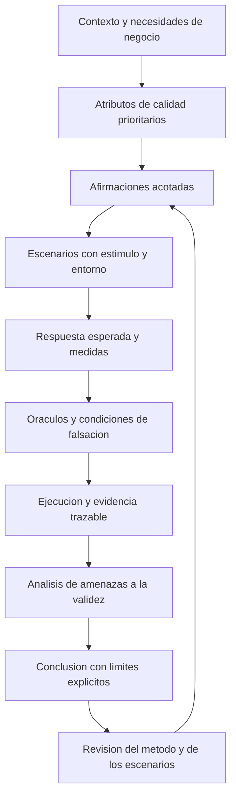

# Clase 3: Calidad de software: escenarios falsables, evidencia reproducible y amenazas a la validez

> **Objetivo académico:** Analizar cómo transformar atributos abstractos de calidad de software en escenarios medibles y falsables, formalizar métodos reproducibles para definirlos y evaluar las amenazas que limitan las conclusiones obtenidas a partir de sus evidencias.

## 1. Contexto y marco conceptual

La sesión desarrolla una idea central: una afirmación de calidad necesita contexto, criterios observables y evidencia. Expresiones como «el software es bueno», «es rápido» o «es seguro» resultan insuficientes mientras no se precise para quién, bajo qué condiciones y respecto de qué comportamiento esperado.

La analogía de las sillas ilustra esta dependencia contextual: una silla adecuada para un jardín infantil puede resultar inadecuada para una oficina o un bar. Del mismo modo, un tiempo de respuesta aceptable para una operación administrativa puede ser inaceptable en otro servicio. La experiencia del evaluador orienta la investigación, pero también puede sesgarla cuando impone criterios conocidos antes de comprender el contexto real del sistema.

### Testing y aseguramiento de la calidad

La sesión distingue el testing del aseguramiento de la calidad, o *quality assurance* —QA—, como actividades complementarias:

| Dimensión | Testing | Aseguramiento de la calidad |
| --- | --- | --- |
| Foco destacado | Comportamiento del producto bajo condiciones definidas | Procesos que sostienen y previenen problemas de calidad |
| Evidencias características | Respuestas, registros, tiempos, fallos y resultados de pruebas | Procedimientos, planes, auditorías y controles del proceso |
| Contribución | Reducir incertidumbre sobre afirmaciones específicas | Favorecer consistencia, prevención y mejora organizativa |
| Límite | Una prueba satisfactoria no demuestra ausencia de defectos | Un proceso documentado o certificado no garantiza por sí solo el comportamiento del producto |

**Enriquecimiento conceptual:** Esta distinción describe focos de trabajo, no una separación absoluta. El testing puede aportar evidencia al sistema de QA y realizarse durante distintas etapas del desarrollo. Tampoco toda evaluación de calidad requiere ejecutar el producto: la revisión de requisitos, arquitectura o código puede aportar evidencia pertinente. La representatividad de las pruebas respecto del uso previsto debe justificarse según el tipo de afirmación.

El sistema bajo prueba se denomina SUT, por *system under test*. Su delimitación es decisiva: una API local, una aplicación desplegada con su base de datos y un servicio que depende de un proveedor externo constituyen objetos de evaluación diferentes.

### Calidad como reducción de incertidumbre

Las pruebas permiten identificar defectos y respaldar conclusiones acotadas. No autorizan a declarar que un sistema está libre de errores. Por ejemplo, comprobar que una API devuelve una respuesta válida reduce incertidumbre sobre esa operación en ese entorno, pero no demuestra seguridad, escalabilidad ni estabilidad prolongada.

La conclusión académicamente defendible debe reunir cuatro elementos: afirmación evaluada, evidencia disponible, condiciones de observación y límites de inferencia.

## 2. Fundamentos teóricos y arquitectura

### De un atributo abstracto a un escenario observable

Un escenario de calidad relaciona una situación concreta con una respuesta esperada y una regla de evaluación. En la sesión se emplean los siguientes componentes:

| Componente | Función |
| --- | --- |
| Afirmación o *claim* | Expresar qué propiedad se pretende sostener |
| Estímulo | Precisar la petición, entrada, evento o perturbación |
| Entorno | Identificar condiciones de despliegue, carga, configuración y estado |
| Respuesta | Describir el comportamiento esperado |
| Medida | Determinar cómo observar y cuantificar la respuesta |
| Oráculo | Establecer cómo decidir si el resultado satisface el criterio |
| Evidencia | Conservar el registro que permite revisar la decisión |
| Falsación | Precisar qué observación refutaría la afirmación |

Un oráculo es una referencia o regla para juzgar el resultado. Puede apoyarse en un contrato de API, una regla de negocio, un esquema de datos o un requisito temporal. La evidencia es el resultado registrado; no debe confundirse con la regla que lo interpreta.

### Falsabilidad y alcance de la afirmación

Una afirmación es falsable si se puede describir una observación incompatible con ella. Esto no equivale simplemente a introducir datos inválidos. Una prueba con datos válidos también puede refutar una afirmación si el sistema incumple la respuesta funcional o temporal prevista.

Por ejemplo, «un usuario autenticado puede crear un artículo válido» queda refutada si, cumplidas las precondiciones, la operación no crea el artículo o atribuye su autoría incorrectamente. Si el escenario incluye un requisito temporal, una respuesta funcionalmente correcta puede incumplirlo.

**Enriquecimiento conceptual:** Un escenario satisfactorio respalda una afirmación bajo las condiciones observadas. El salto desde esas observaciones a una propiedad general necesita argumentos adicionales sobre representatividad de datos, cargas, estados y entornos.

### Tres perspectivas de validez

Las amenazas a la validez son condiciones que debilitan la interpretación o el alcance de una conclusión. No basta enumerar problemas técnicos: debe explicarse cómo alteran la relación entre observación y afirmación.

| Perspectiva | Pregunta central | Ejemplo pertinente |
| --- | --- | --- |
| Validez interna | ¿Qué condiciones del procedimiento podrían explicar el resultado observado? | Estado residual de la base de datos o calentamiento no controlado |
| Validez de constructo | ¿La medida representa realmente la propiedad que se afirma evaluar? | Interpretar HTTP 200 como demostración suficiente de corrección o seguridad |
| Validez externa | ¿Hasta dónde pueden trasladarse los resultados? | Generalizar desde una máquina local a producción o a otros perfiles de usuarios |

**Enriquecimiento conceptual:** La clasificación depende del argumento que se pretende sostener. Una diferencia entre entornos puede afectar la generalización; también puede revelar que el procedimiento operacionaliza inadecuadamente el objeto evaluado. «Externa» no significa simplemente que un componente pertenezca a otro proveedor, ni «interna» que el problema pertenezca al equipo. La sesión emplea estas categorías con cierta flexibilidad; conviene justificar cada clasificación mediante el mecanismo de sesgo.

### Formalización del método

El método para construir escenarios es distinto del conjunto de escenarios ya construido. Una lista de pruebas describe productos del trabajo; un método explica cómo otra persona puede producirlos.

La formalización debe proporcionar entradas, pasos, criterios de decisión y resultados esperados. Su valor consiste en permitir repetición, comparación y mejora. Un procedimiento estable puede generar escenarios insuficientes; precisamente su estabilidad facilita identificar el patrón de error y corregirlo. La repetibilidad es necesaria para la mejora sistemática, aunque no garantiza que el método sea correcto.

## 3. Implementación técnica y lógica de negocio

La fuente describe scripts, registros y automatización, pero no proporciona código completo que permita reproducir las ejecuciones. Por ello se conserva su lógica técnica sin inventar implementaciones ni resultados adicionales.

### Procedimiento para definir escenarios

La discusión permite reconstruir una secuencia metodológica general:

1. Delimitar el SUT, su uso previsto, sus contratos y las restricciones de acceso.
2. Identificar comportamientos críticos y atributos de calidad relevantes para el negocio.
3. Formular afirmaciones acotadas sobre esos comportamientos.
4. Expresar cada afirmación como estímulo, entorno, respuesta y medida.
5. Definir oráculos y condiciones de falsación antes de ejecutar.
6. Preparar condiciones de ejecución y mecanismos de registro reproducibles.
7. Analizar resultados, amenazas y límites antes de formular conclusiones.

**Enriquecimiento conceptual:** Esta secuencia sintetiza las intervenciones de la sesión; no constituye un estándar externo ni un procedimiento validado experimentalmente. Para convertirla en un método operativo conviene especificar cómo priorizar comportamientos, justificar umbrales y resolver desacuerdos entre evaluadores.

### Contratos, operaciones y códigos HTTP

Los casos de API incluyen accesibilidad del contrato, operaciones CRUD —crear, leer, actualizar y eliminar—, entradas inválidas, latencia y autorización.

| Caso | Oráculo descrito o discutido | Alcance y precaución |
| --- | --- | --- |
| Contrato accesible | HTTP 200 y contenido identificable como OpenAPI | Confirma acceso básico; no certifica conformidad completa del contrato |
| Operación básica | Código esperado y JSON bien formado | La sintaxis válida no garantiza semántica de negocio correcta |
| Recurso inexistente | Respuesta de error prevista por el contrato | Comprobar solo que sea distinta de 200 es insuficiente |
| Creación de artículo | Respuesta de creación, autoría correcta y artículo visible | Relaciona transporte, contenido y efecto persistente |
| Acceso protegido | Rechazo de credenciales inválidas y aceptación de las válidas | No demuestra cobertura completa de autenticación y autorización |

En varias intervenciones se transcribe «2011» junto a respuestas de creación. Por el contexto se interpreta como HTTP 201; no se reconoce un código HTTP 2011. Asimismo, la mención aislada a un endpoint «existente» con respuesta 404 se entiende en el contexto general de pruebas sobre recursos o rutas inexistentes, sujeto siempre al contrato concreto.

**Enriquecimiento conceptual:** HTTP 401 y 403 no son intercambiables: suelen distinguir falta de autenticación válida y denegación de una operación, respectivamente. HTTP 500 señala un error del servidor y no debe aceptarse como manejo correcto de una entrada inválida solo porque sea distinto de 200. El oráculo debe indicar la respuesta específica esperada y sus condiciones.

### Latencia, repetición y umbrales

La sesión propone medir tiempos de respuesta y conservar una línea base. También insiste en justificar los límites desde el contexto de negocio, evitando ajustar el criterio únicamente para que coincida con el resultado obtenido.

**Enriquecimiento conceptual:** Para una solicitud individual puede definirse la latencia observada como:

$$
L = t_f - t_i
$$

Aquí $t_i$ y $t_f$ son los instantes de inicio de la solicitud y finalización de la respuesta, medidos con una referencia temporal consistente; $L$ es una duración no negativa, expresada, por ejemplo, en milisegundos. La definición requiere precisar qué se considera finalización: recepción completa, primera respuesta o algún otro evento. Una medida desde el cliente incluye efectos de comunicación y no equivale necesariamente al tiempo de procesamiento interno.

**Enriquecimiento conceptual:** Para $n$ solicitudes observadas, con $n$ entero positivo y latencias $L_1,\ldots,L_n$, la media aritmética es:

$$
\overline{L} = \frac{1}{n}\sum_{i=1}^{n} L_i
$$

La media tiene la misma unidad que las latencias y resume su magnitud promedio. No describe por sí sola la cola de respuestas lentas. El percentil 50 corresponde a la mediana, no necesariamente a la media; un percentil 95 caracteriza otro punto de la distribución. Su interpretación exige declarar muestra, procedimiento de cálculo y condiciones de carga.

La fuente alterna referencias temporales incompatibles al explicar el arranque del servidor. El argumento válido es cualitativo: una solicitud que activa inicialización puede tardar mucho más que una solicitud en régimen estable. Esas cifras no constituyen mediciones verificadas.

### Evidencia y reproducibilidad

Se describen archivos JSON, CSV, texto, logs y capturas, junto con scripts y mecanismos de ejecución mediante Make. Los formatos cumplen funciones diferentes: datos estructurados para análisis, resúmenes para lectura y registros para reconstruir eventos.

Una captura acredita un estado visible en un instante; un script documenta parte del procedimiento; un registro conserva una observación. Ninguno sustituye automáticamente a los demás.

**Enriquecimiento conceptual:** La trazabilidad se fortalece al vincular cada ejecución con la versión del sistema y del script, configuración, datos de entrada, estado inicial, instante y resultado. Conservar evidencias en un repositorio facilita su revisión, pero el versionamiento por sí solo no demuestra que otra persona pueda reproducirlas.

## 4. Análisis crítico de casos y auditoría práctica

### API de artículos: resultados frente a método

Un caso describe creación de artículos, validación de duplicados, modificación y autorización, con criterios funcionales y temporales. Su aporte consiste en vincular operaciones concretas con evidencias y criticidad.

La observación principal es metodológica: presentar escenarios detallados no explica cómo fueron seleccionados. Para que otro equipo pueda ampliar el conjunto necesita conocer criterios de priorización, atributos considerados, fuentes de requisitos y reglas para elegir medidas.

También se discuten complejidad del entorno inicial, consistencia de la base de datos, cambios de dependencias y mantenimiento del repositorio. Son riesgos relevantes, pero se convierten en amenazas a la validez cuando se identifica su efecto sobre la evidencia. Por ejemplo, datos residuales pueden provocar que una prueba de duplicidad falle o pase por condiciones no previstas.

**Enriquecimiento conceptual:** Migraciones, datos de prueba controlados, archivos de bloqueo de dependencias y verificaciones de disponibilidad atienden mecanismos diferentes. Una migración no garantiza limpieza de datos; un servicio disponible no garantiza el estado inicial necesario para una prueba.

### API clínica: cobertura y criterios ajustados al resultado

Otro caso comunica respuestas HTTP 500 ante operaciones para las que se esperaban errores controlados. Esto muestra que el oráculo debe distinguir entre rechazo contractual y fallo interno.

La discusión introduce una cobertura cercana al 50 % y una referencia al 80 %. Ninguno de esos porcentajes queda respaldado como umbral universal de calidad. Tampoco corresponde confundir un porcentaje de cobertura con un percentil de latencia.

**Enriquecimiento conceptual:** Para una medida de cobertura estructural puede utilizarse:

$$
C = \frac{u_e}{u_t}\times 100\%
$$

Aquí $u_e$ es el número de unidades de código ejecutadas por las pruebas y $u_t$ el total de unidades consideradas, con $0\leq u_e\leq u_t$ y $u_t>0$. Debe declararse si las unidades son líneas, sentencias o ramas. $C$ indica alcance estructural de ejecución; no mide directamente corrección, suficiencia de los oráculos ni fiabilidad en operación.

Adoptar como umbral el porcentaje ya observado puede servir para registrar una línea base, pero no demuestra suficiencia. Deben distinguirse descripción del estado actual y criterio de aceptación justificado.

### API de reservas: disponibilidad funcional acotada

El caso de reservas utiliza operaciones CRUD y consultas con identificadores inexistentes. Reconoce que las pruebas locales y los códigos HTTP no bastan para afirmar escalabilidad, concurrencia o corrección integral de negocio.

La advertencia es adecuada: una operación puede devolver un código satisfactorio y aun así persistir datos incorrectos. También una secuencia ejecutada una sola vez puede no revelar inestabilidad o interferencia entre operaciones.

La propuesta de repetir scripts requiere justificar su propósito. Repetir puede ayudar a estudiar variabilidad; introducir usuarios simultáneos permite analizar concurrencia. Son cambios metodológicos diferentes. La explicación debe conectar cada mejora con la incertidumbre que pretende reducir.

### API TypeScript: rendimiento y seguridad

Otro caso utiliza una API desplegada mediante Docker y compara operaciones con tokens válidos e inválidos, además de medir rendimiento. Se describen evidencias estructuradas y límites asociados a infraestructura y cargas locales.

El análisis de constructo es especialmente relevante: tiempo de respuesta, códigos HTTP y manejo de errores representan dimensiones parciales. Para sostener afirmaciones más amplias deben seleccionarse observaciones adicionales alineadas con cada escenario.

La posibilidad de repetir escenarios en sistemas similares amplía la base de observación, pero no convierte sistemas distintos en equivalentes. Las diferencias de dominio, contratos y perfiles de uso deben permanecer explícitas.

### Chatbot: funcionamiento del backend y calidad de las respuestas

El caso conversacional distingue entre pruebas del backend y evaluación del contenido generado. Se informa que los escenarios planificados resultaron satisfactorios y que cuatro de seis presentaron tiempos inferiores a un segundo. Son resultados comunicados durante la sesión; la transcripción no incluye sus registros para verificarlos.

El límite más importante reconocido es la ausencia de evaluación de coherencia y corrección de las respuestas. Una respuesta HTTP 200 con estructura válida puede contener información incorrecta o no responder a la consulta.

**Enriquecimiento conceptual:** En un sistema conversacional conviene separar disponibilidad del servicio, conformidad estructural, latencia y adecuación semántica. Cubrir rutas de la API tampoco equivale a cubrir líneas o ramas de código. Además, una aplicación instalada localmente que consulta un servicio remoto tiene un recorrido de ejecución híbrido: su latencia puede incluir red y proveedor externo.

### Separación de ambientes y datos protegidos

El caso financiero introduce restricciones de acceso, separación entre desarrollo, pruebas y producción, así como enmascaramiento o tokenización de datos. Su interés académico consiste en mostrar que la representatividad de las pruebas está condicionada por seguridad, gobernanza y acceso.

Las afirmaciones concretas sobre exigencias de ASFI no incluyen identificación documental suficiente. Se conservan como contexto referido por participantes, sin presentarlas como interpretación normativa verificada.

**Enriquecimiento conceptual:** La separación de funciones puede restringir acceso directo sin impedir controles coordinados de calidad durante el ciclo de vida. Los datos protegidos pueden preservar distribuciones y relaciones relevantes, pero esa conservación debe evaluarse; no corresponde asumir equivalencia automática ni inutilidad de esos datos.

### Heterogeneidad tecnológica y resultados no transferibles

Un caso relatado sobre sistemas de pagos describe diferencias entre sistemas operativos, motores de base de datos y versiones. Su enseñanza es que certificación y alta cobertura pueden coexistir con fallos operativos cuando los entornos no representan condiciones relevantes de producción.

Los detalles históricos y las restricciones concretas atribuidas a sistemas de archivos no están documentados suficientemente. La conclusión defendible es general: compatibilidad de rutas, permisos, versiones y configuración puede modificar el comportamiento del mismo código.

**Enriquecimiento conceptual:** Probar el mismo artefacto que se promueve a producción reduce una fuente de variación, pero no elimina diferencias de configuración, infraestructura, datos o servicios dependientes. Docker ayuda a fijar componentes del entorno; no reproduce automáticamente toda la plataforma operativa.

## 5. Principios de diseño, buenas prácticas y anti-patrones

### Diseñar desde el contexto

La selección de pruebas debe partir del uso y del riesgo relevante. Un corte de energía puede ser pertinente para un sistema que depende de infraestructura física remota, mientras que otro servicio exige modelar fallos de instancias o dependencias. La técnica se justifica por la propiedad que permite observar.

Las mejoras de calidad necesitan una cadena argumental explícita: problema de conocimiento, cambio propuesto, nueva evidencia esperada y decisión que esa evidencia permitirá tomar. «Agregar scripts» o «usar una herramienta de carga» describe acciones, pero no basta como justificación.

### Controlar calentamiento y estado sin ocultar fallos

La sesión propone descartar corridas iniciales para reducir el efecto del calentamiento. Esta mitigación depende de la afirmación evaluada.

**Enriquecimiento conceptual:** Excluir solicitudes lentas solo porque superan un límite puede eliminar precisamente los fallos que se pretende detectar. Si el objeto es el rendimiento en régimen estable, debe establecerse previamente una fase de calentamiento y registrar sus condiciones. Si el arranque forma parte de la experiencia real del usuario, debe evaluarse como escenario propio. La selección de observaciones no debe decidirse retrospectivamente para mejorar el resultado.

### Diferenciar riesgos, defectos y amenazas

Un defecto pertenece al comportamiento del producto; un riesgo expresa una posibilidad de impacto; una amenaza a la validez cuestiona la interpretación de la evidencia. Pueden relacionarse, pero no son sinónimos.

Por ejemplo, la indisponibilidad de un proveedor puede ser un riesgo operativo y una condición de un escenario de resiliencia. Si permanece sin controlar y altera comparaciones de rendimiento, también puede afectar la interpretación de los resultados. La clasificación debe acompañarse de esa explicación.

### Anti-patrones identificados

| Anti-patrón | Problema | Alternativa |
| --- | --- | --- |
| Declarar calidad por un resultado pasa/falla | Oculta el alcance y las condiciones | Acompañar el resultado con escenario, evidencia y límites |
| Usar cualquier respuesta distinta de 200 como éxito de una prueba negativa | Puede aceptar errores internos inesperados | Definir el código y contenido esperados según contrato |
| Equiparar cobertura con fiabilidad | Confunde ejecución estructural con comportamiento correcto | Combinar cobertura con oráculos y escenarios pertinentes |
| Copiar amenazas genéricas | No identifica cómo se sesga el caso concreto | Vincular cada amenaza con una inferencia y su mecanismo |
| Describir lo realizado como si fuera un método | Otra persona no dispone de reglas para repetir la selección | Especificar entradas, pasos y criterios de decisión |
| Ajustar umbrales para obtener resultados favorables | Confunde línea base y aceptación | Justificar requisitos antes de interpretar los resultados |
| Generalizar desde Docker local a producción | Omite diferencias relevantes de operación | Delimitar alcance y contrastar entornos representativos |
| Descartar latencias altas sin criterio previo | Introduce sesgo de selección | Separar escenarios y documentar reglas de inclusión |

El seguimiento entre iteraciones aporta valor cuando se mantiene trazabilidad de los cambios. Más registros no implican automáticamente mejor evidencia: es necesario que las mediciones respondan a preguntas y que las comparaciones conserven condiciones conocidas.

## 6. Síntesis conceptual y profundización académica

La sesión articula un proceso de conocimiento sobre calidad: comprender el contexto, formular afirmaciones, construir escenarios, fijar oráculos, obtener evidencia y delimitar conclusiones. La automatización sostiene ese proceso, pero no sustituye las decisiones conceptuales que lo hacen válido.

Los casos permiten distinguir tres niveles de resultado. Primero, una ejecución puede satisfacer su oráculo. Segundo, el conjunto de escenarios puede representar de manera más o menos adecuada el atributo de interés. Tercero, las observaciones pueden generalizarse solo dentro de condiciones justificadas. Confundir estos niveles conduce a declaraciones de calidad excesivas.

La formalización proporciona una contribución metodológica cuando permite que otra persona construya escenarios siguiendo criterios explícitos. Su calidad debe analizarse tanto por la repetibilidad como por la pertinencia de los escenarios producidos. Un método consistente facilita mejora acumulativa; un método consistente pero sesgado requiere revisión.

**Enriquecimiento conceptual:** Las referencias de la sesión a GQM, modelos ISO, arc42 y ATAM pueden entenderse como apoyos de distinta naturaleza: orientación de medidas a objetivos, estructuración de atributos y evaluación o documentación arquitectónica. No constituyen enfoques intercambiables ni fijan por sí solos los umbrales de una aplicación. La transcripción no precisa todas las denominaciones o ediciones, por lo que no se derivan requisitos normativos específicos.

Las principales líneas de profundización son la operacionalización de atributos, el diseño de oráculos semánticos, la representatividad experimental y la relación entre evidencia del producto y controles del proceso. En sistemas conversacionales se añade la necesidad de evaluar contenido; en APIs transaccionales, los efectos de negocio; en entornos regulados, la tensión entre representatividad, privacidad y separación de funciones.

La declaración final de calidad debe ser proporcional a lo observado: qué propiedad cuenta con respaldo, mediante qué evidencia, bajo qué condiciones y con qué incertidumbres pendientes.
