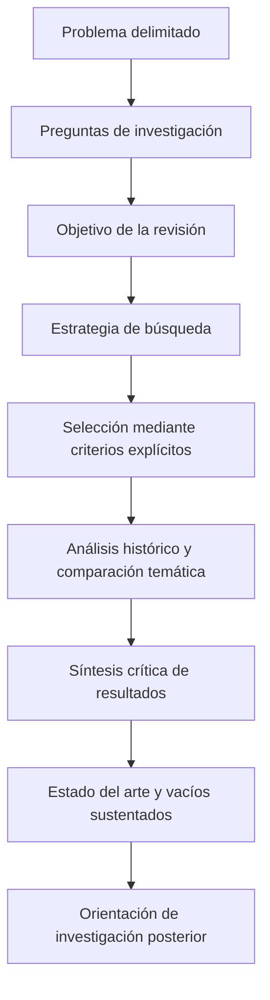

# Clase 3: Construcción del estado del arte y argumentación crítica sobre inteligencia artificial

> **Objetivo académico:** Comprender cómo articular problema, preguntas, objetivo y metodología en un artículo científico, mediante la construcción crítica de un estado del arte y la delimitación de una reflexión sobre autonomía cognitiva e inteligencia artificial.

## 1. Contexto y marco conceptual

La sesión desarrolla dos casos de escritura científica: una revisión sobre arquitecturas que integran modelos de lenguaje de gran tamaño —LLM— con sistemas de software existentes y una reflexión sobre transformación digital, autonomía cognitiva y responsabilidad humana. Ambos permiten analizar un problema transversal: convertir una inquietud temática en una investigación delimitada, argumentada y metodológicamente reconocible.

En el primer caso, el interés surge de la incorporación de funcionalidades generativas a aplicaciones tradicionales. El ejemplo discutido es un sistema de gestión de impuestos que busca integrar capacidades de consulta e interacción con información mediante LLM. La investigación se orienta inicialmente a conocer y sistematizar las arquitecturas existentes; la propuesta de un modelo arquitectónico propio constituye un propósito posterior, distinto del resultado inmediato de la revisión.

En el segundo caso, la preocupación es la posible pérdida de autonomía cuando las personas delegan decisiones y procesos de pensamiento en tecnologías digitales. Se contraponen, como posiciones del debate presentado, una adopción tecnológica intensiva y una incorporación sometida a deliberación y control humano. Esta oposición sirve para formular preguntas; no constituye evidencia de que existan únicamente dos posturas ni demuestra deterioro cognitivo.

### Del interés temático al problema científico

Un tema identifica un campo de interés; el problema precisa qué relación, insuficiencia o contradicción requiere investigación. Expresiones como «integración de LLM» o «transformación digital» son demasiado amplias si no se especifica qué se desconoce y por qué importa.

En el caso arquitectónico, la preocupación apunta a la dispersión de enfoques de integración y a la necesidad de comprender cómo gestionan la incertidumbre de los componentes generativos. Sin embargo, la impresión de haber encontrado poca información es un punto de partida, no una demostración de vacío científico.

En el caso de autonomía cognitiva, la afirmación de que la tecnología invade la vida humana necesita transformarse en un problema conceptual más preciso: qué se entiende por autonomía, qué formas de delegación se consideran problemáticas y mediante qué argumentos puede sostenerse esa valoración.

**Enriquecimiento conceptual:** La pertinencia práctica y el vacío de conocimiento cumplen funciones diferentes. Una necesidad profesional puede justificar la relevancia del estudio, pero la novedad científica requiere contrastar esa necesidad con lo que la literatura ya explica, resuelve o deja abierto.

## 2. Fundamentos teóricos y arquitectura

### 2.1. Estado del arte como resultado de una elaboración crítica

La distinción central de la sesión es que el estado del arte se construye mediante el análisis y la sistematización de la literatura. No equivale a una lista de documentos ni a una sucesión de resúmenes.

La construcción exige reconocer enfoques, comparar definiciones, identificar convergencias y contradicciones, valorar aportes y delimitar problemas pendientes. La contribución de quien revisa reside en organizar e interpretar el conocimiento disponible con un criterio explícito.

**Enriquecimiento conceptual:** También es válido analizar estados del arte previamente publicados. La precisión relevante para este caso consiste en distinguir el objeto de análisis —la literatura sobre arquitecturas de integración— del producto buscado —una síntesis crítica del conocimiento sobre esas arquitecturas—.

### 2.2. Método histórico-lógico

El docente propone organizar el análisis desde los planteamientos más antiguos hacia los más recientes para comprender el desarrollo de las ideas. La dimensión histórica reconstruye la secuencia de contribuciones; la dimensión lógica explica qué cambia, qué permanece y qué tensiones aparecen.

La cronología aporta comprensión cuando permite responder preguntas como las siguientes:

- ¿Qué limitación intentaba resolver un enfoque inicial?
- ¿Qué incorporó una propuesta posterior y con qué fundamento?
- ¿Cambió la definición del problema o solamente su solución técnica?
- ¿Qué cuestiones siguen abiertas pese a la evolución de las propuestas?

**Enriquecimiento conceptual:** El orden temporal no basta para demostrar progreso. Una propuesta reciente puede responder a un contexto diferente o introducir nuevas limitaciones. Conviene combinar la reconstrucción histórica con categorías temáticas que hagan comparables los trabajos.

### 2.3. Arquitecturas con componentes generativos

El caso técnico distingue componentes tradicionales, descritos en la discusión como deterministas, y componentes generativos con salidas potencialmente variables. Esta diferencia motiva preguntas sobre reproducibilidad, validación de respuestas, confiabilidad e integración.

La transcripción contiene una inversión terminológica inicial al asociar los componentes no deterministas con el software tradicional. La explicación posterior aclara la distinción utilizada en el caso: el comportamiento probabilístico se atribuye a los modelos generativos.

**Enriquecimiento conceptual:** Para un componente determinista, una misma entrada produce la misma salida si se mantienen el estado y las condiciones relevantes. La variación de salida en un LLM depende también de su configuración, del procedimiento de generación y del entorno de ejecución. Por ello, «tradicional» y «determinista» no son equivalentes universales, ni toda ejecución de un modelo generativo tiene necesariamente que producir una salida distinta.

La arquitectura se convierte así en una cuestión de gestión de interacciones y garantías: cómo conectar capacidades generativas con procesos existentes y cómo controlar sus efectos sobre el funcionamiento del sistema. La sesión no presenta una arquitectura terminada ni demuestra que los enfoques clásicos sean incapaces de incorporar estos componentes.

### 2.4. Reflexión filosófica y autonomía cognitiva

El segundo caso introduce el determinismo algorítmico, el humanismo digital y una propuesta denominada acción transcrítica. Esta última se utiliza para expresar un cuestionamiento que atraviesa lo tecnológico y lo filosófico, orientado a conservar capacidad de juicio humano.

También se plantea una convergencia entre biotecnología e infotecnología, ilustrada mediante la dependencia de sistemas digitales y la confianza en tecnologías aplicadas a la salud. Tales ejemplos abren interrogantes éticos sobre control y responsabilidad; no aportan por sí mismos evidencia sobre seguridad clínica o pérdida de autonomía.

**Enriquecimiento conceptual:** El determinismo computacional describe una propiedad del comportamiento de un sistema; el determinismo algorítmico, en el debate social, puede referirse a la idea de que los algoritmos condicionan decisiones y posibilidades humanas. Confundir ambos sentidos produciría una falsa continuidad entre los dos casos.

## 3. Implementación técnica y lógica de negocio

La fuente no contiene código, experimentos ni una integración de software implementada. Su contenido operativo corresponde al diseño de una revisión y a la organización argumentativa de artículos científicos.

### 3.1. Coherencia entre problema, preguntas y objetivo

En la revisión arquitectónica se proponen tres ejes de indagación: enfoques de integración existentes, mecanismos de gestión del comportamiento no determinista y desafíos identificados en la literatura. Estas preguntas deben quedar vinculadas con la problemática y ser respondidas por los resultados.

La sesión sitúa las preguntas orientadoras en la introducción y la estrategia de búsqueda en la metodología. Esta distinción separa qué se busca conocer de cómo se construirá la evidencia para conocerlo.

**Enriquecimiento conceptual:** Una formulación coherente con el caso sería: «Sistematizar críticamente la literatura sobre arquitecturas de software que incorporan componentes de inteligencia artificial generativa, para caracterizar sus enfoques de integración, mecanismos de control y limitaciones reportadas». Es una reformulación ilustrativa, no un objetivo definitivo validado durante la sesión.

Identificar enfoques puede formar parte de esa sistematización, pero la contribución no termina en nombrarlos: requiere explicar sus diferencias y el alcance de la evidencia que los respalda.

El diagrama representa la relación metodológica discutida. La investigación posterior puede apoyarse en la revisión, pero no debe presentarse como una solución ya desarrollada.

### 3.2. Búsqueda y selección de literatura

La estrategia planteada combina términos relativos a arquitectura de software, inteligencia artificial generativa y LLM. También contempla criterios de inclusión y exclusión: priorizar trabajos sobre arquitecturas e integración y excluir los centrados exclusivamente en entrenamiento de modelos cuando no respondan al objeto del estudio.

Se considera delimitar un intervalo temporal y consultar publicaciones en revistas, conferencias y repositorios. La fuente no permite recuperar con precisión toda la lista de recursos ni la cadena de búsqueda mostrada; por ello, no se reconstruyen nombres o expresiones ausentes.

**Enriquecimiento conceptual:** Para hacer trazable una revisión conviene documentar las fuentes consultadas, las consultas utilizadas, el alcance temporal, los criterios de elegibilidad y las razones de exclusión. La actualidad de una publicación y su pertinencia son criterios diferentes: restringir la búsqueda a trabajos recientes puede ser adecuado para ciertos objetivos, pero puede ocultar antecedentes necesarios para una reconstrucción histórico-lógica.

### 3.3. Organización del análisis documental

La sesión propone comparar autores, definiciones y aportes mientras se reconstruye la evolución del tema. Una lectura productiva debe distinguir lo que cada documento afirma de la valoración elaborada por quien revisa.

**Enriquecimiento conceptual:** Una matriz conceptual puede organizar esta comparación sin anticipar resultados:

| Dimensión | Información que permite contrastar |
| --- | --- |
| Problema abordado | Necesidad específica que motiva cada propuesta |
| Enfoque arquitectónico | Componentes y relaciones descritos por el trabajo |
| Gestión de variabilidad | Mecanismos de control o validación reportados |
| Evidencia de evaluación | Base utilizada para sostener las afirmaciones |
| Límites declarados | Condiciones en las que no se ha establecido su validez |
| Relación con antecedentes | Continuidades, diferencias y contradicciones |

Estas categorías constituyen un recurso de análisis, no hallazgos obtenidos en la sesión.

### 3.4. Estructura del artículo

Se utiliza IMRyD —introducción, métodos, resultados y discusión; IMRAD en inglés— como referencia de organización. El principio enfatizado es la correspondencia entre estructura, contenido y metodología.

| Componente | Función académica |
| --- | --- |
| Introducción | Delimitar contexto, problema, relevancia, preguntas y objetivo |
| Métodos | Explicar cómo se selecciona y analiza la evidencia |
| Resultados | Presentar lo producido por ese procedimiento |
| Discusión | Interpretar aportes, contrastes, alcance y limitaciones |
| Conclusiones | Responder al objetivo dentro de los límites del estudio |

En una revisión, los resultados pueden consistir en categorías, relaciones y síntesis teóricas. El docente propone integrar resultados y discusión para vincular la exposición de ideas con su valoración crítica.

**Enriquecimiento conceptual:** IMRyD es una estructura ampliamente utilizada, pero no una condición universal para todo artículo científico. Los textos de reflexión y las distintas revistas pueden adoptar otras organizaciones. La exigencia generalizable es que el lector pueda reconocer la pregunta, el procedimiento intelectual, el argumento y su sustento.

## 4. Análisis crítico de casos y auditoría práctica

### 4.1. Caso de integración de LLM con software existente

La necesidad práctica está claramente identificada: incorporar capacidades generativas a sistemas que continúan operando. El punto débil inicial es la transición desde esa necesidad hacia una afirmación de insuficiencia del conocimiento disponible.

Una evaluación crítica debe separar tres niveles:

- **Observación profesional:** existen procesos de incorporación de LLM a aplicaciones previamente desarrolladas.
- **Hipótesis sobre el campo:** las soluciones podrían estar dispersas o carecer de criterios suficientemente compartidos.
- **Resultado de la revisión:** solo el análisis del corpus permitirá establecer qué enfoques están documentados y qué limitaciones persisten.

El propósito de generalizar una arquitectura exige, además, delimitar qué tipos de sistemas y necesidades de integración se comparan. Un caso de consulta de información y otro de generación de código pueden compartir componentes, pero no necesariamente requieren las mismas garantías.

**Enriquecimiento conceptual:** La posibilidad de generalización depende de la diversidad y comparabilidad de los casos incluidos. Un modelo de integración no adquiere validez general por formularse en términos abstractos; necesita justificar qué condiciones comparte su dominio de aplicación.

### 4.2. Caso de autonomía cognitiva y transformación digital

La propuesta plantea que la brecha digital debería pensarse también en términos de autonomía cognitiva. Su valor reside en ampliar la discusión más allá de la disponibilidad de dispositivos o conectividad. Su riesgo es convertir esa ampliación en una exclusión injustificada de otras dimensiones de desigualdad.

**Enriquecimiento conceptual:** Una formulación más prudente sostiene que la brecha digital puede incluir diferencias en la capacidad de comprender, cuestionar y gobernar el uso de tecnologías, además de diferencias de acceso y uso. La fuente no demuestra que una dimensión sustituya a las demás.

La expresión «taxonomía de la resistencia cognitiva» anuncia una clasificación. Sin embargo, durante la sesión no se presentan categorías completas ni reglas para distinguirlas. Del mismo modo, la acción transcrítica aparece como una noción en construcción, no como un método consolidado.

La afirmación de que el ser humano pierde capacidades por utilizar IA permanece en el nivel de preocupación o tesis debatible. No se proporcionan mediciones ni resultados que permitan sostener una relación causal.

Las preguntas «¿puede pensar una máquina?» y «¿merece llamarse inteligencia a la IA?» introducen una discusión ontológica y epistemológica. Su aporte consiste en problematizar conceptos que el uso operativo suele dar por supuestos. La sesión no resuelve estas preguntas ni ofrece un criterio único de inteligencia.

### 4.3. Afirmaciones, fuentes y alcance

En la conversación se atribuyen posiciones intelectuales a distintas universidades, pero sin referencias identificables y con asociaciones variables. Esas atribuciones no permiten establecer escuelas institucionales verificadas. El contenido rescatable es la tensión entre adopción tecnológica, control humano y deliberación ética.

**Enriquecimiento conceptual:** Una auditoría argumentativa distingue afirmaciones descriptivas —qué ocurre—, causales —qué produce un efecto— y normativas —qué debería hacerse—. Una recomendación ética no sustituye evidencia empírica, y una capacidad técnica no basta para justificar moralmente su uso.

## 5. Principios de diseño, buenas prácticas y anti-patrones

| Principio | Buena práctica | Anti-patrón |
| --- | --- | --- |
| Delimitación | Precisar objeto, contexto y alcance del problema | Usar un tema amplio como si fuera un problema formulado |
| Coherencia | Relacionar preguntas, objetivo, método y resultados | Prometer una solución arquitectónica cuando solo se ha planteado una revisión |
| Síntesis crítica | Comparar aportes mediante categorías comunes | Encadenar resúmenes sin interpretación |
| Reconstrucción histórica | Explicar cambios conceptuales y sus motivos | Suponer que lo más reciente es necesariamente superior |
| Sustento de vacíos | Vincular las limitaciones con el corpus revisado | Equiparar una búsqueda inicial infructuosa con ausencia de conocimiento |
| Precisión conceptual | Definir los sentidos de determinismo, autonomía e inteligencia | Trasladar un término entre dominios sin aclaración |
| Proporcionalidad | Ajustar las conclusiones al tipo y alcance de evidencia | Presentar preocupaciones como resultados causales demostrados |
| Organización | Hacer visible la función de cada sección | Confundir formato externo con coherencia científica |

La sesión admite el uso de herramientas de IA para apoyar la redacción y la consulta de documentos. Su utilidad se vincula con localizar información y facilitar la sistematización, sin reemplazar la lectura crítica ni la elaboración propia.

**Enriquecimiento conceptual:** El apoyo automatizado requiere contrastar las respuestas con los documentos originales, preservar la atribución de ideas y distinguir las síntesis del investigador de las afirmaciones de cada fuente. La fluidez de un texto generado no acredita su exactitud ni la existencia de sus referencias.

Una contextualización desde el panorama internacional hacia una realidad local puede fortalecer la relevancia, como se sugiere en la sesión. Para ello deben existir datos pertinentes; la cercanía geográfica no autoriza a inventar condiciones locales.

## 6. Síntesis conceptual y profundización académica

La construcción del estado del arte es una actividad de producción intelectual: organiza evidencia, compara perspectivas y delimita qué puede sostenerse sobre un campo. Su rigor depende tanto de la trazabilidad de la selección documental como de la calidad del análisis realizado.

El caso arquitectónico muestra la necesidad de distinguir una revisión del conocimiento existente de la propuesta posterior de un modelo. El comportamiento generativo abre problemas de reproducibilidad, validación y confiabilidad, pero el alcance de esos problemas y de sus soluciones debe establecerse mediante evidencia.

El caso de autonomía cognitiva muestra cómo una preocupación filosófica puede adquirir forma académica si define sus conceptos, diferencia tipos de afirmación y explicita el recorrido argumentativo. La crítica a la delegación tecnológica no requiere negar la utilidad de la IA; requiere precisar qué capacidades humanas interesa conservar y bajo qué condiciones podrían verse comprometidas.

La conexión entre ambos casos es la gestión responsable de la incertidumbre: en uno se analiza cómo integrar componentes cuyos resultados requieren control; en el otro, cómo preservar el juicio humano ante sistemas a los que se delegan funciones. Esta conexión permite profundizar en la relación entre confiabilidad técnica, supervisión y responsabilidad, sin afirmar que la sesión haya desarrollado una teoría conjunta.

**Enriquecimiento conceptual:** Dos líneas de profundización derivadas son la diferencia entre disponer de información y producir conocimiento justificado, y la diferencia entre recibir asistencia tecnológica y ceder autoridad de decisión. Ambas ayudan a evaluar el aporte de una investigación sin confundir desempeño operativo, comprensión y legitimidad.
