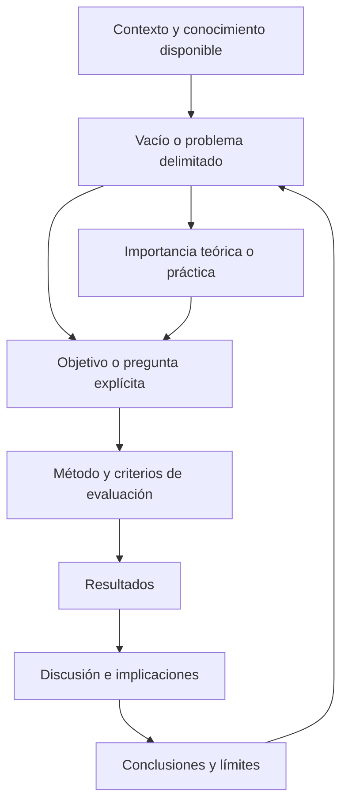
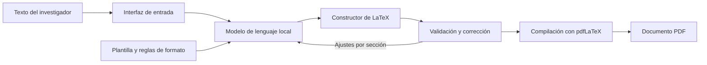
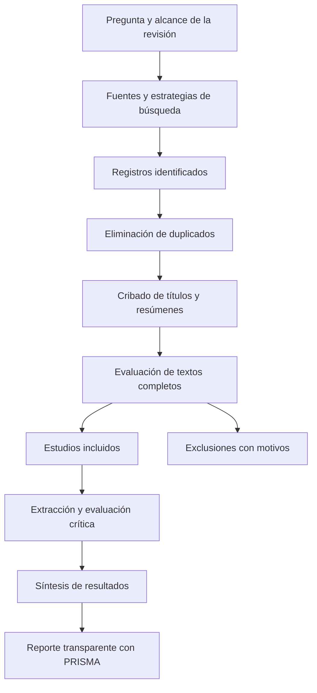

# Clase 4: Coherencia metodológica, revisiones sistemáticas y evaluación de contribuciones científicas

> **Objetivo académico:** Comprender la articulación entre problema, objetivo, método, resultados y discusión, y evaluar críticamente su aplicación en revisiones sistemáticas, desarrollos tecnológicos, estudios computacionales y artículos de reflexión.

## 1. Contexto y marco conceptual

La sesión articula la producción científica mediante el análisis de casos de investigación en computación y educación. El eje transversal es la **coherencia interna del artículo**: una temática pertinente o un sistema funcional requieren una pregunta delimitada, procedimientos explícitos y evidencia adecuada para sostener una contribución científica.

Los casos abarcan generación de documentos científicos con modelos de lenguaje locales, seguridad de la información en entornos virtuales de aprendizaje, redes neuronales para administración de redes, autonomía cognitiva frente a sistemas digitales, aprendizaje adaptativo de métodos numéricos y comparación de representaciones latentes euclidianas y no euclidianas. Su diversidad permite distinguir problemas de redacción de problemas epistemológicos y metodológicos.

### 1.1. Del contexto al objetivo

La introducción debe establecer tres elementos relacionados:

- **Situación del conocimiento:** qué se conoce, qué enfoques predominan y qué dificultades persisten.
- **Pertinencia:** por qué resolver la dificultad tiene importancia teórica o práctica.
- **Objetivo o pregunta:** qué resultado cognoscitivo se pretende alcanzar y sobre qué objeto delimitado.

Una introducción no debe limitarse a describir una tecnología. Debe justificar el tránsito desde el conocimiento disponible hasta la necesidad de investigar. En la sesión se propone una progresión desde el contexto general hacia el ámbito específico; esta organización permite situar un problema local sin desconectarlo de la literatura internacional.

**Enriquecimiento conceptual:** La ausencia de estudios en un lugar no constituye por sí sola un vacío científicamente relevante. Es necesario explicar qué condiciones del contexto podrían modificar las conclusiones existentes o qué decisión permanece sin fundamento suficiente.

### 1.2. El estado del arte como construcción analítica

El estado del arte representa una reconstrucción organizada del conocimiento relevante sobre un tema. Su elaboración exige localizar, seleccionar, comparar, interpretar y sintetizar trabajos; no equivale a acumular resúmenes.

El docente enfatiza que una revisión puede **construir un estado del arte**, en lugar de presuponer que este existe como un objeto único ya terminado. La distinción busca precisar la operación intelectual efectuada sobre las fuentes.

**Enriquecimiento conceptual:** También es legítimo actualizar o analizar críticamente estados del arte previamente publicados. Lo decisivo es identificar el corpus, el alcance temporal y la contribución de la nueva síntesis. El conocimiento publicado es plural y puede contener resultados incompatibles, sesgos y vacíos.

## 2. Fundamentos teóricos y arquitectura

### 2.1. Precisión semántica de los objetivos

El objetivo orienta la elección del método, la selección de evidencia y la interpretación de resultados. La sesión cuestiona el uso de verbos como términos intercambiables y recomienda elegir una acción principal que represente el centro de la contribución.

| Verbo | Operación predominante | Evidencia o producto esperado |
| --- | --- | --- |
| Diseñar | Definir una solución y sus relaciones | Especificación, arquitectura o modelo |
| Desarrollar | Construir o materializar una solución | Artefacto y descripción de su construcción |
| Comparar | Establecer semejanzas y diferencias | Criterios comunes y resultados contrastables |
| Analizar | Descomponer y relacionar componentes | Interpretación sustentada de partes y relaciones |
| Sintetizar | Integrar resultados dispersos | Representación conjunta y conclusiones integradoras |
| Sistematizar | Organizar conocimiento con criterios explícitos | Categorías, relaciones y estructura explicativa |
| Evaluar | Juzgar propiedades según criterios | Mediciones o valoraciones justificadas |
| Validar | Aportar evidencia de adecuación para un uso | Evidencia vinculada a una interpretación o finalidad |

Durante el debate se discute si desarrollar implica evaluar y si evaluar presupone desarrollar. La conclusión metodológica útil es evitar que procesos sustantivos queden ocultos bajo supuestos lingüísticos: construir y evaluar requieren procedimientos y evidencias identificables.

El docente recomienda un verbo principal y señala que algunas revistas admiten objetivos con dos acciones.

**Enriquecimiento conceptual:** Un solo verbo constituye una estrategia de claridad, no una condición universal de validez científica. Asimismo, evaluar un sistema no implica haberlo construido. La formulación debe reflejar la contribución efectivamente realizada, con independencia de la cantidad de verbos utilizada.

### 2.2. Evaluación y validación: alcances diferentes

Una evaluación puede describir desempeño, comparar alternativas o identificar deficiencias. La validación exige relacionar la evidencia con una afirmación de adecuación: válido para qué propósito, bajo qué condiciones y con qué restricciones.

La sesión menciona evaluación por usuarios, juicio de expertos, método Delphi y aplicación práctica. Cada procedimiento responde a preguntas distintas; su elección debe depender del objeto y del alcance de la afirmación.

**Enriquecimiento conceptual:** El juicio experto puede aportar evidencia sobre pertinencia, claridad o plausibilidad, pero no demuestra automáticamente eficacia operativa. Delphi supone un proceso estructurado e iterativo de consulta y retroalimentación; una valoración independiente de varios expertos no basta para identificarlo como Delphi. La publicación y la revisión por pares tampoco sustituyen la validación empírica de una afirmación.

### 2.3. Instrumentos, contenido y consistencia interna

Se mencionan la V de Aiken y el alfa de Cronbach, aunque sus nombres aparecen deformados en la transcripción. La primera se vincula con el juicio de expertos sobre contenido; el segundo, con consistencia interna.

**Enriquecimiento conceptual:** Son propiedades diferentes. Una alta consistencia interna no garantiza que un instrumento cubra adecuadamente el constructo ni que mida aquello que pretende medir. Tampoco corresponde aplicar el alfa a cualquier lista de criterios: su interpretación requiere justificar la estructura de la escala y la relación entre los ítems.

### 2.4. Estructura del artículo y tipo de contribución

La estructura introducción, métodos, resultados y discusión organiza la justificación, el procedimiento, los hallazgos y su interpretación. Las revistas pueden combinar apartados o utilizar otras denominaciones. En artículos teóricos o de reflexión, estas funciones pueden distribuirse de otra manera.

El debate sobre originalidad contrapone la obtención directa de datos con la reutilización de conjuntos públicos para entrenar y comparar modelos. Los participantes señalan que, en aprendizaje automático, la contribución puede residir en el método y su evaluación, aunque el conjunto de datos exista previamente.

**Enriquecimiento conceptual:** Reutilizar datos no convierte automáticamente una investigación en revisión bibliográfica. Un análisis secundario o un experimento computacional sobre datos públicos puede producir resultados originales. Conviene distinguir entre reutilizar observaciones para generar nueva evidencia y sintetizar resultados publicados por otros autores. Una propuesta metodológica original tampoco se clasifica como revisión solo por apoyarse en literatura previa.

## 3. Implementación técnica y lógica de negocio

### 3.1. Sistema local para generar documentos en LaTeX

Se presenta un sistema que recibe texto plano y produce documentos científicos con formato editorial mediante modelos de lenguaje ejecutados localmente. La finalidad declarada es disminuir la barrera sintáctica de LaTeX y el tiempo de preparación formal del manuscrito.

La arquitectura expuesta comprende captura de entrada, procesamiento con un modelo local, construcción y validación del código LaTeX y compilación a PDF. También se describe una revisión iterativa por secciones, con entre cinco y ocho interacciones en las pruebas comunicadas.

Los prompts se organizan en instrucciones metodológicas, de formato y de generación documental. Se mencionan Ollama, una interfaz cuyo nombre se transcribe de manera imprecisa y una cadena de compilación con pdfLaTeX. No se proporciona código ejecutable ni una especificación completa de los prompts; por ello, el caso permite reconstruir el flujo conceptual, pero no reproducir la implementación.

La ejecución local evita la necesidad de enviar el contenido a una API externa en el flujo descrito. La presentación también reconoce dependencia del hardware y diferencias de rendimiento entre CPU y GPU.

**Enriquecimiento conceptual:** Ejecutar localmente no elimina el uso de tokens: elimina, en su caso, la facturación de una API por tokens. Persisten costos de hardware, energía, mantenimiento y operación. La privacidad depende además del almacenamiento, los registros y los controles de acceso. Compilar correctamente tampoco garantiza exactitud científica, autenticidad de referencias o cumplimiento completo de una norma editorial.

### 3.2. Diseño de la evaluación del sistema

El estudio se describe como aplicado, cuantitativo y descriptivo-evaluativo. La presentación declara un diseño no experimental, aunque incorpora comparaciones cuya estructura no se detalla suficientemente para revisar esa clasificación.

Se comunica un corpus de 40 fragmentos en español de computación, matemáticas, física e ingeniería. Cada fragmento se procesa tres veces por modelo, con 120 intentos por modelo. Se mencionan tres configuraciones locales de las familias Llama y Mistral, pero las versiones y tamaños de Llama no son consistentes en la transcripción.

Las dimensiones de evaluación incluyen:

- Compilación exitosa del documento.
- Calidad tipográfica, matemática y referencial.
- Tiempo de generación y condiciones de hardware.
- Facilidad de uso y satisfacción.
- Pertinencia y potencial de adopción según expertos.

**Enriquecimiento conceptual:** La tasa de compilación puede expresarse como:

$$
\widehat{p}_{\mathrm{comp}}=\frac{s}{n}\times 100\%.
$$

Aquí, $s$ es el número entero de intentos que producen un PDF sin errores de compilación y $n>0$ es el número total de intentos, ambos medidos en ejecuciones. La tasa describe éxito técnico bajo las condiciones probadas; no mide fidelidad semántica. Por ejemplo, si $s=114$ y $n=120$, se obtiene $95\%$. Este ejemplo es ilustrativo y no reconstruye los resultados del caso. Las repeticiones sobre un mismo fragmento pueden estar relacionadas, por lo que no deben asumirse independientes al estimar incertidumbre.

La presentación informa una tasa global de compilación de 94,3 %, frente a un umbral de 90 %. También comunica puntuaciones tipográficas entre 4,6 y 4,9, un resultado referencial de 74,3 % y una valoración final de expertos de 4,6. Estas cifras son resultados declarados en la exposición: las tablas completas y sus denominadores no están disponibles para auditarlas.

Se describen tres expertos para una evaluación ciega de calidad y un panel de cinco para la valoración del sistema, además de 100 usuarios seleccionados intencionalmente. Estos grupos cumplen funciones distintas y deben documentarse por separado.

### 3.3. Revisiones sistemáticas y uso de PRISMA

Los casos de seguridad educativa, administración de redes y aprendizaje adaptativo utilizan búsquedas bibliográficas, criterios de inclusión y exclusión, eliminación de duplicados y selección de textos. Se mencionan fuentes como IEEE Xplore, ACM, SciELO, Scopus, Web of Science y Google Académico, según el caso.

La sesión destaca tres recursos de PRISMA:

1. Lista de verificación básica y ampliada.
2. Diagrama de flujo de identificación y selección.
3. Documento de explicación y elaboración, que desarrolla los ítems mediante aclaraciones y ejemplos.

**Enriquecimiento conceptual:** PRISMA es una guía de reporte de revisiones sistemáticas; no reemplaza el método de revisión ni garantiza por sí misma su calidad. Un diagrama completo no demuestra que la búsqueda sea exhaustiva, que los criterios sean adecuados o que se haya evaluado el riesgo de sesgo.

Una estrategia reproducible debe comunicar fuentes consultadas, fecha de búsqueda, expresiones utilizadas, campos interrogados, filtros, criterios de elegibilidad, tratamiento de duplicados y procedimiento de extracción y síntesis. Las expresiones de búsqueda completas no aparecen en la fuente, de modo que no pueden reconstruirse con precisión.

## 4. Análisis crítico de casos y auditoría práctica

### 4.1. Generación documental: distinguir funcionamiento y calidad

El sistema local reúne varias capas de evidencia que no deben confundirse: compilación, presentación visual, corrección matemática, gestión bibliográfica, percepción de uso y valoración experta. Una fortaleza en una capa no compensa automáticamente una deficiencia en otra.

La exposición identifica limitaciones en claves bibliográficas, cobertura disciplinaria, selección no probabilística de usuarios y recursos de cómputo. El docente destaca la necesidad de explicar mejor la intervención de expertos y de discutir las implicaciones prácticas de la herramienta.

La auditoría del reporte requiere aclarar:

- La composición del corpus y la dificultad de sus fragmentos.
- Las versiones exactas de modelos y configuraciones de ejecución.
- La rúbrica, escala, ponderaciones y procedimiento de valoración.
- La comparabilidad entre documentos generados y documentos preparados con Word.
- La correspondencia entre cada resultado, su denominador y su unidad.

**Enriquecimiento conceptual:** Una puntuación de 4,7 en una escala de 1 a 5 no es 4,7 %. La mejora relativa del 72 % mencionada en la exposición no puede interpretarse sin conocer el indicador y la referencia. Asimismo, la mención de Wilcoxon y de $p<0{,}1$ no basta para sostener superioridad: deben especificarse la variante de la prueba, el emparejamiento de observaciones, el nivel de significación previsto y el tamaño del efecto. No se corrige ese valor a otro umbral porque la fuente no permite hacerlo.

Las diferencias de tiempo entre CPU y GPU se describen de forma ambigua. No se puede derivar una aceleración confiable sin controlar hardware, modelo, configuración, longitud de entrada y salida y número de iteraciones.

### 4.2. Seguridad en entornos virtuales de aprendizaje

La revisión sobre seguridad educativa aborda suplantación de identidad, accesos no autorizados y amenazas a la integridad de procesos de evaluación del aprendizaje. Su función es organizar el conocimiento para sustentar un modelo de seguridad posterior.

El intervalo comunicado es 2015–2025. La selección combina fuentes bibliográficas, términos de búsqueda y criterios temáticos. El principal aspecto metodológico discutido es formular un objetivo que describa la operación de síntesis y un título que identifique el tipo de estudio.

**Enriquecimiento conceptual:** Un problema de seguridad debe relacionar activos, amenazas, vulnerabilidades y consecuencias. La pertinencia de un control depende de esa relación; una recomendación general no demuestra su eficacia en todos los entornos educativos.

### 4.3. Redes neuronales para administración de redes

El caso relaciona detección de tráfico anómalo, monitoreo y solución de fallas con técnicas de aprendizaje automático. Se comunica una selección inicial aproximada de 30 documentos y un conjunto de 15 en revisión, sin resultados consolidados.

El problema formulado es la dependencia de intervención humana y sus posibles costos en tiempo y eficiencia. Sin embargo, hablar del impacto de las redes neuronales en cualquier organización resulta demasiado amplio si no se definen funciones de red, contextos y resultados de interés.

**Enriquecimiento conceptual:** Para comparar enfoques conviene separar la tarea técnica, el tipo de datos y la métrica. Mejor desempeño predictivo no demuestra por sí solo mejor operación: también importan falsas alarmas, latencia, recursos y consecuencias de las decisiones automatizadas. La automatización debe acompañarse de mecanismos de supervisión acordes con el riesgo.

### 4.4. Aprendizaje adaptativo de métodos numéricos

La revisión se motiva en la heterogeneidad de conocimientos previos y necesidades de aplicación de estudiantes de distintas ingenierías. Se distingue entre proporcionar contenido y favorecer su apropiación mediante retroalimentación personalizada.

El vacío propuesto es la insuficiencia de una respuesta binaria de acierto o error cuando no explica en qué paso falla el razonamiento. La revisión busca enfoques que permitan comprender y atender esa dificultad; no presenta una intervención educativa evaluada.

Se comunica una ventana de búsqueda 2021–2026, alrededor de 530 registros iniciales y 31 trabajos en una selección todavía provisional, con Zotero para el tratamiento de duplicados. Esas cifras describen el avance del proceso y no un corpus final.

La observación central consiste en diferenciar el efecto educativo deseado del objetivo alcanzable mediante una revisión. Mejorar la comprensión del estudiante es una finalidad amplia; sintetizar evidencia sobre retroalimentación adaptativa es una operación verificable dentro de un estudio documental.

**Enriquecimiento conceptual:** Una revisión puede analizar evidencia sobre aprendizaje, pero no atribuirse directamente mejoras educativas sin una intervención y mediciones pertinentes. También conviene distinguir **revisión sistemática**, definida por procedimientos explícitos, de una perspectiva **sistémica**, orientada a relaciones entre componentes.

### 4.5. Representaciones latentes euclidianas y no euclidianas

El caso propone comparar embeddings para representar intereses de navegación de usuarios mediante una taxonomía semántica jerárquica. La motivación es que una representación euclidiana puede introducir distorsiones cuando la estructura de los datos tiene propiedades jerárquicas.

La exposición conecta aprendizaje de representaciones, redes profundas, atención, autoencoders variacionales, modelos hiperbólicos de Poincaré y Lorentz y geometría de la información. Las referencias se mencionan oralmente y varias aparecen deformadas, por lo que no se reconstruye una bibliografía.

**Enriquecimiento conceptual:** Un embedding es una función $f:X\rightarrow\mathcal{M}$ que asigna cada elemento $x$ del conjunto de objetos $X$ a una representación en un espacio $\mathcal{M}$ con una noción de distancia. En el caso euclidiano, $\mathcal{M}=\mathbb{R}^{d}$, donde $d$ es un entero positivo que indica la dimensión. En una alternativa no euclidiana, la geometría y la distancia cambian. Las representaciones hiperbólicas pueden ser adecuadas para ciertas jerarquías, pero esa conveniencia debe evaluarse; una taxonomía jerárquica no prueba automáticamente que todo el comportamiento observado tenga geometría hiperbólica.

La comparación requiere precisar qué se entiende por representación más adecuada y cómo se medirá. En la sesión estos criterios permanecen en elaboración.

**Enriquecimiento conceptual:** Una comparación controlada debería mantener condiciones equivalentes de partición de datos, presupuesto de ajuste y evaluación, y justificar métricas asociadas con la tarea. Los autoencoders variacionales incorporan representaciones probabilísticas, pero ello no implica que su espacio latente sea necesariamente no euclidiano.

El uso de datos públicos se relaciona con reproducibilidad y confidencialidad. La sesión insiste en documentar procedencia, tratamiento y confiabilidad.

**Enriquecimiento conceptual:** La frecuencia de citación de un conjunto de datos puede mostrar uso previo, pero no demuestra exactitud, representatividad o adecuación. Deben revisarse origen, licencia, documentación, sesgos, posibles fugas de información y condiciones de protección de datos. Datos cifrados, seudonimizados y anonimizados no son equivalentes. Su publicación previa tampoco elimina responsabilidades éticas.

### 4.6. Reflexión sobre autonomía cognitiva y transformación digital

El artículo de reflexión propone una acción transcrítica frente a riesgos de vigilancia, manipulación de preferencias y pérdida de autonomía. Sus ejes son soberanía de datos, flexibilidad mental e introspección. Contrapone una lectura de determinismo algorítmico con una perspectiva de humanismo digital.

El valor académico del caso depende de definir conceptos como resistencia cognitiva, autonomía, identidad y personalidad, y de explicar cómo se relacionan. La pertenencia disciplinaria de una expresión no sustituye su definición operacional o argumentativa.

Se mencionan NIST AI RMF, IEEE 7000 y una orientación atribuida al MIT sobre fricción ética. También aparece NIST SP 800-122 en el debate sobre información personal. La fuente no desarrolla los documentos ni permite verificar todas las atribuciones.

**Enriquecimiento conceptual:** NIST es el Instituto Nacional de Estándares y Tecnología de Estados Unidos. Las referencias normativas requieren identificadores y alcances precisos. Los relatos sobre conocimiento exhaustivo de usuarios, suplantación de personalidad o ruptura de autenticación multifactor no demuestran capacidades generales de un sistema. Los deepfakes, el robo de credenciales y la manipulación de preferencias son fenómenos distintos y requieren evidencia específica. Los patrones oscuros orientan decisiones mediante el diseño de interfaces; no se reducen al robo de identidad.

La afirmación sobre menor fatiga y mayor creatividad tras desconexión se presenta sin datos o procedimiento identificable. Debe tratarse como una proposición que requiere sustento, no como un resultado empírico demostrado en la sesión.

## 5. Principios de diseño, buenas prácticas y anti-patrones

### 5.1. Redacción orientada a la contribución

Un título debe comunicar el objeto y, cuando resulte relevante, el tipo de estudio: revisión sistemática, comparación o reflexión. La brevedad debe conservar precisión. La recomendación de aproximadamente doce palabras se expone como pauta de redacción.

**Enriquecimiento conceptual:** No corresponde tratar esa longitud como una obligación universal de APA. Las instrucciones de la revista determinan los límites aplicables. Del mismo modo, identificar una revisión sistemática en el título exige que el trabajo corresponda a esa modalidad.

El resumen debe ser fiel al artículo terminado. La sesión contrasta una preferencia por resultados generales con un enfoque más informativo que incorpora resultados concretos, útil cuando el lector solo accede al resumen.

**Enriquecimiento conceptual:** El resumen debe permitir valorar el alcance de la evidencia sin ocultar resultados esenciales para generar expectativa. La selección de cifras depende del diseño y de las reglas editoriales; debe evitar conclusiones que excedan el cuerpo del trabajo. La explicación sobre el papel del acceso digital fue presentada por el docente como una inferencia personal.

También se recomienda evitar fórmulas vacías, como introducir repetidamente el texto con referencias al propio artículo. La prioridad es la claridad del contenido; una frase convencional no constituye por sí sola un defecto metodológico.

### 5.2. Discusión con interpretación y consecuencias

La discusión debe relacionar hallazgos con el problema, confrontarlos con literatura pertinente, explicar sus implicaciones y delimitar su alcance. En el caso del sistema documental, las implicaciones incluyen reducción de barreras técnicas y posible adopción institucional, condicionadas por calidad referencial y recursos disponibles.

Un anti-patrón frecuente es repetir tablas sin explicar qué cambian los resultados en la comprensión del problema o en una decisión práctica. Otro es presentar una posibilidad de adopción como si ya se hubiera demostrado impacto institucional.

### 5.3. Selección bibliográfica y acceso abierto

La sesión enfatiza revisión por pares, actualidad, pertinencia temática y confiabilidad de las fuentes. También reconoce la utilidad de literatura gris para contextos con escasa cobertura y la necesidad de mantener trabajos seminales.

**Enriquecimiento conceptual:** El término apropiado para publicaciones de libre acceso es **acceso abierto**, diferente de código abierto. Acceso, revisión por pares e indexación son atributos distintos. Scopus es una base de indexación y ScienceDirect una plataforma editorial; ninguna añade automáticamente una nueva revisión por pares a cada artículo por aparecer allí. Un documento accesible gratuitamente puede tener revisión rigurosa, y uno de pago puede presentar limitaciones.

La literatura gris requiere criterios explícitos de selección: autoría, institución responsable, método, transparencia, actualidad y posibles conflictos de interés. No se justifica solo por falta de acceso a otras fuentes ni se invalida únicamente por su formato.

Los porcentajes mencionados en clase para equilibrar literatura reciente y clásica son orientaciones aproximadas, no estándares universales. La relevancia de un trabajo seminal depende de su función conceptual; la actualidad debe juzgarse según el ritmo del campo y la pregunta.

### 5.4. Transparencia, privacidad e integridad

El uso de información confidencial exige documentar la procedencia y proteger identidades. Mantener trazabilidad facilita auditorías, pero compartir datos debe respetar autorizaciones y restricciones.

**Enriquecimiento conceptual:** La reproducibilidad puede apoyarse en código, protocolos, datos anonimizados o accesos controlados; no exige revelar información personal. Conservar datos identificables indefinidamente o enviarlos a una revista sin autorización no constituye una solución general.

La sesión advierte sobre cargar manuscritos inéditos en servicios externos sin conocer su tratamiento de datos. También diferencia revisión de similitud y detección de texto generado por IA.

**Enriquecimiento conceptual:** Una coincidencia textual no demuestra por sí sola plagio y un detector de IA no establece autoría con certeza. Ambas salidas requieren interpretación humana y revisión contextual. La calidad científica debe evaluarse mediante trazabilidad de fuentes, evidencia, métodos y consistencia argumentativa.

### 5.5. Revisión como proceso crítico

El intercambio de preguntas y objeciones se presenta como una vía para mejorar la argumentación. La autoridad académica no sustituye la justificación: las observaciones deben contrastarse con evidencia, convenciones disciplinares y normas editoriales.

Entre los anti-patrones identificados están asumir procesos no descritos, clasificar estudios solo por el origen de los datos, confundir satisfacción con eficacia, convertir preferencias de estilo en reglas universales y presentar afirmaciones filosóficas como hallazgos empíricos.

## 6. Síntesis conceptual y profundización académica

La coherencia metodológica depende de que cada decisión pueda rastrearse desde el problema hasta la conclusión. El objetivo delimita qué evidencia es necesaria; el método explica cómo se obtiene o construye; los resultados muestran qué se encontró; la discusión determina qué significa y hasta dónde puede sostenerse.

Los casos permiten distinguir cuatro planos de contribución:

| Plano | Pregunta central | Límite que debe explicitarse |
| --- | --- | --- |
| Artefacto tecnológico | ¿Qué se construyó y cómo funciona? | Funcionamiento no equivale a eficacia general |
| Evaluación empírica o computacional | ¿Cómo se comporta bajo condiciones definidas? | Los resultados dependen del diseño y los datos |
| Síntesis de evidencia | ¿Qué conocimiento puede integrarse de las fuentes? | Las conclusiones dependen de cobertura, calidad y sesgos |
| Reflexión teórica | ¿Qué interpretación o argumento se sostiene? | Las proposiciones requieren conceptos claros y sustento |

La precisión terminológica atraviesa estos planos. Desarrollar, evaluar y validar no son equivalentes; tampoco lo son dato público y resultado publicado, acceso abierto y revisión por pares, compilación y corrección científica, o consistencia interna y validez.

Las líneas de profundización que se desprenden de la sesión incluyen la relación entre ciencia del diseño y evaluación de artefactos, el alcance de estudios originales con datos secundarios, la adecuación geométrica de representaciones latentes y la gobernanza de sistemas que afectan autonomía y privacidad. En todas ellas, el criterio central es formular afirmaciones cuya fuerza corresponda a la evidencia disponible.
