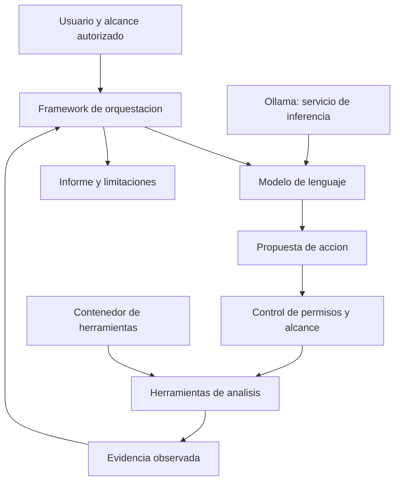

# Clase 2: Inteligencia artificial en ciberseguridad: modelos locales, agentes y evaluación crítica

> **Objetivo académico:** Comprender la relación entre modelos de lenguaje, especialización en ciberseguridad y frameworks con herramientas; analizar su ejecución local, sus restricciones y los límites de la evidencia obtenida durante una demostración práctica.

## 1. Contexto y marco conceptual

### De la operación manual a la asistencia mediante IA

La sesión parte de una comparación con un procedimiento técnico previamente tratado: generación de una carga mediante MSFvenom, configuración de una escucha y establecimiento de una conexión inversa. Este antecedente sirve para introducir una transformación en el trabajo de ciberseguridad: los modelos de lenguaje pueden asistir en la producción de texto y código, reducir el esfuerzo de consulta y facilitar la planificación de procedimientos.

Una **carga útil o payload** es el componente que realiza una acción dentro de una operación técnica. Una **conexión inversa** se inicia desde el equipo donde se ejecuta la carga hacia un extremo que recibe la comunicación. Estas definiciones no implican que generar un fragmento de código baste para comprometer un sistema: siguen importando las condiciones de ejecución, los permisos, la conectividad y los controles defensivos.

La clase sostiene que la IA reduce ciertas barreras de entrada para el abuso informático. Conviene separar tres capacidades: producir una propuesta textual, generar código técnicamente válido y ejecutar una operación con resultados comprobables. La demostración posterior muestra precisamente que estas capacidades no son equivalentes.

### Ámbitos de uso y riesgo

| Ámbito | Capacidad discutida | Límite que debe revisarse |
| --- | --- | --- |
| Ingeniería social | Redacción de mensajes que imitan comunicaciones legítimas | La naturalidad lingüística no demuestra capacidad para evadir cualquier filtro |
| Producción de código | Asistencia para elaborar o interpretar programas | El código requiere revisión de funcionalidad, seguridad y contexto |
| Análisis defensivo | Interpretación de registros, vulnerabilidades y mitigaciones | Las respuestas pueden omitir condiciones relevantes o inventar detalles |
| Automatización con agentes | Planificación y uso de herramientas sobre un objetivo | Depende de integraciones, permisos, recursos y controles de ejecución |

Se comentan un artículo sobre detección de phishing generado por IA, otro sobre generación de malware mediante modelos de lenguaje y una noticia sobre ransomware que incorporaría IA. La explicación de los resultados del artículo de phishing es parcialmente ambigua: se menciona una comparación entre Gmail, Outlook y Yahoo, pero no se aportan tablas, métricas, muestras ni condiciones experimentales suficientes para establecer una clasificación fiable.

La noticia sobre ransomware se presenta como ejemplo de selección automatizada de datos para exfiltración o cifrado. Su denominación y su condición de supuesto primer caso documentado no pueden confirmarse con el material disponible. El valor conceptual del ejemplo reside en distinguir el uso de IA durante el desarrollo de un programa del uso de inferencia durante su ejecución.

**Enriquecimiento conceptual:** Un programa redactado con ayuda de IA no es necesariamente un agente autónomo. La autonomía exige un ciclo de observación, decisión y acción. Incluso cuando un sistema incorpora ese ciclo, su alcance depende de las herramientas y los permisos que recibe.

## 2. Fundamentos teóricos y arquitectura

### Modelos de lenguaje y representación del contexto

Un modelo de lenguaje aprende regularidades estadísticas a partir de datos y produce continuaciones condicionadas por una entrada. En la clase se utiliza una visualización tridimensional atribuida a Brendan Bycroft para recorrer componentes de una arquitectura GPT: tokenización, representaciones vectoriales, atención, normalización, perceptrón multicapa y salida.

La **tokenización** convierte el texto en una secuencia de unidades representadas por identificadores. Aunque en la explicación oral se habla de convertir palabras en números, un token no coincide necesariamente con una palabra: puede representar fragmentos de palabra, signos u otras unidades. Después, los identificadores se asocian con vectores que el modelo transforma a lo largo de sus capas.

El **mecanismo de atención** permite combinar información de distintas posiciones del contexto. En un modelo causal, la predicción de la posición siguiente utiliza las posiciones permitidas por su máscara; por ello, la expresión informal de que cada palabra observa todas las demás requiere esa precisión.

**Enriquecimiento conceptual:** Una formulación habitual de la atención escalada es:

$$
\operatorname{Attention}(Q,K,V)=\operatorname{softmax}\left(\frac{QK^{\top}}{\sqrt{d_k}}+M\right)V.
$$

Para una secuencia de longitud $n$, las matrices $Q,K\in\mathbb{R}^{n\times d_k}$ contienen consultas y claves, y $V\in\mathbb{R}^{n\times d_v}$ contiene valores. Los enteros positivos $d_k$ y $d_v$ son dimensiones internas, sin unidad física. La matriz $M\in(\mathbb{R}\cup\{-\infty\})^{n\times n}$ representa la máscara: las posiciones no permitidas reciben un valor que anula su peso después de aplicar softmax por fila. La división entre $\sqrt{d_k}$ modera la escala de los productos internos. La salida es una matriz de $n\times d_v$ que combina los valores según sus pesos de atención. Esta expresión describe un componente de la arquitectura, no una garantía de razonamiento correcto.

La **normalización de capa o LayerNorm** regula la escala de las activaciones. La descripción de obtener promedio cero corresponde al paso de normalización; los parámetros aprendidos de escala y desplazamiento pueden modificar el promedio y la dispersión finales. El **MLP**, o perceptrón multicapa, introduce transformaciones no lineales sobre las representaciones de cada posición. La analogía de que cada palabra reflexiona es pedagógica y no describe una actividad consciente.

La salida del modelo se interpreta como una distribución sobre posibles tokens siguientes. El texto se construye mediante generación sucesiva. La fluidez del resultado no demuestra que sus afirmaciones sean verdaderas ni que un programa generado funcione.

### Generalización, especialización y restricciones

La sesión distingue modelos generalistas, modelos adaptados a ciberseguridad y modelos promocionados como carentes de filtros.

| Categoría | Caracterización | Aplicaciones discutidas | Precaución |
| --- | --- | --- | --- |
| Generalista | Entrenamiento sobre dominios diversos | Explicación, programación y consulta técnica | Puede producir respuestas plausibles pero incorrectas |
| Especializado | Adaptación o ajuste con información de un dominio | Registros, vulnerabilidades, respuesta a incidentes y documentación | La especialización debe comprobarse con resultados |
| Promocionado como sin restricciones | Modificación declarada del comportamiento de rechazo | Investigación del comportamiento del modelo | La etiqueta no certifica ausencia de rechazos, calidad ni seguridad |

El **fine-tuning** o ajuste fino adapta parámetros de un modelo previamente entrenado mediante datos adicionales. No equivale a construir un modelo desde cero. Se mencionan como posibles materiales de especialización los registros de vulnerabilidades, los retos CTF, los exploits y los foros técnicos, pero no se documenta la composición efectiva del entrenamiento de los modelos mostrados.

**Enriquecimiento conceptual:** La especialización de dominio, la capacidad técnica y las restricciones de seguridad son dimensiones diferentes. Un modelo puede conocer ciberseguridad y rechazar determinadas solicitudes; otro puede responder sin rechazo y producir contenido incorrecto. El tamaño del archivo tampoco permite deducir por sí solo su calidad.

La transcripción utiliza una denominación variable para un modelo orientado a defensa, referido como «mitos» o «notos». Se conserva su función conceptual sin atribuirle una identidad técnica no confirmada. También se mencionan las familias Phi, Gemma, Llama, Qwen y Mistral, además de publicaciones comunitarias bajo el nombre WormGPT. La pertenencia a una familia o el nombre de una publicación no certifican sus capacidades.

### Del modelo al sistema con herramientas

Un modelo utilizado como chat produce respuestas, pero no obtiene por sí mismo observaciones actuales de una red. Un framework puede incorporar el modelo a un sistema que consulta herramientas, procesa resultados y decide pasos posteriores. La sesión menciona Strix y otras herramientas cuyos nombres aparecen con menor claridad en la transcripción.



**Enriquecimiento conceptual:** El diagrama incorpora explícitamente un control de permisos y alcance como principio de diseño. La integración concreta de ese control no se verificó durante la sesión. Un sistema puede repetir el ciclo varias veces, pero debe contar con condiciones de terminación y supervisión.

La analogía expuesta identifica al modelo con el cerebro y al framework con el cuerpo. Es útil para distinguir generación de decisiones y ejecución instrumental, aunque simplifica la arquitectura: el framework también contiene lógica, políticas, manejo de errores y mecanismos de coordinación.

## 3. Implementación técnica y lógica de negocio

### Componentes del entorno local

La práctica utiliza Windows y una distribución Linux accesible mediante **WSL**, el Subsistema de Windows para Linux. Se introduce **Ollama** como servicio de ejecución local de modelos y se discute **Docker** para los componentes desplegados en contenedores. Un participante muestra **Open WebUI** como interfaz de conversación conectada a modelos locales.

| Componente | Función | Distinción relevante |
| --- | --- | --- |
| WSL | Ejecutar un entorno Linux en Windows | No es un modelo ni un servicio de inferencia |
| Ollama | Descargar, cargar y ejecutar modelos compatibles | Puede utilizarse desde clientes distintos |
| Modelo | Producir respuestas a partir del contexto | No constituye por sí solo un escáner de red |
| Open WebUI | Ofrecer una interfaz de conversación y selección de modelos | Su despliegue puede utilizar un contenedor |
| Framework agente | Coordinar el modelo y las herramientas | Necesita una integración explícita con el servicio de inferencia |
| Docker | Ejecutar servicios o herramientas en contenedores | Su papel depende de la arquitectura elegida |

**Enriquecimiento conceptual:** Docker y Python no son requisitos universales para usar Ollama de manera nativa. Pueden ser necesarios para un framework, una interfaz o un despliegue particular. La sesión inicialmente mezcla estos requisitos y después distingue el contenedor de Open WebUI del entorno de herramientas atribuido a Strix.

También se describe el uso de una imagen de Kali Linux para las herramientas del framework. Esa explicación no quedó acompañada por una inspección completa de los contenedores, por lo que no debe tratarse como comprobación de la imagen exacta utilizada.

### Comandos conservados y normalizados

La transcripción contiene comandos pronunciados con errores de reconocimiento. El siguiente bloque normaliza únicamente operaciones identificables, sin reconstruir instaladores, direcciones de descarga ni variables de configuración inciertas.

```powershell
wsl --install
```

Esta operación instala WSL en Windows cuando la versión del sistema y los permisos lo permiten. La distribución y los componentes requeridos dependen de la configuración. Las características de Windows señaladas durante la sesión no deben convertirse en una lista universal de requisitos sin revisar la versión y el modo de instalación.

En una distribución basada en Debian o Ubuntu:

```bash
sudo apt update
sudo apt upgrade
python3 --version
```

`apt update` actualiza el índice de paquetes y `apt upgrade` aplica actualizaciones disponibles. `python3 --version` consulta la versión del intérprete; no demuestra que estén instaladas todas las dependencias de un framework. Estas operaciones corresponden al entorno Linux y no a la descarga de pesos del modelo.

Para Ollama:

```bash
ollama serve
ollama list
```

`ollama serve` inicia el servicio y `ollama list` muestra los modelos descargados. Un error al iniciar el servicio puede indicar que su dirección de escucha ya está ocupada, incluso por otra instancia de Ollama. No demuestra por sí solo un fallo del modelo.

**Enriquecimiento conceptual:** Para expresar la sintaxis genérica de descarga y ejecución sin inventar un identificador concreto, puede usarse una variable de shell:

```bash
modelo='IDENTIFICADOR_DEL_MODELO'
ollama pull "$modelo"
ollama run "$modelo"
```

El valor de `modelo` debe sustituirse por un identificador real disponible en el registro correspondiente. `pull` descarga los archivos y `run` abre la interacción; según el estado local y la disponibilidad del modelo, la ejecución también puede iniciar una descarga. Descargar correctamente no garantiza que el modelo pueda cargarse con los recursos disponibles.

La sesión muestra consultas conceptuales sobre inyección SQL y firewalls, además de solicitudes de código de uso dual. No se conserva un programa completo ni una ejecución verificable que permita evaluar su funcionalidad. Por ello, el resultado académico de la práctica es la comparación de comportamientos y la observación del entorno, sin atribuir éxito técnico a código no mostrado.

### Recursos, cuantización y ejecución

La **cuantización** reduce la precisión numérica de las representaciones de un modelo para disminuir sus necesidades de almacenamiento y, según la implementación, mejorar su ejecución. La **poda o pruning** elimina o desactiva componentes bajo un criterio de importancia. Son técnicas distintas y ninguna garantiza conservar toda la capacidad del modelo original.

**Enriquecimiento conceptual:** Una aproximación al almacenamiento de los pesos es:

$$
S_{\text{pesos}}\approx\frac{P\,b}{8}.
$$

Aquí $P\in\mathbb{N}^{+}$ es el número de parámetros, $b>0$ es el promedio de bits utilizados por parámetro y $S_{\text{pesos}}$ se expresa en bytes. La aproximación supone que domina el almacenamiento de los pesos y omite metadatos y estructuras auxiliares. Por ejemplo, $8\times10^9$ parámetros a 4 bits requieren aproximadamente $4\times10^9$ bytes, es decir, 4 GB decimales, solo para los pesos. Este cálculo es ilustrativo y no identifica ninguno de los archivos de la demostración.

La memoria de ejecución incluye además caché de contexto, activaciones, buffers y procesos del servicio. En un sistema con framework también intervienen las herramientas, los contenedores, la interfaz y el sistema operativo. Si existe aceleración, importa qué parte se aloja en RAM y qué parte en memoria de la GPU.

La clase subraya que el hardware condiciona la experiencia. Sin embargo, las recomendaciones numéricas y las estimaciones de tiempos se presentan como apreciaciones, no como mediciones controladas. No se establece una correspondencia universal entre un tamaño de archivo y una cantidad obligatoria de RAM.

### Observación de memoria y reinicio de WSL

```bash
free -h
```

Este comando presenta la memoria que ve Linux en unidades legibles. La clase compara lecturas antes y después de interacciones y reinicios.

```powershell
wsl --shutdown
```

Este comando detiene el entorno WSL y sus distribuciones en ejecución. Puede liberar recursos asociados, pero también interrumpe servicios y procesos activos. Su uso en la demostración explica por qué fue necesario volver a abrir el entorno y revisar el servicio.

**Enriquecimiento conceptual:** `Ctrl+C` suele interrumpir el proceso en primer plano, mientras que `Ctrl+Z` normalmente lo suspende. Suspender un cliente no equivale a finalizar el servicio ni a descargar los pesos de memoria. Esta diferencia es relevante para interpretar la aparente liberación o persistencia de recursos.

## 4. Análisis crítico de casos y auditoría práctica

### Caso 1: respuesta incoherente de un modelo pequeño

En una interacción, un modelo publicado bajo el nombre WormGPT continúa hablando de firewalls después de recibir una consulta distinta. Se observa falta de adherencia a la solicitud, pero no se dispone de información suficiente para establecer una causa única.

El docente relaciona el comportamiento con el tamaño reducido del modelo. Esa es una hipótesis posible, aunque también podrían intervenir el historial, la plantilla de conversación, la configuración o la calidad del modelo. La lentitud concurrente no permite resolver estas alternativas.

**Enriquecimiento conceptual:** La falta de memoria puede impedir la carga, provocar intercambio a disco o aumentar la latencia. No explica por sí sola una respuesta semánticamente incoherente. Conviene separar rendimiento, seguimiento de instrucciones y exactitud factual como propiedades diferentes.

### Caso 2: rechazos en modelos especializados o modificados

Varios modelos rechazan solicitudes de explotación o de generación de conexiones inversas. La observación relevante es que una especialización en ciberseguridad o una etiqueta de ausencia de restricciones no predicen de forma suficiente el comportamiento efectivo.

La fuente emplea términos transcritos como «safe» y «unsafe» de manera inconsistente. Sin conocer el formato de salida, no es posible identificar si corresponden a mensajes del modelo, etiquetas de clasificación o componentes externos. El rechazo textual observado sí puede describirse; una arquitectura específica de filtrado no puede deducirse.

**Enriquecimiento conceptual:** El término *abliterated*, aparentemente aludido en la sesión, puede describir modificaciones destinadas a reducir ciertos comportamientos de rechazo. No significa ausencia universal de restricciones ni certifica calidad técnica.

### Caso 3: integración incompleta del framework

Se intenta iniciar Strix con un objetivo y cambiar el modelo seleccionado mediante configuración de entorno. La práctica presenta espera prolongada y posteriormente un error de conexión. No se muestran resultados suficientes para afirmar que se identificaron puertos, se verificaron vulnerabilidades o se completó una operación autónoma.

La auditoría de la integración debe distinguir:

1. Disponibilidad del servicio de inferencia.
2. Presencia e identificación exacta del modelo.
3. Conectividad entre el framework y el servicio.
4. Compatibilidad del protocolo y de la configuración.
5. Capacidad del modelo para producir solicitudes de herramienta válidas.
6. Disponibilidad del entorno que ejecuta las herramientas.
7. Existencia de evidencia verificable y condiciones de terminación.

La sesión no permite conservar el nombre exacto de la variable de entorno ni una invocación completa reproducible del framework. Inventar esos elementos daría una apariencia de precisión que la fuente no sustenta.

### Caso 4: Open WebUI y Docker

Un participante muestra una interfaz gráfica funcional que permite seleccionar modelos y mantener conversaciones. Explica que utiliza Docker para ejecutar Open WebUI. Este caso aporta una separación concreta entre interfaz, servicio de inferencia y modelos.

La comparación con la terminal del docente no permite concluir que una interfaz gráfica sea intrínsecamente lenta o rápida. Los equipos, modelos, procesos y límites de WSL no estaban igualados.

**Enriquecimiento conceptual:** Acceder al servicio HTTP de Ollama no equivale por sí solo a abrir una interfaz de chat completa. Open WebUI agrega esa capa de interacción. Los números de puerto mencionados oralmente son inconsistentes y deben tratarse como configuración no confirmada.

### Caso 5: jailbreak y calidad de la evidencia

Se define **jailbreak** como un conjunto de técnicas dirigidas a inducir respuestas que el sistema debería restringir. Se mencionan escalada conversacional, enmascaramiento, cambios de configuración y persistencia. Esta taxonomía no queda respaldada por una referencia completa, y el término persistencia se usa tanto para modificaciones duraderas como para insistencia a lo largo de una conversación.

También se relata un supuesto incidente contra entidades mexicanas mediante asistentes de IA. La fuente no permite verificar la cronología, los volúmenes, la atribución ni las cifras de afectados. El caso puede conservarse como motivación para analizar abuso de asistentes, sin presentarlo como un hecho certificado. El número de registros, además, no equivale necesariamente al número de personas únicas.

**Enriquecimiento conceptual:** Alegar participación en un programa de recompensas por vulnerabilidades no demuestra autorización. La autorización depende del alcance real y de las condiciones de acceso. Además, un jailbreak modifica el comportamiento del asistente; una vulnerabilidad del sistema objetivo requiere evidencia independiente.

### Caso 6: telemetría de amenazas y contexto boliviano

La consulta de un mapa de Kaspersky abre una discusión sobre la diferencia entre un elevado número de detecciones y la ausencia de noticias sobre incidentes concretos. Se mencionan categorías como detecciones al acceder a archivos y análisis bajo demanda, junto con un observatorio boliviano de delitos informáticos como antecedente documental.

**Enriquecimiento conceptual:** Deben distinguirse eventos detectados, intentos bloqueados, compromisos confirmados, incidentes organizacionales y noticias publicadas. Una detección no demuestra una intrusión exitosa; varias detecciones pueden proceder de un mismo origen o equipo. La cobertura del proveedor, la base instalada, el intervalo temporal y las reglas de conteo condicionan cualquier ranking.

La discusión jurídica plantea diferencias entre detección técnica, tipificación penal, investigación y publicación de incidentes. No obstante, las afirmaciones concretas sobre legislación boliviana, convenios internacionales y actuaciones de proveedores carecen de documentación suficiente en la fuente. Tampoco puede inferirse que una supuesta ausencia normativa determine el ranking de un sistema privado de telemetría.

El debate sobre comunicaciones de equipos hacia sus fabricantes permite rescatar un problema técnico: identificar destinos, finalidad y contenido de la telemetría saliente. Las acusaciones particulares sobre espionaje y litigios no se conservan como hechos comprobados.

## 5. Principios de diseño, buenas prácticas y anti-patrones

### Selección y validación de modelos

La selección debe relacionar el dominio técnico, la capacidad observada y el presupuesto de recursos. La sesión muestra que descargar un modelo por su nombre o por una etiqueta promocional no resuelve esa decisión.

**Enriquecimiento conceptual:** Para comparar alternativas conviene mantener constantes el conjunto de consultas, el idioma, el historial, la configuración y el criterio de evaluación. Deben registrarse por separado exactitud, seguimiento de instrucciones, calidad del uso de herramientas, rechazo y latencia. Una respuesta extensa o permisiva no constituye evidencia de competencia.

La procedencia de los artefactos también importa. Los repositorios comunitarios facilitan la distribución y adaptación, pero no garantizan que todas las publicaciones tengan documentación equivalente. Disponibilidad de pesos, licencia de uso y transparencia del entrenamiento son propiedades distintas.

### Arquitectura y operación

| Buena práctica | Justificación | Anti-patrón asociado |
| --- | --- | --- |
| Separar interfaz, inferencia, modelo y herramientas | Permite localizar fallos y dependencias | Atribuir todos los componentes a Ollama |
| Dimensionar el conjunto del sistema | El framework agrega consumo al modelo | Considerar únicamente el archivo descargado |
| Comprobar conexión y configuración antes del análisis | Evita confundir un fallo de servicio con incapacidad del modelo | Cambiar modelos repetidamente sin aislar la causa |
| Contrastar afirmaciones con salidas de herramientas | Permite distinguir observación de generación textual | Aceptar puertos o vulnerabilidades inventados |
| Diferenciar suspensión, cierre y descarga de memoria | Facilita interpretar el estado real del entorno | Suponer que cerrar la consola elimina todos los procesos |
| Documentar versión e identificador | Permite atribuir resultados al artefacto usado | Tratar un nombre comunitario como producto uniforme |

### Controles para sistemas con herramientas

**Enriquecimiento conceptual:** Un agente requiere alcance explícito, permisos mínimos, trazabilidad y límites de ejecución. Las decisiones generadas por un modelo deben tratarse como propuestas sometidas a validación. Los contenedores ayudan a organizar y aislar dependencias, pero su protección depende de la configuración y no sustituye la autorización sobre los sistemas analizados.

La elección de un modelo con orientación defensiva puede influir en sus respuestas, pero no convierte automáticamente todo el framework en una herramienta defensiva. El comportamiento final surge de la combinación de modelo, instrucciones, herramientas, permisos y lógica de orquestación.

### Memoria, contexto y aprendizaje

La clase afirma que los sistemas pueden recordar experiencias y aplicarlas a situaciones nuevas. Esta idea requiere distinguir mecanismos.

**Enriquecimiento conceptual:** El historial de conversación aporta contexto temporal; una memoria externa conserva información para recuperarla posteriormente; el ajuste de parámetros modifica el modelo. Estos mecanismos no son equivalentes. Una conversación ordinaria no demuestra aprendizaje permanente de los pesos, y no todos los frameworks incorporan memoria persistente.

Del mismo modo, operar localmente permite reducir ciertas dependencias de conectividad, pero no garantiza por sí solo privacidad absoluta. Las interfaces, extensiones y herramientas pueden realizar conexiones externas. La propiedad debe evaluarse sobre la arquitectura completa.

## 6. Síntesis conceptual y profundización académica

La sesión articula tres niveles: el modelo genera representaciones y respuestas; el servicio de inferencia administra su ejecución; el framework conecta esa capacidad con herramientas y objetivos. La interfaz de usuario y los contenedores cumplen funciones adicionales que deben distinguirse para comprender el sistema.

Los resultados observados son acotados: hubo interacción con modelos locales, respuestas conceptuales, salidas incoherentes, rechazos y una interfaz gráfica funcional. La integración del framework presentó dificultades y no produjo evidencia suficiente de un análisis autónomo completo. Esta delimitación permite conservar el valor de la demostración sin atribuirle resultados no acreditados.

La principal conclusión metodológica es que **generación, ejecución y verificación constituyen etapas diferentes**. Un texto convincente puede ser incorrecto; un modelo especializado puede rechazar ciertas solicitudes; un modelo permisivo puede fallar; un servicio operativo puede no estar correctamente integrado con sus herramientas.

**Enriquecimiento conceptual:** La profundización académica puede organizarse alrededor de cuatro relaciones: especialización frente a exactitud; cuantización frente a consumo y calidad; autonomía frente a control; y telemetría frente a inferencia sobre incidentes. En todos los casos, el rigor exige definir qué se observa, qué se supone y qué evidencia permitiría sostener una conclusión.

La IA amplía posibilidades de asistencia y automatización en ciberseguridad, pero su utilidad depende de la calidad del modelo, del diseño del sistema y de la evaluación crítica de sus resultados. La competencia profesional consiste en transformar las respuestas generadas en conocimiento técnicamente contrastado.
