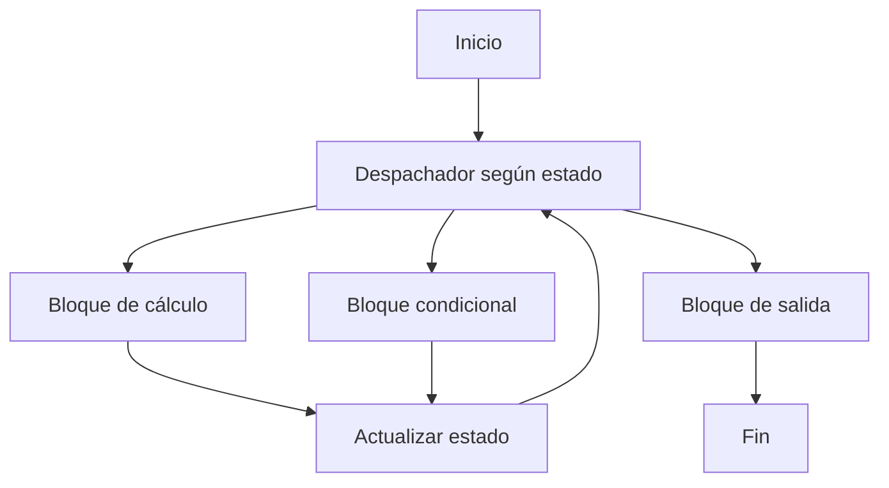
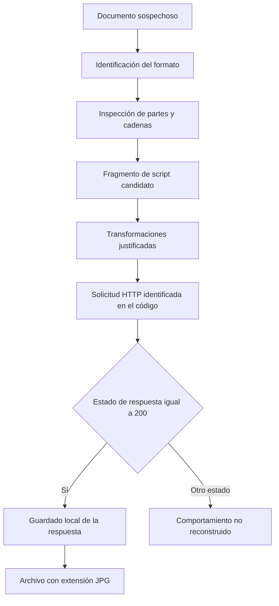

# Clase 3: Ofuscación y desofuscación: análisis de documentos Office y reconstrucción del comportamiento malicioso

> **Objetivo académico:** Comprender la ofuscación como transformación que dificulta el análisis del software, distinguirla del cifrado y reconstruir el comportamiento de documentos sospechosos mediante identificación de formatos, inspección estructural y desofuscación estática, evaluando críticamente las herramientas y la evidencia disponible.

## 1. Contexto y marco conceptual

La sesión estudia la relación entre ocultación de código, evasión de controles e ingeniería inversa. Su eje práctico es el análisis de un documento presentado como Word que contiene elementos asociados a VBA y un fragmento de script ofuscado. La finalidad de la desofuscación es comprender qué hace el artefacto, cómo interactúa con el sistema y qué indicios permiten detectarlo o contenerlo.

La **ofuscación** transforma la representación de un programa para dificultar su lectura y análisis, procurando conservar su comportamiento relevante. Puede afectar nombres, cadenas, expresiones, organización del código y flujo de control. En un contexto malicioso aumenta el costo de identificar instrucciones, recursos externos y acciones sobre el equipo. También puede utilizarse legítimamente para dificultar la ingeniería inversa de software.

La **desofuscación** recupera una representación suficientemente inteligible para analizar ese comportamiento. No implica necesariamente reconstruir el código fuente original: una representación equivalente, una cadena decodificada o un flujo de acciones documentado pueden bastar para responder una pregunta de investigación.

**Enriquecimiento conceptual:** La ofuscación es una técnica transversal que puede acompañar diferentes vectores de entrada; por sí sola no constituye necesariamente un vector de ataque. Un documento adjunto, una aplicación o un recurso web pueden introducir código, mientras que la ofuscación dificulta su inspección. Tampoco existe fundamento en la fuente para afirmar que todos los incidentes relevantes dependan de ella.

La sesión conecta tres dimensiones:

- **Ingeniería social:** induce a abrir documentos o habilitar funciones mediante señuelos creíbles.
- **Capacidades de ejecución:** macros, scripts y componentes del sistema permiten realizar acciones cuando se cumplen sus condiciones de activación.
- **Ocultación y evasión:** transformaciones del código y uso de recursos legítimos dificultan reconocer la intención maliciosa.

El contexto profesional también incluye asistentes de inteligencia artificial. Las intervenciones describen diferencias entre un modelo que genera respuestas y un agente conectado a herramientas. Estas observaciones son testimonios de uso, no una comparación experimental controlada.

## 2. Fundamentos teóricos y arquitectura

### 2.1. Preservación del comportamiento

La sesión caracteriza la ofuscación como una transformación que mantiene la funcionalidad y reduce la legibilidad. El cambio afecta la representación y puede alterar profundamente la estructura aparente.

**Enriquecimiento conceptual:** Una formalización mínima de esa intención es:

$$
\forall x \in D,\quad \operatorname{Obs}(P,x)=\operatorname{Obs}(O(P),x)
$$

Aquí, $P$ es el programa original; $O$ es una transformación de ofuscación; $O(P)$ es el programa transformado; $D$ es el dominio de entradas admitidas; y $\operatorname{Obs}$ representa los efectos observables elegidos para la comparación. Se supone un entorno de ejecución compatible. La igualdad expresa equivalencia respecto de esos efectos, no identidad del texto, del tiempo de ejecución ni del consumo de memoria. Su validez debe justificarse para la transformación concreta; no se deduce de que un programa parezca funcionar en un caso.

### 2.2. Ofuscación, codificación, cifrado y seguridad por oscuridad

| Concepto | Propósito y mecanismo | Consecuencia para el análisis |
| --- | --- | --- |
| Ofuscación | Dificultar la comprensión mediante transformaciones de la representación | Requiere reconstruir expresiones, cadenas o relaciones de control; no garantiza confidencialidad |
| Codificación | Representar datos conforme a un esquema, como Base64 | Puede revertirse si se conoce el esquema; no necesita una clave secreta |
| Cifrado | Proteger información mediante un algoritmo y una clave | La recuperación depende de la clave y de las propiedades del sistema criptográfico |
| Seguridad por oscuridad | Hacer depender la protección del desconocimiento del funcionamiento interno | La revelación de ese funcionamiento puede invalidar el supuesto de protección |

**Enriquecimiento conceptual:** Base64 no es cifrado ni una etapa obligatoria de la ofuscación. Un programa puede ocultar cadenas mediante concatenación, sustitución, operaciones aritméticas u otras transformaciones sin utilizar Base64. Decodificar solo tiene sentido cuando la estructura del dato y el código que lo procesa sustentan esa hipótesis.

La referencia oral a AES-256 contiene una formulación contradictoria sobre recuperar contenido sin clave. La distinción conceptualmente pertinente es que un cifrado correctamente implementado busca impedir una recuperación práctica sin la clave adecuada, bajo sus supuestos de seguridad. La ofuscación suele perseguir un incremento del esfuerzo de análisis; ese incremento puede ser considerable y no implica una reversión sencilla ni la recuperación exacta del original.

### 2.3. Macros VBA, scripts y objetos incrustados

**VBA**, Visual Basic for Applications, permite automatizar funciones de aplicaciones Office. La sesión destaca su interacción con el sistema y su posible abuso como componente inicial de una cadena de infección. La ejecución depende de la aplicación, las políticas y los mecanismos de activación; abrir un documento no demuestra por sí mismo que una macro se haya ejecutado.

**OLE**, Object Linking and Embedding, permite vincular o incrustar objetos entre aplicaciones. Un documento puede contener recursos de otras aplicaciones y componentes que requieren inspección adicional.

**Enriquecimiento conceptual:** VBA, VBScript, JavaScript, OLE y ActiveX son conceptos relacionados en ciertos escenarios de Windows, pero distintos. OLE no debe describirse como requisito universal para que cualquier documento contenga macros. La presencia de un contenedor OLE o de un proyecto VBA tampoco determina por sí sola una intención maliciosa. En particular, el script con referencias a `ActiveXObject` comentado en la práctica no puede identificarse automáticamente como código VBA.

La sesión utiliza **dropper** para describir componentes que introducen otras cargas. **Enriquecimiento conceptual:** Conviene distinguir un dropper que deposita una carga que ya contiene de un downloader que la obtiene desde otro recurso. Un mismo artefacto puede combinar ambos comportamientos, pero la clasificación debe apoyarse en sus instrucciones.

La **persistencia** consiste en mantener o recuperar la ejecución más allá de la sesión inicial. Se mencionan tareas programadas, claves de registro y modificaciones relacionadas con Office como posibles mecanismos. Ninguno queda demostrado para la muestra práctica.

### 2.4. Aplanamiento del flujo de control

La sesión explica que el aplanamiento fragmenta el código en bloques cuya selección pasa a depender de un despachador, frecuentemente dentro de un bucle. La estructura original de secuencias, condiciones y ciclos deja de ser evidente.



El diagrama representa un esquema conceptual de aplanamiento: los bloques regresan al despachador mediante una actualización del estado. No reproduce un programa concreto de la demostración.

El docente relaciona este tema con una investigación propia sobre funciones aleatorias y dificultades del análisis simbólico. **Enriquecimiento conceptual:** El análisis simbólico representa entradas o estados mediante expresiones y restricciones; puede coexistir con ejecución concreta. La aleatoriedad o seudoaleatoriedad no establece por sí misma una imposibilidad de análisis ni permite estimar años de trabajo. La resistencia depende del diseño, de las dependencias observables, de las claves o semillas y de la estrategia analítica. La fuente no proporciona resultados suficientes para evaluar esa investigación.

## 3. Implementación técnica y lógica de negocio

### 3.1. Entorno y herramientas

La demostración utiliza Kali Linux como entorno de trabajo, MalwareBazaar como fuente de una muestra, VirusTotal para triaje y CyberChef para identificación y transformación de datos. También se mencionan Ghidra y ViperMonkey, sin mostrar un procedimiento operativo con ellas.

| Herramienta o recurso | Papel descrito | Límite de interpretación |
| --- | --- | --- |
| Kali Linux | Entorno separado del equipo anfitrión para el análisis | La distribución no garantiza por sí sola aislamiento |
| MalwareBazaar | Repositorio de muestras y metadatos asociados | Las etiquetas orientan; no sustituyen el análisis del artefacto |
| VirusTotal | Consulta de detecciones y contexto de una muestra | El desacuerdo entre motores no equivale a una probabilidad de seguridad |
| CyberChef | Detección de formato, extracción de cadenas y transformaciones encadenadas | Una receta incorrecta puede producir una salida aparentemente significativa |
| Ghidra y ViperMonkey | Referencias a herramientas de ingeniería inversa y análisis de macros | No se documenta su uso en la práctica |

La muestra se distribuye en un archivo comprimido protegido por contraseña para reducir aperturas accidentales. Esa protección no neutraliza su contenido.

**Enriquecimiento conceptual:** Un entorno de análisis requiere aislamiento explícito de red, carpetas compartidas, portapapeles y recursos del anfitrión. Analizar un archivo con parsers también implica exposición a contenido no confiable. En esta sesión predomina el análisis estático: se inspeccionan datos y código sin demostrar la ejecución de la carga.

### 3.2. Triaje e identificación del contenedor

El procedimiento comienza con metadatos que sugieren presencia de VBA, posibles invocaciones del sistema y cadenas codificadas. En VirusTotal se reportan oralmente 38 detecciones de 61 motores. Ese dato corresponde a la observación narrada; no se dispone del informe íntegro ni de una consulta independiente.

A continuación se utiliza `Detect File Type` en CyberChef. La operación analiza firmas de contenido para orientar la identificación real del archivo, independientemente del nombre. La sesión interpreta la salida como un documento Office con estructura ZIP y procede a inspeccionarlo como contenedor.

**Enriquecimiento conceptual:** Los formatos Office Open XML, como `.docx`, `.xlsx` y `.pptx`, utilizan paquetes ZIP; también existen variantes habilitadas para macros. Los formatos binarios heredados, como muchos `.doc`, `.xls` y `.ppt`, suelen utilizar contenedores OLE Compound File. Por tanto, es incorrecto generalizar que todos los archivos Office son ZIP. Una extensión `.doc` con contenido ZIP requiere investigar una posible discrepancia de formato.

La sesión copia el archivo con una extensión ZIP y después lo extrae. Los nombres completos de origen no se conservan de forma fiable. El significado de las operaciones puede expresarse con nombres genéricos:

**Enriquecimiento conceptual:** El siguiente fragmento ilustra las operaciones descritas, exclusivamente para un archivo previamente identificado como ZIP en un entorno aislado; no reproduce los comandos exactos ni una ejecución verificada.

```bash
cp documento_sospechoso.doc muestra.zip
unzip -l muestra.zip
unzip muestra.zip -d contenido_muestra
```

`cp` copia bytes: cambiar la extensión no convierte el formato. `unzip -l` enumera las entradas y la última instrucción las extrae al directorio indicado. La validez del procedimiento depende de que el contenido sea realmente un ZIP.

### 3.3. Extracción de cadenas e inspección estructural

En CyberChef se aplica `Strings` con diferentes longitudes mínimas, incluyendo 4, 10 y 100 caracteres. Se comentan referencias a `vbaProject.bin`, imágenes, fuentes y metadatos. El objetivo es localizar indicios que orienten una revisión más precisa.

**Enriquecimiento conceptual:** `Strings` extrae secuencias imprimibles según sus parámetros; no recupera todo el código de un archivo. Las cadenas comprimidas, cifradas o representadas con otra codificación pueden no aparecer. Elevar el umbral reduce ruido, pero elimina indicadores cortos. La ausencia de resultados llamativos no demuestra ausencia de contenido malicioso.

La inspección manual recorre archivos de contenido, propiedades y partes del documento. Entre ellos se identifica un fragmento extenso con etiquetas HTML y código de script. Este hallazgo se toma como candidato de análisis porque su estructura y sus operaciones merecen explicación, no porque su longitud pruebe malicia.

La referencia a `vbaProject.bin` es compatible con un proyecto VBA incrustado. **Enriquecimiento conceptual:** Debe diferenciarse la aparición de ese nombre en una cadena de la identificación efectiva de la parte correspondiente, la extracción de sus módulos y la comprensión de sus puntos de entrada.

### 3.4. Transformaciones y reconstrucción funcional

La sesión describe selección de un fragmento, eliminación manual de envolturas consideradas ajenas a la cadena codificada y pruebas con `From Base64` y `Reverse`. Los resultados iniciales son poco legibles. Después se reconocen referencias a creación de objetos, una solicitud HTTP, una condición sobre el estado 200 y una operación `SaveToFile`.

El orden definitivo de la receta y las opciones de cada operación no quedan registrados con precisión. Por ello, no es posible reconstruir una transformación reproducible a partir del relato.

**Enriquecimiento conceptual:** Para analizar una receta deben conservarse entrada, salida y parámetros de cada paso. El orden importa: invertir una cadena antes de decodificarla no equivale necesariamente a invertir los bytes resultantes después. El contenido que parece envoltura puede participar en la construcción o selección de la carga y debe conservarse como evidencia antes de separarlo.

La lógica comentada puede resumirse así:



El diagrama describe la interpretación estática presentada. No representa una descarga observada. El estado HTTP 200 indica éxito de la petición según la semántica HTTP; no acredita que el recurso sea benigno. Una extensión `.jpg` tampoco demuestra que el contenido sea una imagen.

La ruta se describe como ubicada en un directorio público de Windows. Las respuestas de asistentes de IA añaden interpretaciones sobre descarga binaria, ocultación de ventana y posible ejecución posterior. La transcripción no permite verificar todas esas afirmaciones contra el código completo.

## 4. Análisis crítico de casos y auditoría práctica

### 4.1. Campañas utilizadas como marco comparativo

| Caso presentado | Cadena o mecanismo descrito | Conocimiento recuperable | Reserva sobre la evidencia |
| --- | --- | --- | --- |
| Carbanak | Infiltración bancaria, observación de procesos, ocultación, inyección y comunicaciones protegidas | El análisis técnico debe relacionarse con los procesos internos que hacen posible el impacto | Cifras, duración, detalles y comparación con capacidades militares pertenecen al relato oral |
| Operación denominada «Macromeis» | Documento con referencia remota `INCLUDEPICTURE`, macros, scripts y persistencia | Un recurso remoto puede revelar apertura; servicios legítimos pueden formar parte de una cadena maliciosa | La denominación, cronología y detalles técnicos no quedan establecidos con precisión |
| Red Kitten | Señuelos documentales, macros, una carga descrita en C#, carga de DLL e imágenes | La credibilidad del contenido y el abuso de ejecutables legítimos pueden reforzar la infección | La atribución y el uso de IA se presentan como hipótesis; el relato contiene contradicciones temporales |
| Operation Dream Job, vinculada en la sesión a Lazarus | Contactos profesionales falsos, documentos y una herramienta de acceso remoto con cadenas ocultas | La personalización del señuelo y la ocultación de configuración actúan en capas distintas | No se adjuntan las muestras ni el informe para corroborar el mecanismo exacto |

En Carbanak, la lección central es que el adversario puede estudiar procesos de negocio además de comprometer equipos. Comprender autorizaciones, movimientos y reconciliaciones ayuda a interpretar el impacto; una descripción del código aislada de ese contexto resulta insuficiente.

En la campaña denominada «Macromeis», la sesión distingue una petición asociada a una imagen remota de una cadena de ejecución mediante macros y scripts. **Enriquecimiento conceptual:** Una solicitud de imagen puede funcionar como seguimiento de apertura sin demostrar ejecución de código. Además, `SendKeys`, mencionado de forma imprecisa, se relaciona con pulsaciones de teclado y no debe generalizarse a cualquier automatización de ratón. La técnica exacta exige consultar el artefacto.

En Red Kitten, la explicación resalta documentos que explotan angustia emocional y presentan datos aparentemente oficiales. La revisión de inconsistencias internas ayuda a cuestionar su credibilidad, pero no sustituye el análisis técnico. La carga de una DLL maliciosa mediante un ejecutable legítimo es compatible con un patrón de carga lateral de DLL; esa interpretación requiere verificar qué biblioteca se solicita y cómo se resuelve su ubicación.

La posible generación de macros con IA se infiere, según el relato, de nombres, comentarios y estructura. **Enriquecimiento conceptual:** Esos rasgos son indicios débiles para establecer procedencia: también pueden aparecer en código humano, plantillas o material copiado. No permiten identificar de manera concluyente un modelo ni demostrar generación automática.

En Dream Job, el foco es la construcción de confianza mediante información profesional específica. La sesión asocia el caso con robo de tecnología y funciones de acceso remoto. Las referencias históricas adicionales a Sony Pictures y WannaCry no aportan evidencia sobre la muestra; en particular, la afirmación de una vía PlayStation para el incidente de Sony no queda sustentada y no se adopta como hecho.

### 4.2. Qué demuestra el caso práctico

| Evidencia descrita | Interpretación razonable | Conclusión que excedería la evidencia |
| --- | --- | --- |
| Numerosos motores detectan el archivo | Existe una señal relevante para priorizar el análisis | El archivo tiene una probabilidad exacta de malicia equivalente al porcentaje de detecciones |
| Aparece una referencia a `vbaProject.bin` | Conviene inspeccionar el proyecto VBA y sus módulos | Toda macro es maliciosa o ya se ejecutó |
| Se identifica código de solicitud HTTP y guardado | El fragmento parece implementar recuperación y escritura de datos | La transferencia ocurrió y su contenido se ejecutó |
| La salida se guarda con extensión JPG | El nombre puede ocultar la naturaleza del contenido | Es una imagen válida o contiene necesariamente esteganografía |
| Hay metadatos en otro idioma | Existe un indicio sobre el contexto documental | Se conoce la nacionalidad o afiliación del atacante |
| Una IA explica el fragmento | Se dispone de hipótesis para contrastar | La explicación constituye validación independiente |

**Enriquecimiento conceptual:** Los números narrados permiten corregir una inconsistencia aritmética sin añadir una medición nueva. Si $n=61$ es el total de motores reportados y $d=38$ el número de detecciones, ambos conteos adimensionales, la fracción sin detección reportada es:

$$
q=\frac{n-d}{n}=\frac{23}{61}\approx 0.377
$$

Esto equivale aproximadamente al 37.7 %, bajo el supuesto simplificado de que los 23 resultados restantes sean efectivamente no detecciones. Si incluyen errores, resultados no soportados u otras categorías, deben separarse. La proporción no es una tasa general de fallo ni una probabilidad de infección; además, los motores no constituyen ensayos independientes. Por ello, el 20–25 % mencionado oralmente no coincide con los conteos proporcionados.

La reconstrucción es suficiente para describir un comportamiento compatible con descarga y guardado. No basta para asignar una familia concreta, demostrar ransomware, confirmar persistencia o afirmar ejecución posterior.

## 5. Principios de diseño, buenas prácticas y anti-patrones

### 5.1. Investigar mediante hipótesis contrastables

La secuencia metodológica recuperable es identificar el formato, revisar la estructura, localizar fragmentos, justificar transformaciones e interpretar acciones. Cada fase debe responder una pregunta concreta. Aplicar operaciones al azar hasta obtener texto reconocible introduce sesgo y dificulta reproducir el hallazgo.

**Enriquecimiento conceptual:** Una cadena legible es un resultado intermedio. Debe verificarse cómo se utiliza, qué datos la alimentan y qué efectos habilita. La interpretación funcional exige relacionar el código decodificador con la cadena transformada y con sus consumidores.

### 5.2. Conservar evidencia y separar niveles de certeza

La fuente destaca la intervención humana cuando las operaciones automáticas no revelan resultados evidentes. La revisión manual es valiosa si conserva el contexto del hallazgo.

**Enriquecimiento conceptual:** Una documentación sólida registra el identificador de la muestra, las partes inspeccionadas, las versiones de herramientas y las transformaciones. Debe distinguir entre evidencia directa, inferencia compatible y dato no determinado. Recortar código sin conservar el original o presentar una interpretación como ejecución observada rompe esa trazabilidad.

### 5.3. Evaluar controles por comportamiento

La explicación docente enfatiza límites de las firmas. **Enriquecimiento conceptual:** Los productos actuales pueden combinar firmas, heurísticas, análisis de comportamiento y otros mecanismos. La presencia de una cadena como `powershell.exe` no garantiza una alerta, y ocultarla no garantiza evasión. El contexto de ejecución y la secuencia de acciones suelen aportar más información que una palabra aislada.

La ofuscación puede añadir fricción al análisis, pero no debe ser el fundamento exclusivo de una arquitectura de seguridad. Las políticas de macros, la restricción de ejecución y el seguimiento de comportamientos anómalos deben evaluarse según el entorno y el modelo de amenaza.

### 5.4. Usar IA como apoyo verificable

Las intervenciones atribuyen a los asistentes utilidad para interpretar código, explicar vulnerabilidades y redactar recomendaciones. También describen alucinaciones, terminología inexistente y asociaciones incorrectas. La sesión menciona integración mediante MCP y herramientas como Nmap para pasar de respuesta textual a acción sobre un entorno.

**Enriquecimiento conceptual:** Conectar herramientas amplía las capacidades operativas; no demuestra que mejore la exactitud del razonamiento. La calidad debe evaluarse mediante resultados contrastables. Es necesario distinguir el código sugerido, la llamada efectivamente realizada y su salida. En análisis de malware, las instrucciones o comentarios dentro del artefacto son datos no confiables, también para el asistente.

Los nombres y tamaños de modelos aparecen de forma inconsistente en la transcripción, por lo que no se utilizan para establecer una clasificación comparativa. Las interfaces de navegador y las desplegadas con Docker se mencionan como alternativas para interactuar con modelos locales; no se aportan mediciones de rendimiento ni detalles suficientes para recomendar una configuración.

### 5.5. Anti-patrones principales

- Suponer que todos los formatos Office son ZIP o que una extensión identifica el contenido real.
- Considerar obligatoria la presencia de Base64 en cualquier esquema de ofuscación.
- Interpretar una búsqueda de cadenas sin hallazgos como prueba de inocuidad.
- Confundir guardado de un archivo con su ejecución o su persistencia.
- Atribuir una campaña por idioma, comentarios o nombres internos aislados.
- Equiparar desacuerdo entre motores con seguridad del archivo.
- Confiar en que un sistema virtualizado o una contraseña de archivo bastan para contener una muestra.
- Aceptar la salida de un asistente como sustituto del análisis del artefacto.

**Enriquecimiento conceptual:** En servicios de análisis, el tratamiento de datos también importa. Consultar información ya disponible mediante un identificador y enviar un documento completo son acciones distintas; la segunda puede exponer contenido a terceros. Del mismo modo, usar CyberChef en el navegador o una copia local requiere evaluar procedencia, versión y tratamiento efectivo de los datos. La modalidad en línea no es universalmente superior.

## 6. Síntesis conceptual y profundización académica

La ofuscación modifica la accesibilidad del comportamiento para el analista. La desofuscación reduce esa dificultad mediante identificación estructural, reconstrucción de datos y análisis de relaciones entre instrucciones. Su resultado más útil es una explicación sustentada de capacidades, condiciones y efectos, aunque no se recupere el código original.

La práctica ilustra un tránsito desde señales generales —metadatos, detecciones y referencias a macros— hacia una interpretación más específica de un fragmento que solicita un recurso y guarda la respuesta. Sus límites también son formativos: faltan el código íntegro, la receta definitiva y evidencias de ejecución. Estas ausencias impiden convertir hipótesis de descarga, ejecución y persistencia en una cadena confirmada.

Las campañas comentadas conectan ingeniería social, capacidades de Office, recursos legítimos y ocultación. Sus relatos ofrecen un marco comparativo, pero las atribuciones y cifras requieren los informes originales antes de incorporarse como resultados históricos verificados.

**Enriquecimiento conceptual:** Las líneas de profundización que se desprenden del contenido son la recuperación del flujo de control, el análisis simbólico y sus límites, la comparación entre representaciones de documentos, la distinción entre indicadores y evidencia causal, y la evaluación reproducible de asistentes de IA. En todas ellas, el rigor depende de separar lo observado, lo inferido y lo que permanece indeterminado.
