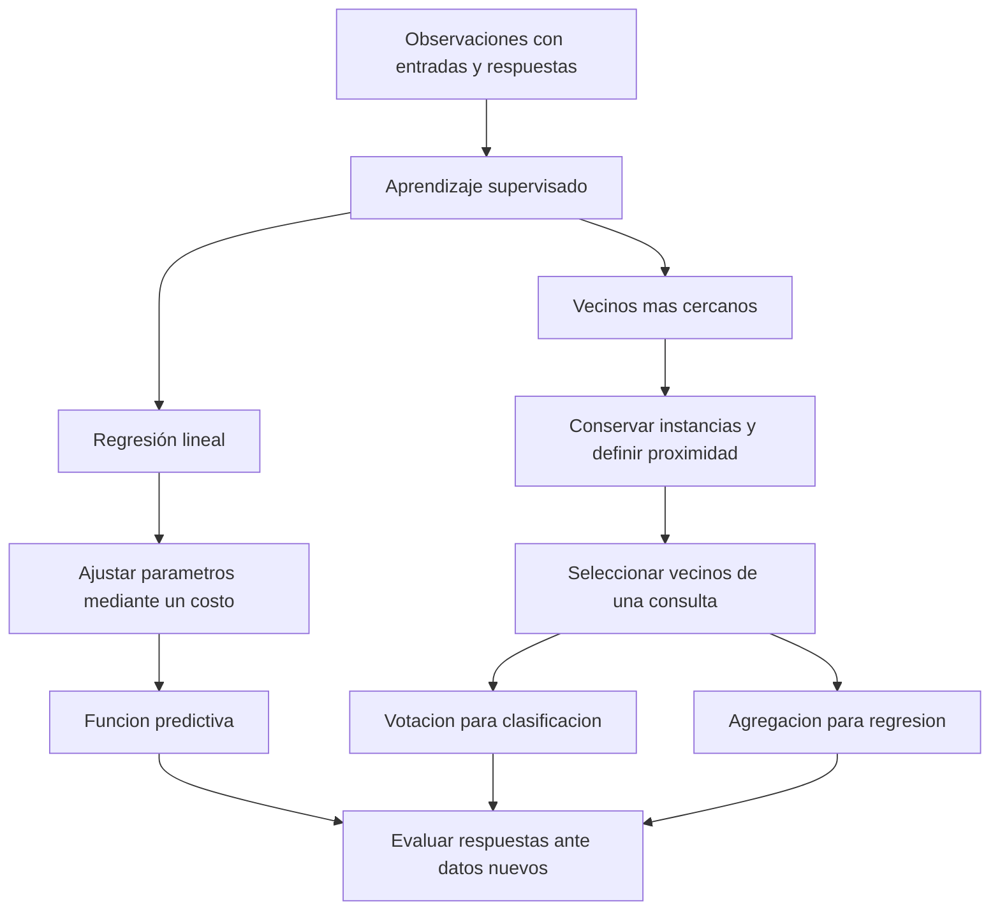

# Clase 3: Aprendizaje supervisado: regresión lineal, optimización y vecinos más cercanos

> **Objetivo académico:** Comprender el aprendizaje supervisado como construcción de reglas predictivas a partir de observaciones etiquetadas; relacionar la regresión lineal con la minimización de una función de costo y analizar cómo los vecinos más cercanos permiten clasificar, estimar valores numéricos e imputar datos mediante relaciones de proximidad.

## 1. Contexto y marco conceptual

El aprendizaje supervisado parte de observaciones para las cuales se conocen tanto las características de entrada como la respuesta de interés. En la sesión se desarrollan dos mecanismos diferentes: ajustar parámetros de una función y conservar instancias para responder por semejanza.

**Enriquecimiento conceptual:** Una notación que distingue observaciones y características es:

$$
\mathcal{D}=\{(\mathbf{x}^{(i)},y^{(i)})\}_{i=1}^{m},\qquad \mathbf{x}^{(i)}\in\mathbb{R}^{p}.
$$

Aquí, $\mathcal{D}$ es el conjunto de datos, $m\in\mathbb{N}_{>0}$ es el número de observaciones y $p\in\mathbb{N}_{>0}$ es el número de características numéricas después de representar las variables. El superíndice $(i)$ identifica una observación; no representa una potencia. En regresión, $y^{(i)}\in\mathbb{R}$; en clasificación, $y^{(i)}$ pertenece a un conjunto finito de clases $\mathcal{C}$. Las variables originalmente cualitativas requieren una representación compatible con el método elegido.

La distinción entre regresión y clasificación depende de la naturaleza de la respuesta:

| Problema | Respuesta | Regla ilustrativa |
|---|---|---|
| Regresión | Magnitud numérica | Estimar el precio de una vivienda a partir de su tamaño |
| Clasificación | Categoría | Asignar una observación a una clase mediante vecinos etiquetados |

La clasificación también es una forma de predicción. En la sesión, la expresión «predecir un valor» se utiliza especialmente para referirse a regresión; conviene conservar la distinción entre respuesta numérica y categórica sin restringir la predicción a una sola de ellas.

El ejemplo del tamaño y el precio de una vivienda introduce la hipótesis predictiva: una función recibe una entrada y produce una estimación. El propósito consiste en encontrar una regla que represente adecuadamente la relación observada y permita responder ante entradas nuevas.

El aprendizaje tiene aquí un sentido computacional: los datos determinan parámetros o relaciones que modifican las respuestas del sistema. Esto no establece equivalencia con los mecanismos cognitivos del aprendizaje humano. Tampoco basta obtener una regla que reproduzca observaciones conocidas: su utilidad depende de su comportamiento ante casos nuevos.

## 2. Fundamentos teóricos y arquitectura

### 2.1. Hipótesis lineal y parámetros

La regresión lineal simple utiliza la hipótesis:

$$
h_{\theta}(x)=\theta_0+\theta_1x.
$$

La entrada $x\in\mathbb{R}$ representa una característica; $h_{\theta}(x)\in\mathbb{R}$ es la respuesta estimada; $\theta_0\in\mathbb{R}$ es el intercepto y $\theta_1\in\mathbb{R}$ es la pendiente. Si $x$ es superficie y la respuesta es precio, el intercepto tiene unidades monetarias y la pendiente tiene unidades monetarias por unidad de superficie. La interpretación de $\theta_0$ como precio para superficie cero puede carecer de sentido práctico, aunque cumpla una función matemática en el ajuste.

Los valores de los parámetros determinan diferentes rectas. Por ejemplo, $\theta_0=1.5$ y $\theta_1=0$ producen una salida constante de $1.5$; $\theta_0=0$ y $\theta_1=0.5$ producen una recta que pasa por el origen; $\theta_0=1$ y $\theta_1=0.5$ desplazan esa recta verticalmente.

**Enriquecimiento conceptual:** Para la tercera combinación, $h_{\theta}(1)=1.5$. Esta sustitución corrige una inconsistencia aritmética verbal de la explicación. Además, una recta sí puede pasar por todos los puntos cuando estos son exactamente colineales. La necesidad de aproximar aparece cuando las observaciones no admiten un ajuste lineal exacto.

### 2.2. Residuos y función de costo

El residuo de una observación es la diferencia entre su predicción y su respuesta conocida. La función presentada agrega sus cuadrados:

$$
J(\theta_0,\theta_1)=\frac{1}{2m}\sum_{i=1}^{m}\left(h_{\theta}(x^{(i)})-y^{(i)}\right)^2.
$$

Aquí, $J\geq 0$ mide el costo sobre las $m$ observaciones. Los residuos tienen las unidades de la respuesta y el costo tiene sus unidades al cuadrado. El objetivo es minimizar $J$ respecto de los parámetros; no minimizar los valores de los parámetros en sí mismos.

Elevar al cuadrado impide que errores de signos opuestos se cancelen y penaliza con mayor intensidad los residuos grandes. En la regresión lineal también produce un objetivo diferenciable y cuadrático respecto de los parámetros.

**Enriquecimiento conceptual:** La expresión utilizada es la mitad del error cuadrático medio. El factor $1/2$ simplifica las derivadas y no cambia los parámetros minimizadores. El error absoluto constituye otra alternativa, pero introduce puntos de no diferenciabilidad cuando el residuo vale cero. La posibilidad de derivar una función no garantiza por sí sola que tenga mínimo: en este caso la estructura cuadrática convexa es la propiedad decisiva.

Con un parámetro libre, el costo puede representarse mediante una parábola. Con intercepto y pendiente libres, el costo es una superficie sobre el plano de parámetros. El eje de la respuesta estimada en el gráfico de datos y el eje del costo en el gráfico de optimización representan magnitudes distintas.

### 2.3. Simplificación sin intercepto

Para facilitar el cálculo manual, la sesión fija $\theta_0=0$:

$$
h_{\theta}(x)=\theta_1x,\qquad J(\theta_1)=\frac{1}{2m}\sum_{i=1}^{m}(\theta_1x^{(i)}-y^{(i)})^2.
$$

Esta restricción reduce el problema a encontrar una pendiente y obliga a que la recta pase por el origen.

**Enriquecimiento conceptual:** Su utilidad didáctica no implica que sea una decisión apropiada para todos los datos. Si la relación real requiere intercepto, fijarlo en cero restringe el modelo y puede generar error sistemático.

### 2.4. Vecinos más cercanos como aprendizaje basado en instancias

KNN conserva observaciones de referencia y utiliza su proximidad a una consulta. En clasificación, las etiquetas de los vecinos determinan la respuesta; en regresión, se agregan sus valores numéricos.

La sesión lo caracteriza como no paramétrico y basado en instancias. Esto significa que no se ajusta una forma funcional global como la recta anterior.

**Enriquecimiento conceptual:** «No paramétrico» no equivale a ausencia de modelo, de decisiones o de supuestos. El conjunto de referencia, la representación de las variables, la distancia y la regla de agregación definen una función predictiva implícita. Su supuesto operativo es que la proximidad en el espacio elegido informa sobre la semejanza de las respuestas. Además, $k$ es un hiperparámetro: se configura o selecciona mediante evaluación, en lugar de estimarse como una pendiente durante el ajuste lineal.

## 3. Implementación técnica y lógica de negocio

La fuente desarrolla cálculos manuales y procedimientos conceptuales, pero no proporciona código completo ni resultados de una ejecución informática. Los pasos siguientes formalizan la lógica descrita sin atribuirle una implementación ejecutada.

### 3.1. Cálculo del costo para la función identidad

El ejemplo utiliza los pares $(1,1)$, $(2,2)$ y $(3,3)$, con $m=3$ y sin intercepto. Como las respuestas coinciden con las entradas, la pendiente $\theta_1=1$ reproduce exactamente las tres observaciones.

**Enriquecimiento conceptual:** Sustituyendo los datos se obtiene una expresión cerrada del costo:

$$
J(\theta_1)=\frac{1}{6}\left[(\theta_1-1)^2+(2\theta_1-2)^2+(3\theta_1-3)^2\right]
=\frac{7}{3}(\theta_1-1)^2.
$$

La simplificación utiliza que los tres residuos son múltiplos de $\theta_1-1$, con factores $1$, $2$ y $3$. Sus cuadrados suman $14(\theta_1-1)^2$ antes de dividir por seis.

| Pendiente $\theta_1$ | Costo exacto | Aproximación |
|---|---|---|
| $0$ | $7/3$ | $2.3333$ |
| $0.5$ | $7/12$ | $0.5833$ |
| $1$ | $0$ | $0$ |

Estos valores precisan los redondeos de la explicación. Entre las pendientes comparadas, $1$ tiene el menor costo; la expresión cuadrática permite además establecer que es el mínimo global de este ejemplo.

### 3.2. Diferencia entre explorar valores y descender por el gradiente

La sesión vincula el recorrido del costo con el descenso del gradiente y con un factor de aprendizaje. Sin embargo, calcular costos para pendientes prefijadas y avanzar con incrementos constantes describe una búsqueda por valores candidatos; no constituye por sí mismo descenso del gradiente.

**Enriquecimiento conceptual:** En el modelo sin intercepto, la derivada y la actualización correspondiente son:

$$
\frac{dJ}{d\theta_1}=\frac{1}{m}\sum_{i=1}^{m}(\theta_1x^{(i)}-y^{(i)})x^{(i)},
$$

$$
\theta_1^{(t+1)}=\theta_1^{(t)}-\alpha\left.\frac{dJ}{d\theta_1}\right|_{\theta_1=\theta_1^{(t)}}.
$$

El índice $t\in\mathbb{N}_0$ cuenta iteraciones y $\alpha>0$ es la tasa de aprendizaje. La derivada se calcula usando las $m$ observaciones y el valor actual de la pendiente. La tasa multiplica el gradiente: no es directamente el desplazamiento de la pendiente. Por ello, una tasa constante puede generar desplazamientos distintos en cada iteración. Si las variables conservan unidades físicas, $\alpha$ debe hacer dimensionalmente consistente la actualización; su valor numérico depende de la escala de los datos.

La lógica consiste en calcular predicciones, obtener residuos, evaluar el gradiente y actualizar la pendiente en dirección opuesta a él. Una tasa demasiado pequeña puede requerir muchas iteraciones; una excesiva puede provocar oscilaciones o divergencia. El efecto depende también de la curvatura del costo.

**Enriquecimiento conceptual:** En el ejemplo identidad, el gradiente es $\frac{14}{3}(\theta_1-1)$. Partiendo de $\theta_1^{(0)}=0$ y usando $\alpha=0.1$, la primera actualización produce $\theta_1^{(1)}=7/15\approx0.4667$. Es una derivación ilustrativa, no un resultado informado de ejecución. Muestra que la tasa $0.1$ no implica un incremento de $0.1$ en la pendiente.

### 3.3. Distancia y selección de vecinos

Cada observación se representa como un vector de características. Para dos vectores numéricos $\mathbf{a},\mathbf{b}\in\mathbb{R}^{p}$, la distancia euclidiana generaliza el teorema de Pitágoras:

$$
d(\mathbf{a},\mathbf{b})=\sqrt{\sum_{j=1}^{p}(a_j-b_j)^2}.
$$

El índice $j$ recorre características, y $a_j$ y $b_j$ son sus valores en cada observación. En dos dimensiones se suman dos diferencias cuadradas. La interpretación de esta distancia requiere una representación y unas escalas compatibles; sumar directamente magnitudes heterogéneas puede producir una proximidad dominada por la variable de mayor escala.

Para una consulta, el procedimiento descrito calcula distancias a las observaciones de referencia, selecciona las $k$ menores y combina las respuestas correspondientes. El valor $k$ cuenta vecinos, no grupos o clústeres. Una etiqueta conocida se utiliza para votar, pero no debe incorporarse como característica de la consulta.

En clasificación, la regla básica es la votación mayoritaria. En regresión, la sesión propone copiar la respuesta del vecino cuando $k=1$ y promediar cuando se utilizan varios vecinos.

**Enriquecimiento conceptual:** La regresión KNN por promedio uniforme puede escribirse como:

$$
\widehat{y}(\mathbf{x})=\frac{1}{k}\sum_{i\in N_k(\mathbf{x})}y^{(i)}.
$$

La consulta $\mathbf{x}\in\mathbb{R}^{p}$ contiene las características disponibles; $N_k(\mathbf{x})$ es el conjunto de índices de sus $k$ vecinos seleccionados y $1\leq k\leq m$. Las respuestas $y^{(i)}$ son numéricas y la estimación conserva sus unidades. La distancia se calcula sobre las entradas, sin utilizar la respuesta desconocida.

### 3.4. Selección del número de vecinos

La sesión propone comparar diferentes valores de $k$ utilizando observaciones con etiqueta conocida y contabilizar aciertos. La discusión también incorpora la validación cruzada como alternativa para comparar configuraciones.

**Enriquecimiento conceptual:** La exactitud de clasificación sobre un conjunto independiente de $n$ observaciones es:

$$
\operatorname{Accuracy}=\frac{1}{n}\sum_{i=1}^{n}\mathbb{1}(\widehat{y}^{(i)}=y^{(i)}).
$$

Aquí, $n\in\mathbb{N}_{>0}$ es el tamaño del conjunto evaluado, $\widehat{y}^{(i)}$ es la clase predicha y $\mathbb{1}$ vale uno si hay coincidencia y cero en caso contrario. La exactitud pertenece a $[0,1]$ y no tiene unidades. Puede ser insuficiente cuando existe un fuerte desequilibrio entre clases.

Las observaciones utilizadas para medir el desempeño deben quedar fuera del conjunto de vecinos de esa predicción. En validación cruzada, cada partición de validación se predice utilizando únicamente las particiones de entrenamiento correspondientes. El mejor $k$ es el que ofrece mejor desempeño según ese procedimiento y esa métrica, sin garantía universal para datos futuros.

## 4. Análisis crítico de casos y auditoría práctica

### 4.1. Ajuste lineal frente a estructura de los datos

La sesión contrasta tendencias positivas, negativas, patrones no lineales y nubes dispersas. Una pendiente puede representar tanto una relación creciente como decreciente. Cuando existe curvatura relevante, una recta puede dejar residuos sistemáticos aunque sus parámetros minimicen perfectamente el costo dentro de la familia lineal.

**Enriquecimiento conceptual:** Deben distinguirse el error de optimización y la limitación de representación. El primero aparece cuando todavía no se ha alcanzado el mejor ajuste permitido por el modelo; la segunda persiste cuando ninguna recta describe adecuadamente la relación. Reducir la tasa de aprendizaje no corrige una familia funcional inadecuada. Tampoco puede asegurarse que todo patrón no lineal produzca un costo numéricamente grande: su magnitud depende de la escala de la respuesta y de la intensidad de la desviación.

Un costo mínimo no tiene por qué ser cero. Ruido, variables omitidas y restricciones del modelo pueden impedir un ajuste exacto. Además, un costo pequeño sobre los datos empleados para ajustar parámetros no certifica capacidad predictiva sobre nuevas observaciones.

### 4.2. Empates y papel de $k$

La discusión gráfica muestra que cambiar el número de vecinos puede alterar la clase asignada. Con dos vecinos de clases distintas puede existir empate de votos incluso cuando sus distancias sean diferentes.

**Enriquecimiento conceptual:** Un valor impar de $k$ evita el empate de votos entre dos clases en votación uniforme, pero no resuelve todos los empates multiclase. Por ejemplo, tres vecinos de tres clases distintas producen una igualdad. También pueden existir distancias exactamente iguales, especialmente con variables discretas o geometrías simétricas. El sistema necesita una política explícita: considerar distancias, ponderar votos o aplicar un criterio determinista documentado. Una resolución aleatoria requiere controlar su reproducibilidad.

La fuente relaciona $k$ con el desempeño, pero no aporta resultados suficientes para establecer un valor numérico óptimo de un conjunto concreto.

### 4.3. Representación de variables cualitativas

La sesión advierte que las variables cualitativas necesitan una transformación antes del cálculo numérico de distancias. También menciona distancias alternativas, como Manhattan y Hamming, cuya pertinencia depende de la representación y del significado de las características.

**Enriquecimiento conceptual:** Asignar números arbitrarios a categorías nominales no garantiza una distancia válida. Codificar tres categorías como $1$, $2$ y $3$ introduce orden y separación que pueden no existir. Para categorías nominales puede resultar pertinente una representación indicadora o una medida de desacuerdo; las variables ordinales requieren justificar tanto el orden como las separaciones. La distancia de Hamming contabiliza diferencias entre posiciones comparables y no equivale a distancia geográfica. El término oído en la referencia a coordenadas geográficas no permite identificar con certeza la medida específica mencionada.

### 4.4. Imputación multivariada por proximidad

El caso de una altura faltante ilustra una extensión del mecanismo de vecinos. Se busca una observación semejante utilizando características disponibles, como peso y edad, y se utiliza su altura como referencia. Con varios vecinos puede agregarse la información disponible en lugar de copiar un único valor.

El enfoque es multivariado porque la selección de donantes depende de varias características. Se diferencia de imputar una media calculada exclusivamente sobre la variable incompleta.

**Enriquecimiento conceptual:** Su posible ventaja depende de que las variables observadas contengan información sobre la ausente y de que las distancias sean pertinentes. No existe superioridad universal sobre métodos univariados. El campo faltante se excluye del cálculo directo de distancia; los donantes deben disponer de ese campo. Con faltantes adicionales es necesario definir qué dimensiones son comparables y cómo se ajusta la distancia. Para evaluar un sistema predictivo, el imputador y las transformaciones deben ajustarse dentro de cada partición de entrenamiento, evitando utilizar información del conjunto reservado.

### 4.5. Imágenes y semejanza vectorial

La sesión utiliza una imagen de $128\times128$ píxeles para ilustrar el aplanamiento de una matriz en un vector. Bajo la misma representación, una imagen comparada consigo misma tiene distancia cero.

**Enriquecimiento conceptual:** Una imagen de ese tamaño con un canal genera $16\,384$ componentes; con tres canales genera $49\,152$. La distancia entre píxeles no equivale necesariamente a semejanza semántica: cambios de iluminación, posición o encuadre pueden alterar fuertemente el vector aunque el objeto sea el mismo. Una representación aprendida puede resultar más apropiada para comparar contenidos, pero no se desarrolla en la sesión.

La analogía con semejanza entre frases apunta a la importancia de representar objetos como vectores. No demuestra que un modelo de lenguaje sea un clasificador KNN ni que su funcionamiento completo se reduzca a buscar vecinos.

### 4.6. Costo computacional y conservación de datos

En la búsqueda exhaustiva, cada consulta requiere comparar su vector con todos los registros de referencia. La sesión destaca que un millón de registros implica un millón de cálculos de distancia por consulta.

**Enriquecimiento conceptual:** Con $m$ registros y $p$ características, calcular todas las distancias requiere $O(mp)$ operaciones, y almacenar las características requiere $O(mp)$ memoria, además de las respuestas y posibles estructuras auxiliares. Ordenar todas las distancias añade $O(m\log m)$; seleccionar únicamente los vecinos necesarios permite evitar ese ordenamiento completo. Los índices y las búsquedas aproximadas pueden reducir el costo en determinados escenarios, con límites que dependen de la dimensionalidad y de la precisión requerida.

## 5. Principios de diseño, buenas prácticas y anti-patrones

| Decisión | Buena práctica | Riesgo que se evita |
|---|---|---|
| Familia predictiva | Contrastar el modelo con la estructura de los datos | Confundir convergencia numérica con adecuación del modelo |
| Intercepto | Justificar la restricción de pasar por el origen | Introducir una limitación estructural innecesaria |
| Optimización | Diferenciar búsqueda de candidatos y actualización por gradiente | Interpretar cualquier recorrido del costo como descenso del gradiente |
| Tasa de aprendizaje | Evaluar estabilidad, escala y progreso del costo | Oscilación, divergencia o convergencia innecesariamente lenta |
| Número de vecinos | Comparar configuraciones con observaciones reservadas | Seleccionar $k$ por conveniencia o por autoidentificación |
| Distancia | Definir representación, escala y significado de las diferencias | Obtener vecinos cercanos solo por artefactos de codificación |
| Agregación | Especificar votación, promedio y resolución de empates | Respuestas ambiguas o irreproducibles |
| Evaluación | Elegir una métrica compatible con la respuesta | Interpretar diferencias entre códigos de clases como magnitudes |
| Imputación | Seleccionar donantes adecuados y controlar filtraciones | Contaminar la evaluación o trasladar valores poco pertinentes |
| Rendimiento | Estimar almacenamiento y costo por consulta | Aplicar búsqueda exhaustiva sin considerar la escala operativa |

**Enriquecimiento conceptual:** La separación entre parámetros e hiperparámetros organiza estas decisiones. La pendiente y el intercepto se ajustan a partir de los datos; la tasa de aprendizaje configura el optimizador. En KNN, $k$, la distancia y la ponderación configuran la regla predictiva. Por ello, $k$ no es la única decisión relevante.

En clasificación nominal, asignar códigos numéricos a las clases no convierte sus diferencias en errores cuantitativos significativos. La discusión sobre aciertos debe interpretarse como evaluación de coincidencias entre etiquetas. Aplicar error cuadrático a códigos arbitrarios produciría resultados dependientes de la codificación. En regresión, en cambio, las diferencias entre valores numéricos de la respuesta sí tienen una interpretación métrica.

La elección de $k$ también exige considerar cambios en los datos. La sesión plantea reevaluarlo cuando llegan nuevas observaciones. **Enriquecimiento conceptual:** Conviene vincular esa revisión a evidencia de deterioro o cambio de distribución, conservando una evaluación comparable. Una muestra aleatoria puede facilitar la selección en grandes volúmenes, pero no garantiza por sí sola representación suficiente de clases poco frecuentes. Las dependencias temporales o entre sujetos requieren particiones acordes con el uso previsto.

Finalmente, la afirmación de que los datos dejan de ser necesarios después de aprender debe delimitarse. Un modelo lineal puede realizar inferencia con sus coeficientes y las transformaciones asociadas. KNN requiere conservar sus instancias de referencia. **Enriquecimiento conceptual:** Incluso cuando la inferencia no consulta los registros originales, estos pueden seguir siendo necesarios para trazabilidad, auditoría y actualización. Las cifras generales de almacenamiento mencionadas sobre grandes modelos no permiten establecer cuánto conocimiento contienen ni cuánto espacio requiere una arquitectura concreta.

## 6. Síntesis conceptual y profundización académica

La regresión lineal y KNN muestran dos formas distintas de utilizar observaciones para responder ante una consulta. En la primera se comprime una relación en coeficientes; en la segunda se conserva información local en un conjunto de instancias y se aplica una regla de proximidad.

| Aspecto | Regresión lineal simple | KNN |
|---|---|---|
| Representación de la relación | Función global con intercepto y pendiente | Regla local definida por referencias y distancias |
| Operación central | Minimizar un costo sobre parámetros | Buscar vecinos y combinar sus respuestas |
| Información necesaria para inferencia | Coeficientes y transformaciones | Instancias, respuestas y configuración de proximidad |
| Salida tratada en la sesión | Valor numérico | Clase o valor numérico |
| Limitación característica | Restricción a una relación lineal | Dependencia de representación, densidad y costo de búsqueda |

El aprendizaje no se identifica con obtener un error cero. Consiste en establecer una regla a partir de datos y evaluar su capacidad para responder en condiciones relevantes. El ejemplo identidad permite observar el mecanismo de minimización con un ajuste exacto; los patrones dispersos y no lineales muestran por qué esa situación no debe generalizarse.

El concepto articulador de la clase es la correspondencia entre representación, regla y evaluación. La función de costo determina qué significa ajustar bien una regresión; la distancia determina qué significa parecerse en KNN; la métrica de evaluación determina qué significa responder correctamente fuera de las observaciones utilizadas para construir la regla.

**Enriquecimiento conceptual:** Una profundización natural conecta estos mecanismos con el equilibrio entre sensibilidad local y suavizado. Un $k$ pequeño responde a variaciones muy locales y puede ser sensible al ruido; uno grande agrega información más amplia y puede borrar diferencias relevantes. En regresión lineal, aumentar la precisión de la optimización no amplía la familia de relaciones representables. Ambas observaciones distinguen la capacidad del método, su ajuste y la calidad de su validación.

Las extensiones conceptuales pertinentes son el análisis de residuos, la selección de hiperparámetros, la construcción de distancias para datos heterogéneos y la evaluación de la generalización. Estas conexiones amplían los fundamentos expuestos sin suponer resultados experimentales que la fuente no proporciona.
