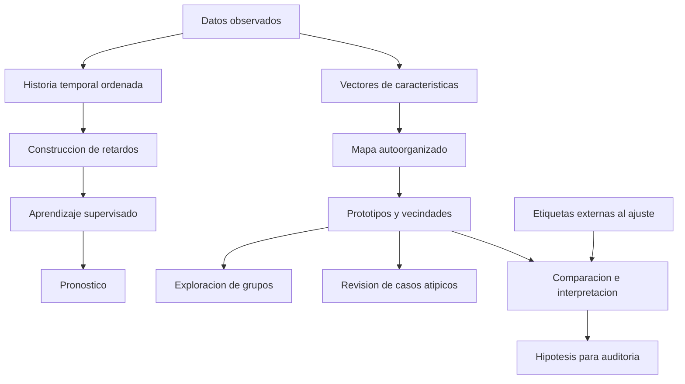

# Clase 6: Pronóstico de series temporales y mapas autoorganizados para agrupamiento y auditoría de datos

> **Objetivo académico:** Comprender la transformación de series temporales en problemas de aprendizaje supervisado y el funcionamiento de los mapas autoorganizados de Kohonen, diferenciando predicción, agrupamiento, detección de anomalías y revisión de etiquetas mediante una evaluación crítica de sus supuestos y límites.

## 1. Contexto y marco conceptual

La sesión articula dos problemas de reconocimiento de patrones: predecir valores futuros a partir de observaciones ordenadas temporalmente y descubrir estructuras de similitud sin disponer de una salida objetivo durante el aprendizaje. El primer problema se aborda mediante redes neuronales alimentadas con retardos; el segundo, mediante mapas autoorganizados o SOM, por sus siglas en inglés.

Una serie temporal consiste en observaciones de una variable registradas en distintos instantes. El eje temporal determina el orden de los datos; el otro eje representa la magnitud observada, con sus unidades correspondientes. El consumo eléctrico, los caudales y las mediciones ambientales ilustran fenómenos que pueden estudiarse de esta manera. Dos finalidades mencionadas son el pronóstico y la detección de anomalías.

En el enfoque **univariado**, el pronóstico utiliza la historia de una sola variable. En el enfoque **multivariado**, incorpora otras magnitudes potencialmente relacionadas con la variable objetivo. Tener varias variables disponibles no garantiza que sean informativas: su contribución depende del fenómeno, su calidad y su disponibilidad al momento de pronosticar.

Los SOM reciben vectores de características y organizan sus semejanzas en una malla de neuronas. Sus aplicaciones discutidas incluyen agrupamiento, visualización, reducción dimensional, exploración de datos financieros y revisión de etiquetas existentes. La denominación no supervisado indica que esas etiquetas no intervienen en el ajuste del mapa.

**Enriquecimiento conceptual:** Conviene separar tres preguntas: qué valor ocurrirá después, qué observaciones se parecen y qué etiquetas merecen revisión. Un pronosticador responde a la primera; un agrupador contribuye a la segunda; la tercera requiere combinar evidencia algorítmica con información independiente sobre el significado de las etiquetas.

## 2. Fundamentos teóricos y arquitectura

### 2.1. De una serie a un conjunto supervisado

La sesión recupera la recta como modelo elemental de predicción:

$$
\hat y_t = a t + b.
$$

Aquí, $t$ es el tiempo expresado en una unidad consistente o mediante un índice numérico; $\hat y_t$ es el valor estimado; $a$ representa el cambio esperado por unidad temporal, y $b$ es la ordenada de origen. La expresión supone una relación lineal y no representa por sí sola oscilaciones complejas, estacionalidad o cambios de régimen.

Para una red neuronal, introducir únicamente una fecha descompuesta en día, mes y año no representa explícitamente la secuencia de valores anteriores. La solución central presentada consiste en construir **retardos**, también llamados *lags*, mediante ventanas deslizantes.

**Enriquecimiento conceptual:** Una formulación precisa del caso univariado es:

$$
\mathbf{x}_t = (y_{t-p+1},\ldots,y_t), \qquad \hat y_{t+1}=f_\theta(\mathbf{x}_t).
$$

La serie contiene valores $y_t\in\mathbb{R}$; $t$ es un índice temporal entero; $p\geq 1$ es la longitud entera de la ventana; $\mathbf{x}_t\in\mathbb{R}^p$ reúne los últimos $p$ valores observados; $f_\theta$ es el predictor con parámetros $\theta$, y $\hat y_{t+1}$ estima el siguiente valor. Las entradas y la salida conservan las unidades de la variable, salvo que se aplique una transformación explícita.

Con una ventana de cinco observaciones, el procedimiento expuesto forma pares como los siguientes:

| Entrada | Objetivo |
| --- | --- |
| $y_1,y_2,y_3,y_4,y_5$ | $y_6$ |
| $y_2,y_3,y_4,y_5,y_6$ | $y_7$ |
| $y_3,y_4,y_5,y_6,y_7$ | $y_8$ |

**Enriquecimiento conceptual:** Si hay $N$ observaciones consecutivas, una ventana de longitud $p<N$ produce $N-p$ pares para pronóstico a un paso. Las ventanas comparten observaciones y, por ello, no deben interpretarse como muestras independientes. La construcción habitual presupone intervalos regulares; los huecos temporales deben identificarse y tratarse explícitamente.

### 2.2. Red multicapa y pronóstico recursivo

La arquitectura descrita utiliza una entrada por retardo, una o varias capas ocultas y una salida continua. En el caso multivariado, las entradas pueden incluir otras variables y sus retardos. La sesión no especifica una arquitectura única, funciones de activación ni un procedimiento reproducible de selección de hiperparámetros.

Una vez ajustado el modelo, es posible extender el horizonte utilizando sus propias predicciones como nuevas entradas. Cuando se agotan las observaciones reales de la ventana, esta pasa a contener valores estimados. La clase discute que algunos pronósticos se aproximan progresivamente a una constante.

**Enriquecimiento conceptual:** Esa estabilización es una posibilidad, no una ley universal. Puede surgir por la dinámica de la función aprendida, la tendencia a producir valores centrales o la pérdida de información al alimentar el modelo con sus propias salidas. Otros modelos pueden producir oscilaciones o divergencias. El horizonte amplifica la exposición a errores acumulados y a cambios del fenómeno no representados en el entrenamiento.

### 2.3. Arquitectura de los mapas autoorganizados

Los mapas de Kohonen, asociados en la exposición a Teuvo Kohonen, se presentan mediante una capa de entrada y una malla de salida. Cada neurona de la malla dispone de un vector de pesos comparable con las características de una observación. Al presentar un vector, se identifica la neurona cuyo prototipo está más cerca de él, normalmente mediante distancia euclidiana.

La sesión ilustra mallas de $4\times4$ y $5\times5$, así como una malla de $14\times14$ en un caso financiero. La posición de una neurona en la malla debe distinguirse de su vector de pesos: la primera describe su vecindad topológica; el segundo describe qué patrones representa.

**Enriquecimiento conceptual:** Para una observación $\mathbf{x}\in\mathbb{R}^d$ y prototipos $\mathbf{w}_j\in\mathbb{R}^d$, la unidad ganadora puede escribirse como:

$$
c(\mathbf{x})=\operatorname*{arg\,min}_{j\in\{1,\ldots,m\}}\|\mathbf{x}-\mathbf{w}_j\|_2.
$$

$d\geq1$ es el número de características; $m\geq1$ es el número de neuronas; $j$ identifica una neurona, y $c(\mathbf{x})$ devuelve el índice de la ganadora. La norma euclidiana mide distancia en el espacio de características, por lo que la escala y las unidades de estas influyen directamente en el resultado. Si hay empate, la implementación necesita una regla para resolverlo.

En el entrenamiento se aproxima el prototipo ganador a la entrada. También se modifican los prototipos de neuronas vecinas, lo que favorece una organización espacial de patrones semejantes.

**Enriquecimiento conceptual:** La actualización estándar que formaliza esta explicación es:

$$
\mathbf{w}_j^{(s+1)}=\mathbf{w}_j^{(s)}+\alpha_s h_{c,j}^{(s)}\left(\mathbf{x}^{(s)}-\mathbf{w}_j^{(s)}\right).
$$

$s\geq0$ es el índice entero de actualización; $\mathbf{x}^{(s)}$ es la observación presentada; $c$ es su neurona ganadora; $\alpha_s\in(0,1]$ es la tasa de aprendizaje, y $h_{c,j}^{(s)}\in[0,1]$ pondera la vecindad de $j$ respecto de $c$. Los pesos y las entradas deben compartir representación y escala. Habitualmente se reducen la tasa y el alcance de vecindad durante el ajuste. La expresión desplaza cada prototipo hacia la entrada en una proporción controlada, sin utilizar una etiqueta objetivo.

**Enriquecimiento conceptual:** La inspiración biológica constituye una motivación histórica, no una demostración de equivalencia con el cerebro. Asimismo, una malla bidimensional describe dos coordenadas de salida y no implica por sí misma que existan dos capas. Un SOM tampoco produce automáticamente probabilidades calibradas: entrega prototipos y asignaciones cuya interpretación exige análisis adicional.

## 3. Implementación técnica y lógica de negocio

### 3.1. Flujo de modelado temporal

El procedimiento técnico descrito parte de seleccionar una variable, ordenar sus observaciones, construir retardos, ajustar una red y contrastar sus predicciones con la serie. La exposición insiste en comprender previamente el comportamiento temporal: tendencia, periodicidad, estacionariedad y observaciones extremas.

**Enriquecimiento conceptual:** La descomposición puede ayudar a distinguir tendencia, estacionalidad y variación residual, pero no todas las series admiten una descomposición simple o estable. La estacionariedad tampoco es un requisito universal de cualquier red neuronal; su análisis permite reconocer cambios estadísticos que afectan la generalización.

Se contrastan dos estrategias discutidas durante la sesión:

| Estrategia | Operación | Implicación |
| --- | --- | --- |
| Modelo fijo con realimentación | Utiliza predicciones sucesivas como entradas sin modificar los pesos | Reduce el coste de actualización, pero acumula incertidumbre a lo largo del horizonte |
| Reajuste con valores predichos | Añade salidas estimadas al conjunto y vuelve a entrenar | Modifica el predictor con datos generados por él mismo; exige revisar el riesgo de reforzar errores |

**Enriquecimiento conceptual:** Debe añadirse una distinción decisiva: actualizar con una **observación real recién disponible** incorpora evidencia; actualizar con una **predicción propia** incorpora una pseudoetiqueta. La segunda alternativa no añade información independiente sobre el futuro y no garantiza mayor exactitud. La sugerencia de aceptar predicciones cuyo error sea pequeño requiere disponer primero de una referencia observada: sin ella no puede medirse ese error real.

Para evitar contaminación temporal, las transformaciones y la selección del modelo deben utilizar únicamente información disponible hasta el instante de corte. La comparación entre entrenamiento y datos posteriores debe distinguir si las entradas incluyen observaciones reales recientes o solo pronósticos anteriores.

### 3.2. Flujo de ajuste e interpretación del SOM

La demostración con Weka muestra la selección de un método de agrupamiento, la posible instalación de un paquete adicional y la configuración del tamaño del mapa. También se menciona la existencia de implementaciones en Python, sin identificar de forma verificable una biblioteca concreta. La transcripción no contiene código fuente completo ni parámetros suficientes para reproducir los resultados.

El flujo general consiste en seleccionar las variables descriptivas, separar la etiqueta existente, ajustar el mapa y recuperar la neurona ganadora de cada observación. Los identificadores arbitrarios deben excluirse porque su distancia numérica carece, normalmente, de significado sustantivo.

**Enriquecimiento conceptual:** Las variables categóricas requieren una codificación compatible con la distancia elegida. Codificar regiones con enteros consecutivos impondría distancias artificiales. También debe justificarse el escalado: combinar ingresos con variables binarias sin tratamiento puede hacer que la magnitud de los ingresos domine el agrupamiento.

Un mapa de $1\times2$ contiene dos prototipos y permite obtener dos asignaciones posibles. En una malla mayor, varias neuronas pueden representar partes de un mismo grupo y otras pueden no recibir observaciones.

**Enriquecimiento conceptual:** El número de neuronas es una decisión de resolución representacional, no una estimación automática del número natural de grupos. Dos prototipos fuerzan una partición de ese tamaño aunque la población no posea dos clases bien separadas. Una malla con más neuronas que observaciones tampoco garantiza asignaciones únicas.

### 3.3. Comparación con etiquetas existentes

El caso bancario utiliza características de clientes y una variable binaria denominada PEP. La etiqueta se reserva para comparar posteriormente las asignaciones del SOM; el identificador se elimina del ajuste. La transcripción no define de manera suficiente el significado sustantivo de PEP, por lo que no corresponde equipararla automáticamente con aprobación de crédito o incumplimiento.

**Enriquecimiento conceptual:** Los identificadores de los grupos son arbitrarios. Antes de calcular un porcentaje de coincidencia binaria, debe resolverse la correspondencia entre grupos y etiquetas:

$$
A=\max_{\pi}\frac{1}{N}\sum_{i=1}^{N}\mathbf{1}\{\pi(g_i)=c_i\}.
$$

$N\geq1$ es el número de observaciones; $g_i\in\{0,1\}$ es la asignación de grupo; $c_i\in\{0,1\}$ es la etiqueta disponible; $\pi$ recorre las dos correspondencias biyectivas entre ambos conjuntos, y $\mathbf{1}$ vale uno si la condición se cumple y cero en caso contrario. $A\in[0,1]$ mide el acuerdo después de alinear nombres; $100A$ lo expresa como porcentaje. Este acuerdo descriptivo no demuestra la corrección de las etiquetas ni la capacidad predictiva fuera de la muestra.

## 4. Análisis crítico de casos y auditoría práctica

### 4.1. Series ambientales y divergencia del pronóstico

Las intervenciones muestran series con cambios bruscos y contrastan resultados univariados y multivariados. Al principio se menciona humedad, pero posteriormente se aclara que algunos participantes utilizaron una columna denominada volumen; otros reportan PM2.5 y CO. Por tanto, las comparaciones corresponden a configuraciones distintas, no a un único experimento controlado.

Se describe una caída observada que los pronósticos no anticipan y se reportan diferencias visuales al reintroducir predicciones en el entrenamiento. Una intervención menciona una ventana de 24 horas y actualizaciones cada seis horas. Otra muestra que el reajuste repetido aumenta el tiempo de cómputo.

**Enriquecimiento conceptual:** Una curva más variable o menos plana no necesariamente es más exacta. Sin errores calculados sobre el mismo tramo observado, arquitectura documentada y protocolo temporal común, estas demostraciones permiten formular hipótesis, pero no establecer superioridad general. Tampoco debe confundirse *look-back*, que es la longitud de historia de entrada, con la realimentación de pronósticos o el reentrenamiento.

La discusión propone suavizar o sustituir picos que dificultan el ajuste. El ejemplo de un incremento de mortalidad durante una pandemia muestra, sin embargo, la necesidad de distinguir error de medición y acontecimiento real.

**Enriquecimiento conceptual:** Un valor extremo real puede ser central para el problema. Eliminarlo por distancia a la media puede borrar cambios de régimen o riesgos relevantes. Las alternativas incluyen conservarlo, modelar su contexto, usar pérdidas robustas o separar regímenes; la elección depende del objetivo y de la evidencia disponible. Cualquier sustitución debe documentarse y evitar utilizar información futura.

### 4.2. Mapa de entidades financieras

La presentación describe un caso situado en la crisis bancaria española de 1977 a 1985: 66 entidades representadas mediante nueve ratios, con 37 catalogadas como solventes y 29 como quebradas. Se utiliza una malla de $14\times14$, equivalente a 196 neuronas, para explorar su distribución.

Se comenta que las entidades 51 y 5 activan una misma neurona pese a tener etiquetas diferentes. También se interpreta la presencia de una entidad en una zona dominada por la etiqueta opuesta como motivo para revisar su clasificación.

**Enriquecimiento conceptual:** Compartir neurona significa tener el mismo prototipo más cercano; no exige obtener distancias idénticas. Una discrepancia puede deberse a características insuficientes, diferencias de escala, pérdidas de información o decisiones de modelado. Si la quiebra es un acontecimiento histórico observado, el mapa no puede invalidarlo: permite investigar por qué entidades similares en los ratios disponibles tuvieron desenlaces diferentes.

La exposición propone seguir la trayectoria de una entidad mediante ratios registrados en varios momentos.

**Enriquecimiento conceptual:** Para comparar posiciones temporales debe mantenerse una referencia coherente. Proyectar sucesivos registros sobre un mapa fijo facilita esa lectura. Si se ajusta un mapa independiente cada año, sus posiciones pueden rotar o reorganizarse; la coordenada de una neurona deja de ser directamente comparable sin alineación.

### 4.3. Acuerdo en el conjunto de clientes

Se reportan 600 registros: 326 con una etiqueta y 274 con la otra. Una intervención comunica un acuerdo global de 64.33 % y una discrepancia de 35.67 %. Otra obtiene asignaciones equivalentes, tras su interpretación, a 344 casos en un grupo y 256 en el otro. Son resultados relatados durante la sesión y no ejecuciones verificadas en estos apuntes.

La discusión termina reconociendo que las discrepancias son casos para investigar. El agrupamiento no tiene la última palabra sobre la etiqueta. El resultado depende de la selección de variables, el preprocesamiento y los parámetros del ajuste.

**Enriquecimiento conceptual:** Los totales por grupo no permiten reconstruir una matriz de contingencia: hacen falta las asignaciones de cada registro. Además, una medida global puede ocultar acuerdos diferentes entre categorías. La evaluación debe examinar la tabla cruzada, la estabilidad entre inicializaciones y el significado de los perfiles. Utilizar la etiqueta para seleccionar características puede ser válido, pero cambia el diseño de una exploración estrictamente independiente de esa etiqueta.

### 4.4. Anomalías multivariadas y hojas de quinoa

El SOM se propone para detectar filas cuyo perfil conjunto difiere de la mayoría. La idea amplía la revisión univariada: una observación puede tener valores individualmente plausibles y, sin embargo, presentar una combinación infrecuente.

**Enriquecimiento conceptual:** Un grupo pequeño no es automáticamente anómalo. Puede representar una subpoblación legítima. Una señal complementaria es la distancia al prototipo ganador, interpretada respecto de la distribución de distancias y del dominio. Forzar dos grupos puede separar una población heterogénea sin identificar errores.

El caso de hojas de quinoa introduce etiquetas de severidad y coexistencia de áreas verdes, enfermas y necróticas dentro de una imagen. La sesión reconoce que la revisión puede requerir una unidad de análisis más fina que la hoja completa.

**Enriquecimiento conceptual:** El agrupamiento depende de qué representación se extraiga de la imagen. Agrupar imágenes completas no garantiza separar severidad si dominan iluminación, fondo o tamaño. El análisis por regiones y la revisión experta independiente pueden aportar evidencia, pero la coincidencia con grupos no constituye por sí sola una medida de exactitud clínica o fitopatológica.

## 5. Principios de diseño, buenas prácticas y anti-patrones

| Principio | Justificación | Anti-patrón asociado |
| --- | --- | --- |
| Respetar el orden temporal | El pronóstico debe reproducir la información disponible en cada instante | Mezclar pasado y futuro al preparar o evaluar datos |
| Distinguir observación y predicción | Solo una observación aporta nueva evidencia directa sobre el fenómeno | Tratar una salida del modelo como verdad observada |
| Analizar extremos en su contexto | Una rareza puede ser un error o un acontecimiento real | Sustituir automáticamente todos los picos por una media |
| Separar etiquetas del ajuste exploratorio | Permite analizar estructuras sin imponer la clasificación existente | Introducir la etiqueta en la distancia y después presentarla como confirmación independiente |
| Justificar representación y escala | La distancia depende de cómo se codifiquen las variables | Usar identificadores, categorías ordinalizadas sin fundamento o unidades incompatibles |
| Interpretar las neuronas como prototipos | La malla representa semejanzas condicionadas por el modelo | Suponer que cada neurona equivale a una clase real |
| Revisar estabilidad y trazabilidad | Las asignaciones pueden variar con inicialización y parámetros | Interpretar una sola ejecución como estructura definitiva |
| Evaluar utilidad y coste conjuntamente | Las actualizaciones deben responder al ritmo de cambio y a las restricciones del sistema | Reentrenar continuamente sin evidencia de beneficio |

**Enriquecimiento conceptual:** La búsqueda exhaustiva de la neurona ganadora cuesta del orden de $O(md)$ por observación, donde $m$ es el número de prototipos y $d$ la dimensionalidad. Para $U$ presentaciones de datos, el coste de esa búsqueda es $O(Umd)$; la actualización de vecindades añade trabajo según su implementación. Por ello, la rapidez del SOM no puede afirmarse sin considerar tamaño de malla, dimensión y cantidad de actualizaciones.

La exposición menciona cifras orientativas de iteraciones por neurona. Estas no constituyen una regla universal y deben distinguirse de épocas completas sobre el conjunto. El criterio operativo requiere observar estabilización, calidad de representación y sensibilidad a los parámetros.

**Enriquecimiento conceptual:** La capacidad de aproximación de una red multicapa tampoco garantiza que una arquitectura concreta aprenda el mecanismo temporal relevante. Del mismo modo, el interés actual en modelos de lenguaje y modelos especializados de series no elimina la necesidad de evaluación temporal. La analogía con predecir el siguiente token no hace equivalentes todas sus representaciones ni sus objetivos.

## 6. Síntesis conceptual y profundización académica

La contribución central del bloque temporal es transformar una secuencia en pares entrada–objetivo mediante ventanas de retardos. Esa representación permite utilizar una red multicapa, pero desplaza parte esencial del problema hacia la selección de historia, el tratamiento de cambios temporales y el protocolo de evaluación. La realimentación de predicciones extiende el horizonte; el reentrenamiento con esas predicciones exige cautela porque no incorpora automáticamente nueva evidencia.

En el bloque no supervisado, el SOM combina competencia entre prototipos con adaptación de vecindades. Su malla permite explorar semejanzas y trayectorias, siempre que la representación de los datos y la referencia espacial sean coherentes. El agrupamiento ofrece una forma de priorizar observaciones para revisión y de descubrir patrones que una inspección variable por variable podría omitir.

La distinción epistemológica fundamental es que **acuerdo, consistencia y verdad no son equivalentes**. Una etiqueta puede ser correcta y poco compatible con los grupos construidos; también puede reproducir un sesgo consistente con las características seleccionadas. El mapa aporta evidencia sobre semejanzas bajo una métrica y una representación concretas.

**Enriquecimiento conceptual:** La profundización académica puede articularse en tres líneas: comparar pronósticos recursivos con estrategias que estimen varios horizontes directamente; estudiar la calidad de cuantización y la preservación de vecindades en SOM; y desarrollar auditorías de etiquetas que combinen desacuerdo algorítmico, estabilidad del modelo y revisión externa. En las tres, la decisión metodológica debe responder al significado de los datos y a la pregunta científica, además de al comportamiento visual del resultado.
