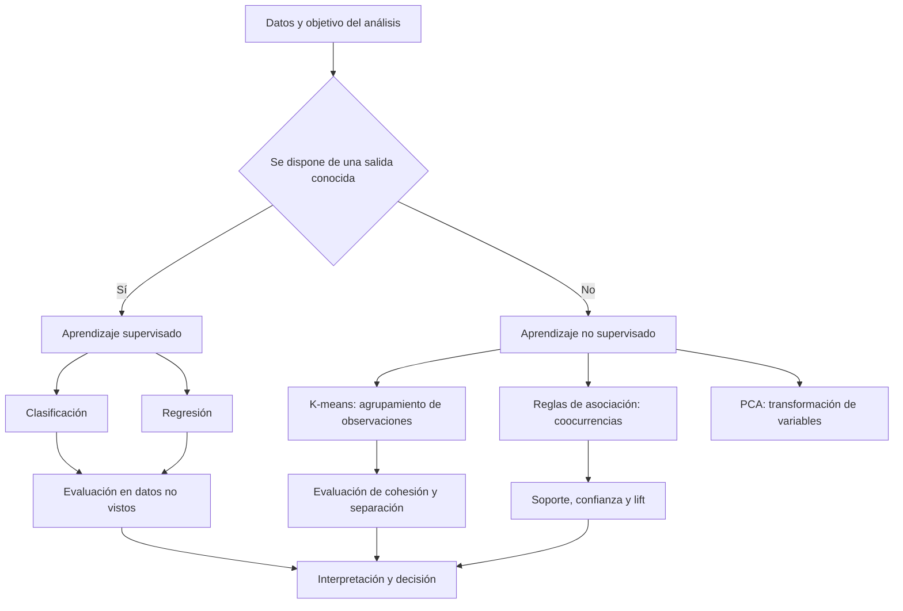
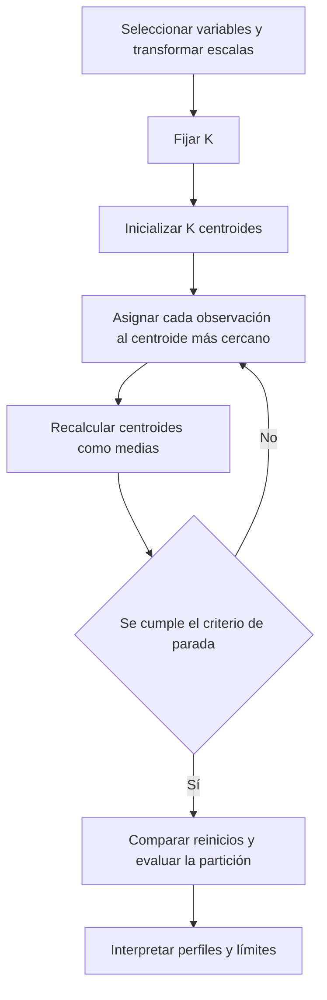
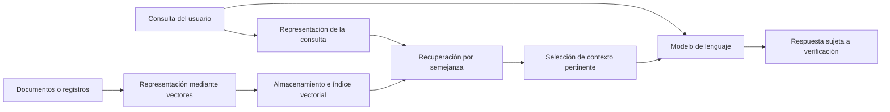

# Clase 7: Agrupamiento con K-means, reglas de asociación y evaluación de modelos

> **Objetivo académico:** Comprender la lógica y las limitaciones de K-means y de las reglas de asociación, interpretar sus resultados y seleccionar criterios de evaluación coherentes con problemas de clasificación, regresión y agrupamiento, conectando estos fundamentos con las representaciones vectoriales y el uso controlado de modelos de lenguaje.

## 1. Contexto y marco conceptual

### 1.1. Del aprendizaje supervisado al descubrimiento de estructura

La sesión integra tres ejes: agrupamiento mediante K-means, descubrimiento de reglas de asociación y evaluación de modelos. Los dos primeros pertenecen al aprendizaje no supervisado; el tercero permite revisar el rendimiento de modelos supervisados y la calidad de agrupamientos.

En aprendizaje supervisado se dispone de observaciones descritas por variables predictoras y de una salida conocida. La **clasificación** predice categorías; la **regresión** predice valores numéricos. Entre las técnicas recuperadas en la sesión aparecen KNN, regresión lineal y redes neuronales, además de menciones a árboles de decisión, regresión logística y redes bayesianas. Una misma familia, como las redes neuronales, puede resolver clasificación o regresión según su configuración y objetivo.

En aprendizaje no supervisado no se proporciona una variable objetivo que determine la respuesta correcta. Se buscan regularidades en las observaciones: grupos, asociaciones o representaciones de menor dimensión. Se retoman los mapas autoorganizados de Kohonen como antecedente del agrupamiento.

**Enriquecimiento conceptual:** descubrir grupos no equivale necesariamente a recuperar etiquetas verdaderas desconocidas. Una partición depende de la representación, de las variables seleccionadas, de la medida de semejanza y del algoritmo. Sus identificadores pueden emplearse posteriormente como etiquetas derivadas, pero un modelo supervisado entrenado con ellas aprenderá a reproducir esa partición; no adquirirá por ello una validación externa de su significado.

El aprendizaje por refuerzo se menciona como otro paradigma relacionado con la evolución de los modelos de lenguaje, sin desarrollarse sus mecanismos en esta sesión.

### 1.2. Diferencia entre PCA y K-means

La distinción central es la unidad sobre la cual actúa cada procedimiento:

| Aspecto | PCA | K-means |
| --- | --- | --- |
| Propósito | Obtener una representación de menor dimensión | Particionar observaciones en grupos |
| Resultado | Componentes calculadas a partir de las variables originales | Asignaciones de grupo y centroides |
| Relación con los datos | Transforma las coordenadas de cada observación | Asigna cada observación a un grupo |
| Interpretación | Examinar qué variación conserva cada componente | Caracterizar los perfiles de los grupos |

**Enriquecimiento conceptual:** la expresión usada en la sesión, «PCA agrupa variables», funciona como contraste introductorio, pero requiere precisión: PCA construye combinaciones lineales de variables, usualmente ortogonales entre sí, que capturan direcciones de variación. No produce necesariamente grupos disjuntos de variables. K-means sí produce una partición de las observaciones.

Ambos métodos pueden combinarse: una representación obtenida con PCA puede utilizarse como entrada de K-means o para visualizar sus resultados. Sin embargo, reducir dimensiones modifica la geometría disponible para el agrupamiento; conservar mucha varianza no garantiza conservar la separación relevante entre grupos.

## 2. Fundamentos teóricos y arquitectura

### 2.1. Distancia como criterio de semejanza

K-means se presenta como un método que reúne observaciones semejantes. Para operacionalizar la semejanza se utiliza la distancia euclidiana.

Sean $\mathbf{x}_i,\mathbf{x}_j\in\mathbb{R}^{p}$ dos observaciones, donde $p$ es el número de características numéricas y $x_{ir}$ es el valor de la característica $r$ de la observación $i$. Su distancia euclidiana es:

$$
d(\mathbf{x}_i,\mathbf{x}_j)=\sqrt{\sum_{r=1}^{p}(x_{ir}-x_{jr})^2}.
$$

La distancia es no negativa y vale cero cuando los vectores coinciden. Su interpretación presupone que las coordenadas admiten diferencias numéricas significativas y que sus escalas son comparables o han sido ponderadas deliberadamente. Si todas las coordenadas comparten una unidad, la distancia conserva esa unidad; si se estandarizan, opera sobre coordenadas adimensionales.

Para los puntos de la sesión $\mathbf{x}_1=(2,2)$ y $\mathbf{x}_2=(6,8)$:

$$
d(\mathbf{x}_1,\mathbf{x}_2)=\sqrt{(6-2)^2+(8-2)^2}=\sqrt{52}\approx7.21.
$$

El cálculo generaliza el teorema de Pitágoras a varias dimensiones. La cifra expresa cercanía geométrica en esa representación, no una semejanza semántica universal.

### 2.2. Objetivo y ciclo de K-means

K-means requiere fijar previamente un entero $K$, el número de grupos. La sesión describe cuatro operaciones: inicializar centroides, asignar observaciones al centroide más cercano, recalcular promedios y repetir hasta estabilizar las asignaciones.

**Enriquecimiento conceptual — formalización del criterio:** sean $n$ observaciones, $1\leq K\leq n$, una asignación $z_i\in\{1,\ldots,K\}$ para cada observación y centroides $\boldsymbol{\mu}_k\in\mathbb{R}^{p}$. El K-means euclidiano estándar busca minimizar:

$$
J=\sum_{i=1}^{n}\left\|\mathbf{x}_i-\boldsymbol{\mu}_{z_i}\right\|_2^2.
$$

$J$ es la suma de distancias cuadradas dentro de los grupos, también denominada inercia. Para grupos no vacíos, el procedimiento alterna:

$$
z_i\leftarrow\underset{k\in\{1,\ldots,K\}}{\operatorname{argmin}}\;\left\|\mathbf{x}_i-\boldsymbol{\mu}_k\right\|_2^2,
$$

$$
\boldsymbol{\mu}_k\leftarrow\frac{1}{|C_k|}\sum_{i\in C_k}\mathbf{x}_i,
\qquad C_k=\{i:z_i=k\}.
$$

$C_k$ es el conjunto de índices asignados al grupo $k$ y $|C_k|$ su cantidad de observaciones. La primera operación mejora la asignación con centroides fijos; la segunda sitúa cada centroide en la media de sus observaciones. La media minimiza la suma de desviaciones cuadradas respecto de un centro.

La explicación de la sesión contrapone **cohesión intragrupo** y **separación entre grupos**. Con mayor precisión, el objetivo explícito de K-means es minimizar $J$. Para datos y $K$ fijos, la dispersión total puede descomponerse en dispersión interna y entre grupos; por ello, disminuir la primera incrementa la segunda en esa descomposición. Esto no significa maximizar cada distancia entre pares de centroides por separado.

La estabilización no garantiza el óptimo global. Inicializaciones diferentes pueden conducir a particiones diferentes. También se requieren reglas para resolver empates y tratar grupos vacíos; estos detalles no se desarrollan en la fuente.

### 2.3. Reglas de asociación como relaciones probabilísticas

Una regla de asociación tiene la forma $A\Rightarrow B$, donde $A$ es el antecedente y $B$ el consecuente. Ambos pueden contener uno o varios productos. La flecha indica una relación estadística orientada para su interpretación; no establece una implicación lógica sin excepciones, una secuencia temporal ni una causa.

**Enriquecimiento conceptual — notación:** sea $N>0$ el número de transacciones. Sean $A$ y $B$ conjuntos no vacíos y disjuntos de ítems. $n(A)$ cuenta las transacciones que contienen todos los ítems de $A$; $n(A\cup B)$ cuenta las que contienen simultáneamente todos los ítems de ambos conjuntos. Las probabilidades siguientes son frecuencias empíricas sobre esas transacciones.

**Soporte relativo:**

$$
\operatorname{supp}(A\Rightarrow B)=\frac{n(A\cup B)}{N}=\widehat{P}(A\text{ y }B).
$$

Está entre cero y uno y mide la prevalencia conjunta. El soporte absoluto es el conteo $n(A\cup B)$; conviene distinguirlo del relativo para evitar ambigüedades.

**Confianza:**

$$
\operatorname{conf}(A\Rightarrow B)=\frac{n(A\cup B)}{n(A)}=\widehat{P}(B\mid A),\qquad n(A)>0.
$$

También está entre cero y uno. Mide qué proporción de las transacciones con el antecedente contiene el consecuente. Es direccional: invertir la regla cambia el denominador.

**Lift:**

$$
\operatorname{lift}(A\Rightarrow B)=\frac{\operatorname{supp}(A\Rightarrow B)}{\operatorname{supp}(A)\operatorname{supp}(B)}
=\frac{\operatorname{conf}(A\Rightarrow B)}{\operatorname{supp}(B)}.
$$

Se requiere soporte marginal positivo para ambos conjuntos. El lift es adimensional, no negativo y simétrico al intercambiar antecedente y consecuente. Compara la coocurrencia observada con la esperada bajo independencia:

- $\operatorname{lift}=1$: la coocurrencia coincide con el producto de las frecuencias marginales.
- $\operatorname{lift}>1$: existe asociación positiva en los datos; los conjuntos aparecen juntos más de lo esperado bajo independencia.
- $\operatorname{lift}<1$: existe asociación negativa; aparecen juntos menos de lo esperado.

**Enriquecimiento conceptual:** un lift mayor que uno no demuestra por sí solo una relación fuerte, causal o estadísticamente estable. Tampoco un valor cercano a uno prueba que el mecanismo generador sea «el azar». La interpretación depende del tamaño de muestra, la incertidumbre y la relevancia práctica.

## 3. Implementación técnica y lógica de negocio

### 3.1. Preparación y ejecución de K-means

La sesión utiliza Weka para mostrar agrupamiento con SimpleKMeans. No proporciona código ni una configuración completa reproducible. El flujo técnico recuperable es:

1. Seleccionar las características pertinentes.
2. Revisar unidades, rangos y valores extremos.
3. Aplicar transformaciones justificadas.
4. Fijar $K$ e inicializar centroides.
5. Ejecutar asignaciones y actualizaciones.
6. Comparar soluciones e interpretar los perfiles resultantes.

El ejemplo de sueldo y edad explica por qué las escalas importan: diferencias de miles en una característica pueden dominar diferencias de decenas en otra. Estandarizar no es un detalle cosmético; redefine la importancia relativa de cada dimensión en la distancia.

**Enriquecimiento conceptual:** una transformación habitual es:

$$
z_{ir}=\frac{x_{ir}-\bar{x}_r}{s_r},\qquad s_r>0.
$$

$\bar{x}_r$ es la media y $s_r$ la desviación estándar de la característica $r$ en los datos utilizados para ajustar la transformación. El resultado $z_{ir}$ es adimensional. Una variable constante necesita un tratamiento específico porque su desviación estándar es cero. La normalización a un intervalo y las transformaciones logarítmicas, también mencionadas en la sesión, responden a objetivos diferentes; no son intercambiables automáticamente.

### 3.2. Reconstrucción matemática del caso de cuatro observaciones

El caso técnico utiliza los puntos $(1,1)$, $(2,1)$, $(4,3)$ y $(5,4)$, con $K=2$ y centroides iniciales $(1,1)$ y $(2,1)$.

**Enriquecimiento conceptual — cálculo completo:** la reconstrucción siguiente explicita las iteraciones y corrige la impresión de que una única pasada basta para obtener la partición final. Se emplean distancias cuadradas, que preservan el orden de cercanía y evitan calcular raíces.

| Observación | Distancia cuadrada a $(1,1)$ | Distancia cuadrada a $(2,1)$ | Primera asignación |
| --- | ---: | ---: | --- |
| $(1,1)$ | 0 | 1 | Grupo 1 |
| $(2,1)$ | 1 | 0 | Grupo 2 |
| $(4,3)$ | 13 | 8 | Grupo 2 |
| $(5,4)$ | 25 | 18 | Grupo 2 |

Tras la primera actualización:

$$
\boldsymbol{\mu}_1=(1,1),\qquad
\boldsymbol{\mu}_2=\left(\frac{11}{3},\frac{8}{3}\right).
$$

En la siguiente asignación, $(2,1)$ queda a distancia cuadrada $1$ del primer centroide y $50/9$ del segundo; por tanto, cambia al grupo 1. Los puntos $(4,3)$ y $(5,4)$ permanecen en el grupo 2. Las nuevas medias son:

$$
\boldsymbol{\mu}_1=\left(\frac{3}{2},1\right),\qquad
\boldsymbol{\mu}_2=\left(\frac{9}{2},\frac{7}{2}\right).
$$

Una nueva asignación conserva los grupos, de modo que la partición se estabiliza. El punto adicional $\mathbf{q}=(3,2)$ se asigna comparando:

$$
\left\|\mathbf{q}-\boldsymbol{\mu}_1\right\|_2^2=\frac{13}{4},\qquad
\left\|\mathbf{q}-\boldsymbol{\mu}_2\right\|_2^2=\frac{18}{4}.
$$

Pertenece al grupo 1 según el criterio de centroide más cercano, en concordancia con la conclusión discutida en la sesión. Esta operación asigna una observación nueva a una partición ya ajustada. Incorporarla y volver a entrenar constituye una operación distinta, que puede mover los centroides.

### 3.3. Representación transaccional y Apriori

Las reglas de asociación requieren definir qué constituye una transacción. La sesión compara tres representaciones:

| Representación | Organización | Implicación técnica |
| --- | --- | --- |
| Lista por transacción | Cada registro contiene los productos presentes | Evita almacenar ausencias explícitas |
| Pares transacción–ítem | Una fila por producto presente en una transacción | Facilita filtros y agrupaciones relacionales |
| Matriz binaria | Filas como transacciones y columnas como productos | Explicita presencia con uno y ausencia con cero |

**Enriquecimiento conceptual:** una transacción no equivale necesariamente a un cliente. Un cliente puede realizar varias compras; fusionarlas cambia las coocurrencias y el significado de las reglas. La tabla de pares descrita en la sesión tampoco debe confundirse con la representación vertical especializada que almacena, para cada ítem, el conjunto de identificadores de transacciones donde aparece.

En la matriz binaria, los ceros expresan ausencia dentro del registro definido. Si hay muchos productos y pocas presencias por transacción, una estructura dispersa puede reducir almacenamiento. La matriz binaria es una representación útil, pero no una exigencia universal de todas las implementaciones de Apriori.

Apriori se presenta como algoritmo para reducir el conjunto de combinaciones y extraer reglas según métricas. En Weka se muestra una base con aproximadamente 216 ítems y 4627 transacciones, así como la posibilidad de limitar el número de reglas devueltas. La transcripción no conserva todos sus parámetros ni las reglas completas.

**Enriquecimiento conceptual — principio de poda:** si un conjunto de ítems es frecuente, todos sus subconjuntos también lo son. Equivalentemente, ampliar un conjunto no puede aumentar su soporte. Apriori aprovecha esta propiedad para descartar candidatos que contienen subconjuntos infrecuentes, antes de generar reglas y filtrarlas por confianza u otros criterios. La cantidad de candidatos puede crecer mucho con numerosos ítems o umbrales de soporte bajos; su rapidez no es universal.

### 3.4. Del resultado estadístico a una decisión comprensible

Una regla debe comunicarse en el lenguaje del proceso: «Entre las compras que contienen estos productos, una proporción determinada incluye también este otro». Esa explicación conserva el carácter condicional de la confianza y permite discutir ubicación de productos, recomendaciones o promociones.

El personal operativo no necesita recibir una lista de indicadores sin contexto. La decisión requiere identificar productos, población analizada, alcance y finalidad. Una confianza del 92 % y un lift de 1.27, como los mencionados durante la demostración, describen aspectos diferentes: frecuencia condicional y comparación con la frecuencia marginal. Sin los conteos y la regla completa no es posible auditar su estabilidad.

**Enriquecimiento conceptual:** una asociación histórica puede orientar una intervención, pero no demuestra que colocar productos juntos incrementará las ventas. Ese efecto requiere una evaluación adicional que distinga asociación observacional y resultado de la intervención.

## 4. Análisis crítico de casos y auditoría práctica

### 4.1. Jugo de naranja y vodka: dirección de la confianza

El ejemplo considera 1000 transacciones, de las cuales 400 incluyen jugo de naranja, 50 vodka y 40 ambos productos. La reconstrucción coherente de los conteos es:

| Transacciones | Con vodka | Sin vodka | Total |
| --- | ---: | ---: | ---: |
| Con jugo de naranja | 40 | 360 | 400 |
| Sin jugo de naranja | 10 | 590 | 600 |
| Total | 50 | 950 | 1000 |

El soporte conjunto es $40/1000=0.04$, equivalente al 4 %. La confianza de vodka hacia jugo de naranja es $40/50=0.8$, equivalente al 80 %. La confianza inversa es $40/400=0.1$, equivalente al 10 %.

El lift en ambas direcciones es:

$$
\operatorname{lift}=\frac{0.04}{0.05\times0.4}=2.
$$

Ambos productos aparecen juntos con el doble de frecuencia que la esperada bajo independencia empírica. La regla inversa tiene confianza baja en términos absolutos, pero también duplica la frecuencia marginal del vodka, que es del 5 %. Esto muestra por qué confianza y lift deben leerse conjuntamente.

**Enriquecimiento conceptual — corrección aritmética:** los 360 registros con solo jugo y el 4 % de soporte conjunto se obtienen de los conteos consistentes del ejemplo. Se corrigen las vacilaciones orales sobre esos valores sin modificar su lógica probabilística.

### 4.2. Pan y jugo de naranja: confianza alta sin asociación adicional

El segundo caso contiene:

| Transacciones | Con pan | Sin pan | Total |
| --- | ---: | ---: | ---: |
| Con jugo de naranja | 280 | 120 | 400 |
| Sin jugo de naranja | 420 | 180 | 600 |
| Total | 700 | 300 | 1000 |

El soporte conjunto es 0.28. La confianza de pan hacia jugo es 0.4 y la inversa es 0.7. Sin embargo:

$$
\operatorname{lift}=\frac{0.28}{0.7\times0.4}=1.
$$

La confianza del 70 % hacia pan coincide exactamente con la frecuencia marginal del pan. Conocer que una transacción contiene jugo no mejora esa proporción. El caso fundamenta la observación discutida en clase: es más preciso hablar de ausencia de asociación adicional en la tabla que atribuir el resultado a un mecanismo de azar demostrado.

### 4.3. Agrupamiento, etiquetas existentes y detección de anomalías

La demostración con datos del Titanic utiliza características como clase de viaje, sexo, edad, tarifa y supervivencia. Se muestran dos grupos con 236 y 164 observaciones, respectivamente, y se explica que los centroides o perfiles representativos deben traducirse en descripciones de los grupos.

También se compara una partición con una etiqueta existente, excluyendo esa etiqueta de las variables de entrada. Se menciona un porcentaje de correspondencia del 60.25 %, pero no se conservan todos los detalles de configuración.

**Enriquecimiento conceptual:** la discrepancia entre un clúster y una etiqueta no prueba que la etiqueta esté equivocada. Las clases externas pueden responder a criterios distintos de la geometría del conjunto de características. Además, los identificadores de clúster son arbitrarios: un «grupo 0» no corresponde automáticamente a una «clase 0». Cualquier porcentaje de correspondencia requiere conocer cómo se alinearon ambos resultados.

Las variables nominales también requieren cautela. Codificar categorías mediante números no les confiere necesariamente orden o distancia. La fuente no permite reconstruir el tratamiento exacto de atributos nominales en la demostración, por lo que sus resúmenes no deben asumirse como medias numéricas de todas las columnas.

La sesión propone ejecutar inicialmente K-means con $K=2$ para explorar la posible separación de observaciones extremas. Es una heurística exploratoria, no un detector concluyente.

**Enriquecimiento conceptual:** un grupo pequeño puede ser una subpoblación legítima; grupos grandes también pueden contener anomalías. La sospecha debe contrastarse con distancias a centroides, distribución de las características y conocimiento del dominio. Los valores extremos pueden desplazar las medias y alterar precisamente la partición que pretende identificarlos.

### 4.4. Evaluación de clasificación

La evaluación debe realizarse con datos no utilizados para ajustar el modelo. Un resultado elevado sobre las mismas observaciones de entrenamiento no establece capacidad de generalización. El sobreajuste ocurre cuando el modelo captura particularidades de esos datos que no se sostienen en observaciones nuevas.

La matriz de confusión organiza conteos entre clases reales y predichas. En la demostración se describe una fila con 22 aciertos y errores de 50 y 16 hacia otras categorías: sus 88 observaciones muestran que un total agregado puede ocultar fallos importantes por clase. El relato cambia entre posibles objetivos del conjunto Titanic; por ello, no permite reconstruir una matriz completa inequívoca.

**Enriquecimiento conceptual — fórmulas para clasificación binaria:** una vez fijada la clase positiva, $TP$ y $TN$ son verdaderos positivos y negativos, mientras que $FP$ y $FN$ son falsos positivos y negativos. Son conteos no negativos. Cuando los denominadores son positivos:

$$
\operatorname{accuracy}=\frac{TP+TN}{TP+TN+FP+FN},
$$

$$
\operatorname{precision}=\frac{TP}{TP+FP},\qquad
\operatorname{recall}=\frac{TP}{TP+FN},
$$

$$
F_1=\frac{2TP}{2TP+FP+FN}.
$$

Las métricas están entre cero y uno. Si un denominador es cero, su tratamiento debe declararse. La exactitud mide la proporción total de aciertos; la precisión responde cuántas predicciones positivas fueron correctas; el recall indica cuántos positivos reales se recuperaron. $F_1$ equilibra precisión y recall mediante su media armónica, pero no incorpora directamente los verdaderos negativos.

Si el 90 % de los correos pertenece a una clase, predecir siempre esa clase obtiene 90 % de exactitud sin identificar la minoritaria. Esto explica la limitación de accuracy con desbalance. La precisión cobra especial relevancia cuando los falsos positivos son costosos; el recall, cuando lo son los falsos negativos.

La curva ROC resume el comportamiento al variar un umbral de decisión. **Enriquecimiento conceptual:** para puntuaciones de clasificación binaria, representa la tasa de verdaderos positivos, $TP/(TP+FN)$, frente a la tasa de falsos positivos, $FP/(FP+TN)$, siempre que existan positivos y negativos reales. No constituye por sí sola una elección del umbral operativo ni incorpora todos los costos del problema.

### 4.5. Evaluación de regresión

**Enriquecimiento conceptual — formalización y precisión terminológica:** sean $m>0$ observaciones de evaluación, valores reales $y_i\in\mathbb{R}$ y predicciones $\hat y_i\in\mathbb{R}$, expresados en la misma unidad. Para cada observación, el residual es $e_i=y_i-\hat y_i$.

$$
\operatorname{MSE}=\frac{1}{m}\sum_{i=1}^{m}e_i^2,\qquad
\operatorname{RMSE}=\sqrt{\frac{1}{m}\sum_{i=1}^{m}e_i^2},
$$

$$
\operatorname{MAE}=\frac{1}{m}\sum_{i=1}^{m}|e_i|.
$$

MSE y RMSE penalizan cuadráticamente los errores grandes. El MSE tiene unidades al cuadrado; RMSE y MAE conservan la unidad de la variable objetivo. MSE no incluye una raíz; esta distingue a RMSE y corrige la mezcla verbal presente en la explicación.

Con $\bar y$ como media de los valores reales de evaluación:

$$
R^2=1-\frac{\sum_{i=1}^{m}(y_i-\hat y_i)^2}{\sum_{i=1}^{m}(y_i-\bar y)^2}.
$$

La expresión requiere variación en los valores reales. Es adimensional y compara el error con el de predecir siempre $\bar y$. Su máximo es uno, pero puede ser negativo cuando el modelo resulta peor que esa referencia. Por tanto, no está restringido universalmente al intervalo de cero a uno, especialmente fuera de los datos de ajuste.

El error porcentual absoluto medio es:

$$
\operatorname{MAPE}=\frac{100}{m}\sum_{i=1}^{m}\left|\frac{y_i-\hat y_i}{y_i}\right|.
$$

Se expresa en porcentaje y requiere $y_i\neq0$. Valores reales próximos a cero pueden producir contribuciones desproporcionadas. Su pertinencia depende de que la interpretación relativa tenga sentido para la variable estudiada.

### 4.6. Evaluación de agrupamientos y selección de K

La sesión menciona el método del codo, la silueta y el índice de Calinski–Harabasz. El primero busca un cambio de pendiente en la reducción de la dispersión interna al aumentar $K$; los otros evalúan relaciones entre cohesión y separación.

**Enriquecimiento conceptual — silueta:** para una observación $i$ de un grupo con al menos dos integrantes, sea $a_i$ su distancia media a las demás observaciones de su grupo y $b_i$ la menor distancia media a otro grupo. Con al menos dos grupos y denominador positivo:

$$
s_i=\frac{b_i-a_i}{\max(a_i,b_i)}.
$$

$s_i$ pertenece al intervalo $[-1,1]$. Valores próximos a uno indican buena separación relativa; cerca de cero sugieren frontera entre grupos; valores negativos indican mayor cercanía media a otro grupo. El promedio resume la partición. Los grupos de una sola observación requieren una convención específica.

**Enriquecimiento conceptual — Calinski–Harabasz:** para $n$ observaciones y $2\leq K<n$ grupos no vacíos:

$$
CH=\frac{B/(K-1)}{W/(n-K)}.
$$

$W$ es la dispersión cuadrática interna y $B$ la dispersión cuadrática entre centroides de grupo y la media global, ponderada por el tamaño de cada grupo. Si $W>0$, el índice es adimensional. Valores mayores favorecen separación relativa a la dispersión interna, pero no garantizan que los grupos sean útiles para el dominio.

La elección de $K$ puede venir condicionada por una necesidad operativa o apoyarse en estas métricas. En ninguno de los casos se obtiene automáticamente un número verdadero de grupos. La referencia de la sesión a categorías socioeconómicas debe entenderse como ejemplo de una restricción del problema; no acredita una clasificación normativa concreta ni resultados censales verificables.

## 5. Principios de diseño, buenas prácticas y anti-patrones

### 5.1. Validez experimental y costo computacional

La validación cruzada divide los datos en particiones y rota la utilizada para evaluación. Cada ajuste se realiza con las restantes. Así se aprovechan observaciones distintas para estimar el rendimiento sin evaluarlas con el mismo modelo que las utilizó en su entrenamiento.

**Enriquecimiento conceptual:** la selección de variables y el ajuste de transformaciones deben realizarse dentro de cada partición de entrenamiento. Usar todo el conjunto para prepararlas puede filtrar información hacia la evaluación. Si la validación también orienta la selección de hiperparámetros, conviene reservar una evaluación final independiente. Con series temporales o registros dependientes, las divisiones deben respetar el orden temporal o la pertenencia a grupos.

Para K-means se recomienda repetir inicializaciones y comparar soluciones. **Enriquecimiento conceptual:** una implementación básica que procesa $n$ observaciones, $p$ características y $K$ centroides durante $T$ iteraciones tiene un costo aproximado $O(TnKp)$. Guardar centroides cuesta $O(Kp)$, pero la memoria total también puede incluir datos, asignaciones y estructuras auxiliares. La afirmación de que «solo se almacenan centroides» describe ciertos procesamientos por lotes o recorridos de datos, no todas las implementaciones.

| Buena práctica | Anti-patrón que evita |
| --- | --- |
| Justificar variables, escalas y distancia | Agrupar según unidades arbitrarias |
| Comparar reinicios de K-means | Confiar en una sola inicialización |
| Analizar estabilidad y perfiles | Dar significado automático a los identificadores de grupo |
| Leer soporte, confianza y lift conjuntamente | Interpretar una confianza alta sin revisar prevalencias |
| Evaluar con observaciones no usadas en el ajuste | Presentar rendimiento de entrenamiento como generalización |
| Seleccionar métricas según consecuencias de error | Declarar calidad con un único indicador agregado |
| Registrar configuración y tratamiento de datos | Comparar resultados cuya preparación se desconoce |

### 5.2. Distancias vectoriales, búsqueda semántica y RAG

La sesión conecta la distancia entre observaciones con textos representados como vectores. Variantes de una dirección, como «Avenida 12 de Abril» y su forma abreviada, pueden ser distintas como cadenas y próximas en una representación apropiada.

Se mencionan bases vectoriales, PostgreSQL con pgvector y arquitecturas RAG para aportar contexto a un modelo de lenguaje. El principio es representar contenidos, recuperar información pertinente y utilizarla al generar una respuesta.

**Enriquecimiento conceptual:** la semejanza vectorial depende del modelo de representación y no confirma por sí sola que dos registros correspondan a la misma entidad. La recuperación vectorial complementa búsquedas textuales, índices léxicos y consultas relacionales; no los reemplaza universalmente. Un esquema RAG también requiere seleccionar fragmentos relevantes y controlar la calidad del contexto recuperado.

### 5.3. Parámetros, tokens y optimización de modelos de lenguaje

La conversación distingue de manera práctica modelos locales y servicios remotos, capacidad de memoria, concurrencia y tamaño del contexto. Se mencionan fragmentación, resumen, caché y enrutamiento como mecanismos para reducir procesamiento o latencia.

**Enriquecimiento conceptual — distinciones necesarias:**

- **Parámetros:** valores aprendidos que determinan el comportamiento del modelo. Su cantidad y precisión numérica influyen en memoria y cómputo.
- **Tokens:** unidades de la secuencia procesada; su cantidad describe la longitud de entrada o salida.
- **Tokens por segundo:** medida de rendimiento que depende del hardware, arquitectura, contexto y concurrencia. Debe distinguirse de la demora hasta la primera respuesta.
- **Cuantización:** representación numérica de menor precisión. Puede reducir memoria y costo, con efectos sobre calidad y velocidad que deben medirse. No equivale simplemente a recortar cifras decimales escritas.
- **Cómputo selectivo:** ciertas arquitecturas o técnicas reducen qué componentes se activan. No debe confundirse con desactivar neuronas arbitrariamente en cualquier red.
- **Fine-tuning:** adaptación de parámetros mediante entrenamiento adicional. Puede actualizar todos o parte de ellos; no es sinónimo de cuantización ni de recuperación de contexto.

RAG y fine-tuning resuelven necesidades relacionadas pero diferentes: el primero aporta información recuperada durante la consulta; el segundo modifica parámetros para adaptar comportamientos. La sesión plantea ambos como alternativas para trabajar con un dominio, por ejemplo registros de fallos de sistemas, sin presentar una comparación experimental.

El despliegue local puede favorecer control operativo, pero su conveniencia depende de concurrencia, hardware, mantenimiento y calidad requerida. Las experiencias relatadas no permiten concluir que sea siempre más económico o que sustituirá universalmente a los servicios remotos.

### 5.4. Desarrollo con agentes e interpretación responsable

El intercambio sobre desarrollo de software destaca la importancia de especificar requisitos, contratos, patrones de código y condiciones de calidad. Se describen ejemplos de reglas en archivos Markdown para orientar la generación de operaciones CRUD y evitar resultados difíciles de mantener.

El problema de integrar módulos desarrollados con contextos diferentes revela una necesidad arquitectónica: compartir convenciones, interfaces y criterios de aceptación. La generación rápida de código no elimina la revisión de coherencia, localización o mantenibilidad.

**Enriquecimiento conceptual:** un arnés de agentes organiza contexto, herramientas, restricciones y comprobaciones. Puede mejorar la consistencia, pero una especificación detallada no vuelve determinista el resultado ni sustituye su verificación. Las observaciones laborales discutidas en la sesión son testimonios y apreciaciones; no constituyen evidencia suficiente para generalizar efectos sobre contratación.

La interpretabilidad también requiere separar descripción y explicación. Un modelo de lenguaje puede ayudar a redactar perfiles de clústeres, pero esa narración debe contrastarse con los datos. Un árbol de decisión paralelo puede resultar comprensible sin explicar necesariamente el comportamiento de una red neuronal diferente.

**Enriquecimiento conceptual:** si un modelo interpretable pretende aproximar otro modelo, debe evaluarse su fidelidad a las predicciones del modelo original. Eliminar características y observar cambios puede ayudar a analizar dependencia predictiva, pero no demuestra causalidad. Las alusiones regulatorias de la sesión motivan la importancia de la explicabilidad; no especifican obligaciones jurídicas verificables.

## 6. Síntesis conceptual y profundización académica

K-means y las reglas de asociación descubren estructuras diferentes. El primero organiza observaciones según una geometría elegida; las segundas cuantifican coocurrencias entre conjuntos de ítems. Su utilidad depende de decisiones previas sobre representación y de una interpretación posterior que conecte resultados con el problema.

La sesión deja seis relaciones fundamentales:

1. **Representación y resultado:** cambiar variables, escalas o unidades puede cambiar los grupos y sus perfiles.
2. **Optimización y validez:** estabilizar centroides no garantiza un óptimo global ni una partición significativa.
3. **Frecuencia y asociación:** soporte mide presencia conjunta, confianza mide una proporción condicional y lift la compara con una referencia de independencia.
4. **Rendimiento y generalización:** los indicadores son útiles cuando la evaluación evita reutilizar información del ajuste.
5. **Predicción e interpretación:** una predicción acertada y una explicación fiel son propiedades distintas que deben revisarse por separado.
6. **Automatización y criterio:** los modelos de lenguaje pueden apoyar recuperación, desarrollo e interpretación, pero requieren especificaciones y verificación de resultados.

Como apertura conceptual, se mencionan agrupamientos jerárquicos y ensambles. Los primeros permiten explorar particiones a distintos niveles mediante fusiones o divisiones; los segundos combinan resultados de varios modelos. La sesión no desarrolla sus algoritmos ni proporciona una implementación.

**Enriquecimiento conceptual:** bootstrap consiste en remuestrear observaciones con reemplazo; bagging combina modelos entrenados en muestras de ese tipo. Promediar predicciones numéricas puede ser una estrategia de ensamble, aunque su beneficio depende de calidad y diversidad de errores. Estas nociones no deben confundirse con boosting, familia a la que pertenece XGBoost. No se conserva como hecho la explicación incidental sobre su origen porque no se aporta evidencia para sostenerla.

La profundización académica queda articulada en torno a estabilidad de particiones, incertidumbre de asociaciones, evaluación bajo dependencia entre registros y fidelidad de explicaciones. El criterio común es distinguir lo que el algoritmo calcula, lo que los datos permiten inferir y lo que una decisión práctica necesita justificar.
