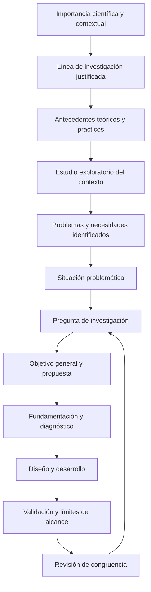
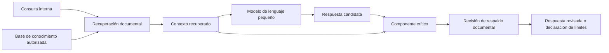

# Clase 2: Congruencia del diseño doctoral, construcción del problema y validación de propuestas

> **Objetivo académico:** Analizar la coherencia entre problema, objeto de estudio, campo de acción, objetivos, hipótesis, variables y fundamentos de una investigación doctoral propositiva, y distinguir los alcances de su validación, delimitación temporal y transferencia a otros contextos.

## 1. Contexto y marco conceptual

La sesión desarrolla una revisión metodológica de investigaciones doctorales en ciencias de la computación mediante cinco casos: seguridad de la información en evaluaciones en línea; optimización clásica, cuántica e híbrida de portafolios; transformación digital en telecomunicaciones; personalización adaptativa del aprendizaje mediante modelos de lenguaje; y acceso al conocimiento empresarial mediante recuperación y autorreflexión. Los casos permiten identificar un problema transversal: una propuesta técnicamente plausible puede perder consistencia científica cuando sus componentes declaran transformaciones diferentes.

El perfil de investigación constituye una proyección argumentada del proceso científico. Presenta el problema, anticipa sus fundamentos y establece una ruta de construcción y validación. La tesis desarrolla esos componentes con mayor profundidad, evidencia y posicionamiento del investigador. Por tanto, el tránsito entre ambos documentos supone ampliar y fundamentar las decisiones, además de conservar su coherencia.

### 1.1. Importancia del tema, antecedentes y problema

La secuencia expositiva defendida en la sesión parte de la importancia del tema en una escala internacional, regional y local. Después ubica la investigación en una línea institucional y explica brevemente la razón de esa correspondencia. Mencionar una línea o un objetivo de desarrollo sin justificar su vínculo con el problema deja incompleta la argumentación.

A continuación se distinguen varios componentes:

| Componente | Función académica | Confusión que debe evitarse |
| --- | --- | --- |
| Importancia del tema | Explicar su relevancia científica, tecnológica o social | Convertirla en una descripción extensa de la solución |
| Antecedentes teóricos | Identificar aportes previos pertinentes y sus fuentes | Desarrollar aquí todo el estado del arte |
| Antecedentes prácticos | Reconocer experiencias y condiciones del contexto | Sustituir la realidad local por afirmaciones generales |
| Estudio exploratorio | Identificar problemas, capacidades, restricciones y necesidades | Presentarlo como si ya fuera la solución |
| Situación problemática | Sintetizar la carencia central sustentada en los problemas identificados | Acumular normativa, síntomas y explicaciones sin jerarquía |
| Pregunta de investigación | Formular con precisión qué requiere comprensión o transformación | Reunir todos los procedimientos y resultados esperados |

En el esquema de la sesión, los antecedentes mencionan aportes de manera concisa y con atribución. Su desarrollo comparativo y evolutivo corresponde al estado del arte. Esta distinción organiza la exposición; no elimina la necesidad de explicar por qué cada antecedente resulta pertinente.

### 1.2. De los problemas del contexto a la situación problemática

El estudio exploratorio precede lógicamente a la formulación consolidada de la situación problemática. Su función consiste en reconocer qué ocurre, a quién afecta y qué necesita transformación. Puede apoyarse en entrevistas, documentos, observación y herramientas de organización del diagnóstico, según las características del problema.

La situación problemática sintetiza esos hallazgos. No equivale a una lista de dificultades: identifica la carencia común que articula los problemas observados. La pregunta de investigación expresa esa necesidad de forma interrogativa y delimitada.

**Enriquecimiento conceptual:** El orden anterior representa una lógica de justificación, no una secuencia irreversible. La investigación puede refinar su pregunta después de nuevos hallazgos. La exigencia consiste en documentar los cambios y revisar sus consecuencias sobre los demás componentes.

## 2. Fundamentos teóricos y arquitectura

### 2.1. Arquitectura de congruencia del diseño

El título funciona en la sesión como una referencia inicial para revisar el resto del diseño. El objetivo general también permite detectar qué promete realmente la investigación. La coherencia se establece mediante una revisión recíproca de ambos con el problema, el campo de acción y la hipótesis.

| Componente | Pregunta de control |
| --- | --- |
| Título | ¿Identifica el aporte y la transformación principal sin dispersión terminológica? |
| Problema | ¿Expresa una necesidad sustentada y delimitada? |
| Objeto de estudio | ¿Reconoce el proceso o fenómeno más amplio que se investiga? |
| Campo de acción | ¿Precisa el aspecto del objeto sobre el cual se interviene o profundiza? |
| Objetivo general | ¿Declara el resultado científico que responde al problema? |
| Objetivos específicos | ¿Cubren los momentos necesarios para producir y validar ese resultado? |
| Hipótesis o premisa | ¿Anticipa una relación compatible con la pregunta y con la evidencia prevista? |
| Variables o categorías | ¿Representan los constructos efectivamente investigados? |
| Fundamentos | ¿Sostienen las decisiones conceptuales, técnicas y metodológicas? |

La congruencia exige estabilidad del significado. Si una pregunta busca personalizar el aprendizaje y la hipótesis busca mejorar el desempeño algebraico, existe una diferencia sustantiva que debe resolverse. Ambas finalidades pueden relacionarse, pero necesitan una arquitectura explícita.

### 2.2. Objeto de estudio y campo de acción

Según el protocolo discutido, el objeto de estudio designa el proceso o fenómeno general; la propuesta constituye el aporte que se construye para actuar sobre una parte de ese proceso. Por ejemplo, la auditoría de sistemas de información puede constituir el objeto, mientras que un modelo de auditoría representa la propuesta.

El campo de acción delimita el aspecto específico del objeto relacionado con el problema. En la sesión se insiste en tres dimensiones:

- **Temática:** qué proceso, propiedad o relación se estudia o transforma.
- **Espacial u organizacional:** en qué institución, empresa, sector o población se desarrolla.
- **Temporal:** durante qué periodo se sitúa la investigación.

Una localización geográfica no basta para definir el campo. Tampoco basta con nombrar una tecnología: es necesario explicar su relación con el fenómeno investigado.

**Enriquecimiento conceptual:** Las denominaciones y la ubicación documental de estas delimitaciones varían entre tradiciones metodológicas. Debe distinguirse la convención institucional de una definición universal. Su utilidad reside en hacer verificable el alcance del estudio.

### 2.3. Propuesta, variables y condiciones de contexto

En los casos propositivos, el docente interpreta habitualmente el modelo o la metodología como variable independiente y el proceso que se pretende mejorar como variable dependiente. Los estándares, mecanismos o tecnologías de apoyo aparecen en ocasiones como variables intervinientes o concomitantes.

Esta clasificación permite detectar discordancias: si el título promete una metodología completa y la hipótesis solo compara estrategias de inicialización, el objeto de la evaluación se ha desplazado.

**Enriquecimiento conceptual:** Un componente tecnológico o un estándar no se convierte automáticamente en variable interviniente por aparecer después de la expresión «basado en». Puede ser un fundamento, una condición fija, una restricción o una decisión de diseño. Para tratarlo como variable debe definirse qué propiedad varía, cómo se observa y qué papel cumple en la explicación. Asimismo, un artefacto complejo puede evaluarse mediante configuraciones o condiciones de uso, sin reducir toda su arquitectura a una variable escalar.

### 2.4. Hipótesis, enfoque y diseño

La discusión final rechaza la equivalencia entre presencia de hipótesis e investigación experimental. Una hipótesis puede orientar investigaciones descriptivas, asociativas o de otros alcances. Los enfoques mixtos también pueden incorporar hipótesis y preguntas cualitativas.

Se diferencian tres planos:

1. **Perspectiva epistemológica:** supuestos sobre el conocimiento, la explicación y la relación con el fenómeno.
2. **Enfoque:** orientación cuantitativa, cualitativa o mixta de la producción y análisis de evidencia.
3. **Diseño:** organización concreta de observaciones, intervenciones, comparaciones y momentos de medición.

La investigación computacional vinculada con organizaciones y personas puede necesitar medidas de rendimiento y, simultáneamente, información sobre apropiación, percepciones o efectos organizacionales. La elección depende de la pregunta y de la evidencia necesaria.

**Enriquecimiento conceptual:** El empleo de entrevistas no determina por sí solo un enfoque mixto. Una entrevista estructurada puede producir datos cuantificables. Un diseño mixto requiere justificar e integrar componentes cuantitativos y cualitativos, por ejemplo al explicar mediante entrevistas un resultado observado en métricas operativas.

## 3. Implementación técnica y lógica de negocio

La fuente no presenta código, ejecuciones ni resultados experimentales. La implementación tratada es metodológica: cómo traducir una necesidad contextual en un artefacto investigable y en una estrategia de evaluación. Los casos describen propuestas en desarrollo; sus beneficios permanecen como expectativas o hipótesis.

### 3.1. Seguridad de la información en evaluaciones en línea

El primer caso propone un modelo para la gestión segura del ciclo de evaluación en entornos virtuales de aprendizaje de la Universidad Autónoma Gabriel René Moreno. Se plantea integrar controles organizacionales, humanos y tecnológicos, con apoyo en estándares internacionales y en el marco normativo aplicable. La identificación exacta de algunos estándares no es recuperable con certeza del audio transcrito.

Los conceptos centrales incluyen autenticidad del participante, trazabilidad, controles de acceso, autenticación multifactor, auditoría y monitoreo. El modelo se concibe como apoyo al proceso evaluativo; su alcance no sustituye el diseño pedagógico.

La situación problemática se concreta en una contradicción: existen configuraciones de plataforma y prácticas individuales, pero faltan requisitos de seguridad organizados por fases y evidencia sistemática de integridad y autenticidad. Esta formulación resulta más precisa que una descripción extensa de legislación y trayectoria institucional.

El diagnóstico propuesto considera las unidades responsables de educación a distancia, infraestructura tecnológica, docentes y estudiantes. Cada actor aporta una perspectiva distinta sobre capacidades, vulnerabilidades y necesidades.

La lógica técnica relaciona fases del proceso, riesgos y controles. El aporte práctico se expresa mediante una guía de implementación, listas de verificación, indicadores y protocolos. Su valor metodológico depende de que esos elementos constituyan un procedimiento articulado y reutilizable.

**Enriquecimiento conceptual:** La presencia de un control y su efectividad deben distinguirse. Contar con autenticación multifactor no demuestra por sí solo la integridad de toda una evaluación. La trazabilidad requiere además criterios sobre registro de eventos, protección de evidencias y responsabilidades de revisión. Estas precisiones desarrollan el problema planteado; no describen funcionalidades ya implementadas.

### 3.2. Optimización clásica, cuántica e híbrida de portafolios

El segundo caso plantea una metodología sistemática y reproducible para formular, implementar y comparar estrategias de optimización de portafolios con restricciones de cardinalidad, utilizando datos históricos de activos del S&P 500. Incluye QAOA, su variante con inicialización informada y formulaciones QUBO.

La arquitectura prevista comprende preparación de datos financieros, formulación matemática, estrategias de inicialización, optimización y evaluación comparativa. Los criterios mencionados son calidad de solución, factibilidad, eficiencia computacional, estabilidad y desempeño financiero.

La revisión detecta la ausencia de un objetivo dedicado al diagnóstico del estado actual. La revisión de literatura y el diseño de una metodología no sustituyen la caracterización de las limitaciones concretas que la propuesta pretende resolver.

**Enriquecimiento conceptual:** QAOA se refiere a un algoritmo cuántico de optimización aproximada; una formulación QUBO representa un problema de optimización cuadrática sobre variables binarias. La sesión los menciona, pero no desarrolla circuitos, funciones de costo ni transformaciones entre formulaciones.

**Enriquecimiento conceptual — formulación ilustrativa de cardinalidad:** Sea un universo de $n\in\mathbb{N}$ activos y sea $z_i\in\{0,1\}$ una variable que indica si el activo $i$, con $i=1,\ldots,n$, pertenece al portafolio. Si se exige seleccionar exactamente $K$ activos, donde $K\in\{1,\ldots,n\}$, la restricción es:

$$
\sum_{i=1}^{n} z_i=K.
$$

Esta expresión cuenta activos seleccionados; no determina los pesos de inversión ni define por sí sola el compromiso entre rendimiento y riesgo. Si la cardinalidad fuese máxima en lugar de exacta, correspondería una desigualdad. El caso no especifica todos los detalles de su formulación, por lo que la ecuación ilustra el concepto y no reconstruye el modelo del investigador.

La finalidad financiera debe expresarse con cuidado: la discusión gira alrededor de considerar conjuntamente rendimiento y riesgo. La expresión oral que alude a maximizar ambos no debe adoptarse como objetivo financiero establecido.

### 3.3. Transformación digital en telecomunicaciones

El tercer caso parte de una propuesta genérica para gestionar procesos de negocio en compañías de telecomunicaciones mediante prácticas ágiles y desarrollo seguro. La revisión exige precisar el tipo de aporte: modelo, metodología, estrategia u otro artefacto.

La motivación técnica se relaciona con servicios accesibles desde distintos dispositivos, interoperabilidad, conexión con servicios en la nube y tratamiento de información personal. El crecimiento de canales y servicios incrementa la complejidad de coordinación y la exposición de datos.

La dificultad metodológica aparece cuando el título sitúa la gestión de procesos como finalidad, mientras el objetivo general orienta el modelo hacia la transformación digital del negocio. La decisión sobre cuál es el resultado principal debe reflejarse en la pregunta, el campo de acción, los objetivos y la hipótesis.

El análisis FODA elaborado a partir de referentes internacionales ayuda a comprender tendencias sectoriales. Sin embargo, no constituye automáticamente un diagnóstico de la organización donde se pretende actuar. Para ello se necesita evidencia contextual sobre procesos, restricciones y capacidades locales.

La utilización de tecnologías actuales o terminología contemporánea tampoco demuestra novedad científica. El aporte debe identificarse en la organización del modelo, sus relaciones, procedimientos o capacidad explicativa y transformadora.

### 3.4. Personalización adaptativa del aprendizaje

El cuarto caso propone un modelo para estudiantes de secundaria de Oruro apoyado en modelos de lenguaje generativos. Integra diagnóstico del conocimiento, andamiaje pedagógico y retroalimentación automática en el aprendizaje de habilidades STEM.

La principal discordancia se produce entre dos finalidades posibles:

| Orientación | Resultado principal | Evidencia que debería corresponder |
| --- | --- | --- |
| Personalizar el aprendizaje | Adecuación del proceso a las necesidades del estudiante | Indicadores de adaptación y pertinencia del apoyo |
| Fortalecer habilidades | Mejora del aprendizaje en un dominio delimitado | Medidas de desempeño alineadas con ese dominio |

La hipótesis presentada se concentra en resolución de problemas algebraicos, mientras otros componentes conservan la amplitud de habilidades STEM. Esta reducción puede ser metodológicamente razonable, pero debe declararse de forma consistente y justificar qué dimensión representa.

**Enriquecimiento conceptual:** STEM comprende ciencia, tecnología, ingeniería y matemáticas. STEAM incorpora además artes. Como el discurso alterna formas de reconocimiento impreciso, se conserva STEM, denominación explícitamente desarrollada en la explicación. Una medida de desempeño algebraico no representa por sí sola el conjunto de competencias STEM.

La disponibilidad de instrumentos adecuados condiciona la posibilidad de evaluar la propuesta. La selección de una medida exige correspondencia entre constructo, población, contenido y condiciones de aplicación; no basta con que el instrumento haya sido utilizado en otra investigación.

### 3.5. Recuperación y autorreflexión para conocimiento empresarial

El quinto caso plantea un modelo crítico que combina generación aumentada por recuperación, RAG, mecanismos de autorreflexión y modelos de lenguaje pequeños para apoyar el acceso al conocimiento interno de una empresa de desarrollo de software.

Las restricciones incluyen privacidad de información, infraestructura de cómputo y transferencia de conocimiento durante la incorporación de personal. Los resultados esperados se relacionan con productividad, acceso al soporte, autonomía en consultas y reducción de tiempos o costos. La fuente no aporta mediciones que demuestren esos efectos.

La propuesta contempla un prototipo desplegado dentro de la infraestructura empresarial, un banco de consultas con respuestas y evidencias documentales de referencia, y un procedimiento replicable de diseño y validación del componente crítico.

**Enriquecimiento conceptual:** RAG vincula la generación de respuestas con información recuperada de fuentes documentales. La autorreflexión añade una revisión de la respuesta o de la evidencia. Su combinación no garantiza corrección: un componente crítico puede reproducir errores del generador o aceptar documentos irrelevantes. Evaluar confiabilidad exige referencias verificables y criterios independientes de la autovaloración del sistema.

**Enriquecimiento conceptual — arquitectura interpretativa:** El siguiente diagrama organiza los mecanismos descritos; no representa una implementación comprobada en la sesión.

El aporte doctoral debe diferenciar la integración de componentes existentes de las relaciones, condiciones o procedimientos originales que se pretende establecer. Mencionar arquitecturas conocidas proporciona antecedentes; demostrar qué añade el modelo constituye un problema de contribución científica.

## 4. Análisis crítico de casos y auditoría práctica

### 4.1. Desarrollar, diseñar, proponer e implementar

La sesión cuestiona que «implementar» exprese por sí solo el alcance de un objetivo doctoral propositivo. El argumento sostiene que la implementación puede ser una fase de un proceso más amplio de construcción y validación.

Los verbos «desarrollar», «diseñar» y «proponer» se emplean para hacer visible el aporte que se pretende construir. No obstante, el verbo debe corresponder al resultado y a la evidencia prevista.

**Enriquecimiento conceptual:** El verbo aislado no determina la originalidad ni el nivel científico. Una implementación puede contener una contribución original, y un diseño puede carecer de ella. La valoración debe considerar el conocimiento nuevo, su fundamento, su materialización y su evaluación. De igual manera, una propuesta aún no validada debe identificarse como tal, sin atribuirle eficacia demostrada.

### 4.2. Validación conceptual, factibilidad y efectividad

La revisión distingue la valoración de expertos de la evaluación de funcionamiento y de la efectividad contextual.

| Dimensión | Qué permite analizar | Límite principal |
| --- | --- | --- |
| Coherencia conceptual | Relaciones entre componentes y correspondencia con fundamentos | No demuestra efectos en uso |
| Pertinencia por expertos | Adecuación y plausibilidad de la propuesta | Depende de selección, criterios y procedimiento de valoración |
| Factibilidad | Posibilidad de operar bajo restricciones reales | No equivale a utilidad o superioridad |
| Evaluación técnica | Rendimiento, calidad y cumplimiento de requisitos | Puede omitir efectos humanos u organizacionales |
| Efectividad contextual | Cambios relevantes en las condiciones de aplicación | Requiere un diseño que permita interpretar esos cambios |

**Enriquecimiento conceptual:** La opinión favorable de expertos constituye evidencia de valoración, no una prueba suficiente de generalización ni de causalidad. Su alcance debe comunicarse junto con los criterios empleados y las limitaciones del procedimiento.

### 4.3. Caso único, transferencia y generalización

El caso de conocimiento empresarial plantea la diferencia entre aplicar una propuesta en una empresa y declarar beneficios para todas las pymes de un sector. Ampliar la población declarada aumenta la evidencia necesaria: identificación del universo, criterios de selección, diversidad de condiciones y justificación del alcance.

En la sesión se considera que las características del modelo y su pertinencia en entornos similares pueden fundamentar su posible réplica. También se advierte que una formulación sectorial más amplia requiere justificar la elección del contexto y las posibilidades de aplicación.

**Enriquecimiento conceptual:** Conviene distinguir:

- **Generalización estadística:** inferencia hacia una población bajo un diseño y supuestos de muestreo justificables.
- **Generalización analítica:** contribución a proposiciones teóricas o relaciones explicativas a partir del caso.
- **Transferibilidad:** pertinencia potencial en otros contextos, atendiendo a similitudes, diferencias y condiciones de aplicación.

Un caso único puede producir conocimiento relevante sin representar estadísticamente a todo un sector. La descripción de sus condiciones favorece la transferencia, pero no demuestra que el mismo efecto ocurra en todas las organizaciones.

### 4.4. Antes y después: observación e intervención

La discusión diferencia diseños experimentales y no experimentales, así como observaciones transversales y longitudinales. En términos generales, la observación transversal se concentra en un momento o corte; la longitudinal sigue cambios a través del tiempo. La familia de diseños de intervención incluye variantes preexperimentales, cuasiexperimentales y experimentales.

**Enriquecimiento conceptual:** Temporalidad e intervención son dimensiones distintas. Un estudio con intervención también puede ser longitudinal. Una comparación antes y después en un único grupo suele corresponder a un diseño preexperimental cuando el investigador introduce un tratamiento. Observar repetidamente un proceso sin intervenir puede corresponder a un estudio longitudinal no experimental.

**Enriquecimiento conceptual — ejemplo trabajado:** Para un conjunto de $m\in\mathbb{N}$ participantes o unidades comparables, sea $T_{j,\mathrm{antes}}$ el tiempo de resolución de una consulta antes de introducir un sistema y $T_{j,\mathrm{después}}$ el tiempo posterior, ambos en minutos y medidos bajo condiciones definidas. El cambio medio observado es:

$$
\Delta\overline{T}=\frac{1}{m}\sum_{j=1}^{m}\left(T_{j,\mathrm{después}}-T_{j,\mathrm{antes}}\right).
$$

Un valor negativo indica una reducción media de tiempo en las unidades observadas. Esta diferencia no demuestra por sí sola que el sistema la haya causado: pueden intervenir aprendizaje previo, cambios en la dificultad de las consultas u otras modificaciones organizacionales. La ecuación ilustra la distinción entre cambio observado y atribución causal; no contiene resultados de la clase.

**Enriquecimiento conceptual:** La clasificación tampoco depende únicamente del número de empresas. La asignación aleatoria, la intervención, los grupos comparadores y el control de amenazas a la validez son criterios centrales. Asimismo, correlación y explicación causal no son equivalentes, y los diseños experimentales no constituyen una opción superior para toda pregunta.

### 4.5. Temporalidad y evolución tecnológica

La delimitación temporal permite identificar el periodo de estudio y el alcance de la revisión de literatura. En áreas de evolución rápida, una investigación debe indicar hasta cuándo revisó la evidencia y qué condiciones tecnológicas sustentan sus decisiones.

La discusión contiene afirmaciones generales sobre sustitución de tecnologías y tiempos de aceptación de innovaciones que no se acompañan de evidencia verificable. El principio recuperable consiste en declarar límites y revisar cambios relevantes; no en asumir una duración universal de aceptación científica.

**Enriquecimiento conceptual:** Deben diferenciarse el periodo de obtención de datos, la fecha de corte bibliográfico y las versiones de herramientas utilizadas. Un borrador técnico, un estándar aprobado y una tendencia comercial tienen estados de evidencia diferentes. Fijar un corte no elimina la necesidad de valorar novedades que pudieran alterar sustancialmente las conclusiones.

### 4.6. Autonomía investigadora y revisión argumentada

La sesión subraya que las observaciones metodológicas deben analizarse con apoyo en el problema, la literatura y el protocolo aplicable. Las discrepancias entre revisores no se resuelven mediante cambios sucesivos sin fundamento.

La autonomía científica supone explicar por qué se acepta o se mantiene una decisión. También exige reconocer incongruencias reales. La normativa institucional organiza la presentación y las convenciones del proceso; la solidez de una afirmación científica requiere, además, argumentos y evidencia.

## 5. Principios de diseño, buenas prácticas y anti-patrones

### 5.1. Correspondencia entre fundamentos y conceptos

El marco teórico debe identificar teorías y autores pertinentes. El marco conceptual deriva de esas decisiones y define los términos utilizados. Es posible adoptar una teoría clásica y utilizar una conceptualización posterior, siempre que se explique su compatibilidad y el motivo de la elección.

Las matrices de revisión ayudan a sintetizar aportes en el perfil. En la tesis, la sesión recomienda un desarrollo argumentado de la evolución del conocimiento y de sus principales hitos. Una matriz o un índice pueden apoyar esa exposición, pero no sustituyen el análisis.

Los referentes tecnológicos y normativos también necesitan descripción y justificación de pertinencia. Enumerar herramientas, leyes o estándares deja pendiente qué función cumplen y cómo se relacionan con la propuesta.

**Enriquecimiento conceptual:** Además del orden cronológico, una síntesis teórica puede organizarse por problemas, enfoques, resultados o controversias. La estructura elegida debe permitir identificar límites y sustentar decisiones. Aunque los fundamentos específicos de la propuesta se desarrollen en una sección propia, sus antecedentes siguen siendo relevantes para justificar la contribución.

### 5.2. Justificaciones diferenciadas

| Justificación | Contenido central |
| --- | --- |
| Teórica | Teorías que sostienen el problema y contribución conceptual esperada |
| Práctica | Utilidad concreta y transformación prevista en el contexto |
| Metodológica | Aporte en métodos, procedimientos o formas de actuación de la propuesta |
| Social | Beneficiarios, necesidades y consecuencias sociales relevantes |
| Económica | Efectos esperados sobre costos, recursos o eficiencia, cuando correspondan |
| Motivación investigadora | Razones académicas y profesionales de la elección, formuladas con sobriedad |

En el uso específico de la sesión, la justificación metodológica se concentra en el aporte procedimental de la propuesta. No se satisface enumerando el enfoque o el diseño de la investigación. Esta delimitación debe entenderse dentro del protocolo discutido.

La justificación debe ser concisa y argumentada. Expresiones como «es innovador porque utiliza tecnologías actuales» no identifican una contribución. Tampoco debe presentarse una reducción de costos o una mejora del aprendizaje como resultado comprobado cuando todavía constituye una expectativa.

### 5.3. Integridad de fuentes y reutilización de trabajos propios

La sesión aborda la citación de artículos propios, trabajos no indexados y documentos institucionales. El principio central es atribuir con claridad las ideas y textos reutilizados, incluidos los del propio investigador.

**Enriquecimiento conceptual:** La autocitación pertinente no constituye por sí misma una mala práctica. Los problemas aparecen cuando se oculta la reutilización o se presenta material previo como completamente nuevo. Parafrasear no elimina la obligación de citar, y un porcentaje de similitud no equivale automáticamente a una determinación de plagio. La indexación tampoco decide por sí sola la validez de una fuente: deben considerarse su calidad, pertinencia, trazabilidad y condiciones de acceso.

### 5.4. Anti-patrones recurrentes

| Anti-patrón | Consecuencia | Principio correctivo |
| --- | --- | --- |
| Pregunta saturada de métodos y procedimientos | Dispersión del problema central | Priorizar la necesidad y desarrollar la estrategia en los componentes correspondientes |
| Diagnóstico sustentado solo en tendencias externas | Débil correspondencia con el contexto | Incorporar evidencia de la unidad de estudio |
| Cambio de finalidad entre pregunta e hipótesis | Evaluación de un resultado distinto del prometido | Revisar conjuntamente los constructos del diseño |
| Propuesta denominada de formas incompatibles | Indefinición del aporte | Precisar si se construye un modelo, metodología u otro artefacto |
| Variables deducidas solo de la gramática | Clasificación metodológica insuficiente | Definir propiedades observables y relaciones justificadas |
| Ausencia de diagnóstico | Diseño sin caracterización del estado actual | Explicitar capacidades, restricciones y necesidades |
| Marco teórico reducido a un índice | Falta de fundamento y posicionamiento | Desarrollar relaciones, argumentos y decisiones |
| Validación por expertos equiparada a efectividad | Sobreestimación de la evidencia | Delimitar qué dimensión respalda cada procedimiento |
| Hipótesis equiparada a experimento | Diseño impuesto por una asociación incorrecta | Distinguir enfoque, alcance, temporalidad e intervención |
| Generalización declarada por conveniencia | Alcance superior al sustentado | Ajustar las conclusiones a la evidencia y al contexto |

## 6. Síntesis conceptual y profundización académica

La contribución central de la clase es una lógica de trazabilidad: la propuesta debe responder a una necesidad sustentada; la necesidad debe expresarse en una pregunta delimitada; los objetivos deben producir evidencia pertinente; y la hipótesis, las variables o las categorías deben conservar el mismo significado a lo largo del diseño.

En investigaciones propositivas, la secuencia recurrente comprende fundamentación, diagnóstico, construcción y validación. Los casos muestran que omitir uno de esos momentos puede dejar una propuesta sin sustento, sin correspondencia contextual o sin evidencia de utilidad.

El paso del perfil a la tesis requiere profundización. La introducción y el diseño teórico aportan una base que se desarrolla mediante fundamentos teóricos referenciales, decisiones metodológicas argumentadas, resultados, fundamentos de la propuesta y validación. El posicionamiento del investigador articula esos componentes y explica por qué adopta unas alternativas frente a otras.

**Enriquecimiento conceptual:** La coherencia interna es necesaria, pero no suficiente. Un proyecto puede utilizar términos consistentes y, aun así, partir de una premisa falsa, medir inadecuadamente un constructo o atribuir causalidad sin respaldo. El rigor integra coherencia, evidencia, validez de medición y reconocimiento de límites.

Las líneas de profundización derivadas de la sesión incluyen la distinción entre artefacto y contribución científica; la relación entre adaptación pedagógica y aprendizaje; la evaluación independiente de sistemas generativos; la comparación reproducible de algoritmos; la integración de evidencia cuantitativa y cualitativa; y las condiciones de transferencia de modelos entre organizaciones.

Una investigación doctoral sólida identifica qué conocimiento añade, mediante qué evidencia lo sostiene, en qué condiciones resulta válido y qué aspectos permanecen abiertos. La delimitación temporal y contextual hace evaluable esa contribución, mientras la revisión crítica evita convertir expectativas de diseño en resultados demostrados.
