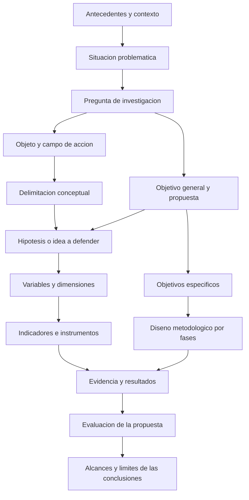

# Clase 3: Congruencia del proyecto doctoral y fundamentación de la validación científica

> **Objetivo académico:** Analizar la coherencia entre problema, objeto de estudio, campo de acción, objetivos, hipótesis y operacionalización, y fundamentar la selección de diseños e instrumentos para evaluar propuestas tecnológicas doctorales.

## 1. Contexto y marco conceptual

La sesión desarrolla una revisión metodológica de investigaciones propositivas en informática y disciplinas relacionadas. Los casos abarcan ciberseguridad agroindustrial, soporte académico mediante inteligencia artificial, auditoría de sistemas en pymes, estimación de severidad fitopatológica y cadena de custodia digital. Su articulación permite distinguir tres cuestiones: la relevancia del problema profesional, la contribución al conocimiento y la evidencia necesaria para sostener esa contribución.

Una dificultad operativa puede motivar una investigación, pero su importancia económica o institucional no demuestra por sí misma una contribución doctoral. Esta requiere delimitar qué conocimiento resulta insuficiente, qué propone la investigación para superarlo y cómo se contrastará la propuesta. La experiencia del investigador y su acceso al campo favorecen la factibilidad; no sustituyen la argumentación científica.

### 1.1. Del contexto al problema científico

La exposición distingue antecedentes, situación problemática y pregunta de investigación. Los antecedentes teóricos presentan aportes previos relevantes; los antecedentes prácticos sitúan dificultades y experiencias del contexto. La situación problemática sintetiza la insuficiencia concreta que justifica investigar, mientras que la pregunta delimita aquello que se busca comprender o transformar.

El estado del arte exige un desarrollo más profundo: comparar aportes, reconocer límites y argumentar la brecha de conocimiento. Mencionar investigaciones precedentes no equivale a analizar críticamente su capacidad para resolver el problema.

En el esquema metodológico trabajado durante la sesión, la pregunta se centra en la transformación requerida y el objetivo general introduce la propuesta. Incorporar anticipadamente una arquitectura o un modelo específico en la pregunta puede dar por establecida una solución antes de justificarla.

**Enriquecimiento conceptual:** Esta recomendación debe entenderse dentro del tipo de investigación propositiva analizado. En otras tradiciones metodológicas es legítimo formular preguntas sobre una intervención determinada. El criterio general es evitar que la formulación presuponga la eficacia de aquello que todavía necesita evaluación.

### 1.2. Perfil y tesis: proyección y fundamentación

El perfil proyecta la investigación: delimita el problema y anticipa su recorrido conceptual y metodológico. La tesis fundamenta las decisiones y documenta su aplicación. Una matriz puede mostrar relaciones entre variables, dimensiones e instrumentos, pero no explica por sí sola por qué esas relaciones son pertinentes.

El paso de perfil a tesis implica transformar en argumentación lo que inicialmente aparece como una estructura proyectada. Los fundamentos teóricos requieren posicionamiento respecto de las teorías y conceptos asumidos; los fundamentos metodológicos deben justificar las decisiones efectivamente utilizadas. Una sucesión de definiciones o técnicas no constituye todavía una fundamentación.

## 2. Fundamentos teóricos y arquitectura

### 2.1. La congruencia como estructura de relaciones

El hilo conductor vincula título, pregunta, objeto de estudio, campo de acción, objetivo general e hipótesis o idea a defender. La operacionalización traduce posteriormente los conceptos en dimensiones e indicadores observables.

| Componente | Función dentro de la investigación | Riesgo identificado en la sesión |
| --- | --- | --- |
| Título | Comunicar la propuesta y su finalidad central | Nombrar una aplicación cuando la contribución declarada es un marco de trabajo |
| Pregunta | Delimitar la necesidad de conocimiento o transformación | Introducir la solución como si ya estuviera justificada |
| Objeto de estudio | Identificar el proceso o fenómeno general investigado | Reducirlo a una herramienta sin aclarar el fenómeno estudiado |
| Campo de acción | Precisar el ámbito de transformación dentro del objeto | Confundir el proceso que se transforma con el artefacto que lo transforma |
| Objetivo general | Expresar el resultado central buscado | Acumular acciones o finalidades heterogéneas |
| Objetivos específicos | Organizar las etapas lógicas necesarias | Convertirlos en descripciones extensas de actividades |
| Hipótesis o idea a defender | Articular la afirmación central que se sostendrá con evidencia | Incorporar resultados ausentes de la pregunta y de los objetivos |
| Operacionalización | Relacionar conceptos, dimensiones, indicadores e instrumentos | Enumerar indicadores sin explicar su pertinencia |

La congruencia terminológica evita cambios silenciosos en el compromiso de investigación. Brindar un servicio, mejorarlo y optimizarlo expresan pretensiones diferentes. Una formulación centrada en brindar soporte no queda automáticamente alineada con una hipótesis sobre reducción de carga operativa y aumento de satisfacción.

**Enriquecimiento conceptual:** Optimizar supone precisar qué criterio se mejora y bajo qué restricciones. Si el estudio solo compara indicadores antes y después, puede demostrar una mejora observada sin demostrar que alcanzó una solución óptima. La terminología debe corresponder al alcance de la evidencia.

### 2.2. Objetivos y justificaciones

El recorrido recurrente de los objetivos específicos comprende sistematización teórica, diagnóstico, construcción de la propuesta y validación. Estos objetivos deben delimitar resultados intelectuales o empíricos, manteniendo una redacción precisa.

En el caso de ciberseguridad se cuestionó incluir la validación como una segunda acción principal dentro del objetivo general cuando ya figuraba como objetivo específico. El criterio expuesto fue preservar una finalidad central y ubicar su evaluación dentro del desarrollo lógico de la investigación.

**Enriquecimiento conceptual:** La presencia de dos verbos no invalida universalmente un objetivo. El problema aparece cuando se acumulan resultados independientes o se pierde la jerarquía entre finalidad y procedimiento. La observación de la sesión corresponde a una formulación concreta y a su organización metodológica.

Las justificaciones responden a dimensiones diferentes:

- La justificación teórica explica qué insuficiencia conceptual o de conocimiento hace necesario estudiar el problema.
- La práctica identifica el valor de la propuesta para resolver dificultades concretas, distinguiendo beneficios esperados de resultados demostrados.
- La social y económica analiza consecuencias pertinentes para personas, organizaciones o sectores.
- La metodológica expone el aporte procedimental de la propuesta: una articulación de técnicas, una secuencia reproducible o una forma de resolver el problema.

Enumerar el paradigma, el enfoque mixto y la metodología de construcción del artefacto describe el diseño de investigación; no demuestra automáticamente una contribución metodológica.

### 2.3. Paradigma, enfoque, diseño y metodología de construcción

La sesión insiste en separar niveles que suelen confundirse. El paradigma expresa una posición general sobre el conocimiento; el enfoque organiza la producción y análisis de evidencia cuantitativa, cualitativa o mixta; el diseño concreta la estrategia de obtención e integración de datos. Design Science Research, o DSR, se presenta como una metodología orientada a construir y evaluar artefactos para resolver problemas relevantes.

En una investigación tecnológica, declarar DSR no reemplaza la explicación del paradigma general ni del diseño empírico. El pragmatismo aparece en los casos como una orientación compatible con la resolución de problemas y la combinación de métodos, siempre que esa elección se fundamente.

También deben distinguirse métodos teóricos, métodos empíricos, técnicas e instrumentos. La sesión menciona análisis-síntesis e histórico-lógico entre los primeros; encuestas, entrevistas, observación y análisis documental dentro de la obtención de evidencia; y cuestionarios, guías de entrevista, listas de cotejo y registros operativos como instrumentos concretos. Su clasificación y uso deben explicarse de manera consistente.

## 3. Implementación técnica y lógica de negocio

La fuente presenta arquitecturas y estrategias de investigación, sin proporcionar código ejecutable ni resultados completos de implementación. Los procedimientos siguientes sintetizan propuestas discutidas y no acreditan su eficacia.

### 3.1. Integración de ciberseguridad en entornos TI/OT

El caso agroindustrial describe la convergencia entre tecnologías de información, TI, y tecnologías de operación, OT. Redes empresariales y sistemas de gestión se conectan con sistemas SCADA, controladores lógicos programables, PLC, y sensores industriales. Se mencionan pesaje automatizado, almacenamiento de grano, termometría, calderas, extracción y refinación.

La interconexión amplía las rutas potenciales de compromiso. El incidente relatado involucra usuarios internos, credenciales y controles de acceso en la interfaz con el sistema de pesaje. La discusión identifica además equipos antiguos sin soporte y separación organizacional entre quienes administran TI y quienes mantienen OT.

La propuesta busca articular cuatro referencias, cuyas denominaciones se normalizan por contexto como NIST, COBIT, ISO/IEC 27001 e IEC 62443. La fuente no precisa todas sus versiones ni los documentos concretos seleccionados.

| Referencia | Función atribuida en la propuesta |
| --- | --- |
| NIST | Orientación para la gestión del riesgo de ciberseguridad |
| COBIT | Gobernanza y articulación de responsabilidades |
| ISO/IEC 27001 | Sistema de gestión de seguridad de la información |
| IEC 62443 | Seguridad de sistemas de automatización y control industrial |

La integración necesita explicar qué componentes se seleccionan, cómo se relacionan y qué conflictos o duplicidades se resuelven. La sola presencia de cuatro referencias no demuestra que exista un modelo integrado.

**Enriquecimiento conceptual:** IEC 62443 se orienta a automatización y control industrial; su pertinencia para la agroindustria no implica que sea exclusiva de ese sector. Asimismo, seguridad por oscuridad significa depender del desconocimiento del diseño o funcionamiento como protección. No equivale a una imposibilidad técnica de interconexión.

La propuesta contempla diagnóstico de riesgo, construcción del modelo, aplicación piloto y comparación posterior. Se declara una población de 25 personas: ocho de TI, diez de OT, cinco de planta y dos directivos. Esta composición identifica participantes, pero no agota las unidades de análisis: también deben delimitarse procesos, activos, controles o escenarios de riesgo.

### 3.2. Arquitectura multiagente para soporte académico

El segundo caso plantea una arquitectura denominada SOEBOT, basada en modelos de lenguaje de gran tamaño, LLM, recuperación aumentada de información, RAG, y coordinación multiagente. El problema descrito incluye documentación fragmentada, consultas repetitivas, respuestas inconsistentes, demoras y dependencia de búsquedas manuales.

La base de conocimiento prevista comprende reglamentos, planes académicos, procedimientos y documentación institucional oficial. El alcance expuesto corresponde a un prototipo y una aplicación piloto, sin integración completa con los sistemas corporativos de matrícula o finanzas.

Los indicadores mencionados incluyen tiempo de respuesta, precisión normativa, consistencia informativa, satisfacción del usuario, carga operativa, trazabilidad y aciertos de enrutamiento. Es necesario distinguir indicadores del funcionamiento interno de la arquitectura de aquellos que describen el servicio prestado.

**Enriquecimiento conceptual:** Una representación funcional mínima de RAG comprende recepción de la consulta, recuperación de documentos pertinentes y generación apoyada en ese contexto. Una arquitectura multiagente puede distribuir esas funciones, pero la distribución concreta no quedó especificada en la fuente. Recuperar documentos tampoco garantiza que una respuesta sea correcta: se requiere evaluar su respaldo documental y el tratamiento de información insuficiente o contradictoria.

### 3.3. Modelo de auditoría de sistemas para pymes

La propuesta de auditoría organiza su procedimiento en planificación, ejecución y resultados. Busca evaluar controles de TI mediante referencias a COBIT y a la familia ISO/IEC 27000. La exposición alterna ISO/IEC 27001 e ISO/IEC 27002, sin resolver por completo sus funciones respectivas.

Se identifican dimensiones de acceso lógico y físico, infraestructura tecnológica, respaldo y continuidad, políticas, riesgos e incidentes, activos, cambios y seguridad de sistemas de información. El diseño mixto concurrente prevé analizar inicialmente por separado datos cuantitativos y cualitativos e integrarlos posteriormente.

Las fuentes previstas son usuarios de sistemas, personal con responsabilidades y especialistas en auditoría. Los cuestionarios y entrevistas responden a perspectivas diferentes, por lo que su composición muestral y sus criterios de selección deben justificarse separadamente.

**Enriquecimiento conceptual:** ISO/IEC 27001 establece requisitos para un sistema de gestión; ISO/IEC 27002 proporciona orientación sobre controles. Su complementariedad no autoriza a tratarlas como denominaciones intercambiables. En auditoría también conviene distinguir la existencia de un control, su diseño y su funcionamiento efectivo: una política documentada no demuestra su aplicación.

### 3.4. Estimación continua de severidad foliar

El caso fitopatológico propone estimar la severidad del mildiu en hojas de quinua mediante un modelo jerárquico supervisado e interpretable. Se describen segmentación, extracción de características cromáticas, morfológicas y de textura, clasificación probabilística y regresión. No se proporcionan algoritmos concretos, datos de entrenamiento ni métricas obtenidas.

La adquisición estandarizada busca reducir variaciones debidas a iluminación, fondo, distancia y orientación. Se menciona una aplicación y un dispositivo de captura como soportes operativos del modelo. La evaluación visual especializada funciona como referencia de contraste, sin plantear la sustitución del juicio profesional.

**Enriquecimiento conceptual:** La definición porcentual de severidad puede expresarse como:

$$
S = 100\frac{A_{\mathrm{afectada}}}{A_{\mathrm{foliar}}}
$$

Aquí $S$ es la severidad en porcentaje; $A_{\mathrm{afectada}}$ es el área de tejido identificada como afectada y $A_{\mathrm{foliar}}>0$ es el área foliar evaluada. Ambas áreas deben medirse en la misma unidad y satisfacer $0\leq A_{\mathrm{afectada}}\leq A_{\mathrm{foliar}}$, por lo que $S\in[0,100]$. La expresión supone que la delimitación de lesión y hoja es válida. Una imagen bidimensional estima áreas proyectadas, que pueden diferir de la superficie real por curvatura u oclusión; además, la identificación visual de lesión requiere criterios fitopatológicos explícitos. Esta fórmula aclara el constructo, sin atribuir al modelo resultados no presentados.

### 3.5. Marco de trabajo para evidencia digital

El último caso propone integrar técnicas criptográficas y blockchain para preservación y trazabilidad de evidencia digital durante la cadena de custodia. Se distinguen estas funciones del análisis pericial y de las decisiones jurídicas posteriores.

La discusión propone que el título identifique el marco de trabajo como producto científico. Integridad, autenticidad, no repudio y trazabilidad pueden desarrollarse mediante la operacionalización, evitando sobrecargar el título y la pregunta con todos sus indicadores.

**Enriquecimiento conceptual:** Estas propiedades no son equivalentes. La integridad se refiere a detectar alteraciones; la autenticidad, a sustentar el origen o identidad declarados; la trazabilidad, a reconstruir eventos y transferencias; y el no repudio depende de mecanismos técnicos y condiciones organizativas y jurídicas. Un registro blockchain puede contribuir a la trazabilidad de lo registrado, pero no garantiza la veracidad de la captura inicial, la custodia física ni la validez jurídica de la evidencia.

## 4. Análisis crítico de casos y auditoría práctica

### 4.1. Revisión sistemática y fuerza de la brecha

En el caso agroindustrial se informa una revisión organizada con PRISMA: 981 registros identificados, 816 después de una primera depuración, 60 seleccionados tras el cribado y 30 incluidos en el corpus final. Son cifras declaradas durante la exposición, no verificadas en la sesión mediante los registros de selección.

Existe una inconsistencia interna: se mencionan 13 estudios teóricos, 11 revisiones y tres estudios empíricos, que suman 27 y no 30. No se explica la clasificación de los tres documentos restantes. La observación limita la interpretación de la distribución, aunque no impide analizar el argumento general sobre escasez de evidencia aplicada.

**Enriquecimiento conceptual:** PRISMA orienta la transparencia del reporte de una revisión; su mención no certifica por sí sola la exhaustividad de la búsqueda ni la calidad de los estudios. Una afirmación de ausencia de integración requiere criterios de búsqueda y selección explícitos, además de explicar qué cuenta como integración. Es más preciso afirmar que no se identificó evidencia dentro del alcance revisado que declarar una inexistencia universal.

### 4.2. Contribución doctoral y selección del caso

El debate sobre ciberseguridad cuestiona si una aplicación empresarial demuestra una contribución científica suficiente. La aplicación empírica es valiosa, pero su realización no establece automáticamente novedad teórica o metodológica. Debe identificarse qué relación, mecanismo de integración o principio de diseño se aprende mediante ella.

La empresa se justifica como caso por su acceso autorizado, convergencia TI/OT y presencia de procesos relevantes para el sector. El tamaño o liderazgo comercial no demuestra representatividad estadística.

**Enriquecimiento conceptual:** En un caso único puede plantearse generalización analítica: transferir proposiciones o principios a contextos que compartan condiciones relevantes. Esto requiere describir esas condiciones y sus límites. La facilidad de acceso favorece la viabilidad, pero debe distinguirse de la justificación científica de selección.

También se cuestionan promesas de evitar pérdidas millonarias o proteger vidas cuando aún no existen resultados que atribuyan esos efectos al modelo. Es legítimo describir tales consecuencias como riesgos del contexto o beneficios potenciales, manteniendo separada la evidencia disponible.

### 4.3. Qué valida cada procedimiento

El debate plantea una tensión entre aplicación piloto y juicio de expertos. Una postura prioriza evidencia operacional; otra advierte que componentes distintos del modelo pueden requerir procedimientos de evaluación diferentes. La fuente no demuestra que una única modalidad baste para todas las dimensiones.

| Procedimiento | Evidencia que puede aportar | Límite principal |
| --- | --- | --- |
| Juicio de expertos | Coherencia, pertinencia y suficiencia conceptual o técnica | No demuestra por sí solo eficacia operacional |
| Aplicación piloto | Factibilidad y funcionamiento en un contexto delimitado | Su transferencia a otros contextos requiere argumentación |
| Comparación antes-después | Cambio observado tras una intervención | No aísla automáticamente el efecto causal |
| Revisión documental | Correspondencia con fuentes o criterios definidos | Depende de la calidad y alcance de esas fuentes |
| Evaluación predictiva | Desempeño del estimador sobre datos de contraste | Requiere independencia adecuada y referencia válida |

**Enriquecimiento conceptual:** Construir un artefacto no constituye por sí mismo un experimento. Tampoco toda evaluación de implementación necesita un diseño experimental: este depende de la intervención, la asignación, la comparación y el control de amenazas a la validez. En el caso fitopatológico deben distinguirse la validación de predicciones y la evaluación de cambios en el proceso profesional producidos por usar la herramienta.

### 4.4. Comparaciones temporales e inferencia causal

Los casos de ciberseguridad y soporte académico proponen mediciones previas y posteriores sobre un mismo contexto. El diseño preexperimental permite observar cambios, aunque carezca de grupo de comparación.

**Enriquecimiento conceptual:** Para un indicador de riesgo comparable entre momentos puede definirse:

$$
\Delta R = R_{\mathrm{antes}}-R_{\mathrm{despues}}
$$

$R_{\mathrm{antes}}$ y $R_{\mathrm{despues}}$ representan el riesgo medido con la misma escala, unidad de análisis y procedimiento; $\Delta R$ se expresa en esa misma unidad. Si valores mayores significan mayor riesgo, $\Delta R>0$ indica una reducción observada. La resta exige una escala que admita diferencias interpretables; no es automáticamente válida para categorías ordinales como bajo, medio y alto. Tampoco demuestra causalidad: cambios de infraestructura, amenazas o criterios de valoración pueden explicar parte de la diferencia.

La dimensión temporal y el control experimental son criterios distintos. Un estudio puede ser longitudinal sin ser experimental, y una comparación antes-después no demuestra por sí sola que exista un enfoque mixto.

### 4.5. Métodos mixtos, muestreo e instrumentos

Declarar un enfoque mixto exige identificar los datos cualitativos y cuantitativos, el orden de obtención y el punto de integración. En un diseño concurrente las vertientes se desarrollan en un periodo compartido y se articulan analíticamente. En uno secuencial, los resultados de una fase pueden orientar la siguiente.

La fuente menciona diseños secuenciales explicativos, exploratorios y transformativos. Su selección debe corresponder al propósito y a la relación entre fases, no únicamente a la existencia de dos momentos temporales.

**Enriquecimiento conceptual:** Una encuesta puede producir datos cuantitativos, cualitativos o ambos según sus preguntas y análisis. Una entrevista tampoco determina por sí sola el enfoque. El análisis documental puede producir categorías interpretativas o conteos. Lo decisivo es cómo se construye y utiliza la evidencia.

En muestreo cualitativo, indicar selección intencional resulta insuficiente si no se explica qué experiencia o diversidad se busca. La fuente enfatiza el propósito de selección; sus afirmaciones generales sobre las muestras cualitativas deben leerse como orientación para los casos tratados, no como una taxonomía exhaustiva. Los criterios de inclusión y exclusión también pueden ser pertinentes en estudios cualitativos.

El caso de auditoría plantea dificultades para construir un marco poblacional de pymes. Esa dificultad requiere revisar definiciones, fuentes y cobertura; no elimina la necesidad de justificar la selección ni habilita inferencias poblacionales sin respaldo.

Respecto de los instrumentos, se discute el alfa de Cronbach y el ajuste progresivo de guías de entrevista. **Enriquecimiento conceptual:** El alfa informa sobre consistencia interna bajo determinados supuestos; no acredita por sí solo validez de contenido o de constructo. En investigación cualitativa, la guía puede refinarse durante el trabajo de campo, pero conviene documentar versiones y cambios. La saturación se relaciona con la suficiencia analítica de la información, no simplemente con dejar de modificar preguntas.

## 5. Principios de diseño, buenas prácticas y anti-patrones

### 5.1. Diseñar desde el problema y la evidencia

La propuesta debe responder a una necesidad delimitada. En el soporte académico, partir de los problemas de información permite decidir si la recuperación contextual y la coordinación multiagente son necesarias. En ciberseguridad, los procesos críticos y sus riesgos orientan la selección de controles. En fitopatología, definir severidad condiciona la captura y la referencia de contraste.

El anti-patrón común consiste en elegir primero una tecnología y reformular después el problema para justificarla. Otro consiste en presentar una combinación de herramientas como contribución científica sin explicar su articulación ni el conocimiento que permite producir.

### 5.2. Hacer verificable la operacionalización

Cada indicador necesita una definición, una fuente de datos y un procedimiento de obtención. En las arquitecturas inteligentes deben diferenciarse calidad de la respuesta, latencia y satisfacción. En auditoría, cumplimiento documental y efectividad operacional. En evidencia digital, integridad y trazabilidad.

**Enriquecimiento conceptual:** Una matriz útil relaciona constructo, dimensión, indicador, instrumento, unidad de análisis, momento de medición y criterio de interpretación. Su función es hacer rastreable la inferencia desde los datos hasta las conclusiones; el texto debe justificar por qué esos datos representan el constructo.

### 5.3. Justificar la evaluación por componentes

La estrategia de validación se selecciona después de precisar el modelo y sus componentes. La gobernanza, el funcionamiento técnico y los efectos organizacionales pueden requerir evidencias distintas. El juicio de expertos y la aplicación piloto pueden ser complementarios cuando responden a preguntas diferentes.

En todos los casos debe distinguirse lo propuesto, lo implementado, lo medido y lo demostrado. Una reducción estimada del riesgo no equivale a una reducción observada de pérdidas; una buena clasificación de enfermedades no equivale a una buena estimación continua de severidad; un registro inalterable no prueba que su contenido inicial sea verdadero.

### 5.4. Mantener correspondencia entre metodología y resultados

Los métodos declarados deben aparecer efectivamente aplicados en el informe. Si se anuncia análisis cualitativo, deben explicarse sus categorías y resultados; si se anuncia comparación temporal, deben existir mediciones comparables. La fundamentación no debe conservar decisiones abandonadas ni atribuir a procedimientos simples un alcance que no tienen.

La redacción académica articula decisión, justificación y consecuencia. Tablas y listados permiten sintetizar relaciones, pero su acumulación no sustituye el razonamiento. Esta exigencia también se aplica al texto generado con inteligencia artificial: una estructura preliminar necesita revisión conceptual, evidencia y posicionamiento del investigador.

## 6. Síntesis conceptual y profundización académica

La sesión sitúa la calidad doctoral en la relación entre problema relevante, contribución identificable y evidencia congruente. La experiencia profesional aporta acceso y conocimiento contextual; la investigación transforma esos recursos en afirmaciones delimitadas, procedimientos explícitos y resultados susceptibles de evaluación crítica.

Los cinco casos muestran distintas formas de esa exigencia. La ciberseguridad requiere demostrar la integración entre referencias y sus efectos dentro de un entorno TI/OT. El soporte académico debe vincular arquitectura, calidad informativa y resultados del servicio. La auditoría necesita controles e instrumentos ajustados al contexto de las pymes. La estimación foliar exige separar detección de enfermedad y cuantificación de severidad. La cadena de custodia digital demanda precisar qué propiedades sustentan realmente la criptografía, blockchain y los procedimientos organizativos.

La maduración de un proyecto incluye revisar formulaciones y diseños conforme se comprende mejor el problema. Esa revisión debe conservar la trazabilidad del argumento: los cambios en indicadores, alcance o validación pueden exigir ajustar pregunta, objetivos e hipótesis.

**Enriquecimiento conceptual:** La profundización puede organizarse en tres niveles de validez: conceptual, para determinar si los constructos representan el problema; metodológica, para establecer si los procedimientos producen evidencia pertinente; e inferencial, para delimitar qué conclusiones permiten los datos. Distinguir estos niveles ayuda a sostener contribuciones precisas sin convertir beneficios potenciales en resultados demostrados.
