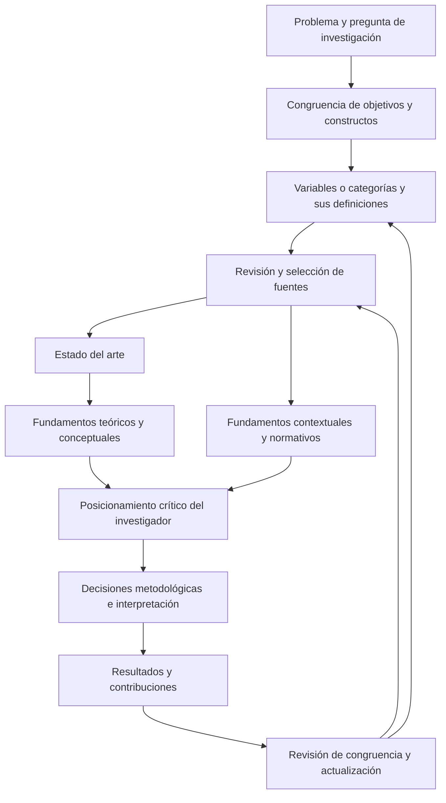

# Clase 4: Construcción y sistematización crítica de los fundamentos teóricos referenciales

> **Objetivo académico:** Comprender la transformación de una proyección teórica de investigación en una fundamentación doctoral argumentada, articulando congruencia metodológica, métodos teóricos, estado del arte, fundamentos conceptuales, referencias contextuales y análisis normativo con una escritura científica verificable.

## 1. Contexto y marco conceptual

La sesión sitúa los fundamentos teóricos referenciales dentro de la comunicación científica de una investigación doctoral. Su planteamiento central es que el informe de tesis requiere transformar las selecciones preliminares del proyecto en decisiones justificadas. Identificar teorías, conceptos o métodos constituye un punto de partida; fundamentarlos exige explicar su pertinencia, contrastarlos con alternativas y delimitar las consecuencias de asumirlos.

### Del proyecto al informe de investigación

El perfil de investigación cumple una función proyectiva: organiza el problema, anticipa decisiones y establece una orientación para el estudio. La tesis comunica y argumenta el proceso desarrollado, los fundamentos asumidos y los resultados obtenidos. Ambos documentos guardan continuidad, pero no son intercambiables.

| Componente | Función proyectiva en el perfil | Desarrollo argumentativo en la tesis |
| --- | --- | --- |
| Problema y objetivos | Delimitar lo que se pretende investigar | Presentar el eje que organiza y permite interpretar el estudio |
| Teorías y conceptos | Identificar referentes inicialmente pertinentes | Comparar referentes y justificar las posiciones adoptadas |
| Diseño metodológico | Prever enfoque, métodos e instrumentos | Fundamentar su elección, articulación y límites |
| Resultados | Anticipar qué información será necesaria | Analizar información efectivamente obtenida |
| Contribución | Formular una expectativa de novedad | Precisar qué se aporta y con qué sustento |

La diferencia decisiva no reside únicamente en el tiempo verbal. Consiste en pasar de mencionar una elección a sostenerla mediante razones. Una investigación doctoral puede producir contribuciones de sistematización teórica o metodológica, además de resultados empíricos y aplicaciones prácticas; esas contribuciones deben hacerse visibles en el razonamiento del informe.

La introducción recupera elementos del proyecto: antecedentes, situación problemática, pregunta de investigación, objetivos, justificaciones, novedad, objeto de estudio, campo de acción, alcance, hipótesis o idea a defender, variables o categorías y delimitaciones. La sesión reconoce que el orden de presentación puede variar entre protocolos. Ubicar el objeto y el campo antes o después de los objetivos no resuelve por sí mismo la coherencia del estudio: esta depende de sus relaciones conceptuales.

En la concepción presentada, el objeto de estudio se vincula con el ámbito de conocimiento donde se inscribe el problema, mientras que el campo de acción delimita el aspecto específico sobre el cual se concentra la investigación. Estas denominaciones deben interpretarse dentro de la tradición metodológica utilizada y mantenerse consistentes a lo largo del documento.

### Definición inicial y fundamentación conceptual

Una aclaración importante de la sesión distingue entre declarar una variable y desarrollar su fundamentación. En la introducción no basta con escribir el nombre de una variable: corresponde indicar qué significa en el estudio. El capítulo conceptual retoma esa definición para contrastarla con otras, justificar su selección y explicar sus relaciones con los demás conceptos.

El concepto se presenta como una representación abstracta de objetos, procesos, situaciones o fenómenos; la definición es la formulación verbal que delimita el significado de un término. Por tanto, una definición breve no sustituye el desarrollo de una estructura conceptual, y un conjunto de definiciones aisladas tampoco constituye un marco conceptual.

El resumen de la tesis condensa la problemática, el objetivo, la hipótesis o idea a defender cuando corresponda, los métodos principales, los resultados, la propuesta y las contribuciones. La sesión recomienda consolidarlo cuando exista una visión integral del estudio, especialmente de sus conclusiones y aportes. Las palabras clave deben representar el contenido final; el resumen en inglés debe conservar su correspondencia conceptual.

## 2. Fundamentos teóricos y arquitectura

### Unidad entre elaboración teórica e información empírica

Los métodos teóricos permiten abstraer, relacionar, interpretar y organizar el conocimiento. Los métodos empíricos permiten obtener información sobre manifestaciones del fenómeno en la práctica. La sesión los presenta como dimensiones interdependientes: la teoría orienta qué observar y cómo hacerlo; los datos requieren elaboración racional para adquirir significado científico.

La denominación de un método no constituye una justificación suficiente. Su presencia en el diseño debe corresponder a operaciones reconocibles dentro de la investigación. Declarar análisis-síntesis o modelación exige precisar sobre qué materiales se aplican, para qué decisiones y con qué producto intelectual.

| Método o perspectiva | Operación principal | Aporte a los fundamentos | Límite que debe vigilarse |
| --- | --- | --- | --- |
| Análisis-síntesis | Descomponer un fenómeno y reconstruir sus relaciones | Comparar aportes y elaborar una interpretación integrada | Fragmentar sin reconstruir el conjunto |
| Histórico-lógico | Relacionar evolución temporal y estructura del fenómeno | Explicar hitos, continuidades y transformaciones | Reducir el análisis a una enumeración de fechas |
| Genético | Reconstruir orígenes y condiciones de formación | Investigar cómo surge y se desarrolla un problema | Confundir sucesión temporal con causalidad demostrada |
| Inductivo-deductivo | Relacionar observaciones particulares y proposiciones generales | Construir y revisar inferencias entre datos y teoría | Generalizar más allá de la evidencia disponible |
| Hipotético-deductivo | Derivar consecuencias contrastables de hipótesis | Vincular supuestos, predicciones y contraste empírico | Considerar suficiente la formulación de una hipótesis |
| Sistémico-estructural | Analizar componentes, organización e interacciones | Explicar la configuración de sistemas complejos | Describir partes sin estudiar sus relaciones |
| Enfoque de sistema | Considerar propósito, entorno, dinámica y retroalimentación | Integrar los componentes del estudio y sus dependencias | Suponer que el todo equivale a una suma de elementos |
| Tránsito de lo abstracto a lo concreto pensado | Reconstruir intelectualmente un fenómeno mediante determinaciones relacionadas | Conectar categorías generales con una representación articulada del objeto | Confundir la representación con el fenómeno completo |
| Modelación | Construir representaciones selectivas de fenómenos o sistemas | Explorar relaciones, comportamientos y escenarios | Omitir supuestos y condiciones de aplicación |

El análisis-síntesis no obliga a que cada párrafo contenga una introducción, una comparación y una conclusión. Una argumentación puede desarrollar varias perspectivas antes de integrarlas. Lo decisivo es que la síntesis reconstruya relaciones y produzca comprensión, en lugar de repetir lo previamente descrito.

El método histórico-lógico debe mantener como referencia la pregunta de investigación o el campo de acción. Su amplitud no justifica reconstruir la historia completa de una disciplina cuando solo una parte explica el problema. El método genético añade la atención al origen y a las condiciones que posibilitan determinados cambios.

La inducción y la deducción pueden retroalimentarse: las observaciones sugieren regularidades y las proposiciones generales orientan nuevas observaciones. En el razonamiento hipotético-deductivo, formular una hipótesis es apenas un momento del proceso; también se requieren consecuencias observables y procedimientos de contraste.

**Enriquecimiento conceptual:** La contrastación hipotético-deductiva no exige siempre inferencia estadística: también puede apoyarse en observaciones, experimentos o pruebas de consecuencias específicas, según la disciplina y el diseño. La evidencia favorable respalda una hipótesis bajo determinadas condiciones, pero no constituye una demostración universal de su verdad.

El enfoque sistémico y el análisis sistémico-estructural presentan solapamientos. La sesión diferencia sus énfasis: el segundo destaca organización y relaciones entre componentes; el primero amplía la atención hacia propósito, entorno, retroalimentación y funcionamiento integral. Esta distinción resulta útil si se traduce en operaciones concretas y no en duplicación terminológica.

La modelación puede recurrir a representaciones conceptuales, matemáticas, estadísticas o informáticas. Para los modelos propuestos en la sesión, se destaca la articulación entre un componente teórico-conceptual y otro metodológico.

**Enriquecimiento conceptual:** Un mapa de relaciones puede formar parte de la modelación, pero no todo mapa permite simular ni predecir. Esas capacidades dependen de que el modelo incorpore relaciones, reglas o mecanismos adecuados para tales fines. Del mismo modo, un diagrama puede expresar una reconstrucción conceptual, pero su presencia no demuestra por sí sola la aplicación del tránsito de lo abstracto a lo concreto pensado.

### Componentes de los fundamentos teóricos referenciales

La arquitectura del capítulo distingue funciones complementarias:

| Componente | Pregunta que orienta su construcción | Producto esperado |
| --- | --- | --- |
| Antecedentes | ¿Qué estudios previos permiten contextualizar el problema? | Panorama inicial de contribuciones pertinentes |
| Estado del arte | ¿Cómo ha evolucionado el conocimiento y qué permanece abierto? | Sistematización de avances, tendencias, debates y vacíos |
| Fundamentos teóricos | ¿Qué teorías explican el fenómeno y por qué se asumen? | Argumentación sobre el alcance y pertinencia de los referentes |
| Fundamentos conceptuales | ¿Qué significan los conceptos y cómo se relacionan? | Estructura conceptual definida y justificada |
| Fundamentos contextuales | ¿Qué aplicaciones documentadas ayudan a comprender el problema? | Análisis de experiencias y condiciones de aplicación |
| Fundamentos normativos y legales | ¿Qué disposiciones resultan aplicables y con qué implicaciones? | Evaluación crítica de regulaciones, restricciones y vacíos |

El estado del arte ofrece la base para seleccionar teorías y conceptos; estos, a su vez, permiten revisar críticamente la relevancia de la literatura. No se trata de una secuencia irreversible, sino de una construcción que admite ajustes.

## 3. Implementación técnica y lógica de negocio

La fuente no presenta código, algoritmos ejecutados ni resultados experimentales. Su implementación es metodológica y documental: matrices de congruencia y operacionalización, procedimientos de revisión, organización de argumentos y trazabilidad de fuentes.

### Matriz de congruencia

La matriz de congruencia permite relacionar título, pregunta, objetivo general, objetivos específicos e hipótesis o idea a defender. Según el enfoque, incorpora variables, dimensiones e indicadores, o categorías, temas y subtemas.

Su función es revisar si los componentes se refieren al mismo problema y conservan un significado compatible. La sesión insiste en evitar sustituciones terminológicas aparentemente equivalentes que alteren el constructo estudiado. Esta revisión debe continuar en los instrumentos, los resultados y las conclusiones.

**Enriquecimiento conceptual:** La congruencia requiere identidad de significado, no repetición mecánica de todas las palabras. Una abreviatura o variante terminológica puede utilizarse si su equivalencia queda definida. Asimismo, una matriz de congruencia no es una prueba estadística de ajuste ni demuestra validez empírica: documenta relaciones lógicas que posteriormente deben sostenerse con procedimientos y evidencia.

### Matriz de operacionalización

La operacionalización traduce una definición abstracta en decisiones observables o medibles. En el desarrollo cuantitativo presentado, distingue dos niveles:

- **Conceptual:** delimita qué significa la variable a partir de una definición asumida y justificada.
- **Operacional:** especifica dimensiones, indicadores, medidas o índices que permitirán obtener información sobre ella.

La matriz orienta tanto la revisión teórica como el diseño de instrumentos. Si incorpora una dimensión o un indicador, estos deben contar con sustento conceptual. A su vez, las preguntas de un cuestionario o los aspectos de una observación deben responder a aquello que se pretende conocer.

**Enriquecimiento conceptual:** La transformación puede representarse mediante la relación metodológica «constructo, dimensiones, indicadores, procedimiento de obtención y criterio de interpretación». Esta relación no supone que todo constructo admita una única medida ni que todo indicador refleje adecuadamente el fenómeno por el solo hecho de ser cuantificable.

En estudios cualitativos, la organización mediante categorías y relaciones analíticas debe responder al enfoque utilizado. La referencia de la sesión a categorías, temas y subtemas no exige trasladar automáticamente una matriz cuantitativa a un diseño cualitativo.

### Construcción del estado del arte

El procedimiento expuesto comprende delimitar el tema, localizar literatura relevante, seleccionar contribuciones pertinentes, realizar una lectura crítica e identificar aportes que permitan reconstruir su evolución. La sistematización establece nexos entre esos aportes y justifica por qué forman parte del recorrido analizado.

El orden cronológico ayuda a reconocer transformaciones, pero debe acompañarse de argumentos sobre su importancia. Los antecedentes ofrecen una contextualización inicial; el estado del arte desarrolla una revisión más profunda y articulada del conocimiento disponible.

**Enriquecimiento conceptual:** Una revisión organizada y exhaustiva no equivale automáticamente a una revisión sistemática como método formal. Si se utiliza esta última denominación, conviene explicitar estrategia de búsqueda, criterios de selección y procedimiento de síntesis. El estado del arte también puede combinar una organización temporal con ejes temáticos cuando ello haga más claras las controversias y tendencias.

### Elaboración teórica y conceptual

Los fundamentos teóricos deben explicar qué teorías se asumen, qué aspectos del problema permiten comprender y cuáles son sus límites. El marco conceptual desarrolla las definiciones relevantes y las relaciones entre ellas. Cuando se formula una definición propia a partir de varios autores, corresponde distinguir los elementos retomados de la elaboración del investigador.

La revisión especializada complementa la revisión metodológica. Esta última puede advertir incongruencias entre conceptos, objetivos e instrumentos; la revisión disciplinar permite valorar actualidad, pertinencia técnica y adecuación del significado asumido. Una estructura terminológicamente ordenada puede seguir siendo insuficiente si utiliza categorías inadecuadas para el campo.

### Análisis contextual, normativo y legal

Los fundamentos contextuales recuperan aplicaciones documentadas por otros autores. Su función es analizar qué ocurrió en determinados entornos y qué condiciones explican su relevancia para la investigación.

El análisis normativo identifica leyes, normas, reglamentos, políticas y disposiciones institucionales pertinentes. Luego evalúa contenido, alcance, aplicabilidad, límites e implicaciones para el diseño y la interpretación de resultados. Puede abarcar distintos niveles territoriales y organizacionales, siempre que exista una relación justificada con el problema.

Los documentos normativos pueden incorporarse como evidencia complementaria, pero su reproducción no sustituye la argumentación en el cuerpo del capítulo. La sesión destaca la necesidad de analizar las disposiciones dentro de su contexto integral, mantener su actualización y reconocer posibles conflictos entre regulaciones.

### Trazabilidad de citas y referencias

La sesión adopta APA 7 y su sistema autor-fecha: la cita dirige hacia la referencia completa de la fuente. Deben respaldarse las ideas efectivamente utilizadas y mantenerse la correspondencia entre el texto y la lista de referencias.

Se distinguen citas textuales breves y extensas, paráfrasis, citas múltiples, variaciones por número de autores y diferentes tipos documentales. La transcripción menciona ejemplos mostrados en una presentación, pero no reproduce sus contenidos; por ello, no es posible reconstruir fielmente esos ejemplos.

**Enriquecimiento conceptual:** La paráfrasis también exige atribución. En APA existen excepciones a la correspondencia general entre cita y referencia, como ciertas comunicaciones personales no recuperables. La verificabilidad de una fuente depende de su identificación y acceso, no exclusivamente de que se publique en un formato determinado.

## 4. Análisis crítico de casos y auditoría práctica

### Caso: declarar una variable sin justificarla

El intercambio sobre definición y conceptualización permite identificar dos insuficiencias distintas. Escribir únicamente el nombre de una variable deja indeterminado su significado; incluir una definición sin justificarla impide conocer por qué resulta pertinente para el estudio.

La solución consiste en distribuir funciones: definición identificable en la presentación del diseño y desarrollo crítico en el capítulo conceptual. Este último compara posiciones, establece relaciones y explica las razones de la selección. La repetición literal de una definición no agrega fundamentación.

### Caso: un capítulo compuesto por teorías yuxtapuestas

La sesión cuestiona la presentación de teorías como bloques independientes, cada uno con un título y una descripción. Aunque la información pueda ser correcta, su acumulación no explica compatibilidades, diferencias ni consecuencias de adoptar un referente.

El análisis debe precisar qué pregunta responde cada teoría, qué supuestos comparte con otras y dónde aparecen tensiones. El cierre de esa comparación debe mostrar la posición del investigador, sin convertir la crítica en una opinión desligada de evidencia.

### Caso: conceptos breves y un análisis crítico separado

Se discute una estructura en la que el apartado teórico contiene algunas definiciones de autores y un párrafo crítico final, mientras el conceptual se reduce a explicaciones cortas. La observación central es que ambos necesitan argumentación. El fundamento teórico justifica referentes explicativos; el conceptual delimita significados y relaciones.

Un párrafo final no corrige automáticamente una exposición descriptiva extensa. La postura crítica debe integrarse allí donde se toman decisiones conceptuales, aunque también pueda sintetizarse al cerrar un apartado.

### Caso: normas técnicas dentro del marco de investigación

La ubicación de estándares y normas en un apartado normativo puede ser pertinente por su función prescriptiva. La clasificación debe acompañarse de un análisis de su alcance y de las razones para utilizarlos.

**Enriquecimiento conceptual:** Una norma técnica no equivale necesariamente a una obligación legal. Su exigibilidad depende del contexto aplicable, por ejemplo, de su incorporación a una disposición jurídica o a un compromiso contractual. Esta distinción evita atribuir a un estándar un alcance que no se ha demostrado.

### Caso: profundidad y fragmentación del capítulo

La sesión identifica dos extremos: superficialidad descriptiva y abstracción excesiva. El equilibrio depende de mantener el análisis conectado con la pregunta y las variables o categorías. La extensión no acredita por sí sola profundidad, y la dificultad del lenguaje no demuestra rigor.

También se cuestiona la multiplicación de subtítulos para párrafos aislados. Una estructura excesivamente fragmentada puede romper el hilo argumentativo. La orientación de mantener apartados sustantivos debe entenderse como criterio de desarrollo, no como una medida universal de calidad basada en páginas.

### Caso: validez de instrumentos y presentación de resultados

La sesión ubica la fundamentación del procedimiento de validación de instrumentos en el capítulo metodológico, dentro del desarrollo de técnicas e instrumentos. El capítulo de resultados se concentra en los datos obtenidos y su análisis.

**Enriquecimiento conceptual:** Conviene distinguir la explicación del procedimiento de validación de la evidencia producida al aplicarlo. Esa evidencia debe quedar documentada donde la estructura del informe permita evaluarla. La revisión por especialistas puede aportar evidencia pertinente, pero no garantiza por sí sola todas las propiedades de un instrumento.

### Caso: actualidad tecnológica y confiabilidad documental

En ciencias de la computación puede existir una distancia temporal entre la aparición de una innovación y su publicación científica consolidada. La sesión reconoce el valor informativo de documentos preliminares y comunicaciones profesionales para identificar desarrollos recientes.

**Enriquecimiento conceptual:** Actualidad y confiabilidad deben evaluarse por separado. Un documento reciente puede informar sobre una innovación sin demostrar su eficacia. Los preprints y las comunicaciones profesionales requieren identificar su estado de revisión, el respaldo disponible y las afirmaciones que permiten sostener. El acceso gratuito o de pago tampoco determina por sí mismo la calidad de una fuente.

## 5. Principios de diseño, buenas prácticas y anti-patrones

| Principio | Buena práctica | Anti-patrón |
| --- | --- | --- |
| Pertinencia | Vincular cada desarrollo con el problema y el campo de acción | Incorporar teoría por notoriedad o disponibilidad |
| Integración | Comparar supuestos, alcances y relaciones | Acumular resúmenes independientes |
| Precisión | Mantener definiciones y denominaciones estables | Introducir sinónimos que modifican el constructo |
| Fundamentación | Explicar por qué se asume una posición | Presentar elecciones como evidentes |
| Proporcionalidad | Desarrollar lo necesario para sostener las decisiones | Confundir exhaustividad con expansión ilimitada |
| Actualización | Revisar referentes dentro de un corte temporal explícito | Conservar una revisión inicial sin reconsiderarla |
| Trazabilidad | Verificar fuentes y atribuir ideas | Reproducir referencias sin comprobar su correspondencia |
| Interpretación normativa | Analizar disposiciones dentro de su contexto | Extraer artículos aislados y generalizar su alcance |
| Responsabilidad intelectual | Revisar críticamente apoyos automatizados | Adoptar texto generado sin verificarlo |

El uso de inteligencia artificial generativa se analiza a partir del riesgo de obtener una prosa repetitiva, fragmentada y descriptiva. La herramienta puede producir una organización aparente sin construir las relaciones que requiere una fundamentación doctoral. El investigador conserva la responsabilidad de verificar fuentes, evaluar afirmaciones y sostener sus decisiones.

**Enriquecimiento conceptual:** Los rasgos estilísticos mencionados no permiten determinar de manera fiable si un texto fue generado por inteligencia artificial. Su valor está en identificar problemas de argumentación que deben corregirse cualquiera sea su origen. La revisión académica debe concentrarse en exactitud, evidencia, coherencia y atribución.

La subcitación impide reconocer de dónde provienen las ideas; la sobrecitación introduce reiteraciones que pueden dificultar la lectura. El criterio no es alcanzar una cantidad de referencias, sino respaldar cada afirmación que lo requiere y diferenciar las aportaciones propias.

Las herramientas de similitud pueden ayudar a localizar coincidencias textuales, pero su resultado debe interpretarse mediante revisión contextual.

**Enriquecimiento conceptual:** Un porcentaje de similitud no equivale a una determinación de plagio. Puede incluir citas correctamente atribuidas, formulaciones convencionales o coincidencias problemáticas. Tampoco sustituye la revisión de paráfrasis, fuentes y reutilización de producción propia.

La delimitación temporal debe mostrar hasta dónde llega la revisión. Actualizar no implica perseguir indefinidamente toda publicación nueva: significa mantener un corte explícito y reconocer cuándo un cambio relevante obliga a reconsiderar los fundamentos.

## 6. Síntesis conceptual y profundización académica

Los fundamentos teóricos referenciales constituyen una arquitectura de razones que conecta el problema con las decisiones de investigación. El estado del arte explica la evolución del conocimiento; los fundamentos teóricos justifican referentes explicativos; el marco conceptual precisa significados y relaciones; los fundamentos contextuales analizan aplicaciones documentadas; y el componente normativo evalúa disposiciones pertinentes.

Su integración depende de los métodos teóricos, utilizados como operaciones efectivas de análisis y construcción del conocimiento. Estos permiten seleccionar, comparar, abstraer, reconstruir e interpretar información. Su enumeración carece de valor si no se reconoce qué decisiones posibilitan dentro del estudio.

La matriz de congruencia permite revisar la continuidad entre problema, objetivos y constructos. La operacionalización conecta esos constructos con procedimientos de obtención e interpretación de información. Ambas herramientas deben mantenerse relacionadas con la fundamentación y con los resultados, sin atribuirles capacidades de validación que no poseen.

Una contribución doctoral requiere hacer explícito qué se conserva de la literatura, qué se cuestiona, qué se reorganiza y qué se propone. Identificar un vacío no basta para demostrar una contribución; corresponde explicar su importancia y el alcance de la respuesta ofrecida.

**Enriquecimiento conceptual:** Conviene distinguir entre sistematizar conocimiento para comprender un campo y producir una contribución teórica original. Una sistematización puede sustentar dicha contribución cuando identifica relaciones, límites o explicaciones que agregan conocimiento, pero la reorganización expositiva no garantiza por sí misma novedad científica.

Como líneas de profundización conceptual, destacan la diferencia entre coherencia lógica y validez empírica; la relación entre cronología y explicación causal; los criterios de calidad para fuentes tecnológicas recientes; y la trazabilidad entre teoría, medición e interpretación. Estas distinciones permiten valorar la solidez del estudio más allá de su presentación formal.
