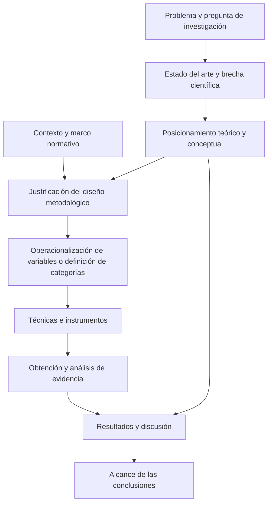

# Clase 5: Fundamentación teórica, diseño metodológico y análisis de resultados en la tesis doctoral

> **Objetivo académico:** Articular la fundamentación teórica y referencial, el diseño metodológico y la base empírica de una tesis doctoral en Ciencias de la Computación, de modo que cada conclusión pueda rastrearse hasta los datos, los instrumentos y las decisiones de diseño que la sustentan.

## 1. Contexto y marco conceptual

La sesión distinguió tres funciones de la tesis doctoral. Los **fundamentos teóricos referenciales** reconstruyen la evolución del problema, justifican las teorías y conceptos adoptados y delimitan las condiciones contextuales y normativas. El **diseño metodológico** fundamenta cómo se obtendrá y analizará la evidencia. El **capítulo de resultados** caracteriza el problema en la práctica y discute los hallazgos a la luz de la literatura. El perfil anticipa estas decisiones y declara los aportes esperados. La tesis desarrolla su justificación y establece cuáles de esos aportes están respaldados por la investigación.

| Componente | Función en la argumentación doctoral |
| --- | --- |
| Antecedentes | Identificar los aportes previos más relevantes y situar el problema en la introducción. |
| Estado del arte | Reconstruir la evolución de los aportes, comparar qué resuelven, en qué condiciones y con qué limitaciones, y delimitar una brecha científica. |
| Fundamentación teórico-conceptual | Justificar la perspectiva adoptada y precisar las definiciones que regirán la observación, la medición o la interpretación. Teorías y conceptos pueden desarrollarse conjuntamente cuando comparten el mismo hilo argumental. |
| Marco contextual | Delimitar el escenario efectivo de investigación y justificar la pertinencia de los actores, fuentes, métodos, modelos y componentes tecnológicos. La dimensión histórica explica cómo se configuró el problema y la actual describe las prácticas, tecnologías y condiciones vigentes. |
| Marco legal o normativo | Identificar las disposiciones que condicionan el estudio y sus decisiones tecnológicas, así como los vacíos regulatorios relevantes. Su alcance depende del contexto y puede incluir disposiciones internacionales, regionales y nacionales. |

La brecha debe desprenderse de la comparación de la literatura y corresponder al problema formulado. El cierre del capítulo teórico explicita cómo la sistematización fundamenta las decisiones posteriores. Las proposiciones propias requieren un desarrollo argumentado de las relaciones que introducen y del alcance en que se sostienen.

## 2. Fundamentos teóricos y arquitectura

En sentido amplio, el **método científico** abarca la organización del pensamiento científico mediante el paradigma, la perspectiva epistemológica, el enfoque, el diseño y el tipo de investigación. El paradigma establece supuestos sobre el conocimiento y su justificación. El enfoque define la ruta general de indagación. El diseño organiza la obtención, el análisis y, cuando corresponde, la integración de la evidencia. En sentido específico, los métodos teóricos y empíricos, con sus procedimientos, técnicas e instrumentos, concretan esa ruta. Una metodología de construcción de artefactos en Ciencias de la Computación opera en un nivel distinto del posicionamiento epistemológico y se justifica en relación con este.

La sesión asoció el positivismo con la ruta cuantitativa, la tradición interpretativa o hermenéutica con la cualitativa y presentó perspectivas críticas, constructivistas y sistémicas en relación con diseños mixtos. El docente señaló que las denominaciones y sus subdivisiones varían entre fuentes. **Enriquecimiento conceptual:** la coherencia epistemológica se evalúa por la correspondencia entre la pregunta, los supuestos sobre la evidencia y las inferencias que se pretende sostener. La asociación entre paradigmas y enfoques elaborada en la sesión ofrece una orientación para argumentar esas decisiones.

Por su finalidad, la investigación básica amplía el conocimiento y la aplicada atiende problemas del contexto. Una tesis que desarrolla un modelo y estudia su aplicación puede combinar ambas finalidades. Por el alcance del trabajo, la sesión distinguió la investigación diagnóstica o analítica, centrada en caracterizar un problema, de la investigación basada en diseño, que desarrolla y evalúa un artefacto. En la acepción propositiva presentada en clase, la validación se amplía para reunir evidencia de pertinencia o factibilidad, desempeño técnico y aplicación en contexto. Los objetivos específicos desglosan el objetivo general en resultados observables o valorables y explicitan qué se hará y con qué finalidad. De allí se deriva la distinción entre la sistematización o el aporte teórico, la evidencia práctica y la contribución materializada en un producto, modelo o servicio.

El flujo muestra dos dependencias. Los conceptos, el contexto y la normativa justifican cómo producir evidencia. La teoría vuelve a intervenir en la discusión, donde permite interpretar lo observado y precisar el alcance de las conclusiones.

## 3. Implementación técnica y lógica de negocio

**Diseño e instrumentación.** El capítulo metodológico justifica el paradigma, el enfoque, el diseño, el tipo de investigación, los métodos teóricos y empíricos, las técnicas, los instrumentos y las fuentes. Explicita la población, la unidad de análisis y el procedimiento de selección. Un censo comprende todas las unidades de una población delimitada. Un estudio sobre registros, imágenes o eventos puede definir su población en términos de esos objetos y sus condiciones de elegibilidad. Para un muestreo probabilístico se documentan el esquema de selección, los supuestos del cálculo del tamaño muestral y el procedimiento de selección. En diseños no probabilísticos se justifican los criterios de inclusión y exclusión, la lógica de selección y el alcance de las inferencias.

La **matriz de congruencia** vincula pregunta, objetivos y decisiones metodológicas. La **operacionalización** conecta la definición conceptual de cada variable con las dimensiones, indicadores, procedimientos de medición y datos observables. En la ruta cualitativa se trabaja con categorías de análisis que pueden refinarse al interpretar los datos. En la ruta mixta pueden coexistir variables y categorías. Si se contempla una hipótesis estadística, su formulación debe corresponder a la pregunta, los datos y el procedimiento inferencial. Una premisa teórica puede orientar la indagación interpretativa.

El **método** orienta el abordaje, la **técnica** establece cómo se obtiene o analiza la información y el **instrumento** materializa esa operación, por ejemplo, mediante una guía de observación, una matriz de extracción documental o un protocolo de registro experimental. La revisión de instrumentos existentes permite decidir si conviene adoptarlos, adaptarlos o construir otros. La sesión distinguió la revisión y el pilotaje de instrumentos cuantitativos del refinamiento iterativo de instrumentos cualitativos durante el trabajo de campo. En la tesis, la descripción metodológica, los instrumentos documentados y el procedimiento efectivamente aplicado deben permitir rastrear el origen de cada dato. **Enriquecimiento conceptual:** en aprendizaje automático, la validación cruzada se describe como un procedimiento de evaluación. El protocolo de partición y los registros de datos, configuraciones y métricas permiten reproducirlo.

| Ruta | Diseño y procedimiento de análisis |
| --- | --- |
| Cuantitativa | La sesión distinguió diseños experimentales, incluidos preexperimentos, cuasiexperimentos y experimentos, y diseños observacionales transversales o longitudinales, como los de tendencia, cohorte o panel. También presentó la denominación *diseño múltiple* para combinaciones de fases experimentales y observacionales. Tras preparar y depurar los datos, el análisis descriptivo caracteriza frecuencias, tendencia central, dispersión y distribuciones. El inferencial selecciona técnicas compatibles con el nivel de medición, la dependencia entre observaciones y los supuestos del diseño. Se discutieron correlación, regresión, pruebas de medias y proporciones, análisis de varianza y covarianza, chi cuadrado, Spearman, Kendall y métodos multivariados. |
| Cualitativa | Se consideran diseños narrativos, etnográficos, fenomenológicos, de teoría fundamentada, de investigación-acción y de estudio de caso. La ruta comprende preparar y familiarizarse con el corpus, codificar, construir categorías y temas, comparar segmentos, representar relaciones emergentes y triangular interpretaciones. NVivo y ATLAS.ti pueden apoyar la organización del corpus y la trazabilidad de la codificación. |
| Mixta | Los diseños concurrentes desarrollan las fases en paralelo y los secuenciales conectan una fase con la siguiente. En un diseño explicativo secuencial, los hallazgos cuantitativos orientan la indagación cualitativa. Cada fase conserva su diseño y sus criterios analíticos. La integración compara convergencias, aportes complementarios y discrepancias para producir metainferencias. La clasificación experimental u observacional se aplica a la fase cuantitativa correspondiente. |

**Medición de severidad foliar.** El caso de mildiu en quinua distinguió la incidencia, referida a las unidades enfermas, de la severidad, referida a la fracción de tejido afectado dentro de una unidad. Para una hoja, la definición expuesta se expresa como sigue.

$$
S = 100\,\frac{A_s}{A_e}
$$

$S$ es la severidad expresada como porcentaje entre $0$ y $100$. $A_s$ es el área sintomática dentro de la región evaluada y $A_e$ es el área foliar evaluable. Ambas áreas se miden en la misma unidad, con $A_e>0$ y $0\le A_s\le A_e$. Cuando se usan recuentos de píxeles de una misma imagen, el cociente representa la proporción de la proyección visible delimitada por las máscaras. La pérdida de tejido, la oclusión y las reglas de segmentación pueden afectar el denominador y, por tanto, la interpretación.

La captura estandarizada controla iluminación, fondo, cámara, distancia y orientación. La segmentación delimita la hoja y las regiones analizadas. Los descriptores de color, textura y morfología representan manifestaciones observables como clorosis, necrosis y distribución de lesiones. La arquitectura jerárquica aprovecha que las lesiones pequeñas y dispersas pueden dominar en fases tempranas, mientras que en severidades altas pueden aparecer coalescencia y pérdida de tejido evaluable. Un clasificador auxiliar asigna probabilidades a regiones de severidad y los regresores especializados producen estimaciones que se fusionan en una salida porcentual.

$$
\widehat S(x)=\sum_{k=1}^{K}p_k(x)\,r_k(x)
$$

$x$ es el vector de descriptores visuales calculados para una hoja, $K$ es el número de regiones auxiliares de la escala y $k$ identifica una de ellas. Para cada $x$, los pesos $p_k(x)$ son probabilidades adimensionales entre $0$ y $1$ que suman $1$. Cada $r_k(x)$ es el porcentaje estimado por el regresor especializado y $\widehat S(x)$ es el porcentaje predicho antes de calibrar. La fusión evita el cambio forzoso de regresor al cruzar un umbral de asignación. **Enriquecimiento conceptual:** como promedio ponderado, la estimación queda entre el menor y el mayor valor especializado. La suavidad de la salida depende del comportamiento de los pesos y de los regresores. Los intervalos auxiliares expuestos como 0–25, 26–75 y 76–100 requieren una regla explícita de asignación si la referencia admite valores fraccionarios. La cobertura de la escala y la justificación biológica de los cortes son cuestiones distintas.

La calibración isotónica ajusta una correspondencia monótona entre la predicción y la referencia experta sin imponer una relación lineal. Su ajuste requiere datos reservados y la evaluación final utiliza datos independientes. El corpus descrito contiene 772 imágenes adaxiales de un experimento de la Universidad de Copenhague. La evaluación planteada separa accesiones genéticas completas y evita compartir sesiones de captura entre entrenamiento y prueba. La validación externa incorpora hojas de campo bajo captura estandarizada en Altei y Kirusillas. La caja oscura busca reproducir condiciones de captura y la inferencia local permite operar sin conexión. La sesión describe el diseño y la validación prevista, con evidencia insuficiente para estimar el desempeño externo.

## 4. Análisis crítico de casos y auditoría práctica

| Caso | Decisión científica o arquitectónica | Alcance de la evidencia |
| --- | --- | --- |
| Propagación de incendios forestales | Comparar redes convolucionales, combinaciones con redes recurrentes, autómatas diferenciables y enfoques de aprendizaje automático informado por la física. El modelo de Rothermel se presentó como referente para discutir la influencia del viento y la pendiente. Los registros satelitales y meteorológicos se contextualizan según su procedencia y cobertura. | El rendimiento publicado depende de la geografía, la temporalidad, las métricas y el protocolo de evaluación. Si el trabajo empírico se desarrolla en la Chiquitania, ese es el escenario que debe fundamentarse, aunque el Pantanal de Santa Cruz motive la investigación. La revisión normativa considera tanto factores antrópicos asociados al problema como restricciones aplicables a los medios técnicos. |
| Centro de operaciones de seguridad con inteligencia de fuentes abiertas | Usar OSINT e inteligencia de amenazas para fortalecer las capacidades defensivas de instituciones estratégicas bolivianas. Se discutió una arquitectura distribuida con coordinación central, así como la madurez institucional, la calidad de la información y los riesgos de desinformación. | Los informes regionales mencionados contextualizan el problema. El diagnóstico institucional requiere evidencia de las capacidades y responsabilidades efectivas. La fundamentación debe explicar la pertinencia de AGETIC y de otros actores, y distinguir el alcance de la normativa de telecomunicaciones, los planes institucionales de seguridad de la información y los estándares ISO/IEC 27001 y 27002 mencionados. |
| Severidad continua de mildiu en quinua | Tratar la imagen como instrumento de medición y conservar la trazabilidad entre captura, máscara, síntomas, descriptores y predicción. Combinar error, asociación, concordancia, sesgo y límites de acuerdo para valorar el modelo frente a la referencia experta. | La valoración experta puede variar con la percepción, la experiencia y la distribución de los síntomas. Pearson mide asociación lineal y la concordancia de Lin evalúa acuerdo con la referencia. La evaluación externa delimita la transferencia a las condiciones observadas. Una relación entre descriptor y predicción admite una interpretación computacional, mientras que una atribución causal biológica exige evidencia adicional. |
| Soporte académico multiagente en posgrado | Integrar un sistema de gestión del aprendizaje con agentes especializados para interpretar consultas, recuperar documentos pertinentes mediante generación aumentada por recuperación, verificar su consistencia normativa y generar respuestas contextualizadas. Se identificaron problemas de fragmentación documental, actualización manual y baja trazabilidad. | Las brechas arquitectónica, metodológica y contextual se trataron como resultados de la revisión presentada. La evaluación longitudinal propuesta combina tiempo de respuesta, precisión, carga operativa y satisfacción. El modelo de aceptación tecnológica de Davis aporta los constructos de utilidad percibida y facilidad de uso percibida, que complementan la evaluación de la exactitud documental. La transferibilidad requeriría evidencia de implementación en el contexto institucional. |

**Enriquecimiento conceptual:** si los registros de incendios comparten una misma temporada, región o evento, dividir observaciones al azar puede trasladar dependencias del entrenamiento a la prueba. Bloquear la partición por evento, región o periodo vincula el protocolo con la forma de transferencia que se pretende medir. En el caso foliar, la separación por accesión y por sesión responde a un problema de dependencia análogo. La unidad de partición debe elegirse a partir de la afirmación de generalización que se quiere sostener.

## 5. Principios de diseño, buenas prácticas y anti-patrones

- Redactar cada epígrafe como una argumentación continua. La cronología del estado del arte cobra valor cuando explica cómo cambian las capacidades de los métodos, qué condiciones limitan sus resultados y cómo esas limitaciones fundamentan la brecha. Agrupar epígrafes cuando sus conceptos o argumentos dependen unos de otros.
- Distinguir la definición citada, la paráfrasis, la interpretación del investigador y la justificación de la postura adoptada. Verificar las paráfrasis y traducciones asistidas por inteligencia artificial con las fuentes originales. Una formulación fluida puede modificar el sentido de un concepto y alterar su relación con la operacionalización o con el diseño.
- Delimitar el contexto por sus consecuencias para el estudio. Seleccionar la información institucional, tecnológica y normativa que afecta las fuentes, el acceso, la aplicación de los métodos o la interpretación de resultados.
- Presentar cada tabla, figura, matriz o mapa, describir después qué relaciones o patrones muestra e interpretar su significado para la pregunta de investigación. En un estudio cualitativo, representar las relaciones entre categorías y vincularlas con la evidencia del corpus. En uno cuantitativo, interpretar cada resultado antes de sintetizar el conjunto por dimensiones, indicadores o instrumentos.
- Distinguir la calidad del instrumento, el desempeño del artefacto y la validez de las inferencias. La calibración, la concordancia con una referencia y la generalización externa responden a preguntas diferentes. Conservar la separación de datos y documentar cualquier cambio entre el diseño previsto y el procedimiento ejecutado.

## 6. Síntesis conceptual y profundización académica

La discusión contrasta el problema observado en la práctica con las teorías y hallazgos previos, plantea interpretaciones de las coincidencias y discrepancias y delimita qué conclusiones admite el diseño. En estudios mixtos, la interpretación de cada fase sustenta una integración posterior. Las metainferencias explicitan qué aporta cada conjunto de datos a la comprensión del problema y qué discrepancias permanecen abiertas.

**Enriquecimiento conceptual:** una evaluación doctoral de un artefacto puede organizar sus afirmaciones en torno a tres preguntas. La **validez de medición** indaga si los datos representan el fenómeno definido. La **validez de la evaluación** indaga si el protocolo y las métricas respaldan la comparación de desempeño. La **transferibilidad** indaga bajo qué cambios de población, región, procedimiento o institución sigue siendo defendible la conclusión. En la estimación foliar, estas preguntas remiten al área evaluable y a la referencia experta, a la partición y a las métricas de acuerdo, y a la validación en condiciones de campo, respectivamente.
