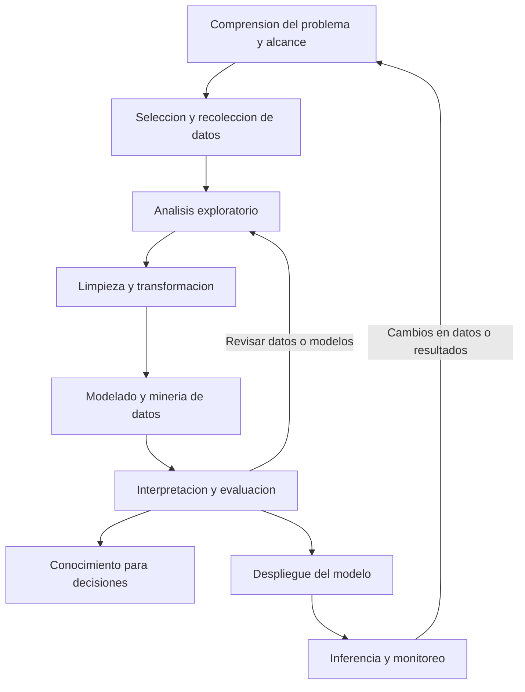

# Clase 2: Ciencia de datos: descubrimiento de conocimiento, aprendizaje automático y productos de datos

> **Objetivo académico:** Comprender la relación entre ciencia de datos, descubrimiento de conocimiento y aprendizaje automático; analizar el ciclo de desarrollo de modelos y distinguir sus productos, responsabilidades profesionales y condiciones de integración con sistemas de software.

## 1. Contexto y marco conceptual

### Ciencia de datos como articulación interdisciplinaria

La sesión presenta la ciencia de datos como la integración de tres ámbitos: ciencias de la computación, matemáticas y estadística, y conocimiento del negocio. Su finalidad es procesar datos, identificar relaciones relevantes y producir conocimiento útil para la toma de decisiones.

El conocimiento del negocio tiene carácter transversal. Comprender qué produce una organización, cómo presta sus servicios y cuáles son sus procesos permite formular preguntas pertinentes e interpretar resultados. Cambiar de sector exige aprender otro dominio: la competencia técnica no sustituye esa comprensión contextual.

La programación permite materializar el análisis, automatizar procedimientos e integrar resultados en otros sistemas. Se mencionan Python, R y Julia. Las herramientas visuales de tipo *no-code* facilitan operaciones recurrentes y la construcción rápida de soluciones, aunque sus límites funcionales, condiciones de licencia y posibilidades de personalización pueden restringir ciertos proyectos.

**Enriquecimiento conceptual:** La elección entre programación y herramientas visuales debe considerar la reproducibilidad, la integración con otros sistemas, el volumen de datos y el costo de mantenimiento. Una interfaz visual puede ser suficiente para un proceso estable; los requisitos de personalización pueden justificar incorporar código. Ambas alternativas pueden coexistir.

### Del dato al conocimiento y a la decisión

La minería de datos se introduce como un conjunto de técnicas para descubrir patrones, tendencias y reglas en conjuntos de datos. La metáfora minera destaca que el valor no reside simplemente en acumular registros, sino en identificar relaciones significativas.

La sesión diferencia implícitamente tres resultados: obtener patrones, interpretarlos como conocimiento y utilizarlos para decidir. Un algoritmo puede producir una clasificación o una estimación; determinar qué acción organizacional corresponde requiere contexto, objetivos y responsabilidad de quienes toman decisiones.

## 2. Fundamentos teóricos y arquitectura

### KDD: descubrimiento de conocimiento en bases de datos

KDD, *Knowledge Discovery in Databases*, organiza el descubrimiento de conocimiento en una secuencia metodológica. En la exposición se distinguen:

1. **Comprensión del problema:** reconocer el contexto y el objetivo del análisis.
2. **Selección:** identificar fuentes y registros pertinentes.
3. **Limpieza:** tratar problemas de calidad y descartar información inadecuada cuando exista una justificación.
4. **Transformación:** construir una representación compatible con el análisis.
5. **Minería de datos:** aplicar técnicas para identificar patrones y relaciones.
6. **Interpretación y evaluación:** establecer qué significan los resultados y si responden al problema.

La selección, la limpieza y la transformación se agrupan en la sesión bajo el término preprocesamiento. La minería de datos constituye una etapa de KDD, por lo que no debe confundirse con el proceso completo.

La exposición sitúa antecedentes de KDD a finales de la década de 1980 y menciona a Piatetsky-Shapiro. No se dispone de una referencia bibliográfica completa que permita establecer con precisión la prioridad histórica de los términos.

El diagrama integra el núcleo de descubrimiento de conocimiento con la extensión operativa discutida en clase: desplegar modelos, generar inferencias repetidas y monitorear su comportamiento. Las flechas de retorno expresan que el desarrollo es iterativo.

### Representaciones numéricas de los datos

La sesión distingue datos estructurados, como tablas empresariales, y datos no estructurados, como texto, imágenes, audio y video. Para numerosos métodos de aprendizaje es necesario construir representaciones numéricas adecuadas.

**Enriquecimiento conceptual:** Que un archivo esté almacenado digitalmente no significa que su representación sea directamente apropiada para un modelo. El almacenamiento codifica información; el preprocesamiento debe además preservar los aspectos relevantes para la tarea. Tampoco basta con que todas las columnas sean numéricas para considerar concluida la preparación: pueden persistir valores ausentes, errores, escalas incompatibles o relaciones incorrectamente representadas.

| Representación | Organización | Aplicación conceptual |
| --- | --- | --- |
| Vector | Un eje de valores | Características de una observación |
| Matriz | Dos ejes | Registros por variables o una imagen en escala de grises |
| Tensor de mayor orden | Tres o más ejes | Imágenes con canales, conjuntos de imágenes o secuencias de video |

**Enriquecimiento conceptual:** En computación numérica, vector y matriz pueden entenderse como tensores de orden uno y dos. El número de ejes no debe confundirse con la cantidad de componentes de un vector. Una imagen RGB puede representarse mediante un tensor de forma $H \times W \times 3$, donde $H$ y $W$ son enteros positivos que indican su altura y anchura en píxeles, y el tercer eje contiene los canales rojo, verde y azul. Este ejemplo supone una imagen RGB; no describe todos los formatos de imagen.

### Inteligencia artificial, aprendizaje automático y aprendizaje profundo

La inteligencia artificial se presenta como un campo amplio orientado a desarrollar capacidades computacionales de resolución de problemas, planificación y aprendizaje. La sesión menciona sistemas expertos, lógica difusa y metaheurísticas, además del aprendizaje automático.

El aprendizaje profundo se ubica dentro del aprendizaje automático y se relaciona con redes neuronales de múltiples capas. Su expansión se vincula con la disponibilidad de datos, capacidad de cómputo y avances metodológicos, especialmente para datos no estructurados. También se menciona la inteligencia artificial generativa como un ámbito de aplicaciones capaces de producir contenido, incluido texto, imágenes y video.

**Enriquecimiento conceptual:** La descripción de aprendizaje a partir de datos y respuestas corresponde al aprendizaje supervisado. El aprendizaje automático también incluye métodos no supervisados y otros paradigmas. Asimismo, aumentar la profundidad de una red no garantiza mejorar sus resultados: intervienen los datos, la optimización, la regularización y la adecuación de la arquitectura al problema.

### Programación explícita y aprendizaje supervisado

La comparación central de la sesión contrapone dos formas de construir comportamiento computacional:

| Aspecto | Programación con reglas explícitas | Aprendizaje supervisado |
| --- | --- | --- |
| Información disponible | Datos y reglas especificadas | Ejemplos de entrada y respuestas de referencia |
| Construcción del comportamiento | Implementación directa de las reglas | Ajuste de parámetros mediante entrenamiento |
| Resultado de la construcción | Programa que aplica reglas | Modelo entrenado que produce predicciones |
| Uso posterior | Aplicar el programa a entradas | Realizar inferencia con el modelo |

La palabra «reglas» se utiliza en clase para explicar los parámetros aprendidos. En una relación sencilla puede tratarse de un único coeficiente; en una red neuronal puede tratarse de numerosos valores que actúan conjuntamente.

**Enriquecimiento conceptual:** Los parámetros numéricos de una red no equivalen necesariamente a reglas simbólicas legibles. Además, conviene distinguir el algoritmo de entrenamiento, que ajusta parámetros, del modelo entrenado, que utiliza esos parámetros para producir resultados.

## 3. Implementación técnica y lógica de negocio

### Flujo de desarrollo de un modelo

La sesión describe siete actividades principales: comprender el problema, recolectar y seleccionar datos, explorar su contenido, limpiar y transformar, implementar modelos, evaluar resultados y desplegar con monitoreo.

El procedimiento es experimental. Se pueden comparar varios modelos disponibles en bibliotecas y modificar las decisiones de preparación de datos o configuración. Si los resultados son insuficientes, es necesario revisar las hipótesis iniciales, las etiquetas, las fuentes o la complejidad del modelo. Completar una secuencia de pasos no garantiza haber resuelto el problema.

Se distingue entre **parámetros**, ajustados durante el entrenamiento, e **hiperparámetros**, utilizados para configurar el modelo o su proceso de aprendizaje. La multiplicación de experimentos exige registrar configuraciones y resultados para identificar qué cambios produjeron una mejora.

No se desarrolla en la fuente una implementación completa ni se proporcionan fragmentos de código recuperables. La demostración del entorno de programación es introductoria y no permite reconstruir un experimento ejecutado.

### Preprocesamiento por modalidad

| Modalidad | Operaciones mencionadas | Criterio de aplicación |
| --- | --- | --- |
| Imágenes | Revisar ruido y anomalías, reescalar intensidades, rotar y cambiar tamaño | Preservar información relevante para la tarea |
| Texto | Revisar repeticiones y palabras frecuentes | Evitar eliminar contenido que aporte significado |
| Tablas | Limpiar registros y transformar categorías | Mantener la semántica de las variables |
| Audio y video | Preparación específica según modalidad | La sesión no desarrolla procedimientos detallados |

En imágenes RGB con ocho bits por canal, los valores de intensidad pertenecen al conjunto $\{0,1,\ldots,255\}$. La sesión propone dividir entre 255 para llevarlos al intervalo de cero a uno.

**Enriquecimiento conceptual:** Para una intensidad $p \in \{0,1,\ldots,255\}$, la transformación es:

$$
p' = \frac{p}{255}
$$

Aquí $p'$ es una intensidad reescalada y adimensional en $[0,1]$. Por ejemplo, $p=102$ produce $p'=0.4$. La expresión supone datos de ocho bits y debe aplicarse coherentemente en entrenamiento e inferencia. Este reescalado cambia la escala numérica; por sí solo no corrige diferencias de iluminación entre fotografías.

**Enriquecimiento conceptual:** Una imagen negra o blanca no es necesariamente un error: puede ser una observación válida. Rotaciones y cambios de tamaño tampoco son universalmente inocuos; deben preservar la etiqueta y los rasgos de interés. En texto, retirar palabras frecuentes depende de la tarea: eliminar una negación puede invertir el significado. No debe generalizarse una operación de limpieza sin analizar su efecto semántico.

### Ejemplo trabajado: conversión monetaria

La sesión utiliza la conversión entre bolivianos y dólares para explicar la diferencia entre conocer una regla y estimarla a partir de ejemplos. Los valores monetarios mencionados son ilustrativos y no constituyen una cotización verificada.

**Enriquecimiento conceptual:** Sea $b \geq 0$ un importe en bolivianos y sea $r>0$ el tipo de cambio expresado en bolivianos por dólar. Si se supone una conversión proporcional, sin comisiones y con tasa constante, el importe $d \geq 0$ en dólares se calcula mediante:

$$
d = \frac{b}{r} = kb, \qquad k = \frac{1}{r}
$$

El coeficiente $k$ tiene unidades de dólares por boliviano. Conocer $r$ permite programar directamente la conversión. Si solo se dispone de pares observados $(b_i,d_i)$, puede estimarse $k$ mediante una regresión proporcional. Para $n$ observaciones, donde $n$ es un entero positivo e $i \in \{1,\ldots,n\}$, el ajuste por mínimos cuadrados plantea:

$$
\hat{k} = \underset{k \geq 0}{\operatorname{argmin}} \sum_{i=1}^{n}(d_i-kb_i)^2
$$

Derivar el objetivo respecto de $k$ e igualar a cero produce:

$$
-2\sum_{i=1}^{n}b_i(d_i-kb_i)=0
\quad\Longrightarrow\quad
\hat{k}=\frac{\sum_{i=1}^{n}b_i d_i}{\sum_{i=1}^{n}b_i^2}
$$

La solución requiere que al menos un $b_i$ sea distinto de cero. Con importes no negativos, el cociente satisface la restricción de no negatividad. El ejemplo formaliza la idea de aprender una relación; no implica que sea necesario usar aprendizaje automático cuando la tasa ya es conocida. Si existen comisiones, cambios temporales o tasas diferentes, el supuesto proporcional puede resultar inadecuado.

### Integración y entornos de ejecución

La sesión presenta Python, R y Julia como entornos con bibliotecas para preparación y modelado. También plantea que un modelo puede integrarse con aplicaciones desarrolladas en otros lenguajes mediante servicios y APIs REST. Se menciona la invocación de procesos externos como una posibilidad de integración, sin desarrollar su implementación.

Se distinguen entornos locales y cuadernos alojados, como Google Colab. En un cuaderno remoto, las celdas ejecutan código utilizando recursos asignados por el proveedor. También se mencionan Visual Studio Code, Spyder y Anaconda como herramientas relacionadas con el trabajo local.

**Enriquecimiento conceptual:** Estas herramientas cumplen funciones diferentes: un editor o entorno de desarrollo permite escribir y depurar código; una distribución facilita gestionar componentes; un cuaderno combina código, resultados y texto. La portabilidad requiere controlar versiones y dependencias, con independencia de la interfaz elegida.

## 4. Análisis crítico de casos y auditoría práctica

### Clasificación de imágenes y detección de incendios

El caso de gatos y perros ilustra el aprendizaje de categorías a partir de imágenes etiquetadas. Su extensión a imágenes con fuego y sin fuego permite analizar un producto con finalidad operativa: recibir imágenes nuevas y generar una clasificación que pueda integrarse en un sistema de vigilancia.

El trabajo comprende recolectar ejemplos, preparar representaciones, revisar etiquetas, entrenar, evaluar y desplegar. La calidad del modelo depende de toda esa cadena. La sesión destaca que la preparación de datos puede consumir una proporción elevada del esfuerzo y menciona una estimación orientativa del 60–70 %, sin presentar una medición específica.

**Enriquecimiento conceptual:** Clasificar una imagen como «con fuego» no equivale a resolver por completo la detección de incendios en video. Un sistema operativo debe considerar secuencias temporales, latencia, falsas alarmas, condiciones de captura y mecanismos de respuesta. Los falsos negativos y falsos positivos tienen consecuencias diferentes; una métrica agregada puede ocultar errores relevantes.

### Entrenamiento, evaluación e inferencia

Durante el entrenamiento se ajustan parámetros con ejemplos y respuestas de referencia. Durante la evaluación se estudia el comportamiento ante otros datos mediante métricas. En inferencia se utiliza el modelo entrenado para producir resultados sobre entradas nuevas.

La pregunta sobre cuándo desplegar un modelo se responde en función de la tarea y sus métricas. La clasificación produce categorías; la regresión estima valores numéricos. No existe un umbral universal que determine que cualquier modelo está listo para producción.

**Enriquecimiento conceptual:** La evaluación supervisada requiere respuestas de referencia también para los datos de evaluación. Debe evitarse que información reservada para esa evaluación influya en el entrenamiento. Si se comparan repetidamente modelos sobre el mismo conjunto de prueba, sus resultados pueden dejar de representar una estimación independiente. Además del rendimiento predictivo, la decisión de despliegue debe considerar confiabilidad, recursos y consecuencias de los errores.

### Cantidad de datos y ejemplo sanitario

La discusión sobre identificación de sarampión contrasta datos tabulares de pacientes con imágenes. Su propósito es mostrar que la representación, la dificultad de la tarea y el modelo influyen en la necesidad de datos; no se presenta un sistema diagnóstico validado.

Se menciona como orientación empírica una cantidad de 5000 imágenes por categoría, atribuida oralmente al libro *Deep Learning*. La propia discusión reconoce excepciones y señala que una tarea sencilla, como distinguir día y noche, podría requerir menos información. No se demuestra un mínimo universal ni se valida esa atribución bibliográfica en el material disponible.

**Enriquecimiento conceptual:** El tamaño necesario depende de la diversidad de la población, la calidad de las etiquetas, el equilibrio entre categorías, el error tolerable, la capacidad del modelo y el uso de conocimiento previo. Los datos tabulares no garantizan requerir pocas observaciones, ni las imágenes obligan siempre a usar aprendizaje profundo.

**Enriquecimiento conceptual:** Las curvas de aprendizaje permiten analizar cómo varía el rendimiento de validación al aumentar los datos de entrenamiento. Aportan evidencia para decidir si conviene recolectar más datos o revisar otras limitaciones, aunque no garantizan un mínimo exacto. En aplicaciones sanitarias también deben analizarse representatividad, separación por paciente y pertinencia de las referencias clínicas; estos requisitos no pueden sustituirse por un conteo de imágenes.

### Big data y procesamiento distribuido

Big data se introduce mediante una relación entre la demanda del problema y los recursos disponibles. El ejemplo compara una computadora con un terabyte de almacenamiento y un conjunto de veinte terabytes: la infraestructura local resulta insuficiente para alojarlo íntegramente.

La respuesta conceptual es distribuir almacenamiento o procesamiento entre computadoras de un clúster. Un mecanismo de coordinación reparte trabajo, los nodos procesan particiones y los resultados se combinan cuando la operación lo requiere. La discusión también señala dificultades de instalación y configuración de infraestructura distribuida.

| Tecnología mencionada | Función conceptual |
| --- | --- |
| Hadoop y HDFS | Ecosistema de procesamiento y almacenamiento distribuido; HDFS cumple la función de sistema de archivos |
| Apache Spark | Procesamiento distribuido, incluido procesamiento de flujos según la configuración |
| Hive y Pig | Herramientas del ecosistema Hadoop para expresar consultas o transformaciones |
| Apache Kafka | Plataforma de eventos utilizada para publicar y consumir flujos de mensajes |

**Enriquecimiento conceptual:** Esta distinción evita tratar todas las tecnologías como sustitutos equivalentes. Kafka no cumple la misma función que un motor de análisis. El tamaño en disco tampoco determina por sí solo la arquitectura: importan memoria, velocidad de llegada, complejidad de las operaciones y latencia requerida. El procesamiento distribuido introduce comunicación y coordinación, por lo que no garantiza una mejora para cualquier volumen.

## 5. Principios de diseño, buenas prácticas y anti-patrones

### Definir el alcance antes de seleccionar herramientas

El *scoping*, o definición del alcance, establece el problema, los objetivos, las partes interesadas, los datos disponibles y las limitaciones de tiempo y recursos. La sesión cuestiona iniciar un proyecto con una instrucción vaga como «analizar estos datos» sin precisar qué se busca resolver.

**Enriquecimiento conceptual:** Una formulación útil conecta una necesidad organizacional con una salida técnica y una decisión: qué problema existe, qué resultado debe producir el sistema y cómo se utilizará. La arquitectura debe responder a esas condiciones; seleccionar tecnologías antes de aclararlas puede introducir complejidad innecesaria.

### Productos de datos y productos de software

Los productos de software mencionados incluyen aplicaciones móviles y de escritorio, sitios web, APIs, sistemas embebidos y aplicaciones para dispositivos conectados. Los modelos pueden integrarse en ellos para aportar predicción, clasificación o recomendación.

Los productos de datos se organizan en seis categorías expuestas en la sesión:

| Producto | Aporte principal |
| --- | --- |
| Reportes e informes | Comunicar información sintetizada y hallazgos |
| Visualizaciones y dashboards | Mostrar patrones e indicadores mediante representaciones visuales |
| Procesos ETL | Automatizar extracción, transformación y carga |
| Análisis para decisiones | Relacionar evidencia con opciones de acción |
| Modelos | Generar estimaciones o clasificaciones sobre datos nuevos |
| Narrativa de datos | Explicar el recorrido desde el problema y los datos hasta los hallazgos y recomendaciones |

La inteligencia de negocios se relaciona con indicadores, análisis organizacional y tableros de control. Se mencionan Tableau y Power BI como herramientas para construir visualizaciones mediante interfaces. El ejemplo de evolución de COVID en el Reino Unido ilustra un dashboard; no se aportan datos ni resultados suficientes para reproducir su análisis.

**Enriquecimiento conceptual:** La inteligencia de negocios puede producir valor mediante integración, agregación y visualización sin incorporar minería de datos. Asimismo, un producto de datos suele materializarse mediante software: las categorías describen énfasis y no conjuntos mutuamente excluyentes. Aumentar la frecuencia de actualización o agregar un modelo solo aporta valor si mejora una necesidad concreta.

### ETL y ELT

ETL significa extracción, transformación y carga: obtener datos de fuentes, aplicar las transformaciones pertinentes y depositarlos en un destino para su uso posterior. La sesión menciona ELT como variante y reconoce que la elección depende del caso, sin desarrollar criterios detallados.

**Enriquecimiento conceptual:** En ELT, la carga precede a la transformación, que se ejecuta utilizando capacidades del destino. La elección depende de su potencia de procesamiento, gobernanza, volumen y necesidades de conservación de datos originales. Transformar no implica necesariamente convertir todo a números: puede incluir validaciones, integración, agregaciones o estandarización de fechas.

### Responsabilidades profesionales

| Rol | Énfasis descrito |
| --- | --- |
| Analista de datos | Reportes, visualizaciones, dashboards y análisis para decisiones |
| Científico de datos | Formulación del problema, experimentación y desarrollo de productos de datos, especialmente modelos |
| Ingeniero de datos | Integración, transformación y disponibilidad de datos mediante procesos automatizados |
| Ingeniero de aprendizaje automático | Implementación y operación de soluciones basadas en modelos |
| Arquitecto de datos | Organización de infraestructura, almacenamiento, procesamiento e integración |

También se mencionan especializaciones en visión artificial, procesamiento de lenguaje natural, ingeniería de prompts e inteligencia artificial generativa. Los nombres de los cargos y sus responsabilidades varían entre organizaciones; una descripción puede agrupar varias funciones.

### Buenas prácticas y anti-patrones

- **Relacionar métricas con objetivos:** una mejora numérica debe interpretarse según su utilidad y sus costos operativos.
- **Registrar experimentos:** conservar datos utilizados, configuración y resultados permite comparar decisiones y sostener conclusiones.
- **Revisar etiquetas y calidad:** incrementar el volumen no compensa automáticamente errores sistemáticos.
- **Monitorear después del despliegue:** cambios en los datos o el entorno pueden alterar el comportamiento del modelo.
- **Controlar tiempo y costo:** iterar indefinidamente no es una estrategia viable; las mejoras deben ponderarse frente a los recursos necesarios.
- **Comprender el código asistido por IA:** estas herramientas pueden apoyar explicaciones y análisis, pero sus salidas requieren revisión. Delegar sin comprensión reduce la capacidad de diagnosticar errores y adaptar soluciones.

Los anti-patrones discutidos incluyen modelar antes de entender el negocio, asumir que datos numéricos ya están preparados, tomar cifras orientativas como garantías universales y tratar una buena métrica aislada como evidencia suficiente para desplegar.

## 6. Síntesis conceptual y profundización académica

La clase conecta el descubrimiento de conocimiento con la construcción de productos utilizables. KDD ofrece una estructura para seleccionar, preparar, analizar e interpretar datos; el ciclo contemporáneo de modelos incorpora además despliegue y monitoreo. El proceso requiere retornos entre etapas y combina experimentación con restricciones organizacionales.

El aprendizaje supervisado se comprende mediante la diferencia entre programar una regla conocida y estimar parámetros desde ejemplos. El entrenamiento construye el comportamiento del modelo; la evaluación aporta evidencia sobre su desempeño; la inferencia utiliza ese comportamiento para generar resultados. Estas etapas no deben confundirse.

La elección de representaciones, modelos y arquitecturas depende del problema. Ni el carácter no estructurado de los datos, ni una determinada cantidad de observaciones, ni la mayor complejidad de una red establecen por sí solos la calidad de una solución. La interpretación de métricas exige considerar los datos y las consecuencias de los errores.

Los resultados de la ciencia de datos abarcan informes, visualizaciones, procesos de integración, análisis, modelos y narrativas. Su valor se concreta cuando permiten comprender mejor un fenómeno, mejorar un proceso o sostener decisiones. La ingeniería de software aporta los medios para integrar esos resultados en sistemas mantenibles y operativos.

**Enriquecimiento conceptual:** Como líneas de profundización, resultan pertinentes la generalización y la fuga de información, la trazabilidad de experimentos, la variación de distribuciones en producción y la relación entre desempeño predictivo e impacto organizacional. Estas conexiones amplían el marco de la sesión sin suponer que se hayan desarrollado implementaciones o validaciones empíricas.
