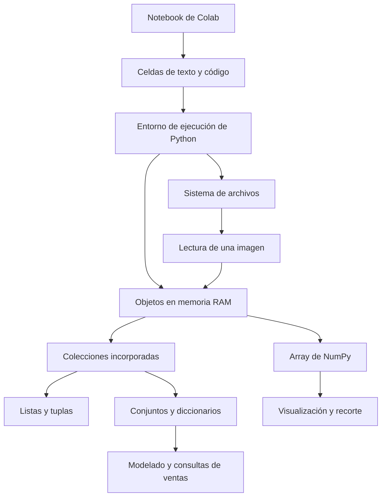

# Clase 4: Google Colab y estructuras de datos en Python: memoria, imágenes y consultas de ventas

> **Objetivo académico:** Comprender el entorno de ejecución de Google Colab y seleccionar estructuras de datos de Python según su mutabilidad, organización y operaciones, aplicándolas a la representación de imágenes y al análisis básico de ventas mediante funciones, iteraciones y diccionarios anidados.

## 1. Contexto y marco conceptual

La sesión articula dos niveles de trabajo: el entorno donde se ejecuta el programa y las estructuras con las que se representa la información. Esta relación es fundamental en ciencia de datos: disponer de un archivo no equivale a haber cargado sus datos en memoria, y representar una colección no garantiza que su estructura sea adecuada para las consultas posteriores.

### Notebook, script y entorno de ejecución

Un notebook de Python, cuya extensión correcta es `.ipynb`, combina celdas de texto, código y resultados. Permite desarrollar un análisis por etapas, documentar decisiones y observar salidas intermedias. Un script `.py` contiene código ejecutable como archivo de Python. Ambos pueden utilizar el mismo lenguaje, pero difieren en la organización y conservación del contexto de trabajo.

| Elemento | Función principal | Consideración relevante |
|---|---|---|
| Notebook `.ipynb` | Integrar explicación, código y resultados | Las salidas guardadas pueden corresponder a una ejecución anterior |
| Script `.py` | Almacenar código para su ejecución | La exportación no conserva necesariamente las visualizaciones y salidas del notebook |
| Entorno de ejecución | Proporcionar proceso de Python, memoria y recursos | Su estado puede perderse al reiniciarlo o reemplazarlo |
| Sistema de archivos | Almacenar imágenes, conjuntos de datos y otros archivos | Un archivo debe leerse para convertirse en una estructura utilizable por Python |

Colab proporciona un entorno remoto basado en Linux. En la demostración, el directorio inicial es `/content`; aparecen también directorios característicos como `/bin`, `/boot`, `/dev`, `/etc` y `/home`.

**Enriquecimiento conceptual:** El documento y la sesión de ejecución son entidades distintas. Compartir el notebook permite compartir su contenido y las salidas que contenga, pero no transfiere automáticamente la memoria del proceso, los archivos temporales ni el montaje autenticado de Google Drive. Esta distinción explica por qué un notebook puede abrirse correctamente y, aun así, necesitar que se vuelvan a cargar los datos o ejecutar sus celdas.

### De variables aisladas a colecciones

El análisis de datos requiere manejar múltiples observaciones, productos o imágenes. Crear una variable independiente por elemento dificulta la iteración y la agregación. Las estructuras de datos permiten organizar colecciones y expresar operaciones comunes sobre ellas.

La clase presenta cuatro estructuras incorporadas en Python: listas, tuplas, conjuntos y diccionarios. También introduce `numpy.ndarray` mediante la lectura de una imagen, diferenciándolo de las colecciones incorporadas.



## 2. Fundamentos teóricos y arquitectura

### Objetos, tipos, atributos y métodos

La función `type(objeto)` permite identificar el tipo de un objeto. Una lista pertenece a `list`; un diccionario, a `dict`; la imagen leída con OpenCV se representa normalmente mediante un `numpy.ndarray`.

Los tipos determinan qué operaciones están disponibles. Un atributo expone información, como `imagen.shape`; un método se invoca para realizar una operación, como `lista.append(elemento)`.

**Enriquecimiento conceptual:** En Python, los nombres se vinculan a objetos. Por tanto, es más preciso decir que una variable referencia un objeto de cierto tipo que identificar la variable con una región fija de memoria. Esta distinción ayuda a comprender por qué dos nombres pueden referirse a una misma lista mutable.

### Propiedades de las colecciones

| Estructura | Construcción habitual | Mutabilidad | Organización y acceso | Aplicación destacada |
|---|---|---|---|---|
| `list` | `[a, b, c]` | Mutable | Secuencia ordenada; acceso por posición | Colecciones que pueden crecer o modificarse |
| `tuple` | `(a, b, c)` | Inmutable en sus posiciones | Secuencia ordenada; acceso por posición | Agrupaciones estructurales y dimensiones |
| `set` | `{a, b, c}` | Mutable | Elementos únicos; sin índices posicionales | Pertenencia, unión e intersección |
| `dict` | `{"clave": valor}` | Mutable | Asociación entre claves únicas y valores | Registros y acceso mediante identificadores |

Las listas admiten objetos de diferentes tipos y otras colecciones como elementos. Sin embargo, cuando una operación presupone valores comparables o numéricos, la homogeneidad simplifica el razonamiento y reduce errores.

Las tuplas permiten indexación y slicing, pero no operaciones como `append`, `extend` o `remove`. La decisión entre lista y tupla depende de si se necesita modificar la secuencia y del significado que se desea comunicar.

**Enriquecimiento conceptual:** La inmutabilidad de una tupla no implica inmutabilidad profunda. Si contiene una lista, esa lista puede cambiar, aunque la tupla siga referenciando el mismo objeto. Además, los paréntesis no bastan para construir una tupla de un elemento: se necesita la coma, como en `(3,)`.

Los conjuntos eliminan duplicados y permiten operaciones de teoría de conjuntos. No ofrecen un orden posicional que pueda consultarse mediante índices.

**Enriquecimiento conceptual:** La restricción de los conjuntos no consiste simplemente en prohibir listas y diccionarios: sus elementos deben ser hashables, es decir, compatibles con un cálculo de hash estable y con la comparación de igualdad. Las listas y los diccionarios incorporados no cumplen ese requisito. Las claves de un diccionario también deben ser hashables; sus valores pueden ser objetos arbitrarios.

En un diccionario, asignar a una clave nueva agrega una asociación; asignar a una clave existente sustituye su valor. La unicidad de las claves no exige que los valores sean únicos.

**Enriquecimiento conceptual:** Los diccionarios de Python moderno conservan el orden de inserción. Esto no convierte sus claves en índices de posición: el acceso sigue basándose en la clave.

### Indexación y slicing

La indexación de secuencias comienza en cero. Para una lista con cinco elementos, las posiciones válidas son de `0` a `4`. Los índices negativos permiten acceder desde el final: `-1` designa el último elemento y `-2`, el penúltimo.

La expresión general de slicing es `secuencia[inicio:fin:paso]`. El límite `fin` es exclusivo. Para un paso positivo, se seleccionan posiciones desde `inicio` mientras sean menores que `fin`, avanzando según `paso`.

```python
valores = [1, 2.5, "texto", [4, 6], 9]

primero = valores[0]       # 1
anidado = valores[3][1]    # 6
ultimo = valores[-1]      # 9
porcion = valores[1:3]    # [2.5, "texto"]
saltos = valores[1:6:2]   # [2.5, [4, 6]]
```

**Enriquecimiento conceptual:** Este ejemplo reconstruye las operaciones descritas. El slicing ajusta sus límites a la longitud disponible, de modo que un límite superior excesivo no produce por sí mismo un error. En cambio, acceder directamente a una posición inexistente produce `IndexError`. Describir el límite exclusivo como «hasta el límite menos uno» solo resulta adecuado para ciertos recorridos con paso positivo; la regla general es excluir el extremo final. Un paso igual a cero no es válido.

## 3. Implementación técnica y lógica de negocio

### Directorio de trabajo y comandos en Colab

Los comandos utilizados incluyen `pwd`, para consultar el directorio actual; `ls`, para listar archivos; `mkdir`, para crear directorios; `cd`, para cambiar de directorio, y `mv`, para mover o renombrar archivos.

La demostración compara la ejecución de comandos mediante `!` con el uso de `%cd`:

```python
!pwd
!mkdir -p /content/hola
!cd /content/hola
!pwd

%cd /content/hola
%pwd
!mkdir -p hola_dos
```

**Enriquecimiento conceptual:** El bloque reconstruye el comportamiento mostrado. Los comandos con `!` se ejecutan mediante un shell separado. Por ello, el cambio de directorio de `!cd` no modifica el directorio del proceso de Python para ejecuciones posteriores. `%cd` es una instrucción especial de IPython que sí cambia ese directorio de trabajo. La diferencia no debe generalizarse como «`!` solo afecta una celda y `%` afecta todo el notebook»: crear un archivo con `!mkdir` modifica el sistema de archivos y ese cambio permanece después de terminar el comando.

El entorno permite instalar paquetes mediante `pip`. **Enriquecimiento conceptual:** En notebooks, `%pip install nombre_del_paquete` ayuda a dirigir la instalación al entorno de Python activo. La instalación y los archivos locales deben distinguirse de los recursos persistentes del documento.

### Archivos, RAM y lectura de imágenes

La sesión muestra la carga de una imagen desde el equipo local al sistema de archivos de Colab. Después, OpenCV la lee y genera un objeto en memoria; Matplotlib permite visualizarlo.

**Enriquecimiento conceptual:** Reconstrucción del flujo técnico, con comprobación de lectura añadida:

```python
import cv2
import matplotlib.pyplot as plt

imagen_bgr = cv2.imread("/content/london.jpg")
if imagen_bgr is None:
    raise FileNotFoundError("No se pudo leer la imagen indicada")

imagen_rgb = cv2.cvtColor(imagen_bgr, cv2.COLOR_BGR2RGB)

print(type(imagen_rgb))
print(imagen_rgb.shape)
plt.imshow(imagen_rgb)
plt.show()
```

OpenCV utiliza convencionalmente BGR para imágenes de color leídas de esta manera; Matplotlib interpreta una imagen de tres canales en orden RGB. La conversión reordena los canales para evitar una visualización cromática incorrecta. No es necesario explicar esta diferencia como una sustitución histórica universal de BGR por RGB: se trata de convenciones entre herramientas.

La forma observada en la sesión es `(1053, 2000, 3)`: 1053 filas, 2000 columnas y tres canales. Para una imagen de esas dimensiones, los índices de fila van de `0` a `1052`, y los de columna, de `0` a `1999`.

**Enriquecimiento conceptual:** Para una imagen RGB de ocho bits por canal puede utilizarse la representación:

$$
I \in \{0,1,\ldots,255\}^{H\times W\times 3}.
$$

Aquí, $I$ es el array de intensidades; $H$ y $W$ son enteros positivos que indican altura y anchura en píxeles. La última dimensión corresponde a rojo, verde y azul. Esta expresión supone una imagen RGB de ocho bits: no describe todos los formatos posibles, como imágenes en escala de grises, con transparencia o de mayor profundidad numérica.

```python
pixel = imagen_rgb[0, 0]
recorte = imagen_rgb[400:800, 400:800, :]

plt.imshow(recorte)
plt.show()
```

El primer acceso devuelve los tres valores de un píxel. El segundo selecciona filas y columnas de `400` a `799`, conservando todos los canales. Para la imagen descrita, el recorte tiene forma `(400, 400, 3)`. Mostrarlo con mayor tamaño en pantalla no agrega detalle a sus datos.

**Enriquecimiento conceptual:** La coma separa ejes de indexación de NumPy; no representa un diccionario. Además, `shape` devuelve una tupla, pero eso no significa que la forma del array sea invariable durante toda la ejecución: pueden obtenerse arrays con otras formas mediante recortes, transformaciones o reasignaciones.

### Organización y servicios auxiliares

Las celdas Markdown permiten crear encabezados con `#` y `##`, que alimentan la tabla de contenidos. Esta estructura facilita navegar entre carga de datos, procesamiento y resultados. El panel de variables permite inspeccionar tipos, formas y valores; buscar y reemplazar ayuda a mantener el código.

La sección de secretos permite recuperar credenciales por nombre sin escribirlas directamente en el notebook. **Enriquecimiento conceptual:** La disponibilidad de un secreto depende de la configuración de acceso; no debe suponerse que todos los notebooks pueden leerlo automáticamente. Tampoco debe imprimirse su contenido en salidas compartidas.

El montaje de Google Drive incorpora una ruta de acceso a archivos persistentes dentro del entorno. Debe distinguirse copiar de mover: `cp` crea una copia y `mv` cambia la ubicación o el nombre. Mover un archivo desde Drive hacia `/content` puede retirarlo de su ubicación persistente original.

### Métodos de listas y diccionarios

| Operación | Semántica |
|---|---|
| `lista.append(x)` | Agrega `x` como un único elemento |
| `lista.extend(iterable)` | Agrega los elementos del iterable |
| `lista.remove(x)` | Elimina la primera aparición de `x` |
| `lista.index(x)` | Obtiene la posición de la primera aparición de `x` |
| `lista.count(x)` | Cuenta las apariciones de `x` |
| `lista.reverse()` | Invierte el orden actual |
| `lista.insert(i, x)` | Inserta `x` en la posición indicada |
| `lista.sort()` | Ordena la lista mediante comparaciones compatibles |
| `diccionario.items()` | Permite recorrer pares de clave y valor |
| `diccionario.keys()` | Permite recorrer claves |
| `diccionario.values()` | Permite recorrer valores |
| `diccionario.get(clave)` | Recupera un valor sin exigir acceso directo con corchetes |

**Enriquecimiento conceptual:** `reverse()` invierte la secuencia, pero no la ordena por magnitud. `remove(x)` busca un valor; para retirar por posición puede utilizarse `pop(i)`. En Python 3, la comprobación de pertenencia de una clave se escribe `clave in diccionario`; `has_key` no está disponible.

### Control de flujo, funciones y formato de cadenas

Un `for` recorre un iterable; un `while` repite su cuerpo mientras su condición sea verdadera. La indentación define qué instrucciones pertenecen a cada bloque introducido por dos puntos. Un `break` termina el bucle que lo contiene. `pass` es una instrucción vacía útil mientras una rama todavía no tiene implementación.

**Enriquecimiento conceptual:** La indentación es parte de la sintaxis de Python. La convención habitual es utilizar cuatro espacios por nivel y evitar mezclar tabuladores y espacios. Desplazar una condición de salida fuera de un `while True` puede producir un bucle que nunca alcanza esa condición.

`input()` devuelve texto. La conversión `int(input(...))` exige una representación válida de entero; de lo contrario se produce `ValueError`. La sesión identifica esta limitación y menciona `try` y `except`, sin desarrollar todavía una estrategia completa de tratamiento de excepciones.

Las funciones se definen con `def`, pueden recibir parámetros con valores predeterminados y devuelven resultados mediante `return`. Los nombres de variables y funciones utilizan habitualmente `snake_case`.

**Enriquecimiento conceptual:** Las clases utilizan convencionalmente `CapWords` o `PascalCase`, como `ProductoVendido`. Estas son convenciones de nombres, no sistemas de tipado. Un nombre con guion, como `generar-datos`, no es un identificador válido de función en Python.

La sesión compara la interpolación tradicional con `%s` y `%f` con las f-strings. En estas últimas, una `f` precede la cadena y las expresiones se colocan entre llaves, como en `f"Producto {i + 1}"`.

### Generación del catálogo y cantidades mensuales

El caso comercial representa cada producto mediante un nombre, un precio y doce cantidades mensuales. Un diccionario externo permite buscar por nombre; cada valor contiene un diccionario con el precio y la lista de cantidades.

**Enriquecimiento conceptual:** Reconstrucción coherente del código desarrollado oralmente; no constituye una transcripción literal ni una ejecución verificada:

```python
import random


def generar_datos(num=10):
    productos = {}
    for i in range(num):
        nombre = f"Producto {i + 1}"
        precio = round(random.uniform(50, 500), 2)
        cantidades = [random.randint(0, 500) for _ in range(12)]
        productos[nombre] = {
            "precio": precio,
            "cantidades": cantidades,
        }
    return productos


productos = generar_datos(5)
```

`random.uniform` genera valores de punto flotante dentro del intervalo indicado y `round(..., 2)` redondea a dos decimales. `random.randint(0, 500)` permite ambos extremos enteros. Los límites son parámetros ilustrativos del caso, sin unidad monetaria especificada.

La comprensión de listas ejecuta doce veces la expresión generadora. `_` es una variable convencional que señala que no se utiliza el valor de la iteración; no elimina la necesidad de escribir el `for`.

El número de productos y el número de meses son dimensiones diferentes: con cinco productos se obtienen cinco registros, cada uno con doce cantidades. La alternativa explícita es crear una lista vacía y agregar cada cantidad mediante `append` dentro de un `for`.

### Consulta del producto más vendido

El criterio desarrollado es el total de unidades vendidas durante el año. No se utiliza el precio para determinar cuál tiene mayor demanda.

**Enriquecimiento conceptual:** Para cada producto $p$ del catálogo $P$, sea $q_{p,m}$ la cantidad de unidades vendidas en el mes $m$, con $m\in\{1,\ldots,12\}$ y $q_{p,m}\in\mathbb{Z}_{\geq 0}$. Entonces:

$$
Q_p = \sum_{m=1}^{12}q_{p,m}, \qquad p^{\ast}\in\operatorname*{arg\,max}_{p\in P}Q_p.
$$

$Q_p$ representa unidades anuales, y $p^{\ast}$ identifica un producto que alcanza el máximo. Se presupone un catálogo no vacío para que exista un resultado; varios productos pueden empatar.

**Enriquecimiento conceptual:** La siguiente reconstrucción separa el cálculo de la presentación y controla el catálogo vacío:

```python
def mas_vendido(productos):
    nombre_maximo = None
    cantidad_maxima = -1

    for nombre, datos in productos.items():
        total = sum(datos["cantidades"])
        if total > cantidad_maxima:
            nombre_maximo = nombre
            cantidad_maxima = total

    if nombre_maximo is None:
        return None

    return nombre_maximo, productos[nombre_maximo]["precio"]
```

El valor inicial `-1` es válido porque las cantidades son no negativas. La comparación estricta conserva el primer producto recorrido cuando hay empate. La función devuelve nombre y precio, que son los datos solicitados por la consulta implementada; el precio no interviene en la selección.

## 4. Análisis crítico de casos y auditoría práctica

### Estado del notebook y persistencia

La demostración permite distinguir tres fallos de naturaleza diferente:

- Un archivo puede existir en Drive pero no encontrarse en la ruta utilizada por el programa.
- Una imagen puede estar cargada en RAM aunque su archivo cambie de nombre posteriormente.
- Un notebook puede conservar código y salidas aunque su sesión ya no contenga las variables necesarias.

**Enriquecimiento conceptual:** Reiniciar el entorno y ejecutar las celdas en orden permite comprobar si el documento expresa sus dependencias o depende de acciones previas no registradas. El panel de variables ayuda a inspeccionar el estado actual, pero no demuestra que ese estado pueda reconstruirse.

### Ordenación de colecciones heterogéneas

La consulta sobre listas con textos, números y diccionarios revela una cuestión de compatibilidad semántica. En Python 3 no existe una conversión automática general que permita ordenar directamente enteros y cadenas.

**Enriquecimiento conceptual:** Una lista como `[1, "2"]` no admite ordenación natural directa y produce `TypeError`. Las cadenas se comparan lexicográficamente según sus caracteres, sin que esto implique que `a` se convierta en el número uno. Para registros o diccionarios debe definirse una clave explícita, por ejemplo `key=lambda registro: registro["precio"]`. Las listas de listas pueden compararse lexicográficamente si los elementos comparados son compatibles; el anidamiento por sí solo no impide ordenarlas.

La homogeneidad ayuda, pero no sustituye la definición del criterio de orden. Una lista de registros del mismo tipo todavía requiere decidir si se ordena por precio, unidades u otra propiedad.

### Máximo por recorrido frente a ordenación

La sesión contrapone el recorrido tradicional con la propuesta de ordenar por cantidades y tomar el primer producto.

**Enriquecimiento conceptual:** Si existen $n$ productos y cada uno tiene $M$ cantidades mensuales, sumar y comparar durante un único recorrido requiere tiempo $O(nM)$ y espacio auxiliar $O(1)$. En el caso trabajado, $M=12$ es fijo, por lo que el tiempo se expresa como $O(n)$ respecto del número de productos.

Ordenar mediante una clave que calcula una vez el total por producto requiere $O(nM+n\log n)$ y espacio adicional para la colección ordenada. La ordenación resulta pertinente para obtener una clasificación completa; para conocer únicamente un máximo, el recorrido evita trabajo innecesario. Una solución más breve no es necesariamente más eficiente.

### Ingresos, beneficio y alcance de la implementación

El caso también menciona consultas por nombre y por el producto menos vendido. Estas posibilidades delimitan el problema, pero la demostración desarrolla la generación de datos y la búsqueda del producto más vendido, sin completar esas otras consultas.

**Enriquecimiento conceptual:** Con un precio unitario constante $c_p$, expresado en unidades monetarias por unidad de producto, el ingreso anual bruto sería:

$$
R_p = c_p Q_p.
$$

$R_p$ se expresa en unidades monetarias y $Q_p$ en unidades vendidas. Esta igualdad presupone un precio constante y omite descuentos, devoluciones e impuestos. No permite calcular beneficio neto porque el modelo no contiene costos. Si el precio variara por mes, sería necesario registrar $c_{p,m}$ y sumar $c_{p,m}q_{p,m}$ sobre los doce meses.

Por ello, identificar el producto más vendido en unidades no equivale a identificar el de mayor ingreso ni el de mayor rentabilidad.

### Alcance de los datos aleatorios

Los datos sintéticos permiten observar el funcionamiento de bucles, agregaciones y búsquedas. No constituyen evidencia sobre un mercado real.

**Enriquecimiento conceptual:** Generar cantidades uniformes e independientes no representa por sí mismo estacionalidad, promociones, dependencia entre productos ni comportamiento de demanda. Para comparar versiones del programa puede fijarse una semilla o utilizarse un generador local inicializado; la sesión no estableció una configuración reproducible ni resultados empíricos generales.

## 5. Principios de diseño, buenas prácticas y anti-patrones

### Seleccionar la estructura según las operaciones

La lista sirve para una secuencia mensual modificable; la tupla, para una agrupación cuya composición debe permanecer estable; el conjunto, para unicidad y operaciones de pertenencia; el diccionario, para acceso por identificador.

El esquema comercial muestra una composición útil: diccionario de productos, diccionarios de atributos y listas de cantidades. No es necesario forzar toda la información dentro de una sola clase de colección.

**Enriquecimiento conceptual:** La conveniencia de una estructura depende del dominio y de las consultas. Un nombre comercial puede no ser un identificador suficientemente estable o único; en un sistema más amplio convendría separar el identificador del producto de su nombre visible.

### Explicitar invariantes

**Enriquecimiento conceptual:** El modelo del catálogo supone que cada producto tiene un precio numérico no negativo y exactamente doce cantidades enteras no negativas. Estas condiciones permiten interpretar `sum(datos["cantidades"])` como unidades anuales comparables. Si una lista tiene menos meses, el programa puede ejecutarse sin errores y producir una comparación conceptualmente inválida.

Las anotaciones de tipo pueden documentar expectativas y permitir análisis estático, pero no validan automáticamente las entradas durante la ejecución.

### Separar responsabilidades

Las funciones evitan duplicaciones y permiten distinguir generación de datos, cálculo, interacción y presentación. Esta separación facilita revisar la lógica sin depender de un menú o de entradas manuales.

**Enriquecimiento conceptual:** El menú debe tratar por separado una opción de salida y una opción desconocida. Terminar ante cualquier valor no reconocido simplifica el ejemplo, pero dificulta distinguir un error de entrada de una decisión de finalizar.

### Anti-patrones identificados

| Anti-patrón | Consecuencia | Criterio de mejora |
|---|---|---|
| Usar `!cd` esperando cambiar el directorio de Python | Las rutas posteriores se resuelven desde otro lugar | Utilizar `%cd` o rutas explícitas |
| Confundir un archivo con su objeto cargado | No se comprende dónde residen los datos | Separar almacenamiento, lectura y procesamiento |
| Visualizar BGR como RGB | Los colores aparecen intercambiados | Convertir los canales antes de visualizar |
| Interpretar la tupla `shape` como garantía de forma permanente | Se confunde la inmutabilidad del descriptor con la evolución del array | Inspeccionar la forma después de transformaciones |
| Ordenar objetos sin definir comparabilidad | Aparecen errores o criterios inadecuados | Establecer tipos y una clave de ordenación |
| Llamar beneficio a precio por unidades | Se atribuye rentabilidad sin datos de costos | Identificar el resultado como ingreso bruto |
| Equiparar menos líneas con optimización | Se ignoran costos de tiempo y memoria | Evaluar claridad y complejidad según la consulta |

### Credenciales y almacenamiento persistente

Guardar secretos fuera del código y comprender el alcance del montaje de Drive permite evitar exposiciones accidentales y pérdidas de archivos. Compartir un notebook tampoco elimina la necesidad de revisar sus salidas guardadas.

**Enriquecimiento conceptual:** Los valores monetarios generados con `float` son adecuados para esta demostración de estructuras. En aplicaciones contables, el redondeo visual a dos decimales no sustituye una política de precisión; pueden requerirse representaciones decimales o unidades monetarias mínimas enteras.

## 6. Síntesis conceptual y profundización académica

La clase desarrolla una cadena de trabajo coherente: comprender el entorno, localizar archivos, cargarlos como objetos, inspeccionar su estructura y aplicar operaciones ajustadas al problema. La imagen ilustra datos multidimensionales; el catálogo comercial muestra cómo combinar diccionarios y listas para representar registros y series mensuales.

Las distinciones centrales son:

- El notebook conserva un documento; la sesión mantiene un estado de ejecución.
- El sistema de archivos y la memoria RAM cumplen funciones distintas.
- El tipo de un objeto determina sus operaciones disponibles.
- La mutabilidad, el orden, la unicidad y la forma de acceso orientan la elección de una colección.
- La suma anual de unidades, el ingreso monetario y el beneficio responden a preguntas diferentes.
- La corrección sintáctica permite ejecutar el programa, pero la corrección semántica exige datos y supuestos compatibles con la consulta.

**Enriquecimiento conceptual:** La conexión con ingeniería de software aparece en la formulación de contratos de datos y responsabilidades. Una función que busca el producto más vendido necesita un catálogo bien formado, un criterio de comparación y una política para datos vacíos o empates. Esas decisiones convierten una secuencia de instrucciones en una operación definida y revisable.

Como líneas de profundización conceptual quedan la relación entre mutabilidad y referencias compartidas, el tratamiento de entradas inválidas, la reproducibilidad de datos sintéticos y el paso desde diccionarios anidados hacia modelos con esquemas explícitos. Estas conexiones amplían la comprensión del código presentado sin suponer que la sesión haya desarrollado todavía una arquitectura de producción o programación orientada a objetos en profundidad.
