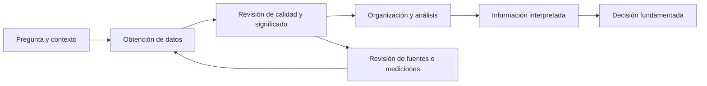

# Clase 1: Fundamentos del dato, clasificación estadística y análisis exploratorio con hojas de cálculo

> **Objetivo académico:** Distinguir datos e información, clasificar variables según su significado y medición, evaluar la calidad de un conjunto de datos y construir resúmenes interpretables mediante formularios, funciones y tablas dinámicas.

## 1. Contexto y marco conceptual

### Del dato a la decisión

La sesión sitúa los datos como materia prima del análisis y como soporte de decisiones justificadas. Un dato representa un hecho, concepto o instrucción mediante números, palabras, fechas, categorías, coordenadas u otros formatos. Una edad, una temperatura, el nombre de un lugar y una categoría de producto son ejemplos de representaciones cuyo significado depende del contexto.

La información se obtiene al organizar, procesar, resumir e interpretar datos en relación con una pregunta. La diferencia central no reside únicamente en acumular observaciones: conocer su procedencia y lo que representan permite atribuir significado a los resultados. Un valor aislado como 30 resulta insuficiente si se desconoce si corresponde a edad, temperatura, cantidad o precio.

La analogía del rompecabezas ilustra esta relación: las piezas representan observaciones parciales; su articulación permite reconocer una figura. Sin embargo, inferir una figura con piezas faltantes requiere considerar qué información falta y qué incertidumbre introduce.

**Enriquecimiento conceptual:** La oposición entre dato e información es una distinción funcional. Un registro estructurado también es un dato; los datos no se definen por carecer de organización. Asimismo, una medición contextualizada puede aportar información por sí misma. El punto analítico consiste en identificar qué significado adquiere una representación para una pregunta y una persona usuaria determinadas.



El esquema sintetiza la relación desarrollada en la clase. **Enriquecimiento conceptual:** El retorno hacia la obtención expresa que detectar errores o vacíos puede exigir revisar las fuentes antes de decidir.

### Alcance de los campos relacionados

La introducción vincula el análisis de datos con tres ámbitos: el tratamiento general de conjuntos de datos, los desafíos de grandes volúmenes y el acceso a datos abiertos. Los sistemas de información geográfica aparecen como un campo de aplicación en el que los registros incorporan una referencia espacial.

La clase desarrolla principalmente fundamentos del dato, recolección mediante formularios y análisis con hojas de cálculo. Big data, open data, imágenes satelitales y herramientas geográficas se presentan como contexto, sin desarrollar todavía sus arquitecturas ni procedimientos especializados.

Los usos discutidos abarcan decisiones cotidianas, análisis de mercados, desarrollo de productos, campañas de marketing, investigación científica y planificación pública. En todos ellos, la utilidad del análisis depende de relacionar la evidencia disponible con el problema concreto.

## 2. Fundamentos teóricos y arquitectura

### Clasificación estadística de variables

La clasificación presentada corresponde al significado estadístico de las variables y debe distinguirse de los tipos de almacenamiento de un lenguaje de programación.

| Familia | Tipo | Propiedad principal | Ejemplos discutidos |
| --- | --- | --- | --- |
| Cuantitativa | Discreta | Toma valores de un conjunto finito o numerable | Número de personas, goles, unidades de inventario |
| Cuantitativa | Continua | Se modela mediante valores de un intervalo | Temperatura, altura y peso |
| Cualitativa | Nominal | Identifica categorías sin orden intrínseco | Color, género musical, ciudad |
| Cualitativa | Ordinal | Identifica categorías con un orden definido | Nivel educativo, riesgo bajo/medio/alto, conocimiento básico/intermedio/avanzado |

**Enriquecimiento conceptual:** La definición de variable discreta mediante un conjunto finito o numerable precisa la explicación introductoria basada en números enteros. Una variable discreta puede contener decimales; por ejemplo, importes limitados a múltiplos de una unidad monetaria mínima. A su vez, una variable continua puede registrarse con enteros por redondeo. La presencia de decimales no determina por sí sola la clasificación.

Las variables cuantitativas representan cantidades sobre las que ciertas operaciones aritméticas tienen significado. Las cualitativas representan atributos o categorías. Las escalas ordinales permiten establecer un orden, pero no garantizan distancias iguales entre niveles.

**Enriquecimiento conceptual:** Ni la objetividad es una propiedad automática de todo dato numérico ni la subjetividad define todo dato cualitativo. Una respuesta numérica puede expresar una percepción y una categoría puede asignarse mediante reglas observables. También pueden utilizarse números como códigos de categorías: un identificador de cliente no se convierte en una cantidad por almacenarse con dígitos.

### Magnitud, registro y variable derivada

El debate de la clase muestra que conocer el contexto es indispensable. Para clasificar correctamente conviene separar tres elementos:

1. La magnitud o atributo observado.
2. La regla con la que se registra.
3. La transformación o resumen que se construye posteriormente.

**Enriquecimiento conceptual:** La edad como tiempo transcurrido puede modelarse de forma continua; la edad registrada en años cumplidos es discreta. Una temperatura sigue siendo una magnitud continua aunque una aplicación muestre únicamente enteros. Por tanto, un cambio de visualización no modifica automáticamente la naturaleza de la magnitud.

**Enriquecimiento conceptual:** El promedio de valores discretos puede tener decimales sin convertirse necesariamente en una variable continua. Si se promedian cantidades enteras para un tamaño de grupo fijo, los promedios posibles avanzan en incrementos determinados por ese tamaño. Debe distinguirse la clasificación de las observaciones originales de las propiedades del estadístico calculado.

### Calidad de datos

La sesión identifica validez, confiabilidad, completitud, oportunidad y relevancia como condiciones para producir información útil.

| Dimensión | Pregunta de revisión | Implicación analítica |
| --- | --- | --- |
| Validez | ¿El registro representa adecuadamente el atributo o hecho? | Valores incorrectos pueden alterar resultados e interpretaciones |
| Confiabilidad | ¿La fuente y el procedimiento ofrecen resultados consistentes? | Una síntesis precisa de datos poco fiables puede seguir siendo engañosa |
| Completitud | ¿Están disponibles los registros y campos necesarios? | La ausencia de datos puede impedir responder la pregunta |
| Oportunidad | ¿El periodo y la disponibilidad corresponden a la decisión? | Datos desfasados pueden resultar inadecuados para una situación actual |
| Relevancia | ¿Los datos están relacionados con el fenómeno estudiado? | Un conjunto abundante puede aportar poca evidencia pertinente |

**Enriquecimiento conceptual:** La actualidad se juzga respecto del propósito. Una decisión operativa puede requerir datos recientes, mientras que una tendencia climática necesita observaciones históricas comparables. Los datos antiguos no son inválidos por su antigüedad.

**Enriquecimiento conceptual:** La completitud tampoco exige conservar indiscriminadamente todos los valores. Eliminar registros, corregirlos o tratar ausencias requiere criterios explícitos y valorar el sesgo que puede introducir cada decisión.

## 3. Implementación técnica y lógica de negocio

### Obtención de conjuntos de datos

La sesión distingue dos vías: reutilizar datos existentes o producir registros mediante un proceso de recolección. Los formularios, como Google Forms y Microsoft Forms, permiten definir preguntas y reunir respuestas que después pueden analizarse en una hoja de cálculo.

En el caso mostrado se registran características personales, ubicación y habilidades tecnológicas. La herramienta genera recuentos y gráficos automáticos, útiles para una exploración inicial. Sin embargo, la representación predeterminada puede resultar insuficiente cuando se necesitan agrupaciones, cruces o gráficos específicos.

**Enriquecimiento conceptual:** En una estructura tabular, cada fila debe corresponder a una unidad de observación claramente definida y cada columna a un atributo. Una pregunta de selección múltiple necesita atención especial: una respuesta puede producir varias categorías, por lo que el total de selecciones no equivale necesariamente al número de personas.

### Selección de herramientas

El criterio defendido en la clase es elegir la herramienta en función de la necesidad. Excel, Google Sheets y LibreOffice permiten obtener rápidamente sumas, recuentos, promedios y tablas dinámicas. Python, los entornos estadísticos y las herramientas de visualización amplían las posibilidades cuando se requieren otros procedimientos.

También se mencionan Google Colab como entorno de programación accesible desde el navegador, Visual Studio Code y entornos locales como alternativas, y QGIS y Google Earth Engine dentro del contexto geográfico. No se desarrolla código Python ni procesamiento espacial durante esta sesión.

**Enriquecimiento conceptual:** La conveniencia de una hoja de cálculo depende del volumen, la complejidad, la repetición del proceso y la necesidad de trazabilidad. Su facilidad de uso no garantiza que sea suficiente para cualquier análisis; del mismo modo, una herramienta más compleja no asegura un resultado mejor.

### Caso de comercio electrónico: comprender la unidad de registro

El conjunto utilizado contiene campos de factura, fecha, identificadores, país, cantidad e importe. El primer paso consiste en reconocer qué representa cada fila. La repetición de un identificador de cliente muestra que contar filas no equivale a contar clientes.

En la demostración se reportan 25 953 registros y 4 373 identificadores de cliente distintos. Son resultados comunicados durante la sesión, sin verificación independiente del archivo original. Una mención aislada presenta un recuento diferente, por lo que no debe tratarse como una segunda medición confirmada.

**Enriquecimiento conceptual:** Tampoco debe suponerse que cada fila es una factura completa. Puede tratarse de una línea de detalle. Antes de calcular promedios por compra o por factura se necesita confirmar la granularidad y las claves del conjunto.

### Recuento de registros y clientes

La clase utiliza la selección de una columna para consultar el recuento y después funciones de hoja de cálculo. Se distingue entre contar celdas numéricas y contar celdas no vacías. También se advierte que incluir el encabezado añade una unidad al recuento.

**Enriquecimiento conceptual:** Las siguientes fórmulas reconstruyen la lógica mostrada con rangos ilustrativos. No transcriben las referencias exactas de la pantalla. Se supone que `A` contiene un campo obligatorio, `C` el identificador de cliente y que las filas 2 a 25954 delimitan los 25 953 registros reportados:

```excel
=CONTARA(A2:A25954)
=CONTARA(UNIQUE(C2:C25954))
```

La primera fórmula cuenta celdas no vacías y solo equivale al número de registros si el campo elegido está completo. La segunda obtiene identificadores únicos y cuenta el resultado; para interpretarlo como número de clientes se requiere que los identificadores sean válidos, estén normalizados y no haya valores vacíos que alteren el recuento. Los nombres de función y los separadores dependen del producto y de la configuración de idioma.

**Enriquecimiento conceptual:** La deduplicación debe aplicarse al nivel correcto. Dos filas con el mismo cliente pueden corresponder a operaciones distintas y no constituyen por ello registros duplicados.

### Ventas, devoluciones y agregaciones

La exploración encuentra cantidades negativas, interpretadas como posibles devoluciones. Esto revela una regla de negocio decisiva: sumar todos los movimientos produce un saldo neto, mientras que separar movimientos positivos y negativos permite describir ventas brutas y devoluciones.

En la demostración se utiliza una tabla dinámica con el importe como valor agregado y un filtro de importes no negativos. El procedimiento ilustra cómo obtener un subtotal condicionado. La interpretación exige confirmar previamente qué significan los signos y qué contiene el campo monetario.

**Enriquecimiento conceptual:** Sean $n$ el número de registros y $a_i \in \mathbb{R}$ el importe firmado del registro $i$, expresado en una misma unidad monetaria, para $i=1,\ldots,n$. Bajo el supuesto de que los importes positivos representan ventas y los negativos devoluciones, se definen:

$$
V_{\mathrm{bruta}}=\sum_{i:a_i>0}a_i
$$

$$
D=-\sum_{i:a_i<0}a_i
$$

$$
V_{\mathrm{neta}}=\sum_{i=1}^{n}a_i=V_{\mathrm{bruta}}-D
$$

Aquí $V_{\mathrm{bruta}}$ es el total positivo, $D\geq 0$ es la magnitud de las devoluciones y $V_{\mathrm{neta}}$ es el saldo firmado; las tres cantidades conservan la unidad monetaria de $a_i$. La identidad se obtiene al separar la suma total en términos positivos, negativos y ceros. Un saldo neto no es un cálculo incorrecto: responde a una pregunta diferente de la venta bruta.

**Enriquecimiento conceptual:** Si la columna `F` contiene esos importes, una implementación ilustrativa es:

```excel
=SUMAR.SI(F2:F25954;">0";F2:F25954)
=-SUMAR.SI(F2:F25954;"<0";F2:F25954)
=SUMA(F2:F25954)
```

Las dos primeras fórmulas calculan respectivamente ventas brutas y magnitud de devoluciones; la tercera, el saldo neto. Un filtro por valores mayores o iguales a cero produce la misma suma bruta que uno estrictamente positivo, aunque puede cambiar el recuento y el promedio al incluir operaciones de importe cero.

**Enriquecimiento conceptual:** Para unidades físicas puede aplicarse una separación análoga a la columna de cantidades, siempre que sus signos tengan ese significado. El importe negativo podría corresponder también a ajustes u otras operaciones; el signo por sí solo no certifica una devolución. Asimismo, si el campo monetario fuera precio unitario en lugar de total de línea, sumarlo directamente no produciría ingresos: sería necesario conocer la cantidad y las reglas de cálculo pertinentes.

## 4. Análisis crítico de casos y auditoría práctica

### Interpretación de temperatura

El ejemplo cotidiano conecta observaciones y pronóstico con una decisión sobre vestimenta. La secuencia relevante consiste en contextualizar la temperatura, interpretar su evolución esperada y actuar en consecuencia.

**Enriquecimiento conceptual:** Una observación y un pronóstico tienen distinto estatus de evidencia. La primera registra una medición; el segundo expresa una estimación de una situación futura. Conviene preservar esa diferencia al comunicar una decisión y su incertidumbre.

La sesión también plantea obtener una temperatura promedio a partir de registros de un periodo.

**Enriquecimiento conceptual:** Para $n\in\mathbb{N}$ observaciones válidas, con $n>0$, y temperaturas $T_i\in\mathbb{R}$ expresadas en grados Celsius, la media aritmética es:

$$
\overline{T}=\frac{1}{n}\sum_{i=1}^{n}T_i
$$

El resultado $\overline{T}$ conserva la unidad de grados Celsius. Interpretarlo como promedio de un periodo requiere revisar la cobertura temporal y la comparabilidad de las mediciones. Si unas horas o días tienen muchas más observaciones que otros, la media simple puede representar principalmente los momentos más muestreados.

### Color, imágenes y variables derivadas

Durante la discusión aparecen ejemplos en los que una preferencia, interpretación o aplicación se usa para justificar un cambio de tipo estadístico. La precisión fundamental consiste en identificar si se conserva la variable original o si se construye otra.

| Caso | Variable original | Variable derivada posible | Precisión conceptual |
| --- | --- | --- | --- |
| Color de automóvil | Color: nominal | Conveniencia térmica: ordinal | Una preferencia no convierte automáticamente el color en una escala ordinal |
| Fotografía o captura | Imagen como objeto de datos | Calidad baja/media/alta: ordinal | La valoración es un atributo añadido a la imagen |
| Radiografía | Imagen médica | Forma: nominal; longitud o área: cuantitativa; riesgo categorizado: ordinal | Una misma fuente permite extraer variables de tipos diferentes |
| Comentario | Texto libre | Sentimiento negativo/neutro/positivo: ordinal, si se define ese orden | El texto requiere una regla de codificación antes de resumirse por categorías |
| Condición térmica | Descripción contextual | Frío/templado/cálido: ordinal | El orden corresponde al eje térmico definido, no a cualquier clasificación climática |

**Enriquecimiento conceptual:** Las distinciones de la tabla precisan el debate de la sesión. Una imagen, un audio o un archivo son modalidades u objetos de datos; no deben clasificarse automáticamente como una única variable nominal u ordinal. Su contenido puede dar lugar a múltiples variables, según la medición o codificación aplicada.

**Enriquecimiento conceptual:** En el ejemplo del automóvil, el calentamiento no depende únicamente del color: intervienen materiales, exposición, ventilación y otras condiciones. La referencia física pertinente es la absorción y reflexión de radiación, sin que una preferencia particular establezca por sí misma una escala estadística del color.

### Lectura de un formulario descriptivo

La demostración del formulario utiliza distribuciones de edad, características físicas, ciudad y conocimientos tecnológicos. Se muestra cómo pasar de respuestas individuales a recuentos, porcentajes, valores extremos y categorías predominantes.

Como ejemplo coherente, se reportan 28 respuestas masculinas entre 29 respuestas totales, equivalentes aproximadamente al 96,6 %. El resultado describe a quienes respondieron esa pregunta.

**Enriquecimiento conceptual:** Si $c$ es el número de respuestas de una categoría y $n>0$ el total de respuestas válidas de la pregunta, ambos enteros con $0\leq c\leq n$, su porcentaje es:

$$
p=100\frac{c}{n}
$$

Para $c=28$ y $n=29$, se obtiene $p\approx96{,}6\%$. La interpretación depende del denominador: si no todas las personas respondieron, el porcentaje no describe automáticamente al grupo completo. En preguntas de selección múltiple, los porcentajes de categorías pueden sumar más de 100 %.

**Enriquecimiento conceptual:** Declarar conocimiento básico, medio o avanzado mide una autopercepción bajo las categorías propuestas. No demuestra experiencia práctica ni dominio verificado. Tampoco conocer el nombre de un lenguaje equivale a dominarlo.

La opción «otro» permitió registrar lenguajes no incluidos, pero no recuperar sus nombres desde el formulario. Este caso evidencia una limitación del instrumento: una categoría residual sin campo de especificación reduce la capacidad explicativa del conjunto.

Algunas cifras sobre niveles de conocimiento se expresan de forma inconsistente en la transcripción. Por ello, no se reconstruyen distribuciones completas ni se deducen frecuencias faltantes.

### Auditoría del caso comercial

El análisis del comercio electrónico plantea cuatro controles centrales:

1. Separar encabezados y observaciones antes de contar.
2. Distinguir registros, clientes, facturas y unidades vendidas.
3. Revisar el significado de cantidades e importes negativos.
4. Nombrar cada agregado según su alcance: bruto, devoluciones o neto.

**Enriquecimiento conceptual:** La confiabilidad de un repositorio no sustituye la evaluación del conjunto concreto. Es necesario conocer procedencia, periodo, definición de campos y transformaciones aplicadas. Del mismo modo, filtrar devoluciones puede ser adecuado para describir ventas brutas, pero insuficiente para analizar el resultado comercial completo.

## 5. Principios de diseño, buenas prácticas y anti-patrones

| Principio | Buena práctica | Anti-patrón |
| --- | --- | --- |
| Definir la pregunta | Precisar qué información necesita la decisión | Calcular resúmenes sin propósito definido |
| Documentar significado | Identificar unidad de observación, campos y unidades | Confundir filas con clientes o facturas |
| Clasificar por medición | Separar magnitud, registro y transformación | Decidir el tipo estadístico solo por la presencia de decimales |
| Revisar calidad | Evaluar validez, consistencia, cobertura y pertinencia | Asumir que una fuente conocida garantiza datos adecuados |
| Explicitar denominadores | Indicar respuestas válidas y población descrita | Generalizar porcentajes de participantes a todo el grupo |
| Preservar semántica comercial | Separar movimientos y documentar filtros | Llamar ventas brutas a una suma neta o borrar negativos sin explicación |
| Elegir herramientas por necesidad | Usar funciones y tablas dinámicas cuando basten | Confundir complejidad tecnológica con rigor analítico |
| Interpretar representaciones | Revisar si el gráfico responde a la pregunta | Aceptar automáticamente el gráfico predeterminado |

**Enriquecimiento conceptual:** Para mantener trazabilidad conviene conservar los datos originales y separar de ellos las transformaciones y resultados. Registrar rangos, filtros, criterios de exclusión y definiciones de indicadores facilita reproducir el análisis y detectar discrepancias.

**Enriquecimiento conceptual:** En formularios, las categorías deben ser claras y adecuadas al atributo. Una opción residual acompañada de un campo de especificación puede reducir pérdida de información, cuando ese detalle sea pertinente. En datos personales o de salud, la recolección debe limitarse a lo necesario y considerar las condiciones de acceso y uso.

## 6. Síntesis conceptual y profundización académica

La contribución central de la clase es establecer una secuencia de trabajo: comprender qué representan los datos, evaluar su calidad, organizarlos, resumirlos e interpretar los resultados en función de una decisión. Las herramientas facilitan esa secuencia, pero la corrección depende de las definiciones y los supuestos que sostienen cada operación.

La clasificación estadística orienta el tratamiento de las variables. Los conteos corresponden a cantidades discretas; las magnitudes como temperatura o altura suelen modelarse como continuas; las categorías nominales identifican diferencias y las ordinales incorporan un orden. Las modalidades de datos, como imágenes y texto, requieren definir qué atributos serán medidos o codificados.

Los dos casos prácticos muestran problemas complementarios. El formulario evidencia la importancia de las preguntas, categorías y denominadores. El comercio electrónico evidencia la necesidad de conocer la granularidad, distinguir identificadores de cantidades y separar ventas, devoluciones y saldos netos. En ambos, un cálculo correcto puede conducir a una interpretación incorrecta si no se comprende su alcance.

**Enriquecimiento conceptual:** La profundización académica puede orientarse hacia teoría de la medición, sesgo de no respuesta, tratamiento de datos faltantes, diseño de indicadores y reproducibilidad. Estas conexiones prolongan los fundamentos de la sesión sin suponer que ya se desarrollaron métodos especializados de big data o análisis geoespacial.
