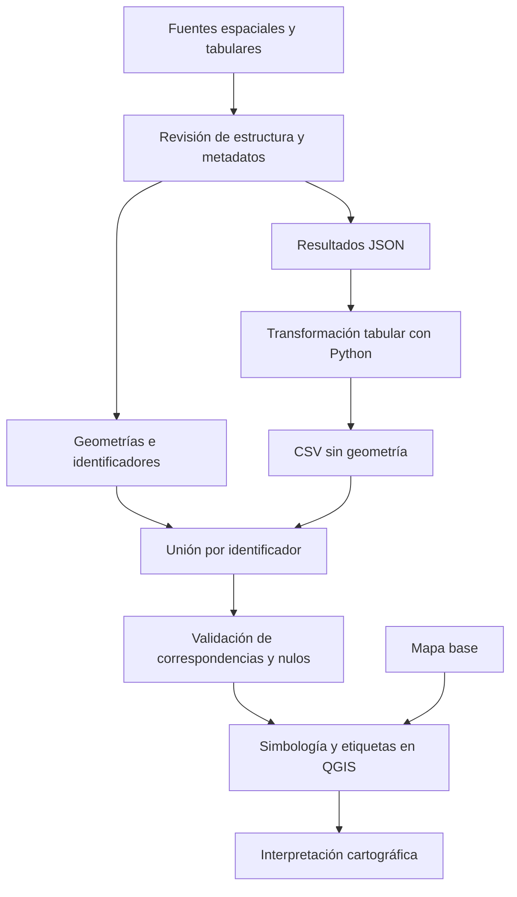

# Clase 6: Preparación, integración y visualización de datos espaciales con Python y QGIS

> **Objetivo académico:** Comprender cómo seleccionar herramientas de preparación de datos, representar información geográfica e integrar atributos tabulares con geometrías mediante Python y QGIS, evaluando la integridad de las transformaciones y los límites de la interpretación cartográfica.

## 1. Contexto y marco conceptual

### Del dato disponible al resultado analítico

La sesión articula dos problemas: adecuar datos heterogéneos para su análisis y representar espacialmente la información resultante. El primer problema aparece tanto en fuentes censales como en registros electorales; el segundo incorpora geometrías, atributos y decisiones cartográficas.

Se distingue entre obtener información ya sintetizada y construir esa síntesis desde archivos originales. Una fuente estadística oficial puede proporcionar directamente una distribución poblacional, mientras que otra puede distribuirla entre varias hojas, encabezados múltiples, celdas combinadas y totales intercalados. Ambos caminos pueden producir una tabla semejante, pero sus necesidades de transformación y validación son diferentes.

La complejidad del trabajo analítico suele quedar oculta en el producto final: un gráfico o mapa sencillo puede requerir una preparación extensa. Por ello, la limpieza constituye una fase sustantiva del análisis y depende de cómo llegan los datos y de cómo deben quedar para responder la pregunta planteada.

### Selección de herramientas

La elección entre hojas de cálculo, Python y herramientas distribuidas depende del volumen, la estructura, la repetición de operaciones y el dominio técnico del analista. La sesión cuestiona adoptar herramientas complejas cuando una transformación sencilla basta, pero también reconoce que la programación puede reducir considerablemente el esfuerzo de corregir numerosos archivos.

**Enriquecimiento conceptual:** El volumen no es el único criterio de automatización. Un conjunto pequeño que se actualiza frecuentemente puede justificar un procedimiento reproducible; una operación manual breve puede ser razonable si es excepcional, verificable y queda documentada. Google Colab proporciona un entorno de ejecución, pero la capacidad real depende de sus recursos y de las bibliotecas empleadas: utilizarlo no convierte automáticamente un procesamiento en distribuido.

### Qué hace espacial a un dato

Un dato espacial incorpora una referencia de ubicación o puede vincularse con ella. Las coordenadas describen posiciones dentro de un sistema de referencia; las direcciones son referencias indirectas que pueden permitir localizar entidades. Los ejemplos incluyen departamentos, municipios, centros poblados, carreteras, ríos y recintos electorales.

**Enriquecimiento conceptual:** Una dirección no siempre identifica un punto de manera unívoca. Su conversión en coordenadas, denominada geocodificación, puede introducir incertidumbre. Asimismo, unas coordenadas solo son interpretables correctamente cuando se conoce su sistema de referencia.

Un sistema de información geográfica, o SIG, reúne herramientas y procedimientos para almacenar, editar, analizar y representar información geográfica. El mapa es una salida posible, aunque también pueden generarse tablas, estadísticas y gráficos. La sesión se concentra en carga, integración y visualización; los geoprocesos se mencionan como operaciones posteriores de modificación o derivación espacial, sin desarrollarse en detalle.

## 2. Fundamentos teóricos y arquitectura

### Modelos de representación espacial

| Modelo | Organización | Ejemplos de la sesión | Consideración principal |
| --- | --- | --- | --- |
| Vectorial | Entidades con geometría y atributos | Centros poblados, vías, límites administrativos y recintos | La geometría representa entidades discretas |
| Ráster | Matriz de celdas con valores | Referencia conceptual e imágenes de fondo | La resolución condiciona el detalle espacial |

En el modelo vectorial se reconocen tres geometrías básicas: puntos, líneas y polígonos. Los puntos representan ubicaciones; las líneas, trazados; y los polígonos, superficies delimitadas. Un multipolígono permite que una misma entidad contenga varias partes poligonales, incluso separadas espacialmente.

**Enriquecimiento conceptual:** Una capa con numerosos registros poligonales no es, por ese solo motivo, una capa de multipolígonos. La distinción corresponde a la estructura geométrica de cada entidad. La elección entre punto, línea y polígono también depende de la escala y del propósito: una ciudad puede representarse como ubicación o como extensión urbana.

### Geometría y atributos

Una capa vectorial combina una geometría con atributos descriptivos. Su tabla organiza entidades en filas y atributos en columnas; en Python, un GeoDataFrame incorpora además una columna geométrica. Esta organización permite seleccionar departamentos por nombre, simbolizar municipios según población o consultar resultados de un recinto.

Una tabla sin geometría también puede participar en un proyecto SIG. Para adquirir una representación espacial necesita coordenadas interpretables o una relación con una capa que ya posea geometría. El caso electoral utiliza esta segunda vía.

### Formatos y organización de archivos

La sesión utiliza GeoJSON, Shapefile y CSV, y menciona otros formatos vectoriales y ráster.

**Enriquecimiento conceptual:** Conviene distinguir el modelo de datos del formato que lo almacena:

- **GeoJSON:** estructura JSON con convenciones específicas para representar entidades geográficas y sus propiedades. Un JSON genérico no necesariamente cumple esas convenciones.
- **Shapefile:** formato vectorial compuesto por archivos asociados. Habitualmente, `.shp` almacena geometrías, `.shx` su índice y `.dbf` los atributos; `.prj` suele describir el sistema de referencia.
- **CSV:** tabla de texto delimitado que puede contener atributos, coordenadas o identificadores, pero no presupone geometría.
- **KML:** formato de representación geográfica mencionado como alternativa vectorial.
- **GeoTIFF y otros formatos ráster:** almacenan matrices georreferenciadas.

Un archivo DBF aislado contiene datos tabulares; no equivale por sí solo a una geometría vectorial completa. Asimismo, los términos capa y Shapefile no son sinónimos: una capa puede proceder de múltiples formatos o servicios.

### Arquitectura del flujo de integración

El flujo separa la preparación estructural de los atributos, su asociación con las geometrías y la representación final. El mapa base aporta contexto y no sustituye a la capa analítica.

## 3. Implementación técnica y lógica de negocio

### Preparación de información censal

Se muestra la obtención de una distribución poblacional desde una fuente estadística oficial y su organización en una hoja de cálculo. El debate técnico se centra en qué hacer cuando esa distribución no está disponible directamente y debe reconstruirse desde archivos heterogéneos.

Las operaciones relevantes son consolidar hojas, identificar encabezados útiles, separar detalles de totales y corregir formatos numéricos. La sesión recuerda que diferencias entre punto y coma decimal pueden producir estadísticas incoherentes, incluso en variables sencillas como peso y altura.

**Enriquecimiento conceptual:** La consolidación debe conservar una granularidad definida. Sumar simultáneamente filas de detalle y subtotales produce doble conteo. También conviene separar los datos originales de los transformados para poder revisar cada corrección.

### Visualización con Python

El recorrido en Google Colab utiliza bibliotecas de tratamiento tabular y espacial, principalmente pandas y GeoPandas, junto con herramientas gráficas como Matplotlib y Plotly. Se menciona la instalación de una dependencia adicional, `simpledbf`, aunque la transcripción no permite reconstruir su función exacta dentro del código.

El procedimiento observado comprende:

1. Cargar archivos comprimidos o descomprimirlos para acceder a su contenido.
2. Leer una capa de natalidad de territorios de España e inspeccionar sus columnas.
3. Representar el indicador mediante colores y añadir una leyenda y un fondo oceánico.
4. Cargar límites departamentales de Bolivia e inspeccionar atributos y geometrías.
5. Diferenciar departamentos por color y seleccionar entidades concretas, como Santa Cruz o Chuquisaca.
6. Explorar representaciones interactivas con desplazamiento, acercamiento y control de visibilidad.

Se demuestra que ciertos lectores pueden acceder directamente a datos comprimidos, mientras que otros recorridos requieren extracción y rutas específicas. Los errores observados se relacionan con rutas incorrectas, variables inconsistentes, importaciones pendientes y orden de ejecución de las celdas.

La transcripción no proporciona el código completo. Por ello, estos pasos describen el procedimiento y no constituyen una reproducción ejecutable.

### Organización del trabajo en QGIS

QGIS se presenta como software libre y de código abierto para crear, visualizar, editar y analizar información geográfica. Su extensibilidad mediante complementos permite incorporar herramientas desarrolladas por la comunidad.

Los componentes de interfaz relevantes son el menú principal, las barras de herramientas, el navegador de fuentes, el panel de capas, el lienzo cartográfico y la barra de estado. Esta última muestra información como coordenadas del cursor y escala de visualización.

La incorporación de capas se realiza desde el administrador de fuentes, desde el menú de adición de capas vectoriales o arrastrando fuentes desde el navegador. Los favoritos del navegador facilitan el acceso recurrente a una carpeta. Las herramientas de navegación permiten recuperar la extensión de una capa cuando el desplazamiento o el acercamiento dejan el lienzo aparentemente vacío.

Quitar una capa del panel elimina su referencia dentro del proyecto, sin borrar necesariamente los archivos originales. Guardar el proyecto conserva la organización de capas, la simbología y otras configuraciones.

**Enriquecimiento conceptual:** Guardar un proyecto no garantiza que sus fuentes externas queden incorporadas. La portabilidad requiere comprobar rutas y disponibilidad de archivos, además de persistir las modificaciones efectuadas sobre los datos.

### Fuentes abiertas y mapas base

Se presentan GeoBolivia y el Centro Digital de Recursos Naturales de Bolivia como fuentes de información espacial. Las capas exploradas incluyen límites administrativos, centros poblados, vías y ríos. Se señala que parte de la información disponible es antigua y que algunos recursos pueden dejar de estar accesibles.

El complemento QuickMapServices permite incorporar mapas base. El procedimiento mostrado consiste en instalarlo desde el gestor de complementos, acceder a su configuración y ampliar el catálogo mediante `More services` y `Get contributed pack`. Se utilizan ejemplos de OpenStreetMap y servicios de Google como fondos de referencia.

**Enriquecimiento conceptual:** La disponibilidad pública de una fuente o servicio no certifica por sí sola su licencia de reutilización. Deben distinguirse procedencia, actualidad, cobertura y condiciones de uso. Los fondos remotos también introducen dependencia de conectividad.

### Integración del caso electoral

El caso utiliza dos fuentes separadas de un proyecto asociado a resultados electorales bolivianos de 2025:

| Fuente | Contenido observado | Función |
| --- | --- | --- |
| GeoJSON de recintos | Puntos e identificador `c` | Proporcionar ubicación |
| Archivo de resultados | Identificadores, nombres y resultados anidados | Proporcionar atributos electorales |

El GeoJSON se incorpora directamente a QGIS, pero contiene pocos atributos. El archivo de resultados no se reconoce directamente como una capa válida y requiere transformación tabular.

En Python se reorganiza la estructura para que cada recinto ocupe una fila, se expanden subcampos en columnas y se convierte el índice en un identificador explícito. El resultado contiene nombres, una categoría de ganador, votos por organización y campos de agregación. La correspondencia exacta de algunas abreviaturas no queda establecida con suficiente claridad.

Antes de la lectura se muestra una sustitución de puntos por guiones para evitar problemas de interpretación del identificador; posteriormente se genera una columna que restituye los puntos. El resultado se exporta a CSV.

En QGIS, ese CSV se incorpora como tabla sin geometría. La unión se configura desde las propiedades de la capa de recintos: se selecciona la tabla de resultados, su campo identificador transformado y el campo `c` de la capa espacial. Después se inspecciona la tabla ampliada y se consulta un recinto con la herramienta de identificación.

Por último, se aplica simbología categorizada según el campo de ganador, diferenciando organizaciones mediante colores y formas. Esta operación representa la categoría asociada a cada recinto; no calcula nuevamente los resultados electorales.

## 4. Análisis crítico de casos y auditoría práctica

### Comparabilidad censal

Los valores introducidos para algunos países durante la demostración se declaran ilustrativos. No sustentan conclusiones demográficas. Además, comparar censos de años diferentes combina variación entre países con diferencias temporales.

**Enriquecimiento conceptual:** Para comparar composición poblacional puede utilizarse una proporción:

$$
p_{g,c,t}=\frac{N_{g,c,t}}{N_{c,t}}.
$$

Aquí, $N_{g,c,t}$ es el número no negativo de personas del grupo registrado $g$ en el país $c$ y año $t$; $N_{c,t}>0$ es la población total del mismo universo. La proporción $p_{g,c,t}$ es adimensional y pertenece a $[0,1]$ cuando ambos conteos son compatibles. Multiplicarla por $100$ permite expresarla como porcentaje. La operación ajusta por tamaño poblacional, pero no corrige diferencias de fecha, cobertura o definición estadística.

### Auditoría de la unión electoral

La aparición de atributos tras una unión demuestra que existen correspondencias, pero no acredita que todas sean correctas. En la sesión aparecen valores nulos cuyo origen no se determina.

**Enriquecimiento conceptual:** Una revisión rigurosa debe comprobar:

- Igualdad del significado y tipo de los identificadores en ambas fuentes.
- Preservación de ceros iniciales, puntos y otros caracteres significativos.
- Unicidad de la clave cuando se espera una relación uno a uno.
- Recintos sin correspondencia y resultados sin geometría asociada.
- Duplicados y cambios inesperados en el número de entidades.
- Coherencia entre nombres, ubicación y atributos recuperados.

Los identificadores deben tratarse como texto cuando sus caracteres tienen función de identificación. Sustituir globalmente todos los puntos de un archivo puede alterar decimales u otros contenidos; es preferible controlar los tipos y transformar únicamente el campo pertinente. La sustitución observada constituye una solución local que requiere revisión antes de generalizarse.

Un nulo después de la unión puede indicar ausencia de coincidencia, un valor originalmente vacío o un problema de interpretación. No debe convertirse automáticamente en cero votos.

### Clasificación de población municipal

La sesión compara métodos de clasificación para un campo presentado como población total de 2010. Los intervalos iguales generan inicialmente un mapa dominado por una tonalidad; reducir el número de clases no modifica sustancialmente el resultado. Los cuantiles producen mayor diferenciación visual, mientras que las rupturas naturales destacan grupos de municipios con poblaciones elevadas.

**Enriquecimiento conceptual:** Para intervalos iguales, la amplitud de clase es:

$$
\Delta=\frac{x_{\max}-x_{\min}}{k}.
$$

Los extremos $x_{\min}$ y $x_{\max}$ corresponden al mínimo y máximo de una variable numérica válida; $k$ es un entero positivo que indica el número de clases. Si la variable es población, $\Delta$ se expresa en habitantes. La fórmula supone un rango no degenerado y exige definir cómo se incluyen los valores situados en las fronteras. Con una distribución muy asimétrica, muchos municipios pueden concentrarse en las clases inferiores.

| Método | Criterio | Límite interpretativo |
| --- | --- | --- |
| Intervalos iguales | Misma amplitud numérica | Puede ocultar diferencias en distribuciones asimétricas |
| Cuantiles | Cantidad aproximadamente igual de entidades por clase | Los rangos pueden ser muy desiguales y los empates complican la separación |
| Rupturas naturales | Agrupación según la distribución de los valores | Los cortes dependen del conjunto analizado |
| Desviación estándar | Distancia respecto de la media | Requiere interpretar la dispersión y revisar la asimetría |

El resultado poco informativo obtenido con desviación estándar no permite identificar una causa específica sin revisar valores, tipos y configuración. La clasificación no debe elegirse únicamente porque el mapa resulte más atractivo.

### Conteos, tasas y densidades

La demostración española se presenta inicialmente como natalidad, aunque después aparece una referencia verbal a densidad. La unidad exacta del indicador no se documenta, por lo que no corresponde equiparar ambos conceptos ni interpretar sus valores como porcentajes.

**Enriquecimiento conceptual:** Un conteo poblacional mide habitantes; una densidad relaciona habitantes con superficie; una tasa de natalidad requiere especificar nacimientos, población de referencia, periodo y factor de escala. Sus mapas responden a preguntas distintas.

### Límites del mapa electoral

El número de puntos de un color representa recintos clasificados por ganador, no votos acumulados. Recintos con cantidades muy distintas de votantes pueden recibir símbolos iguales. La concentración de puntos depende también de la localización de los recintos y del solapamiento visual.

**Enriquecimiento conceptual:** Un mapa de ganadores omite márgenes de victoria y magnitudes de votación. Tampoco permite inferir preferencias individuales a partir de patrones territoriales agregados. Las impresiones regionales surgidas durante la visualización deben tratarse como hipótesis exploratorias, pendientes de contrastación con agregaciones y fuentes verificadas.

## 5. Principios de diseño, buenas prácticas y anti-patrones

### Orden visual y simbología

El orden del panel determina, en la configuración mostrada, la superposición de las capas. Un polígono con relleno opaco puede ocultar carreteras, puntos o divisiones internas. Se demuestra cómo combinar municipios con relleno, límites departamentales destacados y un contorno nacional sin relleno.

La simbología debe corresponder al tipo de variable:

- **Símbolo único:** representación uniforme de una capa.
- **Categorizada:** diferenciación de valores nominales, como departamento, tipo de vía u organización ganadora.
- **Graduada:** agrupación de una variable numérica en rangos.
- **Basada en reglas:** representación mediante condiciones explícitas; se menciona como alternativa, sin desarrollarse.

**Enriquecimiento conceptual:** Una paleta cualitativa ayuda a distinguir categorías sin introducir orden. Una secuencial comunica progresión numérica. Combinar color y forma mejora la diferenciación cuando el color por sí solo resulta insuficiente. Las categorías vacías o no clasificadas deben revisarse antes de ocultarlas, pues podrían revelar datos faltantes.

### Etiquetas, leyenda y escala

La sesión muestra que etiquetar departamentos desde una capa municipal repite innecesariamente sus nombres. Usar la capa departamental corresponde mejor a la entidad que se desea identificar. Etiquetar todos los municipios a escala nacional satura la vista.

**Enriquecimiento conceptual:** Las etiquetas identifican entidades sobre el mapa; la leyenda explica la correspondencia entre símbolos, categorías e intervalos. Son recursos complementarios. La visibilidad dependiente de escala y las reglas de prioridad permiten adaptar las etiquetas al nivel de detalle sin reducirlas hasta hacerlas ilegibles.

### Reproducibilidad e integridad

Las buenas prácticas que se desprenden del recorrido son conservar las fuentes, documentar transformaciones, inspeccionar tipos y nulos, verificar rutas y guardar periódicamente la configuración del proyecto. Las rutas simples pueden reducir problemas con algunas herramientas, pero no sustituyen una gestión correcta de archivos.

**Enriquecimiento conceptual:** También debe comprobarse el sistema de referencia antes de superponer capas o medir distancias y superficies. La reproyección visual puede facilitar la coincidencia aparente sin que las unidades sean adecuadas para una operación métrica.

Los principales anti-patrones son escoger herramientas solo por prestigio o volumen, realizar correcciones manuales repetidas sin registro, alterar identificadores mediante reemplazos indiscriminados, interpretar una unión sin auditarla, confundir ausencia con cero y presentar un mapa sin indicar variable, periodo o criterio de clasificación.

## 6. Síntesis conceptual y profundización académica

La sesión desarrolla una continuidad entre análisis tabular y análisis geográfico. Las exigencias de limpieza, consistencia y selección de herramientas permanecen, mientras que la dimensión espacial incorpora geometrías, sistemas de referencia, superposición y decisiones de representación.

Python aporta flexibilidad para reorganizar estructuras anidadas y preparar atributos; QGIS facilita explorar capas, configurar uniones y construir representaciones cartográficas. Su complementariedad se aprecia en el caso electoral: las ubicaciones y los resultados proceden de fuentes separadas, se integran por una clave y adquieren una lectura espacial mediante simbología categorizada.

Tres distinciones sostienen el rigor del procedimiento: transformar una estructura no valida su contenido; unir tablas no garantiza correspondencias completas; visualizar un patrón no establece su explicación. La calidad del mapa depende tanto de la integridad de los datos como de la clasificación, la escala y la claridad de sus símbolos.

**Enriquecimiento conceptual:** Las líneas de profundización más próximas son la trazabilidad de transformaciones, la integridad referencial de uniones, la sensibilidad de los mapas a sus métodos de clasificación y la diferencia entre magnitudes absolutas e indicadores normalizados. Los geoprocesos constituyen un desarrollo posterior: en esta sesión se construye principalmente la base de preparación, integración y representación necesaria para utilizarlos con criterio.
