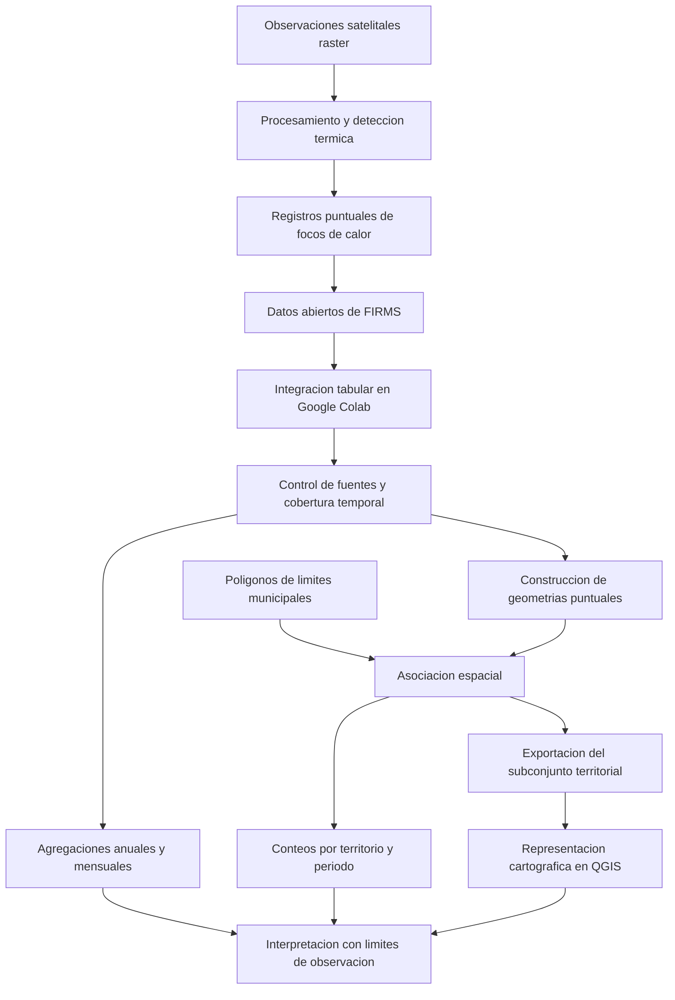

# Clase 8: Imágenes satelitales y análisis espaciotemporal de focos de calor en Bolivia

> **Objetivo académico:** Comprender las propiedades de las imágenes satelitales y construir un análisis reproducible de detecciones térmicas mediante datos abiertos, distinguiendo observaciones satelitales, incendios y superficies quemadas; integrar agregación temporal, asociación territorial y representación cartográfica con Google Colab y QGIS.

## 1. Contexto y marco conceptual

La sesión conecta tres componentes del módulo: disponibilidad de datos abiertos, procesamiento analítico y representación de fenómenos espaciales. El caso conductor es la dinámica de incendios y quemas en Bolivia, estudiada mediante registros de focos de calor provenientes de observaciones satelitales. El recorrido combina análisis nacional, comparación interanual y mensual, asociación con divisiones administrativas y cartografía del municipio de Concepción, en Santa Cruz.

El interés del caso no reside únicamente en procesar millones de filas. También exige determinar qué representa cada registro, qué comparaciones admite y qué conclusiones exceden su capacidad informativa. Una tabla correctamente agregada puede producir interpretaciones equivocadas si se confunde la cantidad de detecciones con la cantidad de incendios o si se suman fuentes cuya cobertura cambia entre años.

### 1.1. Modelos de representación espacial

| Modelo | Unidad de representación | Información asociada | Aplicación en la sesión |
| --- | --- | --- | --- |
| Vectorial | Puntos, líneas y polígonos | Geometría y atributos | Focos de calor, caminos y límites administrativos |
| Raster o matricial | Celdas organizadas en filas y columnas | Un valor por celda y banda | Imágenes satelitales de las que se derivan las detecciones |

Un raster representa el espacio mediante una malla. En una capa categórica, sus valores pueden identificar coberturas como bosque, agua u otras clases; en una imagen satelital, los valores están relacionados con la señal registrada por el sensor. La interpretación depende del producto y de sus metadatos: un cero no significa necesariamente ausencia de información.

Un foco de calor ilustra la relación entre ambos modelos: se origina en el procesamiento de imágenes raster y se distribuye como una observación puntual con coordenadas y atributos. Por tanto, trabajar con puntos derivados de imágenes no convierte el proceso de observación original en vectorial.

### 1.2. Incendios como problema socioambiental

La clase presenta los incendios como un fenómeno multicausal. Se consideran condiciones climáticas —temperatura, sequedad y régimen de lluvias—, transformaciones demográficas, apertura de caminos, expansión agropecuaria, fragmentación del paisaje y cambios de uso del suelo. También intervienen políticas de manejo del fuego, capacidades institucionales, conocimiento local y participación comunitaria.

Estos factores pueden modificar la disponibilidad de combustible, la probabilidad de ignición y las posibilidades de controlar la propagación. Sus efectos incluyen afectaciones a poblaciones rurales, infraestructura, biodiversidad y calidad del aire en ciudades alejadas del lugar de origen.

La sesión utiliza los episodios de 2010, 2019 y 2024 como referencias interpretativas. Describe para 2024 la unión de incendios y complejos de incendios en el norte de Santa Cruz, con una extensión estimada del orden de cinco millones de hectáreas para el caso mostrado. Esa cifra corresponde a una estimación expuesta oralmente, no a una superficie calculada durante el procedimiento con focos de calor.

**Enriquecimiento conceptual:** Conviene distinguir amenaza, exposición y vulnerabilidad. La actividad del fuego constituye una amenaza; las personas, bienes y ecosistemas potencialmente afectados conforman la exposición; y sus condiciones de susceptibilidad y respuesta determinan la vulnerabilidad. Los focos de calor aportan información sobre actividad térmica, pero no describen por sí solos el riesgo completo.

## 2. Fundamentos teóricos y arquitectura

### 2.1. Imágenes satelitales y observación de la Tierra

Una imagen satelital es un producto generado a partir de mediciones realizadas por sensores situados en plataformas orbitales. La analogía con una cámara facilita la introducción, aunque la observación terrestre puede registrar regiones del espectro electromagnético que exceden la visión humana.

La clase distingue satélites de posicionamiento, comunicación y observación terrestre. Para el análisis ambiental interesan especialmente estos últimos, cuyos instrumentos permiten estudiar vegetación, crecimiento urbano, cambios de cobertura, agricultura y efectos de eventos extremos.

Se diferencian dos modalidades de sensado:

- **Pasivo:** registra radiación disponible procedente del sistema observado.
- **Activo:** emite una señal y mide su retorno para obtener información de la superficie.

**Enriquecimiento conceptual:** En sensores pasivos ópticos puede medirse radiación solar reflejada; en sensores térmicos también se registra radiación emitida por la superficie. Por ello, reducir toda imagen satelital a una fotografía de luz solar reflejada resulta insuficiente para explicar la detección de anomalías térmicas. Asimismo, las imágenes pueden apoyar la evaluación de daños de un terremoto, pero ello no implica capacidad general para predecir su ocurrencia.

### 2.2. Bandas y resoluciones

Una banda corresponde a un intervalo de longitudes de onda registrado por un instrumento. Las combinaciones de bandas permiten observar propiedades distintas de la superficie. El visible incluye las regiones asociadas a rojo, verde y azul; otros instrumentos incorporan infrarrojo cercano, infrarrojo de onda corta, infrarrojo térmico o microondas.

| Resolución | Pregunta que responde | Consecuencia analítica |
| --- | --- | --- |
| Espacial | ¿Qué extensión del terreno representa cada píxel? | Condiciona el detalle y la separación de objetos próximos |
| Temporal | ¿Con qué frecuencia se observa una misma zona? | Condiciona el seguimiento de fenómenos cambiantes |
| Espectral | ¿Qué intervalos del espectro distingue el sensor? | Condiciona qué propiedades físicas pueden diferenciarse |
| Radiométrica | ¿Cuántos niveles digitales permiten representar la señal? | Condiciona la discretización de las variaciones registradas |

La resolución espacial se expresa mediante dimensiones sobre el terreno. Un píxel de 10 m por 10 m representa una unidad espacial mucho menor que uno de 1 km por 1 km. Una imagen útil para análisis regional puede resultar insuficiente para distinguir detalles urbanos.

La resolución temporal se relaciona con la revisita o frecuencia de observación. La clase contrapone observaciones frecuentes de menor detalle y observaciones más espaciadas con mayor detalle espacial. Esta relación sirve como orientación para seleccionar datos, pero no constituye una ley universal aplicable a todas las plataformas.

**Enriquecimiento conceptual:** La resolución espectral depende tanto del número de bandas como de su anchura y ubicación. Un sensor hiperespectral registra numerosas bandas estrechas; uno multiespectral utiliza un conjunto más reducido; una banda pancromática integra un intervalo relativamente amplio. Contar canales sin considerar qué intervalos representan no basta para establecer su utilidad.

### 2.3. Cuantización radiométrica

Para una codificación entera sin signo de $b$ bits por píxel y banda, el número de códigos posibles es:

$$
L = 2^b
$$

Aquí, $b$ es un entero positivo que expresa la profundidad de bits y $L$ es el número de niveles digitales, sin unidad física. Si todos los códigos se utilizan para valores ordinarios, su rango es:

$$
v \in \{0,1,\ldots,2^b-1\}
$$

La variable $v$ representa el código digital de una celda y banda. Su conversión a una magnitud física depende de la calibración del producto.

**Enriquecimiento conceptual — corrección y ejemplo trabajado:** Con 4 bits existen $2^4=16$ códigos, de 0 a 15; no 32. Con 8 bits hay 256 códigos, de 0 a 255, y con 16 bits hay 65 536 códigos, de 0 a 65 535. Estos valores corrigen el cálculo oral de la sesión. Algunos productos reservan códigos para datos ausentes o condiciones especiales, por lo que el número de valores físicos utilizables puede ser menor. Además, una mayor profundidad de bits no garantiza por sí sola mayor exactitud instrumental.

### 2.4. Qué representa un foco de calor

Un foco de calor es una detección de anomalía térmica localizada mediante coordenadas. En la explicación introductoria, el punto se sitúa en el centro del píxel donde el algoritmo identifica la señal. Esa coordenada representa la observación a la escala del sensor y no debe interpretarse automáticamente como la posición exacta de una llama.

La relación entre focos e incendios admite varias configuraciones:

- Varios fuegos pequeños pueden producir una sola detección dentro de un píxel.
- Un incendio extenso puede generar múltiples detecciones en distintos píxeles.
- Un mismo incendio puede registrarse varias veces mediante distintas pasadas o plataformas.
- Una anomalía térmica puede tener un origen distinto de un incendio forestal.

Por tanto, el conteo de focos no equivale al conteo de incendios y tampoco permite calcular directamente la superficie quemada. Esta última requiere productos o procedimientos específicos para identificar áreas afectadas.

**Enriquecimiento conceptual:** Es necesario separar un error de detección de una discrepancia con el objetivo analítico. Una fuente térmica industrial o vinculada a un conflicto puede ser una detección térmica válida y, al mismo tiempo, quedar fuera de un estudio de incendios forestales. Su exclusión responde a la definición del fenómeno de interés, no necesariamente a un fallo del sensor.

### 2.5. Arquitectura del análisis

## 3. Implementación técnica y lógica de negocio

### 3.1. Obtención de datos abiertos

La fuente utilizada es FIRMS de NASA. Se distinguen los datos recientes, disponibles para ventanas temporales cortas, y los archivos históricos, que permiten seleccionar territorio, instrumento y periodo. En la demostración se mencionan formatos CSV, Shapefile y KML para distribución o intercambio.

La combinación de plataformas e instrumentos debe expresarse correctamente:

| Plataforma | Instrumento asociado | Papel en el análisis |
| --- | --- | --- |
| Terra y Aqua | MODIS | Serie histórica extensa utilizada para comparaciones de largo plazo |
| Suomi NPP | VIIRS | Fuente adicional con disponibilidad posterior |
| NOAA-20 | VIIRS | Fuente incorporada a la comparación reciente |
| NOAA-21 | VIIRS | Fuente más reciente, excluida de la comparación común desde 2018 |

La transcripción alterna nombres de sensores y plataformas. MODIS y VIIRS son instrumentos; Terra, Aqua, Suomi NPP, NOAA-20 y NOAA-21 son plataformas. Esta distinción permite interpretar correctamente los campos de procedencia.

En el archivo mostrado, la incorporación de fuentes se describe aproximadamente desde 2012 para Suomi NPP, 2018 para NOAA-20 y 2024 para NOAA-21. Esas referencias se utilizan para razonar sobre la cobertura disponible, no como garantía de que todos los años iniciales estén completos.

### 3.2. Integración y preparación temporal en Colab

El procedimiento observado comprende descargar archivos comprimidos, descomprimirlos, identificar los CSV y cargarlos en un DataFrame de pandas. Se reporta un total inicial de 9 375 987 registros para la integración histórica mostrada. Esa cantidad describe el conjunto de la demostración; no constituye una cifra permanente del repositorio.

Los campos incluyen latitud, longitud, fecha de adquisición, plataforma, instrumento y atributos de la detección, como brillo y dimensiones de observación. La fecha `acq_date` se utiliza para obtener año, mes y día, facilitando agrupaciones posteriores.

La transcripción no contiene las celdas completas del cuaderno. Por ello, se conserva la lógica de transformación sin presentar código como si hubiera sido recuperado o ejecutado:

1. Integrar archivos con sus atributos de procedencia.
2. Interpretar la fecha de adquisición.
3. Derivar los campos temporales necesarios.
4. Inspeccionar cantidades de registros y cobertura por fuente.
5. Filtrar periodos y plataformas antes de agregar.
6. Generar tablas y gráficos anuales o mensuales.

**Enriquecimiento conceptual:** Antes de concatenar archivos históricos y recientes conviene comprobar tipos, campos, versiones y posibles solapamientos. Dos registros próximos en espacio y tiempo no son necesariamente duplicados: pueden representar observaciones legítimas de diferentes pasadas. La deduplicación requiere una definición explícita de identidad y propósito.

### 3.3. Comparabilidad temporal

El primer gráfico suma todos los registros por año y muestra un crecimiento marcado, especialmente en 2024. La revisión por plataforma revela un problema: la red de observación cambia con la incorporación de instrumentos adicionales. Parte del aumento puede responder a mayor capacidad de detección.

Se plantean dos diseños:

- **Serie extensa:** utilizar las plataformas históricas disponibles y revisar el inicio efectivo de cada una.
- **Serie reciente:** mantener un conjunto común de plataformas desde un periodo compartido, como 2018 en la demostración, y excluir fuentes incorporadas posteriormente.

**Enriquecimiento conceptual:** Seleccionar Terra y Aqua no garantiza que su combinación sea idéntica desde el primer año, porque sus inicios y disponibilidades pueden diferir. La homogeneidad exige comprobar cobertura real, continuidad, versión del producto y fecha de corte, además de los nombres seleccionados.

Para expresar la agregación, puede definirse el conteo de detecciones:

$$
C_{y,m,r,S} = \sum_{i=1}^{n} \mathbf{1}\left(y_i=y,\ m_i=m,\ p_i\in r,\ s_i\in S\right)
$$

**Enriquecimiento conceptual:** En esta expresión, $n$ es el número de registros disponibles; $i$ identifica una detección; $y_i$ y $m_i$ son su año y mes; $p_i$ es su ubicación; $s_i$ identifica su plataforma o fuente; $r$ es el territorio seleccionado; y $S$ es el conjunto de fuentes admitidas. La función indicadora vale 1 cuando se cumplen todas las condiciones y 0 en caso contrario. El resultado $C_{y,m,r,S}$ se mide en detecciones y no en incendios ni hectáreas.

La fórmula aclara que modificar el territorio, las fuentes o la ventana temporal cambia el objeto contado. No corrige por sí misma diferencias de sensibilidad, observaciones repetidas o datos faltantes.

### 3.4. Asociación territorial mediante geoprocesamiento

Los registros iniciales contienen coordenadas, pero no necesariamente nombres de departamento, provincia o municipio. Para incorporarlos se utiliza una capa de polígonos municipales que ya incluye atributos administrativos.

La operación descrita consiste en construir puntos a partir de longitud y latitud, relacionarlos espacialmente con los polígonos y transferir los atributos territoriales correspondientes. La clase denomina este procedimiento intersección; funcionalmente, su finalidad es asignar cada detección al territorio que le corresponde.

**Enriquecimiento conceptual:** Una unión espacial y una intersección geométrica pueden resolver objetivos próximos, pero no son operaciones idénticas. Como las celdas no están disponibles, no puede establecerse qué función concreta se utilizó. Para puntos y polígonos deben definirse también el predicado espacial, el tratamiento de puntos sobre límites y la política ante superposiciones.

La coherencia del sistema de referencia es indispensable. Para coordenadas geográficas WGS 84, la importación utilizada en QGIS asigna:

- Campo X: longitud.
- Campo Y: latitud.
- Sistema de referencia: EPSG:4326.

**Enriquecimiento conceptual:** WGS 84 y EPSG:4326 describen aquí un sistema de referencia geográfico, con coordenadas angulares; no una proyección plana métrica. Asignar un sistema declara cómo interpretar las coordenadas existentes; reproyectar transforma su representación. Confundir ambas operaciones puede desplazar o deformar los datos.

Tras la asociación, cada fila conserva sus atributos de detección e incorpora departamento, provincia y municipio. Esto permite aplicar filtros territoriales y obtener conteos administrativos. El resultado de interés para 2024 se guarda como CSV, se comprime y se transfiere a QGIS.

### 3.5. Importación, filtrado y materialización en QGIS

El CSV se incorpora mediante una capa de texto delimitado. La geometría se construye indicando longitud, latitud y sistema de referencia. El archivo tabular puede contener información suficiente para generar puntos, aunque no almacene la geometría como lo hace un formato vectorial especializado.

La selección territorial combina condiciones de departamento y municipio. Esto evita depender exclusivamente de nombres municipales que pueden repetirse. También puede añadirse una condición mensual; septiembre corresponde al mes 9 y octubre al 10.

La demostración exporta el subconjunto de Concepción a Shapefile para disminuir el volumen utilizado en la visualización. Materializar un subconjunto significa crear un archivo con las entidades filtradas, en lugar de mantener únicamente un filtro sobre la fuente nacional.

Se observa una mejora de respuesta tras reducir el conjunto de trabajo. No obstante, el efecto combina reducción de registros, cambio de formato y condiciones del equipo; la sesión no permite aislar la contribución de cada factor.

### 3.6. Simbología y composición cartográfica

La capa de focos se representa mediante simbología categorizada por mes. Los valores numéricos se presentan con nombres mensuales en la leyenda para facilitar la lectura. El municipio de interés se destaca y los territorios vecinos utilizan bordes y colores más tenues.

La composición incorpora área del mapa, orientación norte, barra de escala, leyenda, coordenadas, título, fuente y referencia espacial. Se añade contexto mediante caminos, capital municipal y un mapa base de OpenStreetMap. También se integra un gráfico mensual para relacionar distribución espacial y evolución temporal.

El diseño debe ajustarse a la geometría territorial: la orientación de la página, el tamaño del mapa y el espacio de la leyenda dependen de la extensión representada. La jerarquía visual permite destacar el fenómeno sin eliminar referencias necesarias para situarlo.

## 4. Análisis crítico de casos y auditoría práctica

### 4.1. Aumento observado y cambio del sistema de medición

El contraste entre el gráfico agregado y el gráfico por plataforma es la principal revisión metodológica de la sesión. La suma de fuentes produce una serie aparentemente creciente, pero su composición cambia con el tiempo.

La mayor cantidad de detecciones puede responder a actividad térmica, mayor sensibilidad instrumental, más observaciones o una combinación de esos factores. En consecuencia, el conteo bruto no proporciona una medida directamente comparable de incendios a lo largo de toda la historia.

**Enriquecimiento conceptual:** Una serie observacional combina fenómeno y mecanismo de medición. Mantener fuentes constantes reduce una causa de heterogeneidad, pero no elimina efectos de nubosidad, disponibilidad, geometría de observación o cambios del procesamiento. Para fortalecer la comparación conviene presentar resultados separados por plataforma antes de resumirlos.

### 4.2. Comparación de 2024 con el corte parcial de 2025

En la demostración, 2025 está incompleto y llega aproximadamente a finales de agosto. La caída de su total frente a 2024 no debe interpretarse como una reducción anual consolidada.

La comparación mensual expuesta menciona, aproximadamente, 73 000 detecciones en julio de 2025 y 33 000 en agosto, frente a 131 000 y 570 000 en los meses equivalentes de 2024. Estas cifras describen la lectura oral del gráfico y no han sido recalculadas en estos apuntes.

La interpretación admisible es que, con las fuentes y el corte utilizados, se observa una menor cantidad de detecciones en determinados meses de 2025 respecto de 2024. No se puede deducir de ello el resultado del año completo.

**Enriquecimiento conceptual:** Una comparación acumulada consistente debe aplicar a todos los años la misma fecha límite y la misma selección de fuentes. Si el mes reciente está incompleto, compararlo con meses completos introduce un sesgo adicional. Además, los datos recientes pueden tener revisiones o diferencias de disponibilidad respecto de los históricos.

### 4.3. Explicaciones causales de una disminución

La clase propone lluvias recientes, mayor humedad, campañas de sensibilización, mecanismos de reporte y acciones institucionales como posibles contribuciones a la disminución observada.

Estas hipótesis son plausibles dentro del marco multicausal presentado. Sin embargo, las agregaciones descriptivas no identifican el efecto independiente de cada intervención. Una coincidencia temporal entre menor conteo y nuevas acciones públicas no demuestra causalidad.

**Enriquecimiento conceptual:** Evaluar esas explicaciones requeriría información meteorológica, territorial e institucional adicional y un diseño que controle diferencias entre periodos o regiones. También debe considerarse que algunas condiciones atmosféricas pueden afectar tanto al fuego como a su observación. Menos detecciones no significa automáticamente menor actividad real en la misma proporción.

### 4.4. Resultado territorial de Concepción

Después de asociar las detecciones con municipios, el análisis del subconjunto de Santa Cruz identifica a Concepción como el municipio con más registros dentro del procesamiento mostrado para 2024. El total de 360 622 detecciones se repite en el análisis tabular y en la capa exportada, lo que proporciona una comprobación de consistencia entre ambos entornos.

La distribución mensual señala septiembre como el máximo, con crecimiento previo y descenso posterior. No se fija un valor exacto para ese mes porque la transcripción contiene cifras incompatibles. Tampoco se interpreta el total municipal como número de incendios.

**Enriquecimiento conceptual:** El ranking absoluto depende también del tamaño del territorio y de la cobertura de observación. Un municipio extenso puede acumular más detecciones sin tener la mayor intensidad por unidad de superficie. Una tasa territorial podría complementar el conteo, siempre que se defina correctamente el área y se reconozca que seguiría midiendo detecciones, no superficie quemada.

### 4.5. Lectura espacial de categorías mensuales

La coloración por mes permite identificar dónde se concentran detecciones tempranas y tardías. La clase utiliza esa distribución para explorar una posible evolución espacial de la actividad del fuego.

**Enriquecimiento conceptual:** El patrón visual no demuestra una trayectoria continua de propagación. Los puntos de diferentes meses pueden pertenecer a eventos distintos, registrar repetidamente el mismo lugar o quedar ocultos por superposición. Reconstruir un frente de incendio requiere mayor resolución temporal, criterios de vinculación y evidencia adicional, como perímetros o cicatrices de quema.

### 4.6. Rendimiento y formatos

El geoprocesamiento en Colab se describe como rápido en comparación con la interacción posterior sobre millones de puntos en QGIS. Esa observación corresponde a la experiencia concreta de la sesión y no constituye una comparación controlada entre motores.

**Enriquecimiento conceptual — precisión técnica:** GeoPackage no es inherentemente un formato comprimido ni necesariamente más lento que Shapefile. Almacena información en una base SQLite y puede utilizar índices espaciales. El rendimiento depende de las consultas, índices, controladores, almacenamiento y volumen. En este caso, la reducción territorial es una explicación relevante de la mejora y no debe atribuirse exclusivamente al formato elegido.

## 5. Principios de diseño, buenas prácticas y anti-patrones

| Principio | Buena práctica | Anti-patrón y consecuencia |
| --- | --- | --- |
| Definición de la observación | Denominar los conteos como detecciones o focos de calor | Presentarlos como incendios individuales |
| Homogeneidad temporal | Revisar fuentes, cobertura y fecha de corte | Sumar plataformas nuevas y atribuir todo el crecimiento al fenómeno |
| Trazabilidad | Conservar procedencia, instrumento y versión del producto | Perder el origen después de concatenar archivos |
| Coherencia espacial | Confirmar coordenadas, referencia y geometrías | Intercambiar latitud y longitud o asignar un sistema incorrecto |
| Asociación territorial | Revisar puntos sin municipio y coincidencias múltiples | Suponer que la transferencia de atributos siempre es uno a uno |
| Eficiencia | Filtrar periodos y territorios antes de operaciones costosas | Mantener todo el conjunto nacional para cada consulta local |
| Comunicación | Explicitar unidades, corte temporal y límites | Convertir un indicador observacional en una conclusión causal |
| Cartografía | Mantener jerarquía, leyenda legible y contexto | Permitir que superposición y fondo oculten las detecciones |

### 5.1. Control de calidad en la asociación espacial

**Enriquecimiento conceptual:** Antes y después del cruce deben contrastarse cantidades de registros y casos excepcionales. Si un punto coincide con dos polígonos superpuestos, la operación puede duplicarlo. Si queda fuera de la cobertura, puede perderse según el tipo de unión. También debe reconocerse que asignar el centro del píxel a un municipio no prueba que toda la actividad térmica detectada estuviera confinada a ese territorio.

La fuente y vigencia de los límites administrativos forman parte del significado del resultado. Cambiar la delimitación puede modificar la asignación municipal sin que cambien las coordenadas originales.

### 5.2. Memoria y selección de herramientas

La sesión utiliza pandas porque el conjunto disponible puede procesarse en el entorno de trabajo, con vigilancia del consumo de RAM. La cantidad de filas no basta para decidir si una herramienta es adecuada: también importan número y tipos de columnas, geometrías y copias intermedias.

**Enriquecimiento conceptual:** Construir millones de objetos geométricos puede aumentar considerablemente la memoria respecto de la tabla original. Seleccionar solo columnas necesarias, filtrar antes del cruce y conservar resultados intermedios útiles puede reducir costes. No se desarrolla en la fuente una implementación distribuida con Spark, por lo que no corresponde atribuirle resultados ni comparaciones de rendimiento.

### 5.3. Persistencia y formatos interoperables

Guardar el proyecto de QGIS conserva referencias a fuentes, simbología y composiciones. Exportar una capa conserva los datos resultantes. Son operaciones complementarias: guardar el proyecto no sustituye la persistencia de los archivos de datos.

La conversación final destaca la interoperabilidad entre QGIS y ArcGIS mediante formatos compartidos. La elección del entorno depende de herramientas, extensibilidad, licenciamiento y experiencia del usuario; no existe una superioridad universal demostrada en la sesión.

**Enriquecimiento conceptual:** Shapefile implica varios archivos asociados y restricciones de campos y tipos. GeoPackage puede ser apropiado cuando se necesitan varias capas, atributos más flexibles o índices. La elección debe responder a las necesidades de intercambio y procesamiento, acompañada de verificaciones de integridad.

### 5.4. Legibilidad y honestidad cartográfica

**Enriquecimiento conceptual:** Los meses tienen orden cronológico; una paleta debe facilitar su lectura y mantenerse consistente entre mapas. La transparencia ayuda a observar superposiciones, aunque también modifica el color percibido y no proporciona una medida calibrada de densidad.

El mapa debe indicar territorio, periodo, fuentes y sistema de referencia. Una gráfica insertada debe conservar proporciones y etiquetas legibles; estirarla para llenar un espacio puede distorsionar la presentación. Cuando se utiliza un mapa base, debe conservarse su atribución y comprobarse que el contexto visual no compita con los datos principales.

## 6. Síntesis conceptual y profundización académica

La clase articula una cadena de transformación: observaciones raster, detecciones puntuales, registros tabulares, agregaciones temporales, asociación con polígonos administrativos y representación cartográfica. Cada etapa aporta capacidad analítica, pero también introduce decisiones que afectan el significado de los resultados.

La distinción central es entre fenómeno y observación. Un incendio puede originar muchas detecciones, varios fuegos pueden quedar representados por una sola y una anomalía térmica puede proceder de otra actividad. Por ello, los focos de calor son indicadores de actividad térmica potencialmente vinculada al fuego, no un inventario directo de eventos ni una medición de hectáreas afectadas.

La segunda distinción es entre descripción y explicación. Los conteos y mapas permiten reconocer concentraciones, estacionalidad y diferencias entre periodos. La atribución de esas diferencias a lluvias, políticas o cambios sociales requiere evidencia adicional. La interpretación gana rigor cuando mantiene constantes las fuentes, compara ventanas equivalentes y comunica las limitaciones de observación.

El caso de Concepción muestra cómo las coordenadas adquieren utilidad territorial mediante geoprocesamiento y cómo un mismo subconjunto puede sostener tablas, gráficos y mapas consistentes. También evidencia que reducir datos y materializar resultados pertinentes puede mejorar la interacción sin cambiar el objetivo científico.

**Enriquecimiento conceptual:** Las líneas de profundización más directamente conectadas con la sesión son la comparación entre detecciones y cicatrices de quema, la separación de eventos mediante relaciones espaciotemporales, la evaluación de sensibilidad entre instrumentos y el análisis multivariable de clima, uso del suelo y respuesta institucional. Estas extensiones requieren mantener explícita la unidad de análisis y distinguir los resultados observados de las inferencias sobre el proceso ambiental.
