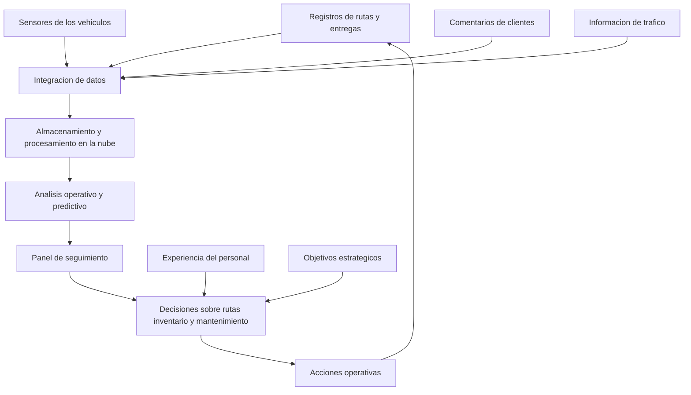

# Clase 1: Fundamentos de cloud computing y big data para decisiones organizacionales

> **Objetivo académico:** Comprender la relación entre infraestructura cloud, procesamiento de grandes volúmenes de datos y oportunidad de las decisiones organizacionales; diferenciar IaaS, PaaS, SaaS y operación on-premises según sus responsabilidades y criterios de selección.

## 1. Contexto y marco conceptual

### Los datos como recurso estratégico

La sesión introduce cloud computing y big data desde una necesidad organizacional: transformar los datos disponibles en información que permita actuar oportunamente. La generación de registros no produce por sí sola una ventaja competitiva. Es necesario seleccionar información pertinente, integrarla, procesarla y relacionarla con decisiones concretas.

La exposición destaca el crecimiento de los datos procedentes de dispositivos móviles, sensores y sistemas empresariales. También menciona sectores como medios de comunicación, salud y manufactura, sin restringir el problema a ellos. La cuestión transversal es cómo aprovechar información heterogénea cuando su generación supera la capacidad de procesamiento de la organización.

Se presentan proyecciones mundiales de generación y almacenamiento de datos como motivación. Sus fuentes no se identifican y algunas equivalencias de unidades son inconsistentes; por ello, no constituyen resultados cuantitativos verificados de la clase.

**Enriquecimiento conceptual:** En notación decimal, un zettabyte equivale a mil exabytes, un exabyte a mil petabytes y un petabyte a mil terabytes. Esta jerarquía describe capacidad o volumen; una tasa de generación necesita además una unidad temporal. No es válido comparar directamente almacenamiento acumulado con datos generados por día sin precisar el período y el alcance de ambas magnitudes.

### Big data como problema de capacidad y oportunidad

El caso central permite reconocer tres dimensiones del problema:

- **Volumen:** la organización genera más datos de los que puede aprovechar con su infraestructura disponible.
- **Variedad:** conviven registros operativos, mediciones de sensores, comentarios de clientes e información externa.
- **Velocidad:** los datos cambian y pierden utilidad operativa antes de que el procesamiento tradicional produzca resultados.

**Enriquecimiento conceptual:** Estas dimensiones corresponden al marco de las tres V de big data. No existe un umbral universal de tamaño que determine cuándo un sistema pertenece a esta categoría: importa la relación entre las exigencias del problema y las capacidades técnicas y organizacionales disponibles.

La sesión caracteriza el entorno empresarial como volátil, incierto, complejo y ambiguo. En ese contexto, los reportes históricos siguen teniendo valor, pero pueden resultar insuficientes para decisiones que requieren detectar cambios y responder durante la operación.

## 2. Fundamentos teóricos y arquitectura

### Cloud computing: acceso bajo demanda

Cloud computing se presenta como acceso bajo demanda a recursos computacionales compartidos mediante la red. Entre esos recursos se encuentran servidores, almacenamiento y aplicaciones. Su característica central es permitir aprovisionar capacidad cuando se necesita y liberarla cuando deja de ser necesaria, sin gestionar manualmente cada solicitud con el proveedor.

La exposición relaciona este modelo con tres posibilidades:

1. Obtener recursos mediante mecanismos de autoservicio.
2. Ajustar la capacidad a variaciones de la demanda.
3. Vincular el gasto con el uso de los servicios contratados.

El ejemplo del comercio electrónico ilustra una demanda variable: durante una promoción aumenta la necesidad de capacidad; después, puede reducirse para evitar mantener recursos ociosos.

**Enriquecimiento conceptual:** El aprovisionamiento no es literalmente instantáneo ni ilimitado. Depende del servicio, las cuotas, la disponibilidad regional y los tiempos de arranque. Asimismo, liberar capacidad de cómputo no necesariamente elimina cargos por almacenamiento persistente, transferencias u otros componentes asociados.

### Escalabilidad y elasticidad

La sesión utiliza ambos conceptos para explicar la adaptación de la infraestructura.

**Enriquecimiento conceptual:** Conviene distinguirlos:

- **Escalabilidad:** capacidad de un sistema para atender una carga mayor mediante la incorporación o ampliación de recursos.
- **Elasticidad:** capacidad de ajustar los recursos, aumentando o disminuyendo su cantidad, conforme cambia la carga.

La elasticidad automática requiere políticas y mecanismos de operación; no aparece únicamente por alojar una aplicación en la nube. Una aplicación también puede encontrar límites en su base de datos, sus dependencias o su diseño interno.

### Modelos de servicio y distribución de responsabilidades

La diferencia entre IaaS, PaaS y SaaS reside en el nivel del servicio consumido y en las responsabilidades que conserva el cliente.

| Modelo | Qué recibe la organización | Responsabilidades principales del cliente | Orientación habitual |
| --- | --- | --- | --- |
| On-premises | Infraestructura operada en instalaciones propias | Administrar infraestructura física y pila de software, según sus acuerdos de soporte | Necesidades de control local o restricciones específicas |
| IaaS: infraestructura como servicio | Cómputo virtual, almacenamiento y redes | Administrar el sistema operativo invitado, software y aplicaciones, según el servicio | Equipos técnicos que necesitan flexibilidad de configuración |
| PaaS: plataforma como servicio | Entorno gestionado para desarrollar y ejecutar aplicaciones | Desarrollar y mantener aplicaciones, gestionar datos y configurar su uso | Equipos que priorizan el desarrollo frente a la administración de infraestructura |
| SaaS: software como servicio | Aplicación disponible para su utilización | Administrar usuarios, permisos, datos y configuración funcional | Usuarios y organizaciones que necesitan una capacidad de negocio disponible |

La exposición menciona Amazon EC2 como ejemplo de IaaS y Salesforce como ejemplo de SaaS. Para PaaS alude a una plataforma de desarrollo de Google, aunque la denominación del producto no queda inequívoca en la transcripción.

**Enriquecimiento conceptual:** En IaaS, el control del cliente se concentra en los recursos virtuales y las capas que administra; el proveedor conserva la gestión de la infraestructura física subyacente. PaaS incluye infraestructura, pero la abstrae para el consumidor. SaaS también necesita configuración, integración y gobierno de datos, aunque no exija desarrollar la aplicación desde cero.

On-premises describe principalmente una ubicación y un régimen de operación. IaaS, PaaS y SaaS describen niveles de servicio. Esta distinción evita tratarlos como categorías completamente equivalentes.

### Arquitectura conceptual del aprovechamiento de datos

El siguiente diagrama sintetiza las relaciones expuestas en el caso; no representa una implementación desplegada:

La arquitectura conecta fuentes, procesamiento, análisis y acción. La experiencia del personal complementa la información procesada, mientras los objetivos estratégicos determinan qué decisiones justifican la inversión.

## 3. Implementación técnica y lógica de negocio

### Caso de la empresa de transporte

La sesión desarrolla un caso narrativo de una empresa de transporte y logística, denominada principalmente JIP, con 25 camiones, almacenes distribuidos y personal experimentado. Su reputación se apoya en el cumplimiento de compromisos, pero enfrenta competidores que ofrecen entregas más rápidas y precios menores.

El problema no se presenta como una ausencia de actividad ni de datos. La organización funciona y produce información, pero su infraestructura y sus procesos no permiten utilizarla con la oportunidad requerida.

| Situación descrita | Consecuencia para el negocio | Necesidad informacional |
| --- | --- | --- |
| Decisiones apoyadas en reportes trimestrales | Adaptación lenta frente a cambios operativos | Información con una frecuencia acorde con cada decisión |
| Procesamiento de entregas y estado de vehículos que tarda días | Visibilidad tardía de la operación | Seguimiento actualizado y procesamiento oportuno |
| Telemetría y registros en formatos diversos | Dificultad de integración y aprovechamiento | Integración de fuentes heterogéneas |
| Cierres de carreteras comunicados mediante llamadas | Pérdida de tiempo antes de reorganizar rutas | Detección y comunicación tempranas de incidencias |
| Análisis de ventas recibido una semana después | Reposición de inventario tardía | Visibilidad de cambios de demanda |
| Saturación del servidor propio | Restricción para almacenar y procesar datos | Capacidad ajustable a las necesidades de carga |

La telemetría incluye temperatura, presión de neumáticos y consumo de combustible. A ella se agregan rutas, entregas, comentarios de clientes y datos de tráfico. Cada fuente puede ser útil, pero debe vincularse con una finalidad de análisis y una acción posible.

### De la infraestructura al proceso de decisión

La propuesta del responsable tecnológico consiste en trasladar el procesamiento a una plataforma cloud con mayor capacidad. En el relato, esa adopción permite disponer de un panel con ubicación y estado de los vehículos, analizar cambios de demanda y ajustar rutas de manera dinámica.

La lógica de negocio se articula en tres ámbitos:

- **Rutas:** utilizar información actualizada para reducir la exposición a congestiones, cierres y retrasos.
- **Inventario:** identificar variaciones de demanda con suficiente anticipación para orientar la reposición.
- **Flota:** disponer de mediciones que apoyen el seguimiento del estado de los vehículos y las decisiones de mantenimiento.

La exposición también atribuye a los algoritmos la predicción de picos de demanda. No describe sus métodos, variables, entrenamiento ni validación, de modo que esta capacidad debe entenderse como parte del escenario ilustrativo.

No se desarrolla código, configuración de servicios, despliegue de infraestructura ni medición experimental. El contenido técnico corresponde a una arquitectura conceptual y a criterios iniciales de selección de servicios.

### Combinación de servicios

El modelo apropiado depende de la función que se quiera cubrir y de la capacidad operativa del equipo. Una misma solución puede combinar niveles de servicio.

**Enriquecimiento conceptual:** Una aplicación propia podría ejecutarse sobre IaaS cuando requiera configuraciones específicas, utilizar una plataforma gestionada para reducir administración y conectarse con una aplicación SaaS de gestión comercial. Esta combinación es una alternativa conceptual, no una arquitectura implementada en la sesión.

La selección debe justificar el grado de control necesario, la responsabilidad asumida y la contribución al problema de negocio. Elegir un proveedor o una categoría de servicio sin precisar esas relaciones deja incompleta la decisión arquitectónica.

## 4. Análisis crítico de casos y auditoría práctica

### Diagnóstico: capacidad, integración y latencia

El caso permite separar tres problemas que requieren respuestas distintas:

1. **Capacidad insuficiente:** el servidor se satura frente a la carga.
2. **Integración insuficiente:** las fuentes heterogéneas no se incorporan de manera útil al análisis.
3. **Latencia excesiva:** el resultado llega después del momento en que era necesario actuar.

Aumentar recursos puede aliviar el primer problema, pero no resuelve automáticamente los otros dos. Migrar a la nube tampoco corrige por sí solo datos inconsistentes, procesos mal coordinados o decisiones sin responsables definidos.

La exposición describe dificultades para integrar información en las bases tradicionales de la empresa. Esto caracteriza la situación del caso; no demuestra que toda base de datos relacional sea incapaz de gestionar grandes volúmenes o integrarse con otras fuentes.

### La oportunidad depende del tipo de decisión

El relato contrapone reportes trimestrales e información actualizada al minuto. La distinción central es la adecuación temporal: una incidencia vial requiere otra velocidad de respuesta que una decisión de planificación de largo plazo.

**Enriquecimiento conceptual:** La latencia total puede representarse como una descomposición de etapas secuenciales:

$$
L_{\text{total}} = L_{\text{captura}} + L_{\text{transporte}} + L_{\text{procesamiento}} + L_{\text{decision}} + L_{\text{accion}}
$$

Cada término es una duración no negativa, expresada en una misma unidad temporal, por ejemplo segundos. Representan, respectivamente, el tiempo para registrar el evento, transmitirlo, procesarlo, decidir y ejecutar la respuesta. La suma supone etapas secuenciales sin solapamiento; en sistemas concurrentes funciona como simplificación conceptual, no como modelo exacto de rendimiento.

La interpretación es que acelerar el procesamiento no garantiza una reacción rápida si la captura, la comunicación o la autorización de la acción siguen siendo lentas. La expresión no se calculó con datos de la empresa y no constituye un resultado observado.

### Límites de las promesas tecnológicas

La propuesta de manejar volúmenes prácticamente ilimitados debe entenderse como una comparación con la capacidad restringida del servidor existente. Los servicios cloud tienen límites técnicos, económicos y contractuales.

También debe matizarse la relación entre actualización de datos y calidad de las decisiones: disponer de información reciente ayuda, pero no garantiza que sea correcta, representativa ni suficiente. El panel mejora la visibilidad; el valor aparece cuando las personas o los procesos pueden actuar sobre lo observado.

La ventaja competitiva se explica en la sesión mediante la combinación de tecnología, experiencia del personal y conocimiento del negocio. Como otros competidores pueden contratar servicios semejantes, la diferenciación depende también de su integración en la operación.

### Alcance de la evidencia

El caso describe mejoras esperadas o narradas, pero no aporta series de medición, comparaciones controladas ni resultados verificables de costos o tiempos de entrega. Por tanto, sirve para analizar mecanismos plausibles de mejora, sin demostrar una magnitud de impacto.

La sesión incluye además una afirmación porcentual sobre pérdidas de inversión asociadas a infraestructura deficiente, sin identificar su fuente o método de estimación. No se adopta como evidencia cuantitativa generalizable.

## 5. Principios de diseño, buenas prácticas y anti-patrones

### Principios de selección y operación

- **Partir de la decisión de negocio.** Identificar qué se necesita decidir, con qué información y en qué plazo antes de elegir servicios.
- **Ajustar el control a la necesidad.** IaaS ofrece flexibilidad, pero exige competencias para administrar las capas bajo responsabilidad del cliente.
- **Reducir administración cuando aporte valor.** PaaS permite concentrar el esfuerzo en aplicaciones; SaaS permite consumir una función ya disponible.
- **Relacionar recursos con demanda.** El aumento temporal de capacidad debe acompañarse de su reducción cuando disminuya la carga.
- **Combinar experiencia y análisis.** El conocimiento operativo ayuda a interpretar resultados y a reconocer restricciones que los datos pueden omitir.
- **Involucrar a la dirección.** La transformación requiere prioridades, recursos y coordinación organizacional, además de decisiones técnicas.

La sesión sitúa monitoreo, seguridad, protección de datos, rendimiento y costos dentro del marco de una infraestructura adecuada, aunque no desarrolla sus mecanismos específicos.

**Enriquecimiento conceptual:** La selección también debe considerar disponibilidad, integración con sistemas existentes, dependencia del proveedor, residencia de datos y capacidad de recuperación. Las restricciones normativas deben analizarse para el contexto particular; no puede deducirse que todo organismo público deba operar exclusivamente en instalaciones propias.

### Anti-patrones reconocibles en el caso

| Anti-patrón | Por qué limita la solución | Criterio alternativo |
| --- | --- | --- |
| Medir todo sin definir para qué | Acumula datos sin una vía clara hacia decisiones | Vincular fuentes y mediciones con usos concretos |
| Mantener recursos máximos de forma permanente | Puede generar gasto por capacidad ociosa | Ajustar capacidad según carga y requisitos de servicio |
| Migrar sin revisar el proceso | Puede trasladar cuellos de botella existentes | Analizar captura, integración, decisión y acción |
| Equiparar SaaS con ausencia de gestión | Omite permisos, datos y configuración funcional | Precisar responsabilidades del cliente y del proveedor |
| Buscar máxima personalización por defecto | Puede aumentar la carga operativa sin beneficio proporcional | Exigir control adicional solo cuando esté justificado |
| Delegar toda la transformación al área técnica | Desvincula la infraestructura de las prioridades del negocio | Mantener coordinación entre dirección, operación y tecnología |

La innovación tiene sentido cuando mejora una capacidad relevante. La novedad de una herramienta, por sí sola, no demuestra que sea adecuada para el problema.

## 6. Síntesis conceptual y profundización académica

La clase establece que big data y cloud computing se relacionan mediante una necesidad práctica: disponer de capacidad de almacenamiento y procesamiento adecuada para convertir datos heterogéneos en información oportuna. La nube ofrece recursos bajo demanda y distintos niveles de servicio; la organización debe decidir cuánto control necesita y qué responsabilidades puede asumir.

El caso de transporte muestra una empresa con activos, experiencia y buena reputación que necesita mejorar su adaptación al entorno. El cambio propuesto consiste en aprovechar mejor lo existente mediante información actualizada, integración de fuentes y apoyo a decisiones sobre rutas, inventario y flota.

La selección entre IaaS, PaaS y SaaS debe entenderse como una distribución de responsabilidades y capacidades. No existe un modelo universalmente superior: la adecuación depende del problema, las restricciones y la madurez del equipo.

**Enriquecimiento conceptual:** Tres distinciones permiten profundizar el análisis: capacidad disponible frente a rendimiento efectivo, actualidad de los datos frente a calidad de la información y rapidez del análisis frente a rapidez de la acción. Confundir estos pares puede conducir a inversiones que amplían la infraestructura sin mejorar el resultado organizacional.

La exposición presenta una evolución general desde el cómputo centralizado y personal hacia servicios conectados, nube, múltiples nubes e inteligencia artificial. Es un esquema pedagógico de tendencias, no una cronología histórica precisa. Su aporte conceptual es mostrar que el acceso a capacidad tecnológica se amplía, mientras la selección, integración y utilización responsable de esa capacidad siguen siendo decisiones organizacionales fundamentales.
