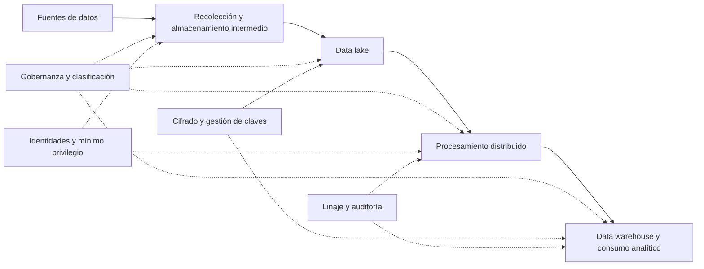

# Clase 6: Seguridad y gobernanza de datos en arquitecturas cloud para Big Data

> **Objetivo académico:** Analizar cómo los principios de seguridad, la responsabilidad compartida, la gobernanza y los controles técnicos se articulan para proteger plataformas de Big Data en la nube, y evaluar sus brechas mediante una matriz de controles sustentada en evidencias.

## 1. Contexto y marco conceptual

### La seguridad como propiedad del ciclo de vida del dato

Los datos constituyen un activo estratégico porque sostienen decisiones y procesos organizacionales. Su utilidad depende de que puedan utilizarse bajo condiciones de seguridad coherentes con su sensibilidad, su significado y las necesidades del negocio. La sesión organiza estas condiciones mediante la tríada de confidencialidad, integridad y disponibilidad.

| Pilar | Significado | Aplicación en Big Data y cloud | Límite que debe reconocerse |
| --- | --- | --- | --- |
| Confidencialidad | Restringir el acceso y la divulgación a sujetos autorizados. | Control de acceso, cifrado, enmascaramiento y protección de claves. | El cifrado no evita que una identidad autorizada abuse de sus permisos. |
| Integridad | Preservar exactitud, coherencia y protección frente a modificaciones indebidas durante el ciclo de vida. | Verificaciones de integridad, trazabilidad de transformaciones y controles sobre cambios. | Un dato sin alteraciones puede ser incorrecto desde su origen. |
| Disponibilidad | Permitir el acceso oportuno de usuarios autorizados a datos y servicios. | Redundancia, recuperación ante desastres y continuidad del negocio. | No todos los conjuntos de datos requieren acceso en tiempo real. |

La disponibilidad debe relacionarse con la criticidad y la oportunidad requerida por cada proceso. Un flujo operativo inmediato y un análisis histórico pueden admitir niveles distintos de latencia e interrupción. La arquitectura debe reflejar estas diferencias.

**Enriquecimiento conceptual:** Integridad no significa impedir cualquier transformación. En una plataforma analítica, limpiar, agregar o normalizar datos puede ser legítimo. Lo exigible es que las transformaciones estén autorizadas, preserven la semántica necesaria y permitan reconstruir cómo se obtuvo el resultado.

### Por qué Big Data amplía la superficie de riesgo

El volumen, la velocidad y la variedad de los datos se combinan con arquitecturas distribuidas. La información atraviesa fuentes, zonas de recolección, almacenamiento intermedio, procesos de transformación, repositorios analíticos y herramientas de consumo. Cada componente incorpora identidades, permisos, configuraciones y conexiones que deben protegerse.

La sesión destaca el almacenamiento intermedio como punto especialmente sensible: puede concentrar datos de numerosas fuentes antes de que reciban controles posteriores de clasificación, transformación o depuración. Su carácter temporal no reduce la necesidad de protección.

El diagrama expresa relaciones conceptuales; no representa una infraestructura desplegada durante la sesión. La protección debe acompañar tanto a los componentes como a los movimientos de datos entre ellos.

## 2. Fundamentos teóricos y arquitectura

### Responsabilidad compartida y modelos de servicio

Migrar a la nube modifica la distribución de responsabilidades, pero conserva la necesidad de controlar identidades, datos, accesos y riesgos. El proveedor y el consumidor asumen responsabilidades distintas según el servicio contratado.

| Modelo | Responsabilidad típica del proveedor | Responsabilidad típica del consumidor |
| --- | --- | --- |
| IaaS: infraestructura como servicio | Proteger la infraestructura física y las capas de infraestructura administradas por el servicio. | Administrar el sistema operativo invitado, aplicaciones, configuraciones, identidades y datos que incorpora. |
| PaaS: plataforma como servicio | Proteger y mantener la plataforma, sus componentes administrados y sus actualizaciones. | Proteger el código y los datos desplegados; configurar permisos y funciones de seguridad disponibles. |
| SaaS: software como servicio | Operar y proteger la aplicación y su infraestructura, dentro del alcance contratado. | Gestionar usuarios, autorizaciones, configuración del servicio y uso adecuado de los datos. |

La sesión presenta una transferencia progresiva de tareas operativas al proveedor al pasar de IaaS a SaaS. La decisión afecta las capacidades técnicas que debe conservar la organización y la forma de verificar los compromisos del proveedor.

**Enriquecimiento conceptual:** Esta transferencia no es una división porcentual ni elimina la responsabilidad del cliente en SaaS. Tampoco debe reducirse la responsabilidad del proveedor IaaS únicamente a los edificios o equipos físicos. La frontera precisa depende del servicio y del contrato. La revisión contractual debe complementarse con la evaluación de configuraciones, accesos, integraciones y evidencias de control.

### Gobierno de datos y automatización

El gobierno o gobernanza de datos establece políticas, estándares, responsabilidades y criterios para utilizar la información de acuerdo con la estrategia corporativa y los requisitos aplicables. La seguridad aporta controles de protección; la gobernanza define también quién decide sobre los datos, bajo qué condiciones y con qué mecanismos de supervisión.

La gobernanza automatizada utiliza tecnología y procesos reproducibles para sostener calidad, seguridad y disponibilidad cuando el volumen de datos vuelve insuficiente la revisión manual. Un mecanismo central es la clasificación automática:

1. Identificar campos o contenidos potencialmente sensibles, como nombres o números de tarjeta.
2. Asignar categorías y etiquetas de sensibilidad.
3. Vincular esas etiquetas con políticas de acceso, cifrado, tratamiento o supervisión.
4. Revisar los resultados y las excepciones para mantener la coherencia de los controles.

**Enriquecimiento conceptual:** La detección automática puede producir falsos positivos y falsos negativos. Una etiqueta es una señal de gobierno; su efecto protector depende de que existan políticas que la utilicen y controles que efectivamente las apliquen. La automatización requiere responsables y validación, especialmente cuando cambia el esquema o el contenido de una fuente.

### Instrumentos regulatorios, estándares y marcos de referencia

La sesión reúne GDPR, HIPAA, ISO/IEC 27001 y NIST como referencias para orientar políticas y evaluar riesgos. Conviene distinguir sus naturalezas para evitar tratarlos como obligaciones equivalentes.

| Referencia | Enfoque | Relación con arquitecturas cloud |
| --- | --- | --- |
| GDPR: Reglamento General de Protección de Datos de la Unión Europea | Tratamiento de datos personales y derechos de las personas. | Influye en acceso, conservación, supresión y medidas de protección de datos personales. |
| HIPAA: legislación estadounidense sobre portabilidad y responsabilidad del seguro médico | Protección de información de salud dentro de su ámbito de aplicación. | Motiva controles sobre acceso, confidencialidad, integridad, disponibilidad y trazabilidad de información de salud protegida. |
| ISO/IEC 27001 | Requisitos para un sistema de gestión de seguridad de la información. | Organiza la gestión de riesgos, responsabilidades, controles y mejora continua. |
| NIST | Institución que publica marcos, estándares y guías técnicas. | Aporta referencias para estructurar gestión de riesgos y controles de ciberseguridad. |

**Enriquecimiento conceptual:** HIPAA y GDPR no se aplican automáticamente a cualquier repositorio de salud. Su aplicabilidad exige analizar sujetos, actividades, jurisdicciones y relaciones contractuales. ISO/IEC 27001 es un estándar de gestión y NIST es una institución con múltiples publicaciones; la transcripción no identifica un documento NIST específico.

La sesión vincula GDPR con anonimización, seudonimización y derecho de supresión. **Enriquecimiento conceptual:** Estas nociones requieren precisión: la seudonimización conserva una posibilidad de vinculación mediante información adicional y no equivale a anonimización. GDPR no exige anonimizar todo dato personal, y el derecho de supresión está sujeto a condiciones y excepciones. La arquitectura debe soportar decisiones justificadas sobre tratamiento y conservación.

### Matriz de controles de la nube

La Cloud Controls Matrix, CCM, se presenta como una herramienta para organizar controles de seguridad por dominios, relacionarlos con requisitos y evaluar la postura de una organización. Su valor consiste en proporcionar un lenguaje común entre responsables técnicos, directivos y proveedores.

En la sesión se utilizan principalmente dominios de identidad y acceso, cifrado y gestión de claves, registros y monitoreo, y seguridad del almacenamiento. También se mencionan continuidad, recuperación ante desastres, gestión de riesgos y cumplimiento.

**Enriquecimiento conceptual:** Una matriz cumplimentada documenta una evaluación; por sí sola no implementa controles ni certifica cumplimiento. Los identificadores abreviados utilizados en el caso no se consideran aquí referencias oficiales verificadas, ya que no se dispone de la versión concreta del catálogo ni de su correspondencia documental.

## 3. Implementación técnica y lógica de negocio

La fuente desarrolla mecanismos y propuestas de arquitectura, pero no contiene un despliegue técnico, código ejecutado ni resultados de pruebas. Las configuraciones descritas deben entenderse como recomendaciones del análisis.

### IAM: identidad, autenticación y autorización

Identity and Access Management, IAM, controla quién puede acceder a los recursos y qué operaciones puede realizar. La sesión lo vincula con el principio de mínimo privilegio: conceder únicamente los permisos necesarios para una función.

En el caso analizado, las medidas propuestas incluyen autenticación multifactor para cuentas privilegiadas, centralización de identidades, revisión de roles, acceso condicional y reducción de permisos excesivos. Las condiciones de acceso pueden considerar dispositivo, ubicación o señales de riesgo, según las capacidades del servicio.

**Enriquecimiento conceptual:** Autenticación y autorización resuelven preguntas distintas: la primera verifica una identidad; la segunda determina sus permisos. La autenticación multifactor, MFA, combina factores de categorías diferentes, como conocimiento, posesión e inherencia. Dos contraseñas siguen perteneciendo a una misma categoría. La biometría es una posibilidad, no un requisito universal de MFA.

**Enriquecimiento conceptual:** Las aplicaciones y procesos automatizados también requieren identidades. Para ellos deben evaluarse identidades de carga de trabajo y credenciales de alcance y duración limitados; la interacción humana con MFA no sustituye la protección de conexiones entre servicios.

### KMS: gestión del ciclo de vida de las claves

Key Management Service, KMS, administra y protege claves criptográficas. La sesión lo presenta como un componente central para superar la gestión manual e inconsistente de claves por equipos separados. Se mencionan AWS KMS, Google Cloud KMS y Azure Key Vault como ejemplos de servicios disponibles en sus respectivos ecosistemas.

Una estrategia de gestión debe considerar:

- Permisos granulares para administrar claves y utilizarlas en operaciones criptográficas.
- Separación de funciones entre administración, uso y auditoría.
- Registro de operaciones y detección de usos anómalos.
- Políticas de rotación y conservación compatibles con los datos protegidos.
- Protección reforzada mediante módulos de seguridad de hardware, HSM, cuando lo justifiquen los requisitos.

**Enriquecimiento conceptual:** Centralizar la gobernanza de claves no significa utilizar una sola clave para todos los datos. Deben preservarse límites entre aplicaciones, entornos y conjuntos de distinta sensibilidad. Además, la rotación de claves criptográficas y el cambio de contraseñas son procesos diferentes; sus frecuencias no deben confundirse ni fijarse sin analizar riesgos y capacidades del servicio.

**Enriquecimiento conceptual:** La disponibilidad de las claves es parte de la disponibilidad de los datos. La pérdida o eliminación irreversible de una clave necesaria puede volver inaccesible información correctamente almacenada. Por ello, retención, recuperación y eliminación deben diseñarse conjuntamente.

### CSPM: evaluación continua de configuraciones

Cloud Security Posture Management, CSPM, identifica configuraciones de riesgo mediante revisión y supervisión del entorno cloud. El ejemplo principal es detectar almacenamiento expuesto públicamente.

Su contribución consiste en convertir revisiones ocasionales en controles repetibles, alertas y, cuando existe una política explícita, acciones de remediación. **Enriquecimiento conceptual:** Detectar una configuración insegura no implica corregirla automáticamente. La corrección requiere permisos, validación y manejo de excepciones para evitar efectos operativos no deseados.

### Protección de los datos según su estado

| Estado | Qué se protege | Medidas discutidas | Consideración técnica |
| --- | --- | --- | --- |
| En reposo | Datos persistidos en objetos, discos y bases de datos. | Cifrado de almacenamiento y, según el caso, de objetos o columnas. | Su eficacia depende también de permisos y protección de claves. |
| En tránsito | Datos que circulan entre componentes del pipeline. | TLS y autenticación mutua mediante mTLS en conexiones apropiadas. | Deben verificarse certificados, configuración y cobertura de todos los saltos. |
| En uso | Datos durante su procesamiento. | Protección del procesamiento sensible, presentada de forma introductoria. | Requiere distinguir tecnologías y sus modelos de amenaza. |

Las intervenciones proponen TLS 1.2 o superior para conexiones entre servicios, aplicaciones y bases de datos, además de configurar los controladores de conexión correspondientes. **Enriquecimiento conceptual:** Las referencias orales a SSL deben interpretarse con cautela: un diseño actual debe seleccionar versiones y configuraciones de TLS admitidas y seguras, evitando protocolos obsoletos. El cifrado de transporte protege el contenido frente a observación y modificación en el canal bajo sus supuestos; no impide toda captura de tráfico ni protege un extremo comprometido.

La explicación de datos en uso sugiere que es posible analizarlos sin descifrarlos. **Enriquecimiento conceptual:** Esto describe una posibilidad asociada al cifrado homomórfico para operaciones compatibles, con restricciones de rendimiento y funcionalidad. La computación confidencial emplea otro enfoque: procesa datos en entornos de ejecución protegidos, donde pueden existir en claro dentro del perímetro protegido. No son mecanismos equivalentes ni eliminan todos los riesgos. La sesión no implementa ninguno.

KMS aporta gestión de claves, pero no sustituye los protocolos de transporte ni proporciona por sí mismo protección del procesamiento en memoria.

### Linaje, auditoría y gobierno centralizado

El linaje permite rastrear el origen, las transformaciones y los destinos de un dato. La sesión lo relaciona con trazabilidad, seguimiento del uso y contraste con políticas organizacionales.

**Enriquecimiento conceptual:** Deben separarse tres capacidades complementarias:

- **Linaje:** explica de dónde procede un resultado y qué transformaciones lo produjeron.
- **Auditoría de acceso:** registra qué identidad actuó sobre qué recurso, cuándo y con qué resultado.
- **Evaluación de políticas:** determina si una configuración o actividad satisface una regla definida.

El linaje aporta contexto para analizar riesgos y dependencias, pero no garantiza por sí mismo detección en tiempo real ni cumplimiento. De modo similar, un checksum puede detectar ciertas alteraciones, pero no acredita exactitud semántica. **Enriquecimiento conceptual:** Frente a manipulación maliciosa también debe protegerse el valor de referencia o utilizarse un mecanismo de integridad autenticada.

Para data lakes y data warehouses se proponen permisos granulares, enmascaramiento o cifrado de datos sensibles, auditoría continua y administración centralizada de políticas. **Enriquecimiento conceptual:** La granularidad disponible depende del motor y del servicio: objeto, tabla, fila y columna no constituyen capacidades uniformes de todos los repositorios. El enmascaramiento modifica la información mostrada y no equivale a cifrado ni a anonimización.

## 4. Análisis crítico de casos y auditoría práctica

### Caso conceptual: Data Health Analytics

El caso describe una plataforma cloud de análisis de datos de pacientes, con data lake, procesamiento y bases analíticas. Sus debilidades recurrentes son autenticación basada únicamente en contraseñas, claves gestionadas de forma descentralizada, registros limitados y almacenamiento público de pruebas.

Se trata de un escenario de análisis. No se presentan inspecciones de una cuenta cloud, evidencias forenses ni verificaciones independientes. Las distintas intervenciones coinciden en las brechas principales, pero discrepan en algunos estados de cumplimiento.

| Área evaluada | Evidencia descrita en el caso | Riesgo asociado | Tratamiento propuesto | Evidencia técnica pertinente para verificarlo |
| --- | --- | --- | --- | --- |
| Identidad y acceso | Cuentas con contraseña como único mecanismo. | Acceso mediante credenciales robadas o comprometidas. | MFA para accesos privilegiados y sensibles; revisión de permisos. | Inventario de cuentas y políticas efectivamente aplicadas. |
| Cifrado | Se menciona cifrado en reposo; la cobertura en tránsito no queda demostrada de forma uniforme. | Exposición en conexiones o componentes no protegidos. | Revisar todos los flujos y exigir TLS donde corresponda. | Configuraciones y validaciones de conexiones entre servicios. |
| Gestión de claves | Cada equipo administra sus claves. | Inconsistencia, pérdida de control y dificultades de rotación. | Gobierno centralizado mediante KMS y separación de funciones. | Inventario de claves, políticas, registros de uso y estado de migración. |
| Auditoría | Se registran principalmente inicios de sesión. | Falta de trazabilidad de accesos, modificaciones y cambios administrativos. | Ampliar registros y correlacionar eventos. | Eventos de lectura, escritura, eliminación, uso de claves y cambios de permisos. |
| Almacenamiento | Recursos de pruebas accesibles públicamente. | Divulgación de información sensible si se utiliza información real. | Bloquear exposición no autorizada y revisar permisos. | Inventario de recursos y verificación de acceso efectivo. |

La columna de evidencias constituye **Enriquecimiento conceptual:** traduce las recomendaciones en criterios observables, sin afirmar que dichas verificaciones hayan sido realizadas.

### Cómo interpretar estados de cumplimiento

Un control puede figurar como cumplido, parcial o no cumplido, pero cada estado necesita alcance y evidencia. La gestión descentralizada de claves fue considerada parcial en algunas intervenciones y no conforme en otras. Esta diferencia puede depender de si el control exige protección básica o gestión mediante un servicio centralizado.

**Enriquecimiento conceptual:** Cuando falta evidencia, conviene distinguir «no verificado» de «no cumplido». Desconocer la configuración de cifrado de una conexión no demuestra su ausencia; tampoco permite declarar cumplimiento. La matriz debe separar observación, inferencia y recomendación.

Las versiones del caso también discrepan sobre si todo el tránsito está cifrado. La conclusión defendible es que su cobertura requiere verificación. De forma análoga, las afirmaciones de incumplimiento legal deben entenderse como alertas de riesgo, no como dictámenes jurídicos acreditados.

### Priorización según exposición y dependencias

Las propuestas convergen en una secuencia de contención, fortalecimiento y mejora continua:

1. Identificar activos, responsables, cuentas y flujos críticos.
2. Contener exposiciones públicas indebidas y proteger accesos privilegiados.
3. Verificar el cifrado en tránsito y corregir conexiones descubiertas.
4. Consolidar gestión de claves, permisos y registros.
5. Incorporar clasificación, controles automatizados y revisiones independientes.

**Enriquecimiento conceptual:** Esta secuencia debe adaptarse al riesgo. El registro básico de eventos es necesario desde la contención, aunque un sistema de correlación más avanzado llegue después. Una exposición activa de información sensible requiere tratamiento inmediato conforme al proceso de incidentes; no debe quedar relegada por un cronograma genérico.

El caso introduce SIEM, sistemas de gestión de información y eventos de seguridad, como mecanismo de centralización y correlación. Su utilidad depende de disponer de eventos suficientes y reglas de detección pertinentes. KMS registra operaciones de claves e IAM administra accesos; ninguno sustituye por sí mismo un SIEM.

### Métricas para verificar el avance

La sesión propone cobertura de MFA, cierre de almacenamiento público, migración de claves y tiempos de detección y resolución. Son indicadores de control y operación; no representan resultados medidos durante la clase.

**Enriquecimiento conceptual:** Una cobertura puede expresarse como:

$$
C = \frac{n_c}{n_a}\times 100\%
$$

Aquí, $n_c$ es el número entero no negativo de elementos que cumplen el control y $n_a$ es el número entero positivo de elementos a los que el control aplica; se exige $0\leq n_c\leq n_a$. El resultado $C$ se expresa en porcentaje. Para MFA, el denominador debe corresponder a las cuentas humanas incluidas en la política y el numerador a aquellas donde el control está efectivamente exigido. Si no existen elementos aplicables, la cobertura se declara no aplicable y no se divide entre cero.

Como ejemplo ilustrativo, si 18 de 20 cuentas privilegiadas tienen MFA exigido, la cobertura es $C=(18/20)\times100\%=90\%$. Este cálculo no describe la plataforma del caso y deja visibles dos cuentas pendientes de protección.

**Enriquecimiento conceptual:** Para incidentes con marcas temporales válidas, el tiempo medio de detección puede definirse como:

$$
\mathrm{MTTD}=\frac{1}{N}\sum_{i=1}^{N}\left(t_{d,i}-t_{0,i}\right)
$$

$N$ es el número entero positivo de incidentes incluidos; $t_{0,i}$ representa el inicio estimado del incidente $i$ y $t_{d,i}$ su detección, medidos en una misma unidad temporal y con $t_{d,i}\geq t_{0,i}$. MTTD se expresa, por ejemplo, en minutos u horas. Su interpretación depende de la calidad con que pueda estimarse el inicio y de qué incidentes se incluyan.

MTTR exige definir explícitamente qué significa resolver: contener, recuperar el servicio o cerrar el incidente. Mezclar estos hitos produce indicadores incomparables. Asimismo, ausencia de accesos indebidos registrados no demuestra ausencia de accesos indebidos si la observabilidad es incompleta.

### Afirmaciones que requieren cautela

La fuente menciona un supuesto incidente externo con una cifra de pacientes, pero no aporta documentación verificable. No se utiliza como evidencia factual. También aparecen períodos de retención diferentes y metas agregadas de cumplimiento sin justificación normativa suficiente.

**Enriquecimiento conceptual:** Retener datos clínicos, conservar registros de auditoría y guardar documentación de cumplimiento son decisiones distintas. No debe atribuirse un período universal a HIPAA ni adoptar una duración por repetición. Cada política requiere identificar el tipo de información, la obligación aplicable y la necesidad operativa. Del mismo modo, un porcentaje global elevado de controles cumplidos puede ocultar una brecha crítica.

## 5. Principios de diseño, buenas prácticas y anti-patrones

| Principio | Buena práctica | Anti-patrón y consecuencia |
| --- | --- | --- |
| Responsabilidad explícita | Documentar obligaciones del proveedor y del cliente para cada servicio. | Suponer que contratar SaaS elimina la responsabilidad sobre usuarios y datos. |
| Mínimo privilegio | Asignar permisos por función y revisar accesos efectivos. | Mantener roles excesivos que amplían el impacto de una cuenta comprometida. |
| Protección integral del pipeline | Cubrir almacenamiento, conexiones, procesos y zonas intermedias. | Proteger únicamente el repositorio final y dejar etapas previas expuestas. |
| Gestión del ciclo de vida de claves | Separar administración y uso; registrar operaciones y prever recuperación. | Cifrar datos con claves dispersas y sin responsables definidos. |
| Configuración segura | Restringir acceso público y supervisar desviaciones mediante CSPM. | Considerar inocuo un recurso público por pertenecer a pruebas. |
| Observabilidad suficiente | Registrar accesos sensibles, modificaciones y acciones administrativas. | Conservar solo inicios de sesión e inferir trazabilidad completa. |
| Gobierno verificable | Relacionar cada control con evidencia, responsable y criterio de aceptación. | Marcar cumplimiento a partir de recomendaciones todavía no implementadas. |
| Protección de entornos de prueba | Utilizar conjuntos de prueba protegidos y adecuados a su finalidad. | Copiar información clínica real a entornos con controles reducidos. |

**Enriquecimiento conceptual:** Los datos sintéticos o una anonimización suficientemente robusta pueden reducir la exposición en pruebas. La tokenización reemplaza valores por tokens y puede conservar mecanismos de correspondencia; no debe presentarse como anonimización automática. La selección depende de la utilidad analítica requerida y del riesgo residual.

**Enriquecimiento conceptual:** Los propios registros de auditoría pueden contener identificadores o información sensible. Deben protegerse frente a lectura indebida y manipulación, evitando registrar secretos y contenido clínico innecesario. La centralización de logs exige también control de acceso, retención justificada y disponibilidad.

La automatización debe reducir inconsistencias y sostener controles repetibles. No elimina la necesidad de revisar políticas, excepciones y efectos operativos. Una configuración central incorrecta puede propagar errores con rapidez; por ello, el gobierno centralizado necesita validación y trazabilidad de cambios.

## 6. Síntesis conceptual y profundización académica

La seguridad cloud para Big Data es una propiedad de extremo a extremo. La confidencialidad requiere limitar acceso y divulgación; la integridad exige transformaciones autorizadas y trazables; la disponibilidad depende de arquitectura, continuidad y acceso sostenible a datos y claves.

La responsabilidad compartida distribuye tareas entre proveedor y consumidor según el modelo de servicio. La gobernanza aporta políticas, responsables y criterios de uso; IAM, KMS, CSPM, cifrado y auditoría materializan partes complementarias de esa estrategia. Ningún servicio aislado cubre todas las dimensiones.

El caso Data Health Analytics muestra que una plataforma puede disponer de cifrado en reposo y seguir expuesta por contraseñas como único factor, claves mal gobernadas, recursos públicos y registros insuficientes. La CCM permite organizar estas brechas, pero su utilidad depende de transformar observaciones en controles verificables y decisiones priorizadas.

**Enriquecimiento conceptual:** Una cadena de razonamiento útil para la evaluación es: requisito aplicable, riesgo identificado, control seleccionado, implementación verificable, evidencia operativa y revisión del riesgo residual. Mantener estos vínculos evita confundir intención, configuración y eficacia.

Las líneas de profundización que se desprenden de la sesión son la delimitación de responsabilidades por servicio, la evaluación de protección de datos en uso, la relación entre linaje y auditoría, y el diseño de métricas que representen controles efectivos. La conclusión metodológica central es que el cumplimiento debe sostenerse con alcance definido y evidencia, mientras que la seguridad debe evaluarse continuamente frente a riesgos concretos.
