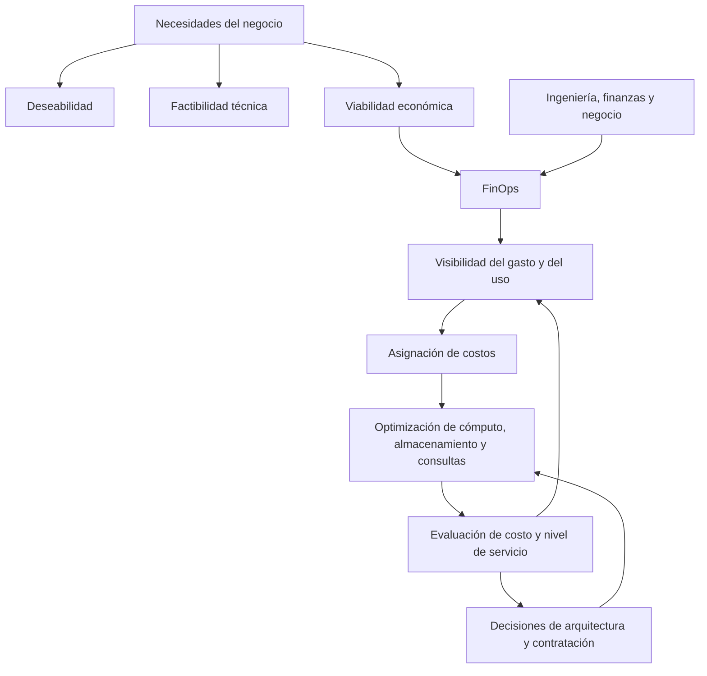

# Clase 7: FinOps y optimización económica de infraestructura para Big Data

> **Objetivo académico:** Analizar la viabilidad económica de soluciones de Big Data en la nube mediante principios de FinOps, selección de modelos de contratación, dimensionamiento de cómputo, gestión del ciclo de vida del almacenamiento y evaluación de costos de procesamiento y analítica.

## 1. Contexto y marco conceptual

Una iniciativa tecnológica requiere articular tres dimensiones: **deseabilidad**, **factibilidad** y **viabilidad**. La deseabilidad identifica una necesidad de los usuarios; la factibilidad determina si existen tecnología, herramientas y capacidades para resolverla; la viabilidad establece si la organización puede financiar y sostener la solución. Su articulación evita que una propuesta técnicamente atractiva resulte ajena a las necesidades del negocio o económicamente insostenible.

La clase se concentra en la viabilidad financiera de infraestructuras para Big Data e inteligencia artificial. La precisión de un modelo o la capacidad de una plataforma no bastan para justificar su adopción: también importa cuánto cuesta producir el resultado y si ese costo es compatible con el valor generado. El contraste planteado entre soluciones que cuestan 100 y 10 por una operación equivalente ilustra una diferencia de eficiencia; no constituye una comparación real documentada.

**Enriquecimiento conceptual:** Una unidad de costo permite relacionar el gasto con una actividad útil del negocio:

$$
c_u = \frac{C}{Q}
$$

Aquí, $C$ es el costo atribuible a un servicio durante un período, expresado en una moneda determinada; $Q>0$ es la cantidad de unidades útiles producidas en ese mismo período; y $c_u$ es el costo por unidad. La unidad puede ser una predicción, una transacción analizada o un terabyte procesado. La comparación requiere mantener explícitos el alcance de costos, la calidad del resultado y el nivel de servicio. Un costo unitario menor no demuestra superioridad si se obtiene sacrificando precisión, disponibilidad o seguridad.

La sesión utiliza una narración sobre Snapchat para ilustrar la relación entre escalamiento y optimización. El aprendizaje conceptual es que una migración de proveedor debe acompañarse de cambios en procesos y uso de servicios. La transcripción no proporciona documentación suficiente para verificar sus cifras ni atribuir causalmente sus resultados a una tecnología específica.

La misma lógica se aplica a la transformación digital: automatizar un proceso ineficiente puede conservar y ampliar sus desperdicios. Conviene revisar actividades, dependencias y necesidades antes de automatizar o migrar, y continuar la optimización durante la operación.

## 2. Fundamentos teóricos y arquitectura

### FinOps como práctica cultural y operativa

FinOps vincula la gestión financiera de la nube con las decisiones de ingeniería y de negocio. Su finalidad es maximizar el valor de la inversión mediante responsabilidad compartida sobre el consumo. No corresponde exclusivamente al área de infraestructura: requiere colaboración entre ingeniería, finanzas y responsables del negocio.

La facilidad para aprovisionar recursos acelera la experimentación, pero también permite acumular gasto sin una revisión proporcional. FinOps introduce visibilidad y criterios económicos en ese proceso de decisión.

Los cuatro pilares desarrollados en la clase son:

| Pilar | Pregunta central | Aplicación |
| --- | --- | --- |
| Visibilidad | ¿Dónde y cómo se consume el presupuesto? | Desglosar gasto y utilización por servicio y recurso. |
| Asignación de costos | ¿A quién corresponde cada consumo? | Identificar equipos, unidades de negocio y responsables mediante etiquetas. |
| Optimización | ¿Qué gasto puede reducirse sin deteriorar el servicio? | Ajustar capacidad, retirar recursos innecesarios y revisar modalidades de contratación. |
| Cultura de costos | ¿Cómo participa cada área en la eficiencia económica? | Incorporar el costo a las decisiones y al seguimiento del rendimiento. |

Estos pilares se refuerzan entre sí. Sin visibilidad resulta difícil identificar oportunidades; sin asignación resulta difícil establecer responsables; y sin una cultura sostenida las mejoras pueden revertirse.

**Enriquecimiento conceptual:** El etiquetado necesita convenciones de nombres, responsables y controles de cobertura. La presencia de una etiqueta no garantiza una asignación correcta. Los servicios compartidos también requieren reglas explícitas para distribuir su costo.

### Desperdicio y sobredimensionamiento

La fuente distingue tres manifestaciones recurrentes de desperdicio:

- **Sobredimensionamiento u oversizing:** contratar más capacidad que la necesaria por temor a una futura insuficiencia.
- **Recursos zombis:** mantener componentes que generan cargos y ya no aportan valor identificable al negocio.
- **Consultas ineficientes:** procesar más datos de los necesarios para responder una necesidad analítica.

Una reserva de capacidad puede estar justificada por picos o requisitos de continuidad. El problema aparece cuando ese margen carece de evidencia o revisión. Por ello, optimizar exige relacionar utilización, demanda y calidad del servicio.

### Ubicación de los servicios en una arquitectura de datos

La clase recupera las capas de ingesta, procesamiento, almacenamiento y análisis. En GCP, Dataflow se sitúa principalmente en el procesamiento de datos, mientras que BigQuery integra almacenamiento analítico y ejecución de consultas SQL a gran escala.

**Enriquecimiento conceptual:** Conviene precisar dos simplificaciones del discurso: BigQuery no es únicamente un repositorio, y Dataflow no abarca por sí solo todo el ciclo hasta la visualización. Dataflow ejecuta transformaciones por lotes o en streaming; sus resultados pueden alimentar BigQuery u otros destinos. La visualización corresponde a herramientas consumidoras posteriores.

## 3. Implementación técnica y lógica de negocio

La sesión presenta configuraciones y estimaciones mediante la calculadora de precios de Google Cloud. No incluye código, despliegues ni mediciones de rendimiento verificables. La implementación expuesta corresponde a la selección de parámetros y a la comparación de escenarios económicos.

### Selección del modelo de contratación

| Modalidad | Característica | Carga compatible | Límite principal |
| --- | --- | --- | --- |
| Bajo demanda | Consumo sin compromiso prolongado. | Demanda incierta, cargas breves y experimentación. | Puede tener mayor precio unitario que alternativas con descuento. |
| Compromiso de uso | Descuento asociado a un compromiso contractual. | Consumo base estable y predecible. | El compromiso puede resultar costoso si la demanda disminuye. |
| Máquinas interrumpibles o Spot | Capacidad descontada que el proveedor puede retirar. | Procesamiento recuperable y tolerante a interrupciones. | Requiere mecanismos de recuperación y admite pérdida temporal de capacidad. |

Los porcentajes de descuento y los plazos mencionados en la fuente son orientativos. No deben convertirse en condiciones universales: su disponibilidad depende del servicio, proveedor y contrato.

**Enriquecimiento conceptual:** Los procesos por lotes y el entrenamiento de modelos no son automáticamente tolerantes a fallos. Para utilizar capacidad interrumpible necesitan, según el caso, puntos de control, reintentos y persistencia de resultados parciales. El descuento debe compararse con el costo de recomputación y con los efectos de retrasar el resultado.

### Dimensionamiento del cómputo

El rightsizing consiste en ajustar los recursos a las necesidades observadas y previstas. La clase expone dos apoyos:

1. **Recomendaciones de tamaño:** emplear el historial de utilización para identificar configuraciones alternativas. La fuente menciona recomendaciones asistidas por algoritmos y el ejemplo de una máquina con utilización de CPU cercana al 20 %.
2. **Configuraciones personalizadas:** seleccionar manualmente CPU virtual y memoria cuando la oferta del servicio lo permita.

**Enriquecimiento conceptual:** Una CPU poco utilizada no demuestra que toda la máquina esté sobredimensionada. La memoria, la entrada/salida, la red o los picos de concurrencia pueden ser las restricciones reales. Una reducción necesita observaciones representativas de la carga y verificación posterior del rendimiento.

### Clases de almacenamiento

La fuente compara clases de Cloud Storage según la frecuencia de acceso esperada:

| Clase | Patrón orientativo | Ejemplos conceptuales |
| --- | --- | --- |
| Standard | Acceso frecuente. | Datos activos y contenido de producción. |
| Nearline | Acceso infrecuente, aproximadamente mensual. | Copias de respaldo y registros consultados ocasionalmente. |
| Coldline | Acceso muy infrecuente, aproximadamente trimestral. | Datos de contingencia y respaldos de consulta excepcional. |
| Archive | Acceso excepcional, aproximadamente anual o menor. | Conservación histórica y documentación de largo plazo. |

Estas frecuencias ayudan a razonar sobre la selección; no constituyen calendarios obligatorios. La clase más fría suele reducir el precio de almacenamiento, pero la decisión debe considerar también recuperación, operaciones, permanencia y transferencias.

### Gestión del ciclo de vida

La gestión del ciclo de vida automatiza transiciones o acciones sobre objetos mediante políticas. La clase ilustra el enfriamiento progresivo con reglas de 30 y 90 días. El principio es conservar los datos activos en una clase adecuada y trasladar los menos utilizados cuando resulte económicamente conveniente.

**Enriquecimiento conceptual:** Deben distinguirse la antigüedad de un objeto y el tiempo transcurrido desde su último acceso. Una regla por antigüedad no demuestra falta de uso. Antes de implementar una política hay que comprobar qué condiciones admite el servicio y qué observaciones de acceso están disponibles. Tampoco puede garantizarse un costo mínimo global únicamente por automatizar transiciones: la recuperación o la eliminación anticipada pueden modificar el resultado.

### BigQuery y capacidad de consulta

Un slot representa capacidad virtual de cómputo empleada por BigQuery para ejecutar consultas; no equivale a una máquina virtual contratada por el usuario.

La fuente contrapone dos enfoques de cobro de consultas:

- **Bajo demanda:** asociado a la cantidad de datos procesados facturables.
- **Por capacidad:** asociado a capacidad de procesamiento y tiempo de uso o contratación, presentado en la sesión como tarifa plana.

**Enriquecimiento conceptual:** No deben confundirse estos modelos con la facturación de máquinas virtuales. En particular, el modelo bajo demanda de consultas no se calcula simplemente por horas de ejecución. La contratación por capacidad tampoco implica necesariamente un importe invariable: depende de la configuración y de las condiciones comerciales. El almacenamiento de BigQuery debe distinguirse del procesamiento de consultas.

### Dataflow y procesamiento distribuido

Dataflow ejecuta flujos de transformación para cargas por lotes y streaming. Su papel económico consiste en utilizar recursos de procesamiento acordes con la demanda del flujo.

**Enriquecimiento conceptual:** La capacidad necesaria depende del volumen de entrada, la complejidad de las transformaciones, la distribución de los datos y los objetivos de latencia. Incrementar trabajadores no garantiza una mejora proporcional si existen cuellos de botella o distribuciones desiguales de carga.

## 4. Análisis crítico de casos y auditoría práctica

### Caso ilustrativo: Analytica Sur

La transcripción presenta una fintech dedicada al análisis predictivo de riesgo crediticio. Su plataforma ingiere aproximadamente 1 TB diario de transacciones y datos demográficos destinados al entrenamiento de modelos. La implementación inicial priorizó rapidez y configuraciones bajo demanda; posteriormente, el gasto motivó una revisión de sostenibilidad.

El caso permite distinguir tres frentes de análisis:

| Frente | Evidencia necesaria | Alternativa de optimización |
| --- | --- | --- |
| Cómputo | Utilización, demanda base, picos y continuidad requerida. | Ajustar tamaño y evaluar compromisos para consumo estable. |
| Almacenamiento | Volumen retenido, frecuencia de acceso y recuperación. | Distribuir datos entre clases y automatizar políticas compatibles. |
| Analítica | Datos procesados, concurrencia y capacidad utilizada. | Revisar consultas y comparar facturación por datos con facturación por capacidad. |

No se dispone de suficientes parámetros y precios para calcular un ahorro total reproducible. El volumen diario de ingesta tampoco equivale al volumen total almacenado.

**Enriquecimiento conceptual:** Bajo el supuesto simplificado de conservar íntegramente cada entrada, sin compresión ni duplicación, el volumen acumulado sería:

$$
V = rD
$$

Aquí, $r\geq 0$ es la tasa constante de ingreso en TB/día; $D\geq 0$ es la retención en días; y $V$ es el volumen retenido en TB. Para el caso descrito, $r=1$ TB/día, pero falta conocer $D$. El modelo deja de ser suficiente cuando existen borrados, réplicas, compresión o conjuntos derivados. Además, una estimación debe mantener coherencia entre unidades decimales y binarias.

### Calculadora de precios: alcance de la estimación

La demostración configura recursos de Compute Engine y Cloud Storage. Entre los parámetros relevantes aparecen las horas mensuales, el sistema operativo, el tipo de máquina, CPU virtual, memoria y descuentos. La cifra de 730 horas se utiliza como aproximación mensual de operación continua; no es la duración exacta de todos los meses.

La calculadora produce una referencia presupuestaria condicionada por sus entradas. No sustituye una factura ni demuestra que una configuración pueda satisfacer la carga. Para comparar escenarios, deben mantenerse constantes las necesidades del negocio y explicitarse las diferencias de capacidad y contratación.

La discusión final aporta una precisión esencial: **almacenar y recuperar datos pueden generar cargos distintos**. Para una estimación realista de una clase fría no basta con introducir el volumen almacenado; también hace falta estimar recuperación y transferencias cuando correspondan.

**Enriquecimiento conceptual:** Una descomposición útil del costo de almacenamiento es:

$$
C_{\text{total}} = C_{\text{capacidad}} + C_{\text{operaciones}} + C_{\text{recuperación}} + C_{\text{transferencia}} + C_{\text{otros}}
$$

Todos los términos son importes monetarios no negativos correspondientes al mismo período. El último agrupa cargos adicionales aplicables, como los asociados a permanencia mínima. Esta identidad organiza la estimación; no establece tarifas ni supone que todos los conceptos apliquen en cada escenario. Evita concluir que una clase es más económica usando solamente su precio por unidad almacenada.

### Corrección del ahorro porcentual

La conversación detecta una inversión en la expresión del ahorro porcentual y reconoce la necesidad de corregirla. No se dispone de los importes completos para reproducir los porcentajes mencionados.

**Enriquecimiento conceptual:** Si $C_0>0$ es el costo de referencia y $C_1\geq 0$ el costo del escenario alternativo, ambos en la misma moneda, período y alcance, el ahorro absoluto es:

$$
A = C_0 - C_1
$$

La fracción de ahorro se obtiene dividiendo esa diferencia por el costo de referencia:

$$
a = \frac{C_0-C_1}{C_0}
$$

Por tanto, el ahorro porcentual es:

$$
a_{\%} = 100\frac{C_0-C_1}{C_0}
$$

$A$ tiene unidades monetarias; $a$ es adimensional; y $a_{\%}$ se expresa en porcentaje. Si $C_1<C_0$, existe ahorro; si ambos son iguales, el ahorro es cero; si $C_1>C_0$, el resultado negativo indica incremento de costo. Con estos supuestos, un ahorro superior al 100 % señala una inconsistencia en datos o cálculo. La expresión no está definida para $C_0=0$.

**Enriquecimiento conceptual:** Ejemplo numérico hipotético: si el costo mensual comparable pasa de 1 000 a 700 unidades monetarias, el ahorro absoluto es 300 y el relativo es $300/1000=0{,}30$, es decir, 30 %. Dividir por el costo nuevo respondería otra pregunta y produciría una base de comparación distinta.

## 5. Principios de diseño, buenas prácticas y anti-patrones

| Principio | Buena práctica | Anti-patrón |
| --- | --- | --- |
| Alineación económica | Relacionar gasto con resultados y calidad del servicio. | Justificar una solución únicamente por su novedad técnica. |
| Visibilidad y responsabilidad | Identificar recursos, consumo y responsables. | Tratar la factura como una caja negra. |
| Dimensionamiento basado en evidencia | Considerar demanda, picos y restricciones múltiples. | Añadir capacidad de forma indefinida por precaución. |
| Contratación acorde con la carga | Reservar compromisos para demanda suficientemente predecible. | Confundir descuento contractual con ahorro garantizado. |
| Recuperabilidad | Usar capacidad interrumpible con mecanismos de recuperación. | Suponer que cualquier carga por lotes tolera interrupciones. |
| Almacenamiento según uso | Evaluar acceso, retención y costo de recuperación. | Conservar todo en Standard o trasladarlo todo a Archive. |
| Automatización gobernada | Aplicar políticas verificadas y observar sus efectos. | Automatizar movimientos basados en supuestos de acceso no comprobados. |
| Comparación consistente | Mantener moneda, período, alcance y nivel de servicio comparables. | Comparar precios parciales como si fueran costos totales. |

La eliminación de recursos zombis requiere comprobar que ya no cumplen una función. Una utilización baja puede corresponder a respaldo, contingencia o demanda estacional.

**Enriquecimiento conceptual:** Una revisión operativa debe contrastar propietario, dependencias y requisitos de continuidad antes de retirar un componente. Asimismo, para reducir datos procesados en BigQuery pueden considerarse selección de columnas, filtros y organización física compatibles con las consultas. Estas medidas deben evaluarse por su efecto real sobre procesamiento y costo, sin asumir que una consulta más breve es necesariamente más económica.

## 6. Síntesis conceptual y profundización académica

La eficiencia económica de una plataforma de Big Data emerge de decisiones relacionadas: arquitectura, capacidad, contratación, retención y patrones de consulta. FinOps proporciona el marco organizativo para conectar esas decisiones con el valor de negocio.

El argumento central de la clase puede expresarse en tres relaciones:

1. La viabilidad requiere comprender tanto el gasto total como el costo de producir resultados útiles.
2. La optimización necesita visibilidad del consumo y responsabilidad sobre su origen.
3. La reducción de costos debe evaluarse junto con rendimiento, continuidad y capacidad de recuperación.

La elección entre demanda, compromiso y capacidad interrumpible depende del comportamiento de la carga. La selección de clases de almacenamiento depende del patrón de acceso y de los costos asociados a recuperar y conservar datos. En analítica, distinguir volumen procesado de capacidad de cómputo evita comparar modalidades de cobro incompatibles.

**Enriquecimiento conceptual:** Una línea de profundización es estudiar la sensibilidad del costo ante cambios de demanda, retención y frecuencia de recuperación. Otra consiste en analizar el equilibrio entre descuentos y flexibilidad: una configuración económica bajo un patrón estable puede dejar de serlo cuando cambian las necesidades. Este análisis convierte una estimación puntual en una decisión revisable, sustentada en evidencia operacional.
