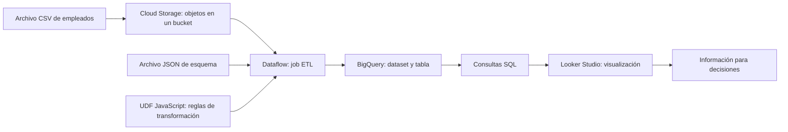

# Clase 8: Pipeline ETL en GCP: de archivos CSV a análisis y visualización

> **Objetivo académico:** Comprender la articulación de Cloud Storage, Dataflow, BigQuery y Looker Studio en un pipeline ETL, relacionando la transformación de registros con su almacenamiento analítico, validación y uso para la toma de decisiones.

## 1. Contexto y marco conceptual

### Del dato disponible a la información utilizable

La sesión aborda un flujo integral de gestión de datos en Google Cloud Platform (GCP). Su propósito es mostrar cómo distintos servicios se coordinan para convertir archivos operacionales en información consultable y comprensible para quienes toman decisiones.

Un **pipeline de datos** es una secuencia de pasos automatizados que obtiene datos desde un origen, aplica operaciones sobre ellos y los entrega a un destino. Su utilidad no reside únicamente en mover archivos: permite sistematizar operaciones que, realizadas manualmente, dificultan el acceso oportuno y consistente a la información.

La arquitectura presentada utiliza un archivo CSV de empleados como origen, Cloud Storage como almacenamiento inicial, Dataflow como servicio de procesamiento, BigQuery como almacén analítico y Looker Studio como herramienta de visualización. La elección responde a la simplicidad de integración del caso; no se plantea como una solución universal para cualquier necesidad de datos.

### Necesidad de negocio del caso

El caso ilustrativo corresponde a Innovación Andina S. A., una empresa tecnológica con operaciones en varios países. Sus registros de dotación y datos demográficos del personal se mantienen en un archivo CSV. El área de recursos humanos dispone de los datos, pero carece de una vía eficiente para consultarlos y obtener indicadores recurrentes.

Entre las preguntas analíticas mencionadas se encuentran el salario promedio por país, la cantidad de empleados por país y la distribución de puestos por departamento. El problema central es la distancia entre conservar registros y disponer de información preparada para el análisis.

**Enriquecimiento conceptual:** Un CSV puede contener datos tabulares y una estructura reconocible. Por ello, la limitación del caso no debe interpretarse como ausencia absoluta de estructura, sino como falta de integración en una plataforma analítica con tipos, reglas de calidad y mecanismos de consulta definidos.

El docente vincula el valor empresarial con los resultados económicos y con decisiones oportunas. **Enriquecimiento conceptual:** En esta arquitectura, ese valor también puede expresarse mediante menor esfuerzo de preparación, mayor trazabilidad y reducción de errores. Ninguno de estos beneficios queda cuantificado en la transcripción.

## 2. Fundamentos teóricos y arquitectura

### Extracción, transformación y carga

El proceso **ETL** comprende tres operaciones:

| Operación | Significado | Aplicación al caso |
|---|---|---|
| Extracción | Lectura de datos desde la fuente | Obtener los registros del CSV almacenado en Cloud Storage |
| Transformación | Limpieza, validación, conversión de tipos y adecuación de estructura | Separar campos, tratar el encabezado y producir registros compatibles con el destino |
| Carga | Inserción de los datos procesados en el destino | Escribir los registros en una tabla de BigQuery |

La transformación constituye un punto crítico porque conecta el formato de origen con los requisitos del destino. Si una columna numérica se interpreta incorrectamente o la salida no coincide con el esquema esperado, la carga puede fallar o introducir datos inadecuados para el análisis.

### Data lake y data warehouse

La sesión distingue dos funciones de almacenamiento:

| Dimensión | Data lake | Data warehouse |
|---|---|---|
| Finalidad destacada | Conservar datos crudos y archivos intermedios | Facilitar consultas analíticas sobre datos estructurados |
| Servicio utilizado | Cloud Storage | BigQuery |
| Organización mostrada | Objetos dentro de buckets | Tablas dentro de datasets |
| Contenido del caso | CSV y archivos auxiliares JSON y JavaScript | Registros de empleados transformados |

Cloud Storage es un servicio de almacenamiento de objetos escalable, seguro y duradero. Su unidad organizativa básica en la sesión es el **bucket**, un contenedor de objetos. Un mismo bucket puede alojar archivos de diferentes formatos.

**Enriquecimiento conceptual:** La conversación utiliza de forma simplificada la equivalencia entre bucket y data lake, e incluye una intervención que lo describe como contenedor de data lakes. Conviene precisar la distinción: el bucket es un recurso de almacenamiento; un data lake es una arquitectura que puede utilizar uno o varios buckets, junto con organización, metadatos, controles de acceso y gobierno. Crear un bucket proporciona una base de almacenamiento, pero no determina por sí solo toda esa arquitectura.

BigQuery se presenta como un almacén de datos administrado que permite ejecutar consultas SQL sobre grandes volúmenes. Dentro del proyecto se organizan **datasets**, y dentro de cada dataset se alojan tablas. La analogía del dataset con una base de datos tradicional facilita la orientación inicial, aunque no establece una equivalencia completa entre ambos modelos.

### Distribución de responsabilidades



El diagrama distingue el flujo de datos de los artefactos de configuración: el CSV contiene registros, el JSON describe la estructura esperada y el JavaScript expresa reglas de transformación.

### Procesamiento administrado y ejecución mediante jobs

Dataflow se caracteriza como un servicio administrado para procesar datos a gran escala. Un **job** es una instancia de ejecución del pipeline: materializa una configuración y permite observar su estado y progreso.

La sesión destaca el escalamiento automático y la reducción de gestión manual de infraestructura. **Enriquecimiento conceptual:** La denominación serverless no implica ausencia de servidores ni de decisiones operativas. El proveedor administra la infraestructura subyacente, mientras que la configuración del procesamiento, los permisos, la capacidad y los costos siguen requiriendo atención.

## 3. Implementación técnica y lógica de negocio

### Recursos y artefactos del flujo

La demostración recorre la consola de GCP y ubica los servicios dentro de un proyecto seleccionado. El identificador del proyecto permite reconocer el ámbito en el que se organizan los recursos; en BigQuery se observa la jerarquía proyecto, dataset y tabla.

La secuencia técnica descrita es la siguiente:

1. Disponer de los servicios necesarios y de un bucket en Cloud Storage.
2. Almacenar el CSV y los archivos auxiliares de esquema y transformación.
3. Preparar el dataset y el destino tabular en BigQuery.
4. Configurar un job de Dataflow a partir de una plantilla.
5. Asociar las referencias a los archivos y la función de transformación.
6. Ejecutar el procesamiento y revisar sus indicadores.
7. Consultar el destino y conectar los datos con Looker Studio.

No se proporciona una configuración completa reproducible: la transcripción alude a contenido mostrado en pantalla, pero no registra el nombre exacto de la plantilla ni los cuerpos íntegros del esquema y del código.

### Contrato estructural mediante JSON

El archivo JSON define los nombres de las columnas y sus tipos. Su función conceptual es establecer la estructura que deben satisfacer los registros cargados en BigQuery.

La sesión compara esta definición con la intención de una instrucción de creación de tabla, aunque expresada mediante un archivo de configuración. No se transcribe la lista completa de campos ni la estructura exacta requerida por la plantilla.

**Enriquecimiento conceptual:** El formato de un archivo de esquema depende del componente que lo consume. Que un archivo sea JSON no garantiza que cualquier plantilla acepte su estructura. Deben coincidir el formato esperado por la plantilla, la salida de la transformación y el esquema efectivo de la tabla.

La descripción de una tabla inicialmente vacía no permite concluir que cualquier plantilla pueda trabajar con una tabla sin esquema. La creación del destino y la aplicación del esquema deben analizarse según el comportamiento concreto de la plantilla utilizada.

### UDF JavaScript y transformación de registros

Una **UDF**, del inglés *User-Defined Function*, es una función definida por el usuario que incorpora lógica específica al procesamiento. En el caso presentado, se almacena en un archivo JavaScript referenciado desde Dataflow.

Las responsabilidades descritas incluyen:

- Interpretar los registros de entrada y separar sus campos.
- Evitar que el encabezado del CSV se trate como un registro de empleados.
- Convertir valores a los tipos requeridos.
- Aplicar reglas de limpieza o validación.
- Generar una salida JSON compatible con BigQuery.

La configuración necesita tanto la ubicación del archivo JavaScript como el nombre de la función que debe invocarse. Referenciar el archivo sin identificar correctamente la función no completa el vínculo entre la plantilla y la lógica personalizada.

**Enriquecimiento conceptual:** La interfaz exacta de entrada y salida de la UDF, así como el mecanismo para descartar registros, dependen de la plantilla. No resulta riguroso deducir una firma de función o un valor de retorno concreto a partir de esta transcripción.

### Referencias a objetos y parámetros del job

Los archivos almacenados en Cloud Storage se identifican mediante URI. La consola permite obtener estas referencias desde el objeto o localizarlo mediante una opción de navegación al configurar el job.

**Enriquecimiento conceptual:** Una referencia habitual a un objeto de Cloud Storage adopta la forma `gs://nombre-bucket/ruta/archivo`. Es un patrón ilustrativo, no una ubicación proporcionada para este caso.

Los campos disponibles cambian según la plantilla seleccionada. La sesión sitúa la referencia al JavaScript y el nombre de función dentro de una sección de parámetros opcionales. Su ubicación en la interfaz no elimina su necesidad funcional cuando el procesamiento depende de esa UDF.

### Verificación en BigQuery y conexión con Looker Studio

BigQuery ofrece una vista previa de los registros y un editor SQL. Ambos permiten revisar si el destino contiene datos después del procesamiento. Desde el entorno mostrado también se presenta la posibilidad de abrir datos en Looker Studio para construir representaciones visuales.

La transcripción describe consultas y gráficos, pero no proporciona sus sentencias completas ni resultados numéricos verificables.

**Enriquecimiento conceptual:** La siguiente consulta ilustra la pregunta sobre empleados por país. Los identificadores son marcadores y no reproducen recursos reales de la sesión:

```sql
SELECT
  pais,
  COUNT(*) AS cantidad_registros
FROM `proyecto.dataset.empleados`
GROUP BY pais
ORDER BY cantidad_registros DESC;
```

Aquí `pais` representa el campo geográfico y `cantidad_registros` cuenta filas por grupo. Solo puede interpretarse como cantidad de empleados si cada fila representa una persona única en el período analizado. Si existen duplicados o múltiples registros diarios de una misma persona, la consulta mide registros y requiere una regla adicional de identificación y temporalidad.

## 4. Análisis crítico de casos y auditoría práctica

### Qué demuestra cada evidencia técnica

El seguimiento del job muestra etapas de procesamiento e indicadores asociados al flujo de registros. La presencia de datos en BigQuery aporta una comprobación del destino, mientras que la visualización permite revisar su disponibilidad para consumo analítico.

**Enriquecimiento conceptual:** Estas comprobaciones cubren dimensiones distintas y deben interpretarse conjuntamente:

| Evidencia | Qué permite revisar | Qué no demuestra por sí sola |
|---|---|---|
| Estado e indicadores del job | Progreso y comportamiento de la ejecución | Corrección semántica de cada registro |
| Vista previa de la tabla | Existencia y apariencia de una muestra | Integridad de todo el conjunto |
| Consultas SQL | Conteos, agrupaciones y coherencia de valores | Adecuación de todas las reglas de negocio |
| Gráfico o dashboard | Disponibilidad visual y comprensión inicial | Actualidad, exhaustividad o calidad total |

Un job finalizado y una tabla poblada son condiciones relevantes, pero insuficientes para afirmar que la necesidad de recursos humanos quedó resuelta.

### Calidad del CSV y coherencia de tipos

La eliminación del encabezado y la conversión de tipos son ejemplos iniciales de control de calidad. **Enriquecimiento conceptual:** Un tratamiento robusto también debe considerar campos vacíos, valores numéricos inválidos, delimitadores dentro de texto entrecomillado y variaciones en los nombres de país o departamento.

Dividir una línea únicamente por comas puede ser insuficiente para un CSV con campos entrecomillados. Del mismo modo, convertir un valor no garantiza que sea válido para el negocio: un salario interpretable como número puede seguir siendo incoherente según su unidad, moneda o período.

### Interpretación de los indicadores de recursos humanos

El salario promedio por país requiere definir qué valores se comparan. **Enriquecimiento conceptual:** Para un país $p$, una media aritmética puede expresarse como:

$$
\bar{s}_p = \frac{1}{n_p}\sum_{i=1}^{n_p}s_{i,p}
$$

Aquí $p$ pertenece al conjunto de países analizados; $n_p$ es un entero positivo que representa el número de observaciones salariales válidas del país; y $s_{i,p}$ es el salario de la observación $i$, expresado en una moneda y un período comunes. La media $\bar{s}_p$ conserva esa misma unidad monetaria y temporal. La expresión no se define para grupos sin observaciones válidas y no determina por sí sola cómo tratar ausencias, duplicados o registros históricos.

Comparar medias entre países exige conocer la moneda y la periodicidad de los salarios. La fuente no especifica estas condiciones, por lo que no permite calcular ni interpretar una comparación internacional concreta.

La distribución de puestos por departamento describe la composición observada del personal. **Enriquecimiento conceptual:** Identificar vacantes requiere además conocer la dotación autorizada o esperada. Un departamento con pocos registros no demuestra, por sí solo, que existan puestos sin cubrir.

### Actualización frente a tiempo real

La sesión asocia la solución con consultas y reportes oportunos, e incluso utiliza la expresión tiempo real. Sin embargo, el flujo descrito parte de un archivo CSV procesado mediante un job.

**Enriquecimiento conceptual:** Este diseño corresponde al procesamiento de un conjunto finito de datos y no acredita por sí mismo una ingesta continua. La actualidad del dashboard depende de la renovación del archivo, la frecuencia de ejecución del pipeline y la actualización de la fuente de visualización. Poder consultar rápidamente una tabla no significa que su contenido se actualice continuamente.

## 5. Principios de diseño, buenas prácticas y anti-patrones

### Alinear la arquitectura con la necesidad

El principio central de la sesión consiste en seleccionar y configurar servicios para resolver una necesidad identificable. La infraestructura debe conducir a información útil para quienes consumen los resultados.

La facilidad de una plantilla reduce el esfuerzo inicial de implementación, pero no sustituye la comprensión de sus entradas, salidas y restricciones. La sesión también reconoce que una ejecución puede requerir revisar configuraciones o compatibilidades; no debe suponerse que cualquier configuración funcionará al primer intento.

**Enriquecimiento conceptual:** De esta arquitectura se desprenden los siguientes criterios de diseño:

| Buena práctica | Justificación | Anti-patrón asociado |
|---|---|---|
| Mantener coherencia entre esquema, UDF y tabla | Evita discrepancias entre valores producidos y tipos esperados | Modificar un artefacto sin revisar los demás |
| Definir la unidad de observación | Permite interpretar correctamente conteos y agregaciones | Equiparar filas con personas sin revisar duplicados o historia |
| Establecer una política para registros inválidos | Facilita detectar pérdidas y errores | Descartar registros silenciosamente |
| Diseñar una carga repetible | Evita inconsistencias al reprocesar un archivo | Reejecutar sin conocer si se duplican los datos |
| Diferenciar almacenamiento crudo y resultados procesados | Facilita trazabilidad y recuperación | Sobrescribir el origen sin conservar una referencia |
| Definir permisos por función | Limita el acceso a datos y operaciones necesarias | Otorgar acceso amplio a información de personal |
| Revisar consumo y configuración de recursos | Vincula rendimiento con costo operativo | Asumir que un servicio administrado carece de costos |

La transcripción no documenta la configuración concreta de estas medidas; se presentan como profundización de los límites del diseño mostrado.

### Visualización con significado de negocio

Looker Studio permite transformar resultados tabulares en dashboards y elementos interactivos. La claridad del gráfico debe acompañarse de una definición inequívoca de la métrica.

**Enriquecimiento conceptual:** Un indicador útil explicita población, período, unidad, filtros y fecha de actualización. La estética no compensa una agregación incorrecta ni una fuente desactualizada. En el caso de personal y salarios, también conviene ajustar el nivel de detalle a los permisos de los consumidores.

## 6. Síntesis conceptual y profundización académica

La clase muestra una arquitectura ETL en la que Cloud Storage conserva archivos, Dataflow ejecuta la transformación, BigQuery organiza el destino analítico y Looker Studio facilita su consumo visual. El pipeline adquiere sentido cuando esa articulación reduce la distancia entre datos operacionales y decisiones de negocio.

La principal relación técnica es la coherencia entre tres contratos: el formato del CSV, las reglas de transformación y el esquema de destino. La principal relación analítica es la correspondencia entre los registros disponibles y el significado atribuido a las métricas.

**Enriquecimiento conceptual:** La evaluación de una solución de este tipo puede distinguir tres niveles: ejecución técnica correcta, calidad y trazabilidad de los datos, y utilidad de la información para el usuario. El éxito en un nivel no garantiza automáticamente los restantes.

La fuente permite comprender los componentes y la lógica general, pero no reconstruir una ejecución exacta ni certificar sus resultados. La profundización pertinente se encuentra en las interfaces de las plantillas, el tratamiento robusto de CSV, la repetibilidad de cargas, la observabilidad y la definición temporal de los indicadores. Estas dimensiones amplían la comprensión del mismo flujo sin alterar el alcance introductorio de la sesión.
